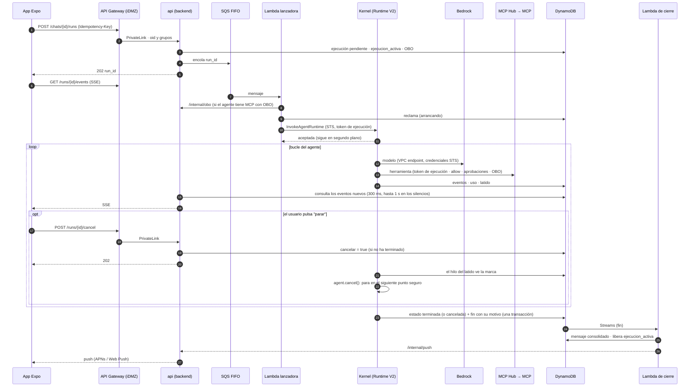
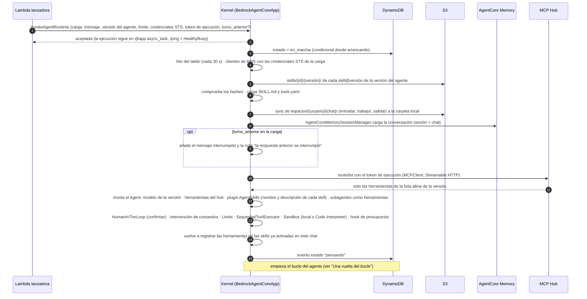
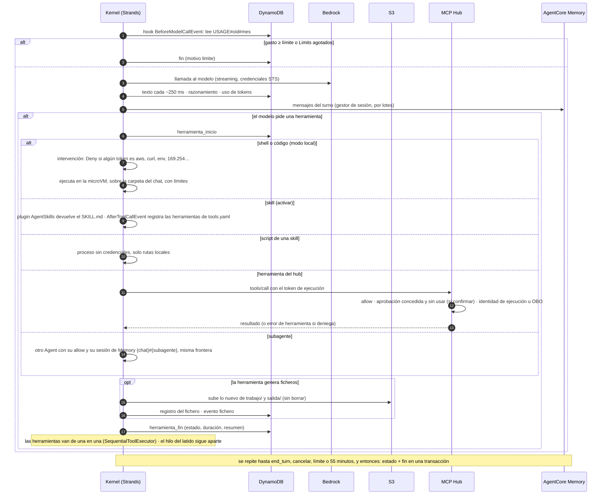
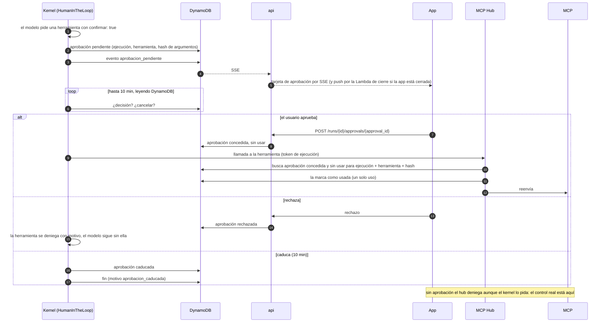
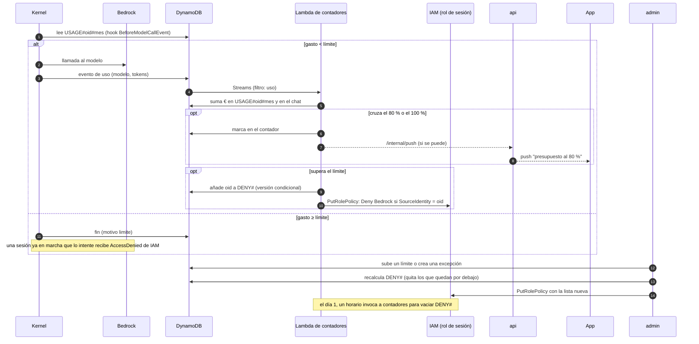
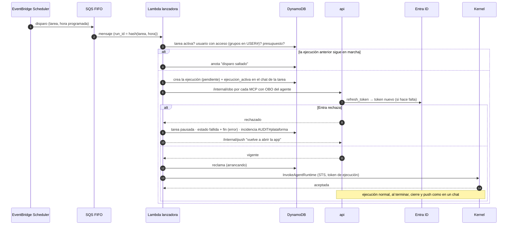

# Arquitectura de agentes

*Diseño de referencia · Expo (iOS y web) + REST · AWS us-east-1*

Cómo viaja un mensaje desde la app Expo (iOS y web) hasta el agente y vuelve: entrada por la cuenta iDMZ, backend sin estado en Fargate que crea la ejecución y la encola, una Lambda que la arranca, un kernel propio (Strands) en AgentCore Runtime V2 que llama a los modelos de Bedrock directamente, y un MCP Hub propio por el que pasan todas las herramientas MCP y que aplica la lista de herramientas permitidas, las confirmaciones y el OBO.

Piezas: Expo + assistant-ui · Entra ID · API Gateway REST + SSE · ECS Fargate · DynamoDB · AgentCore Runtime V2 · MCP Hub propio · Bedrock: Claude · GPT-6.1 Sol · TypeScript + Python · CDK

## Índice

- [Decisiones clave](#decisiones)
- [Diagrama](#diagrama)
- [Recorrido de un mensaje](#recorrido)
- [Inventario y red](#cuentas)
- [La app](#app)
- [El panel](#panel)
- [El agente en ejecución](#agente)
- [Ciclo de vida](#ciclo)
- [Agentes, skills, modelos y conocimiento](#gobierno)
- [Red y aislamiento](#red)
- [MCP Hub](#hub)
- [Identidad y permisos](#identidad)
- [Operación](#operacion)
- [Construcción y despliegue](#construccion)
- [Entorno de pruebas](#pruebas)
- [Migración](#migracion)
- [Por verificar](#verificar)

<a id="decisiones"></a>

## Decisiones clave

### Motor y modelos

- Un solo motor: kernel propio con Strands (Python) en AgentCore Runtime V2, en modo VPC, en us-east-1. Sin AgentCore Gateway, Identity ni interceptor; sin AgentCore Browser ni búsqueda web (el Web Search gestionado solo se expone detrás de un Gateway, así que tampoco); sin LiteLLM ni Dev Workbench.
- Inferencia directa a Bedrock con credenciales STS por ejecución, limitadas a los modelos de la versión del agente; el gasto por usuario se corta con una denegación de IAM por `aws:SourceIdentity`.
- Toda conversación pasa por un agente; no hay chat directo con el modelo. Un modelo por agente (y por subagente) en cada versión.
- Código del modelo, según el agente: en la propia microVM (shell de Strands) o en Code Interpreter en una VPC sin DNS. El modo SANDBOX de Code Interpreter no aísla (la guía de AWS lo describe con "acceso externo limitado": llega a S3 y resuelve DNS; Unit 42 y BeyondTrust demostraron que sirve para sacar datos), por eso va en VPC.

### Backend, herramientas e identidad

- Dos servicios TypeScript sin estado en Fargate: `api` (lo que usa la app: chats, SSE, ficheros, OBO, rutas internas) y `admin` (lo que usa el panel), en procesos y con permisos distintos. En el documento, "el backend" es `api`.
- Un solo lanzador: toda ejecución, de chat o de tarea programada, entra por una cola SQS FIFO y la arranca la Lambda lanzadora, la única que asume el rol de sesión, firma el token de ejecución y llama a `InvokeAgentRuntime`. `api` crea la ejecución y la encola; los reintentos son los de la cola.
- MCP Hub propio para todas las herramientas MCP; los MCP propios siempre en Fargate, en la única VPC conectada a la red corporativa. Los scripts de skills corren en el kernel como herramientas tipadas.
- OBO solo en el backend: siembra una vez y renueva bajo demanda; el hub se lo pide por `/internal/obo`. Ni el kernel ni el hub ven el token de Entra del usuario.
- Ejecuciones de una hora como máximo, credenciales STS sin renovar; una Lambda vigilante limpia las que mueren y la Lambda de cierre (Streams) las cierra.

### Clientes y construcción

- Una app Expo (iOS y web) con assistant-ui y caché local cifrada; panel Next.js con shadcn/ui que solo es interfaz.
- Entrada por una cuenta iDMZ (API Gateway REST con streaming y autorizador de Entra); Akamai solo delante del panel y de la app web.
- Todo en CDK, en un monorepo (TypeScript + Python) con contrato compartido en JSON Schema.
- Entorno de pruebas en una sola cuenta, con las VPC y paradas programadas; lo que no se ha probado contra AWS está en [Por verificar](#verificar).

### Glosario

| Término | Qué es |
|---|---|
| **Ejecución** | Un turno del agente: desde que el backend recibe un mensaje (o se dispara una tarea) hasta el evento `fin`. Tiene `run_id` (en un chat, un UUID; en una tarea, `hash(tarea, hora programada)`; en los dos casos es también el id de sesión del runtime, que exige 33 caracteres o más), estado y dura una hora como máximo. |
| **Sesión del runtime** | La microVM de AgentCore que corre una ejecución; una por ejecución (`runtimeSessionId` = `run_id`). |
| **Credenciales STS de la ejecución** | Credenciales de AWS de una hora que la Lambda lanzadora crea para esa ejecución (en las tablas, "credenciales STS de la sesión"), limitadas a su agente, su usuario y su chat. |
| **Token de ejecución** | Token firmado con KMS por la Lambda lanzadora que identifica la ejecución ante el MCP Hub y el backend: usuario, grupos, agente y versión. No es IAM ni es el token de Entra. |
| **Identidad de ejecución / OBO** | Dos formas de identificar al usuario ante un MCP: pasarle los datos del token de ejecución (el MCP usa su propio rol) o darle un token OBO de Entra con la audiencia del MCP (el MCP actúa como el usuario). |
| **Sesión de Memory** | La conversación de un chat en AgentCore Memory: `sessionId` = chat (y `{chat}#{subagente}` para cada subagente). No confundir con la sesión del runtime, que es una ejecución. |
| **`turno_anterior`** | Campo opcional de la carga con el mensaje y el motivo de la ejecución anterior del chat cuando murió o se canceló, para que la conversación del modelo cuadre con la del usuario. |
| **Espacio del chat** | El prefijo `espacios/{usuario}/{chat}/` de S3 (`entrada/`, `trabajo/`, `salida/`) que el kernel sincroniza con su carpeta local. La conversación del agente no va aquí: está en AgentCore Memory. |
| **Skill** | Instrucciones, scripts y `tools.yaml` versionados desde el panel; sus scripts se exponen al modelo como herramientas al activar la skill. |
| **Subagente** | Otro agente de Strands dentro del mismo kernel, expuesto al principal como herramienta, con su propia lista `allow`. |
| **Mensaje consolidado** | El elemento del chat que guarda la Lambda de cierre al terminar una ejecución: texto, tarjetas resumidas, ficheros, coste y valoración. Es lo que ve el usuario; la conversación que ve el modelo está en AgentCore Memory, con el chat como sesión. |
| **`ejecucion_activa`** | Atributo del chat, con el `run_id`, que impide dos ejecuciones a la vez; lo pone el backend y lo borra la Lambda de cierre al ver el `fin` de esa misma ejecución. |

<a id="diagrama"></a>

## Diagrama

Los números son los pasos del recorrido de un mensaje, justo debajo. Las líneas discontinuas son control: autenticación, tokens OBO, el aviso de push y la lanzadora hacia el backend. No se dibuja la VPC mínima de Code Interpreter (ver "Las cuatro VPC").


Leyenda: Cuenta iDMZ · Cuenta de la plataforma · AgentCore y kernel · Flujo de datos · Control / autenticación · Paso del recorrido

<a id="recorrido"></a>

## Recorrido de un mensaje

Los doce pasos, como secuencia (los números de la lista de abajo son los del diagrama de arquitectura; la secuencia lleva su propia numeración por mensaje):



1. **Inicio de sesión.** La app Expo entra con Entra ID (OIDC + PKCE, MFA y acceso condicional) y obtiene un token para la API de la plataforma. [La app](#app).
2. **Envío.** `POST /chats/{id}/runs` con `Idempotency-Key` al API Gateway REST de la iDMZ; el autorizador Lambda valida el JWT y pasa `oid` y grupos.
3. **Entrada a la plataforma.** PrivateLink hasta el NLB interno y una réplica cualquiera del backend en Fargate.
4. **Control y alta.** El backend comprueba que el usuario puede usar el agente (grupos de Entra) y que le queda presupuesto (si no, 402); crea la ejecución (`pendiente`) y pone `ejecucion_activa` en el chat (si ya hay una, 409); siembra los tokens OBO que falten; deja un mensaje en la cola SQS FIFO con el `run_id` y responde `202 {run_id}`. [Ciclo de vida](#ciclo), [Identidad y permisos](#identidad).
5. **Arranque.** La Lambda lanzadora lee el mensaje, reclama la ejecución (`arrancando`), emite las credenciales STS y el token de ejecución, pide a `api` que el OBO esté vigente y llama a `InvokeAgentRuntime` con una sesión nueva por ejecución; el kernel acepta al instante y sigue en segundo plano (`/ping` en `HealthyBusy`). Si AgentCore rechaza por cuota, el mensaje vuelve a la cola y se reintenta en segundos. En la carga van el mensaje, la versión del agente, el límite de presupuesto, las credenciales y el token de ejecución (y, si la ejecución anterior del chat murió o se canceló, su mensaje y motivo); la conversación anterior la recupera el kernel de AgentCore Memory (sesión = chat).
6. **Modelo.** El kernel (Strands) llama a Bedrock por los VPC endpoints de la VPC de agentes con las credenciales STS, limitadas a los modelos de esa versión; antes de cada llamada mira el gasto del mes. El corte que no depende de él es la denegación de IAM por `aws:SourceIdentity`. [El agente en ejecución](#agente).
7. **Herramientas MCP.** Todas por el MCP Hub (VPC de integraciones, por PrivateLink) con el token de ejecución: lista `allow`, aprobaciones, identidad de ejecución u OBO (pedido al backend), auditoría, y falla cerrado. [Red](#red), [Identidad](#identidad).
8. **Skills, código y ficheros.** Los scripts de skills corren en el kernel como herramientas tipadas; el código del modelo, en la microVM (modo local) o en Code Interpreter; el kernel sincroniza el espacio del chat con S3 y emite `fichero` por cada fichero nuevo. [El agente en ejecución](#agente).
9. **Eventos y coste.** El kernel escribe en DynamoDB, bajo su ejecución, el texto (cada ~250 ms), las herramientas, los ficheros, el uso de tokens y un latido cada 30 s; la Lambda de contadores suma el gasto del mes por Streams.
10. **Lectura en la app.** `GET /runs/{id}/events` (SSE) en cualquier réplica: el backend consulta los eventos nuevos de esa ejecución en DynamoDB por conexión abierta (una consulta por clave, barata) con espera creciente: 300 ms mientras llegan eventos y, en los silencios, 500 → 800 → 1 000 ms, con tope en 1 s (hasta 5 s durante una aprobación pendiente), volviendo a 300 ms en cuanto llega algo; el streaming de texto no lo nota y se ahorra alrededor de la mitad de las consultas; reconecta con `Last-Event-ID`; `POST /runs/{id}/cancel` para parar; ficheros con URL prefirmada.
11. **Fin.** El kernel escribe `fin` (con motivo, uso y coste). La Lambda de cierre, al verlo, guarda el mensaje consolidado en el chat, borra `ejecucion_activa` (salen los mensajes en cola de la app) y avisa al backend. [Ciclo de vida](#ciclo).
12. **App en segundo plano.** El backend envía la notificación por APNs o Web Push (salida por Netskope). Los chats no visibles se actualizan con `GET /chats?updated_since=…`.

<a id="cuentas"></a>

## Inventario por cuenta y red

### Cuenta iDMZ

- API Gateway REST regional con response streaming, con su VPC Link y el NLB que apunta al endpoint de PrivateLink
- Autorizador Lambda para tokens de Entra
- Endpoints de PrivateLink hacia el NLB interno de la plataforma
- Balanceador web (panel de administración, `admin` y app web), detrás de Akamai, con PrivateLink hacia la plataforma

### Cuenta de la plataforma

- Salida a internet solo por Netskope, y por dos caminos: la VPC de servicios (Entra, APNs y Web Push) llega por Transit Gateway únicamente a la VPC de salida de la empresa, donde está el túnel a Netskope, sin rutas hacia la red interna; la VPC de integraciones MCP sale por la red corporativa (Entra, para que los MCP validen el token OBO y hagan el suyo hacia APIs internas, y las APIs que usen los MCP). La VPC de agentes no tiene salida ninguna.
- Cuatro VPC sin IGW ni NAT: la de servicios (backend, panel, app web y Lambdas) y la de agentes (solo los runtimes), cada una con sus VPC endpoints; y la de integraciones MCP y la de Code Interpreter, descritas abajo. Solo la de integraciones llega a la red interna; servicios, solo a la salida de la empresa
- Dos servicios en ECS Fargate: `api` (el backend: chats, ejecuciones y SSE, ficheros, tareas, OBO, rutas internas y push) y `admin` (solo para el panel: agentes, skills, Knowledge Bases, modelos, presupuestos, usuarios, evaluaciones y auditoría), cada uno con su rol de IAM; una cola SQS FIFO por la que entra toda ejecución (chats desde `api`, tareas desde Scheduler) y la Lambda lanzadora que las arranca; las Lambdas de contadores y cierre sobre el stream de DynamoDB; y una Lambda vigilante de ejecuciones; ejecuciones de una hora como máximo, sin renovar credenciales STS
- App web: el export estático de Expo servido por nginx en ECS Fargate, por el mismo camino que el panel (Akamai → ALB del iDMZ → PrivateLink). Desde el navegador, la app llama a la API del iDMZ como la app de iOS (con CORS para el dominio web).
- VPC de integraciones MCP: el MCP Hub y los servidores MCP propios (ECS Fargate), y la única conexión a la red corporativa (Transit Gateway, Direct Connect o VPN). El kernel llega al hub por un VPC endpoint de PrivateLink, y el hub al backend por otro, solo para pedir tokens OBO; no hay rutas entre las VPC
- VPC de Code Interpreter: mínima, solo para sus sesiones, sin endpoints, rutas ni NAT y con el DNS desactivado
- Panel de administración (Next.js con shadcn/ui, en ECS Fargate). Acceso: administradores → Akamai → iDMZ → panel, con Entra y el grupo de administradores. Solo es la interfaz: la lógica y los permisos viven en el servicio `admin`, que no existe en el API Gateway.
- DynamoDB, dos tablas: la principal (chats y mensajes, ejecuciones con sus eventos y ficheros, aprobaciones, tareas programadas, gasto y límites, tokens OBO, claves de idempotencia, agentes, versiones y catálogo de herramientas) y la de auditoría, en la que cada pieza escribe bajo su prefijo (el kernel, solo bajo `AUDIT#kernel#`); y dos Lambdas que leen su stream: contadores (suma el gasto) y cierre (cierra las ejecuciones)
- S3 (espacios de los chats, skills y documentos para RAG), KMS, CloudWatch y Secrets Manager (secreto de la app de Entra y credenciales de los MCP)
- Amazon Bedrock: los modelos del catálogo (Claude, GPT-6.1 Sol…), invocados directamente por el kernel con las credenciales de la sesión
- Bedrock Knowledge Bases: índice de los documentos para RAG, administrado desde el panel (documentos, metadatos, sincronización)

### AgentCore (gestionado, us-east-1)

- Un solo motor: AgentCore Runtime, versión de plataforma V2 (restaura cada sesión desde una instantánea), con el kernel propio (Strands), en modo VPC en la VPC de agentes
- AgentCore Evaluations: calidad de los agentes, online sobre las trazas del kernel y en batch desde el panel
- Code Interpreter (en su propia VPC sin DNS, para el código libre de los agentes que lo usan) y Memory, llamados directamente por el kernel. Sin Browser ni búsqueda web: los agentes no salen a internet. Sin AgentCore Gateway ni AgentCore Identity: las herramientas pasan por nuestro MCP Hub, que pide los tokens OBO al backend, el único que los guarda y los renueva.

### Las cuatro VPC

| VPC | Qué contiene | Endpoints | Salida | DNS Firewall permite | Quién llega |
|---|---|---|---|---|---|
| **Servicios** | Backend (`api`), `admin`, panel, app web, NLB interno y las Lambdas | Los servicios de AWS que usan: DynamoDB y S3 (gateway), AgentCore (plano de datos para `InvokeAgentRuntime` y `StopRuntimeSession`, y control), Bedrock (títulos), STS (`AssumeRole` de la lanzadora), IAM (`PutRolePolicy`), KMS, Secrets Manager, SQS, Scheduler, Logs… | Transit Gateway solo hacia la VPC de salida de la empresa (túnel a Netskope): Entra, APNs, Web Push. En pruebas, un NAT Gateway | AWS, Entra, APNs, Web Push | La iDMZ por PrivateLink; la VPC de integraciones por PrivateLink, solo `/internal/obo` |
| **Agentes** | Solo los runtimes del kernel | `bedrock-runtime`, `bedrock-mantle`, AgentCore (Code Interpreter, Memory), el MCP Hub (PrivateLink), DynamoDB y S3 (gateway), Logs, X-Ray, ECR | Ninguna | `*.amazonaws.com` de us-east-1, `bedrock-mantle.us-east-1.api.aws` y el hub; todo lo demás bloqueado | Nadie por red: la lanzadora llama a la API de AgentCore |
| **Integraciones MCP** | MCP Hub, MCP propios y Cloud Map | `bedrock-agent-runtime` (Knowledge Bases), DynamoDB (tabla principal: catálogo y versiones en lectura, aprobaciones en lectura y marcado; tabla de auditoría bajo `AUDIT#hub#`), KMS (verificar el token de ejecución), Secrets Manager, Logs y métricas de CloudWatch | Red corporativa (Transit Gateway, Direct Connect o VPN) y, por ella, Netskope | AWS, Entra y los dominios internos | El kernel por PrivateLink; los MCP externos, por la red corporativa |
| **Code Interpreter** | Las sesiones de Code Interpreter | Ninguno | Ninguna; DNS desactivado | — | AgentCore por su plano de control (ficheros por la API) |

<a id="app"></a>

## La app (Expo + assistant-ui)

Una sola app Expo para iOS y web (react-native-web) con la interfaz de chat de `@assistant-ui/react-native`. assistant-ui solo pinta y gestiona la interacción: los chats, los mensajes, el coste y los ficheros viven en nuestro backend, así que lo mismo se ve en el iPhone y en el navegador.

### Entrar y elegir agente

- **Inicio de sesión** con Entra (OIDC + PKCE con `expo-auth-session`), con MFA y acceso condicional. En iOS el token se guarda en el llavero (`expo-secure-store`); en web, en memoria con renovación silenciosa.
- **Nuevo chat → catálogo de agentes**: solo los que permiten los grupos de Entra del usuario, cada uno con nombre, descripción, icono y lo que sabe hacer (buscar en documentos, ejecutar código, generar ficheros). El chat queda ligado a ese agente.
- **Ajustes**: perfil, idioma, tema claro u oscuro, notificaciones, memoria y cerrar sesión.

### Chats

- **Lista de chats** en un menú lateral: búsqueda, renombrar, archivar y borrar. El título lo propone el backend con un modelo barato tras el primer mensaje.
- **Conversación en streaming**: texto en Markdown, tarjetas para lo que hace el agente ("Buscando en documentos…", "Ejecutando código…", "Generando el informe…") y el razonamiento plegado si el modelo lo da.
- **Encolar mensajes**: mientras el agente trabaja, el usuario puede seguir escribiendo. Los mensajes quedan en una cola en la app, visibles en la caja de texto, donde se pueden reordenar o quitar, y se envían en orden cuando termina la ejecución. La cola se guarda en la caché local, así que sobrevive a cerrar la app.
- **Cancelar** con el botón de parar (marca de cancelación en el backend); **reintentar** y **copiar** en cada respuesta.
- **Seguir más tarde**: si la app pasa a segundo plano la ejecución continúa; al volver, la app reconecta el SSE con `Last-Event-ID` y recupera lo que falte. Si una tarea larga termina con la app cerrada, llega una notificación.

### Caché local de chats

- **El backend es la fuente de verdad; la app guarda una copia** de la lista de chats y de los mensajes de los chats abiertos, así se abren al instante y sin conexión se puede leer.
- **Solo pide lo nuevo:** la lista con `GET /chats?updated_since=<fecha>` (incluye los borrados, para quitarlos) y cada chat con `GET /chats/{id}/messages?after=<seq>`. Lo que llega por SSE se añade a la copia.
- **Dónde:** en iOS, SQLite (`expo-sqlite`) cifrado con SQLCipher, con la clave en el llavero; en web, IndexedDB, limitado a los últimos 30 días y con la opción "no guardar en este equipo".
- **Seguridad:** al cerrar sesión o cambiar de usuario se borra todo. Los ficheros no se guardan: solo sus datos (nombre, tipo, tamaño) y se descargan al abrirlos.

### Ficheros

- **Adjuntar** PDF, imágenes, Excel/CSV o Word desde el selector de documentos o la cámara. La app pide al backend una URL prefirmada, sube el fichero directamente a S3 (`espacios/{usuario}/{chat}/entrada/`) y envía solo la referencia con el mensaje; el kernel lo trae con su sync y, si hace falta, lo copia a Code Interpreter. Límite de tamaño y tipos permitidos por agente.
- **Artefactos**: la app se entera por el evento `fichero` del SSE (o, si estaba cerrada, al reconectar con `Last-Event-ID` o al sincronizar el chat). Cada fichero aparece como tarjeta en el mensaje (nombre, tipo, tamaño, vista previa de PDF e imágenes) con descargar y compartir (hoja de compartir de iOS). Las descargas usan URLs prefirmadas de pocos minutos.
- **Mis ficheros**: todos los artefactos del usuario, por chat, con filtro y borrado.

### Coste

- **Lo que llevas este mes**: en la cabecera y en ajustes, "12,40 € de 50 €" con una barra, el límite y de dónde viene (por defecto, tu grupo o una excepción).
- **Coste de cada chat** en su cabecera (la Lambda de contadores también suma por chat).
- **Avisos**: al 80 % un aviso en la app y una notificación; al 100 % la caja de texto se bloquea con un mensaje claro ("has alcanzado tu límite mensual; se renueva el día 1") y cómo pedir una ampliación. El backend rechaza los mensajes nuevos; IAM corta lo que ya está en marcha.

### Memoria y valoración

- **"Lo que recuerdo de ti"**: las preferencias y los hechos que la plataforma guarda en AgentCore Memory para ese usuario, comunes a todos los agentes, con borrar uno o todos y la opción de desactivar la memoria larga.
- **Valorar respuestas**: pulgar arriba o abajo y comentario opcional. Se guarda en el mensaje consolidado del chat (dura 12 meses, no los 90 días de la ejecución), se ve en el panel por agente y versión, y las malas respuestas sirven para ampliar los conjuntos de pruebas de las evaluaciones.

### Tareas programadas

- **Crear**: el usuario elige un agente de los que puede usar, escribe la instrucción ("cada lunes a las 8, resume las ventas de la semana y mándame el PDF") y la frecuencia (diaria, semanal, mensual o una vez, con hora y zona horaria).
- **Resultado**: cada tarea tiene su propio chat; cada ejecución añade un mensaje con sus ficheros y llega una notificación. El usuario puede seguir conversando sobre el resultado.
- **Gestionar**: lista de tareas con próxima ejecución y estado; pausar, editar, borrar y "ejecutar ahora". Si una tarea se pausa sola (sin presupuesto, sin acceso al agente, tokens OBO rechazados por Entra o varios fallos seguidos), la app dice por qué.

### Notificaciones y voz

- **Push**: tarea larga terminada, aprobación pendiente, aviso de gasto al 80 % y al 100 %. En iOS por APNs (el backend sale por Netskope); en web, Web Push si el navegador lo permite. La app registra el dispositivo al iniciar sesión.
- **Dictado**: botón de micrófono en la caja de texto; en iOS con el reconocimiento de voz del sistema y en web con la Web Speech API donde exista. Solo dictado, no conversación por voz.

### Cómo se conecta assistant-ui

| Pieza de assistant-ui | Con qué la conectamos |
|---|---|
| `useRemoteThreadListRuntime` + `RemoteThreadListAdapter` | La lista de chats: `list`, `initialize`, `rename`, `archive`, `delete` y `generateTitle` sobre `/chats` del backend. |
| `useExternalStoreRuntime` (uno por chat) | Los mensajes los tenemos nosotros (construidos a partir de los eventos SSE y del historial del backend); `onNew` crea la ejecución (`POST /chats/{id}/runs`) y `onCancel` la cancela. Así la reconexión y el historial no dependen de assistant-ui. |
| Partes de mensaje y Tool UI | Cada evento del kernel se convierte en una parte: texto, razonamiento, llamada a herramienta (con su tarjeta propia para `buscar_documentos`, código y ficheros) y fichero generado. |
| Adaptador `attachments` | Uno propio: lee el fichero desde su URI de Expo, lo sube a S3 con la URL prefirmada y añade la referencia al mensaje. |
| Adaptadores `feedback` y `dictation` | `POST /chats/{id}/messages/{seq}/feedback` (la valoración cuelga del mensaje consolidado, que dura más que la ejecución); reconocimiento de voz de iOS y Web Speech API. |
| Adaptador `queue` | Cola de mensajes durante una ejecución con `createMessageQueue`: avisa a la cola cuando empieza (`notifyBusy`) y termina (`notifyIdle`) la ejecución, y la caja de texto la muestra con `ComposerPrimitive.Queue`. El backend sigue aceptando un mensaje a la vez por chat. |
| Caché local | Los mensajes que pasamos a `useExternalStoreRuntime` salen primero de la copia local y se completan con lo nuevo del backend y del SSE. |
| Fuera de assistant-ui | Coste (`GET /me/usage`), catálogo de agentes (`GET /agents`), memoria (`/me/memory`), ficheros (`/me/files`) y dispositivos para push (`POST /me/devices`): pantallas propias con TanStack Query. |

### Eventos del SSE

El kernel escribe en DynamoDB todo lo que va haciendo el agente, no solo el texto, y la app lo pinta como tarjetas dentro del mensaje. Cualquier evento puede llevar el atributo `subagente` con el nombre del subagente que lo emite; la app lo pinta como tarjeta plegada dentro de la herramienta que lo llamó.

| Evento | Qué lleva | Cómo se ve en la app |
|---|---|---|
| `texto` | Fragmentos de la respuesta (agrupados cada ~250 ms) | El texto escribiéndose |
| `razonamiento` | Resumen del razonamiento, si el modelo lo da y el agente lo permite | Bloque plegado "Pensando…" |
| `herramienta_inicio` | Nombre, etiqueta legible ("Buscando en documentos") y resumen de los argumentos | Tarjeta con indicador "en curso" |
| `herramienta_fin` | Estado (bien o error), duración y resumen corto del resultado; en las búsquedas, las citas (título y enlace) | La tarjeta pasa a hecha o a error |
| `skill_activada` | Qué skill se activó | Línea discreta en la tarjeta |
| `aprobacion_pendiente` | Herramienta, resumen de los argumentos y hasta cuándo se espera | Tarjeta de aprobación con aprobar y rechazar |
| `fichero` | Nombre, tipo, tamaño y referencia del fichero | Tarjeta del fichero con vista previa |
| `estado` | "Esperando al modelo", "reintentando", "esperando aprobación"… | Indicador bajo el mensaje |
| `aviso` | Límite alcanzado: el kernel termina la ejecución con `fin` (`motivo = limite`); el aviso del 80 % llega por push y por `GET /me/usage`, no por el SSE | Aviso en la app |
| `error` | Un error recuperable o no (texto para el usuario); si no se puede seguir, le sigue `fin` | Aviso en el mensaje |
| `fin` | Siempre el último evento de una ejecución: `motivo` (`ok`, `cancelado`, `error`, `limite`, `tiempo`, `aprobacion_caducada`, `interrumpida`), uso y coste final. Lo escribe el kernel; si la ejecución muere, la Lambda vigilante. | Fin del mensaje; la Lambda de cierre cierra la ejecución al verlo |

### Qué no viaja por el SSE

- **Resultados de herramientas**: pueden ser grandes o sensibles (fragmentos de documentos, respuestas de APIs); solo un resumen y, en búsquedas, las citas.
- **Argumentos**: solo un resumen, sin tokens ni datos internos.
- **Razonamiento**: como mucho el resumen, y solo si el agente lo permite.

### Cómo se generan

- Texto y llamadas a herramientas: los eventos de streaming de Strands.
- Inicio y fin de cada herramienta: sus hooks (`BeforeToolCallEvent` y `AfterToolCallEvent`).
- Cada herramienta declara su etiqueta y cómo resumir su resultado: las de skills en `tools.yaml`, las de los MCP en su registro del hub, definido en CDK (el panel las muestra).

### Historial

- Al terminar cada ejecución, la Lambda de cierre guarda el mensaje final consolidado (texto, tarjetas resumidas, ficheros, coste y valoración) como elemento del chat: al reabrir un chat se ven las mismas tarjetas, ya plegadas. Los eventos sueltos del SSE caducan a las 48 h (ver "Retención de datos").

<a id="panel"></a>

## El panel de administración

Next.js con la interfaz hecha con shadcn/ui (componentes sobre Base UI, su opción por defecto desde julio de 2026, y Tailwind), en ECS Fargate, al que se llega por Akamai → ALB web del iDMZ → PrivateLink, con login de Entra. Es solo la interfaz: cada acción llama al servicio `admin` (por el mismo ALB web, bajo `/admin-api`), que comprueba el rol, aplica el cambio y lo deja auditado. `admin` es un proceso aparte del backend de la app, con su propio rol de IAM: es el único que puede escribir agentes, versiones, skills, precios y límites, la Lambda lanzadora es la única que asume el rol de sesión y firma tokens de ejecución, y el backend el único que descifra OBO y habla con Entra.

### Acceso y roles

- **Administradores de plataforma** (grupo de Entra): agentes, skills, Knowledge Bases, evaluaciones, modelos y precios.
- **Administradores de presupuestos** (otro grupo de Entra): límites y excepciones por usuario.
- **Acceso a contenido** (tercer grupo de Entra, el más restringido): abrir conversaciones concretas desde la auditoría o desde una valoración. Cada apertura queda auditada con el motivo.
- MFA y acceso condicional de Entra. Cada cambio queda en la auditoría: quién, cuándo, valor anterior y nuevo, y motivo cuando se pide.

### Agentes

- **Ficha del agente** (sin versión, se aplica al momento): nombre, descripción, icono y qué grupos de Entra lo ven en la app.
- **Configuración** (versionada): todo lo que cambia cómo responde el agente, de las instrucciones a las herramientas; la lista completa está en "Versiones de agentes".
- **Versiones:** se edita un borrador, se prueba en un chat de prueba del panel, se pasan sus pruebas (evaluación batch) y se compara con la versión publicada antes de publicar. Volver atrás es un clic.

### Skills

- **Subir una versión** (instrucciones, scripts y `tools.yaml`) desde el panel. Cada versión es inmutable: `skills/{id}/{versión}/` en S3, con su hash, autor y estado en DynamoDB.
- **Revisión y aprobación:** diferencia con la versión anterior (ficheros, herramientas añadidas o quitadas, cambios de parámetros, si escribe ficheros, librerías que pide). La aprueba otro administrador; solo las aprobadas se pueden asignar.
- **Dependencias:** el panel rechaza una versión que pida librerías que la imagen actual del kernel no trae; añadirlas es publicar una imagen nueva del kernel.
- **Uso y retirada:** qué agentes usan cada versión y aviso de los que van con una antigua; retirar una versión impide asignarla de nuevo.

### Knowledge Bases

- **Documentos:** subir y borrar (URL prefirmada a S3 `documentos/`) y editar sus metadatos: agentes y grupos de Entra que pueden verlos, idioma.
- **Sincronización:** lanzar la ingesta y ver su estado y errores por documento.
- **Probar:** una búsqueda de prueba como si fuera un usuario concreto, para comprobar los filtros por grupo.
- Las Knowledge Bases en sí se crean con CDK; el panel gestiona su contenido.

### Evaluaciones y calidad

- **Conjuntos de pruebas** por agente: pregunta, respuesta esperada, aserciones y herramientas que debería usar. Se pueden crear a partir de respuestas mal valoradas en la app.
- **Resultados:** notas de la evaluación online (muestreo de sesiones reales) y de cada batch, por agente y versión, con su tendencia y las alarmas.
- **Valoraciones de los usuarios:** pulgares y comentarios, con enlace a la conversación (con permiso de acceso a contenido, auditado).

### Tareas programadas

- Todas las tareas de todos los usuarios: agente, frecuencia, última y próxima ejecución, fallos y coste; pausar o borrar cualquiera.
- Límites: tareas activas por usuario y frecuencia mínima.

### Usuarios

- **La lista de quien ha entrado**: el backend crea `USER#{oid}` en la primera petición autenticada (nombre, correo y grupos del token, primera y última entrada) y actualiza la última entrada y los grupos en cada petición, como mucho una vez por hora. No se sincroniza nada con Entra ni con Graph: la lista es la de los que han usado la plataforma.
- **Dar de baja**, desde la ficha del usuario, con motivo y auditado: `estado = baja`. Desde ese momento el backend rechaza sus peticiones aunque el token siga siendo válido, la lanzadora no arranca sus tareas (quedan pausadas) y `api` cancela sus ejecuciones en marcha. El hub no mira el estado del usuario: sin ejecuciones nuevas no hay llamadas. Reactivar es volver a `activo`.
- **Sin borrado**: sus datos caducan por los TTL de siempre (ver "Retención de datos"); no hay ningún proceso de borrado por usuario.

### Presupuestos y consumo

- **Ficha de usuario:** gasto del mes por modelo y agente, límite efectivo y de dónde viene, crear una excepción, y qué agentes puede usar y por qué grupo de Entra.
- **Consumo global:** coste por agente, modelo y día; estimación de Runtime y Code Interpreter; coste de plataforma (Evaluations) aparte; y la conciliación mensual con la factura.

### Seguridad y auditoría

- **Intentos denegados**, leídos de la tabla de auditoría de DynamoDB (consultas instantáneas): comandos bloqueados, herramientas fuera de la lista `allow`, aprobaciones rechazadas o caducadas, fallos de OBO y cortes de presupuesto, con filtros por agente, usuario y fecha.
- **Detalle**: qué se intentó, qué regla lo bloqueó y enlace a la traza completa del mensaje, para ver qué leyó el agente antes (un documento, la respuesta de un MCP).
- **Tendencias y alarmas**: intentos por agente y por día, y las alarmas que han saltado; útil para detectar un documento malicioso o un agente cuyas instrucciones lo empujan a hacer lo que no debe.
- **Quién lo ve**: los administradores de plataforma. Como los comandos pueden contener datos de los usuarios, cada consulta queda a su vez en la auditoría del panel.

### Límites y excepciones

- **Qué se configura:** un límite mensual en € por defecto; límites por grupo de Entra (si el usuario está en varios, se aplica el más alto); excepciones por usuario (importe fijo o aumento temporal, siempre con motivo y fecha de caducidad).
- **Precedencia:** excepción del usuario > grupo más alto > por defecto.
- **Pantallas:** "Presupuestos", con las reglas por grupo (el grupo se busca en Entra con Microsoft Graph, con un registro de aplicación propio de `admin` que solo puede leer grupos; el secreto del OBO sigue siendo solo de `api`) y las excepciones vigentes; y la ficha de usuario, con el gasto del mes por modelo y agente, su límite efectivo y de dónde viene, y un botón para crear una excepción.
- **Permisos y auditoría:** solo un grupo de Entra de administradores de presupuestos cambia límites; cada cambio guarda quién, valor anterior y nuevo, y motivo.
- **Datos:** reglas en DynamoDB (`LIMIT#DEFAULT`, `LIMIT#GROUP#<id>` y `LIMIT#USER#<oid>`). Los grupos del usuario se toman de su token de Entra al crear la ejecución (en las tareas programadas, de los guardados en `USER#{oid}` en su última petición) y se guardan en ella.
- **Cómo llega al corte:** el kernel recibe el límite efectivo en la carga de la invocación y lee el gasto del mes antes de cada llamada al modelo; la Lambda de contadores aplica la denegación de IAM al cruzar el límite. Un cambio de límite desde el panel (por defecto, grupo o excepción) lo aplica `admin` al momento: recalcula qué usuarios de la lista de denegados quedan por debajo de su límite nuevo y los quita (un usuario denegado no genera uso, así que contadores no volvería a mirarlo). El contador lleva el mes en la clave (`USAGE#{oid}#2026-11`), así que no hay que poner nada a cero.
- **Avisos:** al cruzar el 80 % y el 100 %, la Lambda de contadores deja una marca en el contador y avisa al backend por su ruta interna (`POST /internal/push`, en la misma VPC). Solo el backend envía push (tiene las credenciales de APNs y Web Push) y la app lee el estado en `GET /me/usage`. El kernel no emite avisos de presupuesto: su evento `aviso` queda para el corte.

<a id="agente"></a>

## El agente en ejecución

Dónde corre el kernel y qué hace durante una ejecución.

### Arranque de una ejecución

Qué hace el kernel al recibir una ejecución:



### Una vuelta del bucle

Una vuelta del bucle del agente, con las intervenciones y las herramientas:



### Por qué un kernel propio

- Sin AgentCore Gateway, Identity ni interceptor: el kernel propio llama directamente a Bedrock, Code Interpreter y Memory con las credenciales STS de la sesión, y todas las herramientas MCP pasan por nuestro MCP Hub; los scripts de skills corren en el propio kernel.
- Un único camino y una única lógica de seguridad, en nuestro código: lo que se puede limitar por IAM va directo; lo que depende de quién sea el usuario (datos, APIs internas, OBO) va por el hub.
- A cambio, la imagen del kernel, el hub y las actualizaciones de Strands son nuestras.

### Runtime V2 y lo que exige al kernel

- **Qué es**: con `platformVersion` = `V2`, AgentCore arranca el contenedor una vez, hace una instantánea cuando `/ping` responde sano y restaura cada sesión nueva desde ella. Arranque en frío publicado por AWS: P75 de 1,9–2,0 s (V1: 5,4–30 s). El tiempo de inactividad de una sesión (`idleRuntimeSessionTimeout`, 15 minutos por defecto) solo corre cuando `/ping` no dice `HealthyBusy`; nuestras ejecuciones están siempre ocupadas hasta `fin`, así que ninguna se corta por inactividad. Región: us-east-1.
- **Antes de la instantánea**: cargar al arrancar todo lo caro (Strands y las librerías de skills) y no responder sano en `/ping` hasta terminar; debe ocurrir en menos de 120 s. Crear o actualizar el runtime tarda minutos porque prepara la instantánea.
- **Después de restaurar**: todas las instancias parten de la misma memoria. Valores aleatorios e identificadores por petición (`os.urandom()`, `secrets`, `uuid4()`), nunca al arrancar; también los de las trazas. La hora se lee en cada petición (`time.monotonic()` no avanza durante la instantánea). Los clientes de AWS se crean con las credenciales STS de cada carga, nunca al arrancar. Las conexiones se rehacen en la primera llamada y no se fija el puerto de origen.
- **Configuración**: casi todo va en la carga de cada invocación; las variables de entorno del contenedor tienen que caber en 2,5 KB (límite de V2).
- **Despliegue**: CloudFormation (y por tanto CDK) aún no fija `platformVersion`; el mismo despliegue de CDK pasa el runtime a V2 con un recurso personalizado que llama a `UpdateAgentRuntime` después de crearlo, y las actualizaciones posteriores conservan la versión.

### Eventos escritos por el kernel

- **El kernel escribe sus eventos directamente en DynamoDB** (`RUN#{run_id}` / `EVT#000042`), por el VPC endpoint y con las credenciales STS de la sesión, que solo permiten escribir en las claves de esa ejecución (`dynamodb:LeadingKeys`).
- **Por qué:** si el backend se reinicia, el agente sigue informando y la app no pierde nada; el backend queda libre tras arrancar la ejecución; y es barato y rápido (escrituras agrupadas cada ~250 ms, sin salir de AWS).
- **Riesgo:** dentro de su ejecución podría escribir eventos falsos si alguien ejecutara código en el proceso del kernel. En los agentes con Code Interpreter no ocurre (el código del modelo va a otra microVM); en los de modo local puede ocurrir dentro de su propia ejecución: ver "Ejecución de código del modelo".
- **El coste, con doble comprobación:** el uso de tokens lo informa el kernel; se concilia con las métricas de Bedrock por modelo y con la factura (ver "Control del uso por usuario").
- **Alternativa descartada por ahora:** enviar los eventos a un endpoint interno del backend y que este escriba. Centraliza la validación, pero si el backend no está disponible el agente no puede informar de su progreso.

### Ficheros del chat (kernel y Code Interpreter)

- **Espacio del chat** en S3: `espacios/{usuario}/{chat}/`, con `entrada/` (adjuntos del usuario), `trabajo/` (intermedios), `salida/` (lo que se entrega). Se conserva entre mensajes. S3 es la referencia. Solo ficheros: la conversación del agente está en AgentCore Memory (ver "Memoria por usuario").
- **Un único sync, el del kernel**: al empezar la ejecución, el kernel trae el espacio a una carpeta local con boto3 (equivalente a `aws s3 sync`, sin la CLI de AWS en la imagen); tras cada herramienta que genera ficheros sube los cambios, sin borrar nada en S3. Lo hace el propio kernel con las credenciales de la sesión; los scripts de skills no reciben credenciales, solo rutas locales.
- **Solo en el modo Code Interpreter: kernel ↔ Code Interpreter por la API**: antes de cada ejecución de código, el kernel copia a la sesión solo lo que ha cambiado desde la última vez (`CodeInterpreter.upload_files` del SDK de AgentCore, comprobado en su código; lleva la lista de qué tiene cada lado); después lista la carpeta en la sesión (`listFiles`, tamaños y fechas) y se trae lo nuevo o cambiado (`download_files`). Al abrir la sesión se copian `entrada/` y `trabajo/` hasta un tope de 100 MB; por encima, bajo demanda o se avisa al usuario.
- **Herramientas de una en una**: el agente usa `SequentialToolExecutor` de Strands (por defecto ejecuta en paralelo las herramientas que el modelo pide en una misma respuesta). Así la copia local y la de Code Interpreter no se pisan, sin candados. Cuesta algo de velocidad cuando el modelo pide varias herramientas a la vez. Entre ejecuciones del mismo chat no hace falta: el backend solo admite una a la vez por chat.
- **Ficheros nuevos**: tras cada subida, el kernel registra en DynamoDB lo nuevo o cambiado de `salida/` (nombre, tipo, tamaño, clave de S3, ejecución) y emite un evento `fichero` por fichero. La app lo recibe por el SSE y muestra la tarjeta; al abrirla pide al backend una URL prefirmada de descarga.
- **Borrado**: el modelo no borra ficheros persistentes (puede sobrescribirlos en `trabajo/` y `salida/`; `entrada/` es de solo lectura). Borran el usuario y el backend: un fichero (S3 y su registro), un chat entero (todo su prefijo; ver "Borrar" en la memoria). Si el chat tiene una ejecución en marcha, el backend responde 409 y la app ofrece cancelarla primero.
- **Red de seguridad y retención**: bucket con versionado y una regla que borra las versiones antiguas a los 30 días (se puede recuperar lo sobrescrito por error); caducidad de los espacios igual a la de los chats: 12 meses desde la última actividad (ver "Retención de datos").
- **Code Interpreter sin red ni DNS**: en su propia VPC mínima (solo sus subredes, sin endpoints, rutas ni NAT) con el DNS desactivado (`enableDnsSupport = false`), y rol de ejecución sin permisos. No recibe credenciales: los ficheros entran y salen por la API, que pasa por el plano de control de AgentCore. No se usa SANDBOX: puede acceder a S3 de cualquier cuenta y resolver DNS.

### Skills sin inflar el contexto

- **El problema**: cada herramienta envía su descripción y su esquema en cada llamada al modelo (unos 100–300 tokens). Un agente con 10 skills de 3 scripts sumaría 3.000–9.000 tokens por llamada. La caché de prompts abarata el coste, pero con muchas herramientas el modelo elige peor.
- **Carga progresiva** con el plugin `AgentSkills` de Strands: en el prompt de sistema solo van el nombre y la descripción de cada skill del agente, y el modelo tiene una herramienta `skills` para activar una cuando la necesita; al activarla recibe su `SKILL.md`.
- **Herramientas al activar**: el plugin está pensado para ejecutar los scripts con la shell, que solo tienen los agentes en modo local y que no queremos usar para nuestros scripts. Por eso, al activar una skill, el kernel registra en ese momento las herramientas de sus scripts (las de `tools.yaml`), que quedan disponibles el resto de la ejecución: un hook `AfterToolCallEvent` que detecta la llamada a `skills` (comprobado en el código del plugin: solo marca la skill como activada y devuelve su `SKILL.md`; no crea herramientas). Funciona porque Strands vuelve a leer la lista de herramientas en cada vuelta. Las skills activadas se persisten con la sesión, así que al arrancar el siguiente mensaje el kernel vuelve a registrar las de `get_activated_skills`.
- **Resultado**: contexto fijo pequeño (lista corta de skills, la herramienta `skills` y las del hub); los esquemas de una skill solo entran cuando se usa; siguen siendo herramientas tipadas y validadas. Coste: una llamada más al modelo la primera vez que se activa una skill en una ejecución.
- **Herramientas del hub**: el mismo problema; se controla con la lista `allow` de cada agente, que debe incluir solo las que de verdad usa.

### Memoria por usuario (AgentCore Memory)

- **Un recurso de memoria** para la plataforma, con dos usos: la memoria corta (los eventos de cada sesión) guarda la conversación del agente de cada chat, y la memoria larga, con dos estrategias (preferencias del usuario y hechos, semántica), lo que se recuerda entre chats. `actorId` = `oid` de Entra; `sessionId` = id del chat.
- **La conversación del agente**: el kernel usa `AgentCoreMemorySessionManager` (del SDK de AgentCore, comprobado en su código, 1.25.2) como gestor de sesión de Strands: guarda cada mensaje completo, con las llamadas a herramientas y sus resultados (los grandes, como `blob`), como eventos de la sesión del chat, y los recarga al arrancar el siguiente mensaje. Así el modelo recuerda lo que devolvieron las herramientas en turnos anteriores, no solo el texto final (`filter_restored_tool_context` apagado). El recorte lo hace el gestor de conversación de Strands (ventana deslizante o resumen) con el tope de tokens de la versión del agente, p. ej. 60.000. Con una sola escritura por mensaje se tienen las dos cosas: la conversación para recargar y la extracción de la memoria larga.
- **Común a todos los agentes**: preferencias (`/usuarios/{actorId}/preferencias/`: idioma, formato, tono) y hechos (`/usuarios/{actorId}/hechos/`). No hay hechos por agente: las plantillas de espacio de nombres de una estrategia solo admiten `{actorId}`, `{sessionId}` y `{memoryStrategyId}` (comprobado en el SDK), y separar por agente obligaría a un recurso de memoria por agente. Lo que se cuenta a un agente puede aparecer en otro del mismo usuario; es su propia memoria.
- **Escribir**: el gestor de sesión envía los mensajes del turno (`CreateEvent`) a medida que se producen, agrupados; AgentCore extrae en segundo plano, con un modelo, los registros de larga duración. Lo que ve el usuario sigue en DynamoDB (mensajes consolidados): son dos copias, cada una para su lector.
- **Dos copias de la conversación, cada una para su lector**: la del modelo (eventos de AgentCore Memory, mensajes de Strands completos, los escribe el kernel) y la del usuario (mensajes consolidados en DynamoDB, los escribe la Lambda de cierre al ver `fin`). Se borran juntas con el chat; los eventos de Memory caducan a los 365 días de su creación y los chats a los 12 meses desde la última actividad, así que un chat muy largo puede perder su principio para el modelo antes que para el usuario.
- **Leer**: lo hace el propio gestor de sesión con `retrieval_config` (comprobado en el SDK: un `RetrievalConfig` por espacio de nombres, con `top_k` y umbral de relevancia): en cada mensaje del usuario consulta las preferencias y los hechos relacionados y los antepone al mensaje en un bloque `<user_context>`. Sin código propio de recuperación. Lo que no se persiste en Memory es ese bloque: solo vive en la vuelta.
- **Aislamiento**: la memoria es la oficial de AgentCore y el kernel la llama directamente con las credenciales STS de la sesión; la política de esa sesión limita `CreateEvent` y `ListEvents` al `actorId` del usuario y a la sesión del chat y las de sus subagentes (`{chat}` y `{chat}#*`), y `RetrieveMemoryRecords` a sus espacios de nombres. Según la referencia de autorización de AWS, la acción `CreateEvent` admite las claves de condición `bedrock-agentcore:actorId` y `bedrock-agentcore:sessionId`, y `RetrieveMemoryRecords` la clave `namespace`. Importa porque en modo local el código del modelo corre con esas credenciales: con esa política no puede escribir ni leer la memoria de otro usuario. Se comprueba contra AWS en la primera prueba, como todo lo de IAM.
- **Control**: la extracción es del recurso y se aplica a todos los eventos, y los eventos son la conversación, así que no se puede "no extraer" para un usuario o un agente. "Usar memoria" en la versión del agente y "desactivar la memoria" en la app significan no recuperar (`retrieval_config` vacío); el usuario puede además borrar sus registros, uno o todos, desde "Lo que recuerdo de ti" (`ListMemoryRecords`).
- **Borrar**: no hay una API que borre una sesión entera (comprobado en el modelo de la API: solo `DeleteEvent`, uno a uno, y `BatchDeleteMemoryRecords`, de 100 en 100). Al borrar un chat (409 si tiene una ejecución en marcha), el backend marca el chat como borrado (desaparece de la app al momento) y en la misma petición borra el prefijo de S3 y los eventos de la sesión del chat y de las de sus subagentes (`{chat}#{subagente}`; `ListEvents` + `DeleteEvent`, unos segundos para un chat largo). Si algo falla a medias, queda la marca `borrado_pendiente` en el chat y la vigilante lo retoma en su siguiente pasada. Al caducar un chat por TTL no se borra nada a mano: los objetos de S3 caducan por edad con el ciclo de vida y los eventos de Memory a los 365 días.
- **Caducidad, cifrado y coste**: los eventos caducan a los 365 días (`eventExpiryDuration`, el máximo, y es un valor único para el recurso), porque ahora son la conversación y los chats duran 12 meses; los registros largos, a los 12 meses sin uso (`recordExpirySpecification`). Cifrado con nuestra CMK. La extracción usa un modelo por evento y Memory cobra por evento: coste de plataforma a vigilar.

### Sin navegación ni búsqueda web

- **Decidido**: los agentes no salen a internet. No se usa AgentCore Browser (un Chrome gestionado que exigiría una VPC de navegación con salida por Netskope, grabaciones y políticas de dominios) ni el Web Search gestionado de AgentCore, que solo se expone como destino de un AgentCore Gateway (comprobado en el SDK, `bedrock_agentcore/tools/web_search_client.py`), y no queremos Gateway.
- **Lo que sí tienen**: las Knowledge Bases (documentos de la empresa) y los MCP de la red corporativa. Si una skill necesita datos de fuera, se traen como documentos o por un MCP propio contra una API concreta, que pasa por el hub, la lista `allow` y la auditoría.
- **Si algún día hace falta**: la opción menos invasiva sería un MCP propio de búsqueda contra una API de búsqueda contratada, en la VPC de integraciones, con salida por Netskope; nunca un navegador en manos del modelo.

### Ejecución de código del modelo

- **Configurable por agente**, en su versión: `ninguna`, `local` o `code_interpreter`. El kernel es el mismo; solo cambia el `Sandbox` de Strands que configura: el entorno local de Strands (shell y Python en la microVM) o `CodeInterpreterSandbox`, un `Sandbox` propio escrito sobre el cliente `CodeInterpreter` del SDK de AgentCore (no viene en Strands). Así puede haber dos agentes iguales, uno con cada modo.
- **Modo local** (el más simple): el código corre en la microVM del kernel, sobre la carpeta del chat, con las skills, plantillas, fuentes y estilos de marca a mano y las mismas librerías de la imagen; con tiempo, memoria y número de procesos limitados. Es el patrón de AWS para agentes de código en Runtime: la frontera es la microVM, que es de un solo usuario y una sola sesión.
- **Lo que puede hacer ese código**: lo mismo que la sesión de ese usuario (sus ficheros del chat, los eventos de su ejecución, los modelos de su agente, las herramientas permitidas del hub). Nada de otros usuarios ni de otros chats; el gasto lo corta IAM y las acciones sensibles siguen pidiendo aprobación en el hub.
- **Lo que hay que cerrar**: la fuga por DNS (ver al lado); las políticas de los VPC endpoints limitadas a nuestros recursos (para que no pueda usar el endpoint de S3 con credenciales ajenas hacia un bucket de otra cuenta); confirmación en el hub para toda herramienta que envíe algo fuera; la app marca los enlaces externos de los mensajes; y el rol de ejecución mínimo, porque cualquier proceso de la microVM puede leerlo por el servicio de metadatos.
- **Modo Code Interpreter**: para agentes que trabajan con datos más sensibles o código menos predecible. Code Interpreter va en su propia VPC mínima con el DNS desactivado, así que el código no tiene credenciales, ni red, ni DNS; a cambio se copian los ficheros entre las dos microVM y se usa la imagen de Code Interpreter (sin nuestras fuentes ni librerías extra).
- **Primera capa en el modo local** (frena los caminos fáciles, no es una frontera): una intervención de Strands (`InterventionHandler`) revisa cada llamada a la shell o a ejecutar código y devuelve `Deny`, con un motivo para el modelo y registro en la auditoría, si alguno de sus tokens (comando o argumento entero, no subcadena: `venv` o `awk` pasan) es `aws`, `boto3` o `botocore`; las direcciones del servicio de metadatos y de credenciales (`169.254.169.254`, `169.254.170.2`); `env`, `printenv` o `/proc/*/environ` y `/proc/*/mem`; herramientas de red (`curl`, `wget`, `nc`, `ssh`, `dig`, `nslookup`); o `pip install`, `npm install`, `sudo` y `su`.
- **Y en la imagen**, más eficaz porque no depende de cómo se escriba el comando: sin la CLI de AWS ni `curl`, `wget`, `nc` o `dig`; y dos entornos de Python: el del kernel (Strands, boto3) y el del código del modelo, solo con librerías de datos y documentos (pandas, matplotlib, python-pptx…), sin boto3 ni clientes HTTP, que es el que encuentra la shell del modelo en su `PATH`.
- **Mejora futura**, no requisito: en el modo local, ejecutar el código con otro usuario del sistema y un filtro seccomp sin red, si la prueba demuestra que se puede en la microVM.

<a id="ciclo"></a>

## Ciclo de vida de una ejecución

Cómo se lanza, qué estados pasa, cómo se cancela y quién la cierra.

### Estados de una ejecución

| Estado | Quién lo pone | Cuándo | Evento SSE |
|---|---|---|---|
| `pendiente` | `api` (chat) o la lanzadora (tarea, al leer el mensaje de Scheduler) | Al crear la ejecución, en la misma transacción que pone `ejecucion_activa = run_id` en el chat; en un chat, después, el mensaje en la cola SQS | — |
| `arrancando` | Lambda lanzadora | Reclamo condicional justo antes de `InvokeAgentRuntime` (evita arranques dobles); si la invocación falla (429), vuelve a `pendiente` y el mensaje se reintenta | — |
| `en_marcha` | Kernel | Al recibir la invocación, condicional desde `arrancando`; después, latido cada 30 s | `estado`, `texto`, herramientas… |
| `terminada` | Kernel | Al acabar, con cualquier motivo que no sea cancelación: `ok`, `limite`, `tiempo`, `aprobacion_caducada`, `error` | `fin` con ese motivo |
| `cancelada` | Kernel | Tras ver la marca de cancelación (ver "Cancelar") | `fin` (`cancelado`) |
| `fallida` | Lambda vigilante | Más de 2 minutos sin latido o sin reaccionar a `cancelar`; o más de 5 minutos en `pendiente`/`arrancando` (el mensaje acabó en la DLQ, o el kernel murió al arrancar) | `fin` (`interrumpida`) |

Con cualquier `fin`, la Lambda de cierre (DynamoDB Streams) cierra la ejecución: guarda el mensaje consolidado en el chat, borra `ejecucion_activa` (solo si vale ese `run_id`: un `fin` tardío no libera la ejecución siguiente) y avisa al backend para el push. El kernel nunca toca el chat.

### Quién escribe qué en RUN#{run_id}

| Dato | Quién | Condición |
|---|---|---|
| Registro (`estado = pendiente`, usuario, agente, versión, chat) | `api` (chat) o la lanzadora (tarea) | Transacción con `ejecucion_activa = run_id` en el chat (`attribute_not_exists`) |
| `estado = arrancando` | Lanzadora | Desde `pendiente`; vuelve a `pendiente` si la invocación falla |
| `estado = en_marcha` | Kernel | Desde `arrancando` |
| `ultimo_latido` (cada 30 s) | Kernel | Solo si `estado = en_marcha`; si falla, el kernel se para |
| Eventos `EVT#000001…`, uso, ficheros, aprobaciones pendientes | Kernel | Sin condición (lotes de ~250 ms) |
| `cancelar = true` | `api` | Si la ejecución no ha terminado |
| `estado = terminada \| cancelada` + `fin` (`EVT#999999`) | Kernel | Una transacción; `fin` con `attribute_not_exists` |
| `estado = fallida` + `fin` (`interrumpida`) | Vigilante | Solo si sigue en el estado que vio y el latido no cambió |
| `estado = fallida` + `fin` (`error`, "vuelve a iniciar sesión") | Lanzadora | Solo desde `pendiente`/`arrancando`, cuando Entra rechaza el OBO y no se puede arrancar |
| Mensaje consolidado y borrado de `ejecucion_activa` (en el chat, no en `RUN#`) | Lambda de cierre | Al ver `fin`; solo si `ejecucion_activa = run_id` |

### Lanzar

- **Un solo camino para chats y tareas**: `api` (o Scheduler, en las tareas) deja un mensaje en una cola SQS FIFO (`MessageGroupId` = chat; deduplicación por `run_id`) y la Lambda lanzadora lo arranca: reclama, emite STS y token, comprueba el OBO con `api` e invoca. Un solo lanzador, un solo mecanismo de reintento (el de la cola) y un solo sitio con los permisos de asumir el rol de sesión y firmar. Cuesta entre 150 y 500 ms más antes de que arranque el kernel; la app ya está esperando por SSE.
- **El kernel acepta y sigue**: responde a la invocación de inmediato ("aceptada") y sigue trabajando en una tarea en segundo plano (`@app.async_task` del SDK de AgentCore, comprobado en su código), con lo que `/ping` responde `HealthyBusy` mientras dura la ejecución y AgentCore no cierra la sesión por inactividad (ni en una espera de aprobación de 10 minutos ni en una herramienta larga).
- **Lo que va en la carga**: el mensaje y sus adjuntos, la versión del agente (con sus `skill@versión` y hashes), el límite de presupuesto efectivo, las credenciales STS y el token de ejecución. No va el historial: la conversación del agente la guarda y la carga el propio kernel en AgentCore Memory, con el chat como sesión (ver "Memoria por usuario"). El kernel no lee nada del chat en DynamoDB: solo escribe en su ejecución.
- **Turno interrumpido**: toda ejecución es una microVM nueva que carga la conversación de Memory al arrancar, termine como termine la anterior. De una ejecución que murió o se canceló pueden faltar mensajes (el kernel los envía por lotes), aunque el usuario sí ve su mensaje y el "interrumpida" en el chat. Para que la conversación del modelo cuadre con la del usuario, la lanzadora, que lee cómo acabó la última ejecución del chat, añade a la carga un campo opcional `turno_anterior` con ese mensaje y el motivo; el kernel lo mete en la conversación (solo si el último evento de la sesión no es ya ese mensaje: el gestor pudo enviarlo antes de morir) como mensaje del usuario seguido de una nota breve ("la respuesta anterior se interrumpió") antes del mensaje nuevo. Los ficheros que generó ese turno ya están en `salida/`, porque se suben tras cada herramienta.
- **Un mensaje a la vez por chat**: el elemento del chat lleva el atributo `ejecucion_activa` con el `run_id`, que el backend pone con una escritura condicional (`attribute_not_exists`) y que borra la Lambda de cierre al ver el evento `fin` (lo escriba el kernel o la vigilante), con la condición de que siga valiendo ese `run_id`; un segundo envío recibe 409. En la práctica no llega a ocurrir porque la app encola los mensajes mientras el agente trabaja.
- **Cuotas y picos**: la lanzadora tiene la concurrencia justa para la cuota de sesiones nuevas de AgentCore (25 por segundo) y concurrencia aprovisionada para no arrancar en frío. Si AgentCore responde 429, la lanzadora devuelve la ejecución a `pendiente` y deja que la cola reentregue el mensaje pasado el *visibility timeout*; el usuario solo ve que tarda unos segundos más. Un lunes a las 8 con 300 tareas y los chats de la mañana se reparte igual. Tras varios intentos fallidos el mensaje va a una DLQ (alarma) y la vigilante cierra la ejecución a los 5 minutos en `pendiente`.
- **La cola, en detalle** (comprobado en la documentación de AWS): una sola cola FIFO con `MessageGroupId` = chat, así que nunca hay dos arranques del mismo chat a la vez y un reintento no adelanta a nada (SQS no entrega el siguiente mensaje de un grupo hasta que el anterior se ha borrado, y Lambda reintenta el que falló antes de leer más del grupo). Deduplicación por contenido activada en la cola, porque el destino SQS FIFO de EventBridge Scheduler lo exige; el cuerpo de un disparo lleva `<aws.scheduler.scheduled-time>` (Scheduler lo sustituye por la hora programada), para que dos disparos de la misma tarea no se confundan dentro de la ventana de 5 minutos de SQS; `api` manda además `MessageDeduplicationId` = `run_id`. Lotes de un mensaje. Lanzadora con timeout de 30 s y *visibility timeout* de la cola de 180 s (AWS exige seis veces el timeout de la función y lo valida al crear la suscripción); concurrencia máxima 25 en la suscripción, reservada 25 en la función y aprovisionada sobre el alias al que apunta la suscripción. El caudal de una cola FIFO (300 peticiones por segundo por acción) sobra para los 25 arranques por segundo que admite AgentCore.
- **Nada se queda en la cola para siempre**: Lambda borra el mensaje al terminar bien; si falla, el mensaje reaparece pasado el *visibility timeout* (180 s) y, tras cinco entregas fallidas, pasa a la DLQ; lo que nadie consume caduca por la retención de la cola (4 días; la DLQ igual). Un mensaje que llega tarde para una ejecución ya terminada o cancelada lo descarta la lanzadora, borrándolo.

### Sin ejecuciones duplicadas

- **App → backend**: cada envío lleva una cabecera `Idempotency-Key` (un UUID por mensaje). El backend la guarda con una escritura condicional; si la app reintenta, recibe la misma ejecución.
- **Un mensaje a la vez por chat**: el backend pone `ejecucion_activa` en el chat con una escritura condicional; si ya hay una ejecución en marcha responde 409. La app no llega a enviarlo: lo deja en su cola hasta que termine la ejecución.
- **Arranque**: `InvokeAgentRuntime` no tiene token de idempotencia, así que la lanzadora, tras comprobar el OBO, "reclama" la ejecución con una actualización condicional (`pendiente → arrancando`) justo antes de invocar; si la invocación falla, la devuelve a `pendiente` antes de dejar que el mensaje se reintente. SQS puede entregar un mensaje dos veces (la cola deduplica por contenido, y el cuerpo lleva el `run_id`; en las tareas, el id es `hash(tarea, hora programada)`, con la hora que Scheduler mete en el mensaje con `<aws.scheduler.scheduled-time>`): al recibir una entrega repetida, si la ejecución está `pendiente` la reclama; si está `arrancando` (la lanzadora anterior murió entre reclamar e invocar) la deja a la vigilante; en cualquier otro estado la descarta sin invocar.
- **Estados de una ejecución**: `pendiente` → `arrancando` (la reclama la lanzadora) → `en_marcha` (la pone el kernel al recibir la invocación) → `terminada`, `cancelada` o `fallida`. Cada paso es una escritura condicional desde el estado anterior.
- **Kernel**: al recibir la invocación pasa la ejecución a `en_marcha` (condicional); una segunda invocación igual se ignora. Escribe un latido cada ~30 s; la Lambda vigilante marca como fallidas las ejecuciones sin latido y escribe su `fin`.
- **Contadores y cierre**: DynamoDB Streams puede repetir registros. La Lambda de contadores suma el coste en una transacción que también escribe una marca por evento (`attribute_not_exists`); si el evento ya se contó, la transacción falla y no suma dos veces. La de cierre es idempotente por construcción: consolidar y borrar `ejecucion_activa` dos veces da lo mismo; el aviso al backend para el push lleva el `run_id` y el backend no envía dos push para la misma ejecución.

### Cancelar

- **Desde la app**: `POST /runs/{id}/cancel` (solo el dueño del chat). El backend escribe `cancelar = true` en el registro de la ejecución si no ha terminado (en `pendiente` o `arrancando` el kernel la verá nada más arrancar), y responde `202`. Lo mismo para una ejecución de una tarea programada, desde la app o el panel; pausar una tarea no corta la ejecución en marcha.
- **El kernel lo aplica con Strands**: el hilo del latido lee la marca cada 30 s y llama a `agent.cancel(message=…)` (comprobado en el código de Strands: para en el siguiente punto seguro, durante el streaming del modelo, antes o después de una herramienta, también las MCP, y termina con `stop_reason = "cancelled"`). Sin código propio en los hooks. Como mucho se pierde y se paga una respuesta del modelo a medias.
- **Lo que está a medias**: los scripts de skill reciben el `cancel_signal` de Strands en su contexto y paran; si no lo hacen en 30 s se abandonan; Code Interpreter se para (`StopCodeInterpreterSession`); una aprobación pendiente se marca caducada. Los ficheros generados hasta entonces se suben al espacio del chat.
- **Cierre**: estado `cancelada` y `fin` con `motivo = cancelado` y el texto que llevaba; la Lambda de cierre consolida y libera el chat como siempre. Si el kernel no reacciona a la marca en 2 minutos (está colgado pero late), la Lambda vigilante lo trata como muerto y llama a `StopRuntimeSession`.

Cómo se detecta y se cierra una ejecución que muere:


### Lambda vigilante

- **Para qué**: el kernel responde a la invocación al instante y sigue en segundo plano; nadie espera la respuesta. Si la microVM muere (falta de memoria, el código del modelo mata el kernel, AgentCore corta la sesión, el kernel se cuelga), nadie escribe "terminada": el chat se queda ocupado (409 a cada mensaje, la cola de la app no se vacía), la app sigue esperando y la tarea programada no termina nunca. Nada lo libera solo.
- **Lo que escribe el kernel**: en el registro de la ejecución (`RUN#{run_id}`, del que cuelgan también sus eventos y sus ficheros), `estado = en_marcha`, `inicio` y `ultimo_latido`, que actualiza cada ~30 s desde un hilo aparte del bucle del agente: una herramienta lenta o un modelo que piensa mucho no paran el latido; solo deja de llegar si el proceso o la microVM han muerto o se han colgado del todo. Al terminar pone `estado = terminada` y escribe el evento `fin` en una sola transacción (si muriera entre los dos, la ejecución quedaría terminada sin `fin` y nadie la cerraría); es la Lambda de cierre, al verlo en Streams, quien libera el chat y guarda el mensaje consolidado: el kernel solo escribe en las claves de su ejecución.
- **Lo que hace cada minuto**: busca las ejecuciones no terminadas (índice disperso con las `pendiente`, `arrancando` y `en_marcha`) y da por muertas: las `en_marcha` con más de 2 minutos sin latido (unos 4 perdidos) o con `cancelar` puesto desde hace más de 2 minutos sin efecto; y las `pendiente` o `arrancando` con más de 5 minutos desde su creación (el kernel murió al arrancar o nunca llegó a escribir `en_marcha`). No mira la duración: el tope de una hora ya lo impone el propio kernel (para a los 55 minutos) y, pasada la hora, se queda sin credenciales STS. Con cada una:
  - la pasa a `fallida` con una escritura condicional (solo si sigue en el estado que vio y su latido no ha cambiado): si el kernel termina justo a la vez, gana el kernel;
  - escribe el evento `fin` (`motivo = interrumpida`, "la ejecución se ha interrumpido"); `fin` es el evento `EVT#999999` de la ejecución (así entra en el rango que lee el SSE) con el TTL de la ejecución, no el de 48 h, y se escribe con `attribute_not_exists`, así que solo hay uno aunque el kernel vuelva tarde; la app lo muestra con un botón para reintentar y la Lambda de cierre, al verlo, borra `ejecucion_activa` del chat (salen los mensajes en cola y deja de haber 409) y consolida lo que haya;
  - llama a `StopRuntimeSession` (API de AgentCore) para matar la microVM si sigue viva: el corte duro, sin limpieza; lo demás ya está escrito;
  - si es una tarea programada, suma un fallo (varios seguidos la pausan y avisan al usuario);
  - lo registra en la tabla de auditoría bajo `AUDIT#plataforma#{agente}`.
- **Si el kernel solo estaba colgado y vuelve**: el latido y el cierre son escrituras condicionales a `estado = en_marcha` (los lotes de eventos no lo son, para no encarecerlos); como ya está `fallida`, el siguiente latido falla y el kernel se para. Los eventos que hubiera escrito entre medias no se consolidan.
- **Ejemplo**: empieza a las 10:00:00; latidos hasta las 10:03:00; la microVM muere a las 10:03:10; a las 10:05 la Lambda ve un latido de hace 2 minutos y todavía no actúa; a las 10:06 (3 minutos) la marca como fallida y escribe `fin`; la Lambda de cierre libera el chat. Sin ella, el chat seguiría bloqueado para siempre.
- **Coste**: una invocación de la vigilante por minuto, más el latido del kernel (una escritura en DynamoDB cada 30 s por ejecución activa).

<a id="gobierno"></a>

## Agentes, skills, modelos y conocimiento

Qué puede usar cada usuario y cómo se cambia un agente sin romperlo.

### Qué agentes ve cada usuario

- **Solo por grupos de Entra**: la ficha de cada agente lista los grupos que pueden usarlo; un usuario ve todos los agentes de los grupos a los que pertenece. Para los agentes generales, un grupo amplio ("Todos los empleados"). No hay asignaciones a usuarios concretos: para un caso puntual se crea un grupo. Así los accesos se gestionan en Entra y se auditan allí.
- **Grupos del usuario**: salen del claim `groups` del token, que el autorizador pasa al backend. En Entra, el token lleva solo los grupos asignados a la aplicación; si aun así el usuario supera el límite del token (más de 200 grupos), el backend los pide a Microsoft Graph, con caché.
- **Dónde se comprueba**: en el catálogo (`GET /agents` devuelve solo los agentes permitidos) y, sobre todo, en cada mensaje: al crear la ejecución el backend vuelve a comprobar que el usuario puede usar el agente del chat.
- **Quitar acceso**: si el usuario sale del grupo o se quita el grupo del agente, su siguiente mensaje se rechaza; sus chats con ese agente quedan en solo lectura con un aviso en la app.
- **En el panel**: desde el agente, qué grupos lo ven; desde la ficha del usuario, qué agentes puede usar y por qué grupo.

### Versiones de agentes

- **Qué se versiona**: lo que cambia cómo responde el agente: instrucciones, modelo y parámetros, herramientas permitidas del hub, `skill@versión`, subagentes, Knowledge Bases y filtros, cómo ejecuta código (`ninguna`, `local` o `code_interpreter`), si usa memoria, las confirmaciones que añade y los límites de adjuntos. La ficha (nombre, descripción, icono, grupos que lo ven) no se versiona: se cambia sin pruebas y se aplica al momento. De las Knowledge Bases solo se versiona cuáles usa el agente, no su contenido: los documentos que se suben se usan en cuanto termina la sincronización.
- **Cómo se guarda**: un borrador editable por agente; cada versión publicada es inmutable en DynamoDB (`AGENT#id` / `VERSION#n`) con hash, autor y fecha; un puntero `publicada` indica la que está en uso. Publicar y volver atrás es mover ese puntero, de forma atómica.
- **Del borrador a publicado**: chat de prueba en el panel con el borrador (solo administradores; `admin` pide a `api` por `/internal/lanzar` una ejecución con "versión = borrador n" y el chat de prueba del administrador, que entra por la cola como cualquier otra) → evaluación batch de su conjunto de pruebas → comparación con la publicada (notas por evaluador, coste y tiempo por ejecución) → validación (versiones de skills aprobadas, herramientas registradas en el hub, Knowledge Bases existentes, modelo permitido) → publicar. Opcional: exigir una nota mínima.
- **Qué versión usa un chat**: cada mensaje nuevo usa la versión publicada en ese momento, así las mejoras y correcciones llegan sin abrir otro chat. La lanzadora la pone en la carga de la ejecución; la ejecución la registra y las trazas la llevan, para que Evaluations dé notas por versión.

### Versiones de skills

- **Inmutables**: cada versión se sube desde el panel a `skills/{id}/{versión}/` y nunca se sobrescribe. DynamoDB guarda número, hash del contenido, autor y estado.
- **Ciclo de vida**: borrador → aprobada → retirada. La revisión muestra la diferencia con la versión anterior y la aprueba un administrador distinto del que la subió. Una versión retirada no se puede asignar y se borra cuando ninguna versión de agente la usa (respetando la retención de auditoría).
- **Los agentes fijan versión**: la versión de un agente incluye `skill@versión` de cada skill, así que una versión nueva de una skill no cambia nada hasta que se actualiza el agente: en su borrador se sube la versión, se pasan sus pruebas (evaluación batch) y se publica.
- **En ejecución**: el kernel recibe en la carga la versión del agente con sus `skill@versión` y hashes, trae esas carpetas y comprueba el hash. Una ejecución no cambia de versión a mitad, y cada ejecución deja registradas las versiones con las que corrió.
- **Dependencias**: la VPC de agentes no tiene internet, así que no hay `pip install` en ejecución. El `tools.yaml` declara las librerías que usa la skill; tienen que estar en la imagen del kernel, y el panel rechaza la versión si no lo están.

### Subagentes

- **Qué es**: un agente puede delegar una tarea acotada en otro agente ("revisa este documento y dame una lista de errores") y quedarse solo con el resultado, sin llenar su contexto. Strands lo trae de serie (comprobado en su código, 1.63.0): el patrón "agente como herramienta" (`strands/agent/_agent_as_tool.py`) y, en `strands.multiagent`, `Graph` y `Swarm`.
- **Cómo lo usamos**: solo el patrón de agente como herramienta. En la versión del agente, una lista opcional de subagentes, cada uno con nombre, descripción (lo que ve el modelo principal para decidir cuándo llamarlo), instrucciones, modelo y su propia lista `allow`, más corta que la del principal. El kernel los crea como herramientas al arrancar; los define el administrador y se versionan con el agente, nunca el modelo en ejecución. `Graph` queda para más adelante (flujos fijos en tareas programadas: investigar → redactar → revisar); `Swarm` y A2A entre runtimes, descartados: el primero es difícil de acotar y auditar, el segundo rompe "una microVM por ejecución".
- **Misma frontera de seguridad**: un subagente es otro objeto `Agent` dentro del mismo proceso del kernel, no otra invocación de Runtime. Usa las mismas credenciales STS, el mismo token de ejecución y el mismo espacio del chat; sus herramientas pasan por el hub con las mismas aprobaciones y la misma auditoría. El hub no puede saber qué subagente llama (el token de ejecución es el mismo), así que aplica la unión de las listas `allow` de la versión (principal y subagentes); la lista más corta de cada subagente es control del kernel, como la de las skills: mejora el comportamiento, no es seguridad. Nada cambia en la red ni en IAM.
- **Presupuesto y límites**: sus llamadas al modelo cuentan en la misma ejecución, el mismo contador del mes y los `Limits` de Strands, que el kernel reparte: cada subagente es otra invocación con sus propios límites, descontados del total de la ejecución (por verificar que el uso acumulado se puede leer entre invocaciones); el tope de una hora es para la suma de todos. Cada subagente encarece la ejecución: el panel muestra su coste dentro de la del principal.
- **Su propia sesión de Memory**: el gestor de sesión admite un agente por sesión (comprobado en su código), así que cada subagente usa la sesión `{chat}#{subagente}`, con el mismo `actorId`; su conversación no se mezcla con la del principal y se borra con el chat.
- **En la app**: los eventos del subagente llevan `subagente: <nombre>` y se pintan como una tarjeta plegada dentro de la tarjeta de la herramienta que lo llamó (Strands emite un evento propio para los eventos intermedios de un agente-herramienta). El mensaje consolidado guarda solo el resumen.

### Modelos: uno por agente

- **Catálogo en el panel**: los modelos de Bedrock que se ofrecen, con su precio (lo usa la Lambda de contadores), parámetros máximos y si está activo. Retirar un modelo impide usarlo en versiones nuevas y el panel avisa de qué agentes lo usan.
- **Uno por versión de agente**: el modelo y sus parámetros (temperatura, máximo de tokens, razonamiento) son parte de la configuración versionada; cambiar de modelo es publicar una versión nueva con sus pruebas. El usuario no elige modelo: elige agente. Para limitar un modelo caro, se asigna el agente que lo usa solo a los grupos que deben usarlo.
- **Modelos auxiliares** en la configuración general del panel: el que genera los títulos de los chats, el juez de Evaluations y el de embeddings de las Knowledge Bases. Los llama el backend (o el servicio) con su propio rol, limitado a esos modelos; es coste de plataforma, no entra en el contador del usuario.

### RAG con Bedrock Knowledge Bases

- **Documentos** en S3 (`documentos/`), cada uno con un fichero de metadatos (agentes, grupos de Entra, idioma…).
- **Administración desde el panel**: el administrador sube o borra documentos (URL prefirmada a S3), edita sus metadatos y lanza la resincronización; el servicio `admin` escribe el `.metadata.json`, llama a `StartIngestionJob` y muestra el estado y los errores (`GetIngestionJob`). Qué Knowledge Base usa cada agente se guarda en su configuración (versionada). El contenido no se versiona: lo que se sube o se borra se aplica a todos los agentes que usan esa Knowledge Base en cuanto termina la sincronización, sin pruebas previas; la evaluación online detecta si las respuestas empeoran. Las Knowledge Bases y sus data sources se crean con CDK; el panel gestiona el contenido, no la infraestructura.
- **Knowledge Base**: trocea, genera los embeddings con un modelo de Bedrock y guarda los vectores (S3 Vectors, más barato, u OpenSearch Serverless, más rápido y con búsqueda híbrida, pero cobra por horas y no entra en los ~200 $ del entorno de pruebas). Se resincroniza al cambiar los documentos.
- **Acceso del agente**: herramienta `buscar_documentos` de `mcp-documentos` (Fargate), por el hub, con su lista `allow` como cualquier otra. El hub le pasa la identidad de la ejecución (usuario, grupos, agente) sacada del token firmado por la lanzadora, y el MCP añade siempre los filtros por agente y por grupos y llama a `Retrieve` con su propio rol. El kernel no tiene permisos sobre las Knowledge Bases: IAM no puede obligar a usar un filtro de metadatos.
- **Red**: `bedrock-agent-runtime` por VPC endpoint desde la VPC de integraciones; todo dentro de AWS.

### Evaluaciones con AgentCore Evaluations

- **Trazas**: el kernel (Strands) emite trazas OpenTelemetry con ADOT a CloudWatch (AgentCore Observability), con atributos de agente y versión. Contienen prompts y respuestas: grupo de logs cifrado con nuestra CMK, retención limitada y acceso restringido.
- **Online**: una configuración que muestrea un porcentaje de las sesiones reales (una sesión se da por terminada tras 15 min sin actividad) y les aplica evaluadores integrados (`Builtin.Helpfulness`, `Builtin.Correctness`, elección de herramientas…) y los nuestros (LLM como juez con nuestros criterios, o una Lambda), a nivel de llamada a herramienta, de turno o de sesión. Filtros por agente.
- **Batch desde el panel**: cada agente tiene un conjunto de pruebas con respuesta esperada, aserciones y herramientas esperadas. Antes de publicar una versión nueva (prompt, skills, modelo) el panel lanza esas pruebas como ejecuciones normales por `/internal/lanzar`, con un usuario de plataforma (un `oid` de evaluaciones con su propio presupuesto y sin OBO), y luego `StartBatchEvaluation` sobre esas sesiones, y compara con la versión anterior.
- **Resultados** en CloudWatch (logs y métricas): el panel los muestra por agente y versión, y hay alarmas si baja la nota.
- **Coste**: el modelo juez lo invoca el propio servicio de Evaluations con el rol del evaluador, fuera de las credenciales de las sesiones, así que no cuenta en el presupuesto de los usuarios: es coste de plataforma y hay que acotarlo con el porcentaje de muestreo.

<a id="red"></a>

## Red y aislamiento

Qué puede alcanzar cada pieza y qué no.

### VPC de agentes separada

- **Solo los runtimes del kernel** (AgentCore Runtime en modo VPC: las interfaces de red de cada microVM están en sus subredes).
- **Code Interpreter, fuera**: va en su propia VPC (ver "Fuga de datos por DNS"); el kernel le llega por la API de AgentCore, no por la red.
- **Sin rutas a otras VPC** (ni peering ni Transit Gateway): un agente comprometido no puede llegar al backend, al NLB interno ni a la iDMZ.
- **VPC endpoints propios**, con políticas limitadas a lo que necesita un agente: Bedrock (`bedrock-runtime` y `bedrock-mantle`), AgentCore (Code Interpreter y Memory), el endpoint de PrivateLink del MCP Hub, la tabla principal de DynamoDB, los prefijos `skills/` y `espacios/` de S3, ECR, CloudWatch Logs y X-Ray (trazas OTEL). Security groups que solo permiten salir hacia esos endpoints, y flow logs propios.
- **Arranque desde la VPC de servicios** sin conexión de red entre ambas: la Lambda lanzadora llama a `InvokeAgentRuntime`, que es una API de AWS.
- **Una hora como máximo por ejecución**: la Lambda lanzadora asume el rol de la sesión a partir de sus propias credenciales de rol (*role chaining*), y AWS limita esas credenciales a una hora. En lugar de renovarlas, cada ejecución dura como mucho una hora: el kernel para el bucle del agente a los 55 minutos, guarda lo que lleva y termina con `fin` (`motivo = tiempo`, "la ejecución ha superado el tiempo máximo"); el usuario puede seguir en otro mensaje. Sin reinvocar sesiones ni renovar credenciales, y el kernel nunca llama al backend.

### Fuga de datos por DNS

- **El problema**: aunque una VPC no tenga salida a internet, su resolver de DNS reenvía las consultas al servidor DNS del dueño de cada dominio. Un código manipulado (por instrucciones escondidas en un documento o en la respuesta de un MCP) puede trocear un fichero, codificarlo y preguntar por nombres como `aG9sYS4u.1.atacante.com`: el servidor del atacante apunta los nombres y reconstruye el fichero. No hace falta conexión, credenciales ni permisos.
- **La solución**: Route 53 Resolver DNS Firewall asociado a cada VPC, que filtra las consultas antes de que salgan. En la VPC de agentes, lista de permitidos estricta: los dominios de nuestros VPC endpoints (`*.amazonaws.com` de us-east-1 y `bedrock-mantle.us-east-1.api.aws`) y los nombres internos (el hub); todo lo demás se bloquea.
- **También en las VPC de Fargate**: en la VPC de servicios, permitidos los dominios de AWS, Entra (`login.microsoftonline.com`, Graph), APNs y Web Push; en la de integraciones, los de AWS, Entra y los dominios internos corporativos. Lo que sale a internet desde las dos pasa además por Netskope.
- **Code Interpreter, en su propia VPC**: si compartiera la VPC de agentes, heredaría su lista de permitidos (`*.amazonaws.com`), que él no necesita y que aún permitiría trucos con servicios de AWS de otra cuenta. Por eso va en una VPC mínima, sin endpoints, rutas ni NAT, con el DNS desactivado (`enableDnsSupport = false`): no resuelve ningún nombre. No tiene coste por horas.
- **Coste**: una tarifa por regla y otra por millón de consultas, del orden de céntimos o pocos dólares al mes. Se define en la pila de red de CDK, con los bloqueos registrados en CloudWatch.

<a id="hub"></a>

## MCP Hub

La única puerta de las herramientas MCP: dónde vive, qué comprueba en cada llamada y cómo pide confirmación.

### Dónde vive y cómo se llega

- **Dónde viven**: el MCP Hub y los MCP propios, en ECS Fargate, en la VPC de integraciones MCP, la única conectada a la red corporativa (Transit Gateway, Direct Connect o VPN). La VPC de agentes sigue sin rutas: el kernel solo llega al hub, por un VPC endpoint de PrivateLink (el hub publica un servicio de endpoint con un NLB). Sin Lambdas para herramientas: los MCP siempre son Fargate.
- **El hub**: una sola puerta para todas las herramientas. Junta las listas de herramientas de los MCP (nombres únicos entre MCP, que el registro en CDK valida), valida el token de ejecución firmado por la Lambda lanzadora, aplica la lista `allow`, exige las aprobaciones, pide el token OBO al backend y lo guarda en memoria hasta que caduca (no tiene el secreto de Entra, no llama a Entra ni toca el almacén), audita y reenvía la llamada. Usa el paquete `dominio` del monorepo y falla cerrado. Dos tareas como mínimo en producción.
- **De hub a MCP**: dentro de la misma VPC, por Cloud Map (ECS Service Connect), sin balanceador ni VPC Lattice. Los nuestros, siempre en Fargate; los MCP externos (de la empresa, en otro sitio de la red corporativa) se registran en el hub con su URL interna; si usan la CA interna, el hub confía en ella.
- **Identidad, declarada por MCP en su registro** (`identidad: ejecucion | obo`). Con `ejecucion`, el hub pasa al MCP la identidad del token de ejecución (usuario, grupos, agente) y el MCP usa su propio rol: así va `mcp-documentos`, que no actúa como el usuario en Entra. Con `obo`, el hub pide al backend el token OBO con la audiencia del MCP; el MCP lo valida contra Entra y, si llama a una API interna como el usuario, hace su propio OBO hacia ella: así va `mcp-hora`, para probar el camino.
- **MCP de ejemplo, `mcp-hora`**, para probar el camino completo: `hora_actual({ zona? })` → hora en esa zona (por defecto Europe/Madrid); `eco({ texto })` → devuelve el texto y la hora de recepción; `quien_soy()` → nombre, `oid` y audiencia del token recibido, para comprobar que el OBO llega de punta a punta. Una tarea de 0,25 vCPU y 0,5 GB.
- **`mcp-documentos`**: solo `buscar_documentos` sobre las Knowledge Bases (con filtros obligatorios). Generar ficheros (PDF, PowerPoint…) es cosa de las skills en el kernel, que es quien tiene el espacio del chat; un MCP no puede dejar ficheros en él.

### Herramientas permitidas por agente

- **Se configura** en el agente (panel de administración), como una lista `allow` de herramientas del hub, y se guarda en DynamoDB. Es la única fuente de verdad.
- **Kernel:** carga del hub solo esas herramientas, con el `MCPClient` de Strands sobre Streamable HTTP, que admite cabeceras propias (comprobado en su código): el token de ejecución va en cada llamada sin código extra. Mejora el comportamiento del modelo, pero no es seguridad.
- **MCP Hub:** en cada llamada comprueba, con el token de ejecución, que la herramienta está en la lista de esa versión del agente y, si no, la deniega. Es el control real; la consulta se cachea.
- **El hub no mira si la ejecución ha terminado**: valida la firma, la lista `allow` y las aprobaciones, y reenvía. Una llamada que esté en marcha cuando llega una cancelación o un `fin` se completa o falla sola y su resultado se descarta; si era sensible, ya pasó por aprobación. Quien sabe si una ejecución ha terminado es quien lo necesita para el usuario: `api` (409, cancelar) y la Lambda de cierre.
- **Falla cerrado:** si el hub no puede comprobar algo (DynamoDB, el token OBO, el MCP de destino), deniega la llamada y lo devuelve como error de herramienta.

Una herramienta que pide confirmación:



### Confirmación antes de acciones sensibles

- **Qué herramientas**: las marcadas con `confirmar: true` (las de skills en `tools.yaml`; las de los MCP en su registro del hub, en CDK). Típicamente las que escriben o envían algo como el usuario. Una versión de agente puede añadir confirmaciones, pero no quitar las marcadas.
- **Flujo**: la intervención `HumanInTheLoop` de Strands (`strands/vended_interventions/hitl`, comprobada en su código) con `allowed_tools = ["*", "!herramienta_marcada", …]` y un `ask` propio: ese callback guarda la aprobación pendiente en DynamoDB (ejecución, herramienta, resumen de los argumentos y su hash), emite el evento `aprobacion_pendiente` y espera la decisión leyendo DynamoDB. La app muestra la tarjeta de aprobación de assistant-ui con lo que va a hacer; el usuario aprueba o rechaza (`POST /runs/{id}/approvals/{approval_id}`, solo el dueño del chat). Mientras espera, el callback mira también la marca `cancelar` en cada lectura (el `agent.cancel()` no llega mientras el bucle está dentro del callback) y sale si la ve. Si el callback devuelve "sí" la herramienta corre; "no" o nada (caducada) la deniega con un motivo para el modelo, que continúa sin ella; si caducó, deja una marca en el estado del agente y el kernel cierra la ejecución con `fin` (`aprobacion_caducada`) en vez de `ok`. Sin hook propio ni `cancel_tool`. El modo de interrupción real de Strands (terminar la invocación y reanudar con otra, liberando la microVM durante la espera) queda para más adelante: cambia el ciclo de vida de una ejecución.
- **Espera**: la ejecución espera hasta 10 minutos, con notificación push si la app no está abierta (la Lambda de cierre, que también filtra `aprobacion_pendiente` en Streams, avisa a `api`). Después la aprobación caduca: el kernel cancela la herramienta, el modelo cierra la respuesta sin ella y la ejecución termina con `fin` (`motivo = aprobacion_caducada`) y estado `terminada`. Una aprobación tardía no se aplica: la acción se vuelve a proponer en el siguiente mensaje y se pide de nuevo. En las tareas programadas, igual.
- **El control real está en el hub**: para una herramienta marcada, el hub busca una aprobación concedida y sin usar para esa ejecución, herramienta y hash de argumentos, y la marca como usada (un solo uso). Sin ella, deniega. Así ni un kernel comprometido puede saltársela. Para los scripts de skills (código nuestro en el kernel) la comprobación es la del kernel.

<a id="identidad"></a>

## Identidad y permisos

Quién es cada petición, qué puede hacer y cómo se corta el gasto.

### Credenciales del kernel

Lo que puede hacer un agente si alguien ejecuta código en su microVM. El objetivo: casi nada con el rol de ejecución, y todo lo demás con credenciales de la sesión, limitadas a ese agente, ese usuario y esa ejecución.

| Credencial | Permiso | Limitado a |
|---|---|---|
| **Rol de ejecución del runtime** compartido; visible para todo lo que corra en la microVM | ECR (descargar la imagen) | El repositorio del kernel |
| **Rol de ejecución del runtime** | CloudWatch Logs y X-Ray | Los grupos de logs del kernel. Nada más: ni Bedrock, ni S3, ni DynamoDB, ni Secrets Manager. |
| **Credenciales STS de la sesión** las crea la Lambda lanzadora por ejecución; no se renuevan: duran 1 h, lo mismo que la ejecución más larga; nombre de sesión de STS = id de la ejecución (que es también el id de sesión del runtime); revocables con una denegación sobre la sesión | `bedrock:InvokeModel*` y `bedrock-mantle:CreateInference` | Solo los modelos de la versión del agente (por ARN); denegado si el usuario ha superado su límite (`aws:SourceIdentity`) |
| **Credenciales STS de la sesión** | Code Interpreter: iniciar, invocar y parar sesiones | El Code Interpreter de la plataforma, y solo si el agente usa el modo Code Interpreter |
| **Credenciales STS de la sesión** | `s3:GetObject`, `s3:ListBucket` | `skills/{id}/{versión}/*` de las versiones de skills de esa versión del agente |
| **Credenciales STS de la sesión** | `s3:GetObject`, `s3:ListBucket`; `s3:PutObject` solo en `trabajo/` y `salida/` | `espacios/{usuario}/{chat}/`: el sync del kernel con boto3 (traer el espacio, subir cambios y detectar ficheros nuevos) |
| **Credenciales STS de la sesión** | DynamoDB: escribir eventos, uso, aprobaciones pendientes y sus incidencias de auditoría; leer la marca de cancelación, las decisiones de aprobación y el gasto del mes del usuario | Las claves de esa ejecución (`RUN#{run_id}`: registro, eventos, ficheros y aprobaciones) y, en la tabla de auditoría, `AUDIT#kernel#{agente}`; las dos con `dynamodb:LeadingKeys`. Solo en lectura, `USAGE#{oid}#{mes}`. El límite efectivo llega en la carga de la invocación; la conversación del agente está en AgentCore Memory. |
| **Credenciales STS de la sesión** | AgentCore Memory: escribir y listar eventos de la sesión del chat (`CreateEvent`, `ListEvents`) y buscar registros; nunca borrar | El `actorId` del usuario y la sesión de ese chat; los espacios de nombres del usuario: `/usuarios/{oid}/preferencias/` y `/usuarios/{oid}/hechos/`. Condiciones `bedrock-agentcore:actorId` y `sessionId` en `CreateEvent` y `ListEvents`, y `namespace` en `RetrieveMemoryRecords` (según la referencia de autorización de AWS). |
| **Token de ejecución** no es IAM: lo firma la Lambda lanzadora con KMS por ejecución | Llamar al MCP Hub y a `/internal/obo` | Esa ejecución: usuario, grupos, agente y versión. Dura una hora, como las credenciales STS; el hub y `api` solo validan la firma. Nadie comprueba "si la ejecución ha terminado" en cada llamada: un kernel que siguiera llamando después de su `fin` tiene como tope esa hora, y lo sensible ya pasó por aprobación. |
| **Rol de la Lambda lanzadora** | `sts:AssumeRole` del rol de sesión (con `SourceIdentity`), `kms:Sign`, `bedrock-agentcore:InvokeAgentRuntime`, leer y reclamar ejecuciones (y cerrarlas si no arrancan), leer tareas, `USER#`, versiones, límites y `USAGE#`, escribir `AUDIT#plataforma#`, llamar a `/internal/obo` y `/internal/push`, consumir la cola | Es la única pieza que asume el rol de sesión e invoca el runtime. No descifra OBO ni habla con Entra. |
| **Rol de `api`** | DynamoDB (chats, ejecuciones, tareas, usuarios, OBO; lectura de agentes y versiones, para el catálogo, el acceso y la audiencia de `/internal/obo`), S3 (espacios: URL prefirmadas y borrados), enviar a la cola, `kms:Decrypt`/`Encrypt` de los OBO, el secreto de Entra, APNs y Web Push, Bedrock solo el modelo de títulos, Memory (borrar eventos de un chat) | Ni asume el rol de sesión, ni firma tokens, ni invoca el runtime: desde que todo entra por la cola, no los necesita. |
| **Rol de `admin`** | DynamoDB (agentes, versiones, skills, catálogo, límites, `DENY#`, usuarios, tareas de todos los usuarios, auditoría; lectura de chats solo para el grupo "acceso a contenido", auditada; `cancelar` en una ejecución), horarios de Scheduler (pausar o borrar tareas), S3 (`skills/`, `documentos/`), `StartIngestionJob`, Evaluations, `iam:PutRolePolicy` solo sobre el rol de sesión (la denegación por presupuesto), llamar a `/internal/lanzar`, Microsoft Graph con su propio registro de aplicación (solo lectura de grupos) | Solo lo que cambia la configuración y lo que el panel enseña. Nada de OBO ni de credenciales de sesión; no escribe chats ni eventos. |
| **Rol del MCP Hub** tarea de Fargate en la VPC de integraciones | DynamoDB: leer el catálogo y las versiones (lista `allow`), leer y marcar aprobaciones; escribir la tabla de auditoría bajo `AUDIT#hub#`; `kms:Verify` del token de ejecución; llamar a `/internal/obo`; leer los secretos de los MCP | Nada de S3, Bedrock, Memory ni de las claves de las ejecuciones. No tiene el secreto de Entra. |

### Lo que el kernel no tiene

- El token de Entra del usuario ni los tokens OBO (el OBO lo hace el backend; el kernel solo tiene un token de ejecución que el hub valida)
- El secreto de la app de Entra
- Permisos de Bedrock fuera de los modelos de su agente, ni sobre las Knowledge Bases
- Claves de proveedores de modelos
- Acceso a datos de otros usuarios, ejecuciones o agentes
- Salida a internet (solo VPC endpoints)
- Acceso a Microsoft Graph ni a la lista de usuarios
- Escritura en la auditoría fuera de `AUDIT#kernel#{agente}`

### Quién ve las credenciales de la sesión

- El proceso del kernel, que las usa para Bedrock, S3, DynamoDB, Memory y Code Interpreter.
- No los scripts de las skills: se ejecutan en un proceso sin variables `AWS_*`.
- El código libre del modelo: en el modo Code Interpreter, no (va a otra microVM); en el modo local, sí puede usarlas, con el alcance de esa sesión (ver "Ejecución de código del modelo").
- La shell solo existe en los agentes con ejecución de código local, y la usa el código del modelo, no el kernel.

### Tokens OBO

- **Quién tiene el token del usuario**: solo el backend, en cada mensaje (le llega validado por el API Gateway). Ni el kernel ni el MCP Hub lo reciben nunca: el hub solo recibe el token de ejecución.
- **El backend siembra una vez**: al crear una ejecución, para cada MCP con OBO que el agente tiene permitido y del que no haya refresh token guardado (o esté marcado como rechazado), hace el OBO con Entra (`jwt-bearer`, `requested_token_use = on_behalf_of`) pidiendo también `offline_access` para que Entra devuelva un refresh token, y guarda el token de acceso y el refresh token cifrados con KMS en DynamoDB (`OBO#{oid}#{audiencia}`, TTL de 90 días). Lo normal es que ocurra en el primer mensaje con ese agente; a partir de ahí todo va por la renovación bajo demanda, un solo camino.
- **El backend renueva bajo demanda**: una ruta interna (`POST /internal/obo`) recibe el token de ejecución y la audiencia; comprueba la firma y que esa audiencia es un MCP permitido para esa versión del agente, y devuelve el token de ese usuario. Si ha caducado (o le quedan menos de 5 minutos), pide uno nuevo con el refresh token (`grant_type=refresh_token`), guarda los nuevos (Entra puede rotar el refresh token) y lo devuelve. Solo renueva cuando alguien lo usa: los tokens de usuarios sin actividad caducan solos. El backend es el único que lee y escribe el almacén y el único que habla con Entra.
- **El hub siempre pregunta al backend**: antes de llamar a un MCP pide el token de esa audiencia con el token de ejecución de la llamada y lo guarda en memoria hasta poco antes de que caduque; una llamada al backend la primera vez por usuario y MCP y otra cada vez que caduca (más o menos una por hora). No toca DynamoDB ni KMS para los tokens, no tiene el secreto de Entra y no puede pedir el token de otro usuario: el token de ejecución lo firma la Lambda lanzadora con KMS. Si el backend no responde o no hay token, deniega y lo registra en la auditoría.
- **Camino de red**: un VPC endpoint de PrivateLink desde la VPC de integraciones MCP hacia el NLB interno del backend, en un puerto aparte (un NLB es de capa 4 y no filtra rutas) en el que el backend solo monta las rutas internas (`/internal/*`); el security group del endpoint solo admite al hub, y desde esa VPC no se llega al puerto de la API. Las otras llamadas internas (la Lambda lanzadora por el OBO y las Lambdas de contadores y cierre por `/internal/push`) van al mismo puerto, pero desde dentro de la VPC de servicios, sin PrivateLink.
- **Sin MSAL para esto**: MSAL para Node (comprobado en su código, versión 7.1.2) no renueva tokens OBO con el refresh token; su propio código dice que el usuario tiene que volver a enviar su token cuando el de acceso caduca. MSAL para .NET sí tiene un modo de "OBO de larga duración". Por eso el backend hace las dos peticiones con una librería OAuth estándar (por ejemplo `oauth4webapi`), que son dos llamadas HTTP al endpoint de tokens de Entra.
- **Cuánto dura**: los refresh tokens de Entra caducan, por defecto, tras unos 90 días sin usarse y se renuevan con cada uso; las tareas programadas funcionan mientras el usuario haya usado la app en ese periodo y nada haya revocado sus sesiones.

Cómo se mide, se avisa y se corta el gasto:



### Control del uso por usuario

- **Regla:** el kernel mide y avisa; IAM corta. El kernel llama a Bedrock directamente, así que el corte que no depende de él es una denegación de IAM sobre las sesiones del usuario.
- **Dueño de cada ejecución:** el autorizador saca el `oid` de Entra y el backend lo guarda en la ejecución (usuario y agente). Las credenciales STS de la sesión llevan `SourceIdentity` = `oid`: va en cada llamada a AWS y queda en CloudTrail.
- **Medir (kernel):** en cada respuesta del modelo anota el uso (modelo, entrada, salida y caché) como evento de su ejecución.
- **Sumar (Lambda de contadores):** lee esos eventos con DynamoDB Streams (ignorando los borrados que hace el TTL) y suma el coste en € en `USAGE#{oid}#{mes}` y en el chat, con sumas atómicas, usando la tabla de precios por modelo del panel. El kernel solo puede leer su contador (`USAGE#{oid}#{mes}`), nunca escribirlo.
- **Avisar (kernel):** un hook de Strands en `BeforeModelCallEvent` lee el gasto del mes del usuario de su contador y lo compara con el límite efectivo que la lanzadora le pasa en la carga; si se ha pasado, pone `cancel = "has alcanzado tu límite mensual"` (comprobado en el código: el bucle no llama al modelo y cierra con ese texto) y la ejecución termina con `fin` (`limite`).
- **Cortar (IAM):** cuando la Lambda de contadores ve que un usuario supera su límite, añade su `oid` a una denegación de Bedrock con la condición `aws:SourceIdentity` en el rol de las sesiones (una política inline de ese rol, que es lo único que la Lambda puede tocar: `iam:PutRolePolicy` limitado a ese rol; caben unos 200 `oid` en las políticas inline de un rol), y el backend deja de lanzar sus ejecuciones. Sus sesiones dejan de poder llamar al modelo en segundos, aunque el kernel estuviera comprometido.
- **La lista de denegados tiene un solo dueño**: vive en un registro `DENY#` de DynamoDB con número de versión; quien la cambia (contadores al cruzar un límite, `admin` al cambiar un límite o crear una excepción, y contadores invocada por un horario el día 1 a las 00:00 para vaciarla) escribe el registro con una condición sobre la versión y, si gana, escribe la política entera. Así dos instancias no se pisan y el mes nuevo empieza sin denegaciones. Caben unos 200 `oid` en los 10 KB que IAM permite en total a las políticas inline de un rol; si se superan, la lista pasa a políticas gestionadas (hasta diez por rol, 6 KB cada una), y pasar de ahí sería señal de que los límites están mal puestos.
- **Lo que se acepta:** la llamada que cruza el límite termina; el corte llega en la siguiente. Como mucho se pasa el coste de una respuesta.
- **Contra abusos:** límite de vueltas y de tokens por ejecución con los `Limits` de Strands (`turns`, `total_tokens`, `output_tokens`, comprobado en su código): se pasan al invocar al agente, se aplican también a los subagentes y el bucle termina con `stop_reason = "limit_…"`, que el kernel traduce al motivo `limite` de `fin`. Son límites blandos: se comprueban entre vueltas.
- **Lo que no son tokens** (Runtime y Code Interpreter) se estima por la duración de cada sesión y su tarifa y se muestra en el panel; Evaluations es coste de plataforma.
- **Visible:** el panel muestra consumo por usuario, agente y modelo, con límites por grupo de Entra y excepciones por usuario; la app enseña al usuario lo que lleva y le avisa al 80 %.

<a id="operacion"></a>

## Operación

Tareas programadas, las Lambdas, la auditoría, la retención y cómo seguir un mensaje de punta a punta.

Un disparo de principio a fin:



### Tareas programadas

- **Las crea el usuario en la app** con los agentes que puede usar; se ejecutan como él y cuentan en su presupuesto. Se guardan en DynamoDB (agente, instrucción, frecuencia, zona horaria, chat de la tarea, estado).
- **Disparo**: el backend crea un horario por tarea en EventBridge Scheduler (expresión `cron`/`rate`/`at` con zona horaria), cuyo destino es la misma cola SQS FIFO de ejecuciones que usan los chats, con `MessageGroupId` = chat de la tarea (deduplicación por contenido: el destino SQS de Scheduler no admite `MessageDeduplicationId`, y el cuerpo lleva el `run_id`). La consume una Lambda lanzadora con concurrencia limitada, para no superar las cuotas de AgentCore si muchas tareas se disparan a la vez (por ejemplo, los lunes a las 8). Si la ejecución anterior de la tarea sigue en marcha, ese disparo se salta y queda anotado en la tarea (con frecuencia mínima de una hora y ejecuciones de menos de una hora casi nunca ocurre); no vuelve a la cola, para no consumir los reintentos de SQS.
- **La Lambda lanzadora** comprueba antes de arrancar que la tarea sigue activa, que el usuario sigue pudiendo usar el agente (con los grupos de Entra guardados en `USER#{oid}` en su última petición: los de una tarea son, como mucho, tan antiguos como esa petición, y una tarea cuyo usuario no entra en 90 días se pausa, igual que caduca su refresh token) y que le queda presupuesto; crea la ejecución en el chat de la tarea con la versión publicada del agente (en un chat, la crea `api`; en una tarea, la lanzadora al leer el mensaje de Scheduler) y la arranca como cualquier otra: STS, token de ejecución, OBO vigente, `InvokeAgentRuntime`. No necesita el token de Entra del usuario. El kernel no distingue una ejecución programada de una normal.
- **OBO sin el usuario delante**: cuando una herramienta actúa como el usuario, el MCP Hub pide el token al backend (ver "Tokens OBO"), que lo renueva con el refresh token si ha caducado, sin el usuario. La lanzadora pide lo mismo antes de arrancar. Si Entra rechaza la renovación (demasiado tiempo sin actividad, cambio de contraseña, cuenta desactivada, sesiones revocadas o acceso condicional), el registro se marca como rechazado y queda en la auditoría; la lanzadora no arranca la tarea, la pausa y se avisa al usuario para que vuelva a abrir la app.
- **Resultado**: un mensaje nuevo en el chat de la tarea, con sus ficheros, y una notificación push.
- **Pausa automática**: sin presupuesto, sin acceso al agente, tokens OBO caducados o varios fallos seguidos. Límites por usuario (tareas activas y frecuencia mínima) desde el panel.

### Auditoría de agentes

- **Qué se registra**: lo que el kernel y el MCP Hub deciden en nombre de la plataforma: comandos denegados por la intervención de Strands, herramientas denegadas por la lista `allow`, aprobaciones concedidas, rechazadas o caducadas, fallos de OBO y cortes de presupuesto. Cada registro lleva fecha, usuario, chat, ejecución, agente y versión, lo intentado, la regla aplicada, quién lo registró (kernel o hub) y el `trace_id`.
- **Tabla de auditoría en DynamoDB, con la confianza en la clave**: cada pieza escribe bajo un prefijo que IAM le reserva, y el panel muestra de dónde viene cada registro. El MCP Hub escribe bajo `AUDIT#hub#{agente}`; el kernel escribe directamente, con las mismas credenciales STS de la sesión y la misma condición `dynamodb:LeadingKeys` que usa para `RUN#{run_id}`, pero solo bajo `AUDIT#kernel#{agente}` (los comandos denegados por la intervención, pocas); la vigilante (ejecuciones interrumpidas), contadores (cortes de presupuesto), la lanzadora y `api` (OBO rechazado por Entra) escriben bajo `AUDIT#plataforma#{agente}`; y `admin` escribe la auditoría del panel (cambios de configuración, bajas, accesos a contenido) bajo `AUDIT#panel`. Lo que está bajo `AUDIT#kernel#` vale lo que vale el kernel: en modo local, el código del modelo podría escribir ahí incidencias falsas de su propio agente y usuario, pero nunca bajo las otras claves, que sus credenciales no alcanzan. Sin MCP de auditoría ni ruta especial en el hub.
- **Claves para el panel**: auditoría de agentes por origen, agente y fecha (`AUDIT#{origen}#{agente}` / `fecha#id`, con origen `hub`, `kernel` o `plataforma`) con un índice por usuario y fecha; auditoría del panel por fecha (`AUDIT#panel` / `fecha#id`) con el administrador, el objeto, el valor anterior y el nuevo; retención con TTL de 12 meses; cifrada con nuestra CMK.
- **Alarmas**: el hub publica una métrica por incidencia; una alarma de CloudWatch avisa a los administradores si un agente o un usuario acumula varias en poco tiempo (suele indicar un documento con instrucciones escondidas, o un agente mal configurado).
- **Lo que no cubre**: si el código del modelo matara al kernel antes de escribir el evento no habría registro, pero la ejecución sin latido aparece como fallida por la Lambda vigilante. Los logs siguen existiendo como registro técnico y para cruzar con la traza; el panel lee la tabla.

### Cuotas y dimensionamiento

- **AgentCore Runtime** (us-east-1, por cuenta, ampliables por Service Quotas): 5.000 sesiones concurrentes, 25 sesiones nuevas por segundo, 1.000 peticiones por segundo en el plano de datos, cargas de hasta 100 MB, sesiones de 8 h como máximo (nosotros, 1 h) y 15 minutos sin actividad.
- **Lo que eso da**: 500 usuarios con una ejecución en marcha a la vez ocupan el 10 % de las sesiones. Un pico de 300 tareas programadas a la misma hora, con la lanzadora a concurrencia 25 y medio segundo por arranque, se lanza en menos de un minuto sin pasar de las 25 sesiones nuevas por segundo.
- **Bedrock**: cuotas de tokens y peticiones por minuto por modelo y cuenta, ampliables; se piden con antelación y una alarma avisa al 70 %. Los perfiles de inferencia entre regiones darían más cuota, pero sacan los datos de us-east-1: no se usan sin decidirlo antes (residencia de datos: pendiente de decidir). El kernel limita llamadas y tokens por ejecución.
- **Resto**: WAF por IP delante del API Gateway y un límite por usuario en el backend (p. ej. 60 mensajes por minuto; los planes de uso de API Gateway son por clave, no por usuario); DynamoDB on-demand; Lambda lanzadora con concurrencia 25 (la cuota de sesiones nuevas) y aprovisionada, vigilante 1, contadores y cierre una por partición del stream; backend y hub con dos tareas de 1 vCPU y 2 GB cada uno, `admin` con una y escalado por CPU y por conexiones abiertas; un MCP, una o dos tareas.
- **Vigilancia**: métricas de uso frente a cuota en el panel de CloudWatch y alarma al 70 % en sesiones, peticiones y tokens por minuto; las ampliaciones se piden por Service Quotas antes de abrir la plataforma a un grupo nuevo.

### Las Lambdas

| Lambda | La dispara | Lee | Escribe | Llama a |
|---|---|---|---|---|
| **Autorizador** | API Gateway, en cada petición | El JWT de Entra (JWKS) | — | —; pasa `oid` y grupos a `api` |
| **Lanzadora** | La cola SQS FIFO (chats desde `api`, tareas desde Scheduler); concurrencia 25, aprovisionada | Ejecuciones, tareas, `USER#`, la versión del agente, límites y `USAGE#` | `pendiente → arrancando`; en las tareas, crea la ejecución y `ejecucion_activa`; si Entra rechaza el OBO, `fallida` + `fin` (`error`), pausa la tarea e incidencia `AUDIT#plataforma#` | STS (`AssumeRole`), KMS (`Sign`), `api` (`/internal/obo`, `/internal/push`), AgentCore (`InvokeAgentRuntime`) |
| **Contadores** | DynamoDB Streams, filtro: eventos de uso; y un horario el día 1 | Precios del catálogo, límites, `DENY#` | `USAGE#{oid}#{mes}`, contador del chat, marcas del 80/100 %, `DENY#`, incidencia de corte | IAM (`PutRolePolicy` del rol de sesión), `api` (`/internal/push`, si se puede) |
| **Cierre** | DynamoDB Streams, filtro: los eventos `fin` y `aprobacion_pendiente` | Los eventos de la ejecución | Mensaje consolidado del chat; borra `ejecucion_activa` si es de esa ejecución | `api` (`/internal/push`, si se puede): el fin de la ejecución y la aprobación pendiente |
| **Vigilante** | EventBridge, cada minuto | Ejecuciones no terminadas (índice), chats con borrado pendiente, tareas pausadas | `fallida` + `fin`; incidencia `AUDIT#plataforma#`; fallos de la tarea; borrados retomados; borra las tareas pausadas desde hace 90 días | AgentCore (`StopRuntimeSession`), S3 y Memory (borrados pendientes) |
| **Emergencia** (solo pruebas) | SNS, desde AWS Budgets | — | — | ECS (a 0), CodeBuild (`cdk destroy` de la red efímera) |

Ninguna llama a otra Lambda; se coordinan por DynamoDB y por la cola. Dos consumidores del stream es lo que admite DynamoDB sin perder rendimiento, y los dos ignoran los borrados del TTL.

### Qué pasa si falla cada pieza

| Falla | Efecto | Qué ve el usuario | Qué lo contiene |
|---|---|---|---|
| Una réplica del backend (caída o despliegue) | Se cortan los SSE abiertos en ella; las ejecuciones siguen, porque el kernel no depende del backend | Nada: la app reconecta con `Last-Event-ID` a otra réplica y recupera lo que falte de DynamoDB | Mínimo dos réplicas en dos zonas; el NLB deja de enviar conexiones a la que se drena |
| Todo el backend | No se pueden enviar mensajes ni leer el SSE; las ejecuciones en marcha terminan solas; el hub no puede pedir tokens OBO y deniega esas herramientas (falla cerrado); la lanzadora no puede comprobar el OBO y deja los mensajes en la cola | "Sin conexión"; los mensajes quedan en la cola local de la app | Alarma de 5xx y de salud; lo encolado arranca cuando vuelve si tarda menos de unos 5 minutos; si no, la vigilante cierra esas ejecuciones como interrumpidas y el usuario reintenta |
| DynamoDB (throttling o error) | El kernel reintenta con espera creciente (SDK) y agrupa más los lotes; los latidos pueden retrasarse | Texto a saltos | Tablas on-demand; la vigilante tolera 2 minutos sin latido; alarma de throttling |
| Bedrock (429, throttling, error) | Strands reintenta con espera creciente hasta un tope; si no, la ejecución termina con `fin` (`error`) | "El modelo está saturado, vuelve a intentarlo" | Cuotas por modelo vigiladas (ver "Cuotas y dimensionamiento"); límite de llamadas por ejecución |
| AgentCore no admite más sesiones | `InvokeAgentRuntime` responde 429 | El mensaje tarda unos segundos más en empezar a responder | La lanzadora devuelve la ejecución a `pendiente` y el mensaje a la cola; alarma al 70 % de la cuota |
| MCP Hub | Toda herramienta MCP devuelve error al modelo (falla cerrado); el modelo responde sin ella o termina con `error` | Tarjetas de herramienta en error y una respuesta que lo dice | Dos tareas en dos zonas, comprobación de salud, alarma; el kernel reintenta una vez |
| Un MCP | Solo fallan sus herramientas; el hub devuelve error de herramienta y lo audita | Esa tarjeta en error | Tiempo máximo de 30 s por llamada en el hub; alarma por MCP |
| Entra ID | No hay inicios de sesión ni OBO nuevos; los tokens ya emitidos valen hasta caducar (1 h) y el hub usa los OBO que tiene en memoria | Quien ya está dentro sigue; el login falla | El backend reintenta; una tarea cuyo OBO no se puede renovar se pausa y avisa |
| KMS o Secrets Manager | No se firman tokens de ejecución ni se descifran OBO: no se lanzan ejecuciones nuevas | 503 al enviar | Servicios regionales multizona; secretos en caché en memoria del backend |
| Code Interpreter | Falla esa herramienta; el modelo sigue sin ella | Tarjeta en error | Tiempo máximo por sesión; la ejecución no se bloquea |
| La microVM del kernel | Deja de latir | "La ejecución se ha interrumpido" y reintentar | Lambda vigilante (ver "Lambda vigilante") |
| Una zona de disponibilidad | Nada en producción: Fargate en dos zonas, NLB, DynamoDB y AgentCore son multizona | Nada | En pruebas, una sola zona: se acepta |

### Retención de datos

| Dato | Dónde | Caduca | Por qué |
|---|---|---|---|
| Eventos del SSE (`EVT#…`) | DynamoDB principal | 48 h (salvo `fin`, `EVT#999999`, que dura lo que la ejecución) | Solo sirven para el streaming y la reconexión; el historial es el mensaje consolidado |
| Claves de idempotencia | DynamoDB principal | 24 h | Reintentos de la app |
| Aprobaciones | DynamoDB principal | 30 días | La auditoría guarda su copia |
| Ejecuciones (registro, coste, versión, ficheros) | DynamoDB principal | 90 días | Las valoraciones y el resultado viven en el mensaje consolidado |
| Chats y mensajes consolidados | DynamoDB principal | 12 meses desde la última actividad | El usuario puede borrar antes |
| Contadores de gasto | DynamoDB principal | 13 meses | Conciliación con la factura |
| Tokens OBO (cifrados) | DynamoDB principal | 90 días | Lo que dura un refresh token de Entra sin usarse |
| Auditoría | Tabla de auditoría | 12 meses | Cifrada con la CMK; el kernel solo escribe bajo `AUDIT#kernel#{agente}` |
| Agentes, versiones, skills, límites, catálogo, tareas activas | DynamoDB principal | Sin TTL | Es configuración: se borra a mano; una tarea pausada que nadie reactiva en 90 días la borra la vigilante |
| Espacios de los chats (ficheros) | S3 | 12 meses desde la última actividad; versiones antiguas, 30 días | Igual que los chats; lo sobrescrito por error se recupera |
| Conversaciones de los agentes y memoria del usuario | AgentCore Memory | Eventos 365 días; registros 12 meses sin uso; al borrar un chat, sus eventos (`DeleteEvent` uno a uno) | Los eventos son la conversación de cada chat; la retención del recurso es única |
| Logs y trazas | CloudWatch | 90 días | Contienen prompts y respuestas: grupo cifrado y acceso restringido |

### Cómo se aplica la retención

- **El historial no depende de los eventos**: al terminar cada ejecución, la Lambda de cierre (al ver el evento `fin` en Streams) guarda el mensaje final consolidado como elemento del chat y quita `ejecucion_activa`; los eventos sueltos solo sirven para el streaming y la reconexión.
- **El TTL no es exacto**: DynamoDB borra los elementos caducados normalmente en unos días, así que las lecturas ignoran lo que ya ha caducado comparando la fecha.
- **Los borrados del TTL salen en DynamoDB Streams**: las Lambdas de contadores y de cierre los ignoran (son los registros `REMOVE` cuyo `userIdentity` es el servicio de DynamoDB, `dynamodb.amazonaws.com`), para no tratarlos como cambios.
- **Un usuario que se va** no necesita ningún borrado: Entra le cierra la entrada al momento (sin login nuevo, token de una hora, OBO rechazado) o un administrador lo da de baja desde el panel; sus tareas programadas se pausan, y todos sus datos caducan por estos TTL. Solo quedan la auditoría y los contadores, con el `oid`.
- **Copias de seguridad**: con recuperación a un momento dado (PITR), lo borrado sigue recuperable durante su ventana (hasta 35 días). Si algún dato debe desaparecer antes, hay que tenerlo en cuenta.

### Trazas de punta a punta

Para un mensaje concreto de un usuario se ve todo lo que pasó desde que pulsó "enviar" hasta la respuesta: por qué servicios pasó, cuánto tardó cada paso y dónde falló.

### Traza y tramo

- **Traza**: el recorrido completo de un mensaje, con un identificador único (`trace_id`).
- **Tramo** (span): cada paso dentro del recorrido ("el backend valida", "llamada al modelo", "herramienta buscar_documentos"), con el `trace_id` de su traza, su duración y si fue bien o mal.
- Para que todos los tramos acaben en la misma traza, cada servicio pasa el identificador al siguiente en la cabecera estándar W3C `traceparent`: `00-<trace_id>-<tramo padre>-01`.

### El recorrido

- **App**: al enviar, crea el `trace_id` y lo manda en `traceparent`.
- **Backend** (OpenTelemetry para Node): abre sus tramos (comprobar acceso, DynamoDB, encolar) y mete el `traceparent` en el mensaje de SQS; la **lanzadora** lo continúa y lo pasa a `InvokeAgentRuntime`, que acepta `traceParent`, `traceState` y `baggage`.
- **Kernel** (ADOT): continúa la traza, con un tramo por llamada al modelo y por herramienta, y la pasa a Bedrock, al MCP Hub (en cada llamada) y a Code Interpreter (al abrir sesión).
- **MCP Hub y MCP**: el hub continúa la traza (OpenTelemetry para Node) con sus tramos (`allow`, aprobación, OBO) y la pasa al MCP de destino.
- **CloudWatch Transaction Search** junta todos los tramos por `trace_id`.
- **Tareas programadas**: no hay app que la inicie; la lanzadora abre una traza nueva en cada disparo.

### Instrumentación por componente

- **Kernel** (Python): ADOT (AWS Distro for OpenTelemetry), que AgentCore Runtime ya integra; Strands emite sus tramos de modelo y herramientas. Son las mismas trazas que lee Evaluations.
- **Backend, `admin`, MCP Hub y MCP** (TypeScript en Fargate): SDK de OpenTelemetry para Node con instrumentación automática de HTTP, Fastify y el AWS SDK, más tramos propios (comprobar acceso, `allow`, aprobación, OBO). Exportan por OTLP a CloudWatch (X-Ray y Transaction Search), a través de un colector ADOT como contenedor auxiliar en cada tarea de Fargate.
- **Lambdas** (autorizador, contadores, cierre, lanzadora, vigilante): la capa de ADOT para Lambda. La lanzadora abre la traza de cada disparo de una tarea programada.
- **Propagación**: contexto W3C (`traceparent`, `baggage`) en todas las llamadas HTTP y en `InvokeAgentRuntime`; los atributos de negocio (ejecución, chat, agente, versión) se añaden en cada tramo.
- **Coste**: muestreo del 100 % en pruebas; en producción, muestreo por cabecera con las ejecuciones con error o lentas siempre guardadas.

### Para buscar y dar soporte

- **Identificadores de negocio** en cada tramo (y en el `baggage`, para que lleguen a todos los servicios): ejecución, chat, agente y versión. Se puede buscar "la ejecución 3f9c…" o "las ejecuciones lentas del agente Ventas v4" sin conocer el `trace_id`.
- **Logs enlazados**: todos los componentes escriben logs en JSON con el `trace_id` y el id de la ejecución; de una traza se salta a sus logs y de un error a su traza.
- **Código de soporte** en el menú de cada mensaje de la app (el id de la ejecución).
- **Evaluations** lee estas mismas trazas del kernel para puntuar las respuestas: no es un sistema aparte.

Ejemplo de lo que se ve al abrir una traza:

```
mensaje 7f3a… (usuario X, agente Ventas v4)                  total 18,4 s
├─ api: comprobar acceso y presupuesto · crear y encolar           45 ms
├─ lanzadora: reclamar · STS · firma · InvokeAgentRuntime        180 ms
└─ kernel: ejecución                                          18,2 s
   ├─ modelo (Claude, 1.ª vuelta)                               2,1 s
   ├─ herramienta buscar_documentos                             0,9 s
   │  └─ MCP Hub (allow, identidad) → mcp-documentos             80 ms
   ├─ modelo (2.ª vuelta)                                       3,4 s
   ├─ herramienta código → Code Interpreter                     9,8 s   ← aquí se fue el tiempo
   └─ modelo (respuesta final)                                  1,9 s
```

<a id="construccion"></a>

## Construcción y despliegue

### Dos servicios: api y admin

- **Por qué dos**: la API que usan todos los usuarios y la que usan los administradores son dos superficies de seguridad, con ritmos de cambio y escalado distintos. Un fallo en una ruta de chats no puede llegar a "publicar una versión", y `admin` no está en el API Gateway: solo se llega a él por el ALB web, con el grupo de administradores.
- **`api`** (el backend): chats, ejecuciones (las crea y las encola; no las invoca) y SSE, ficheros, `/me`, tareas programadas del usuario, el OBO, las rutas internas (`/internal/obo`, `/internal/push`, `/internal/lanzar` para los chats de prueba y las evaluaciones de `admin`) y el envío de push. Escala por conexiones SSE abiertas. Es el único que descifra OBO y hace OBO con Entra (`admin` solo consulta grupos en Graph con un registro aparte).
- **`admin`**: agentes y versiones, skills, Knowledge Bases, modelos y precios, presupuestos y excepciones, usuarios, evaluaciones y la auditoría para el panel. Casi no escala; se despliega con el panel. Es el único que escribe agentes, skills, precios y límites y que lanza `StartIngestionJob`.
- **Lo que no se divide**: el SSE sigue en `api` (separarlo añade un salto y otro despliegue para ganar poco); las rutas internas viven en `api` porque necesitan el secreto de Entra. Lanzar el agente no es de `api`: es solo de la Lambda lanzadora, para chats y tareas.
- **Dentro de `api`**, módulos de Fastify con fronteras claras, cada uno con sus rutas, su dominio y sus permisos: `chats`, `runs` (con el SSE), `files`, `me`, `tasks`, `internal` y `push`.

### Lenguajes

- **TypeScript**: la app (Expo), el panel (Next.js con shadcn/ui), el backend `api` y el servicio `admin` (Fargate, con Fastify y AWS SDK v3), el MCP Hub y los MCP (Fargate), y las Lambdas (autorizador, contadores, cierre, lanzadora y vigilante; y la de emergencia, solo en pruebas), en el mismo repositorio. Un solo lenguaje para todo lo que no es el agente, con tipos compartidos de verdad entre app, panel y backend.
- **Python**: el kernel (Strands en AgentCore Runtime), `CodeInterpreterSandbox` y los scripts de skills. Strands Python es la versión más madura (1.63 frente a 1.23 en TypeScript); la de TypeScript ya es estable (1.x) y AgentCore Evaluations la admite desde la 1.5.0, pero aún le faltan piezas como los puntos de control y algunos proveedores de modelos.
- **Contrato entre los dos**: la plataforma y el kernel no se llaman directamente; se hablan con la carga de `InvokeAgentRuntime` (que construye la lanzadora) y los eventos en DynamoDB. Ambos se definen una vez en JSON Schema y se generan los tipos de TypeScript (app, panel, backend) y de Python (kernel), para que un cambio en un evento no rompa el otro lado sin avisar.

### Despliegue: todo con CDK

- **Una sola herramienta de infraestructura**: CDK en TypeScript, en el mismo repositorio que el backend, para las dos cuentas (iDMZ y plataforma): redes y VPC endpoints, API Gateway y autorizador, ALB, ECS Fargate, DynamoDB, S3, KMS, SQS, EventBridge Scheduler, Lambdas, Knowledge Bases, AgentCore (Runtime, Memory, Code Interpreter, Evaluations), el MCP Hub y los MCP, y las alarmas.
- **Lo que CloudFormation aún no cubre** va en el mismo despliegue con recursos personalizados: el paso del runtime a V2.
- **Imágenes**: el pipeline construye y publica en ECR la imagen del kernel y las de `api`, `admin`, el panel, la app web (en producción), el MCP Hub y cada MCP; CDK despliega la etiqueta nueva.
- **Entornos**: las mismas pilas en cada entorno (pruebas, en una sola cuenta, y producción, con iDMZ y plataforma) con la misma definición y distinta configuración.

### Herramientas y MCP con CDK

- **Cada MCP se define en CDK** (TypeScript): su servicio de Fargate en la VPC de integraciones, su nombre en Cloud Map para que el hub lo encuentre, su identidad (`ejecucion` u `obo`, con la audiencia en Entra) y sus credenciales en Secrets Manager si las necesita.
- **Registro en el hub** en la misma definición: herramientas que expone, etiqueta legible, cómo resumir el resultado, `confirmar` y responsable. Un recurso personalizado de CDK lo escribe en el catálogo de herramientas de DynamoDB; el hub y el panel lo leen, y la lista `allow` de cada agente elige de ese catálogo.
- **Alta de una herramienta** = un cambio de código revisado en un pull request y desplegado por el pipeline.

### Un monorepo

- **Por qué**: hay código compartido de verdad y cruza lenguajes. El contrato (API, eventos del SSE y carga de `InvokeAgentRuntime`) genera los tipos de TypeScript y de Python; lanzar el agente solo lo hace la Lambda lanzadora; la lógica de límites, precios y acceso la usan el backend, el MCP Hub y los contadores; el cliente de la API, la app y el panel. Un cambio en un evento toca los dos lados en el mismo pull request y, si no cuadra, falla la compilación.
- **Estructura**: `apps/client` (la app Expo, iOS y web), `apps/panel` (Next.js con shadcn/ui), `apps/api` (el backend de la app, Fastify, con módulos `chats`, `runs` con el SSE, `files`, `me`, `tasks`, `internal` y `push`), `apps/admin` (la API del panel); `lambdas/` (autorizador, contadores, cierre, lanzadora, vigilante, emergencia); `packages/` (`contrato`, `api-client`, `dominio`, `config`); `mcp/` (el hub y los servidores MCP propios en TypeScript: `mcp/hub`, `mcp/hora`, `mcp/documentos`); `kernel/` (Python); `infra/` (CDK con las pilas).
- **Herramientas**: pnpm workspaces y Turborepo para TypeScript (solo se construye y prueba lo que cambia); uv para el kernel. La app de Expo vive en el monorepo con su configuración de Metro para paquetes internos y sus publicaciones con EAS; Next.js con `transpilePackages`.
- **CDK en el mismo repositorio**: construye directamente las Lambdas y las imágenes de los contenedores, sin publicar paquetes entre repositorios.
- **Fuera del monorepo**: el contenido de las skills (instrucciones y scripts), que se sube y versiona desde el panel.

### Despliegue sin corte y vuelta atrás

- **Kernel**: una imagen nueva es una versión nueva del runtime (`UpdateAgentRuntime`, con los minutos de la instantánea). Primero se apunta a ella un endpoint `pruebas` y se pasan los chats de prueba y una evaluación batch desde el panel; luego se mueve el endpoint `DEFAULT`. Las ejecuciones en marcha siguen en la versión antigua hasta terminar (una hora como mucho). Volver atrás es apuntar `DEFAULT` a la versión anterior.
- **Backend (`api`)**: despliegue progresivo de ECS con dos réplicas; al retirar una tarea, el NLB deja de enviarle conexiones y, pasado el tiempo de drenado (60 s), se cortan sus SSE: la app reconecta a otra réplica con `Last-Event-ID` sin perder nada, porque los eventos están en DynamoDB. Lo mismo para el hub y los MCP; el kernel reintenta una vez una llamada al hub que falle en ese momento.
- **Orden de las pilas**: datos → red → AgentCore (kernel) → servicios → integraciones → red efímera (pruebas: necesita las VPC de las dos anteriores) → iDMZ (producción) → paradas (pruebas). Un cambio del contrato se despliega primero en quien lo lee (tolerando los dos formatos) y después en quien lo escribe; nunca cambia el significado de un evento existente (ver "Versionado de la API y de los clientes").
- **Vuelta atrás**: cada servicio vuelve a la etiqueta anterior de su imagen con el mismo despliegue de CDK; DynamoDB no tiene esquema, y un cambio de clave se hace con doble escritura durante la transición. Las Lambdas se despliegan con alias y se cambia el alias.

### Versionado de la API y de los clientes

- **Ruta con versión**: `/v1/…` en el API Gateway. Los cambios compatibles (campos nuevos opcionales, eventos nuevos del SSE, rutas nuevas) no cambian la versión; un cambio incompatible abre `/v2`, que convive con `/v1` al menos seis meses.
- **Eventos del SSE**: la app ignora los eventos y los campos que no conoce; nunca se cambia el significado ni el tipo de uno existente. El contrato (JSON Schema en el monorepo) es la única definición, y la app, el panel, el backend y el kernel usan los tipos generados de él.
- **Clientes**: la app envía `X-Client-Version`; si es más antigua que la mínima admitida, el backend responde 426 y la app muestra "actualiza la aplicación". Los cambios de JavaScript llegan por EAS Update sin pasar por la App Store; los cambios nativos exigen una versión de tienda, y la mínima admitida se sube cuando ya casi nadie usa la anterior. La app web se despliega sola.
- **API de administración** (`admin`): misma regla, pero el panel y `admin` se despliegan juntos, así que puede cambiar sin convivencia.

<a id="pruebas"></a>

## Anexo: entorno de pruebas

Una sola cuenta, con paradas programadas y tope de gasto; en producción se despliegan las mismas pilas sin esto.

### Entorno de pruebas

- **Una sola cuenta**, con las VPC para poder verificar lo de red: la de servicios, la de agentes, la de integraciones MCP (hub, `mcp-hora`, `mcp-documentos`) y la mínima de Code Interpreter con el DNS desactivado (sin endpoints, rutas ni NAT), Runtime V2 en modo VPC y Code Interpreter sin red. Todo en una zona de disponibilidad.
- **Diferencias con producción**: sin cuenta iDMZ ni PrivateLink entre cuentas (el API Gateway llega al backend por un VPC Link con NLB); sin Akamai (panel con ALB público, WAF y login de Entra); sin Netskope (salida por un NAT Gateway); un tenant de Entra de pruebas; una tarea de Fargate por servicio; app web en S3 + CloudFront.
- **Protección del panel sin Akamai** (accesible desde cualquier sitio, sin filtro de IPs): el ALB exige el login de Entra con su acción de autenticación OIDC, así que ninguna petición sin sesión válida llega a Next.js; en Entra, la app del panel tiene la asignación obligatoria y solo los grupos de administradores asignados, con MFA. Delante, WAF contra ataques de denegación de servicio y abusos: reglas por ritmo de peticiones por IP y reglas gestionadas de AWS; AWS Shield Standard ya protege el ALB sin coste. El servicio `admin` sigue comprobando el rol y auditando cada acción.
- **Coste aproximado** (precios de lista de us-east-1, por confirmar con la calculadora de AWS): ~200 $ al mes si estuviera siempre encendido (casi todo se cobra por horas: NAT Gateway, VPC endpoints de interfaz, balanceadores y las tareas de Fargate, con la VPC de integraciones, el MCP Hub, `mcp-hora` y `mcp-documentos`); con las paradas de fines de semana y noches (encendido unas 86 de las 168 horas semanales, el 51 %) y los balanceadores también en la red efímera, **~110 $ al mes** (~95 $ con Fargate Spot): la mitad de lo que va por horas más unos 15 $ que no bajan (WAF, KMS, Secrets Manager, DNS Firewall, CloudWatch y Route 53); más el uso, sobre todo modelos de Bedrock (20–100 $ al mes en pruebas ligeras).
- **Solo datos de prueba.** Lo que no valida: la iDMZ entre cuentas, Akamai y Netskope.

### Pilas de CDK

- **Red**: las VPC (servicios, agentes y la VPC mínima de Code Interpreter con el DNS desactivado; la de integraciones va en su pila), subredes, security groups, endpoints de tipo gateway (DynamoDB y S3, gratis) y las reglas de Route 53 Resolver DNS Firewall de esas VPC (la de integraciones lleva las suyas en su pila). Siempre desplegada.
- **Red efímera**: todo lo que se cobra por horas y no se puede pausar: el NAT Gateway, los VPC endpoints de interfaz (AgentCore, CloudWatch…), el NLB interno, el ALB del panel, el WAF, el API Gateway con su VPC Link y su NLB, el NLB del MCP Hub con su VPC endpoint en la VPC de agentes, y el VPC endpoint del hub hacia el backend. En las paradas se destruye y al volver se despliega de nuevo. Las URLs no cambian: el API y el panel usan un dominio propio en Route 53 con certificado de ACM, y los nombres privados de los endpoints son los mismos.
- **Datos**: DynamoDB, S3, KMS, Secrets Manager y la cola SQS de ejecuciones. Siempre desplegada; nunca se toca en una parada.
- **AgentCore y Bedrock**: Runtime V2 (con el recurso personalizado que fija la versión), Memory, Code Interpreter y Evaluations; y las Knowledge Bases de Bedrock. Siempre desplegada: sin uso no cuesta (salvo lo que se confirme del precio de V2 y de OpenSearch si se elige).
- **iDMZ** (solo producción, en su cuenta): el API Gateway REST con el autorizador, el VPC Link y su NLB, el ALB web y los endpoints de PrivateLink hacia la plataforma.
- **Servicios**: ECS con `api`, `admin`, el panel y la app web (nginx) y las Lambdas; en pruebas, también el autorizador. Siempre desplegada; en las paradas las tareas de Fargate bajan a 0.
- **App web en pruebas**: S3 + CloudFront en lugar de nginx en Fargate.
- **Integraciones MCP**: la VPC de integraciones, el MCP Hub y los servicios de Fargate de los MCP (`mcp-hora`, `mcp-documentos`) con sus nombres en Cloud Map, y el registro de herramientas. En las paradas, sus tareas bajan a 0 y el NLB del hub se va con la red efímera.
- **Paradas**: solo en pruebas (ver al lado). En producción se despliegan las mismas pilas sin esta ni la red efímera (todo siempre encendido), con la iDMZ en su cuenta, varias zonas y más tareas.

### Paradas definidas en CDK

- **Se declaran en la configuración del entorno**, como una lista de ventanas con su zona horaria, por ejemplo: `paradas: [{ desde: "vie 21:00", hasta: "lun 07:00", zona: "Europe/Madrid" }, { desde: "00:00", hasta: "06:00", dias: "lun-vie", zona: "Europe/Madrid" }]`. Se pueden añadir más (festivos) sin tocar código, y la pila fusiona las ventanas que se solapan.
- **La pila de paradas** convierte cada ventana en horarios de EventBridge Scheduler: al empezar, bajan a 0 las tareas de Fargate (escalado programado), se pone una marca de parada que la lanzadora consulta (los horarios de Scheduler no se pueden deshabilitar en grupo; las tareas que disparen durante la parada se saltan o se ejecutan al volver, según la configuración) y un proyecto de CodeBuild ejecuta `cdk destroy` de la red efímera; al terminar, `cdk deploy` de la red efímera y las tareas vuelven a 1.
- **Arrancar o parar a mano**: los mismos dos procesos se pueden lanzar cuando haga falta (por ejemplo, una demo en sábado).
- **Durante una parada** no hay API: la app lee el horario de paradas de un fichero estático en CloudFront (que sigue encendido) y muestra "entorno de pruebas parado hasta las 6:00" o "hasta el lunes a las 7:00"; los datos se conservan y las tareas programadas que tocaban se ejecutan al volver o se saltan, según se configure.

### Tope de gasto con AWS Budgets

- **Presupuesto mensual de la cuenta** con avisos por email al 50 % y al 80 % del gasto real, y otro sobre el gasto previsto.
- **Al 100 %**: el aviso por SNS dispara una Lambda que lanza la **parada de emergencia** (lo mismo que una parada: Fargate a 0, tareas programadas en pausa y `cdk destroy` de la red efímera con el mismo CodeBuild). Además, como acción nativa de Budgets, se aplica una política IAM que deniega invocar Bedrock y AgentCore Runtime a los roles de la plataforma: aunque falle lo demás, se corta el gasto de modelos y agentes.
- **Los datos no se borran** (DynamoDB, S3, Memory): sin uso cuestan céntimos. El entorno queda parado hasta que alguien lo rearranca a mano (subiendo el tope o al empezar el mes); el horario de paradas no lo vuelve a encender. Aviso por email a los administradores.
- **Limitación**: los datos de facturación llegan con horas de retraso, así que el tope puede pasarse algo antes de que salte. Lo complementa la detección de anomalías de coste de AWS, gratuita.
- **En CDK**, en la pila de paradas: el presupuesto con sus avisos y su acción IAM, el tema SNS y la Lambda de emergencia. En producción solo hay avisos y detección de anomalías: nunca se para sola.

<a id="migracion"></a>

## Anexo: migración desde el repo actual

### Diferencia con el kernel actual del repo

- Hoy el rol del kernel (`terraform/modules/runtime/iam.tf`) incluye Bedrock, lectura de secretos de MCP (`remote-mcp-key*`, `mcp-hub/*`), invocar runtimes MCP y gateways, herramientas integradas, Memory y escritura en `feeds/*`, compartido por todas las sesiones.
- Para llegar al diseño: un rol "sesión de agente" que solo la Lambda lanzadora puede asumir y su emisión por ejecución (como `workspace_credentials_service.py`); reducir el rol de ejecución a ECR y logs; y que el kernel use siempre las credenciales de la sesión.

<a id="verificar"></a>

## Por verificar antes de construir

Lo que no se ha probado contra AWS, con la prueba que lo resolvería. "Bloquea" marca lo que, si sale mal, obliga a cambiar el diseño. Lo ya decidido está al principio, en "Decisiones clave".

| Punto | Bloquea | Por qué importa | Cómo comprobarlo |
|---|---|---|---|
| Inferencia directa | Sí | Que el kernel llama a Claude por `bedrock-runtime` y a GPT-6.1 Sol por `bedrock-mantle` (nombre privado `bedrock-mantle.us-east-1.api.aws`) desde la VPC de agentes, con streaming y firmando con las credenciales de la sesión; que la respuesta en streaming trae el uso completo (entrada, salida y caché); que la política limita por ARN de modelo en los dos; y cuánto tarda en aplicarse la denegación por `aws:SourceIdentity`. | Un kernel de prueba con un modelo de cada tipo; superar un límite bajo y medir cuántas llamadas pasan antes del corte. |
| Expo en web | No | En el navegador, `EventSource` no admite la cabecera `Authorization`, el API Gateway necesita CORS y, con HTTP/1.1, hay un límite de 6 conexiones por dominio. | SSE con `fetch` en streaming (mismo código en iOS y web), CORS en el API Gateway para el dominio de la web, y comprobar que el cliente negocia HTTP/2. |
| RAG | No | Qué almacén de vectores usar, cómo trocear los documentos y si los filtros por grupo bastan para los permisos de documentos de la empresa. | Una Knowledge Base de prueba con S3 Vectors y otra con OpenSearch Serverless, el mismo conjunto de preguntas (página Evaluation) y medir calidad, latencia y coste. |
| Ejecución de código local | Sí | Que la shell de Strands en la microVM respeta los límites de tiempo, memoria y procesos; que el código del modelo no obtiene más que las credenciales de la sesión y el rol de ejecución (por el servicio de metadatos); que DNS Firewall bloquea los dominios externos sin romper los endpoints de AWS ni `bedrock-mantle`; que la intervención deniega los comandos de la lista y que el entorno de Python del código no trae boto3; que cada denegación llega a la tabla de auditoría bajo `AUDIT#kernel#{agente}` y que esas credenciales no pueden escribir bajo `AUDIT#hub#`; y, como mejora, si en la microVM se puede ejecutar con otro usuario y seccomp. | Un agente de prueba en modo local que intente resolver un dominio externo, leer las variables y la memoria del kernel, y usar el endpoint de S3 hacia un bucket ajeno. |
| Code Interpreter | Sí | `CodeInterpreterSandbox` solo se ha probado contra un cliente simulado. Hay que confirmar con el servicio real, en modo VPC sin endpoints: que la sesión arranca y funciona sin ninguna salida de red, el tamaño máximo de `writeFiles` y `readFiles` con binarios y cuánto tardan con ficheros grandes, que `executeCommand` tiene `timeout` de coreutils y Python 3, y qué librerías trae la imagen (sin red no hay `pip install`). Además, que la sesión arranca y funciona en su propia VPC con el DNS desactivado (AgentCore la controla por su plano, no por nuestra red, pero no está documentado). | Un Code Interpreter propio en modo VPC y una ejecución de prueba con el SDK de Strands: copiar adjuntos, ejecutar, generar un PDF en `salida/` y ver que llega el evento `fichero`. |
| Herramientas de skills | No | Cada script de skill declarado en `tools.yaml` se convierte en herramienta del kernel al activar la skill (plugin `AgentSkills` de Strands más el registro de las herramientas en ese momento). Hay que probar que el registro a mitad de ejecución funciona con los dos modelos y medir los tokens ahorrados; y fijar el formato del manifiesto, y cómo lo revisa y publica el panel. | Definir el esquema de `tools.yaml` y probar una skill con script, por ejemplo `informe-pdf`. |
| Conversación en Memory | Sí | Que `AgentCoreMemorySessionManager` funciona con las credenciales STS de la ejecución limitadas al `actorId`, cuánto tarda en recargar una conversación larga (`ListEvents` pagina de 100 en 100), que los resultados de herramientas vuelven completos, que el gestor de conversación respeta el tope de tokens, cuánto tarda en borrarse un chat de 200 eventos uno a uno, y el coste por evento con 365 días de retención. | Un chat de prueba con 50 turnos y herramientas: medir el arranque y comprobar que el modelo recuerda un resultado de herramienta de un turno anterior; matar una ejecución a medias y ver que el siguiente mensaje conoce el turno interrumpido. |
| Entrada por la iDMZ | Sí | Un REST API con integración privada necesita VPC Link y un NLB en la iDMZ que apunte al endpoint de PrivateLink; falta confirmar que el response streaming atraviesa el VPC Link y hasta dónde llega el tiempo máximo de integración con un SSE de hasta una hora (la app reconecta, pero conviene saber cada cuánto). | Un API Gateway de prueba con VPC Link hacia un NLB y un SSE largo, midiendo cuándo se corta. |
| Claude por perfil de inferencia | Sí | Los modelos recientes de Claude en Bedrock se invocan por ARN de perfil de inferencia, no de modelo; la política STS debe listar los perfiles (y, si son entre regiones, los datos salen de us-east-1, lo que choca con la residencia pendiente). `GPT-6.1 Sol` por `bedrock-mantle`, igual: confirmar nombres y ARN reales. | Listar los perfiles disponibles en la cuenta y probar la política con uno de cada. |
| platformVersion en cada despliegue | No | Si CloudFormation no conoce `platformVersion`, una actualización de imagen podría devolver el runtime a V1; el recurso personalizado tiene que volver a fijarla tras cada cambio. | Desplegar dos imágenes seguidas y comprobar la versión con `GetAgentRuntime` después de cada una. |
| Grupos en el autorizador | No | El contexto que el autorizador pasa al backend admite solo cadenas y tiene un límite de tamaño: con muchos grupos puede no caber. Alternativa: el autorizador solo valida y el backend vuelve a leer el JWT. | Un token de prueba con 200 grupos. |
| Cuotas reales | No | Las cuotas de AgentCore citadas (5.000 sesiones, 25 sesiones/s, 1.000 TPS, 100 MB) son las publicadas en 2026 para us-east-1; hay que ver las de la cuenta, y las de tokens por minuto de cada modelo de Bedrock. | Service Quotas de la cuenta; pedir las ampliaciones antes del piloto. |
| Subagentes | No | Que el patrón de agente como herramienta de Strands funciona con las herramientas del hub y el `SequentialToolExecutor` del principal; que los eventos intermedios del subagente llegan a nuestros hooks para marcarlos con su nombre; y cuánto cuesta una ejecución con un subagente frente a sin él. | Un agente de prueba con un subagente "revisor" con lista `allow` más corta: comprobar que el kernel no le ofrece las demás, que el hub aplica la unión de la versión, y ver la tarjeta plegada en la app. |
| App con assistant-ui | No | Que `useRemoteThreadListRuntime` combina bien con `useExternalStoreRuntime` por chat y con nuestro SSE (reconexión, ejecuciones que siguen en segundo plano); en Expo web, react-native-web no mantiene la posición al cargar mensajes antiguos (limitación documentada por assistant-ui); qué paquete de reconocimiento de voz usar en iOS; cómo se comporta la caché local cifrada (SQLCipher en iOS, IndexedDB en web) con chats largos; el dominio de la app web detrás de Akamai, para el CORS del API Gateway; y las piezas de assistant-ui citadas (`@assistant-ui/react-native`, `createMessageQueue`, `ComposerPrimitive.Queue`, `notifyBusy`/`notifyIdle`) y que shadcn/ui use Base UI por defecto, que no se han comprobado en código (lo de Strands, MSAL y el SDK de AgentCore sí). | Un prototipo con dos pantallas (lista de chats y chat) contra un backend simulado que emita eventos SSE, en iPhone y en navegador. |
| Memoria | Sí | Que la política de la sesión con `bedrock-agentcore:actorId` y `sessionId` en `CreateEvent` y `ListEvents`, y `namespace` en `RetrieveMemoryRecords`, deniega de verdad el acceso a otro usuario (la referencia de autorización las lista para esas acciones; falta probarlo); cuánto tarda la extracción en tener disponible un registro; y el coste de extracción por evento; y que `AgentCoreMemorySessionManager` funciona con esas credenciales limitadas. | Una memoria de prueba con las dos estrategias y unas credenciales STS limitadas a un usuario, intentando leer y escribir en el espacio de nombres de otro. |
| Runtime V2 (instantánea) | Sí | AWS publica un arranque en frío P75 de 1,9–2,0 s en V2 frente a 5,4–30 s en V1, pero no en modo VPC ni con nuestra imagen (Strands y las librerías de skills). Falta confirmar: que V2 admite el modo VPC sin salida a internet (el repo actual pasa a V2 runtimes en modo VPC llamando a la API, pero no es documentación oficial); que las variables de entorno del kernel caben en el límite de V2 (2,5 KB en contenedor); si en modo VPC la imagen la trae el plano de AgentCore (entonces sobra el endpoint de ECR en la VPC de agentes); y el precio de V2 y si se cobran las instantáneas. Es un riesgo a resolver antes de construir: V2 es la única opción del diseño, sin plan de vuelta a V1. | Un runtime V2 en la VPC de agentes en us-east-1 con la imagen real: medir el arranque en frío (P50/P95) frente a V1, lanzar una ejecución de casi una hora y comprobar el corte a los 55 minutos, y revisar en la factura de prueba el coste de V2. |
| Tareas programadas | Sí | Que Entra devuelve un refresh token en el OBO al pedir `offline_access` y que el backend puede renovar con él el token de cada MCP sin el usuario; cuánto dura en la práctica con las políticas de acceso condicional de la empresa; y que EventBridge Scheduler entrega en la cola FIFO cifrada con KMS. | Una tarea de prueba que use una herramienta con OBO, ejecutada a las 24 h y a los 7 días sin que el usuario abra la app. |
| Confirmaciones | No | Que el hub calcula el mismo hash de argumentos que el kernel; cuánto cuesta mantener viva una ejecución esperando 10 minutos en Runtime V2; y la tarjeta de aprobación de assistant-ui en Expo. | Una herramienta de prueba marcada con `confirmar`: aprobar, rechazar, dejar caducar y llamar al hub sin aprobación. |
| Trazas, idempotencia y latencia del arranque | No | Que el `traceparent` atraviesa el API Gateway REST con streaming, el mensaje de SQS y la lanzadora, y llega del kernel al MCP Hub y a los MCP; y cuánto añade al primer token de un chat el paso por la cola y la Lambda (objetivo: menos de 500 ms con concurrencia aprovisionada). | Una ejecución de punta a punta buscada en Transaction Search; reenviar el mismo mensaje de SQS dos veces y comprobar que solo hay una ejecución y un cobro; medir el tiempo entre el 202 y el primer evento. |
| MCP Hub | Sí | Juntar las herramientas de varios MCP con nombres únicos, el manejo de sesiones de Streamable HTTP entre kernel, hub y MCP, la validación del token de ejecución, la petición del token OBO al backend por `/internal/obo`, y el VPC endpoint de PrivateLink desde la VPC de agentes. Revisar qué se puede aprovechar del `mcp-hub` del repo actual. | El hub con `mcp-hora` y `mcp-documentos`, llamado desde un kernel de prueba. |
| Paradas del entorno de pruebas | No | Que el runtime en modo VPC, Code Interpreter y el MCP Hub vuelven a funcionar sin cambios cuando la red efímera se destruye y se vuelve a crear (mismos nombres privados de los endpoints), y cuánto tarda el arranque del lunes. | Una parada y un arranque manuales con una ejecución de prueba antes y después, cronometrando el `cdk deploy` de la red efímera. |
| MCP por la VPC de integraciones | No | Que el hub llega a `mcp-hora` por Cloud Map y le pasa el token OBO; cómo se resuelven los nombres internos de los MCP corporativos desde la VPC de integraciones; y que el hub confía en la CA interna. | Llamar a `quien_soy` desde un agente de prueba: debe devolver el `oid` del usuario y la audiencia del MCP. |
| Evaluations | No | Disponibilidad en us-east-1, que los evaluadores integrados entiendan las trazas de nuestro kernel (Strands en AgentCore Runtime es un caso soportado), qué modelo hace de juez y cuánto cuesta por sesión evaluada. | Un runtime de prueba con observabilidad activada, 20 sesiones, una configuración online al 100 % y un batch con respuestas esperadas; revisar notas, explicaciones y coste. |

---

*Basado en el repositorio sample-agent-platform-with-agentcore, en los modelos de las APIs de AWS (botocore 1.43.123) y en la documentación citada en la conversación. Los puntos "por verificar" no se han probado contra AWS.*
