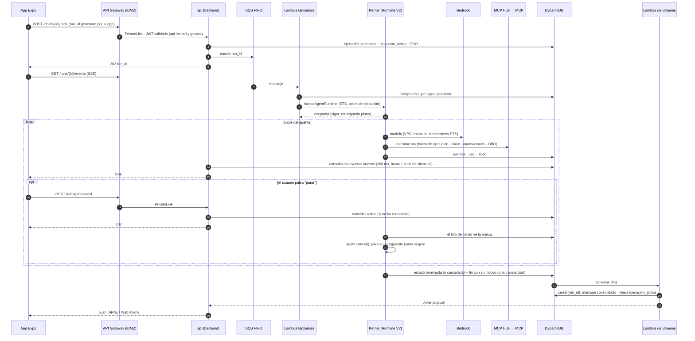
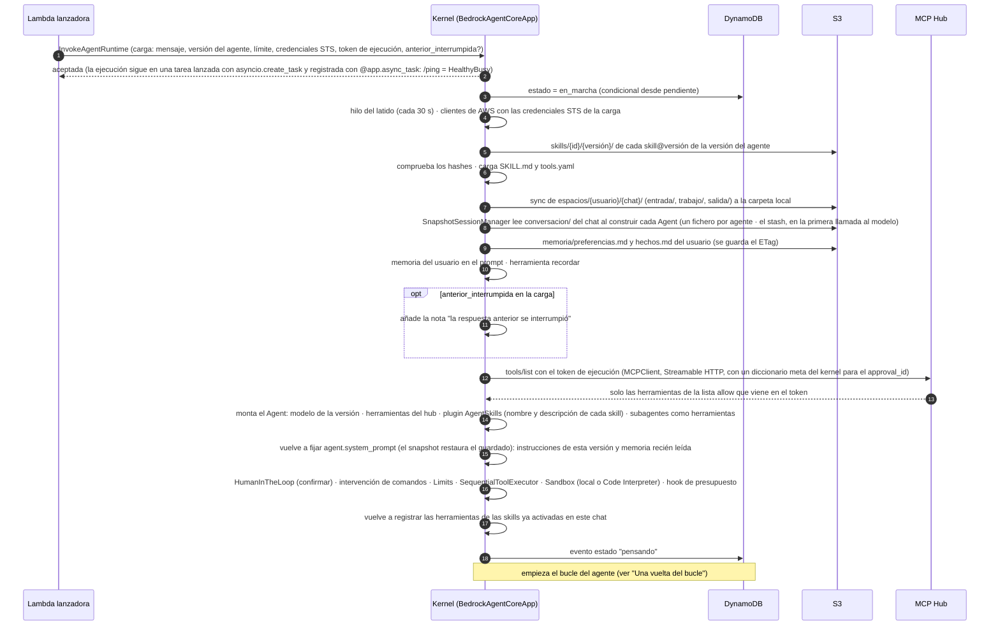
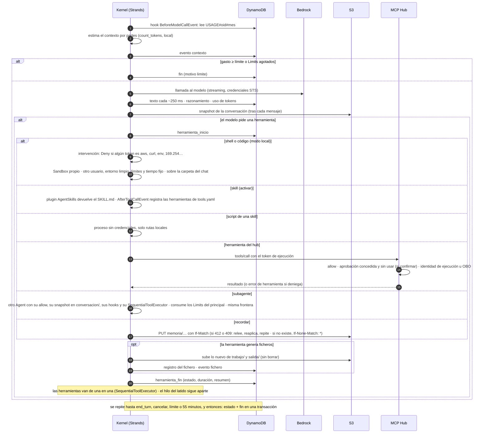
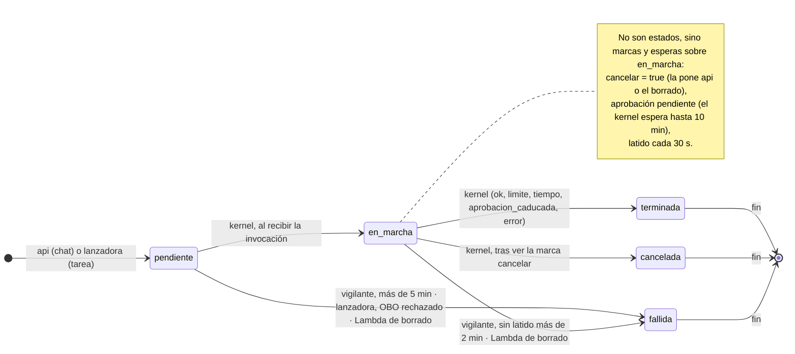
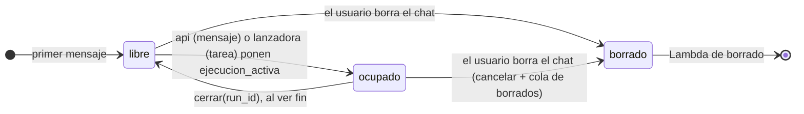
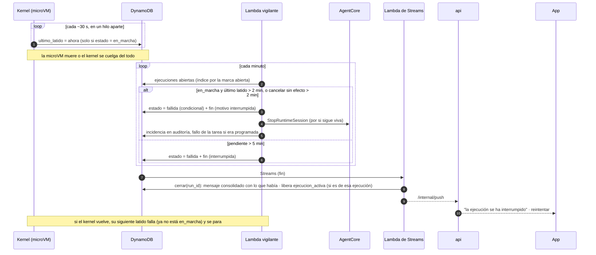
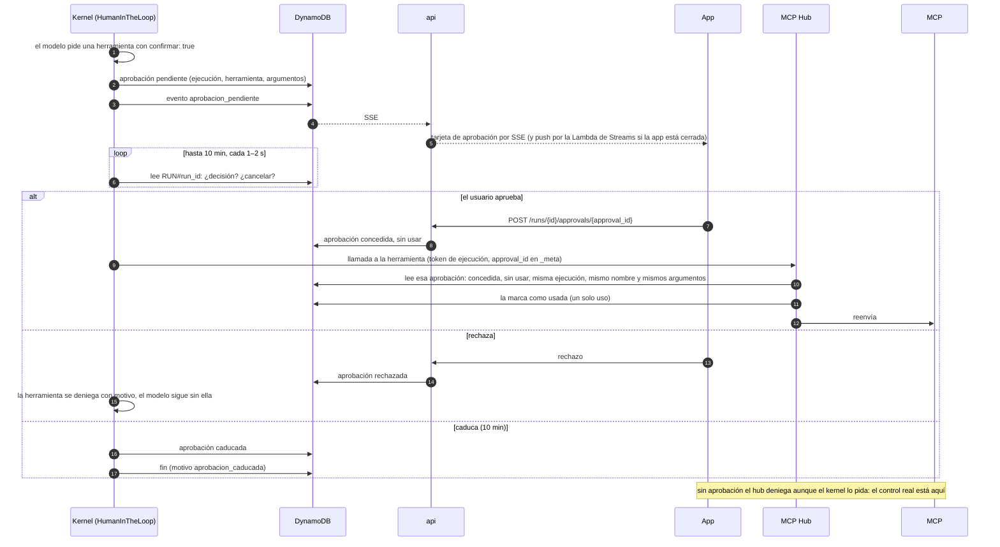
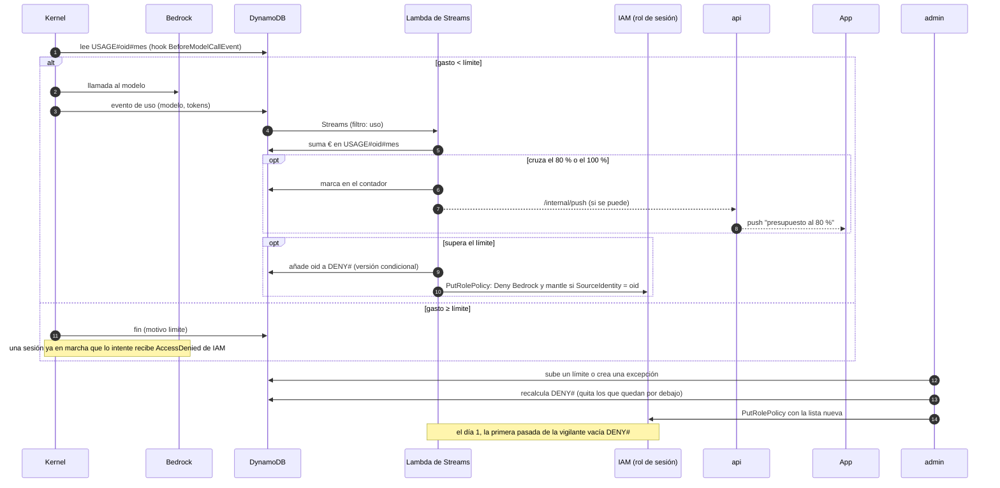
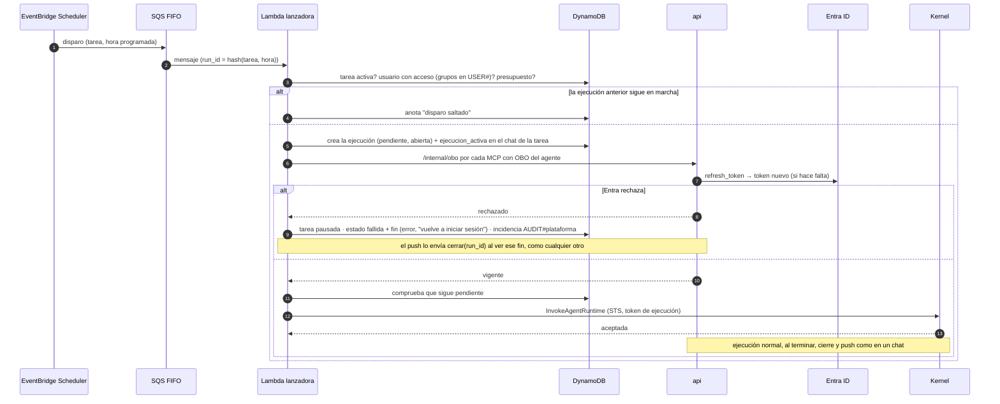

# Arquitectura de agentes

*Diseño de referencia · Expo (iOS y web) + REST · AWS us-east-1*

Cómo viaja un mensaje desde la app Expo (iOS y web) hasta el agente y vuelve: entrada por la cuenta iDMZ, backend sin estado en Fargate que crea la ejecución y la encola, una Lambda que la arranca, un kernel propio (Strands) en AgentCore Runtime V2 que llama a los modelos de Bedrock directamente, y un MCP Hub propio por el que pasan todas las herramientas MCP y que aplica la lista de herramientas permitidas, las confirmaciones y el OBO.

Piezas: Expo + assistant-ui · Entra ID · API Gateway REST + SSE · ECS Fargate · DynamoDB · AgentCore Runtime V2 · MCP Hub propio · Bedrock: Claude · GPT-6.1 Sol · TypeScript + Python · CDK

## Índice

- [Decisiones clave](#decisiones)
- [Diagrama](#diagrama)
- [Recorrido de un mensaje](#recorrido)
- [Inventario y red](#cuentas)
- [La app](#app)
- [El panel](#panel)
- [El agente en ejecución](#agente)
- [Ciclo de vida](#ciclo)
- [Agentes, skills, modelos y conocimiento](#gobierno)
- [Red y aislamiento](#red)
- [MCP Hub](#hub)
- [Identidad y permisos](#identidad)
- [Operación](#operacion)
- [Construcción y despliegue](#construccion)
- [Entorno de pruebas](#pruebas)
- [Migración](#migracion)
- [Verificado](#verificado)
- [Por verificar](#verificar)

<a id="decisiones"></a>

## Decisiones clave

### Motor y modelos

- Un solo motor: kernel propio con Strands (Python) en AgentCore Runtime V2, en modo VPC, en us-east-1. Sin AgentCore Gateway, Identity ni interceptor; sin AgentCore Browser ni búsqueda web (el Web Search gestionado solo se expone detrás de un Gateway, así que tampoco); sin LiteLLM ni Dev Workbench.
- Inferencia directa a Bedrock con credenciales STS por ejecución, limitadas a los modelos de la versión del agente; el gasto por usuario se corta con una denegación de IAM por `aws:SourceIdentity`.
- Toda conversación pasa por un agente; no hay chat directo con el modelo. Un modelo por agente (y por subagente) en cada versión.
- Sin AgentCore Memory: la conversación del agente son ficheros por chat en S3 (un snapshot de Strands por agente y, con el modo automático, el stash) y la memoria del usuario, dos textos en su carpeta que el modelo cambia con la herramienta `recordar` y el usuario edita en la app.
- Código del modelo, según el agente: en la propia microVM (con un `Sandbox` propio: el entorno local de Strands no aísla nada) o en Code Interpreter en una VPC sin DNS. El modo SANDBOX de Code Interpreter no aísla (la guía de AWS lo describe con "acceso externo limitado": llega a S3 y resuelve DNS; Unit 42 y BeyondTrust demostraron que sirve para sacar datos), por eso va en VPC.

### Backend, herramientas e identidad

- Dos servicios TypeScript sin estado en Fargate: `api` (lo que usa la app: chats, SSE, ficheros, OBO, rutas internas) y `admin` (lo que usa el panel), en procesos y con permisos distintos. En el documento, "el backend" es `api`.
- Un solo lanzador: toda ejecución, de chat o de tarea programada, entra por una cola SQS FIFO y la arranca la Lambda lanzadora, la única que asume el rol de sesión, firma el token de ejecución y llama a `InvokeAgentRuntime`. `api` crea la ejecución y la encola; los reintentos son los de la cola.
- MCP Hub propio para todas las herramientas MCP; los MCP propios siempre en Fargate, en la única VPC conectada a la red corporativa. Los scripts de skills corren en el kernel como herramientas tipadas.
- OBO solo en el backend: siembra una vez y renueva bajo demanda; el hub se lo pide por `/internal/obo`. Ni el kernel ni el hub ven el token de Entra del usuario.
- Ejecuciones de una hora como máximo, credenciales STS sin renovar; una Lambda vigilante limpia las que mueren y la Lambda de Streams (contadores y cierre en una sola función) las cierra con `cerrar(run_id)`, una función compartida que también llama la vigilante como respaldo y `api` cuando un envío choca con una ejecución ya terminada.

### Clientes y construcción

- Una app Expo (iOS y web) con assistant-ui y caché local cifrada; panel Next.js con shadcn/ui que solo es interfaz.
- Entrada por una cuenta iDMZ (API Gateway REST con streaming y un autorizador Lambda que solo valida el JWT de Entra; `oid` y grupos los lee `api` del propio token); Akamai solo delante del panel y de la app web.
- Todo en CDK, en un monorepo (TypeScript + Python) con contrato compartido en JSON Schema.
- Entorno de pruebas en una sola cuenta, con las VPC y paradas programadas; lo comprobado en papel está en [Verificado](#verificado) y lo que falta probar contra AWS, en [Por verificar](#verificar).

### Glosario

| Término | Qué es |
|---|---|
| **Ejecución** | Un turno del agente: desde que el backend recibe un mensaje (o se dispara una tarea) hasta el evento `fin`. Tiene `run_id` (en un chat, un UUID de 36 caracteres; en una tarea, `hash(tarea, hora programada)` en SHA-256 hexadecimal, de 64; en los dos casos es también el id de sesión del runtime, que exige 33 caracteres o más), estado y dura una hora como máximo. |
| **Sesión del runtime** | La microVM de AgentCore que corre una ejecución; una por ejecución (`runtimeSessionId` = `run_id`). |
| **Credenciales STS de la ejecución** | Credenciales de AWS de una hora que la Lambda lanzadora crea para esa ejecución (en las tablas, "credenciales STS de la sesión"), limitadas a su agente, su usuario y su chat. |
| **Token de ejecución** | Token firmado con KMS por la Lambda lanzadora que identifica la ejecución ante el MCP Hub y el backend: usuario, grupos, agente, versión y la lista `allow`. No es IAM ni es el token de Entra. |
| **Identidad de ejecución / OBO** | Dos formas de identificar al usuario ante un MCP: pasarle los datos del token de ejecución (el MCP usa su propio rol) o darle un token OBO de Entra con la audiencia del MCP (el MCP actúa como el usuario). |
| **Conversación del agente** | Lo que ve el modelo de un chat: los mensajes de Strands, con herramientas y resultados (con el modo automático, los resultados grandes recortados y el original en el stash, en la misma carpeta), en un fichero JSON (`snapshot_latest.json`) por agente en `espacios/{usuario}/{chat}/conversacion/`. Lo escribe y lo carga el kernel con el `SnapshotSessionManager` de Strands. No confundir con el mensaje consolidado, que es lo que ve el usuario. |
| **Memoria del usuario** | Dos ficheros de texto en `espacios/{usuario}/memoria/` (`preferencias.md` y `hechos.md`), comunes a todos sus agentes. El kernel los mete en el prompt; el modelo los cambia con la herramienta `recordar` y el usuario, desde la app. |
| **`anterior_interrumpida`** | Campo opcional de la carga con el motivo con que murió o se canceló la ejecución anterior del chat, para que el kernel añada una nota y la conversación del modelo cuadre con la del usuario. |
| **Espacio del chat** | El prefijo `espacios/{usuario}/{chat}/` de S3 (`entrada/`, `trabajo/`, `salida/`) que el kernel sincroniza con su carpeta local. En el mismo prefijo, fuera del sync, está `conversacion/` (la conversación del agente). |
| **Skill** | Instrucciones, scripts y `tools.yaml` versionados desde el panel; sus scripts se exponen al modelo como herramientas al activar la skill. |
| **Subagente** | Otro agente de Strands dentro del mismo kernel, expuesto al principal como herramienta, con su propia lista `allow`. |
| **Mensaje consolidado** | El elemento del chat que guarda `cerrar(run_id)` (normalmente desde la Lambda de Streams) al terminar una ejecución: texto, tarjetas resumidas, ficheros, coste y valoración. Es lo que ve el usuario; la conversación que ve el modelo es otro fichero, en `conversacion/` del chat en S3. |
| **`ejecucion_activa`** | Atributo del chat, con el `run_id`, que impide dos ejecuciones a la vez; lo ponen `api` (chat) o la lanzadora (tarea) y lo borra `cerrar(run_id)` al ver el `fin` de esa misma ejecución. |
| **`cerrar(run_id)`** | Función de `packages/dominio`, idempotente paso a paso, que cierra una ejecución con `fin`: mensaje consolidado, coste del chat, borrado de `ejecucion_activa`, push. La llaman la Lambda de Streams (camino normal), la vigilante (respaldo) y `api` (al chocar un envío con una ejecución ya terminada). |

<a id="diagrama"></a>

## Diagrama

Los números son los pasos del recorrido de un mensaje, justo debajo. Las líneas discontinuas son control: autenticación, tokens OBO, el aviso de push y la lanzadora hacia el backend. No se dibuja la VPC mínima de Code Interpreter (ver "Las cuatro VPC").


Leyenda: Cuenta iDMZ · Cuenta de la plataforma · AgentCore y kernel · Flujo de datos · Control / autenticación · Paso del recorrido

<a id="recorrido"></a>

## Recorrido de un mensaje

Los doce pasos, como secuencia (los números de la lista de abajo son los del diagrama de arquitectura; la secuencia lleva su propia numeración por mensaje):



1. **Inicio de sesión.** La app Expo entra con Entra ID (OIDC + PKCE, MFA y acceso condicional) y obtiene un token para la API de la plataforma. [La app](#app).
2. **Envío.** `POST /chats/{id}/runs` con un `run_id` (UUID) que genera la app, al API Gateway REST de la iDMZ; el autorizador Lambda valida el JWT (firma, emisor, audiencia, caducidad) y `api` lee `oid` y grupos del propio token.
3. **Entrada a la plataforma.** PrivateLink hasta el NLB interno y una réplica cualquiera del backend en Fargate.
4. **Control y alta.** El backend comprueba que el usuario puede usar el agente (grupos de Entra) y que le queda presupuesto (si no, 402); crea la ejecución (`pendiente`) y pone `ejecucion_activa` en el chat (si ya hay una, 409); siembra los tokens OBO que falten; deja un mensaje en la cola SQS FIFO con el `run_id` y responde `202 {run_id}`. [Ciclo de vida](#ciclo), [Identidad y permisos](#identidad).
5. **Arranque.** La Lambda lanzadora lee el mensaje, comprueba que la ejecución sigue `pendiente`, emite las credenciales STS y el token de ejecución (en las tareas, pide antes a `api` que el OBO esté vigente) y llama a `InvokeAgentRuntime` con una sesión nueva por ejecución; el kernel pasa la ejecución a `en_marcha`, acepta al instante y sigue en segundo plano (`/ping` en `HealthyBusy`). Si AgentCore rechaza por cuota (429) o con un 409 (`RetryableConflictException`, sesión cambiando de estado), la lanzadora acorta la visibilidad del mensaje a 5–10 s y falla: la cola lo reentrega en segundos. En la carga van el mensaje, la versión del agente, el límite de presupuesto, las credenciales y el token de ejecución (y, si la ejecución anterior del chat murió o se canceló, el motivo); la conversación anterior la recupera el kernel de S3 (`conversacion/` del chat), junto con la memoria del usuario.
6. **Modelo.** El kernel (Strands) llama a Bedrock por los VPC endpoints de la VPC de agentes con las credenciales STS, limitadas a los modelos de esa versión; antes de cada llamada mira el gasto del mes. El corte que no depende de él es la denegación de IAM por `aws:SourceIdentity`. [El agente en ejecución](#agente).
7. **Herramientas MCP.** Todas por el MCP Hub (VPC de integraciones, por PrivateLink) con el token de ejecución: lista `allow`, aprobaciones, identidad de ejecución u OBO (pedido al backend), auditoría, y falla cerrado. [Red](#red), [Identidad](#identidad).
8. **Skills, código y ficheros.** Los scripts de skills corren en el kernel como herramientas tipadas; el código del modelo, en la microVM (modo local) o en Code Interpreter; el kernel sincroniza el espacio del chat con S3 y emite `fichero` por cada fichero nuevo. [El agente en ejecución](#agente).
9. **Eventos y coste.** El kernel escribe en DynamoDB, bajo su ejecución, el texto (cada ~250 ms), las herramientas, los ficheros, el uso de tokens y un latido cada 30 s; la Lambda de Streams suma el gasto del mes.
10. **Lectura en la app.** `GET /runs/{id}/events` (SSE) en cualquier réplica: el backend consulta los eventos nuevos de esa ejecución en DynamoDB por conexión abierta (una consulta por clave, barata) con dos ritmos: 300 ms mientras llegan eventos y 1 s en los silencios (5 s durante una aprobación pendiente), volviendo a 300 ms en cuanto llega algo; el streaming de texto no lo nota y se ahorra alrededor de la mitad de las consultas. Si no hay nada que enviar, `api` manda un comentario SSE de latido cada ≤60 s, porque API Gateway corta un stream tras 5 minutos sin datos y el NLB tras 350 s sin tráfico (fijo con listener TLS); y como un stream dura como mucho 15 minutos, la app reconecta con `Last-Event-ID` antes de llegar a ellos, o en cuanto se corta; `POST /runs/{id}/cancel` para parar; ficheros con URL prefirmada.
11. **Fin.** El kernel escribe `fin` (con motivo, uso y coste). La Lambda de Streams, al verlo, llama a `cerrar(run_id)`: guarda el mensaje consolidado en el chat, borra `ejecucion_activa` (salen los mensajes en cola de la app) y avisa al backend. Si el siguiente mensaje de la app llega antes (la app ve `fin` por el SSE en 300 ms; Streams tarda alrededor de 1 s), `api` cierra él mismo en vez de responder 409. [Ciclo de vida](#ciclo).
12. **App en segundo plano.** El backend envía la notificación por APNs o Web Push (salida por Netskope). Los chats no visibles se actualizan con `GET /chats?updated_since=…`.

<a id="cuentas"></a>

## Inventario por cuenta y red

### Cuenta iDMZ

- API Gateway REST regional con response streaming, con su VPC Link y el NLB que apunta al endpoint de PrivateLink
- Autorizador Lambda para tokens de Entra
- Endpoints de PrivateLink hacia el NLB interno de la plataforma
- Balanceador web (panel de administración, `admin` y app web), detrás de Akamai, con PrivateLink hacia la plataforma

### Cuenta de la plataforma

- Salida a internet solo por Netskope, y por dos caminos: la VPC de servicios (Entra, APNs y Web Push) llega por Transit Gateway únicamente a la VPC de salida de la empresa, donde está el túnel a Netskope, sin rutas hacia la red interna; la VPC de integraciones MCP sale por la red corporativa (Entra, para que los MCP validen el token OBO y hagan el suyo hacia APIs internas, y las APIs que usen los MCP). La VPC de agentes no tiene salida ninguna.
- Cuatro VPC sin IGW ni NAT: la de servicios (backend, panel, app web y Lambdas) y la de agentes (solo los runtimes), cada una con sus VPC endpoints; y la de integraciones MCP y la de Code Interpreter, descritas abajo. Solo la de integraciones llega a la red interna; servicios, solo a la salida de la empresa
- Dos servicios en ECS Fargate: `api` (el backend: chats, ejecuciones y SSE, ficheros, tareas, OBO, rutas internas y push) y `admin` (solo para el panel: agentes, skills, Knowledge Bases, modelos, presupuestos, usuarios, evaluaciones y auditoría), cada uno con su rol de IAM; una cola SQS FIFO por la que entra toda ejecución (chats desde `api`, tareas desde Scheduler) y la Lambda lanzadora que las arranca; una Lambda de Streams (contadores y cierre) sobre el stream de DynamoDB; una Lambda vigilante de ejecuciones; y una cola SQS de borrados con su Lambda, que borra físicamente los chats; ejecuciones de una hora como máximo, sin renovar credenciales STS
- App web: el export estático de Expo servido por nginx en ECS Fargate, por el mismo camino que el panel (Akamai → ALB del iDMZ → PrivateLink). Desde el navegador, la app llama a la API del iDMZ como la app de iOS, con CORS para el dominio web, que en API Gateway REST se monta a mano: el método `OPTIONS` sin autorizador, las cabeceras CORS en las respuestas de `api` (la integración es proxy) y en las Gateway Responses de API Gateway (401, 403, 429, 5XX), y `Authorization`, `Content-Type`, `Last-Event-ID` y `traceparent` entre las cabeceras permitidas. El bucket de S3 de los espacios también lleva CORS, para las subidas con URL prefirmada desde el navegador.
- VPC de integraciones MCP: el MCP Hub y los servidores MCP propios (ECS Fargate), y la única conexión a la red corporativa (Transit Gateway, Direct Connect o VPN). El kernel llega al hub por un VPC endpoint de PrivateLink, y el hub al backend por otro, solo para pedir tokens OBO; no hay rutas entre las VPC
- VPC de Code Interpreter: mínima, solo para sus sesiones, sin endpoints, rutas ni NAT y con el DNS desactivado
- Panel de administración (Next.js con shadcn/ui, en ECS Fargate). Acceso: administradores → Akamai → iDMZ → panel, con Entra y el grupo de administradores. Solo es la interfaz: la lógica y los permisos viven en el servicio `admin`, que no existe en el API Gateway.
- DynamoDB, dos tablas: la principal (chats y mensajes, ejecuciones con sus eventos y ficheros, aprobaciones, tareas programadas, gasto y límites, tokens OBO, agentes y versiones) y la de auditoría, en la que cada pieza escribe bajo su prefijo (el kernel, solo bajo `AUDIT#kernel#`); y una Lambda que lee su stream (suma el gasto y cierra las ejecuciones)
- S3 (espacios de los chats con su conversación, memoria de cada usuario, skills y documentos para RAG), KMS, CloudWatch y Secrets Manager (secreto de la app de Entra y credenciales de los MCP)
- Amazon Bedrock: los modelos del catálogo (Claude, GPT-6.1 Sol…), invocados directamente por el kernel con las credenciales de la sesión
- Bedrock Knowledge Bases: índice de los documentos para RAG, administrado desde el panel (documentos, metadatos, sincronización)

### AgentCore (gestionado, us-east-1)

- Un solo motor: AgentCore Runtime, versión de plataforma V2 (restaura cada sesión desde una instantánea), con el kernel propio (Strands), en modo VPC en la VPC de agentes
- AgentCore Evaluations: calidad de los agentes, online sobre las trazas del kernel y en batch desde el panel
- Code Interpreter (en su propia VPC sin DNS, para el código libre de los agentes que lo usan), llamado directamente por el kernel. Sin AgentCore Memory: la conversación y la memoria del usuario son ficheros en S3. Sin Browser ni búsqueda web: los agentes no salen a internet. Sin AgentCore Gateway ni AgentCore Identity: las herramientas pasan por nuestro MCP Hub, que pide los tokens OBO al backend, el único que los guarda y los renueva.

### Las cuatro VPC

| VPC | Qué contiene | Endpoints | Salida | DNS Firewall permite | Quién llega |
|---|---|---|---|---|---|
| **Servicios** | Backend (`api`), `admin`, panel, app web, NLB interno y las Lambdas | Los servicios de AWS que usan: DynamoDB y S3 (gateway), AgentCore (plano de datos para `InvokeAgentRuntime` y `StopRuntimeSession`, y control), Bedrock (títulos), STS (`AssumeRole` de la lanzadora), IAM (`PutRolePolicy`), KMS, Secrets Manager, SQS, Scheduler, Logs… | Transit Gateway solo hacia la VPC de salida de la empresa (túnel a Netskope): Entra, APNs, Web Push. En pruebas, un NAT Gateway | AWS, Entra (con Graph), APNs, Web Push | La iDMZ por PrivateLink; la VPC de integraciones por PrivateLink, solo `/internal/obo` |
| **Agentes** | Solo los runtimes del kernel | `bedrock-runtime`, `bedrock-mantle`, AgentCore (Code Interpreter), el MCP Hub (PrivateLink), DynamoDB y S3 (gateway, que también deja pasar el bucket de capas de ECR), Logs, X-Ray, ECR (`api` y `dkr`) | Ninguna | `*.us-east-1.amazonaws.com` (el comodín solo vale al principio), los nombres sin región que se usen, `bedrock-mantle.us-east-1.api.aws`, el hub y los CNAME intermedios de todos ellos (las reglas inspeccionan la cadena por defecto); todo lo demás bloqueado, y si falla, cerrado | Nadie por red: la lanzadora llama a la API de AgentCore |
| **Integraciones MCP** | MCP Hub, MCP propios y Cloud Map | `bedrock-agent-runtime` (Knowledge Bases), DynamoDB (tabla principal: catálogo y versiones en lectura, aprobaciones en lectura y marcado; tabla de auditoría bajo `AUDIT#hub#`), KMS (verificar el token de ejecución), Secrets Manager, Logs y métricas de CloudWatch; y los que necesiten Fargate y Service Connect (`ecs`, `ecs-agent`, `ecs-telemetry`, ECR y S3), salvo que salgan por la red corporativa (por verificar) | Red corporativa (Transit Gateway, Direct Connect o VPN) y, por ella, Netskope | AWS, Entra y los dominios internos | El kernel por PrivateLink; los MCP externos, por la red corporativa |
| **Code Interpreter** | Las sesiones de Code Interpreter | Ninguno | Ninguna; DNS desactivado | — | AgentCore por su plano de control (ficheros por la API) |

<a id="app"></a>

## La app (Expo + assistant-ui)

Una sola app Expo para iOS y web (react-native-web) con la interfaz de chat de `@assistant-ui/react-native`. assistant-ui solo pinta y gestiona la interacción: los chats, los mensajes, el coste y los ficheros viven en nuestro backend, así que lo mismo se ve en el iPhone y en el navegador.

### Entrar y elegir agente

- **Inicio de sesión** con Entra (OIDC + PKCE con `expo-auth-session`), con MFA y acceso condicional. En iOS el token se guarda en el llavero (`expo-secure-store`); en web, en memoria con renovación silenciosa.
- **Nuevo chat → catálogo de agentes**: solo los que permiten los grupos de Entra del usuario, cada uno con nombre, descripción, icono y lo que sabe hacer (buscar en documentos, ejecutar código, generar ficheros). El chat queda ligado a ese agente.
- **Ajustes**: perfil, idioma, tema claro u oscuro, notificaciones, memoria y cerrar sesión.

### Chats

- **Lista de chats** en un menú lateral: búsqueda, renombrar, archivar y borrar. El título lo propone el backend con un modelo barato tras el primer mensaje.
- **Conversación en streaming**: texto en Markdown, tarjetas para lo que hace el agente ("Buscando en documentos…", "Ejecutando código…", "Generando el informe…") y el razonamiento plegado si el modelo lo da.
- **Encolar mensajes**: mientras el agente trabaja, el usuario puede seguir escribiendo. Los mensajes quedan en una cola en la app, visibles en la caja de texto, donde se pueden reordenar o quitar, y se envían en orden cuando termina la ejecución. La cola la guarda en la caché local nuestro código (`createMessageQueue` de assistant-ui solo la tiene en memoria) y se vuelve a encolar al abrir el chat, así que sobrevive a cerrar la app.
- **Cancelar** con el botón de parar (marca de cancelación en el backend); **reintentar** y **copiar** en cada respuesta.
- **Contexto del chat**: un indicador pequeño junto a la caja de texto con lo que ocupa la conversación en la ventana del modelo ("34 %"); al pulsarlo, el reparto: instrucciones y memoria, herramientas, conversación y resultados de herramientas. Avisa cuando se acerca al límite y el agente va a empezar a recortar o resumir, para que el usuario sepa por qué el agente "olvida" lo de hace mucho y pueda abrir un chat nuevo. Sale del evento `contexto` del SSE; al reabrir un chat, del último guardado en el mensaje consolidado.
- **Seguir más tarde**: si la app pasa a segundo plano la ejecución continúa; al volver, la app reconecta el SSE con `Last-Event-ID` y recupera lo que falte. El SSE se lee con el `fetch` de `expo/fetch`, que Expo instala como `fetch` global en nativo y que entrega el cuerpo en streaming (el de React Native no); la app parsea los eventos y envía ella misma `Last-Event-ID` al reconectar. Si una tarea larga termina con la app cerrada, llega una notificación.

### Caché local de chats

- **El backend es la fuente de verdad; la app guarda una copia** de la lista de chats y de los mensajes de los chats abiertos, así se abren al instante y sin conexión se puede leer.
- **Solo pide lo nuevo:** la lista con `GET /chats?updated_since=<fecha>` (incluye los borrados, para quitarlos) y cada chat con `GET /chats/{id}/messages?after=<seq>`. Lo que llega por SSE se añade a la copia.
- **Dónde:** en iOS, SQLite (`expo-sqlite`) cifrado con SQLCipher, con la clave en el llavero; en web, IndexedDB, limitado a los últimos 30 días y con la opción "no guardar en este equipo".
- **Seguridad:** al cerrar sesión o cambiar de usuario se borra todo. Los ficheros no se guardan: solo sus datos (nombre, tipo, tamaño) y se descargan al abrirlos.

### Ficheros

- **Adjuntar** PDF, imágenes, Excel/CSV o Word desde el selector de documentos o la cámara. La app pide al backend una URL prefirmada, sube el fichero directamente a S3 (`espacios/{usuario}/{chat}/entrada/`) y envía solo la referencia con el mensaje; el kernel lo trae con su sync y, si hace falta, lo copia a Code Interpreter. Límite de tamaño y tipos permitidos por agente.
- **Artefactos**: la app se entera por el evento `fichero` del SSE (o, si estaba cerrada, al reconectar con `Last-Event-ID` o al sincronizar el chat). Cada fichero aparece como tarjeta en el mensaje (nombre, tipo, tamaño, vista previa de PDF e imágenes) con descargar y compartir (hoja de compartir de iOS). Las descargas usan URLs prefirmadas de pocos minutos.
- **Mis ficheros**: todos los artefactos del usuario, por chat, con filtro y borrado.

### Coste

- **Lo que llevas este mes**: en la cabecera y en ajustes, "12,40 € de 50 €" con una barra, el límite y de dónde viene (por defecto, tu grupo o una excepción).
- **Coste de cada chat** en su cabecera (lo suma `cerrar(run_id)` al terminar cada ejecución).
- **Avisos**: al 80 % un aviso en la app y una notificación; al 100 % la caja de texto se bloquea con un mensaje claro ("has alcanzado tu límite mensual; se renueva el día 1") y cómo pedir una ampliación. El backend rechaza los mensajes nuevos; IAM corta lo que ya está en marcha.

### Memoria y valoración

- **"Lo que recuerdo de ti"**: la memoria del usuario, común a todos los agentes, tal cual: dos textos (preferencias y hechos) que el usuario lee, edita y guarda, o vacía, desde ajustes (`GET` y `PUT /me/memory`). Muestra cuándo cambió por última vez y quién (él o un agente, con el chat). Un interruptor "usar mi memoria" la desactiva sin borrarla: el kernel no la carga ni ofrece `recordar`. Si un agente la cambió mientras el usuario editaba, al guardar la app enseña la versión nueva y pide repetir el cambio (ver "Sin pisarse" en "Conversación y memoria (S3)").
- **Valorar respuestas**: pulgar arriba o abajo y comentario opcional. Se guarda en el mensaje consolidado del chat (dura 12 meses, no los 90 días de la ejecución), se ve en el panel por agente y versión, y las malas respuestas sirven para ampliar los conjuntos de pruebas de las evaluaciones.

### Tareas programadas

- **Crear**: el usuario elige un agente de los que puede usar, escribe la instrucción ("cada lunes a las 8, resume las ventas de la semana y mándame el PDF") y la frecuencia (diaria, semanal, mensual o una vez, con hora y zona horaria).
- **Resultado**: cada tarea tiene su propio chat; cada ejecución añade un mensaje con sus ficheros y llega una notificación. El usuario puede seguir conversando sobre el resultado.
- **Gestionar**: lista de tareas con próxima ejecución y estado; pausar, editar, borrar y "ejecutar ahora". Si una tarea se pausa sola (sin presupuesto, sin acceso al agente, tokens OBO rechazados por Entra o varios fallos seguidos), la app dice por qué.

### Notificaciones y voz

- **Push**: tarea larga terminada, aprobación pendiente, aviso de gasto al 80 % y al 100 %. En iOS por APNs (el backend sale por Netskope); en web, Web Push si el navegador lo permite. La app registra el dispositivo al iniciar sesión.
- **Dictado**: botón de micrófono en la caja de texto; en iOS con el reconocimiento de voz del sistema y en web con la Web Speech API donde exista. Solo dictado, no conversación por voz.

### Cómo se conecta assistant-ui

| Pieza de assistant-ui | Con qué la conectamos |
|---|---|
| `useRemoteThreadListRuntime` + `RemoteThreadListAdapter` | La lista de chats: `list`, `initialize`, `rename`, `archive`, `delete` y `generateTitle` sobre `/chats` del backend. |
| `useExternalStoreRuntime` (uno por chat) | Los mensajes los tenemos nosotros (construidos a partir de los eventos SSE y del historial del backend); `onNew` crea la ejecución (`POST /chats/{id}/runs`) y `onCancel` la cancela. Así la reconexión y el historial no dependen de assistant-ui. |
| Partes de mensaje y Tool UI | Cada evento del kernel se convierte en una parte: texto, razonamiento, llamada a herramienta (con su tarjeta propia para `buscar_documentos`, código y ficheros) y fichero generado. |
| Adaptador `attachments` | Uno propio: lee el fichero desde su URI de Expo, lo sube a S3 con la URL prefirmada y añade la referencia al mensaje. |
| Adaptadores `feedback` y `dictation` | `POST /chats/{id}/messages/{seq}/feedback` (la valoración cuelga del mensaje consolidado, que dura más que la ejecución); en iOS, un `DictationAdapter` propio sobre el reconocimiento de voz del sistema (assistant-ui no trae adaptador nativo; el paquete, por elegir); en web, `WebSpeechDictationAdapter` de `@assistant-ui/core`. |
| Adaptador `queue` | Cola de mensajes durante una ejecución con `createMessageQueue`: avisa a la cola cuando empieza (`notifyBusy`) y termina (`notifyIdle`) la ejecución, y la caja de texto la muestra con `ComposerPrimitive.Queue`, sin `QueueItemPrimitive.Steer` (interrumpiría la ejecución en marcha); al parar, `notifyCancelled` antes de cancelar, si no se quiere que salga el siguiente. El backend sigue aceptando un mensaje a la vez por chat. |
| Aprobaciones | `aprobacion_pendiente` se traduce a la parte `approval` de la llamada a herramienta, con el `approval_id`; `onRespondToToolApproval` llama a `POST /runs/{id}/approvals/{approval_id}`; al caducar, `resolution: "expired"`, para que la tarjeta deje de ofrecer los botones. |
| Caché local | Los mensajes que pasamos a `useExternalStoreRuntime` salen primero de la copia local y se completan con lo nuevo del backend y del SSE. |
| Fuera de assistant-ui | Coste (`GET /me/usage`), catálogo de agentes (`GET /agents`), memoria (`/me/memory`), ficheros (`/me/files`) y dispositivos para push (`POST /me/devices`): pantallas propias con TanStack Query. |

### Eventos del SSE

El kernel escribe en DynamoDB todo lo que va haciendo el agente, no solo el texto, y la app lo pinta como tarjetas dentro del mensaje. Cualquier evento puede llevar el atributo `subagente` con el nombre del subagente que lo emite; la app lo pinta como tarjeta plegada dentro de la herramienta que lo llamó. Entre eventos, `api` intercala comentarios SSE de latido (ver el paso 10 del recorrido), que la app ignora.

| Evento | Qué lleva | Cómo se ve en la app |
|---|---|---|
| `texto` | Fragmentos de la respuesta (agrupados cada ~250 ms) | El texto escribiéndose |
| `razonamiento` | Resumen del razonamiento, si el modelo lo da y el agente lo permite | Bloque plegado "Pensando…" |
| `herramienta_inicio` | Nombre, etiqueta legible ("Buscando en documentos") y resumen de los argumentos | Tarjeta con indicador "en curso" |
| `herramienta_fin` | Estado (bien o error), duración y resumen corto del resultado; en las búsquedas, las citas (título y enlace) | La tarjeta pasa a hecha o a error |
| `skill_activada` | Qué skill se activó | Línea discreta en la tarjeta |
| `aprobacion_pendiente` | Herramienta, resumen de los argumentos y hasta cuándo se espera | Tarjeta de aprobación con aprobar y rechazar |
| `fichero` | Nombre, tipo, tamaño y referencia del fichero | Tarjeta del fichero con vista previa |
| `estado` | "Esperando al modelo", "reintentando", "esperando aprobación"… | Indicador bajo el mensaje |
| `contexto` | Antes de cada llamada al modelo: tokens estimados por partes (instrucciones y memoria, definiciones de herramientas, conversación, resultados de herramientas), el total y el porcentaje de la ventana del modelo; si hubo recorte o resumen, cuánto | Indicador de contexto del chat y su reparto |
| `aviso` | Límite alcanzado: el kernel termina la ejecución con `fin` (`motivo = limite`); el aviso del 80 % llega por push y por `GET /me/usage`, no por el SSE | Aviso en la app |
| `error` | Un error recuperable o no (texto para el usuario); si no se puede seguir, le sigue `fin` | Aviso en el mensaje |
| `fin` | Siempre el último evento de una ejecución: `motivo` (`ok`, `cancelado`, `error`, `limite`, `tiempo`, `aprobacion_caducada`, `interrumpida`), uso y coste final. Lo escribe el kernel; si no, la vigilante (`interrumpida`), la lanzadora (`error`) o la Lambda de borrado (`cancelado`). | Fin del mensaje; la Lambda de Streams llama a `cerrar(run_id)` al verlo |

### Qué no viaja por el SSE

- **Resultados de herramientas**: pueden ser grandes o sensibles (fragmentos de documentos, respuestas de APIs); solo un resumen y, en búsquedas, las citas.
- **Argumentos**: solo un resumen, sin tokens ni datos internos.
- **Razonamiento**: como mucho el resumen, y solo si el agente lo permite.

### Cómo se generan

- Texto y llamadas a herramientas: los eventos de streaming de Strands; los de un subagente llegan al stream del principal como `AgentAsToolStreamEvent`, y los de un nodo de grafo, como `MultiAgentNodeStreamEvent`: de ahí sale el atributo `subagente`.
- Inicio y fin de cada herramienta: sus hooks (`BeforeToolCallEvent` y `AfterToolCallEvent`), registrados en cada agente: los de un subagente no pasan por los del principal.
- Cada herramienta declara su etiqueta y cómo resumir su resultado: las de skills en `tools.yaml`, las de los MCP en su registro del hub, definido en CDK (el panel las muestra).

### Historial

- Al terminar cada ejecución, `cerrar(run_id)` guarda el mensaje final consolidado (texto, tarjetas resumidas, ficheros, coste y valoración) como elemento del chat: al reabrir un chat se ven las mismas tarjetas, ya plegadas. Los eventos sueltos del SSE caducan a las 48 h (ver "Retención de datos").

<a id="panel"></a>

## El panel de administración

Next.js con la interfaz hecha con shadcn/ui (componentes sobre Base UI, su opción por defecto desde julio de 2026, y Tailwind), en ECS Fargate, al que se llega por Akamai → ALB web del iDMZ → PrivateLink, con login de Entra. Es solo la interfaz: cada acción llama al servicio `admin` (por el mismo ALB web, bajo `/admin-api`), que comprueba el rol, aplica el cambio y lo deja auditado. `admin` es un proceso aparte del backend de la app, con su propio rol de IAM: es el único que puede escribir agentes, versiones, skills, precios y límites, la Lambda lanzadora es la única que asume el rol de sesión y firma tokens de ejecución, y el backend el único que descifra OBO y habla con Entra.

### Acceso y roles

- **Administradores de plataforma** (grupo de Entra): agentes, skills, Knowledge Bases, evaluaciones, modelos y precios.
- **Administradores de presupuestos** (otro grupo de Entra): límites y excepciones por usuario.
- **Acceso a contenido** (tercer grupo de Entra, el más restringido): abrir conversaciones concretas desde la auditoría o desde una valoración. Cada apertura queda auditada con el motivo.
- MFA y acceso condicional de Entra. Cada cambio queda en la auditoría: quién, cuándo, valor anterior y nuevo, y motivo cuando se pide.

### Agentes

- **Ficha del agente** (sin versión, se aplica al momento): nombre, descripción, icono y qué grupos de Entra lo ven en la app.
- **Configuración** (versionada): todo lo que cambia cómo responde el agente, de las instrucciones a las herramientas; la lista completa está en "Versiones de agentes".
- **Contexto por ejecución**: en el chat de prueba y en el detalle de cualquier ejecución, el reparto del contexto en cada vuelta (los eventos `contexto`) junto al uso real de tokens. Sirve para ver qué agente lleva demasiadas herramientas o skills, o qué herramienta devuelve resultados enormes.
- **Versiones:** se edita un borrador, se prueba en un chat de prueba del panel, se pasan sus pruebas (evaluación batch) y se compara con la versión publicada antes de publicar. Volver atrás es un clic.

### Skills

- **Subir una versión** (instrucciones, scripts y `tools.yaml`) desde el panel. Cada versión es inmutable: `skills/{id}/{versión}/` en S3, con su hash, autor y estado en DynamoDB.
- **Revisión y aprobación:** diferencia con la versión anterior (ficheros, herramientas añadidas o quitadas, cambios de parámetros, si escribe ficheros, librerías que pide). La aprueba otro administrador; solo las aprobadas se pueden asignar.
- **Dependencias:** el panel rechaza una versión que pida librerías que la imagen actual del kernel no trae; añadirlas es publicar una imagen nueva del kernel.
- **Uso y retirada:** qué agentes usan cada versión y aviso de los que van con una antigua; retirar una versión impide asignarla de nuevo.

### Knowledge Bases

- **Documentos:** subir y borrar (URL prefirmada a S3 `documentos/`) y editar sus metadatos: agentes y grupos de Entra que pueden verlos, idioma.
- **Sincronización:** lanzar la ingesta y ver su estado y errores por documento.
- **Probar:** una búsqueda de prueba como si fuera un usuario concreto, para comprobar los filtros por grupo.
- Las Knowledge Bases en sí se crean con CDK; el panel gestiona su contenido.

### Evaluaciones y calidad

- **Conjuntos de pruebas** por agente: pregunta, respuesta esperada, aserciones y herramientas que debería usar. Se pueden crear a partir de respuestas mal valoradas en la app.
- **Resultados:** notas de la evaluación online (muestreo de sesiones reales) y de cada batch, por agente y versión, con su tendencia y las alarmas.
- **Valoraciones de los usuarios:** pulgares y comentarios, con enlace a la conversación (con permiso de acceso a contenido, auditado).

### Tareas programadas

- Todas las tareas de todos los usuarios: agente, frecuencia, última y próxima ejecución, fallos y coste; pausar o borrar cualquiera.
- Límites: tareas activas por usuario y frecuencia mínima.

### Usuarios

- **La lista de quien ha entrado**: el backend crea `USER#{oid}` en la primera petición autenticada (nombre, correo y grupos del token, primera y última entrada) y actualiza la última entrada y los grupos en cada petición, como mucho una vez por hora. No se sincroniza nada con Entra ni con Graph: la lista es la de los que han usado la plataforma.
- **Dar de baja**, desde la ficha del usuario, con motivo y auditado: `estado = baja`. Desde ese momento el backend rechaza sus peticiones aunque el token siga siendo válido, la lanzadora no arranca sus tareas (quedan pausadas) y `api` cancela sus ejecuciones en marcha. El hub no mira el estado del usuario: sin ejecuciones nuevas no hay llamadas. Reactivar es volver a `activo`.
- **Casi sin borrado**: sus datos caducan por los TTL de siempre (ver "Retención de datos"); lo único que se borra al darlo de baja es su memoria (`memoria/` en S3, un `DeleteObjects`), que no caduca por edad.

### Presupuestos y consumo

- **Ficha de usuario:** gasto del mes por modelo y agente, límite efectivo y de dónde viene, crear una excepción, y qué agentes puede usar y por qué grupo de Entra.
- **Consumo global:** coste por agente, modelo y día; estimación de Runtime y Code Interpreter; coste de plataforma (Evaluations) aparte; y la conciliación mensual con la factura.

### Seguridad y auditoría

- **Intentos denegados**, leídos de la tabla de auditoría de DynamoDB (consultas instantáneas): comandos bloqueados, herramientas fuera de la lista `allow`, aprobaciones rechazadas o caducadas, fallos de OBO y cortes de presupuesto, con filtros por agente, usuario y fecha.
- **Detalle**: qué se intentó, qué regla lo bloqueó y enlace a la traza completa del mensaje, para ver qué leyó el agente antes (un documento, la respuesta de un MCP).
- **Tendencias y alarmas**: intentos por agente y por día, y las alarmas que han saltado; útil para detectar un documento malicioso o un agente cuyas instrucciones lo empujan a hacer lo que no debe.
- **Quién lo ve**: los administradores de plataforma. Como los comandos pueden contener datos de los usuarios, cada consulta queda a su vez en la auditoría del panel.

### Límites y excepciones

- **Qué se configura:** un límite mensual en € por defecto; límites por grupo de Entra (si el usuario está en varios, se aplica el más alto); excepciones por usuario (importe fijo o aumento temporal, siempre con motivo y fecha de caducidad).
- **Precedencia:** excepción del usuario > grupo más alto > por defecto.
- **Pantallas:** "Presupuestos", con las reglas por grupo (el grupo se busca en Entra con Microsoft Graph, con un registro de aplicación propio de `admin` que solo puede leer grupos; el secreto del OBO sigue siendo solo de `api`) y las excepciones vigentes; y la ficha de usuario, con el gasto del mes por modelo y agente, su límite efectivo y de dónde viene, y un botón para crear una excepción.
- **Permisos y auditoría:** solo un grupo de Entra de administradores de presupuestos cambia límites; cada cambio guarda quién, valor anterior y nuevo, y motivo.
- **Datos:** reglas en DynamoDB (`LIMIT#DEFAULT`, `LIMIT#GROUP#<id>` y `LIMIT#USER#<oid>`). Los grupos del usuario se toman de su token de Entra al crear la ejecución (en las tareas programadas, de los guardados en `USER#{oid}` en su última petición) y se guardan en ella.
- **Cómo llega al corte:** el kernel recibe el límite efectivo en la carga de la invocación y lee el gasto del mes antes de cada llamada al modelo; la Lambda de Streams aplica la denegación de IAM al cruzar el límite. Un cambio de límite desde el panel (por defecto, grupo o excepción) lo aplica `admin` al momento: recalcula qué usuarios de la lista de denegados quedan por debajo de su límite nuevo y los quita (un usuario denegado no genera uso, así que la Lambda de Streams no volvería a mirarlo). El contador lleva el mes en la clave (`USAGE#{oid}#2026-11`), así que no hay que poner nada a cero.
- **Avisos:** al cruzar el 80 % y el 100 %, la Lambda de Streams deja una marca en el contador y avisa al backend por su ruta interna (`POST /internal/push`, en la misma VPC). Solo el backend envía push (tiene las credenciales de APNs y Web Push) y la app lee el estado en `GET /me/usage`. El kernel no emite avisos de presupuesto: su evento `aviso` queda para el corte.

<a id="agente"></a>

## El agente en ejecución

Dónde corre el kernel y qué hace durante una ejecución.

### Arranque de una ejecución

Qué hace el kernel al recibir una ejecución:



### Una vuelta del bucle

Una vuelta del bucle del agente, con las intervenciones y las herramientas:



### Por qué un kernel propio

- Sin AgentCore Gateway, Identity ni interceptor: el kernel propio llama directamente a Bedrock, Code Interpreter y S3 con las credenciales STS de la sesión, y todas las herramientas MCP pasan por nuestro MCP Hub; los scripts de skills corren en el propio kernel.
- Un único camino y una única lógica de seguridad, en nuestro código: lo que se puede limitar por IAM va directo; lo que depende de quién sea el usuario (datos, APIs internas, OBO) va por el hub.
- A cambio, la imagen del kernel, el hub y las actualizaciones de Strands son nuestras.

### Runtime V2 y lo que exige al kernel

- **Qué es**: con `platformVersion` = `V2`, AgentCore arranca el contenedor una vez, hace una instantánea cuando `/ping` responde sano y restaura cada sesión nueva desde ella. Arranque en frío publicado por AWS: P75 de 1,9–2,0 s (V1: 5,4–30 s), medido en modo PUBLIC con un servidor eco y sin llamada al modelo; en VPC y con nuestra imagen, por medir. El tiempo de inactividad de una sesión (`idleRuntimeSessionTimeout`, 15 minutos por defecto) solo corre cuando `/ping` no dice `HealthyBusy`; nuestras ejecuciones están siempre ocupadas hasta `fin`, así que ninguna se corta por inactividad. Como una sesión terminada nunca recibe otra invocación, se fija al mínimo, 60 s (por defecto 900), para que la microVM se libere en cuanto termina; V2 además recupera la memoria inactiva a los 120 s (según la página de precios). Región: us-east-1.
- **Antes de la instantánea**: cargar al arrancar todo lo caro (Strands y las librerías de skills) y no responder sano en `/ping` hasta terminar; debe ocurrir en menos de 120 s. Crear o actualizar el runtime tarda minutos porque prepara la instantánea.
- **Después de restaurar**: todas las instancias parten de la misma memoria. Valores aleatorios e identificadores por petición (`os.urandom()`, `secrets`, `uuid4()`), nunca al arrancar; también los de las trazas. La hora se lee en cada petición (`time.monotonic()` no avanza durante la instantánea). Los clientes de AWS se crean con las credenciales STS de cada carga, nunca al arrancar. Las conexiones se rehacen en la primera llamada y no se fija el puerto de origen.
- **Configuración**: casi todo va en la carga de cada invocación; las variables de entorno del contenedor tienen que caber en 2,5 KB (límite de V2).
- **Despliegue**: `PlatformVersion` es una propiedad de `AWS::BedrockAgentCore::Runtime` en CloudFormation (`platformVersion` en el `Runtime` de CDK) y se cambia sin reemplazar el recurso: se fija a `V2` en la propia definición. Volver a V1 es cambiar esa propiedad, una actualización en el sitio. Un runtime en modo VPC creado desde el 5 de mayo de 2026 descarga la imagen por nuestra VPC (ver "VPC de agentes separada"), así que crearlo o actualizarlo necesita los endpoints de ECR (`api` y `dkr`) y el bucket de capas de ECR en el gateway de S3.

### Eventos escritos por el kernel

- **El kernel escribe sus eventos directamente en DynamoDB** (`RUN#{run_id}` / `EVT#000042`), por el VPC endpoint y con las credenciales STS de la sesión, que solo permiten escribir en las claves de esa ejecución (`dynamodb:LeadingKeys`).
- **Por qué:** si el backend se reinicia, el agente sigue informando y la app no pierde nada; el backend queda libre tras arrancar la ejecución; y es barato y rápido (escrituras agrupadas cada ~250 ms, sin salir de AWS).
- **Riesgo:** dentro de su ejecución podría escribir eventos falsos si alguien ejecutara código en el proceso del kernel. En los agentes con Code Interpreter no ocurre (el código del modelo va a otra microVM); en los de modo local, el código del modelo corre con otro usuario y sin las credenciales de la sesión (ver "Ejecución de código del modelo"), así que solo ocurriría si esa separación fallara, y siempre dentro de su propia ejecución.
- **El coste, con doble comprobación:** el uso de tokens lo informa el kernel; se concilia con las métricas de Bedrock por modelo y con la factura (ver "Control del uso por usuario").
- **Alternativa descartada por ahora:** enviar los eventos a un endpoint interno del backend y que este escriba. Centraliza la validación, pero si el backend no está disponible el agente no puede informar de su progreso.

### Contexto: cuánto ocupa y quién lo recorta

- **Medir**: en el hook `BeforeModelCallEvent` (el mismo del presupuesto), el kernel cuenta los tokens de cada parte con `count_tokens` del modelo de Strands (comprobado en su código, 1.63.0): el prompt de sistema (instrucciones, memoria del usuario y lista de skills), las definiciones de herramientas, la conversación y, dentro de ella, los resultados de herramientas. Es una estimación local (tiktoken con `cl100k_base` si está instalado; si no, caracteres entre 4 en el texto y entre 2 en el JSON), sin llamadas a AWS. El mismo evento trae `projected_input_tokens`: el uso real de la respuesta anterior más la estimación de los mensajes nuevos, calculado antes de los hooks, así que no refleja lo que el modo automático recorte en ese mismo evento. El porcentaje sale de la ventana del modelo, que viene del catálogo.
- **Emitir**: un evento `contexto` por vuelta, en el mismo lote que el texto. No se usa el conteo exacto de Bedrock (`use_native_token_count`, la API `CountTokens`): sería una llamada más en cada vuelta, y el total real de entrada ya llega gratis en el uso de cada respuesta; la app y el panel enseñan los dos y el reparto estimado se escala al real. `cerrar(run_id)` guarda el último en el mensaje consolidado.
- **Recortar**: lo hace el gestor de conversación de Strands. Hoy, ventana deslizante o resumen. La ventana deslizante cuenta mensajes, no tokens (`window_size`: la versión del agente fija cuántos conserva); el resumen se dispara al pasar un porcentaje de `context_window_limit`, la ventana del modelo que el kernel pasa a Strands desde el catálogo (la versión fija ese porcentaje). Strands tiene además `context_manager = "auto"` en el `Agent` (comprobado en su código): recorta a una vista previa de 750 tokens los resultados de herramientas de más de 1.500 y resume la conversación al llegar al 85 % de la ventana, sin nada que ajustar por agente. El resumen es una llamada auxiliar (por defecto, al modelo del agente) que no pasa por los hooks del bucle ni por los `Limits`, aunque su uso cuenta en el de la petición: el kernel lo suma aparte al gasto. Si las pruebas salen bien (ver "Por verificar"), sustituye a los dos; con un `context_manager` puesto, Strands ignora el gestor de conversación. El modo automático no tira lo que recorta: lo guarda en un almacén aparte (el *stash*) y le da al modelo la herramienta `retrieve_context` para recuperarlo. El stash guarda, según llegan, los bloques de texto y cada elemento de los resultados de herramientas de cada mensaje (no las llamadas a herramientas ni el razonamiento), con un `PUT` por cada uno; al arrancar una ejecución, en la primera llamada al modelo, hace un `GET` por cada bloque guardado de los mensajes restaurados (no por mensaje; salta los resultados ya recortados): coste y latencia a medir. Por defecto ese stash vive en memoria y, al guardar la sesión, va dentro del snapshot, que entonces sí crecería con el chat. Por eso el kernel pasa al `Agent` el mismo `S3Storage` que al gestor de snapshots (`storage=`): el stash queda en `conversacion/` del chat (`context/{chat}/scopes/agent/{agente}/`), el snapshot solo guarda una referencia, y todo se borra con el prefijo del chat. En los dos casos, el evento `contexto` dice cuándo se recortó y cuánto.

### Ficheros del chat (kernel y Code Interpreter)

- **Espacio del chat** en S3: `espacios/{usuario}/{chat}/`, con `entrada/` (adjuntos del usuario), `trabajo/` (intermedios), `salida/` (lo que se entrega). Se conserva entre mensajes. S3 es la referencia. Junto a ellos, `conversacion/`, que no se sincroniza: la escribe y la lee el kernel directamente (ver "Conversación y memoria").
- **Un único sync, el del kernel**: al empezar la ejecución, el kernel trae el espacio a una carpeta local con boto3 (equivalente a `aws s3 sync`, sin la CLI de AWS en la imagen); tras cada herramienta que genera ficheros sube los cambios, sin borrar nada en S3. Solo `entrada/`, `trabajo/` y `salida/`: la conversación y la memoria del usuario no pasan por el sync (la memoria es del usuario, no del chat, y un chat y una tarea suyos pueden correr a la vez; con un sync, el último en subir pisaría al otro). Lo hace el propio kernel con las credenciales de la sesión; los scripts de skills no reciben credenciales, solo rutas locales.
- **Solo en el modo Code Interpreter: kernel ↔ Code Interpreter por la API**: antes de cada ejecución de código, el kernel copia a la sesión solo lo que ha cambiado desde la última vez (`CodeInterpreter.upload_files` del SDK de AgentCore, que solo hace un `writeFiles` y no guarda nada: la lista de qué tiene cada lado, con tamaño y hash, la lleva el kernel); después lista la carpeta en la sesión (`listFiles`, que da tamaños pero no fechas) y se trae lo nuevo o cambiado por tamaño y hash (`download_files`). Al abrir la sesión se copian `entrada/` y `trabajo/` hasta un tope de 100 MB, repartidos en varias llamadas `writeFiles` (`upload_files` lo mete todo en una, y AWS documenta 100 MB en línea por llamada); por encima, bajo demanda o se avisa al usuario. La sesión de Code Interpreter caduca a los 900 s por defecto aunque haya actividad (máximo 28.800 s): el kernel la abre con `sessionTimeoutSeconds` = 3.600, la hora de la ejecución, y la cierra con `StopCodeInterpreterSession` al terminar (si no, sigue facturando hasta su TTL).
- **Herramientas de una en una**: el agente usa `SequentialToolExecutor` de Strands (por defecto ejecuta en paralelo las herramientas que el modelo pide en una misma respuesta). Así la copia local y la de Code Interpreter no se pisan, sin candados. Cuesta algo de velocidad cuando el modelo pide varias herramientas a la vez. Entre ejecuciones del mismo chat no hace falta: el backend solo admite una a la vez por chat.
- **Ficheros nuevos**: tras cada subida, el kernel registra en DynamoDB lo nuevo o cambiado de `salida/` (nombre, tipo, tamaño, clave de S3, ejecución) y emite un evento `fichero` por fichero. La app lo recibe por el SSE y muestra la tarjeta; al abrirla pide al backend una URL prefirmada de descarga.
- **Borrado**: el modelo no borra ficheros persistentes (puede sobrescribirlos en `trabajo/` y `salida/`; `entrada/` es de solo lectura). Borran el usuario y el backend: un fichero (S3 y su registro), un chat entero (todo su prefijo, conversación incluida; lo hace la Lambda de borrado, ver "Borrar un chat" en "Conversación y memoria"). Se puede borrar un chat con una ejecución en marcha: `api` pone `cancelar` y la Lambda de borrado corta la microVM (`StopRuntimeSession`) sin esperar al kernel.
- **Red de seguridad y retención**: bucket con versionado y una regla que borra las versiones antiguas a los 30 días (se puede recuperar lo sobrescrito por error); caducidad de los espacios igual a la de los chats: 12 meses desde la última actividad (ver "Retención de datos").
- **Code Interpreter sin red ni DNS**: en su propia VPC mínima (solo sus subredes, sin endpoints, rutas ni NAT) con el DNS desactivado (`enableDnsSupport = false`), y rol de ejecución sin permisos. No recibe credenciales: los ficheros entran y salen por la API, que pasa por el plano de control de AgentCore. No se usa SANDBOX: puede acceder a S3 de cualquier cuenta y resolver DNS.

### Skills sin inflar el contexto

- **El problema**: cada herramienta envía su descripción y su esquema en cada llamada al modelo (unos 100–300 tokens). Un agente con 10 skills de 3 scripts sumaría 3.000–9.000 tokens por llamada. La caché de prompts abarata el coste, pero con muchas herramientas el modelo elige peor.
- **Carga progresiva** con el plugin `AgentSkills` de Strands: en el prompt de sistema solo van el nombre y la descripción de cada skill del agente, y el modelo tiene una herramienta `skills` para activar una cuando la necesita; al activarla recibe su `SKILL.md`. El kernel le pasa las skills como instancias `Skill` leídas del disco local, no como rutas: con rutas, el plugin lee los `SKILL.md` a través del `Sandbox` del agente, que en modo Code Interpreter es la otra microVM, y la skill que no puede leer la salta con solo un aviso en el log.
- **Herramientas al activar**: el plugin está pensado para ejecutar los scripts con la shell, que solo tienen los agentes en modo local y que no queremos usar para nuestros scripts. Por eso, al activar una skill, el kernel registra en ese momento las herramientas de sus scripts (las de `tools.yaml`), que quedan disponibles el resto de la ejecución: un hook `AfterToolCallEvent` que detecta la llamada a `skills` (comprobado en el código del plugin: solo marca la skill como activada y devuelve su `SKILL.md`; no crea herramientas). Funciona porque Strands vuelve a leer la lista de herramientas en cada vuelta. Las herramientas de los scripts son una clase `AgentTool` propia, y para esas Strands no admite registrar dos veces el mismo nombre (`register_tool` lanza un error, también si solo cambia `-` por `_`; las funciones con `@tool` sí se sustituyen sin avisar, comprobado ejecutando): el kernel lleva la lista de lo ya registrado y, si el modelo activa otra vez una skill, no vuelve a registrar sus herramientas. Las skills activadas se persisten con la sesión, así que al arrancar el siguiente mensaje el kernel vuelve a registrar las de `get_activated_skills`.
- **Resultado**: contexto fijo pequeño (lista corta de skills, la herramienta `skills` y las del hub); los esquemas de una skill solo entran cuando se usa; siguen siendo herramientas tipadas y validadas. Coste: una llamada más al modelo la primera vez que se activa una skill en una ejecución, y la caché de prompts se pierde en la vuelta siguiente, porque cambia la lista de herramientas.
- **Herramientas del hub**: el mismo problema; se controla con la lista `allow` de cada agente, que debe incluir solo las que de verdad usa.

### Conversación y memoria (S3)

Sin AgentCore Memory: todo son ficheros en el bucket de los espacios, bajo el prefijo del usuario, y los lee y escribe el kernel con las credenciales de la sesión.

- **Conversación del agente (corto plazo)**: el gestor de sesión de Strands `SnapshotSessionManager` con almacenamiento `S3Storage` (comprobado en el código de Strands, 1.63.0, que lo describe como el camino recomendado para agentes nuevos): guarda el agente entero (los mensajes, las llamadas a herramientas y sus resultados tal como los deja el recorte; con el modo automático, los resultados grandes van recortados y el original queda en el stash) en un solo fichero JSON, `snapshot_latest.json`, bajo `espacios/{usuario}/{chat}/conversacion/` (en `session/{chat}/scopes/agent/{agente}/snapshots/`; sesión = chat). Al arrancar, un `GET`; con `save_latest_on = "message"`, un `PUT` que lo sobrescribe tras cada mensaje. Así el modelo recuerda lo que devolvieron las herramientas en turnos anteriores, no solo el texto final. Cada subagente guarda el suyo en la misma carpeta, con su id de agente (Strands exige crearlo con `as_tool(preserve_context=True)`); un orquestador `Graph` guarda solo su estado, porque sus nodos no pueden tener snapshot propio. Sin historial de instantáneas (no usamos `snapshot_trigger`). El recorte lo hace el gestor de conversación de Strands (ventana deslizante, en mensajes, o resumen, por porcentaje de la ventana del modelo, según la versión del agente) o el modo automático (ver "Contexto: cuánto ocupa y quién lo recorta"). **El fichero no crece con el chat**: el recorte y el resumen editan la lista de mensajes del agente en su sitio, y el gestor de snapshots vuelve a guardar al final de cada invocación, después de recortar (comprobado en su código: lo hace precisamente para no dejar guardada la versión sin recortar). Así el snapshot queda acotado por lo que deja el recorte, por largo que sea el chat (cuánto, por medir; en la prueba local, 4,8 KB con un resultado de 78.779 caracteres recortado); el stash del modo automático, en cambio, sí crece con el chat (una entrada por bloque) y solo se borra con el prefijo del chat; el detalle antiguo se queda en el resumen para el modelo, y entero para el usuario en los mensajes consolidados. `S3Storage` recibe la sesión de boto3 del kernel, así que escribe con las credenciales STS de la ejecución. El snapshot guarda también el prompt de sistema y, desde la segunda ejecución del chat, lo restaura al construir el `Agent`, encima del que le pasa el kernel; por eso el kernel vuelve a fijar `agent.system_prompt` justo después, con las instrucciones de la versión actual y la memoria recién leída.
- **Dos copias de la conversación, cada una para su lector**: la del modelo (el snapshot y, con el modo automático, el stash: mensajes de Strands tal como los deja el recorte, los escribe el kernel) y la del usuario (mensajes consolidados en DynamoDB, los escribe `cerrar(run_id)` al ver `fin`). Se borran juntas con el chat y caducan a la vez: 12 meses desde la última actividad.
- **Memoria del usuario (largo plazo)**: dos ficheros de texto, `espacios/{usuario}/memoria/preferencias.md` (idioma, formato, tono) y `hechos.md` (lo que conviene saber de él: su equipo, sus proyectos), comunes a todos sus agentes y con un tope de unos 10 KB cada uno. No hay memoria por agente: lo que se cuenta a un agente lo puede usar otro del mismo usuario; es su propia memoria y la ve entera en la app.
- **Leer**: el kernel los lee al arrancar (un `GET` cada uno, guardando su ETag) y los pone en el prompt de sistema, en un bloque propio. Si la versión del agente tiene "usar memoria" apagado, o el usuario la ha desactivado en la app (la lanzadora lo lleva en la carga), no los lee.
- **Escribir: la herramienta `recordar`**: una herramienta fija del kernel, en todos los agentes con memoria, con una operación (añadir, cambiar o quitar una línea) y el fichero. El prompt base le dice al modelo cuándo usarla: cuando el usuario expresa una preferencia estable o pide que recuerde algo. No hay extracción automática ni una llamada extra al final de cada ejecución: costaría tokens en todas, también en las tareas de madrugada, y llenaría los ficheros de ruido; si se echa de menos, se añade después en el kernel. La llamada sale como tarjeta de herramienta en el chat, así que el usuario ve qué se ha guardado.
- **Sin pisarse**: un chat y una tarea programada del mismo usuario pueden correr a la vez. `recordar` aplica su cambio sobre el texto que leyó y hace un `PUT` con `If-Match` = el ETag (escritura condicional de S3); si otra ejecución, o el usuario desde la app, lo cambió entre medias, S3 responde 412 (o 409, si otra escritura coincide en el tiempo) y el kernel vuelve a leerlo, aplica el mismo cambio sobre lo nuevo y repite; si el fichero aún no existe (con `If-Match`, S3 responde 404), lo crea con `If-None-Match: *`. Son unos KB: el reintento es inmediato y no hace falta cerrojo. `api` guarda igual las ediciones de la app, con el ETag que devolvió al leer; si no coincide, responde 412 y la app enseña la versión nueva. Por eso la memoria no pasa por el sync de ficheros.
- **Aislamiento**: es S3 con IAM, sin claves de condición propias: la política del rol de sesión, con las etiquetas de la ejecución (`${aws:PrincipalTag/oid}` y `${aws:PrincipalTag/chat}`, ver "Cómo cabe en IAM"), permite `GetObject` y `PutObject` en `espacios/{usuario}/{chat}/conversacion/*` y en `espacios/{usuario}/memoria/*` de ese usuario, más `ListBucket` sobre esos prefijos (sin él, una clave que aún no existe da 403 en vez de `NoSuchKey`, y `S3Storage` falla en el primer mensaje del chat), y nada más. En modo local el código del modelo no recibe esas credenciales: el `Sandbox` propio lo lanza con un entorno limpio y con otro usuario, que no puede leer el entorno ni la memoria del proceso del kernel (comprobado ejecutando en local; en la microVM, por probar). Si esa separación fallara, podría leer o reescribir la conversación de ese chat y la memoria de ese usuario sin pasar por `recordar`, como los ficheros del chat, sin alcanzar a otro usuario.
- **Borrar un chat**: al borrarlo, el backend lo marca como `borrado`, pone `cancelar` en su ejecución activa si la hay, pausa sus tareas programadas, deja `{chat, oid}` en la cola SQS de borrados y responde 204: desaparece de la app al momento, aunque tenga una ejecución en marcha. El borrado físico lo hace siempre la Lambda de borrado, que consume esa cola (un solo camino, sin peticiones de varios segundos abiertas en el API Gateway ni trabajo largo dentro del cron de la vigilante): si la ejecución sigue `pendiente` o `en_marcha`, `fallida` + `fin` (`cancelado`), condicional al estado que vio, y `StopRuntimeSession` si estaba `en_marcha`, sin esperar al kernel (el mensaje que aún esté en la cola FIFO lo descarta la lanzadora al no encontrarla `pendiente`); ese `fin` deja la ejecución cerrada antes de borrarla, por si el borrado se queda a medias; el prefijo del chat en S3 (`entrada/`, `trabajo/`, `salida/` y `conversacion/`, con los snapshots del principal y de sus subagentes: un `DeleteObjects` por cada mil objetos); y los elementos del chat en DynamoDB (chat, mensajes, ejecuciones con sus eventos, ficheros y aprobaciones), sin esperar al TTL. Todo es repetible: borrar lo que ya no existe no falla, así que un reintento de la cola es inocuo; tras varios fallos, DLQ con alarma. No borra la memoria del usuario (`memoria/` es suya, no del chat; si el modelo guardó algo de ese chat con `recordar`, el usuario lo ve y lo quita en "Lo que recuerdo de ti"), ni la auditoría ni los contadores. Al caducar un chat por TTL no se borra nada a mano: los objetos de su prefijo caducan por edad con el ciclo de vida de S3 (el snapshot se reescribe con cada mensaje, así que su edad es la de la última actividad; las entradas del stash, no: se escriben una vez, y en un chat activo más de 12 meses las más antiguas caducan antes que el chat).
- **Borrar o desactivar la memoria**: el usuario la vacía o la edita en la app; `api` escribe los ficheros. No caduca por edad (una preferencia de hace dos años sigue valiendo) y ocupa unos KB por usuario. Al dar de baja a un usuario desde el panel, `admin` borra su `memoria/` (un `DeleteObjects`); el resto de sus datos caduca por TTL como siempre.
- **Cifrado y coste**: el bucket ya está cifrado con nuestra CMK. Un `PUT` por mensaje y dos `GET` más uno por agente al arrancar (con el modo automático, además, los del stash): céntimos al mes. Sin coste de extracción ni por evento.

### Sin navegación ni búsqueda web

- **Decidido**: los agentes no salen a internet. No se usa AgentCore Browser (un Chrome gestionado que exigiría una VPC de navegación con salida por Netskope, grabaciones y políticas de dominios) ni el Web Search gestionado de AgentCore, que solo se expone como destino de un AgentCore Gateway (comprobado en el SDK, `bedrock_agentcore/tools/web_search_client.py`), y no queremos Gateway.
- **Lo que sí tienen**: las Knowledge Bases (documentos de la empresa) y los MCP de la red corporativa. Si una skill necesita datos de fuera, se traen como documentos o por un MCP propio contra una API concreta, que pasa por el hub, la lista `allow` y la auditoría.
- **Si algún día hace falta**: la opción menos invasiva sería un MCP propio de búsqueda contra una API de búsqueda contratada, en la VPC de integraciones, con salida por Netskope; nunca un navegador en manos del modelo.

### Ejecución de código del modelo

- **Configurable por agente**, en su versión: `ninguna`, `local` o `code_interpreter`. El kernel es el mismo; solo cambia el `Sandbox` de Strands que configura: uno propio para la shell y Python de la microVM (ver abajo), con las herramientas `shell` y `python_repl` de Strands, o `CodeInterpreterSandbox`, un `Sandbox` propio escrito sobre el cliente `CodeInterpreter` del SDK de AgentCore (no viene en Strands). Así puede haber dos agentes iguales, uno con cada modo.
- **Modo local** (el más simple): el código corre en la microVM del kernel, sobre la carpeta del chat, con las skills, plantillas, fuentes y estilos de marca a mano y las mismas librerías de la imagen; con tiempo, memoria, CPU y número de procesos limitados por nuestro `Sandbox`. Es el patrón de AWS para agentes de código en Runtime: la frontera es la microVM, que es de un solo usuario y una sola sesión.
- **Un `Sandbox` propio**: el entorno local de Strands (`NotASandboxLocalEnvironment`) no aísla nada: no limita memoria ni procesos, el proceso hijo hereda todo el entorno del kernel, el tiempo máximo lo elige el modelo como argumento de la herramienta y el intérprete de Python se busca por el `PATH`. El nuestro lanza cada comando con un entorno limpio (sin credenciales ni variables `AWS_*`), con límites de memoria, CPU y procesos (`setrlimit` al lanzar el proceso), un tiempo máximo fijo de la plataforma que ignora el que pida el modelo y el Python de datos por su ruta absoluta (el nombre del intérprete que pasa `python_repl` no admite rutas, `strands/sandbox/constants.py:19`: el `Sandbox` lo sustituye él o fija el `PATH` del entorno limpio, como el prototipo de las pruebas). Y lo lanza con un usuario del sistema sin privilegios, distinto del del kernel: el límite de procesos no se aplica a root (comprobado ejecutando: como root, con un tope de 20 procesos se crean los 60 pedidos; con otro usuario se corta en 18), mientras que el de memoria sí. Ese usuario, además, no puede leer la memoria ni las variables del proceso del kernel (comprobado ejecutando: `/proc/<pid>/environ` y `/proc/<pid>/mem` dan "Permission denied"). Un prototipo de este `Sandbox` está en `pruebas/kernel/t_contexto_sandbox.py`.
- **Lo que puede hacer ese código**: con el `Sandbox` propio, trabajar sobre la carpeta local del chat (que el kernel sube a S3 tras cada herramienta) y usar lo que permita el rol de ejecución, que cualquier proceso de la microVM lee por el servicio de metadatos; no recibe las credenciales STS de la sesión ni el token de ejecución, y no puede leerlos del proceso del kernel (comprobado ejecutando en local; en la microVM, por probar). Si esa separación fallara, alcanzaría lo mismo que la sesión de ese usuario (sus ficheros del chat, los eventos de su ejecución, los modelos de su agente, las herramientas permitidas del hub). Nada de otros usuarios ni de otros chats; el gasto lo corta IAM y las acciones sensibles siguen pidiendo aprobación en el hub.
- **Lo que hay que cerrar**: la fuga por DNS (ver "Fuga de datos por DNS"); las políticas de los VPC endpoints limitadas a nuestros recursos (para que no pueda usar el endpoint de S3 con credenciales ajenas hacia un bucket de otra cuenta); confirmación en el hub para toda herramienta que envíe algo fuera; la app marca los enlaces externos de los mensajes; y el rol de ejecución mínimo, porque cualquier proceso de la microVM puede leerlo por el servicio de metadatos.
- **Modo Code Interpreter**: para agentes que trabajan con datos más sensibles o código menos predecible. Code Interpreter va en su propia VPC mínima con el DNS desactivado, así que el código no tiene credenciales, ni red, ni DNS; a cambio se copian los ficheros entre las dos microVM y se usa la imagen de Code Interpreter (sin nuestras fuentes ni librerías extra).
- **Primera capa en el modo local** (frena los caminos fáciles, no es una frontera): una intervención de Strands (`InterventionHandler`) revisa cada llamada a la shell o a ejecutar código y devuelve `Deny`, con un motivo para el modelo y registro en la auditoría, si alguno de sus tokens (comando o argumento entero, no subcadena: `venv` o `awk` pasan) es `aws`, `boto3` o `botocore`; las direcciones del servicio de metadatos y de credenciales (`169.254.169.254`, `169.254.170.2`); `env`, `printenv` o `/proc/*/environ` y `/proc/*/mem`; herramientas de red (`curl`, `wget`, `nc`, `ssh`, `dig`, `nslookup`); o `pip install`, `npm install`, `sudo` y `su`. Con `on_error = "deny"`: si la propia intervención falla, la llamada se deniega en vez de pasar.
- **Y en la imagen**, más eficaz porque no depende de cómo se escriba el comando: sin la CLI de AWS ni `curl`, `wget`, `nc` o `dig`; y dos entornos de Python: el del kernel (Strands, boto3) y el del código del modelo, solo con librerías de datos y documentos (pandas, matplotlib, python-pptx…), sin boto3 ni clientes HTTP, que es el que el `Sandbox` llama por su ruta absoluta.
- **Mejora futura**, no requisito: un filtro seccomp sin red para el código del modelo, si la prueba demuestra que se puede en la microVM.

<a id="ciclo"></a>

## Ciclo de vida de una ejecución

Cómo se lanza, qué estados pasa, cómo se cancela y quién la cierra. Primero los dos autómatas, el de la ejecución y el del chat; la tabla de debajo dice quién hace cada transición y con qué condición.





Todo `fin` lleva a `cerrar(run_id)`; en un chat `borrado`, `cerrar` solo libera y sale, sin consolidar nada. Una ejecución `fallida` es una que nadie pudo terminar bien: el kernel murió o no arrancó, o se cortó la microVM al borrar el chat.

### Estados de una ejecución

| Estado | Quién lo pone | Cuándo | Evento SSE |
|---|---|---|---|
| `pendiente` | `api` (chat) o la lanzadora (tarea, al leer el mensaje de Scheduler) | Al crear la ejecución, en la misma transacción que pone `ejecucion_activa = run_id` en el chat; en un chat, después, el mensaje en la cola SQS | — |
| `en_marcha` | Kernel | Al recibir la invocación, condicional desde `pendiente`; después, latido cada 30 s | `estado`, `texto`, herramientas… |
| `terminada` | Kernel | Al acabar, con cualquier motivo que no sea cancelación: `ok`, `limite`, `tiempo`, `aprobacion_caducada`, `error` | `fin` con ese motivo |
| `cancelada` | Kernel | Tras ver la marca de cancelación (ver "Cancelar") | `fin` (`cancelado`) |
| `fallida` | Lambda vigilante | Más de 2 minutos sin latido o sin reaccionar a `cancelar`; o más de 5 minutos en `pendiente` (el mensaje acabó en la DLQ, o el kernel murió al arrancar) | `fin` (`interrumpida`) |
| `fallida` | Lambda de borrado | El usuario borró el chat y la ejecución seguía `pendiente` o `en_marcha`: `StopRuntimeSession` (si estaba `en_marcha`) y cierre inmediato | `fin` (`cancelado`) |

Con cualquier `fin`, `cerrar(run_id)` cierra la ejecución: guarda el mensaje consolidado en el chat, suma el coste del chat, borra `ejecucion_activa` (solo si vale ese `run_id`: un `fin` tardío no libera la ejecución siguiente), quita la marca `abierta` de la ejecución y avisa al backend para el push. Es una función de `packages/dominio` con tres llamantes: la Lambda de Streams al ver `fin` (el camino normal, ~1 s), `api` cuando un envío choca con una ejecución que ya tiene `fin` (en vez de 409), y la vigilante para las que lleven más de 5 minutos con `fin` sin cerrar (el stream atascado o un lote descartado). El kernel nunca toca el chat.

### Quién escribe qué en RUN#{run_id}

| Dato | Quién | Condición |
|---|---|---|
| Registro (`estado = pendiente`, usuario, agente, versión, chat, marca `abierta`) | `api` (chat) o la lanzadora (tarea) | Transacción con `ejecucion_activa = run_id` en el chat (`attribute_not_exists`) |
| `estado = en_marcha` | Kernel | Desde `pendiente` |
| `ultimo_latido` (cada 30 s) | Kernel | Solo si `estado = en_marcha`; si falla, el kernel se para |
| Eventos `EVT#000001…`, uso, ficheros, aprobaciones pendientes | Kernel | Sin condición (lotes de ~250 ms) |
| `cancelar = true` | `api` (parar, o borrar el chat) | Si la ejecución no ha terminado |
| `estado = terminada \| cancelada` + `fin` (`EVT#999999`) | Kernel | Una transacción; `fin` con `attribute_not_exists` |
| `estado = fallida` + `fin` (`interrumpida`) | Vigilante | Solo si sigue en el estado que vio y el latido no cambió |
| `estado = fallida` + `fin` (`error`, "vuelve a iniciar sesión") | Lanzadora | Solo desde `pendiente`, cuando Entra rechaza el OBO de una tarea y no se puede arrancar |
| `estado = fallida` + `fin` (`cancelado`) | Lambda de borrado | Si sigue `en_marcha` o `pendiente` al borrar el chat, tras `StopRuntimeSession` |
| Mensaje consolidado y coste del chat, borrado de `ejecucion_activa` (en el chat, no en `RUN#`), quitar `abierta` | `cerrar(run_id)`: Lambda de Streams, `api` o vigilante | Mensaje con `attribute_not_exists`; `ejecucion_activa` solo si vale ese `run_id`; cada paso por separado, repetible |

### Lanzar

- **Un solo camino para chats y tareas**: `api` (o Scheduler, en las tareas) deja un mensaje en una cola SQS FIFO (`MessageGroupId` = chat; deduplicación por `run_id`) y la Lambda lanzadora lo arranca: comprueba que sigue `pendiente`, emite STS y token (en las tareas, comprueba antes el OBO con `api`) e invoca. Un solo lanzador, un solo mecanismo de reintento (el de la cola) y un solo sitio con los permisos de asumir el rol de sesión y firmar. Cuesta entre 150 y 500 ms más antes de que arranque el kernel; la app ya está esperando por SSE.
- **El kernel acepta y sigue**: responde a la invocación de inmediato ("aceptada") y sigue trabajando en una tarea en segundo plano. El punto de entrada es `async` (el SDK de AgentCore lo corre en un bucle de trabajo propio, en otro hilo), lanza la ejecución con `asyncio.create_task`, guarda la referencia y responde; `@app.async_task` solo registra esa tarea (comprobado en el código del SDK, 1.25.2), con lo que `/ping` responde `HealthyBusy` mientras dura la ejecución y AgentCore no cierra la sesión por inactividad (ni en una espera de aprobación de 10 minutos ni en una herramienta larga).
- **Lo que va en la carga**: el mensaje y sus adjuntos, la versión del agente (con sus `skill@versión` y hashes), el límite de presupuesto efectivo, las credenciales STS y el token de ejecución. No va el historial: la conversación del agente la guarda y la carga el propio kernel en S3, en `conversacion/` del chat (ver "Conversación y memoria"). Sí va un indicador `usar_memoria`, apagado si el usuario la ha desactivado en la app (se guarda en `USER#{oid}`). El kernel no lee nada del chat en DynamoDB: solo escribe en su ejecución.
- **Turno interrumpido**: toda ejecución es una microVM nueva que carga la conversación de S3 al arrancar, termine como termine la anterior. Para que el mensaje del usuario esté siempre guardado, el snapshot se escribe tras cada mensaje (`save_latest_on = "message"`): el del usuario sube antes de la primera llamada al modelo (un `PUT`, decenas de ms); así, de una ejecución que murió o se canceló solo falta la respuesta, o la parte que no llegó a guardarse. La lanzadora añade a la carga un campo opcional `anterior_interrumpida` con el motivo con que acabó la última ejecución del chat, y el kernel mete una nota breve ("la respuesta anterior se interrumpió") antes del mensaje nuevo, sin comparar nada. Si el kernel murió antes de ese primer guardado, el modelo no verá ese mensaje; el usuario sí lo ve y puede reintentarlo. Si murió con una llamada a herramienta sin resultado, Strands la repara al llegar el siguiente mensaje con un `toolResult` de relleno en un mensaje de usuario y añade después, aparte, el mensaje nuevo: quedan dos mensajes de usuario seguidos, como cuando muere tras guardar el mensaje del usuario y antes de responder. Si Claude y GPT-6.1 Sol lo aceptan está por probar (ver "Por verificar"). Los ficheros que generó ese turno ya están en `salida/`, porque se suben tras cada herramienta.
- **Un mensaje a la vez por chat**: el elemento del chat lleva el atributo `ejecucion_activa` con el `run_id`, que el backend pone con una escritura condicional (`attribute_not_exists`) y que borra `cerrar(run_id)` al ver el evento `fin` (lo escriba el kernel, la vigilante, la lanzadora o la Lambda de borrado), con la condición de que siga valiendo ese `run_id`. Un segundo envío mientras la ejecución sigue en marcha recibe 409; en la práctica no ocurre porque la app encola los mensajes mientras el agente trabaja. Lo que sí ocurre es la carrera del final: la app ve `fin` por el SSE en 300 ms y envía el siguiente mensaje de su cola, y la Lambda de Streams tarda alrededor de 1 s en cerrar; por eso, si `ejecucion_activa` apunta a una ejecución que ya tiene `fin`, `api` llama a `cerrar(run_id)` y acepta el mensaje en vez de responder 409.
- **Cuotas y picos**: la lanzadora tiene la concurrencia justa para la cuota de sesiones nuevas de AgentCore (25 por segundo); solo 2–3 instancias aprovisionadas, que el tráfico de chats mantiene calientes (25 siempre encendidas costarían unos 135 $ al mes); el pico de tareas del lunes puede arrancar en frío sin que importe medio segundo. Si AgentCore responde 429, o 409 (`RetryableConflictException`, una sesión que está cambiando de estado: el modelo de la API pide reintentar con espera), la lanzadora acorta la visibilidad del mensaje a 5–10 s (`ChangeMessageVisibility`) y falla, y la cola lo reentrega enseguida; el usuario solo ve que tarda unos segundos más. Un lunes a las 8 con 300 tareas y los chats de la mañana se reparte igual. Tras varios intentos fallidos el mensaje va a una DLQ (alarma) y la vigilante cierra la ejecución a los 5 minutos en `pendiente`.
- **La cola, en detalle** (comprobado en la documentación de AWS): una sola cola FIFO con `MessageGroupId` = chat, así que nunca hay dos arranques del mismo chat a la vez y un reintento no adelanta a nada (SQS no entrega el siguiente mensaje de un grupo hasta que el anterior se ha borrado, y Lambda reintenta el que falló antes de leer más del grupo). Deduplicación por contenido activada en la cola, porque el destino SQS FIFO de EventBridge Scheduler lo exige; el cuerpo de un disparo lleva `<aws.scheduler.scheduled-time>` (Scheduler lo sustituye por la hora programada), para que dos disparos de la misma tarea no se confundan dentro de la ventana de 5 minutos de SQS; `api` manda además `MessageDeduplicationId` = `run_id`. Lotes de un mensaje. Lanzadora con timeout de 30 s y *visibility timeout* de la cola de 180 s (AWS recomienda al menos seis veces el timeout de la función; al crear la suscripción solo rechaza un *visibility timeout* menor que ese timeout); concurrencia máxima 25 en la suscripción, reservada 25 en la función y 2–3 aprovisionadas sobre el alias al que apunta la suscripción (0 durante las paradas de pruebas). El caudal de una cola FIFO (300 peticiones por segundo por acción) sobra para los 25 arranques por segundo que admite AgentCore.
- **Nada se queda en la cola para siempre**: Lambda borra el mensaje al terminar bien; si falla, el mensaje reaparece pasado el *visibility timeout* (180 s) y, tras cinco entregas fallidas, pasa a la DLQ; lo que nadie consume caduca por la retención de la cola (4 días; la DLQ igual). Un mensaje que llega tarde para una ejecución ya terminada o cancelada lo descarta la lanzadora, borrándolo.

### Sin ejecuciones duplicadas

- **App → backend**: el `run_id` lo genera la app (un UUID por mensaje) y es la clave de `RUN#`; `api` lo escribe con `attribute_not_exists` en la misma transacción que pone `ejecucion_activa`. Si la app reintenta, la transacción falla por "ya existe" y `api` responde el mismo `202 {run_id}`; si falla por `ejecucion_activa` y esa ejecución sigue sin `fin`, responde 409 (si ya tiene `fin`, la cierra con `cerrar(run_id)` y sigue). Sin cabecera ni clave de idempotencia aparte.
- **Un mensaje a la vez por chat**: el backend pone `ejecucion_activa` en el chat con una escritura condicional; si ya hay una ejecución en marcha responde 409, y si la que hay ya tiene `fin`, la cierra con `cerrar(run_id)` y sigue. La app no llega a enviarlo mientras dura: lo deja en su cola hasta ver `fin`.
- **Arranque**: `InvokeAgentRuntime` no tiene token de idempotencia, pero no hace falta un estado intermedio: la cola FIFO por chat no entrega un segundo mensaje del grupo hasta borrar el primero, una reentrega solo llega pasado el *visibility timeout* (mucho después de que el kernel haya escrito `en_marcha`, que tarda ~2 s), y la lanzadora no invoca si la ejecución ya no está `pendiente`. `runtimeSessionId` = `run_id` no basta por sí solo: mientras la sesión vive, una segunda invocación con el mismo id cae en la misma microVM, pero si ya terminó, el mismo id arranca otra; lo que evita el duplicado es la comprobación de `pendiente` y el paso condicional a `en_marcha`. La lanzadora comprueba que la ejecución sigue `pendiente` e invoca; el kernel la pasa a `en_marcha` con una escritura condicional. Al recibir una entrega repetida (la cola deduplica por contenido, y el cuerpo lleva el `run_id`; en las tareas, el id es `hash(tarea, hora programada)` en SHA-256 hexadecimal, porque `runtimeSessionId` exige al menos 33 caracteres, con la hora que Scheduler mete en el mensaje con `<aws.scheduler.scheduled-time>`), si la ejecución ya no está `pendiente` la descarta sin invocar. El único hueco, una lanzadora que muere entre invocar y borrar el mensaje con un kernel que luego no arranca, lo cierra la vigilante a los 5 minutos en `pendiente`.
- **Estados de una ejecución**: `pendiente` → `en_marcha` (la pone el kernel al recibir la invocación) → `terminada`, `cancelada` o `fallida`. Cada paso es una escritura condicional desde el estado anterior.
- **Kernel**: al recibir la invocación pasa la ejecución a `en_marcha` (condicional); una segunda invocación igual se ignora. Escribe un latido cada ~30 s; la Lambda vigilante marca como fallidas las ejecuciones sin latido y escribe su `fin`.
- **Lambda de Streams**: DynamoDB Streams puede repetir registros. Para los eventos de uso, suma el coste en una transacción que también escribe una marca por evento (`attribute_not_exists`); si el evento ya se contó, la transacción falla y no suma dos veces. Para `fin`, llama a `cerrar(run_id)`.
- **`cerrar(run_id)` es idempotente paso a paso**, no "todo o nada": quien la ejecute (la Lambda de Streams, `api` o la vigilante, incluso a la vez) puede repetirla sin daño. El mensaje consolidado se escribe con `attribute_not_exists`; `ejecucion_activa` se borra con la condición de que valga ese `run_id`; el coste del chat se suma en la misma transacción que el mensaje (solo si este gana); la marca `abierta` se quita sin condición; y el push lo envía solo quien ganó la escritura del mensaje; si el chat está marcado `borrado` o ya no existe (la Lambda de borrado escribe `fin` y acto seguido borra el chat y la ejecución, así que cuando Streams ve ese `fin` puede no quedar nada), `cerrar` sale sin escribir: una actualización sobre un elemento borrado lo recrearía. Si quien la ejecuta muere a mitad, el siguiente llamante completa los pasos que falten: ninguno depende de haber ganado el anterior (la excepción es el push, que no se repite: antes que dos avisos, ninguno).

### Cancelar

- **Desde la app**: `POST /runs/{id}/cancel` (solo el dueño del chat). El backend escribe `cancelar = true` en el registro de la ejecución si no ha terminado (en `pendiente` el kernel la verá nada más arrancar), y responde `202`. Lo mismo para una ejecución de una tarea programada, desde la app o el panel; pausar una tarea no corta la ejecución en marcha.
- **El kernel lo aplica con Strands**: el hilo del latido lee la marca cada 30 s y llama a `agent.cancel(message=…)` (comprobado en el código de Strands: para en el siguiente punto seguro, durante el streaming del modelo, antes o después de una herramienta, también las MCP, y termina con `stop_reason = "cancelled"`). Sin código propio en los hooks. Como mucho se pierde y se paga una respuesta del modelo a medias.
- **Lo que está a medias**: los scripts de skill reciben el `cancel_signal` de Strands en su contexto y paran; si no lo hacen en 30 s se abandonan; Code Interpreter se para (`StopCodeInterpreterSession`); una aprobación pendiente se marca caducada. Los ficheros generados hasta entonces se suben al espacio del chat.
- **Cierre**: estado `cancelada` y `fin` con `motivo = cancelado` y el texto que llevaba; `cerrar(run_id)` consolida y libera el chat como siempre. Si el kernel no reacciona a la marca en 2 minutos (está colgado pero late), la Lambda vigilante lo trata como muerto y llama a `StopRuntimeSession`. Al borrar el chat no se espera: la Lambda de borrado corta la microVM al momento (ver "Borrar un chat" en "Conversación y memoria").

Cómo se detecta y se cierra una ejecución que muere:



### Lambda vigilante

- **Para qué**: el kernel responde a la invocación al instante y sigue en segundo plano; nadie espera la respuesta. Si la microVM muere (falta de memoria, el código del modelo mata el kernel, AgentCore corta la sesión, el kernel se cuelga), nadie escribe "terminada": el chat se queda ocupado (409 a cada mensaje, la cola de la app no se vacía), la app sigue esperando y la tarea programada no termina nunca. Nada lo libera solo.
- **Lo que escribe el kernel**: en el registro de la ejecución (`RUN#{run_id}`, del que cuelgan también sus eventos y sus ficheros), `estado = en_marcha`, `inicio` y `ultimo_latido`, que actualiza cada ~30 s desde un hilo aparte del bucle del agente: una herramienta lenta o un modelo que piensa mucho no paran el latido; solo deja de llegar si el proceso o la microVM han muerto o se han colgado del todo. Al terminar cierra la sesión de Code Interpreter si la abrió (`StopCodeInterpreterSession`; si no, se cobra hasta su TTL de 3.600 s), pone `estado = terminada` y escribe el evento `fin` en una sola transacción (si muriera entre los dos, la ejecución quedaría terminada sin `fin` y nadie la cerraría); es `cerrar(run_id)`, desde la Lambda de Streams al verlo, quien libera el chat y guarda el mensaje consolidado: el kernel solo escribe en las claves de su ejecución.
- **Lo que hace cada minuto**: busca las ejecuciones abiertas (índice disperso por la marca `abierta`, que ponen `api` o la lanzadora al crear la ejecución y quita `cerrar(run_id)`; así contiene las `pendiente`, las `en_marcha` y las que tienen `fin` pero nadie ha cerrado) y da por muertas: las `en_marcha` con más de 2 minutos sin latido (unos 4 perdidos) o con `cancelar` puesto desde hace más de 2 minutos sin efecto; y las `pendiente` con más de 5 minutos desde su creación (el mensaje se perdió en la DLQ, el kernel murió al arrancar o nunca llegó a escribir `en_marcha`). No mira la duración: el tope de una hora ya lo impone el propio kernel (para a los 55 minutos) y, pasada la hora, se queda sin credenciales STS. Con cada una:
  - la pasa a `fallida` con una escritura condicional (solo si sigue en el estado que vio y su latido no ha cambiado): si el kernel termina justo a la vez, gana el kernel;
  - escribe el evento `fin` (`motivo = interrumpida`, "la ejecución se ha interrumpido"); `fin` es el evento `EVT#999999` de la ejecución (así entra en el rango que lee el SSE) con el TTL de la ejecución, no el de 48 h, y se escribe con `attribute_not_exists`, así que solo hay uno aunque el kernel vuelva tarde; la app lo muestra con un botón para reintentar y la Lambda de Streams, al verlo, llama a `cerrar(run_id)`, que borra `ejecucion_activa` del chat (salen los mensajes en cola y deja de haber 409) y consolida lo que haya;
  - llama a `StopRuntimeSession` (API de AgentCore) para matar la microVM si sigue viva: el corte duro, sin limpieza; lo demás ya está escrito;
  - si es una tarea programada, suma un fallo (varios seguidos la pausan y avisan al usuario);
  - lo registra en la tabla de auditoría bajo `AUDIT#plataforma#{agente}`.
- **Respaldo del cierre**: en la misma pasada, a toda ejecución abierta que tenga `fin` desde hace más de 5 minutos le aplica `cerrar(run_id)`. Normalmente no encuentra ninguna: la Lambda de Streams cierra en un segundo. Las encuentra si el stream se atasca o un lote con un registro envenenado se descartó tras agotar sus reintentos (ver "Las Lambdas"); sin este respaldo, ese `fin` no se cerraría nunca salvo leyendo el destino de fallos, que sería otra Lambda. Como `cerrar` es idempotente por pasos, llegar tarde o a la vez que Streams no hace daño.
- **Principio de mes**: en su primera pasada del día 1 vacía la lista de denegados `DENY#` (escritura condicional sobre su versión, como cualquier otro dueño) y escribe la política vacía en el rol de sesión; `DENY#` guarda el mes al que corresponde, así que una pasada repetida no hace nada. Sin horario aparte para esto.
- **Cada ejecución por separado**: la pasada trata cada ejecución en su propio `try`, y cada sección (muertas, respaldo del cierre, tareas pausadas, día 1) en el suyo, con su métrica: un registro raro no para el resto. Concurrencia 1 y alarma si pasan 3 minutos sin una pasada completa.
- **Si el kernel solo estaba colgado y vuelve**: el latido y el cierre son escrituras condicionales a `estado = en_marcha` (los lotes de eventos no lo son, para no encarecerlos); como ya está `fallida`, el siguiente latido falla y el kernel se para. Los eventos que hubiera escrito entre medias no se consolidan.
- **Ejemplo**: empieza a las 10:00:00; latidos hasta las 10:03:00; la microVM muere a las 10:03:10; a las 10:05 la Lambda ve un latido de hace 2 minutos y todavía no actúa; a las 10:06 (3 minutos) la marca como fallida y escribe `fin`; la Lambda de Streams, con `cerrar(run_id)`, libera el chat. Sin ella, el chat seguiría bloqueado para siempre.
- **Coste**: una invocación de la vigilante por minuto, más el latido del kernel (una escritura en DynamoDB cada 30 s por ejecución activa).

<a id="gobierno"></a>

## Agentes, skills, modelos y conocimiento

Qué puede usar cada usuario y cómo se cambia un agente sin romperlo.

### Qué agentes ve cada usuario

- **Solo por grupos de Entra**: la ficha de cada agente lista los grupos que pueden usarlo; un usuario ve todos los agentes de los grupos a los que pertenece. Para los agentes generales, un grupo amplio ("Todos los empleados"). No hay asignaciones a usuarios concretos: para un caso puntual se crea un grupo. Así los accesos se gestionan en Entra y se auditan allí.
- **Grupos del usuario**: salen del claim `groups` del token. El autorizador solo valida el JWT (firma con el JWKS de Entra, emisor, audiencia, caducidad) y lo deja pasar; `api` vuelve a verificar la firma (JWKS en caché) y lee `oid` y grupos del token, sin depender del contexto del autorizador, que en un API REST solo admite valores simples (cadena, número o booleano), no listas. En Entra, el token lleva solo los grupos asignados a la aplicación; si aun así el usuario supera el límite del token (más de 200 grupos), el token no trae `groups` sino la marca de *overage* (`_claim_names`), y `api` los pide a Microsoft Graph, con caché.
- **Dónde se comprueba**: en el catálogo (`GET /agents` devuelve solo los agentes permitidos) y, sobre todo, en cada mensaje: al crear la ejecución el backend vuelve a comprobar que el usuario puede usar el agente del chat.
- **Quitar acceso**: si el usuario sale del grupo o se quita el grupo del agente, su siguiente mensaje se rechaza; sus chats con ese agente quedan en solo lectura con un aviso en la app.
- **En el panel**: desde el agente, qué grupos lo ven; desde la ficha del usuario, qué agentes puede usar y por qué grupo.

### Versiones de agentes

- **Qué se versiona**: lo que cambia cómo responde el agente: instrucciones, modelo y parámetros, herramientas permitidas del hub, `skill@versión`, subagentes, Knowledge Bases y filtros, cómo ejecuta código (`ninguna`, `local` o `code_interpreter`), si usa memoria, las confirmaciones que añade y los límites de adjuntos. La ficha (nombre, descripción, icono, grupos que lo ven) no se versiona: se cambia sin pruebas y se aplica al momento. De las Knowledge Bases solo se versiona cuáles usa el agente, no su contenido: los documentos que se suben se usan en cuanto termina la sincronización.
- **Cómo se guarda**: un borrador editable por agente; cada versión publicada es inmutable en DynamoDB (`AGENT#id` / `VERSION#n`) con hash, autor y fecha; un puntero `publicada` indica la que está en uso. Publicar y volver atrás es mover ese puntero, de forma atómica.
- **Del borrador a publicado**: chat de prueba en el panel con el borrador (solo administradores; `admin` pide a `api` por `/internal/lanzar` una ejecución con "versión = borrador n" y el chat de prueba del administrador, que entra por la cola como cualquier otra) → evaluación batch de su conjunto de pruebas → comparación con la publicada (notas por evaluador, coste y tiempo por ejecución) → validación (versiones de skills aprobadas, herramientas registradas en el hub, Knowledge Bases existentes, modelo permitido) → publicar. Opcional: exigir una nota mínima.
- **Qué versión usa un chat**: cada mensaje nuevo usa la versión publicada en ese momento, así las mejoras y correcciones llegan sin abrir otro chat. La lanzadora la pone en la carga de la ejecución; la ejecución la registra y las trazas la llevan, para que Evaluations dé notas por versión.

### Versiones de skills

- **Inmutables**: cada versión se sube desde el panel a `skills/{id}/{versión}/` y nunca se sobrescribe. DynamoDB guarda número, hash del contenido, autor y estado.
- **Ciclo de vida**: borrador → aprobada → retirada. La revisión muestra la diferencia con la versión anterior y la aprueba un administrador distinto del que la subió. Una versión retirada no se puede asignar y se borra cuando ninguna versión de agente la usa (respetando la retención de auditoría).
- **Los agentes fijan versión**: la versión de un agente incluye `skill@versión` de cada skill, así que una versión nueva de una skill no cambia nada hasta que se actualiza el agente: en su borrador se sube la versión, se pasan sus pruebas (evaluación batch) y se publica.
- **En ejecución**: el kernel recibe en la carga la versión del agente con sus `skill@versión` y hashes, trae esas carpetas y comprueba el hash. Una ejecución no cambia de versión a mitad, y cada ejecución deja registradas las versiones con las que corrió.
- **Dependencias**: la VPC de agentes no tiene internet, así que no hay `pip install` en ejecución. El `tools.yaml` declara las librerías que usa la skill; tienen que estar en la imagen del kernel, y el panel rechaza la versión si no lo están.

### Subagentes

- **Qué es**: un agente puede delegar una tarea acotada en otro agente ("revisa este documento y dame una lista de errores") y quedarse solo con el resultado, sin llenar su contexto. Strands lo trae de serie (comprobado en su código, 1.63.0): el patrón "agente como herramienta" (`strands/agent/_agent_as_tool.py`) y, en `strands.multiagent`, `Graph` y `Swarm`.
- **Cómo lo usamos**: el patrón de agente como herramienta y, para flujos de orden fijo, `Graph` (abajo). En la versión del agente, una lista opcional de subagentes, cada uno con nombre, descripción (lo que ve el modelo principal para decidir cuándo llamarlo), instrucciones, modelo y su propia lista `allow`, más corta que la del principal. El kernel los crea como herramientas al arrancar; los define el administrador y se versionan con el agente, nunca el modelo en ejecución. `Swarm` y A2A entre runtimes, descartados: el primero es difícil de acotar y auditar (los agentes se pasan el control entre ellos), el segundo rompe "una microVM por ejecución".
- **Flujos de orden fijo con `Graph`**: cuando el orden está decidido de antemano, la versión del agente puede declarar un grafo en vez de dejar que el principal decida a quién llamar: nodos (subagentes) y aristas. El caso que lo motiva es un debate: dos posturas opuestas ("simplificador" y "defensor") que escriben en paralelo, cada una responde a la otra, y un árbitro lee las cuatro piezas y concluye; también sirve para una tarea programada del tipo investigar → redactar → revisar. Comprobado en el código de Strands (`strands/multiagent/graph.py`): `GraphBuilder` con `add_node`, `add_edge` y `set_entry_point`; los nodos que están listos a la vez corren en paralelo y sus eventos llegan mezclados en tiempo real, cada uno con el id de su nodo (`MultiAgentNodeStreamEvent`), así que el kernel los marca con `subagente` como a los demás; `set_max_node_executions` y `set_execution_timeout` acotan el grafo (sin ellos avisa de que la ejecución no tiene tope); el `SnapshotSessionManager` guarda solo el estado del grafo (los resultados de los nodos), porque los nodos no pueden tener snapshot propio; y la cancelación hay que llevarla a cada nodo: `Graph` no tiene `cancel()`, y cada nodo para con el `cancel_signal` de su `Agent` (por probar). El resultado del grafo es lo que el principal devuelve como respuesta. Se declara desde el panel como los subagentes y se versiona con el agente; el modelo no puede cambiar el grafo. Seguridad y presupuesto: igual que abajo, porque cada nodo es un `Agent` dentro del mismo kernel, creado como un subagente (su ejecutor, sus hooks y sus intervenciones); los nodos comparten los `Limits` del principal solo si el kernel ejecuta el grafo con su `invocation_context` (`Graph` no recibe `limits`); la conversación de cada nodo no se guarda.
- **Misma frontera de seguridad**: un subagente es otro objeto `Agent` dentro del mismo proceso del kernel, no otra invocación de Runtime. Usa las mismas credenciales STS, el mismo token de ejecución y el mismo espacio del chat; sus herramientas pasan por el hub con las mismas aprobaciones y la misma auditoría. El hub no puede saber qué subagente llama (el token de ejecución es el mismo), así que aplica la unión de las listas `allow` de la versión (principal y subagentes); la lista más corta de cada subagente es control del kernel, como la de las skills: mejora el comportamiento, no es seguridad. Nada cambia en la red ni en IAM.
- **Presupuesto y límites**: sus llamadas al modelo cuentan en la misma ejecución y el mismo contador del mes, y comparten los `Limits` de Strands del principal: Strands une el subagente a la petición del principal, así que sus vueltas y sus tokens cuentan contra los del principal. El tope real de la ejecución sigue siendo el contador mensual, que ven todos en `BeforeModelCallEvent`, y los 55 minutos. Cada subagente encarece la ejecución: el panel muestra su coste dentro de la del principal.
- **Cada subagente con lo suyo**: el ejecutor de herramientas, los hooks y las intervenciones son de cada `Agent`; no se heredan del principal. El kernel crea cada subagente con su propio `SequentialToolExecutor` (por defecto, Strands ejecuta las herramientas en paralelo), sus hooks de presupuesto, contexto y eventos, y sus intervenciones (`HumanInTheLoop` y la de comandos).
- **Su propia conversación**: cada subagente es otro agente de Strands con su id, creado con `as_tool(preserve_context=True)` (Strands lo exige con snapshot, y así conserva su conversación entre llamadas dentro del chat), y el gestor de sesión guarda su snapshot aparte en la misma carpeta `conversacion/` del chat; su conversación no se mezcla con la del principal y se borra con el chat. Lee la misma memoria del usuario que el principal.
- **En la app**: los eventos del subagente llevan `subagente: <nombre>` y se pintan como una tarjeta plegada dentro de la tarjeta de la herramienta que lo llamó (sus eventos intermedios no pasan por los hooks del principal: llegan a su stream como `AgentAsToolStreamEvent`, y el kernel los traduce a eventos con `subagente`). El mensaje consolidado guarda solo el resumen. En un grafo no hay herramienta que los llame: cada nodo se pinta como una tarjeta propia, plegada, con su nombre y en el orden en que termina (los que corren en paralelo aparecen a la vez), y la respuesta final es el texto del último nodo. Para un debate, el usuario ve las dos posturas, las dos réplicas y la conclusión del árbitro; nada de esto cambia el SSE: son los mismos eventos con el campo `subagente`.

### Modelos: uno por agente

- **Catálogo en el panel**: los modelos de Bedrock que se ofrecen, con su precio (lo usa la Lambda de Streams), su ventana de contexto (el kernel la pasa a Strands como `context_window_limit`), parámetros máximos y si está activo. Retirar un modelo impide usarlo en versiones nuevas y el panel avisa de qué agentes lo usan.
- **Uno por versión de agente**: el modelo y sus parámetros (temperatura, máximo de tokens, razonamiento) son parte de la configuración versionada; cambiar de modelo es publicar una versión nueva con sus pruebas. El usuario no elige modelo: elige agente. Para limitar un modelo caro, se asigna el agente que lo usa solo a los grupos que deben usarlo.
- **Modelos auxiliares** en la configuración general del panel: el que genera los títulos de los chats, el juez de Evaluations y el de embeddings de las Knowledge Bases. Los llama el backend (o el servicio) con su propio rol, limitado a esos modelos; es coste de plataforma, no entra en el contador del usuario.

### RAG con Bedrock Knowledge Bases

- **Documentos** en S3 (`documentos/`), cada uno con un fichero de metadatos (agentes, grupos de Entra, idioma…). Con S3 Vectors, la Knowledge Base admite como mucho 1 KB y 35 claves de metadatos propios por vector: una lista de grupos de Entra (GUID de 36 caracteres) solo cabe si son pocos por documento (unos 20, estimación); con más, alias cortos de grupo (una tabla GUID → código en el panel), grupos de lectura por documento o carpeta, u OpenSearch Serverless, que no tiene ese límite. Se decide con la prueba de la fila RAG de "Por verificar".
- **Administración desde el panel**: el administrador sube o borra documentos (URL prefirmada a S3), edita sus metadatos y lanza la resincronización; el servicio `admin` escribe el `.metadata.json`, llama a `StartIngestionJob` y muestra el estado y los errores (`GetIngestionJob`). Qué Knowledge Base usa cada agente se guarda en su configuración (versionada). El contenido no se versiona: lo que se sube o se borra se aplica a todos los agentes que usan esa Knowledge Base en cuanto termina la sincronización, sin pruebas previas; la evaluación online detecta si las respuestas empeoran. Las Knowledge Bases y sus data sources se crean con CDK; el panel gestiona el contenido, no la infraestructura.
- **Knowledge Base**: trocea, genera los embeddings con un modelo de Bedrock y guarda los vectores (S3 Vectors, más barato y solo con búsqueda semántica, u OpenSearch Serverless, más rápido y con búsqueda híbrida, pero cobra por horas y no entra en los ~200 $ del entorno de pruebas). Se resincroniza al cambiar los documentos.
- **Acceso del agente**: herramienta `buscar_documentos` de `mcp-documentos` (Fargate), por el hub, con su lista `allow` como cualquier otra. El hub le pasa la identidad de la ejecución (usuario, grupos, agente) sacada del token firmado por la lanzadora, y el MCP añade siempre los filtros por agente y por grupos y llama a `Retrieve` con su propio rol. El kernel no tiene permisos sobre las Knowledge Bases: IAM no puede obligar a usar un filtro de metadatos.
- **Red**: `bedrock-agent-runtime` por VPC endpoint desde la VPC de integraciones; todo dentro de AWS.

### Evaluaciones con AgentCore Evaluations

- **Trazas**: el kernel (Strands) emite trazas OpenTelemetry con ADOT a CloudWatch (AgentCore Observability), con atributos de agente y versión. Contienen prompts y respuestas: grupo de logs cifrado con nuestra CMK, retención limitada y acceso restringido.
- **Online**: una configuración que muestrea un porcentaje de las sesiones reales (una sesión se da por terminada tras 15 min sin actividad por defecto (`sessionTimeoutMinutes` de la configuración online, configurable de 1 a 1.440); cada ejecución es una sesión del runtime y, para Evaluations, una sesión aparte, así que los evaluadores de sesión ven un mensaje, no el chat entero) y les aplica evaluadores integrados (`Builtin.Helpfulness`, `Builtin.Correctness`, elección de herramientas…) y los nuestros (LLM como juez con nuestros criterios, o una Lambda), a nivel de llamada a herramienta, de turno o de sesión. Filtros por agente.
- **Batch desde el panel**: cada agente tiene un conjunto de pruebas con respuesta esperada, aserciones y herramientas esperadas. Antes de publicar una versión nueva (prompt, skills, modelo) el panel lanza esas pruebas como ejecuciones normales por `/internal/lanzar`, con un usuario de plataforma (un `oid` de evaluaciones con su propio presupuesto y sin OBO), y luego `StartBatchEvaluation` sobre esas sesiones, y compara con la versión anterior.
- **Resultados** en CloudWatch (logs y métricas): el panel los muestra por agente y versión, y hay alarmas si baja la nota.
- **Coste**: el modelo juez lo invoca el propio servicio de Evaluations con el rol del evaluador, fuera de las credenciales de las sesiones, así que no cuenta en el presupuesto de los usuarios: es coste de plataforma y hay que acotarlo con el porcentaje de muestreo. Los evaluadores integrados juzgan con un modelo que elige el servicio, por inferencia entre regiones de EE. UU.: entran en la decisión de residencia de datos, pendiente.

<a id="red"></a>

## Red y aislamiento

Qué puede alcanzar cada pieza y qué no.

### VPC de agentes separada

- **Solo los runtimes del kernel** (AgentCore Runtime en modo VPC: las interfaces de red de cada microVM están en sus subredes).
- **Code Interpreter, fuera**: va en su propia VPC (ver "Fuga de datos por DNS"); el kernel le llega por la API de AgentCore, no por la red.
- **Sin rutas a otras VPC** (ni peering ni Transit Gateway): un agente comprometido no puede llegar al backend, al NLB interno ni a la iDMZ.
- **VPC endpoints propios**, con políticas limitadas a lo que necesita un agente: Bedrock (`bedrock-runtime` y `bedrock-mantle`), AgentCore (Code Interpreter), el endpoint de PrivateLink del MCP Hub, la tabla principal de DynamoDB, los prefijos `skills/` y `espacios/` de S3 (ficheros, conversación y memoria), ECR (`api` y `dkr`) y el bucket de capas de ECR en el gateway de S3, CloudWatch Logs y X-Ray (trazas OTEL). Un runtime en modo VPC creado tras el despliegue gradual que AWS empezó el 5 de mayo de 2026 descarga la imagen por nuestra VPC, no por el plano de AgentCore. Security groups que solo permiten salir hacia esos endpoints, y flow logs propios.
- **Arranque desde la VPC de servicios** sin conexión de red entre ambas: la Lambda lanzadora llama a `InvokeAgentRuntime`, que es una API de AWS.
- **Una hora como máximo por ejecución**: la Lambda lanzadora asume el rol de la sesión a partir de sus propias credenciales de rol (*role chaining*), y AWS limita esas credenciales a una hora. En lugar de renovarlas, cada ejecución dura como mucho una hora: el kernel para el bucle del agente a los 55 minutos, guarda lo que lleva y termina con `fin` (`motivo = tiempo`, "la ejecución ha superado el tiempo máximo"); el usuario puede seguir en otro mensaje. Sin reinvocar sesiones ni renovar credenciales, y el kernel nunca llama al backend.

### Fuga de datos por DNS

- **El problema**: aunque una VPC no tenga salida a internet, su resolver de DNS reenvía las consultas al servidor DNS del dueño de cada dominio. Un código manipulado (por instrucciones escondidas en un documento o en la respuesta de un MCP) puede trocear un fichero, codificarlo y preguntar por nombres como `aG9sYS4u.1.atacante.com`: el servidor del atacante apunta los nombres y reconstruye el fichero. No hace falta conexión, credenciales ni permisos.
- **La solución**: Route 53 Resolver DNS Firewall asociado a cada VPC, que filtra las consultas antes de que salgan. En la VPC de agentes, lista de permitidos estricta: los dominios de nuestros VPC endpoints (`*.us-east-1.amazonaws.com`, porque DNS Firewall solo admite el comodín al principio, los nombres sin región que se usen y `bedrock-mantle.us-east-1.api.aws`) y los nombres internos (el hub); todo lo demás se bloquea. Las reglas inspeccionan por defecto toda la cadena de CNAME, así que los destinos intermedios también tienen que estar permitidos (o se usa `TRUST_REDIRECTION_DOMAIN` en la regla de permitir); si el firewall falla, falla cerrado (el modo por defecto).
- **También en las VPC de Fargate**: en la VPC de servicios, permitidos los dominios de AWS, Entra (`login.microsoftonline.com`, Graph), APNs y Web Push; en la de integraciones, los de AWS, Entra y los dominios internos corporativos. Lo que sale a internet desde las dos pasa además por Netskope.
- **Code Interpreter, en su propia VPC**: si compartiera la VPC de agentes, heredaría su lista de permitidos (`*.us-east-1.amazonaws.com` y los demás nombres de AWS), que él no necesita y que aún permitiría trucos con servicios de AWS de otra cuenta. Por eso va en una VPC mínima, sin endpoints, rutas ni NAT, con el DNS desactivado (`enableDnsSupport = false`): no resuelve ningún nombre. No tiene coste por horas.
- **Coste**: una tarifa por regla y otra por millón de consultas, del orden de céntimos o pocos dólares al mes. Se define en la pila de red de CDK, con los bloqueos registrados en CloudWatch.

<a id="hub"></a>

## MCP Hub

La única puerta de las herramientas MCP: dónde vive, qué comprueba en cada llamada y cómo pide confirmación.

### Dónde vive y cómo se llega

- **Dónde viven**: el MCP Hub y los MCP propios, en ECS Fargate, en la VPC de integraciones MCP, la única conectada a la red corporativa (Transit Gateway, Direct Connect o VPN). La VPC de agentes sigue sin rutas: el kernel solo llega al hub, por un VPC endpoint de PrivateLink (el hub publica un servicio de endpoint con un NLB), al que llama por un nombre fijo de una zona privada de Route 53 (ver "Pilas de CDK"). Sin Lambdas para herramientas: los MCP siempre son Fargate.
- **El hub**: una sola puerta para todas las herramientas. Junta las listas de herramientas de los MCP (nombres únicos entre MCP, que el registro en CDK valida también tras cambiar `-` por `_`: el kernel trata `a-b` y `a_b` como el mismo nombre), valida el token de ejecución firmado por la Lambda lanzadora, aplica la lista `allow`, exige las aprobaciones, pide el token OBO al backend y lo guarda en memoria hasta que caduca (no tiene el secreto de Entra, no llama a Entra ni toca el almacén), audita y reenvía la llamada. Usa el paquete `dominio` del monorepo y falla cerrado. Dos tareas como mínimo en producción.
- **De hub a MCP**: dentro de la misma VPC, por ECS Service Connect sobre un namespace de Cloud Map, sin balanceador ni VPC Lattice. El hub entra en el namespace como servicio cliente (sin Service Connect no resuelve los nombres), y cada MCP fija los timeouts del proxy de Service Connect según el tiempo máximo de sus herramientas, porque el proxy corta las conexiones inactivas. Los nuestros, siempre en Fargate; los MCP externos (de la empresa, en otro sitio de la red corporativa) se registran en el hub con su URL interna; si usan la CA interna, el hub confía en ella.
- **Identidad, declarada por MCP en su registro** (`identidad: ejecucion | obo`). Con `ejecucion`, el hub pasa al MCP la identidad del token de ejecución (usuario, grupos, agente) y el MCP usa su propio rol: así va `mcp-documentos`, que no actúa como el usuario en Entra. Con `obo`, el hub pide al backend el token OBO con la audiencia del MCP; el MCP lo valida contra Entra y, si llama a una API interna como el usuario, hace su propio OBO hacia ella: así va `mcp-hora`, para probar el camino.
- **MCP de ejemplo, `mcp-hora`**, para probar el camino completo: `hora_actual({ zona? })` → hora en esa zona (por defecto Europe/Madrid); `eco({ texto })` → devuelve el texto y la hora de recepción; `quien_soy()` → nombre, `oid` y audiencia del token recibido, para comprobar que el OBO llega de punta a punta. Una tarea de 0,25 vCPU y 0,5 GB.
- **`mcp-documentos`**: solo `buscar_documentos` sobre las Knowledge Bases (con filtros obligatorios). Generar ficheros (PDF, PowerPoint…) es cosa de las skills en el kernel, que es quien tiene el espacio del chat; un MCP no puede dejar ficheros en él.

### Herramientas permitidas por agente

- **Se configura** en el agente (panel de administración), como una lista `allow` de herramientas del hub, y se guarda en DynamoDB. Es la única fuente de verdad.
- **Kernel:** carga del hub solo esas herramientas, con el `MCPClient` de Strands sobre Streamable HTTP, que admite cabeceras propias (comprobado en su código): el token de ejecución va en cada llamada sin código extra. Mejora el comportamiento del modelo, pero no es seguridad.
- **MCP Hub:** en cada llamada comprueba que la herramienta está en la lista `allow` que viaja dentro del token de ejecución (la lanzadora, que ya lee la versión del agente, mete la unión de las listas del principal y sus subagentes; una ejecución no cambia de versión a mitad) y, si no, la deniega. Es el control real, y no necesita leer DynamoDB para ello: con el token verificado con la clave pública de KMS en memoria, el hub solo toca DynamoDB para las aprobaciones.
- **El hub no mira si la ejecución ha terminado**: valida la firma, la lista `allow` y las aprobaciones, y reenvía. Una llamada que esté en marcha cuando llega una cancelación o un `fin` se completa o falla sola y su resultado se descarta; si era sensible, ya pasó por aprobación. Quien sabe si una ejecución ha terminado es quien lo necesita para el usuario: `api` (cancelar, y `cerrar` cuando un envío choca con un `fin`), la Lambda de Streams y la vigilante.
- **Falla cerrado:** si el hub no puede comprobar algo (DynamoDB, el token OBO, el MCP de destino), deniega la llamada y lo devuelve como error de herramienta.

Una herramienta que pide confirmación:



### Confirmación antes de acciones sensibles

- **Qué herramientas**: las marcadas con `confirmar: true` (las de skills en `tools.yaml`; las de los MCP en su registro del hub, en CDK). Típicamente las que escriben o envían algo como el usuario. Una versión de agente puede añadir confirmaciones, pero no quitar las marcadas.
- **Flujo**: la intervención `HumanInTheLoop` de Strands (`strands/vended_interventions/hitl`, comprobada en su código) con `allowed_tools = ["*", "!herramienta_marcada", …]`, un hook propio y un `ask` propio. El `ask` de Strands solo recibe el texto del aviso, así que un hook de `BeforeToolCallEvent` de orden 0, que corre antes que las intervenciones, captura `toolUseId`, herramienta y argumentos y, si la herramienta está marcada, guarda la aprobación pendiente en DynamoDB (ejecución, herramienta y los argumentos tal cual, como cadena JSON: boto3 no acepta `float` en un mapa de DynamoDB) y emite el evento `aprobacion_pendiente`; el `ask` espera la decisión leyendo cada 1–2 s el registro de la ejecución, donde están la aprobación y la marca `cancelar` (una sola lectura). La app muestra la tarjeta de aprobación de assistant-ui con lo que va a hacer; el usuario aprueba o rechaza (`POST /runs/{id}/approvals/{approval_id}`, solo el dueño del chat). Si ve `cancelar` (el `agent.cancel()` no llega mientras el bucle está dentro del callback), devuelve una denegación: no una excepción, que abortaría la ejecución sin cierre limpio, ni un "sí", porque tras aprobar una herramienta propia se ejecuta aunque la cancelación llegara durante la espera. Si el callback devuelve "sí" la herramienta corre; "no" o nada (caducada) la deniega con un motivo para el modelo, que continúa sin ella; si caducó, deja una marca en el estado del agente y el kernel cierra la ejecución con `fin` (`aprobacion_caducada`) en vez de `ok`. Sin `cancel_tool` propio. El modo de interrupción real de Strands (terminar la invocación y reanudar con otra, liberando la microVM durante la espera) queda para más adelante: cambia el ciclo de vida de una ejecución.
- **Espera**: la ejecución espera hasta 10 minutos, con notificación push si la app no está abierta (la Lambda de Streams, que también filtra `aprobacion_pendiente`, avisa a `api`). Después la aprobación caduca: el kernel cancela la herramienta, el modelo cierra la respuesta sin ella y la ejecución termina con `fin` (`motivo = aprobacion_caducada`) y estado `terminada`. Una aprobación tardía no se aplica: la acción se vuelve a proponer en el siguiente mensaje y se pide de nuevo. En las tareas programadas, igual.
- **El control real está en el hub**: para una herramienta marcada, el kernel pasa el `approval_id` en `_meta` de la llamada MCP (Strands no pone `_meta` por llamada en las herramientas que pide el modelo, pero el `MCPClient` lee su `meta` en cada llamada: el kernel le da un diccionario propio y el mismo hook escribe ahí el `approval_id` antes de la llamada y lo quita después; vale porque las herramientas van de una en una; los nodos de un `Graph` que corren en paralelo no pueden compartir ese cliente ni su diccionario: cada uno lleva el suyo) y el hub busca esa aprobación: concedida, sin usar, de esa ejecución, con el mismo nombre de herramienta e igualdad profunda entre los argumentos guardados y los recibidos (sin hashes: canonicalizar el mismo JSON en Python y en TypeScript es una fuente clásica de fallos), y la marca como usada (un solo uso). Sin ella, deniega. Así ni un kernel comprometido puede saltársela. Para los scripts de skills (código nuestro en el kernel) la comprobación es la del kernel.

<a id="identidad"></a>

## Identidad y permisos

Quién es cada petición, qué puede hacer y cómo se corta el gasto.

### Credenciales del kernel

Lo que puede hacer un agente si alguien ejecuta código en su microVM. El objetivo: casi nada con el rol de ejecución, y todo lo demás con credenciales de la sesión, limitadas a ese agente, ese usuario y esa ejecución.

| Credencial | Permiso | Limitado a |
|---|---|---|
| **Rol de ejecución del runtime** compartido; visible para todo lo que corra en la microVM | ECR (descargar la imagen) | El repositorio del kernel |
| **Rol de ejecución del runtime** | CloudWatch Logs y X-Ray | Los grupos de logs del kernel. Nada más: ni Bedrock, ni S3, ni DynamoDB, ni Secrets Manager. |
| **Credenciales STS de la sesión** las crea la Lambda lanzadora por ejecución; no se renuevan: duran 1 h, lo mismo que la ejecución más larga; nombre de sesión de STS = id de la ejecución (que es también el id de sesión del runtime); revocables con una denegación sobre la sesión | `bedrock:InvokeModel*` y `bedrock-mantle:CreateInference` (y `bedrock-mantle:CallWithBearerToken` si la prueba demuestra que el token bearer de Strands lo necesita: ver "Inferencia directa" en "Por verificar") | Solo los modelos de la versión del agente: en Claude, por ARN del perfil de inferencia y del `foundation-model` en cada región de destino; en mantle, que no tiene recurso de modelo, con la condición `bedrock-mantle:Model`. Denegado si el usuario ha superado su límite (`aws:SourceIdentity`, también sobre las acciones de mantle) |
| **Credenciales STS de la sesión** | Code Interpreter: iniciar, invocar y parar sesiones | El Code Interpreter de la plataforma, y solo si el agente usa el modo Code Interpreter |
| **Credenciales STS de la sesión** | `s3:GetObject`, `s3:ListBucket` | `skills/{id}/{versión}/*` de las versiones de skills de esa versión del agente |
| **Credenciales STS de la sesión** | `s3:GetObject`, `s3:ListBucket`; `s3:PutObject` solo en `trabajo/` y `salida/` | `espacios/{usuario}/{chat}/`: el sync del kernel con boto3 (traer el espacio, subir cambios y detectar ficheros nuevos) |
| **Credenciales STS de la sesión** | DynamoDB: escribir eventos, uso, aprobaciones pendientes y sus incidencias de auditoría; leer la marca de cancelación, las decisiones de aprobación y el gasto del mes del usuario | Las claves de esa ejecución (`RUN#{run_id}`: registro, eventos, ficheros y aprobaciones) y, en la tabla de auditoría, `AUDIT#kernel#{agente}`; las dos con `dynamodb:LeadingKeys` (`ForAllValues:StringEquals`) sobre `GetItem`, `Query`, `PutItem`, `UpdateItem` y `ConditionCheckItem`, que son las acciones con las que IAM autoriza cada elemento de la transacción `estado` + `fin`. Solo en lectura, `USAGE#{oid}#{mes}`. El límite efectivo llega en la carga de la invocación; la conversación del agente está en S3. |
| **Credenciales STS de la sesión** | `s3:GetObject` y `s3:PutObject` de la conversación y la memoria; nunca borrar | `espacios/{usuario}/{chat}/conversacion/*` de ese chat y `espacios/{usuario}/memoria/*` de ese usuario. La memoria se escribe con `If-Match` (escritura condicional), o con `If-None-Match: *` si aún no existe. |
| **Token de ejecución** no es IAM: lo firma la Lambda lanzadora con KMS por ejecución | Llamar al MCP Hub y a `/internal/obo` | Esa ejecución: usuario, grupos, agente, versión y la lista `allow` de herramientas. Dura una hora, como las credenciales STS; el hub y `api` solo validan la firma, con la clave pública de KMS en memoria. Nadie comprueba "si la ejecución ha terminado" en cada llamada: un kernel que siguiera llamando después de su `fin` tiene como tope esa hora, y lo sensible ya pasó por aprobación. |
| **Rol de la Lambda lanzadora** | `sts:AssumeRole` y `sts:TagSession` del rol de sesión (con `SourceIdentity` y las etiquetas de la ejecución), `kms:Sign`, `bedrock-agentcore:InvokeAgentRuntime` (endpoint `produccion`), leer ejecuciones (comprobar `pendiente`), crear la de una tarea con `ejecucion_activa` en su chat, y cerrarlas si no arrancan, leer tareas, `USER#`, versiones, límites y `USAGE#`, escribir `AUDIT#plataforma#`, llamar a `/internal/obo`, consumir la cola | Es la única pieza que asume el rol de sesión e invoca el runtime. No envía push: el de un arranque fallido lo manda `cerrar(run_id)` al ver su `fin`. No descifra OBO ni habla con Entra. |
| **Rol de `api`** | DynamoDB (chats, ejecuciones, tareas, usuarios, OBO; lectura de agentes y versiones, para el catálogo, el acceso y la audiencia de `/internal/obo`; lo que escribe `cerrar(run_id)`), S3 (espacios: URL prefirmadas y borrado de un fichero; leer y escribir con `If-Match` la `memoria/` del usuario), enviar a la cola de ejecuciones y a la de borrados, `kms:Decrypt`/`Encrypt` de los OBO, el secreto de Entra, APNs y Web Push, Bedrock solo el modelo de títulos; salida al JWKS de Entra para verificar los JWT; Microsoft Graph, solo para leer los grupos de un usuario cuyo token trae *overage*; escribir `AUDIT#plataforma#` (OBO rechazado por Entra) | Ni asume el rol de sesión, ni firma tokens, ni invoca el runtime: desde que todo entra por la cola, no los necesita. Tampoco toca IAM. |
| **Rol de la Lambda de Streams** | Leer el stream de la tabla principal; `USAGE#`, marcas, `DENY#` y lo que escribe `cerrar(run_id)` (chats y ejecuciones); `iam:PutRolePolicy` solo sobre el rol de sesión; escribir `AUDIT#plataforma#` (cortes de presupuesto); llamar a `/internal/push` | Es el único rol que junta la denegación de IAM con la escritura en chats: es el precio de un solo consumidor del stream, y es una Lambda sin superficie expuesta. |
| **Rol de la Lambda vigilante** | Ejecuciones (índice de abiertas, `fallida` + `fin`), lo que escribe `cerrar(run_id)`, `DENY#` e `iam:PutRolePolicy` sobre el rol de sesión (solo para vaciar la lista el día 1), tareas, `bedrock-agentcore:StopRuntimeSession`, `AUDIT#plataforma#`, `/internal/push` | Un cron sin entrada externa. |
| **Rol de la Lambda de borrado** | Consumir la cola de borrados; leer y borrar todo lo del chat en DynamoDB (chat, mensajes, ejecuciones, eventos, ficheros, aprobaciones), `fallida` + `fin` en su ejecución; `s3:DeleteObject` y `ListBucket` en `espacios/`; `bedrock-agentcore:StopRuntimeSession`; `AUDIT#plataforma#` | La única pieza que borra chats en S3 (ficheros y conversación). No toca `memoria/`. Nada de `DENY#`, IAM ni push. |
| **Rol de `admin`** | DynamoDB (agentes, versiones, skills, catálogo, límites, `DENY#`, usuarios, tareas de todos los usuarios, auditoría; lectura de chats solo para el grupo "acceso a contenido", auditada; `cancelar` en una ejecución), horarios de Scheduler (pausar o borrar tareas), S3 (`skills/`, `documentos/`; borrar la `memoria/` de un usuario al darlo de baja), `StartIngestionJob`, Evaluations, `iam:PutRolePolicy` solo sobre el rol de sesión (la denegación por presupuesto), llamar a `/internal/lanzar`, Microsoft Graph con su propio registro de aplicación (solo lectura de grupos) | Solo lo que cambia la configuración y lo que el panel enseña. Nada de OBO ni de credenciales de sesión; no escribe chats ni eventos. |
| **Rol del MCP Hub** tarea de Fargate en la VPC de integraciones | DynamoDB: leer y marcar aprobaciones (el catálogo es código y la lista `allow` viaja en el token); escribir la tabla de auditoría bajo `AUDIT#hub#`; `kms:GetPublicKey` (una vez, con caché para la rotación: la firma se verifica en el propio hub con `crypto.verify`, sin KMS en cada llamada); llamar a `/internal/obo`; leer los secretos de los MCP | Nada de S3, Bedrock ni de las claves de las ejecuciones. No tiene el secreto de Entra. |

- **Cómo cabe en IAM**: la política de sesión de STS no puede pasar de 2.048 caracteres de texto plano, y la de esta tabla escrita con rutas fijas no cabe (unos 2.600 minimizada, aun sin skills). Por eso la lanzadora pasa en `AssumeRole` etiquetas de sesión con los datos de la ejecución (`oid`, `chat`, `run_id`, `agente`, `version`, `mes`), y la política del rol de sesión, la misma para todas las ejecuciones, usa `${aws:PrincipalTag/...}` en los recursos: `espacios/${aws:PrincipalTag/oid}/${aws:PrincipalTag/chat}/…`, `RUN#${aws:PrincipalTag/run_id}`, `USAGE#${aws:PrincipalTag/oid}#${aws:PrincipalTag/mes}` y `AUDIT#kernel#${aws:PrincipalTag/agente}`. Va como política administrada, para no gastar el cupo de las políticas inline del rol, que usa la lista `DENY#`. La confianza del rol permite `sts:TagSession` solo a la lanzadora, con `aws:TagKeys` limitado a esas claves: nadie más puede elegir el `oid`.
- **Lo que va en la política de sesión**: solo lo que depende de la versión del agente: sus modelos y las rutas `skills/{id}/{versión}/`. Si una versión con muchas skills no cabe, la lectura de `skills/` pasa a la política del rol y el kernel sigue comprobando el hash de cada skill. Las etiquetas también cuentan en el tamaño empaquetado de la sesión: la métrica a vigilar es `SessionTokenUtilization`, en la respuesta de `AssumeRole`.
- **GPT-6.1 Sol por mantle**: el cliente de Strands para `bedrock-mantle` no firma cada petición: genera un token bearer a partir de unas credenciales, así que el kernel le pasa las credenciales STS de la sesión (si no, usaría las del rol de ejecución).

### Lo que el kernel no tiene

- El token de Entra del usuario ni los tokens OBO (el OBO lo hace el backend; el kernel solo tiene un token de ejecución que el hub valida)
- El secreto de la app de Entra
- Permisos de Bedrock fuera de los modelos de su agente, ni sobre las Knowledge Bases
- Claves de proveedores de modelos
- Acceso a datos de otros usuarios, ejecuciones o agentes
- Salida a internet (solo VPC endpoints)
- Acceso a Microsoft Graph ni a la lista de usuarios
- Escritura en la auditoría fuera de `AUDIT#kernel#{agente}`

### Quién ve las credenciales de la sesión

- El proceso del kernel, que las usa para Bedrock, S3 (ficheros, conversación y memoria), DynamoDB y Code Interpreter.
- No los scripts de las skills: se ejecutan en un proceso sin variables `AWS_*`.
- El código libre del modelo: en el modo Code Interpreter, no (va a otra microVM); en el modo local, no debería alcanzarlas: corre con otro usuario y un entorno limpio, que no leen las variables ni la memoria del kernel (comprobado en local; en la microVM, por verificar); aun así, el diseño cuenta con que pudiera usarlas, con el alcance de esa sesión, y sí puede leer las del rol de ejecución por el servicio de metadatos (ver "Ejecución de código del modelo").
- La shell solo existe en los agentes con ejecución de código local, y la usa el código del modelo, no el kernel.

### Tokens OBO

- **Quién tiene el token del usuario**: solo el backend, en cada mensaje (le llega validado por el API Gateway). Ni el kernel ni el MCP Hub lo reciben nunca: el hub solo recibe el token de ejecución.
- **El backend siembra una vez**: al crear una ejecución, para cada MCP con OBO que el agente tiene permitido y del que no haya refresh token guardado (o esté marcado como rechazado), hace el OBO con Entra (`jwt-bearer`, `requested_token_use = on_behalf_of`) pidiendo también `offline_access` para que Entra devuelva un refresh token, y guarda el token de acceso y el refresh token cifrados con KMS en DynamoDB (`OBO#{oid}#{audiencia}`, TTL de 90 días). Lo normal es que ocurra en el primer mensaje con ese agente; a partir de ahí todo va por la renovación bajo demanda, un solo camino.
- **El backend renueva bajo demanda**: una ruta interna (`POST /internal/obo`) recibe el token de ejecución y la audiencia; comprueba la firma y que esa audiencia es un MCP permitido para esa versión del agente, y devuelve el token de ese usuario. Si ha caducado (o le quedan menos de 5 minutos), pide uno nuevo con el refresh token (`grant_type=refresh_token`), guarda los nuevos (Entra da un refresh token nuevo con cada uso y no revoca el anterior: se guarda el nuevo y se descarta el viejo) y lo devuelve. Solo renueva cuando alguien lo usa: los tokens de usuarios sin actividad caducan solos. El backend es el único que lee y escribe el almacén y el único que habla con Entra.
- **El hub siempre pregunta al backend**: antes de llamar a un MCP pide el token de esa audiencia con el token de ejecución de la llamada y lo guarda en memoria hasta poco antes de que caduque; una llamada al backend la primera vez por usuario y MCP y otra cada vez que caduca (más o menos una por hora). No toca DynamoDB ni KMS para los tokens, no tiene el secreto de Entra y no puede pedir el token de otro usuario: el token de ejecución lo firma la Lambda lanzadora con KMS. Si el backend no responde o no hay token, deniega y lo registra en la auditoría.
- **Camino de red**: un VPC endpoint de PrivateLink desde la VPC de integraciones MCP hacia el NLB interno del backend, en un puerto aparte (un NLB es de capa 4 y no filtra rutas) en el que el backend solo monta las rutas internas (`/internal/*`); el security group del endpoint solo admite al hub, y desde esa VPC no se llega al puerto de la API. Las otras llamadas internas (la Lambda lanzadora por el OBO, y la Lambda de Streams y la vigilante por `/internal/push`) van al mismo puerto, pero desde dentro de la VPC de servicios, sin PrivateLink.
- **Sin MSAL para esto**: MSAL para Node (comprobado en su código, versión 7.1.2) no renueva tokens OBO con el refresh token; su propio código dice que el usuario tiene que volver a enviar su token cuando el de acceso caduca. MSAL para .NET sí tiene un modo de "OBO de larga duración". Por eso el backend hace las dos peticiones con una librería OAuth estándar (por ejemplo `oauth4webapi`), que son dos llamadas HTTP al endpoint de tokens de Entra.
- **Cuánto dura**: los refresh tokens de Entra caducan, por defecto, tras unos 90 días sin usarse y se renuevan con cada uso; las tareas programadas funcionan mientras el usuario haya usado la app en ese periodo y nada haya revocado sus sesiones.

Cómo se mide, se avisa y se corta el gasto:



### Control del uso por usuario

- **Regla:** el kernel mide y avisa; IAM corta. El kernel llama a Bedrock directamente, así que el corte que no depende de él es una denegación de IAM sobre las sesiones del usuario.
- **Dueño de cada ejecución:** el backend lee el `oid` del JWT de Entra (que el autorizador ya ha validado) y lo guarda en la ejecución (usuario y agente). Las credenciales STS de la sesión llevan `SourceIdentity` = `oid`: va en cada llamada a AWS y queda en CloudTrail.
- **Medir (kernel):** en cada respuesta del modelo anota el uso (modelo, entrada, salida y caché) como evento de su ejecución; también el de las llamadas auxiliares (los resúmenes del modo automático, que no pasan por los hooks del bucle principal), que lee de `result.invocation_context.usage`.
- **Sumar (Lambda de Streams):** lee esos eventos con DynamoDB Streams (ignorando los borrados que hace el TTL) y suma el coste en € en `USAGE#{oid}#{mes}`, con sumas atómicas, usando la tabla de precios por modelo del panel; el coste por chat lo suma `cerrar(run_id)` una vez por ejecución, a partir del coste final que lleva `fin`. El kernel solo puede leer su contador (`USAGE#{oid}#{mes}`), nunca escribirlo.
- **Avisar (kernel):** un hook de Strands en `BeforeModelCallEvent` lee el gasto del mes del usuario de su contador y lo compara con el límite efectivo que la lanzadora le pasa en la carga; si se ha pasado, pone `cancel = "has alcanzado tu límite mensual"` (comprobado en el código: el bucle no llama al modelo y cierra con ese texto, con `stop_reason = "end_turn"`, no con un motivo propio); el hook deja una marca y, al verla, el kernel termina la ejecución con `fin` (`limite`) en vez de `ok`.
- **Cortar (IAM):** cuando la Lambda de Streams ve que un usuario supera su límite, añade su `oid` a una denegación con la condición `aws:SourceIdentity` sobre `bedrock:InvokeModel*` y sobre las acciones de mantle (`bedrock-mantle:CreateInference` y `bedrock-mantle:CallWithBearerToken`) en el rol de las sesiones (una política inline de ese rol, que es lo único que la Lambda puede tocar: `iam:PutRolePolicy` limitado a ese rol; caben unos 200 `oid` en las políticas inline de un rol), y el backend deja de lanzar sus ejecuciones. Sus sesiones dejan de poder llamar al modelo aunque el kernel estuviera comprometido: normalmente en segundos, pero IAM es eventualmente consistente y no da plazo, y que la condición de `aws:SourceIdentity` alcance las llamadas a mantle con token bearer está por probar (ver "Inferencia directa" en "Por verificar").
- **La lista de denegados tiene un solo dueño**: vive en un registro `DENY#` de DynamoDB con número de versión; quien la cambia (la Lambda de Streams al cruzar un límite, `admin` al cambiar un límite o crear una excepción, y la vigilante en su primera pasada del día 1 para vaciarla) escribe el registro con una condición sobre la versión y, si gana, escribe la política entera. Así dos instancias no se pisan y el mes nuevo empieza sin denegaciones, sin un horario aparte. Caben unos 200 `oid` en los 10 KB que IAM permite en total a las políticas inline de un rol; si se superan, la lista pasa a políticas gestionadas (hasta diez por rol, menos la de `${aws:PrincipalTag/...}`; 6 KB cada una), y pasar de ahí sería señal de que los límites están mal puestos.
- **Lo que se acepta:** la llamada que cruza el límite termina; el corte llega en la siguiente. Como mucho se pasa el coste de una respuesta.
- **Contra abusos:** límite de vueltas y de tokens por ejecución con los `Limits` de Strands (`turns`, `total_tokens`, `output_tokens`, comprobado en su código): se pasan al invocar al agente, se aplican también a los subagentes y el bucle termina con `stop_reason = "limit_…"`, que el kernel traduce al motivo `limite` de `fin`. Son límites blandos: se comprueban entre vueltas, y no se aplican a las llamadas auxiliares (resúmenes), aunque su uso cuenta.
- **Lo que no son tokens** (Runtime y Code Interpreter) se estima por la duración de cada sesión y su tarifa y se muestra en el panel; Evaluations es coste de plataforma.
- **Visible:** el panel muestra consumo por usuario, agente y modelo, con límites por grupo de Entra y excepciones por usuario; la app enseña al usuario lo que lleva y le avisa al 80 %.

<a id="operacion"></a>

## Operación

Tareas programadas, las Lambdas, la auditoría, la retención y cómo seguir un mensaje de punta a punta.

Un disparo de principio a fin:



### Tareas programadas

- **Las crea el usuario en la app** con los agentes que puede usar; se ejecutan como él y cuentan en su presupuesto. Se guardan en DynamoDB (agente, instrucción, frecuencia, zona horaria, chat de la tarea, estado).
- **Disparo**: el backend crea un horario por tarea en EventBridge Scheduler (expresión `cron`/`rate`/`at` con zona horaria), cuyo destino es la misma cola SQS FIFO de ejecuciones que usan los chats, con `MessageGroupId` = chat de la tarea (deduplicación por contenido: el destino SQS de Scheduler no admite `MessageDeduplicationId`, y el cuerpo lleva el `run_id`). El rol de ejecución de los horarios tiene `sqs:SendMessage` sobre la cola y `kms:GenerateDataKey` y `kms:Decrypt` sobre su clave, y la política de la clave lo admite. La consume una Lambda lanzadora con concurrencia limitada, para no superar las cuotas de AgentCore si muchas tareas se disparan a la vez (por ejemplo, los lunes a las 8). Si la ejecución anterior de la tarea sigue en marcha, ese disparo se salta y queda anotado en la tarea (con frecuencia mínima de una hora y ejecuciones de menos de una hora casi nunca ocurre); no vuelve a la cola, para no consumir los reintentos de SQS.
- **La Lambda lanzadora** comprueba antes de arrancar que la tarea sigue activa, que el usuario sigue pudiendo usar el agente (con los grupos de Entra guardados en `USER#{oid}` en su última petición: los de una tarea son, como mucho, tan antiguos como esa petición, y una tarea cuyo usuario no entra en 90 días se pausa, igual que caduca su refresh token) y que le queda presupuesto; crea la ejecución en el chat de la tarea con la versión publicada del agente (en un chat, la crea `api`; en una tarea, la lanzadora al leer el mensaje de Scheduler) y la arranca como cualquier otra: STS, token de ejecución, OBO vigente, `InvokeAgentRuntime`. No necesita el token de Entra del usuario. El kernel no distingue una ejecución programada de una normal.
- **OBO sin el usuario delante**: cuando una herramienta actúa como el usuario, el MCP Hub pide el token al backend (ver "Tokens OBO"), que lo renueva con el refresh token si ha caducado, sin el usuario. La lanzadora pide lo mismo antes de arrancar. Si Entra rechaza la renovación (demasiado tiempo sin actividad, cambio de contraseña, cuenta desactivada, sesiones revocadas o acceso condicional), el registro se marca como rechazado y queda en la auditoría; la lanzadora no arranca la tarea, la pausa y se avisa al usuario para que vuelva a abrir la app.
- **Resultado**: un mensaje nuevo en el chat de la tarea, con sus ficheros, y una notificación push.
- **Pausa automática**: sin presupuesto, sin acceso al agente, tokens OBO caducados o varios fallos seguidos. Límites por usuario (tareas activas y frecuencia mínima) desde el panel.

### Auditoría de agentes

- **Qué se registra**: lo que el kernel y el MCP Hub deciden en nombre de la plataforma: comandos denegados por la intervención de Strands, herramientas denegadas por la lista `allow`, aprobaciones concedidas, rechazadas o caducadas, fallos de OBO y cortes de presupuesto. Cada registro lleva fecha, usuario, chat, ejecución, agente y versión, lo intentado, la regla aplicada, quién lo registró (kernel o hub) y el `trace_id`.
- **Tabla de auditoría en DynamoDB, con la confianza en la clave**: cada pieza escribe bajo un prefijo que IAM le reserva, y el panel muestra de dónde viene cada registro. El MCP Hub escribe bajo `AUDIT#hub#{agente}`; el kernel escribe directamente, con las mismas credenciales STS de la sesión y la misma condición `dynamodb:LeadingKeys` que usa para `RUN#{run_id}`, pero solo bajo `AUDIT#kernel#{agente}` (los comandos denegados por la intervención, pocas); la vigilante (ejecuciones interrumpidas), la Lambda de Streams (cortes de presupuesto), la Lambda de borrado (chats borrados con la ejecución viva), la lanzadora y `api` (OBO rechazado por Entra) escriben bajo `AUDIT#plataforma#{agente}`; y `admin` escribe la auditoría del panel (cambios de configuración, bajas, accesos a contenido) bajo `AUDIT#panel`. Lo que está bajo `AUDIT#kernel#` vale lo que vale el kernel: en modo local, el código del modelo podría escribir ahí incidencias falsas de su propio agente y usuario, pero nunca bajo las otras claves, que sus credenciales no alcanzan. Sin MCP de auditoría ni ruta especial en el hub.
- **Claves para el panel**: auditoría de agentes por origen, agente y fecha (`AUDIT#{origen}#{agente}` / `fecha#id`, con origen `hub`, `kernel` o `plataforma`) con un índice por usuario y fecha; auditoría del panel por fecha (`AUDIT#panel` / `fecha#id`) con el administrador, el objeto, el valor anterior y el nuevo; retención con TTL de 12 meses; cifrada con nuestra CMK.
- **Alarmas**: el hub publica una métrica por incidencia; una alarma de CloudWatch avisa a los administradores si un agente o un usuario acumula varias en poco tiempo (suele indicar un documento con instrucciones escondidas, o un agente mal configurado).
- **Lo que no cubre**: si el código del modelo matara al kernel antes de escribir el evento no habría registro, pero la ejecución sin latido aparece como fallida por la Lambda vigilante. Los logs siguen existiendo como registro técnico y para cruzar con la traza; el panel lee la tabla.

### Cuotas y dimensionamiento

- **AgentCore Runtime** (us-east-1, por cuenta; las cuotas, ampliables por Service Quotas): 5.000 sesiones concurrentes, 25 sesiones nuevas por segundo, 1.000 peticiones por segundo compartidas por todo el plano de datos (si cuentan las de Code Interpreter, por ver), cargas de hasta 100 MB (límite fijo de la API, no ampliable), sesiones de 8 h por defecto (`maxLifetime`, configurable; nosotros, 1 h) y un tiempo sin actividad de 15 minutos por defecto (configurable desde 60 s; nosotros, 60 s).
- **Lo que eso da**: 500 usuarios con una ejecución en marcha a la vez ocupan el 10 % de las sesiones. Un pico de 300 tareas programadas a la misma hora, con la lanzadora a concurrencia 25 y unos 2–3 s por arranque (`InvokeAgentRuntime` espera a que el kernel acepte, y eso incluye el arranque en frío de V2), se lanza en menos de un minuto, a unas 10 sesiones nuevas por segundo.
- **Bedrock**: cuotas de tokens y peticiones por minuto por modelo y cuenta, ampliables; se piden con antelación y una alarma avisa al 70 %. Los modelos recientes de Claude se invocan por perfil de inferencia: un perfil `us.` reparte entre regiones de EE. UU. (los datos salen de us-east-1, pero no de EE. UU.) y uno `global.`, entre cualquier región comercial; cuál se usa depende de la residencia de datos, pendiente de decidir. GPT-6.1 Sol (`openai.gpt-6.1-sol`) va por `bedrock-mantle` en la región, sin perfil. El kernel limita llamadas y tokens por ejecución.
- **Resto**: WAF por IP delante del API Gateway y un límite por usuario en el backend (p. ej. 60 mensajes por minuto; los planes de uso de API Gateway son por clave, no por usuario); DynamoDB on-demand; Lambda lanzadora con concurrencia 25 (la cuota de sesiones nuevas) y 2–3 aprovisionadas, vigilante 1, Streams una por partición del stream; backend y hub con dos tareas de 1 vCPU y 2 GB cada uno, `admin` con una y escalado por CPU y por conexiones abiertas; un MCP, una o dos tareas.
- **Vigilancia**: métricas de uso frente a cuota en el panel de CloudWatch y alarma al 70 % en sesiones, peticiones y tokens por minuto; las ampliaciones se piden por Service Quotas antes de abrir la plataforma a un grupo nuevo.

### Las Lambdas

| Lambda | La dispara | Lee | Escribe | Llama a |
|---|---|---|---|---|
| **Autorizador** | API Gateway, en cada petición | El JWT de Entra (JWKS): firma, emisor, audiencia, caducidad | — | —; no pasa nada a `api`, que lee `oid` y grupos del propio token |
| **Lanzadora** | La cola SQS FIFO (chats desde `api`, tareas desde Scheduler); concurrencia 25, 2–3 aprovisionadas | Ejecuciones, tareas, `USER#`, la versión del agente, límites y `USAGE#` | Nada en un arranque normal (comprueba `pendiente` e invoca; el kernel pasa a `en_marcha`); en las tareas, crea la ejecución y `ejecucion_activa`; si Entra rechaza el OBO, `fallida` + `fin` (`error`), pausa la tarea e incidencia `AUDIT#plataforma#` | STS (`AssumeRole`), KMS (`Sign`), `api` (`/internal/obo`, solo en las tareas), AgentCore (`InvokeAgentRuntime`) |
| **Streams** (contadores y cierre) | DynamoDB Streams, un solo consumidor con filtro de inserciones de eventos `uso`, `fin` y `aprobacion_pendiente`; un despachador por tipo reparte a dos módulos | Precios del catálogo, límites, `DENY#`; los eventos de la ejecución | `uso`: `USAGE#{oid}#{mes}`, marcas del 80/100 %, `DENY#`, incidencia de corte. `fin`: `cerrar(run_id)` (mensaje consolidado con `attribute_not_exists`, coste del chat, `ejecucion_activa` si es de esa ejecución, quitar `abierta`) | IAM (`PutRolePolicy` del rol de sesión), `api` (`/internal/push`, si se puede): el fin, la aprobación pendiente y los avisos de presupuesto |
| **Vigilante** | EventBridge, cada minuto | Ejecuciones abiertas (índice por la marca `abierta`), `DENY#`, tareas pausadas | `fallida` + `fin` en las muertas; `cerrar(run_id)` en las que llevan `fin` más de 5 minutos sin cerrar; vacía `DENY#` el día 1; incidencia `AUDIT#plataforma#`; fallos de la tarea; borra las tareas pausadas desde hace 90 días | AgentCore (`StopRuntimeSession`), IAM (`PutRolePolicy`, solo el día 1), `api` (`/internal/push`) |
| **Borrado** | La cola SQS de borrados (estándar; `api` encola `{chat, oid}` al borrar un chat); concurrencia baja, timeout de varios minutos, DLQ con alarma | El chat y sus ejecuciones | `fallida` + `fin` (`cancelado`) si la ejecución seguía viva; borra el chat entero en DynamoDB y su prefijo de S3 (ficheros y conversación del principal y de los subagentes); incidencia `AUDIT#plataforma#` | AgentCore (`StopRuntimeSession`), S3 |
| **Emergencia** (solo pruebas) | SNS, desde AWS Budgets | — | — | ECS (a 0), CodeBuild (`cdk destroy` de la red efímera) |

Ninguna llama a otra Lambda; se coordinan por DynamoDB y por las dos colas (ejecuciones y borrados). Cada una tiene un disparador y un trabajo: Streams reacciona a lo que se escribe, la vigilante a lo que no pasa, la lanzadora y la de borrado a un mensaje en su cola. Lo que comparten (cerrar una ejecución, precios, límites) vive en `packages/dominio`.

**La Lambda de Streams, en detalle.** Una sola función con dos módulos (`lambdas/streams/contadores` y `lambdas/streams/cierre`) y un despachador por tipo de evento: un rol, una suscripción al stream y un despliegue, y queda libre el segundo de los dos consumidores que DynamoDB admite por stream sin perder rendimiento. Lo que exige:

- **Filtro en la suscripción**: solo inserciones (`INSERT`) de los tres tipos de evento; así los borrados del TTL (registros `REMOVE`) ni llegan a la función.
- **Lotes acotados**: lote de 10 registros, `BisectBatchOnFunctionError`, `MaximumRetryAttempts` = 2, `MaximumRecordAgeInSeconds` de unos minutos y un destino `OnFailure` (SQS) con alarma. Sin esto, un registro que haga fallar la función (un `fin` malformado escrito por un kernel en modo local) se reintenta hasta 24 horas y bloquea su partición del stream, y con él la suma de gasto de las ejecuciones que compartan partición. Con bisect y dos reintentos, el peor caso son unas doce invocaciones cortas antes de descartar el registro: segundos, no horas.
- **Lo descartado no se pierde**: un `uso` descartado solo deja de sumar ese evento (la conciliación con la factura lo recoge); un `fin` descartado lo cierra la vigilante a los 5 minutos con `cerrar(run_id)`.
- **Un rol que junta dos cosas**: la denegación de IAM y la escritura en chats. Se acepta porque es una Lambda sin entrada externa; `api`, que sí la tiene, sigue sin `PutRolePolicy`.

### Qué pasa si falla cada pieza

| Falla | Efecto | Qué ve el usuario | Qué lo contiene |
|---|---|---|---|
| Una réplica del backend (caída o despliegue) | Se cortan los SSE abiertos en ella; las ejecuciones siguen, porque el kernel no depende del backend | Nada: la app reconecta con `Last-Event-ID` a otra réplica y recupera lo que falte de DynamoDB | Mínimo dos réplicas en dos zonas; el NLB deja de enviar conexiones a la que se drena |
| Todo el backend | No se pueden enviar mensajes ni leer el SSE; las ejecuciones en marcha terminan solas; el hub no puede pedir tokens OBO y deniega esas herramientas (falla cerrado); la lanzadora no puede comprobar el OBO y deja los mensajes en la cola | "Sin conexión"; los mensajes quedan en la cola local de la app | Alarma de 5xx y de salud; lo encolado arranca cuando vuelve si tarda menos de unos 5 minutos; si no, la vigilante cierra esas ejecuciones como interrumpidas y el usuario reintenta |
| S3 (error o lentitud) | El kernel no puede cargar la conversación ni la memoria al arrancar: la ejecución termina con `fin` (`error`) sin llamar al modelo; a mitad, un `PUT` del snapshot que falla se reintenta (SDK) y, si no, la ejecución sigue y se pierde lo no guardado desde el último `PUT` | "No se ha podido cargar el chat, vuelve a intentarlo" o un turno que el modelo no recuerda | Servicio multizona; reintentos del SDK; el snapshot se reescribe en cada mensaje, así que se pierde como mucho el último |
| DynamoDB (throttling o error) | El kernel reintenta con espera creciente (SDK) y agrupa más los lotes; los latidos pueden retrasarse | Texto a saltos | Tablas on-demand; la vigilante tolera 2 minutos sin latido; alarma de throttling |
| Bedrock (429, throttling, error) | Strands reintenta con espera creciente hasta un tope; si no, la ejecución termina con `fin` (`error`) | "El modelo está saturado, vuelve a intentarlo" | Cuotas por modelo vigiladas (ver "Cuotas y dimensionamiento"); límite de llamadas por ejecución |
| AgentCore no admite más sesiones | `InvokeAgentRuntime` responde 429 | El mensaje tarda unos segundos más en empezar a responder | La lanzadora acorta la visibilidad del mensaje a 5–10 s y falla; la ejecución sigue `pendiente` y la cola lo reentrega; alarma al 70 % de la cuota |
| MCP Hub | Toda herramienta MCP devuelve error al modelo (falla cerrado); el modelo responde sin ella o termina con `error` | Tarjetas de herramienta en error y una respuesta que lo dice | Dos tareas en dos zonas, comprobación de salud, alarma; el kernel reintenta una vez |
| Un MCP | Solo fallan sus herramientas; el hub devuelve error de herramienta y lo audita | Esa tarjeta en error | Tiempo máximo de 30 s por llamada en el hub; alarma por MCP |
| Entra ID | No hay inicios de sesión ni OBO nuevos; los tokens ya emitidos valen hasta caducar (1 h) y el hub usa los OBO que tiene en memoria | Quien ya está dentro sigue; el login falla | El backend reintenta; una tarea cuyo OBO no se puede renovar se pausa y avisa |
| KMS o Secrets Manager | No se firman tokens de ejecución ni se descifran OBO: no se lanzan ejecuciones nuevas | 503 al enviar | Servicios regionales multizona; secretos en caché en memoria del backend |
| Code Interpreter | Falla esa herramienta; el modelo sigue sin ella | Tarjeta en error | Tiempo máximo por sesión; la ejecución no se bloquea |
| La microVM del kernel | Deja de latir | "La ejecución se ha interrumpido" y reintentar | Lambda vigilante (ver "Lambda vigilante") |
| La Lambda de Streams (atasco del stream o lote descartado) | No se suma el gasto ni se cierra el `fin` | El chat tarda en liberarse y no llega el push | Bisect, dos reintentos y destino de fallos con alarma; la vigilante aplica `cerrar(run_id)` a los 5 minutos; la conciliación con la factura recoge el uso que no se sumó |
| La lanzadora o la cola FIFO | No arrancan ejecuciones nuevas | El mensaje no empieza | Reintentos de la cola y DLQ con alarma; la vigilante pasa a `fallida` las `pendiente` a los 5 minutos |
| La Lambda de borrado | El chat sigue marcado `borrado` pero existe físicamente | Nada: ya no lo ve | Cola estándar con reintentos y DLQ con alarma; el borrado es repetible |
| Una zona de disponibilidad | Nada en producción: Fargate en dos zonas, NLB, DynamoDB y AgentCore son multizona | Nada | En pruebas, una sola zona: se acepta |

### Retención de datos

| Dato | Dónde | Caduca | Por qué |
|---|---|---|---|
| Eventos del SSE (`EVT#…`) | DynamoDB principal | 48 h (salvo `fin`, `EVT#999999`, que dura lo que la ejecución) | Solo sirven para el streaming y la reconexión; el historial es el mensaje consolidado |
| Aprobaciones | DynamoDB principal | 30 días | La auditoría guarda su copia |
| Ejecuciones (registro, coste, versión, ficheros) | DynamoDB principal | 90 días | Las valoraciones y el resultado viven en el mensaje consolidado |
| Chats y mensajes consolidados | DynamoDB principal | 12 meses desde la última actividad | El usuario puede borrar antes: la Lambda de borrado lo quita todo sin esperar al TTL |
| Contadores de gasto | DynamoDB principal | 13 meses | Conciliación con la factura |
| Tokens OBO (cifrados) | DynamoDB principal | 90 días | Lo que dura un refresh token de Entra sin usarse |
| Auditoría | Tabla de auditoría | 12 meses | Cifrada con la CMK; el kernel solo escribe bajo `AUDIT#kernel#{agente}` |
| Agentes, versiones, skills, límites, catálogo, tareas activas | DynamoDB principal | Sin TTL | Es configuración: se borra a mano; una tarea pausada que nadie reactiva en 90 días la borra la vigilante |
| Espacios de los chats (ficheros) | S3 | 12 meses desde la última actividad; versiones antiguas, 30 días | Igual que los chats; lo sobrescrito por error se recupera |
| Conversación del agente (snapshot) | S3, `conversacion/` del chat | 12 meses desde la última actividad (ciclo de vida por edad; el snapshot se reescribe con cada mensaje, pero el stash del modo automático guarda un objeto por bloque que no se reescribe: en un chat activo más de 12 meses caducan sus bloques más antiguos); al borrar el chat, la Lambda de borrado | Caduca con el chat |
| Memoria del usuario | S3, `memoria/` del usuario | Sin caducidad; la edita o vacía el usuario; la borra `admin` al dar de baja al usuario | Unos KB por usuario; una preferencia antigua sigue valiendo |
| Logs y trazas | CloudWatch | 90 días | Contienen prompts y respuestas: grupo cifrado y acceso restringido |

### Cómo se aplica la retención

- **El historial no depende de los eventos**: al terminar cada ejecución, `cerrar(run_id)` (desde la Lambda de Streams al ver el evento `fin`) guarda el mensaje final consolidado como elemento del chat y quita `ejecucion_activa`; los eventos sueltos solo sirven para el streaming y la reconexión.
- **El TTL no es exacto**: DynamoDB borra los elementos caducados normalmente en unos días, así que las lecturas ignoran lo que ya ha caducado comparando la fecha.
- **Los borrados del TTL salen en DynamoDB Streams**: la Lambda de Streams no los recibe, porque su filtro solo deja pasar inserciones (son registros `REMOVE`, con `userIdentity` del servicio de DynamoDB, `dynamodb.amazonaws.com`).
- **Un usuario que se va** no necesita ningún borrado: Entra le cierra la entrada al momento (sin login nuevo, token de una hora, OBO rechazado) o un administrador lo da de baja desde el panel; sus tareas programadas se pausan, su memoria se borra al darlo de baja (no caduca por edad) y todo lo demás caduca por estos TTL. Solo quedan la auditoría y los contadores, con el `oid`.
- **Copias de seguridad**: con recuperación a un momento dado (PITR), lo borrado sigue recuperable durante su ventana (hasta 35 días). Si algún dato debe desaparecer antes, hay que tenerlo en cuenta.

### Trazas de punta a punta

Para un mensaje concreto de un usuario se ve todo lo que pasó desde que pulsó "enviar" hasta la respuesta: por qué servicios pasó, cuánto tardó cada paso y dónde falló.

### Traza y tramo

- **Traza**: el recorrido completo de un mensaje, con un identificador único (`trace_id`).
- **Tramo** (span): cada paso dentro del recorrido ("el backend valida", "llamada al modelo", "herramienta buscar_documentos"), con el `trace_id` de su traza, su duración y si fue bien o mal.
- Para que todos los tramos acaben en la misma traza, cada servicio pasa el identificador al siguiente en la cabecera estándar W3C `traceparent`: `00-<trace_id>-<tramo padre>-01`.

### El recorrido

- **App**: al enviar, crea el `trace_id` y lo manda en `traceparent`.
- **Backend** (OpenTelemetry para Node): abre sus tramos (comprobar acceso, DynamoDB, encolar) y mete el `traceparent` en el mensaje de SQS; la **lanzadora** lo continúa y lo pasa a `InvokeAgentRuntime`, que acepta `traceparent`, `tracestate` y `baggage`.
- **Kernel** (ADOT): continúa la traza, con un tramo por llamada al modelo y por herramienta, y la pasa a Bedrock, al MCP Hub (en cada llamada) y a Code Interpreter (al abrir sesión).
- **MCP Hub y MCP**: el hub continúa la traza (OpenTelemetry para Node) con sus tramos (`allow`, aprobación, OBO) y la pasa al MCP de destino.
- **CloudWatch Transaction Search** junta todos los tramos por `trace_id`.
- **Tareas programadas**: no hay app que la inicie; la lanzadora abre una traza nueva en cada disparo.

### Instrumentación por componente

- **Kernel** (Python): ADOT (AWS Distro for OpenTelemetry), que AgentCore Runtime ya integra; Strands emite sus tramos de modelo y herramientas. Las trazas del runtime tienen que estar activadas (`tracingEnabled` en el `Runtime` de CDK): sin ellas, la traza del kernel queda separada de la de la lanzadora. Son las mismas trazas que lee Evaluations.
- **Backend, `admin`, MCP Hub y MCP** (TypeScript en Fargate): SDK de OpenTelemetry para Node con instrumentación automática de HTTP, Fastify y el AWS SDK, más tramos propios (comprobar acceso, `allow`, aprobación, OBO). Exportan por OTLP a CloudWatch (X-Ray y Transaction Search), a través de un colector ADOT como contenedor auxiliar en cada tarea de Fargate.
- **Lambdas** (autorizador, Streams, lanzadora, vigilante, borrado y, en pruebas, emergencia): la capa de ADOT para Lambda. La lanzadora abre la traza de cada disparo de una tarea programada.
- **Propagación**: contexto W3C (`traceparent`, `baggage`) en todas las llamadas HTTP y en `InvokeAgentRuntime`; los atributos de negocio (ejecución, chat, agente, versión) se añaden en cada tramo.
- **Coste**: muestreo del 100 % en pruebas; en producción, muestreo por cabecera con las ejecuciones con error o lentas siempre guardadas.

### Para buscar y dar soporte

- **Identificadores de negocio** en cada tramo (y en el `baggage`, para que lleguen a todos los servicios): ejecución, chat, agente y versión. Se puede buscar "la ejecución 3f9c…" o "las ejecuciones lentas del agente Ventas v4" sin conocer el `trace_id`.
- **Logs enlazados**: todos los componentes escriben logs en JSON con el `trace_id` y el id de la ejecución; de una traza se salta a sus logs y de un error a su traza.
- **Código de soporte** en el menú de cada mensaje de la app (el id de la ejecución).
- **Evaluations** lee estas mismas trazas del kernel para puntuar las respuestas: no es un sistema aparte.

Ejemplo de lo que se ve al abrir una traza:

```
mensaje 7f3a… (usuario X, agente Ventas v4)                  total 20,4 s
├─ api: comprobar acceso y presupuesto · crear y encolar           45 ms
├─ lanzadora: comprobar pendiente · STS · firma · Invoke (arranque en frío)  2,2 s
└─ kernel: ejecución                                          18,2 s
   ├─ modelo (Claude, 1.ª vuelta)                               2,1 s
   ├─ herramienta buscar_documentos                             0,9 s
   │  └─ MCP Hub (allow, identidad) → mcp-documentos             80 ms
   ├─ modelo (2.ª vuelta)                                       3,4 s
   ├─ herramienta código → Code Interpreter                     9,8 s   ← aquí se fue el tiempo
   └─ modelo (respuesta final)                                  1,9 s
```

<a id="construccion"></a>

## Construcción y despliegue

### Dos servicios: api y admin

- **Por qué dos**: la API que usan todos los usuarios y la que usan los administradores son dos superficies de seguridad, con ritmos de cambio y escalado distintos. Un fallo en una ruta de chats no puede llegar a "publicar una versión", y `admin` no está en el API Gateway: solo se llega a él por el ALB web, con el grupo de administradores.
- **`api`** (el backend): chats, ejecuciones (las crea y las encola; no las invoca) y SSE, ficheros, `/me`, tareas programadas del usuario, el OBO, las rutas internas (`/internal/obo`, `/internal/push`, `/internal/lanzar` para los chats de prueba y las evaluaciones de `admin`) y el envío de push. Escala por conexiones SSE abiertas. Es el único que descifra OBO y hace OBO con Entra (`admin` solo consulta grupos en Graph con un registro aparte).
- **`admin`**: agentes y versiones, skills, Knowledge Bases, modelos y precios, presupuestos y excepciones, usuarios, evaluaciones y la auditoría para el panel. Casi no escala; se despliega con el panel. Es el único que escribe agentes, skills, precios y límites y que lanza `StartIngestionJob`.
- **Lo que no se divide**: el SSE sigue en `api` (separarlo añade un salto y otro despliegue para ganar poco); las rutas internas viven en `api` porque necesitan el secreto de Entra. Lanzar el agente no es de `api`: es solo de la Lambda lanzadora, para chats y tareas.
- **Dentro de `api`**, módulos de Fastify con fronteras claras, cada uno con sus rutas, su dominio y sus permisos: `chats`, `runs` (con el SSE), `files`, `me`, `tasks`, `internal` y `push`.

### Lenguajes

- **TypeScript**: la app (Expo), el panel (Next.js con shadcn/ui), el backend `api` y el servicio `admin` (Fargate, con Fastify y AWS SDK v3), el MCP Hub y los MCP (Fargate), y las Lambdas (autorizador, Streams, lanzadora, vigilante y borrado; y la de emergencia, solo en pruebas), en el mismo repositorio. Un solo lenguaje para todo lo que no es el agente, con tipos compartidos de verdad entre app, panel y backend.
- **Python**: el kernel (Strands en AgentCore Runtime), `CodeInterpreterSandbox` y los scripts de skills. Strands Python es la versión más madura (1.63 frente a 1.23 en TypeScript); la de TypeScript ya es estable (1.x) y AgentCore Evaluations la admite desde la 1.5.0, pero aún le faltan piezas como los puntos de control y algunos proveedores de modelos.
- **Contrato entre los dos**: la plataforma y el kernel no se llaman directamente; se hablan con la carga de `InvokeAgentRuntime` (que construye la lanzadora) y los eventos en DynamoDB. Ambos se definen una vez en JSON Schema y se generan los tipos de TypeScript (app, panel, backend) y de Python (kernel), para que un cambio en un evento no rompa el otro lado sin avisar.

### Despliegue: todo con CDK

- **Una sola herramienta de infraestructura**: CDK en TypeScript, en el mismo repositorio que el backend, para las dos cuentas (iDMZ y plataforma): redes y VPC endpoints, API Gateway y autorizador, ALB, ECS Fargate, DynamoDB, S3, KMS, SQS, EventBridge Scheduler, Lambdas, Knowledge Bases, AgentCore (Runtime, Code Interpreter, Evaluations), el MCP Hub y los MCP, y las alarmas.
- **Imágenes**: el pipeline construye y publica en ECR la imagen del kernel y las de `api`, `admin`, el panel, la app web (en producción), el MCP Hub y cada MCP; CDK despliega la etiqueta nueva.
- **Entornos**: las mismas pilas en cada entorno (pruebas, en una sola cuenta, y producción, con iDMZ y plataforma) con la misma definición y distinta configuración.

### Herramientas y MCP con CDK

- **Cada MCP se define en CDK** (TypeScript): su servicio de Fargate en la VPC de integraciones, su nombre en Cloud Map para que el hub lo encuentre, su identidad (`ejecucion` u `obo`, con la audiencia en Entra) y sus credenciales en Secrets Manager si las necesita.
- **Registro en el hub** en la misma definición: herramientas que expone, etiqueta legible, cómo resumir el resultado, `confirmar` y responsable. El catálogo es código del monorepo (`packages/config`), que importan el hub y `admin`; sin recurso personalizado de CDK ni tabla: el alta de una herramienta ya es un pull request y un despliegue, y el panel ofrece ese catálogo al componer la lista `allow` de cada agente.
- **Alta de una herramienta** = un cambio de código revisado en un pull request y desplegado por el pipeline.

### Un monorepo

- **Por qué**: hay código compartido de verdad y cruza lenguajes. El contrato (API, eventos del SSE y carga de `InvokeAgentRuntime`) genera los tipos de TypeScript y de Python; lanzar el agente solo lo hace la Lambda lanzadora; la lógica de límites, precios y acceso la usan el backend, el MCP Hub y la Lambda de Streams; `cerrar(run_id)` la usan la Lambda de Streams, la vigilante y el backend; el cliente de la API, la app y el panel. Un cambio en un evento toca los dos lados en el mismo pull request y, si no cuadra, falla la compilación.
- **Estructura**: `apps/client` (la app Expo, iOS y web), `apps/panel` (Next.js con shadcn/ui), `apps/api` (el backend de la app, Fastify, con módulos `chats`, `runs` con el SSE, `files`, `me`, `tasks`, `internal` y `push`), `apps/admin` (la API del panel); `lambdas/` (autorizador, streams con sus módulos `contadores` y `cierre`, lanzadora, vigilante, borrado, emergencia); `packages/` (`contrato`, `api-client`, `dominio`, `config`); `mcp/` (el hub y los servidores MCP propios en TypeScript: `mcp/hub`, `mcp/hora`, `mcp/documentos`); `kernel/` (Python); `infra/` (CDK con las pilas).
- **Herramientas**: pnpm workspaces y Turborepo para TypeScript (solo se construye y prueba lo que cambia); uv para el kernel. La app de Expo vive en el monorepo con su configuración de Metro para paquetes internos y sus publicaciones con EAS; Next.js con `transpilePackages`.
- **CDK en el mismo repositorio**: construye directamente las Lambdas y las imágenes de los contenedores, sin publicar paquetes entre repositorios.
- **Fuera del monorepo**: el contenido de las skills (instrucciones y scripts), que se sube y versiona desde el panel.

### Despliegue sin corte y vuelta atrás

- **Kernel**: una imagen nueva es una versión nueva del runtime (`UpdateAgentRuntime`, con los minutos de la instantánea), y el endpoint `DEFAULT` pasa a ella solo: siempre sigue a la última versión. Por eso la lanzadora no invoca `DEFAULT`, sino un endpoint propio, `produccion`, fijado a una versión (`qualifier = produccion` en `InvokeAgentRuntime`). Primero se apunta a la versión nueva un endpoint `pruebas` y se pasan los chats de prueba y una evaluación batch desde el panel; luego se mueve `produccion` a ella (`UpdateAgentRuntimeEndpoint`). Las ejecuciones en marcha siguen en la versión antigua hasta terminar (una hora como mucho). Volver atrás es mover `produccion` a la versión anterior.
- **Backend (`api`)**: despliegue progresivo de ECS con dos réplicas; al retirar una tarea, el NLB deja de enviarle conexiones y, pasado el tiempo de drenado (60 s), se cortan sus SSE: la app reconecta a otra réplica con `Last-Event-ID` sin perder nada, porque los eventos están en DynamoDB. Lo mismo para el hub y los MCP; el kernel reintenta una vez una llamada al hub que falle en ese momento.
- **Orden de las pilas**: datos → red → servicios → integraciones → red efímera (pruebas: necesita las VPC de las dos anteriores) → AgentCore (kernel: crear o actualizar el runtime necesita los endpoints de ECR de la red efímera; la lanzadora toma el ARN del endpoint `produccion` de la configuración, no como referencia entre pilas) → iDMZ (producción) → paradas (pruebas). Un cambio del contrato se despliega primero en quien lo lee (tolerando los dos formatos) y después en quien lo escribe; nunca cambia el significado de un evento existente (ver "Versionado de la API y de los clientes").
- **Vuelta atrás**: cada servicio vuelve a la etiqueta anterior de su imagen con el mismo despliegue de CDK; DynamoDB no tiene esquema, y un cambio de clave se hace con doble escritura durante la transición. Las Lambdas se despliegan con alias y se cambia el alias.

### Versionado de la API y de los clientes

- **Ruta con versión**: `/v1/…` en el API Gateway. Los cambios compatibles (campos nuevos opcionales, eventos nuevos del SSE, rutas nuevas) no cambian la versión; un cambio incompatible abre `/v2`, que convive con `/v1` al menos seis meses.
- **Eventos del SSE**: la app ignora los eventos y los campos que no conoce; nunca se cambia el significado ni el tipo de uno existente. El contrato (JSON Schema en el monorepo) es la única definición, y la app, el panel, el backend y el kernel usan los tipos generados de él.
- **Clientes**: la app envía `X-Client-Version`; si es más antigua que la mínima admitida, el backend responde 426 y la app muestra "actualiza la aplicación". Los cambios de JavaScript llegan por EAS Update sin pasar por la App Store; los cambios nativos exigen una versión de tienda, y la mínima admitida se sube cuando ya casi nadie usa la anterior. La app web se despliega sola.
- **API de administración** (`admin`): misma regla, pero el panel y `admin` se despliegan juntos, así que puede cambiar sin convivencia.

<a id="pruebas"></a>

## Anexo: entorno de pruebas

Una sola cuenta, con paradas programadas y tope de gasto; en producción se despliegan las mismas pilas sin esto.

### Entorno de pruebas

- **Una sola cuenta**, con las VPC para poder verificar lo de red: la de servicios, la de agentes, la de integraciones MCP (hub, `mcp-hora`, `mcp-documentos`) y la mínima de Code Interpreter con el DNS desactivado (sin endpoints, rutas ni NAT), Runtime V2 en modo VPC y Code Interpreter sin red. Todo en una zona de disponibilidad.
- **Diferencias con producción**: sin cuenta iDMZ ni PrivateLink entre cuentas (el API Gateway llega al backend por un VPC Link con NLB); sin Akamai (panel con ALB público, WAF y login de Entra); sin Netskope (salida por un NAT Gateway); un tenant de Entra de pruebas; una tarea de Fargate por servicio; app web en S3 + CloudFront.
- **Protección del panel sin Akamai** (accesible desde cualquier sitio, sin filtro de IPs): el ALB exige el login de Entra con su acción de autenticación OIDC, así que ninguna petición sin sesión válida llega a Next.js; en Entra, la app del panel tiene la asignación obligatoria y solo los grupos de administradores asignados, con MFA. Delante, WAF contra ataques de denegación de servicio y abusos: reglas por ritmo de peticiones por IP y reglas gestionadas de AWS; AWS Shield Standard ya protege el ALB sin coste. El servicio `admin` sigue comprobando el rol y auditando cada acción.
- **Coste aproximado** (precios de lista de us-east-1, por confirmar con la calculadora de AWS): ~200 $ al mes si estuviera siempre encendido (casi todo se cobra por horas: NAT Gateway, VPC endpoints de interfaz, balanceadores y las tareas de Fargate, con la VPC de integraciones, el MCP Hub, `mcp-hora` y `mcp-documentos`); con las paradas de fines de semana y noches (encendido unas 86 de las 168 horas semanales, el 51 %) y los balanceadores también en la red efímera, **~110 $ al mes** (~95 $ con Fargate Spot): la mitad de lo que va por horas más unos 15 $ que no bajan (WAF, KMS, Secrets Manager, DNS Firewall, CloudWatch y Route 53); más el uso, sobre todo modelos de Bedrock (20–100 $ al mes en pruebas ligeras).
- **Solo datos de prueba.** Lo que no valida: la iDMZ entre cuentas, Akamai y Netskope.

### Pilas de CDK

- **Red**: las VPC (servicios, agentes y la VPC mínima de Code Interpreter con el DNS desactivado; la de integraciones va en su pila), subredes, security groups, endpoints de tipo gateway (DynamoDB y S3, gratis) y las reglas de Route 53 Resolver DNS Firewall de esas VPC (la de integraciones lleva las suyas en su pila). Siempre desplegada.
- **Red efímera**: todo lo que se cobra por horas y no se puede pausar: el NAT Gateway, los VPC endpoints de interfaz (AgentCore, CloudWatch…), el NLB interno, el ALB del panel, el WAF, el API Gateway con su VPC Link y su NLB, el NLB del MCP Hub con su VPC endpoint en la VPC de agentes, y el VPC endpoint del hub hacia el backend. En las paradas se destruye y al volver se despliega de nuevo. Las URLs no cambian: el API y el panel usan un dominio propio en Route 53 con certificado de ACM; los endpoints de AWS se usan por su nombre regional (DNS privado), que no cambia; y los del MCP Hub y de `/internal/obo`, que sí cambian de nombre al recrear su NLB, se usan por un nombre fijo en una zona privada de Route 53 de la pila de red, que la red efímera vuelve a apuntar al endpoint nuevo. Un despliegue del kernel (crear o actualizar el runtime) necesita la red efímera arriba, porque la imagen baja por los endpoints de ECR.
- **Datos**: DynamoDB, S3, KMS, Secrets Manager y las colas SQS (ejecuciones, borrados, sus DLQ y el destino de fallos de la Lambda de Streams). Siempre desplegada; nunca se toca en una parada.
- **AgentCore y Bedrock**: Runtime V2 (`platformVersion` en la propia definición), Code Interpreter y Evaluations; y las Knowledge Bases de Bedrock. Siempre desplegada: sin uso no cuesta (salvo lo que se confirme del precio de V2 y de OpenSearch si se elige).
- **iDMZ** (solo producción, en su cuenta): el API Gateway REST con el autorizador, el VPC Link y su NLB, el ALB web y los endpoints de PrivateLink hacia la plataforma.
- **Servicios**: ECS con `api`, `admin`, el panel y la app web (nginx) y las Lambdas; en pruebas, también el autorizador. Siempre desplegada; en las paradas las tareas de Fargate bajan a 0.
- **App web en pruebas**: S3 + CloudFront en lugar de nginx en Fargate.
- **Integraciones MCP**: la VPC de integraciones, el MCP Hub y los servicios de Fargate de los MCP (`mcp-hora`, `mcp-documentos`) con sus nombres en Cloud Map, y el registro de herramientas. En las paradas, sus tareas bajan a 0 y el NLB del hub se va con la red efímera.
- **Paradas**: solo en pruebas (ver "Paradas definidas en CDK"). En producción se despliegan las mismas pilas sin esta ni la red efímera (todo siempre encendido), con la iDMZ en su cuenta, varias zonas y más tareas.

### Paradas definidas en CDK

- **Se declaran en la configuración del entorno**, como una lista de ventanas con su zona horaria, por ejemplo: `paradas: [{ desde: "vie 21:00", hasta: "lun 07:00", zona: "Europe/Madrid" }, { desde: "00:00", hasta: "06:00", dias: "lun-vie", zona: "Europe/Madrid" }]`. Se pueden añadir más (festivos) sin tocar código, y la pila fusiona las ventanas que se solapan.
- **La pila de paradas** convierte cada ventana en horarios de EventBridge Scheduler: al empezar, bajan a 0 las tareas de Fargate (escalado programado), se pone una marca de parada que la lanzadora consulta (los horarios de Scheduler no se pueden deshabilitar en grupo; las tareas que disparen durante la parada se saltan o se ejecutan al volver, según la configuración) y un proyecto de CodeBuild ejecuta `cdk destroy` de la red efímera; al terminar, `cdk deploy` de la red efímera y las tareas vuelven a 1.
- **Arrancar o parar a mano**: los mismos dos procesos se pueden lanzar cuando haga falta (por ejemplo, una demo en sábado).
- **Durante una parada** no hay API: la app lee el horario de paradas de un fichero estático en CloudFront (que sigue encendido) y muestra "entorno de pruebas parado hasta las 6:00" o "hasta el lunes a las 7:00"; los datos se conservan y las tareas programadas que tocaban se ejecutan al volver o se saltan, según se configure.

### Tope de gasto con AWS Budgets

- **Presupuesto mensual de la cuenta** con avisos por email al 50 % y al 80 % del gasto real, y otro sobre el gasto previsto.
- **Al 100 %**: el aviso por SNS dispara una Lambda que lanza la **parada de emergencia** (lo mismo que una parada: Fargate a 0, tareas programadas en pausa y `cdk destroy` de la red efímera con el mismo CodeBuild). Además, como acción nativa de Budgets, se aplica una política IAM que deniega invocar Bedrock (`bedrock:InvokeModel*` y las acciones de `bedrock-mantle`, que es otro servicio en IAM) y AgentCore Runtime a los roles de la plataforma: aunque falle lo demás, se corta el gasto de modelos y agentes.
- **Los datos no se borran** (DynamoDB y S3): sin uso cuestan céntimos. El entorno queda parado hasta que alguien lo rearranca a mano (subiendo el tope o al empezar el mes); el horario de paradas no lo vuelve a encender. Aviso por email a los administradores.
- **Limitación**: los datos de facturación llegan con horas de retraso, así que el tope puede pasarse algo antes de que salte. Lo complementa la detección de anomalías de coste de AWS, gratuita.
- **En CDK**, en la pila de paradas: el presupuesto con sus avisos y su acción IAM, el tema SNS y la Lambda de emergencia. En producción solo hay avisos y detección de anomalías: nunca se para sola.

<a id="migracion"></a>

## Anexo: migración desde el repo actual

### Diferencia con el kernel actual del repo

- Hoy el rol del kernel (`terraform/modules/runtime/iam.tf`) incluye Bedrock, lectura de secretos de MCP (`remote-mcp-key*`, `mcp-hub/*`), invocar runtimes MCP y gateways, herramientas integradas, Memory y escritura en `feeds/*`, compartido por todas las sesiones.
- Para llegar al diseño: un rol "sesión de agente" que solo la Lambda lanzadora puede asumir y su emisión por ejecución (como `workspace_credentials_service.py`); reducir el rol de ejecución a ECR y logs; y que el kernel use siempre las credenciales de la sesión.

<a id="verificado"></a>

## Verificado antes de construir

Lo que se ha comprobado en papel, sin desplegar nada: contra el código de Strands 1.63 y del SDK de AgentCore 1.25.2, los modelos de API de AWS (botocore 1.43.123), el esquema de CloudFormation y la documentación oficial, en noviembre de 2026. Las rutas `strands/…` son del paquete de Strands 1.63.0 y las `bedrock_agentcore/…`, del SDK de AgentCore 1.25.2; de los modelos de API se cita el servicio y la forma, porque el JSON no tiene líneas útiles. Lo que aún depende de una prueba está en "Por verificar antes de construir". Lo del kernel, además, se ha comprobado ejecutando Strands 1.63.0 en local, sin AWS, con un modelo falso y un servidor MCP mínimo: las 16 pruebas están en `pruebas/kernel/` y se repiten al cambiar de versión de Strands; la fuente de esas filas lo indica.

| Qué | Resultado | Fuente |
|---|---|---|
| Streaming de API Gateway REST | Confirmado con integraciones privadas `HTTP_PROXY`. Refutado el "SSE de hasta una hora": el tiempo de integración con streaming llega a 15 minutos y el stream se corta tras 5 minutos sin datos (endpoints regionales o privados). El diseño ahora: latido SSE de `api` cada ≤60 s y reconexión de la app antes de los 15 minutos. | Guía de API Gateway, "Stream the integration response for your proxy integrations" (documentación oficial, vía buscador); botocore, `apigateway`, `Integration.responseTransferMode` |
| Inactividad del NLB | 350 s por defecto (de 60 a 6.000), fijo en los listeners TLS | botocore, `elbv2`, atributo `tcp.idle_timeout.seconds`; guía de Network Load Balancer (documentación oficial, vía buscador) |
| Tamaño de la política de sesión de STS | Refutado que quepa con rutas fijas: el límite es de 2.048 caracteres de texto plano, y la política de "Credenciales del kernel" ocupa 2.578 minimizada aun sin skills. El diseño ahora: etiquetas de sesión y `${aws:PrincipalTag/...}` en la política del rol; en la de sesión, solo los modelos y las skills de la versión. | botocore, `sts`, `AssumeRoleRequest.Policy`; medida de un borrador de la política |
| Etiquetas de sesión y tamaño empaquetado | Hasta 50 etiquetas, clave de 128 y valor de 256 caracteres como mucho; UUID, GUID y `2026-11` son valores válidos. El rol asumido debe permitir `sts:TagSession`, que admite la condición `aws:TagKeys`. Las etiquetas cuentan en el tamaño empaquetado, y `PackedPolicySize` está obsoleto desde el 17-6-2026: se vigila `SessionTokenUtilization`. | botocore, `sts`, `AssumeRoleRequest.Tags` y `AssumeRoleResponse`; Service Authorization Reference de STS; guía de IAM "Passing session tags in AWS STS" (documentación oficial, vía buscador) |
| `bedrock-mantle:CreateInference` | Refutado "por ARN de modelo": su único recurso es `project`; el modelo se limita con la condición `bedrock-mantle:Model`. | Service Authorization Reference de `bedrock-mantle` (JSON) |
| Strands con `bedrock-mantle` | Genera un token bearer a partir de las credenciales (prefirmado con SigV4, acción `CallWithBearerToken`) en vez de firmar cada petición: el kernel le pasa las credenciales STS de la sesión. Denegar `bedrock:CallWithBearerToken` no basta para mantle; la denegación por `aws:SourceIdentity` incluye ahora las acciones de mantle (que alcance las llamadas con token bearer está en "Por verificar"). | `strands/models/_openai_bedrock.py:174-198`; `aws_bedrock_token_generator/token_generator.py:14-47`; guía de Bedrock "API keys permissions" (documentación oficial, vía buscador) |
| Claude por perfil de inferencia | Invocar por perfil exige permiso sobre el ARN del perfil y sobre el `foundation-model` en la región de origen y en cada región de destino. Un perfil `us.` enruta dentro de EE. UU.; uno `global.`, a cualquier región comercial. | Guías de Bedrock "Geographic cross-Region inference" y "Global cross-Region inference" (documentación oficial, vía buscador); Service Authorization Reference de `bedrock`, `InvokeModel` |
| GPT-6.1 Sol | Refutado "igual que Claude": por mantle se invoca en la región como `openai.gpt-6.1-sol`, sin perfil; en `bedrock-runtime` solo admite perfiles. | Tarjeta del modelo en la guía de Bedrock (documentación oficial, vía buscador); `strands/models/_openai_bedrock.py:22,37-44,66-68` |
| `PlatformVersion` | Refutado que CloudFormation no la fije: es una propiedad de `AWS::BedrockAgentCore::Runtime`, actualizable sin reemplazo, y CDK la expone. Volver de V2 a V1 es una actualización en el sitio. El diseño ya no lleva el recurso personalizado. | Esquema de CloudFormation (cfn-lint 1.59.0), `resources/8044caba860ea6bb.json:3-5,1022-1024`; aws-cdk-lib 2.275.0, `aws-bedrockagentcore/lib/runtime/runtime.d.ts:62` y `aws-bedrockagentcore/README.md:917-919` |
| Imagen del runtime en modo VPC | Refutado que la traiga el plano de AgentCore: un runtime en modo VPC creado desde el despliegue gradual del 5-5-2026 lleva todo su tráfico, también S3 y la imagen, por nuestra VPC. El diseño mantiene ECR (`api` y `dkr`) y deja pasar el bucket de capas de ECR por el gateway de S3. | botocore, `bedrock-agentcore-control`, `VpcConfig.requireServiceS3Endpoint`; guía de AgentCore "Runtime security best practices" (documentación oficial, vía buscador) |
| Inactividad de una sesión del runtime | `idleRuntimeSessionTimeout` va de 60 s a 14 días, 900 s por defecto; el diseño lo fija a 60 s. V2 recupera la memoria inactiva a los 120 s. | botocore, `bedrock-agentcore-control`, `LifecycleConfiguration`; esquema de CloudFormation, `8044caba860ea6bb.json:475-480`; página de precios de AgentCore (documentación oficial, vía buscador) |
| Arranque en frío de V2 | AWS publica un P75 de 1,9–2,0 s (V1: 5,4–30 s), medido en modo PUBLIC con un servidor eco, sin llamada al modelo. | What's New "The new AgentCore Runtime is now available" (documentación oficial, vía buscador); aws-samples, `05-measure-your-runtime/README.md:272-279` |
| Endpoint `DEFAULT` | Refutado "mover `DEFAULT`": siempre sigue a la última versión. El diseño ahora invoca un endpoint propio, `produccion`, fijado a una versión. | aws-cdk-lib 2.275.0, `aws-bedrockagentcore/README.md:135-136,374-377`; guía de AgentCore "Agent runtime versioning" (documentación oficial, vía buscador); botocore, `bedrock-agentcore`, `InvokeAgentRuntimeRequest.qualifier` |
| `runtimeSessionId` | De 33 a 256 caracteres: el UUID de un chat vale; el id de una tarea, en SHA-256 hexadecimal. Refutado que el mismo id caiga siempre en la misma sesión: tras terminar, arranca otra microVM; los duplicados los evita la comprobación de `pendiente`. | botocore, `bedrock-agentcore`, `SessionType`; guía de AgentCore "Runtime sessions" (documentación oficial, vía buscador) |
| Trazas en `InvokeAgentRuntime` | Acepta `traceparent`, `tracestate` y `baggage`. | botocore, `bedrock-agentcore`, `InvokeAgentRuntimeRequest` |
| Duración de una sesión de Code Interpreter | Caduca a los 900 s por defecto aunque haya actividad, con un máximo de 28.800 s: el kernel la abre con 3.600 s. | botocore, `bedrock-agentcore`, `StartCodeInterpreterSessionRequest.sessionTimeoutSeconds` |
| Cuotas de AgentCore | 5.000 sesiones concurrentes en us-east-1, 25 sesiones nuevas por segundo por cuenta y 1.000 TPS compartidos en el plano de datos; la carga de 100 MB es un límite fijo de la API. | What's New de julio de 2026 y notas de versión de AgentCore (documentación oficial, vía buscador); botocore, `bedrock-agentcore`, `InvokeAgentRuntimeRequest.payload` |
| Evaluations | Disponible en us-east-1 y compatible con Strands instrumentado con ADOT. Cada ejecución es una sesión, no el chat entero, y el juez integrado usa inferencia entre regiones de EE. UU. | What's New de AgentCore Evaluations; guías de AgentCore "Supported frameworks telemetry" y "Evaluations cross-Region inference" (documentación oficial, vía buscador) |
| Scheduler hacia una cola FIFO cifrada | Exige deduplicación por contenido y un `MessageGroupId`; el rol del horario necesita `kms:GenerateDataKey` y `kms:Decrypt` sobre la clave de la cola, y la política de la clave tiene que admitirlo. | botocore, `scheduler`, `SqsParameters`; aws-cdk-lib 2.275.0, `aws-scheduler-targets/lib/sqs-send-message.js`; guía de SQS "Key management" (documentación oficial, vía buscador) |
| Refresh token del OBO | Entra lo devuelve si se pide `offline_access`; dura 90 días y se renueva con cada uso. | Microsoft Learn, "Refresh tokens" y "On-behalf-of flow" (documentación oficial, vía buscador); MSAL Python 1.39.0, `msal/application.py:850,867,2767-2769` |
| Escritura condicional en S3 | `If-Match` da 412 si el ETag no coincide, 409 con una escritura concurrente (se reintenta) y 404 si el objeto no existe (se crea con `If-None-Match: *`). | botocore, `s3`, `PutObjectRequest.IfMatch`; guía de S3 "Conditional writes" (documentación oficial, vía buscador) |
| `dynamodb:LeadingKeys` en transacciones | `TransactWriteItems` se autoriza elemento a elemento con `PutItem`, `UpdateItem`, `ConditionCheckItem` y `DeleteItem`, todas con `LeadingKeys`. | Service Authorization Reference de DynamoDB |
| Credenciales del rol de ejecución | Cualquier código de la microVM las lee por el servicio de metadatos: la intervención de comandos no es una frontera. | Guía de AgentCore "Runtime security best practices" (documentación oficial, vía buscador) |
| Contexto del autorizador y grupos de Entra | El contexto de un autorizador REST solo admite valores simples, no listas. Con más de 200 grupos, el token trae *overage* (`_claim_names`) en vez de `groups`: `api` pide los grupos a Graph, y su rol lo incluye ahora. | Guía de API Gateway "Output from a Lambda authorizer"; Microsoft Learn "Configure group claims and app roles in tokens" (documentación oficial, vía buscador) |
| Snapshot y prompt de sistema | Desde la segunda ejecución del chat, el `SnapshotSessionManager` restaura el prompt guardado al construir el `Agent`. El kernel lo vuelve a fijar justo después. | `strands/session/snapshot_session_manager.py:332,432,587-596,685-692`; `strands/agent/agent.py:660,2309-2310`. Comprobado además ejecutando (`pruebas/kernel/t_basico.py`). |
| Herramienta sin resultado en un turno interrumpido | Strands la repara con un `toolResult` de relleno en un mensaje de usuario y añade aparte el mensaje nuevo: quedan dos mensajes de usuario seguidos (a probar con los dos modelos). | `strands/agent/agent.py:2062-2078` |
| `ask` de `HumanInTheLoop` | Refutado "sin hook propio": `ask` solo recibe el texto del aviso. Un hook de orden 0 en `BeforeToolCallEvent` corre antes que las intervenciones y captura `toolUseId`, herramienta y argumentos. | `strands/vended_interventions/hitl/hitl.py:33-41,236-237,256`; `strands/interventions/registry.py:72-76`; `strands/hooks/registry.py:37-42`. Comprobado además ejecutando (`pruebas/kernel/t_subagentes.py`). |
| `_meta` en las llamadas MCP | `MCPAgentTool` no pasa `meta` por llamada, pero el `MCPClient` lee su `meta` en cada llamada: el hook escribe ahí el `approval_id`. | `strands/tools/mcp/mcp_agent_tool.py:127-133`; `strands/tools/mcp/mcp_client.py:944-946`. Comprobado además ejecutando (`pruebas/kernel/t_mcp_meta.py`). |
| Subagentes | Con snapshot exigen `preserve_context=True`. Refutado "sus propios `Limits`": comparten los del principal y sus vueltas cuentan contra él. Ejecutor concurrente por defecto y hooks propios de cada agente; sus eventos llegan al principal como `AgentAsToolStreamEvent`. | `strands/agent/_agent_as_tool.py:108-114,243-255`; `strands/agent/agent.py:610,2170-2172`; `strands/types/agent.py:150-157`; `strands/types/_events.py:248-270`. Comprobado además ejecutando (`pruebas/kernel/t_subagentes.py`). |
| Nodos de `Graph` | Refutado el snapshot por nodo: no admiten gestor de sesión; solo se guarda el estado del grafo. | `strands/multiagent/graph.py:305-308,1354-1376`. Comprobado además ejecutando (`pruebas/kernel/t_contexto_sandbox.py`). |
| Gestores de conversación | Refutado el "tope de tokens": la ventana deslizante cuenta mensajes (`window_size`, 40 por defecto) y el resumen va por fracción de `context_window_limit`. | `strands/agent/conversation_manager/sliding_window_conversation_manager.py:38,48`; `strands/agent/conversation_manager/conversation_manager.py:18-32` |
| Modo automático del contexto | Recorta a 750 tokens los resultados de más de 1.500 y resume al 85 %. El stash guarda los bloques de texto y cada elemento de los resultados de herramientas (no `toolUse` ni razonamiento), con un `PUT` por cada uno, y los `GET` de lo restaurado llegan en la primera llamada al modelo. | `strands/_context_manager/context_manager.py:33-36,85-89,209-214,259-283`; `strands/_context_manager/stash.py:97-99,110-145`. Comprobado además ejecutando (`pruebas/kernel/t_contexto_sandbox.py`). |
| Shell local de Strands | Refutado que limite memoria y procesos: `NotASandboxLocalEnvironment` "provides no isolation", hereda el entorno del kernel, el tiempo máximo lo elige el modelo y el intérprete se busca por el `PATH`. El diseño ahora usa un `Sandbox` propio. | `strands/sandbox/not_a_sandbox_local_environment.py:65-77,126-128`; `strands/sandbox/stream_process.py:67,79-87`; `strands/vended_tools/shell/shell.py:54`; `strands/sandbox/constants.py:19`. Comprobado además ejecutando (`pruebas/kernel/t_contexto_sandbox.py`). |
| Límites del `Sandbox` propio | Con `setrlimit` al lanzar el proceso, el límite de memoria corta (1 GB pedido con 256 MB de tope: `MemoryError`) y el tiempo fijo ignora el que pide el modelo. El límite de procesos no se aplica a root: como root se crean los 60 procesos pedidos con un tope de 20; con otro usuario, 18. El diseño ahora: el código del modelo corre con un usuario sin privilegios. | Prueba local (`pruebas/kernel/t_contexto_sandbox.py`). |
| Tamaño del stash y del snapshot | Con el modo automático, un resultado de herramienta de 78.779 caracteres llega al modelo recortado a 3.103 (principio y final, con una referencia); el original va al stash y el snapshot ocupa 4,8 KB. El stash guarda una entrada por cada bloque de texto, también los mensajes cortos del usuario. | Prueba local (`pruebas/kernel/t_contexto_sandbox.py`). |
| `@app.async_task` | Solo registra la tarea para que `/ping` diga `HealthyBusy`; un punto de entrada `async` corre en un bucle de trabajo propio, en otro hilo, y lanza la ejecución con `asyncio.create_task`. | `bedrock_agentcore/runtime/app.py:265-293,680-700,810-829` |
| S3 Vectors en Knowledge Bases | Como mucho 1 KB y 35 claves de metadatos propios por vector, y solo búsqueda semántica. | Guía de S3 "Using S3 Vectors with Amazon Bedrock Knowledge Bases" (documentación oficial, vía buscador) |
| Piezas de assistant-ui | Existen todas las citadas (`@assistant-ui/react-native`, `useRemoteThreadListRuntime` con `useExternalStoreRuntime`, `createMessageQueue`, `notifyBusy`/`notifyIdle`, `ComposerPrimitive.Queue`); `createMessageQueue` guarda la cola solo en memoria. | assistant-ui (commit `ff654d8`), `packages/core/src/runtime/queue/message-queue.ts:31-34,123-133` y `packages/react-native/src/index.ts:141,146,161,177` |
| `fetch` en streaming en Expo | `expo/fetch` es el `fetch` global en nativo (Expo SDK 58) y entrega el cuerpo en streaming; el de React Native no. | `expo@58.0.22`, `src/winter/runtime.native.ts:34-46` y `src/winter/fetch/FetchResponse.ts:281-312`; `react-native@0.88.1`, `Libraries/Network/fetch.js:15` |
| CORS en API Gateway REST | No tiene configuración de CORS (solo HTTP API): se monta a mano. | botocore, `apigatewayv2`, `Cors` ("Supported only for HTTP APIs"); AWS Knowledge Center, errores de CORS en API Gateway (documentación oficial, vía buscador) |
| ECS Service Connect | El hub tiene que estar en el namespace como servicio cliente para resolver los nombres; el proxy corta tras 5 minutos de inactividad por defecto. | botocore, `ecs`, `ServiceConnectConfiguration` y `TimeoutConfiguration`; guía de ECS "Service Connect" (documentación oficial, vía buscador) |
| Nombres de los endpoints de PrivateLink | Los de servicios de AWS se usan por su nombre regional, que no cambia; un servicio de endpoint propio cambia de nombre al recrear su NLB, y darle DNS privado exige verificar el dominio en una zona pública. El diseño usa una zona privada de Route 53. | Guía de PrivateLink "Manage DNS names for endpoint services" (documentación oficial, vía buscador) |
| Errores de `InvokeAgentRuntime` | Además del 429, puede devolver 409 `RetryableConflictException` (sesión cambiando de estado), que se reintenta con espera. La lanzadora lo trata como el 429. | botocore, `bedrock-agentcore`, `InvokeAgentRuntime.errors` y `RetryableConflictException` (`httpStatusCode` 409) |
| Duración máxima de una sesión del runtime | Las 8 h son el valor por defecto de `maxLifetime`, configurable, no un máximo fijo. | botocore, `bedrock-agentcore-control`, `LifecycleConfiguration` |
| Sincronización con Code Interpreter | Refutado que `upload_files` lleve la cuenta de lo subido: solo hace un `writeFiles`. `listFiles` da tamaños, no fechas. El kernel lleva la lista y compara por tamaño y hash. | `bedrock_agentcore/tools/code_interpreter_client.py:537-575`; botocore, `bedrock-agentcore` |
| Registrar herramientas de skills | Matizado: `register_tool` lanza un error si el nombre ya existe (o solo cambia `-` por `_`) con una `AgentTool` propia, como las de los scripts; una función con `@tool` se sustituye sin avisar. El kernel no registra dos veces. Una herramienta registrada en `AfterToolCallEvent` aparece en la siguiente llamada al modelo. | `strands/tools/registry.py:236-287`, `strands/tools/decorator.py:719-725`. Comprobado además ejecutando (`pruebas/kernel/t_basico.py, t_subagentes.py`). |
| Corte de presupuesto con `cancel` | `BeforeModelCallEvent.cancel` cierra con `stop_reason = "end_turn"`: el kernel deja una marca para emitir `fin` (`limite`). | `strands/hooks/events.py:335-344`; `strands/event_loop/event_loop.py:642-670`. Comprobado además ejecutando (`pruebas/kernel/t_basico.py`). |
| Intervención de comandos | `InterventionHandler` devuelve `Deny` con motivo; con `on_error = "deny"`, un fallo de la propia intervención deniega. | `strands/interventions/handler.py:43-99` |
| DNS Firewall | El comodín solo vale al principio del dominio; las reglas inspeccionan por defecto la cadena de CNAME; falla cerrado por defecto. | botocore, `route53resolver`, `UpdateFirewallDomains` y `FirewallRule` |

<a id="verificar"></a>

## Por verificar antes de construir

Lo que falta probar contra AWS, con la prueba que lo resolvería; lo comprobado en papel está en la sección anterior y no se repite aquí. "Bloquea" marca lo que, si sale mal, obliga a cambiar el diseño. "Estado": "Parcial" si una parte del punto ya se comprobó en papel; "Solo con prueba" si nada se puede comprobar sin desplegar. Lo ya decidido está al principio, en "Decisiones clave".

| Punto | Bloquea | Estado | Por qué importa | Cómo comprobarlo |
|---|---|---|---|---|
| Inferencia directa | Sí | Parcial | Que GPT-6.1 Sol devuelve por mantle, en streaming, el uso con la caché (`cached_tokens` y `cache_write_tokens`); si la política de sesión tiene que permitir `bedrock-mantle:CallWithBearerToken` para el token bearer de Strands; el formato del modelo en la condición `bedrock-mantle:Model`; que la denegación por `aws:SourceIdentity` alcanza las llamadas a mantle con token bearer; y cuánto tarda en aplicarse la denegación (IAM no da plazo). | Un kernel de prueba con un modelo de cada tipo: una política con otro `bedrock-mantle:Model` debe dar `AccessDenied`, y otra sin `CallWithBearerToken` dirá si hace falta; superar un límite bajo y medir cuántas llamadas pasan antes del corte en cada endpoint. |
| Expo en web | No | Parcial | Que el response streaming de REST se sirve sobre HTTP/2 (con HTTP/1.1 el navegador abre solo 6 conexiones por dominio), también a través de Akamai si el API va detrás; que el CORS montado a mano funciona de punta a punta (preflight sin autorizador, Gateway Responses, cabeceras de `api` y bucket de S3); y que el streaming de `expo/fetch` funciona en un iPhone. | El cliente SSE con `expo/fetch` y un parser de SSE en iPhone y navegador; en el navegador, ver en DevTools el protocolo `h2` del SSE y que un 401 del autorizador llega con su código; una subida con URL prefirmada desde la web. |
| RAG | No | Parcial | Qué almacén usar: con S3 Vectors la lista de grupos de Entra de un documento solo cabe si son pocos (unos 20 GUID, estimación), así que hay que elegir entre alias cortos de grupo, grupos de lectura u OpenSearch Serverless; si `listContains` (o `equals` sobre una lista) filtra con S3 Vectors y cuánto tarda un `orAll` de 200 grupos; cómo trocear (el troceado jerárquico con fragmentos grandes puede pasar del límite de metadatos); y calidad, latencia y coste frente a OpenSearch Serverless. | Una Knowledge Base con S3 Vectors y otra con OpenSearch Serverless; documentos con 30 grupos en los metadatos para ver si la ingesta falla; el mismo conjunto de preguntas (página Evaluation) con usuarios de 1 y de 200 grupos, midiendo calidad, latencia y coste. |
| Ejecución de código local | Sí | Parcial | Que el `Sandbox` propio aplica en la microVM el entorno limpio, los límites de memoria, CPU y procesos y el tiempo máximo fijo; que la intervención deniega los comandos de la lista; que las consultas DNS de la microVM pasan por el Resolver de la VPC y DNS Firewall bloquea los dominios externos sin romper los endpoints de AWS ni `bedrock-mantle` (incluidos los CNAME intermedios); que cada denegación llega a `AUDIT#kernel#{agente}` y no se puede escribir bajo `AUDIT#hub#`; que la política del rol con `${aws:PrincipalTag/...}` niega el `RUN#` de otra ejecución, la `memoria/` de otro usuario y la `conversacion/` de otro chat, también del mismo usuario; cuánto ocupa la sesión con la política y las etiquetas; que en la microVM se puede crear y usar un usuario sin privilegios para el código del modelo (el `Sandbox` ya está probado en local); y, como mejora, seccomp. | Un agente de prueba en modo local que intente resolver un dominio externo, leer las variables y la memoria del kernel, pasarse del tiempo o de la memoria y usar el endpoint de S3 hacia un bucket ajeno; y, con las credenciales de la sesión, leer y escribir el `RUN#` de otra ejecución, la `memoria/` de otro usuario y la `conversacion/` de otro chat del mismo usuario: todo debe dar `AccessDenied`. Leer `SessionTokenUtilization` en la respuesta de `AssumeRole`. |
| Code Interpreter | Sí | Parcial | `CodeInterpreterSandbox` solo se ha probado contra un cliente simulado. Falta, con el servicio real en su VPC sin endpoints y con el DNS desactivado (no documentado): que la sesión arranca y funciona; cuánto admiten `writeFiles` y `readFiles` por llamada (AWS documenta 100 MB en línea) y cuánto tardan con ficheros grandes; que la imagen trae `timeout` de coreutils y Python 3; y qué librerías trae de verdad frente a la lista publicada (que haya una de PDF). | Un Code Interpreter propio en modo VPC, con sesión de `sessionTimeoutSeconds` = 3.600, y una ejecución de prueba: copiar adjuntos, ejecutar, generar un PDF en `salida/` y ver que llega el evento `fichero`. |
| Herramientas de skills | No | Parcial | Que el registro de herramientas a mitad de ejecución funciona con los dos modelos (la caché de prompts se pierde en la vuelta siguiente a la activación); cuántos tokens se ahorran; y el formato de `tools.yaml` y cómo lo revisa y publica el panel. | Definir el esquema de `tools.yaml` y probar una skill con script, por ejemplo `informe-pdf`, con los dos modelos. |
| Conversación y memoria en S3 | No | Parcial | Cuánto pesan el snapshot y el stash de un chat de 50 turnos; cuánta latencia añaden los `PUT` tras cada mensaje; si Claude y GPT-6.1 Sol aceptan dos mensajes de usuario seguidos (ejecución muerta antes de responder, o reparada por Strands tras una herramienta sin resultado); y que `recordar` no se pisa con dos ejecuciones a la vez (412, 409 y la creación con `If-None-Match`). | Un chat de prueba con 50 turnos y herramientas: medir el arranque y el tamaño de `conversacion/`, y comprobar que el modelo recuerda un resultado de herramienta de un turno anterior y sigue las instrucciones de una versión publicada entre medias; matar una ejecución antes y después del primer guardado, y a mitad de una herramienta, y enviar otro mensaje con cada modelo; un chat y una tarea del mismo usuario llamando a `recordar` a la vez. |
| Gestión del contexto | No | Parcial | Que el modo automático no rompe la conversación con los dos modelos ni pierde lo que el modelo necesita; cuánto cuesta cada resumen; el coste y la latencia del stash (un `PUT` por bloque guardado y, al arrancar, un `GET` por bloque restaurado); que `retrieve_context` recupera lo recortado de S3 con las credenciales de la sesión (con almacenamiento local ya está comprobado); y cuánto se desvía `count_tokens` del `inputTokens` real con Claude y con GPT-6.1 Sol. | Un chat de prueba que pase de la ventana con resultados de herramientas grandes, comparando el modo automático con la ventana deslizante en las mismas preguntas (evaluación batch); la estimación frente al `inputTokens` real en cada vuelta; y el tiempo de arranque con 50 turnos restaurados. |
| Entrada por la iDMZ | Sí | Parcial | Dónde se corta de verdad un SSE en la cadena VPC Link → NLB → PrivateLink → NLB interno, y que el latido de `api` cada ≤60 s lo evita (PrivateLink también podría cortar las conexiones inactivas); y si el stream dura 15 minutos o 5, porque otra página de la documentación de AWS habla de 5 minutos en total si se personalizó el tiempo de integración. | Un API Gateway de prueba en modo `STREAM`, con VPC Link hacia un NLB, y dos SSE largos, uno con latido cada 30 s y otro sin él: medir los dos cortes. |
| Claude por perfil de inferencia | Sí | Parcial | Qué versiones de Claude solo admiten perfil en us-east-1 y sus ARN reales en la cuenta; si basta un perfil `us.` para la decisión de residencia; y que la política mínima con el perfil y el `foundation-model` de cada región de destino funciona. | `ListInferenceProfiles` y `ListFoundationModels` en la cuenta, y una política mínima con cada perfil. |
| JWT en `api` | No | Parcial | Cuánto cuesta por petición verificar la firma en `api`, cada cuánto se refresca el JWKS, y el camino del *overage*: el permiso de Graph de `api` y su caché. | Un usuario de prueba con 201 grupos en el ámbito del claim (con 200 no hay *overage*); medir la latencia añadida por la verificación en `api`. |
| Cuotas reales | No | Parcial | Las cuotas que tiene de verdad la cuenta; si las llamadas a Code Interpreter cuentan en los 1.000 TPS del plano de datos, que son compartidos; y los tokens por minuto de cada modelo de Bedrock. | Service Quotas de la cuenta; pedir las ampliaciones antes del piloto. |
| Subagentes | No | Parcial | Que funcionan con las herramientas del hub y que el hub aplica la unión de las listas `allow` de la versión; que sus hooks e intervenciones propios funcionan con las herramientas reales (los `Limits` compartidos ya están comprobados en local); y cuánto cuesta una ejecución con un subagente frente a sin él. | Un agente de prueba con un subagente "revisor" con lista `allow` más corta: comprobar que el kernel no le ofrece las demás, que el hub aplica la unión, que una herramienta con `confirmar` del subagente pide aprobación y que los `Limits` del principal lo cortan; ver la tarjeta plegada en la app. |
| App con assistant-ui | No | Parcial | Que `useRemoteThreadListRuntime` con `useExternalStoreRuntime` por chat aguanta nuestro SSE (reconexión, cambio de chat con una ejecución en marcha: assistant-ui puede volver a montar el hook del chat, así que el estado del SSE y de la cola vive en nuestro store); la persistencia de la cola en la caché local, que es código nuestro; traducir `aprobacion_pendiente` y su caducidad a la parte `approval` de la herramienta; qué paquete de dictado usar en iOS (assistant-ui no trae adaptador nativo); cómo se comporta la caché cifrada (SQLCipher en iOS, IndexedDB en web) con chats largos; y el dominio de la app web detrás de Akamai, para el CORS. | Un prototipo con dos pantallas (lista de chats y chat) contra un backend simulado que emita eventos SSE, en iPhone y en navegador. |
| Runtime V2 (instantánea) | Sí | Parcial | El arranque en frío publicado por AWS se midió en modo PUBLIC con un servidor eco, no en VPC ni con nuestra imagen (Strands y las librerías de skills). Falta: que V2 funciona en modo VPC sin salida a internet (el repo actual lo usa con NAT); que la imagen llega por los endpoints de ECR y el gateway de S3 de la VPC de agentes, y si V2 vuelve a tirar de ECR al restaurar sesiones o solo al preparar la instantánea; que las variables de entorno del kernel caben en 2,5 KB; y, en la factura, el precio real de V2 (solo hay cifras de fuentes secundarias) y si las instantáneas se cobran aparte. Si V2 falla, volver a V1 es una actualización en el sitio. | Un runtime V2 en la VPC de agentes sin NAT, con la imagen real: medir el arranque en frío (P50/P95) frente a V1, lanzar una ejecución de casi una hora y comprobar el corte a los 55 minutos, y revisar en la factura de prueba `MemoryUsed-GBHours` y `CPUUsed-vCPUHours`. |
| Tareas programadas | Sí | Parcial | Cuánto dura en la práctica el refresh token del OBO con las políticas de acceso condicional de la empresa; y que el horario entrega de verdad en la cola FIFO cifrada con su rol y la política de la clave. | Una tarea de prueba con una herramienta OBO, ejecutada a las 24 h y a los 7 días sin que el usuario abra la app; ver el mensaje en la cola con su `MessageGroupId`. |
| Confirmaciones | No | Parcial | Que el `approval_id` llega al hub en `_meta` por Streamable HTTP y a través del hub (por stdio y con un servidor MCP local ya está comprobado, como el hook de orden 0 antes del `ask`), también desde un subagente; que la igualdad profunda de argumentos entre lo guardado por el kernel y lo recibido por el hub no falla por serialización (orden de claves, números); cuánto cuesta una ejecución esperando 10 minutos en Runtime V2; y la tarjeta de aprobación de assistant-ui en Expo. | Una herramienta de prueba marcada con `confirmar`, también llamada desde un subagente: aprobar, rechazar, dejar caducar, cancelar durante la espera y llamar al hub sin aprobación. |
| Trazas, idempotencia y latencia del arranque | No | Parcial | Que el `traceparent` atraviesa el API Gateway REST con streaming, el mensaje de SQS y la lanzadora; que, con las trazas del runtime activadas, la traza del kernel queda enganchada a la de la lanzadora y llega al MCP Hub y a los MCP; que una reentrega de SQS no crea una segunda ejecución ni un segundo cobro, también después de `fin`; y cuánto tarda el primer evento, que suma a un arranque en frío de V2 el paso por la cola y la Lambda (objetivo: menos de 500 ms con 2–3 instancias aprovisionadas). | Una ejecución de punta a punta buscada en Transaction Search; reenviar el mismo mensaje de SQS dos veces, también después de `fin`, y comprobar que solo hay una ejecución y un cobro; medir el tiempo entre el 202 y el primer evento. |
| MCP Hub | Sí | Parcial | Juntar las herramientas de varios MCP con nombres únicos; el manejo de sesiones de Streamable HTTP con dos tareas del hub detrás del NLB (el `mcp-hub-demo` del repo usa el modo sin estado); la validación del token de ejecución; la petición del token OBO por `/internal/obo`; que el hub reenvía `_meta` y los argumentos; y el VPC endpoint de PrivateLink desde la VPC de agentes, por su nombre fijo. Del repo actual se aprovechan la agregación y el modo sin estado, no la autenticación. | El hub con `mcp-hora` y `mcp-documentos` y dos tareas, llamado desde un kernel de prueba, también con una herramienta marcada `confirmar`. |
| Paradas del entorno de pruebas | No | Parcial | Que el runtime, Code Interpreter y el MCP Hub vuelven a funcionar al recrear la red efímera, con el nombre fijo de Route 53 del hub y de `/internal/obo` apuntando a los endpoints nuevos; y cuánto tarda el arranque del lunes. | Una parada y un arranque manuales con una ejecución de prueba antes y después, cronometrando el `cdk deploy` de la red efímera. |
| MCP por la VPC de integraciones | No | Parcial | Que el hub pasa el token OBO a `mcp-hora` por Service Connect; que los timeouts del proxy fijados por MCP no cortan herramientas lentas ni respuestas SSE de Streamable HTTP (el de por petición, unos 15 s por defecto, solo lo da una fuente de terceros); si Fargate y Service Connect necesitan en la VPC de integraciones los endpoints `ecs`, `ecs-agent`, `ecs-telemetry`, ECR y S3, o salen por la red corporativa; cómo se resuelven los nombres internos de los MCP corporativos; y que el hub confía en la CA interna. | Llamar a `quien_soy` y a una herramienta de prueba que tarde 25 s (más que los ~15 s por petición del proxy que da una fuente de terceros, menos que los 30 s del hub) desde un agente de prueba: debe devolver el `oid` del usuario y la audiencia del MCP, y la lenta no debe cortarse. |
| Evaluations | No | Parcial | Cuánto cuesta por sesión evaluada (solo hay tarifas de terceros); si se acepta que el juez integrado use inferencia entre regiones de EE. UU. o se usan evaluadores propios; y si basta con evaluar cada ejecución como sesión o hay que agrupar por chat. | Un runtime de prueba con observabilidad activada, 20 sesiones, una configuración online al 100 % y un batch con respuestas esperadas; revisar notas, explicaciones y coste. |

---

*Basado en el repositorio sample-agent-platform-with-agentcore. Verificado en papel en noviembre de 2026 contra el código de Strands 1.63 y del SDK de AgentCore 1.25.2, los modelos de las APIs de AWS (botocore 1.43.123), el esquema de CloudFormation y la documentación oficial (ver "Verificado antes de construir"). Lo del kernel se ha comprobado además ejecutando Strands 1.63.0 en local, sin AWS (`pruebas/kernel/`). Nada se ha probado contra AWS: lo pendiente está en "Por verificar antes de construir".*
