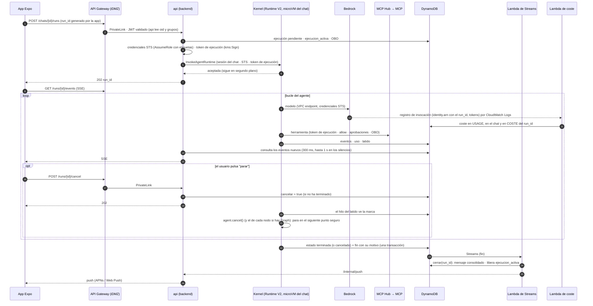
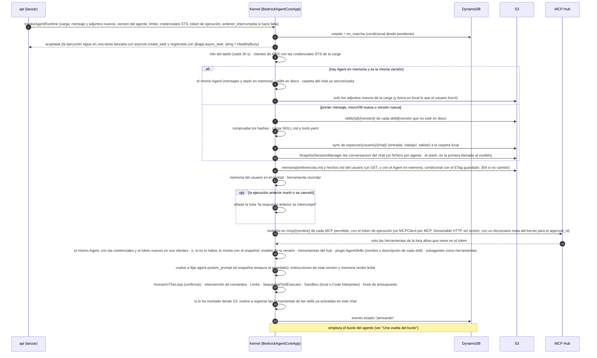
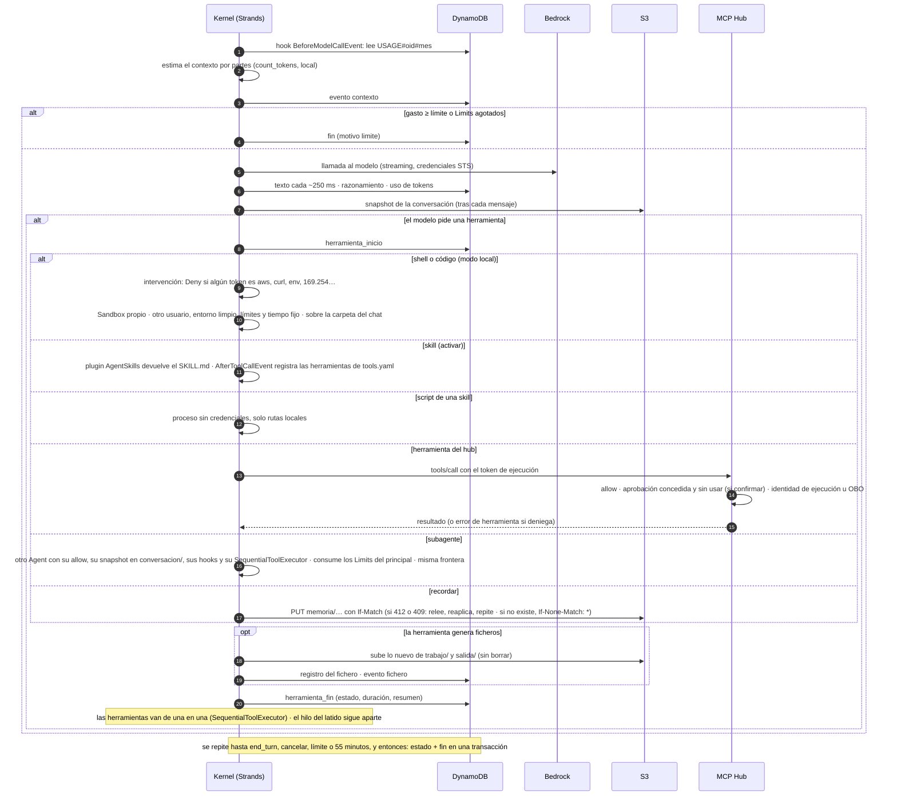
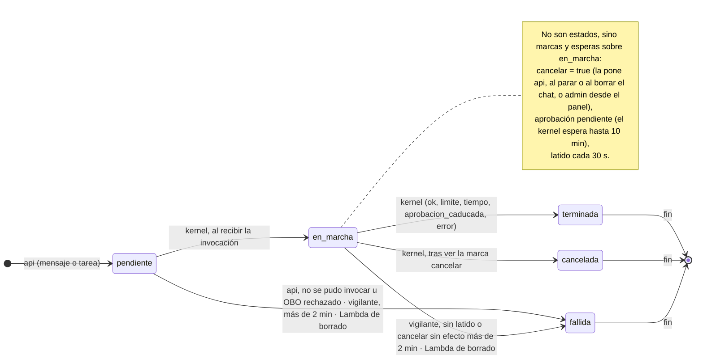
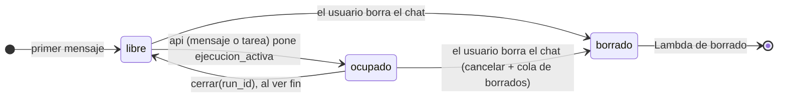
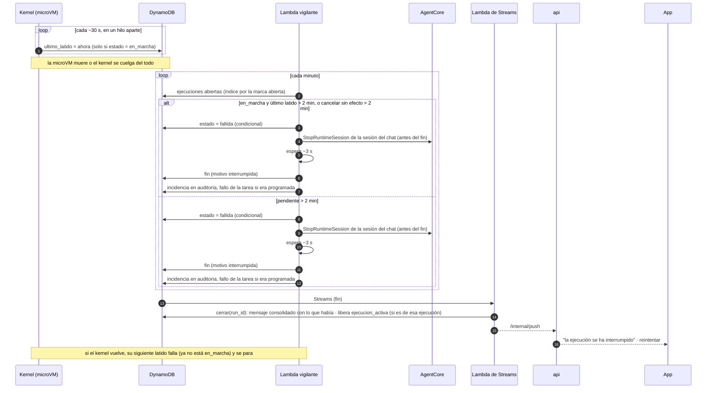
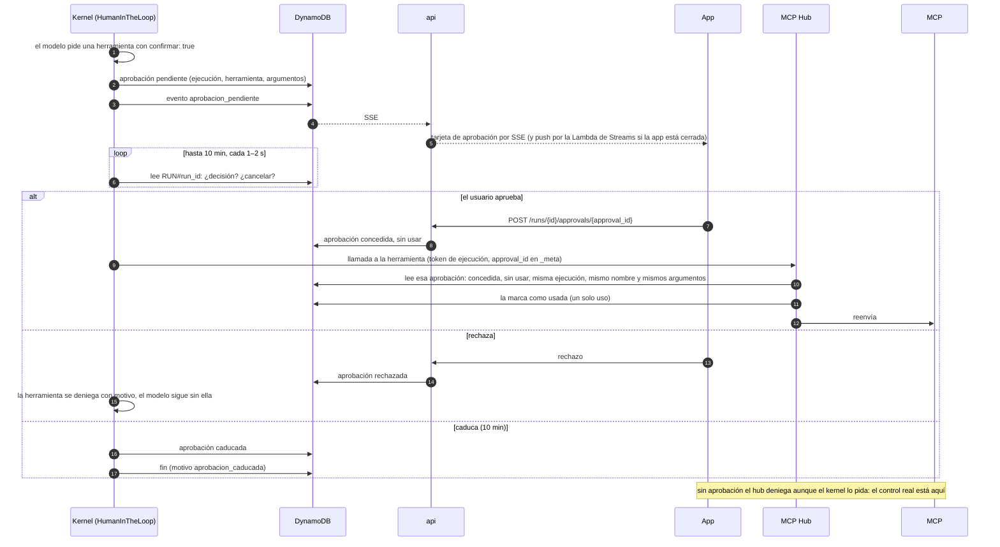
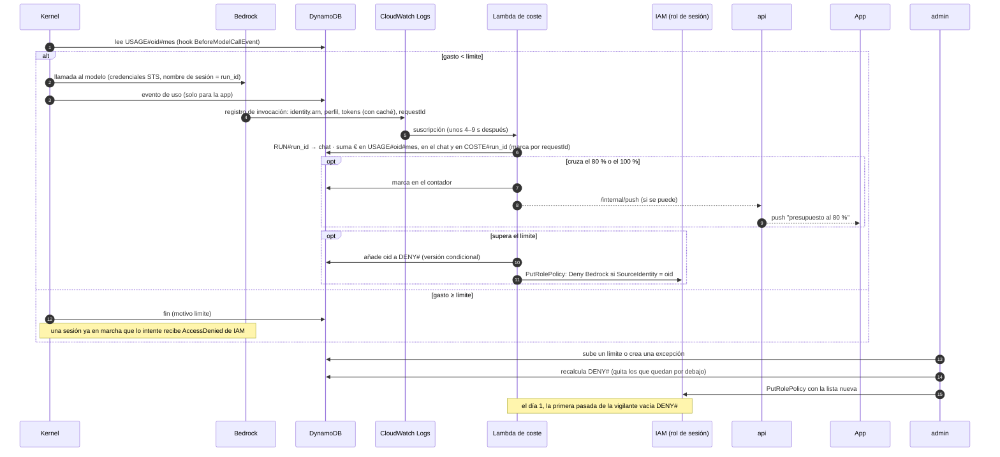
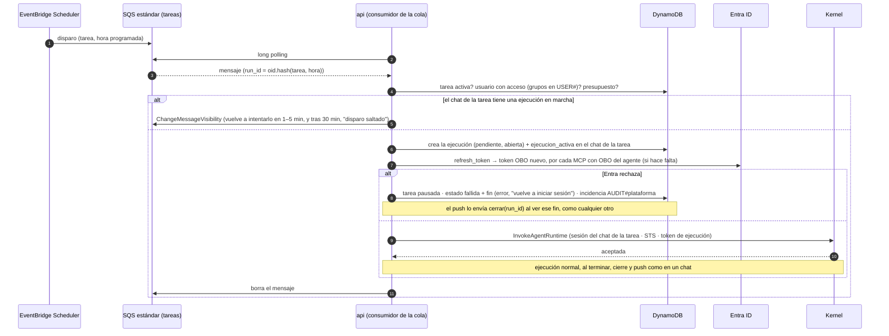
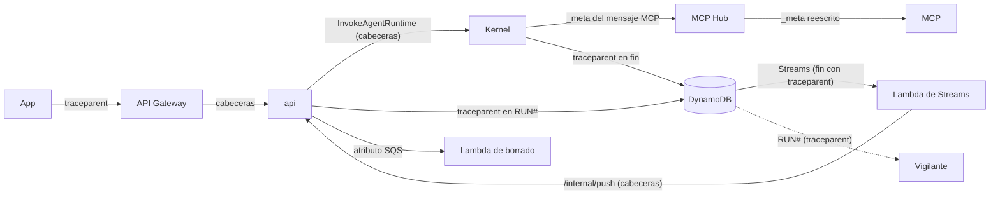

# Arquitectura de agentes

*Diseño de referencia · Expo (iOS y web) + REST · AWS us-east-1*

Cómo viaja un mensaje desde la app Expo (iOS y web) hasta el agente y vuelve: entrada por la cuenta iDMZ, backend sin estado en Fargate que crea la ejecución y la arranca, un kernel propio (Strands) en AgentCore Runtime V2, con una microVM por chat, que llama a los modelos de Bedrock directamente, y un MCP Hub propio por el que pasan todas las herramientas MCP y que aplica la lista de herramientas permitidas, las confirmaciones y el OBO.

Piezas: Expo + assistant-ui · Entra ID · API Gateway REST + SSE · ECS Fargate · DynamoDB · AgentCore Runtime V2 · MCP Hub propio · Bedrock: Claude · TypeScript + Python · CDK

## Índice

- [Decisiones clave](#decisiones)
- [Diagrama](#diagrama)
- [Recorrido de un mensaje](#recorrido)
- [Inventario y red](#cuentas)
- [La app](#app)
- [El panel](#panel)
- [El agente en ejecución](#agente)
- [Ciclo de vida](#ciclo)
- [Agentes, skills, modelos y conocimiento](#gobierno)
- [Red y aislamiento](#red)
- [MCP Hub](#hub)
- [Identidad y permisos](#identidad)
- [Persistencia](#persistencia)
- [Operación](#operacion)
- [Trazas de punta a punta](#trazas)
- [Construcción y despliegue](#construccion)
- [Entorno de pruebas](#pruebas)
- [Migración](#migracion)
- [Verificado](#verificado)
- [Por verificar](#verificar)

<a id="decisiones"></a>

## Decisiones clave

### Motor y modelos

- Un solo motor: kernel propio con Strands (Python) en AgentCore Runtime V2, en modo VPC, en us-east-1. Sin AgentCore Gateway, Identity ni interceptor; sin AgentCore Browser ni búsqueda web (el Web Search gestionado solo se expone detrás de un Gateway, así que tampoco); sin LiteLLM ni Dev Workbench.
- Inferencia directa a Bedrock con credenciales STS por ejecución, limitadas a los modelos de la versión del agente. El coste no lo declara el kernel: sale del registro de invocaciones de Bedrock, que trae la identidad que llama (el nombre de sesión de STS, que es el `run_id` y empieza por el `oid` del usuario) y los tokens; una Lambda lo suma por usuario, chat y ejecución. El gasto por usuario se corta con una denegación de IAM por `aws:SourceIdentity`.
- Toda conversación pasa por un agente; no hay chat directo con el modelo. Un modelo por agente (y por subagente) en cada versión.
- Sin AgentCore Memory: la conversación del agente son ficheros por chat en S3 (un snapshot de Strands por agente y, con el modo automático, el stash) y la memoria del usuario, dos textos en su carpeta que el modelo cambia con la herramienta `recordar` y el usuario edita en la app.
- Código del modelo, según el agente: en la propia microVM (con un `Sandbox` propio: el entorno local de Strands no aísla nada) o en Code Interpreter en una VPC sin DNS. El modo SANDBOX de Code Interpreter no aísla (la guía de AWS lo describe con "acceso externo limitado": llega a S3 y resuelve DNS; Unit 42 y BeyondTrust demostraron que sirve para sacar datos), por eso va en VPC.

### Backend, herramientas e identidad

- Dos servicios TypeScript sin estado en Fargate: `api` (lo que usa la app: chats, SSE, ficheros, OBO, rutas internas) y `admin` (lo que usa el panel), en procesos y con permisos distintos. En el documento, "el backend" es `api`.
- Una microVM por chat, no por mensaje: `runtimeSessionId` = HMAC(secreto, `oid` | chat), como en el repo actual (`session_binding.py`); la sesión vive mientras el chat se usa (15 minutos de inactividad, 8 h de vida como máximo) y cada mensaje es una invocación nueva en la misma microVM.
- Un solo lanzador, dentro de `api`: el mismo `lanzar()` sirve a los chats (al recibir el mensaje) y a las tareas programadas (Scheduler → cola SQS estándar → un consumidor en `api`). `api` crea la ejecución, asume el rol de sesión, firma el token de ejecución y llama a `InvokeAgentRuntime`; el kernel acepta en el acto, así que la petición solo espera uno o dos segundos. Sin cola FIFO ni Lambda lanzadora.
- MCP Hub propio para todas las herramientas MCP; los MCP propios siempre en Fargate, en la única VPC conectada a la red corporativa. Los scripts de skills corren en el kernel como herramientas tipadas.
- OBO solo en el backend: siembra una vez y renueva bajo demanda; el hub se lo pide por `/internal/obo`. Ni el kernel ni el hub ven el token de Entra del usuario.
- Ejecuciones de una hora como máximo, credenciales STS sin renovar; una Lambda vigilante limpia las que mueren y la Lambda de Streams las cierra con `cerrar(run_id)`, una función compartida que también llama la vigilante como respaldo y `api` cuando un envío choca con una ejecución ya terminada.

### Clientes y construcción

- Una app Expo (iOS y web) con assistant-ui y caché local cifrada; panel Next.js con shadcn/ui que solo es interfaz.
- Entrada por una cuenta iDMZ (API Gateway REST con streaming y un autorizador Lambda que solo valida el JWT de Entra; `oid` y grupos los lee `api` del propio token); Akamai solo delante del panel y de la app web.
- Todo en CDK, en un monorepo (TypeScript + Python) con contrato compartido en JSON Schema.
- Entorno de pruebas en una sola cuenta, con las VPC y paradas programadas; lo comprobado (en el código, en local y con las sondas contra AWS) está en [Verificado](#verificado) y lo que falta probar, en [Por verificar](#verificar).

### Glosario

| Término | Qué es |
|---|---|
| **Ejecución** | Un turno del agente: desde que el backend recibe un mensaje (o se dispara una tarea) hasta el evento `fin`. Tiene `run_id` = `{oid}.{sufijo}`: el `oid` del usuario en hexadecimal sin guiones y en minúsculas (32 caracteres), un punto y un sufijo de 26 caracteres en base32 y en mayúsculas (en un chat, un ULID que genera la app; en una tarea, los primeros 26 caracteres en base32 de RFC 4648 de SHA-256(tarea | hora programada), que nunca llevan el `=` de relleno, para que una entrega repetida dé el mismo id). Son 59 caracteres, dentro de los 64 de un nombre de sesión de STS: así el `run_id` es también el nombre de sesión de sus credenciales y el registro de invocaciones de Bedrock dice de qué usuario y de qué ejecución es cada llamada. Tiene además estado y dura una hora como máximo. |
| **Sesión del runtime** | La microVM de AgentCore de un chat; una por chat (`runtimeSessionId` = HMAC(secreto, `oid` \| chat), 64 caracteres hexadecimales). Corre las ejecuciones del chat una tras otra; se para tras 15 minutos sin uso o a las 8 h de vida, y la siguiente invocación con el mismo id arranca una microVM nueva y vacía. |
| **Credenciales STS de la ejecución** | Credenciales de AWS de una hora que `api` crea para esa ejecución al lanzarla (en las tablas, "credenciales STS de la sesión"), limitadas a su agente, su usuario y su chat. |
| **Token de ejecución** | Token firmado con KMS por `api` al lanzar la ejecución, que identifica la ejecución ante el MCP Hub y el backend: usuario, grupos, agente, versión y la lista `allow`. No es IAM ni es el token de Entra. |
| **Identidad de ejecución / OBO** | Dos formas de identificar al usuario ante un MCP: pasarle los datos del token de ejecución (el MCP usa su propio rol) o darle un token OBO de Entra con la audiencia del MCP (el MCP actúa como el usuario). |
| **Conversación del agente** | Lo que ve el modelo de un chat: los mensajes de Strands, con herramientas y resultados (con el modo automático, los resultados grandes recortados y el original en el stash, en la misma carpeta), en un fichero JSON (`snapshot_latest.json`) por agente en `espacios/{usuario}/{chat}/conversacion/`. Lo escribe y lo carga el kernel con el `SnapshotSessionManager` de Strands. No confundir con el mensaje consolidado, que es lo que ve el usuario. |
| **Memoria del usuario** | Dos ficheros de texto en `espacios/{usuario}/memoria/` (`preferencias.md` y `hechos.md`), comunes a todos sus agentes. El kernel los mete en el prompt; el modelo los cambia con la herramienta `recordar` y el usuario, desde la app. |
| **`anterior_interrumpida`** | Campo opcional de la carga con el motivo con que murió o se canceló la ejecución anterior del chat, para que el kernel añada una nota y la conversación del modelo cuadre con la del usuario. |
| **Espacio del chat** | El prefijo `espacios/{usuario}/{chat}/` de S3 (`entrada/`, `trabajo/`, `salida/`) que el kernel sincroniza con su carpeta local. En el mismo prefijo, fuera del sync, está `conversacion/` (la conversación del agente). |
| **Skill** | Instrucciones, scripts y `tools.yaml` versionados desde el panel; sus scripts se exponen al modelo como herramientas al activar la skill. |
| **Subagente** | Otro agente de Strands dentro del mismo kernel, expuesto al principal como herramienta, con su propia lista `allow`. |
| **Mensaje consolidado** | El elemento del chat que guarda `cerrar(run_id)` (normalmente desde la Lambda de Streams) al terminar una ejecución: texto, tarjetas resumidas, ficheros y valoración; su coste está al lado, en `COSTE#{run_id}` del chat, que suma la Lambda de coste. Es lo que ve el usuario; la conversación que ve el modelo es otro fichero, en `conversacion/` del chat en S3. |
| **`ejecucion_activa`** | Atributo del chat, con el `run_id`, que impide dos ejecuciones a la vez; lo pone `api` al crear la ejecución (de un mensaje o de una tarea) y lo borra `cerrar(run_id)` al ver el `fin` de esa misma ejecución. |
| **`cerrar(run_id)`** | Función de `packages/dominio`, idempotente paso a paso, que cierra una ejecución con `fin`: mensaje consolidado, borrado de `ejecucion_activa`, push. El coste no lo toca: lo suma la Lambda de coste desde el registro de invocaciones de Bedrock. La llaman la Lambda de Streams (camino normal), la vigilante (respaldo) y `api` (al chocar un envío con una ejecución ya terminada). |

<a id="diagrama"></a>

## Diagrama

Los números son los pasos del recorrido de un mensaje, justo debajo. Las líneas discontinuas son control: autenticación, tokens OBO, y el aviso de push. No se dibuja la VPC mínima de Code Interpreter (ver "Las cuatro VPC").


Leyenda: Cuenta iDMZ · Cuenta de la plataforma · AgentCore y kernel · Flujo de datos · Control / autenticación · Paso del recorrido

<a id="recorrido"></a>

## Recorrido de un mensaje

Los doce pasos, como secuencia (los números de la lista de abajo son los del diagrama de arquitectura; la secuencia lleva su propia numeración por mensaje):



1. **Inicio de sesión.** La app Expo entra con Entra ID (OIDC + PKCE, MFA y acceso condicional) y obtiene un token para la API de la plataforma. [La app](#app).
2. **Envío.** `POST /chats/{id}/runs` con un `run_id` (`{oid}.{ULID}`) que genera la app, al API Gateway REST de la iDMZ; el autorizador Lambda valida el JWT (firma, emisor, audiencia, caducidad) y `api` lee `oid` y grupos del propio token.
3. **Entrada a la plataforma.** PrivateLink hasta el NLB interno y una réplica cualquiera del backend en Fargate.
4. **Control y alta.** El backend comprueba que el usuario puede usar el agente (grupos de Entra) y que le queda presupuesto (si no, 402); crea la ejecución (`pendiente`) y pone `ejecucion_activa` en el chat (si ya hay una, 409); siembra los tokens OBO que falten. [Ciclo de vida](#ciclo), [Identidad y permisos](#identidad).
5. **Arranque.** El propio `api` emite las credenciales STS y el token de ejecución y llama a `InvokeAgentRuntime` con la sesión del chat: si la microVM del chat sigue viva, la invocación cae en ella (caliente); si no, AgentCore arranca una nueva desde la instantánea. El kernel pasa la ejecución a `en_marcha`, acepta al instante y sigue en segundo plano (`/ping` en `HealthyBusy`); `api` responde `202 {run_id}`. Si AgentCore rechaza por cuota (429) o con un 409 (`RetryableConflictException`, sesión cambiando de estado), `api` reintenta con espera durante unos segundos; si no lo consigue, cierra la ejecución y responde 503, y la app conserva el mensaje para reintentarlo. En la carga van el mensaje, la versión del agente, el límite de presupuesto, las credenciales y el token de ejecución (y, si la ejecución anterior del chat murió o se canceló, el motivo); si el kernel tiene en memoria el `Agent` del chat y es de la misma versión, lo usa; si no, lo monta desde S3 (`conversacion/` del chat). La memoria del usuario la lee siempre (con el `Agent` en memoria, con un `GET` condicional).
6. **Modelo.** El kernel (Strands) llama a Bedrock por los VPC endpoints de la VPC de agentes con las credenciales STS, limitadas a los modelos de esa versión; antes de cada llamada mira el gasto del mes. El corte que no depende de él es la denegación de IAM por `aws:SourceIdentity`. [El agente en ejecución](#agente).
7. **Herramientas MCP.** Todas por el MCP Hub (VPC de integraciones, por PrivateLink) con el token de ejecución: lista `allow`, aprobaciones, identidad de ejecución u OBO (pedido al backend), auditoría, y falla cerrado. [Red](#red), [Identidad](#identidad).
8. **Skills, código y ficheros.** Los scripts de skills corren en el kernel como herramientas tipadas; el código del modelo, en la microVM (modo local) o en Code Interpreter; el kernel sincroniza el espacio del chat con S3 y emite `fichero` por cada fichero nuevo. [El agente en ejecución](#agente).
9. **Eventos y coste.** El kernel escribe en DynamoDB, bajo su ejecución, el texto (cada ~250 ms), las herramientas, los ficheros, el uso de tokens (solo para enseñarlo en la app) y un latido cada 30 s. El coste que cuenta lo saca la Lambda de coste del registro de invocaciones de Bedrock, unos segundos después de cada llamada al modelo.
10. **Lectura en la app.** `GET /runs/{id}/events` (SSE) en cualquier réplica: el backend consulta los eventos nuevos de esa ejecución en DynamoDB por conexión abierta (una consulta por clave, barata) con dos ritmos: 300 ms mientras llegan eventos y 1 s en los silencios (5 s durante una aprobación pendiente), volviendo a 300 ms en cuanto llega algo; el streaming de texto no lo nota y se ahorra alrededor de la mitad de las consultas. Si no hay nada que enviar, `api` manda un comentario SSE de latido cada ≤60 s, porque API Gateway corta un stream tras 5 minutos sin datos y el NLB tras 350 s sin tráfico (fijo con listener TLS); y como un stream dura como mucho 15 minutos, la app reconecta con `Last-Event-ID` antes de llegar a ellos, o en cuanto se corta; `POST /runs/{id}/cancel` para parar; ficheros con URL prefirmada.
11. **Fin.** El kernel escribe `fin` (con su motivo y el uso que midió, solo informativo). La Lambda de Streams, al verlo, llama a `cerrar(run_id)`: guarda el mensaje consolidado en el chat, borra `ejecucion_activa` (salen los mensajes en cola de la app) y avisa al backend. Si el siguiente mensaje de la app llega antes (la app ve `fin` por el SSE en 300 ms; Streams tarda alrededor de 1 s), `api` cierra él mismo en vez de responder 409. [Ciclo de vida](#ciclo).
12. **App en segundo plano.** El backend envía la notificación por APNs o Web Push (salida por Netskope). Los chats no visibles se actualizan con `GET /chats?updated_since=…`.

<a id="cuentas"></a>

## Inventario por cuenta y red

### Cuenta iDMZ

- API Gateway REST regional con response streaming, con su VPC Link y el NLB que apunta al endpoint de PrivateLink
- Autorizador Lambda para tokens de Entra
- Endpoints de PrivateLink hacia el NLB interno de la plataforma
- Balanceador web (panel de administración, `admin` y app web), detrás de Akamai, con PrivateLink hacia la plataforma

### Cuenta de la plataforma

- Salida a internet solo por Netskope, y por dos caminos: la VPC de servicios (Entra, APNs y Web Push) llega por Transit Gateway únicamente a la VPC de salida de la empresa, donde está el túnel a Netskope, sin rutas hacia la red interna; la VPC de integraciones MCP sale por la red corporativa (Entra, para que los MCP validen el token OBO y hagan el suyo hacia APIs internas, y las APIs que usen los MCP). La VPC de agentes no tiene salida ninguna.
- Cuatro VPC sin IGW ni NAT: la de servicios (backend, panel, app web y Lambdas) y la de agentes (solo los runtimes), cada una con sus VPC endpoints; y la de integraciones MCP y la de Code Interpreter, descritas abajo. Solo la de integraciones llega a la red interna; servicios, solo a la salida de la empresa
- Dos servicios en ECS Fargate: `api` (el backend: chats, ejecuciones y SSE, ficheros, tareas, OBO, rutas internas y push) y `admin` (solo para el panel: agentes, skills, Knowledge Bases, modelos, presupuestos, usuarios, evaluaciones y auditoría), cada uno con su rol de IAM; `api` arranca toda ejecución (los chats al recibir el mensaje; las tareas, desde una cola SQS estándar en la que deja el disparo Scheduler y que consume el propio `api`); una Lambda de Streams (cierre y avisos de aprobación) sobre el stream de DynamoDB; una Lambda de coste suscrita al registro de invocaciones de Bedrock (gasto, avisos del 80/100 % y denegación de IAM); una Lambda vigilante de ejecuciones; y una cola SQS de borrados con su Lambda, que borra físicamente los chats; ejecuciones de una hora como máximo, sin renovar credenciales STS
- App web: el export estático de Expo servido por nginx en ECS Fargate, por el mismo camino que el panel (Akamai → ALB del iDMZ → PrivateLink). Desde el navegador, la app llama a la API del iDMZ como la app de iOS, con CORS para el dominio web, que en API Gateway REST se monta a mano: el método `OPTIONS` sin autorizador, las cabeceras CORS en las respuestas de `api` (la integración es proxy) y en las Gateway Responses de API Gateway (401, 403, 429, 5XX), y `Authorization`, `Content-Type`, `Last-Event-ID`, `X-Client-Version`, `traceparent` y `tracestate` entre las cabeceras permitidas. El bucket de S3 de los espacios también lleva CORS, para las subidas con URL prefirmada desde el navegador.
- VPC de integraciones MCP: el MCP Hub y los servidores MCP propios (ECS Fargate), y la única conexión a la red corporativa (Transit Gateway, Direct Connect o VPN). El kernel llega al hub por un VPC endpoint de PrivateLink, y el hub al backend por otro, solo para pedir tokens OBO; no hay rutas entre las VPC
- VPC de Code Interpreter: mínima, solo para sus sesiones, sin endpoints, rutas ni NAT y con el DNS desactivado
- Panel de administración (Next.js con shadcn/ui, en ECS Fargate). Acceso: administradores → Akamai → iDMZ → panel, con Entra y el grupo de administradores. Solo es la interfaz: la lógica y los permisos viven en el servicio `admin`, que no existe en el API Gateway.
- DynamoDB, cuatro tablas (ver [Persistencia](#persistencia)): actividad (chats y mensajes, ejecuciones con sus eventos y ficheros, aprobaciones, tareas programadas, usuarios y gasto), configuración (agentes y versiones, skills, catálogo de modelos, límites y lista de denegados), OBO (los tokens de Entra, solo para `api`) y auditoría, en la que cada pieza escribe bajo su prefijo (el kernel, solo bajo `AUDIT#kernel#`); y una Lambda que lee el stream de la de actividad (cierra las ejecuciones y avisa de las aprobaciones pendientes)
- S3 (espacios de los chats con su conversación, memoria de cada usuario, skills y documentos para RAG), KMS, CloudWatch y Secrets Manager (secreto de la app de Entra y credenciales de los MCP)
- Amazon Bedrock: los modelos del catálogo (de momento, solo Claude, por `bedrock-runtime`), invocados directamente por el kernel con las credenciales de la sesión. Los modelos de OpenAI por `bedrock-mantle` quedan fuera por ahora (ver "Modelos: uno por agente")
- Bedrock Knowledge Bases: índice de los documentos para RAG, administrado desde el panel (documentos, metadatos, sincronización)

### AgentCore (gestionado, us-east-1)

- Un solo motor: AgentCore Runtime, versión de plataforma V2 (restaura cada sesión desde una instantánea), con el kernel propio (Strands), en modo VPC en la VPC de agentes
- AgentCore Evaluations: calidad de los agentes, online sobre las trazas del kernel y en batch desde el panel
- Code Interpreter (en su propia VPC sin DNS, para el código libre de los agentes que lo usan), llamado directamente por el kernel. Sin AgentCore Memory: la conversación y la memoria del usuario son ficheros en S3. Sin Browser ni búsqueda web: los agentes no salen a internet. Sin AgentCore Gateway ni AgentCore Identity: las herramientas pasan por nuestro MCP Hub, que pide los tokens OBO al backend, el único que los guarda y los renueva.

### Las cuatro VPC

| VPC | Qué contiene | Endpoints | Salida | DNS Firewall permite | Quién llega |
|---|---|---|---|---|---|
| **Servicios** | Backend (`api`), `admin`, panel, app web, NLB interno y las Lambdas | Los servicios de AWS que usan: DynamoDB y S3 (gateway), AgentCore (plano de datos para `InvokeAgentRuntime` y `StopRuntimeSession`, y control), Bedrock (títulos), STS (`AssumeRole` de `api`), IAM (`PutRolePolicy`), KMS, Secrets Manager, SQS, Scheduler, Logs, X-Ray… | Transit Gateway solo hacia la VPC de salida de la empresa (túnel a Netskope): Entra, APNs, Web Push. En pruebas, un NAT Gateway | AWS, Entra (con Graph), APNs, Web Push | La iDMZ por PrivateLink; la VPC de integraciones por PrivateLink, solo `/internal/obo` |
| **Agentes** | Solo los runtimes del kernel | `bedrock-runtime`, AgentCore (Code Interpreter), el MCP Hub (PrivateLink), DynamoDB (tablas de actividad y de auditoría) y S3 (gateway, que también deja pasar el bucket de capas de ECR), Logs, X-Ray, ECR (`api` y `dkr`) | Ninguna | `*.us-east-1.amazonaws.com` (el comodín solo vale al principio), los nombres sin región que se usen, el hub y los CNAME intermedios de todos ellos (las reglas inspeccionan la cadena por defecto); todo lo demás bloqueado, y si falla, cerrado | Nadie por red: `api` llama a la API de AgentCore |
| **Integraciones MCP** | MCP Hub, MCP propios y Cloud Map | `bedrock-agent-runtime` (Knowledge Bases), DynamoDB (tabla de actividad: aprobaciones en lectura y marcado; tabla de auditoría bajo `AUDIT#hub#`), KMS (verificar el token de ejecución), Secrets Manager, Logs, métricas de CloudWatch y X-Ray; y los que necesiten Fargate y Service Connect (`ecs`, `ecs-agent`, `ecs-telemetry`, ECR y S3), salvo que salgan por la red corporativa (por verificar) | Red corporativa (Transit Gateway, Direct Connect o VPN) y, por ella, Netskope | AWS, Entra y los dominios internos | El kernel por PrivateLink; los MCP externos, por la red corporativa |
| **Code Interpreter** | Las sesiones de Code Interpreter | Ninguno | Ninguna; DNS desactivado | — | AgentCore por su plano de control (ficheros por la API) |

<a id="app"></a>

## La app (Expo + assistant-ui)

Una sola app Expo para iOS y web (react-native-web) con la interfaz de chat de `@assistant-ui/react-native`. assistant-ui solo pinta y gestiona la interacción: los chats, los mensajes, el coste y los ficheros viven en nuestro backend, así que lo mismo se ve en el iPhone y en el navegador.

### Entrar y elegir agente

- **Inicio de sesión** con Entra (OIDC + PKCE con `expo-auth-session`), con MFA y acceso condicional. En iOS el token se guarda en el llavero (`expo-secure-store`); en web, en memoria con renovación silenciosa.
- **Nuevo chat → catálogo de agentes**: solo los que permiten los grupos de Entra del usuario, cada uno con nombre, descripción, icono y lo que sabe hacer (buscar en documentos, ejecutar código, generar ficheros). El chat queda ligado a ese agente.
- **Ajustes**: perfil, idioma, tema claro u oscuro, notificaciones, memoria y cerrar sesión.

### Chats

- **Lista de chats** en un menú lateral: búsqueda, renombrar, archivar y borrar. El título lo propone el backend con un modelo barato tras el primer mensaje.
- **Conversación en streaming**: texto en Markdown, tarjetas para lo que hace el agente ("Buscando en documentos…", "Ejecutando código…", "Generando el informe…") y el razonamiento plegado si el modelo lo da.
- **Encolar mensajes**: mientras el agente trabaja, el usuario puede seguir escribiendo. Los mensajes quedan en una cola en la app, visibles en la caja de texto, donde se pueden reordenar o quitar, y se envían en orden cuando termina la ejecución. La cola la guarda en la caché local nuestro código (`createMessageQueue` de assistant-ui solo la tiene en memoria) y se vuelve a encolar al abrir el chat, así que sobrevive a cerrar la app.
- **Cancelar** con el botón de parar (marca de cancelación en el backend); **reintentar** y **copiar** en cada respuesta.
- **Contexto del chat**: un indicador pequeño junto a la caja de texto con lo que ocupa la conversación en la ventana del modelo ("34 %"); al pulsarlo, el reparto: instrucciones y memoria, herramientas, conversación y resultados de herramientas. Avisa cuando se acerca al límite y el agente va a empezar a recortar o resumir, para que el usuario sepa por qué el agente "olvida" lo de hace mucho y pueda abrir un chat nuevo. Sale del evento `contexto` del SSE; al reabrir un chat, del último guardado en el mensaje consolidado.
- **Seguir más tarde**: si la app pasa a segundo plano la ejecución continúa; al volver, la app reconecta el SSE con `Last-Event-ID` y recupera lo que falte. El SSE se lee con el `fetch` de `expo/fetch`, que Expo instala como `fetch` global en nativo y que entrega el cuerpo en streaming (el de React Native no); la app parsea los eventos y envía ella misma `Last-Event-ID` al reconectar. Si una tarea larga termina con la app cerrada, llega una notificación.

### Caché local de chats

- **El backend es la fuente de verdad; la app guarda una copia** de la lista de chats y de los mensajes de los chats abiertos, así se abren al instante y sin conexión se puede leer.
- **Solo pide lo nuevo:** la lista con `GET /chats?updated_since=<fecha>` (incluye los borrados, para quitarlos) y cada chat con `GET /chats/{id}/messages?after=<seq>`. Lo que llega por SSE se añade a la copia.
- **Dónde:** en iOS, SQLite (`expo-sqlite`) cifrado con SQLCipher, con la clave en el llavero; en web, IndexedDB, limitado a los últimos 30 días y con la opción "no guardar en este equipo".
- **Seguridad:** al cerrar sesión o cambiar de usuario se borra todo. Los ficheros no se guardan: solo sus datos (nombre, tipo, tamaño) y se descargan al abrirlos.

### Ficheros

- **Adjuntar** PDF, imágenes, Excel/CSV o Word desde el selector de documentos o la cámara. La app pide al backend una URL prefirmada, sube el fichero directamente a S3 (`espacios/{usuario}/{chat}/entrada/`) y envía solo la referencia con el mensaje; el kernel lo trae con su sync y, si hace falta, lo copia a Code Interpreter. Límite de tamaño y tipos permitidos por agente.
- **Artefactos**: la app se entera por el evento `fichero` del SSE (o, si estaba cerrada, al reconectar con `Last-Event-ID` o al sincronizar el chat). Cada fichero aparece como tarjeta en el mensaje (nombre, tipo, tamaño, vista previa de PDF e imágenes) con descargar y compartir (hoja de compartir de iOS). Las descargas usan URLs prefirmadas de pocos minutos.
- **Mis ficheros**: todos los artefactos del usuario, por chat, con filtro y borrado.

### Coste

- **Lo que llevas este mes**: en la cabecera y en ajustes, "12,40 € de 50 €" con una barra, el límite y de dónde viene (por defecto, tu grupo o una excepción).
- **Coste de cada chat** en su cabecera (lo suma la Lambda de coste desde el registro de invocaciones de Bedrock, unos segundos después de cada llamada al modelo).
- **Avisos**: al 80 % un aviso en la app y una notificación; al 100 % la caja de texto se bloquea con un mensaje claro ("has alcanzado tu límite mensual; se renueva el día 1") y cómo pedir una ampliación. El backend rechaza los mensajes nuevos; IAM corta lo que ya está en marcha.

### Memoria y valoración

- **"Lo que recuerdo de ti"**: la memoria del usuario, común a todos los agentes, tal cual: dos textos (preferencias y hechos) que el usuario lee, edita y guarda, o vacía, desde ajustes (`GET` y `PUT /me/memory`). Muestra cuándo cambió por última vez y quién (él o un agente, con el chat). Un interruptor "usar mi memoria" la desactiva sin borrarla: el kernel no la carga ni ofrece `recordar`. Si un agente la cambió mientras el usuario editaba, al guardar la app enseña la versión nueva y pide repetir el cambio (ver "Sin pisarse" en "Conversación y memoria (S3)").
- **Valorar respuestas**: pulgar arriba o abajo y comentario opcional. Se guarda en el mensaje consolidado del chat (dura 12 meses, no los 90 días de la ejecución), se ve en el panel por agente y versión, y las malas respuestas sirven para ampliar los conjuntos de pruebas de las evaluaciones.

### Tareas programadas

- **Crear**: el usuario elige un agente de los que puede usar, escribe la instrucción ("cada lunes a las 8, resume las ventas de la semana y mándame el PDF") y la frecuencia (diaria, semanal, mensual o una vez, con hora y zona horaria).
- **Resultado**: cada tarea tiene su propio chat; cada ejecución añade un mensaje con sus ficheros y llega una notificación. El usuario puede seguir conversando sobre el resultado.
- **Gestionar**: lista de tareas con próxima ejecución y estado; pausar, editar, borrar y "ejecutar ahora". Si una tarea se pausa sola (sin presupuesto, sin acceso al agente, tokens OBO rechazados por Entra o varios fallos seguidos), la app dice por qué.

### Notificaciones y voz

- **Push**: tarea larga terminada, aprobación pendiente, aviso de gasto al 80 % y al 100 %. En iOS por APNs (el backend sale por Netskope); en web, Web Push si el navegador lo permite. La app registra el dispositivo al iniciar sesión.
- **Dictado**: botón de micrófono en la caja de texto; en iOS con el reconocimiento de voz del sistema y en web con la Web Speech API donde exista. Solo dictado, no conversación por voz.

### Cómo se conecta assistant-ui

| Pieza de assistant-ui | Con qué la conectamos |
|---|---|
| `useRemoteThreadListRuntime` + `RemoteThreadListAdapter` | La lista de chats: `list`, `initialize`, `rename`, `archive`, `delete` y `generateTitle` sobre `/chats` del backend. |
| `useExternalStoreRuntime` (uno por chat) | Los mensajes los tenemos nosotros (construidos a partir de los eventos SSE y del historial del backend); `onNew` crea la ejecución (`POST /chats/{id}/runs`) y `onCancel` la cancela. Así la reconexión y el historial no dependen de assistant-ui. |
| Partes de mensaje y Tool UI | Cada evento del kernel se convierte en una parte: texto, razonamiento, llamada a herramienta (con su tarjeta propia para `buscar_documentos`, código y ficheros) y fichero generado. |
| Adaptador `attachments` | Uno propio: lee el fichero desde su URI de Expo, lo sube a S3 con la URL prefirmada y añade la referencia al mensaje. |
| Adaptadores `feedback` y `dictation` | `POST /chats/{id}/messages/{seq}/feedback` (la valoración cuelga del mensaje consolidado, que dura más que la ejecución); en iOS, un `DictationAdapter` propio sobre el reconocimiento de voz del sistema (assistant-ui no trae adaptador nativo; el paquete, por elegir); en web, `WebSpeechDictationAdapter` de `@assistant-ui/core`. |
| Adaptador `queue` | Cola de mensajes durante una ejecución con `createMessageQueue`: avisa a la cola cuando empieza (`notifyBusy`) y termina (`notifyIdle`) la ejecución, y la caja de texto la muestra con `ComposerPrimitive.Queue`, sin `QueueItemPrimitive.Steer`. El driver de la cola no lleva `cancel`: un envío normal con la ejecución en marcha va al carril `steer` del runtime y, con `cancel`, interrumpiría la ejecución; sin él, sale el siguiente al terminar, como uno encolado. Al parar, el runtime avisa a la cola (`notifyCancelled`) antes de llamar a `onCancel`: lo encolado se queda hasta el siguiente envío. El backend sigue aceptando un mensaje a la vez por chat. |
| Aprobaciones | `aprobacion_pendiente` se traduce a la parte `approval` de la llamada a herramienta, con el `approval_id`; `onRespondToToolApproval` llama a `POST /runs/{id}/approvals/{approval_id}`; al caducar, `resolution: "expired"`, para que la tarjeta deje de ofrecer los botones. |
| Caché local | Los mensajes que pasamos a `useExternalStoreRuntime` salen primero de la copia local y se completan con lo nuevo del backend y del SSE. |
| Fuera de assistant-ui | Coste (`GET /me/usage`), catálogo de agentes (`GET /agents`), memoria (`/me/memory`), ficheros (`/me/files`) y dispositivos para push (`POST /me/devices`): pantallas propias con TanStack Query. |

### Eventos del SSE

El kernel escribe en DynamoDB todo lo que va haciendo el agente, no solo el texto, y la app lo pinta como tarjetas dentro del mensaje. Cualquier evento puede llevar el atributo `subagente` con el nombre del subagente que lo emite; la app lo pinta como tarjeta plegada dentro de la herramienta que lo llamó. Entre eventos, `api` intercala comentarios SSE de latido (ver el paso 10 del recorrido), que la app ignora.

| Evento | Qué lleva | Cómo se ve en la app |
|---|---|---|
| `texto` | Fragmentos de la respuesta (agrupados cada ~250 ms) | El texto escribiéndose |
| `razonamiento` | Resumen del razonamiento, si el modelo lo da y el agente lo permite | Bloque plegado "Pensando…" |
| `herramienta_inicio` | Nombre, etiqueta legible ("Buscando en documentos") y resumen de los argumentos | Tarjeta con indicador "en curso" |
| `herramienta_fin` | Estado (bien o error), duración y resumen corto del resultado; en las búsquedas, las citas (título y enlace) | La tarjeta pasa a hecha o a error |
| `skill_activada` | Qué skill se activó | Línea discreta en la tarjeta |
| `aprobacion_pendiente` | Herramienta, resumen de los argumentos y hasta cuándo se espera | Tarjeta de aprobación con aprobar y rechazar |
| `fichero` | Nombre, tipo, tamaño y referencia del fichero | Tarjeta del fichero con vista previa |
| `estado` | "Esperando al modelo", "reintentando", "esperando aprobación"… | Indicador bajo el mensaje |
| `contexto` | Antes de cada llamada al modelo: tokens estimados por partes (instrucciones y memoria, definiciones de herramientas, conversación, resultados de herramientas), el total y el porcentaje de la ventana del modelo; si hubo recorte o resumen, cuánto | Indicador de contexto del chat y su reparto |
| `uso` | Tokens de entrada, salida y caché de cada llamada al modelo, según el kernel (informativo: el coste que cuenta es el de la Lambda de coste) | Uso del mensaje en curso |
| `aviso` | Límite alcanzado: el kernel termina la ejecución con `fin` (`motivo = limite`); el aviso del 80 % llega por push y por `GET /me/usage`, no por el SSE | Aviso en la app |
| `error` | Un error recuperable o no (texto para el usuario); si no se puede seguir, le sigue `fin` | Aviso en el mensaje |
| `fin` | Siempre el último evento de una ejecución: `motivo` (`ok`, `cancelado`, `error`, `limite`, `tiempo`, `aprobacion_caducada`, `interrumpida`) y el uso que midió el kernel (informativo: el coste que cuenta es el de la Lambda de coste). Lo escribe el kernel; si no, la vigilante (`interrumpida`), `api` (`error`, si no pudo arrancarla) o la Lambda de borrado (`cancelado`). | Fin del mensaje; la Lambda de Streams llama a `cerrar(run_id)` al verlo |

### Qué no viaja por el SSE

- **Resultados de herramientas**: pueden ser grandes o sensibles (fragmentos de documentos, respuestas de APIs); solo un resumen y, en búsquedas, las citas.
- **Argumentos**: solo un resumen, sin tokens ni datos internos.
- **Razonamiento**: como mucho el resumen, y solo si el agente lo permite.

### Cómo se generan

- Texto y llamadas a herramientas: los eventos de streaming de Strands; los de un subagente llegan al stream del principal como `AgentAsToolStreamEvent`, y los de un nodo de grafo, como `MultiAgentNodeStreamEvent`: de ahí sale el atributo `subagente`.
- Inicio y fin de cada herramienta: sus hooks (`BeforeToolCallEvent` y `AfterToolCallEvent`), registrados en cada agente: los de un subagente no pasan por los del principal.
- Cada herramienta declara su etiqueta y cómo resumir su resultado: las de skills en `tools.yaml`, las de los MCP en su registro del hub, definido en CDK (el panel las muestra).

### Historial

- Al terminar cada ejecución, `cerrar(run_id)` guarda el mensaje final consolidado (texto, tarjetas resumidas, ficheros y valoración; el coste, al lado, en `COSTE#{run_id}`) como elemento del chat: al reabrir un chat se ven las mismas tarjetas, ya plegadas. Los eventos sueltos del SSE caducan a las 48 h (ver [Retención de datos](#retencion)).

<a id="panel"></a>

## El panel de administración

Next.js con la interfaz hecha con shadcn/ui (componentes sobre Base UI, su opción por defecto desde julio de 2026, y Tailwind), en ECS Fargate, al que se llega por Akamai → ALB web del iDMZ → PrivateLink, con login de Entra. Es solo la interfaz: cada acción llama al servicio `admin` (por el mismo ALB web, bajo `/admin-api`), que comprueba el rol, aplica el cambio y lo deja auditado. `admin` es un proceso aparte del backend de la app, con su propio rol de IAM: es el único que puede escribir agentes, versiones, skills, precios y límites; el backend (`api`) es el único que asume el rol de sesión, firma tokens de ejecución, descifra OBO y habla con Entra.

### Acceso y roles

- **Administradores de plataforma** (grupo de Entra): agentes, skills, Knowledge Bases, evaluaciones, modelos y precios.
- **Administradores de presupuestos** (otro grupo de Entra): límites y excepciones por usuario.
- **Acceso a contenido** (tercer grupo de Entra, el más restringido): abrir conversaciones concretas desde la auditoría o desde una valoración. Cada apertura queda auditada con el motivo.
- MFA y acceso condicional de Entra. Cada cambio queda en la auditoría: quién, cuándo, valor anterior y nuevo, y motivo cuando se pide.

### Agentes

- **Ficha del agente** (sin versión, se aplica al momento): nombre, descripción, icono y qué grupos de Entra lo ven en la app.
- **Configuración** (versionada): todo lo que cambia cómo responde el agente, de las instrucciones a las herramientas; la lista completa está en "Versiones de agentes".
- **Contexto por ejecución**: en el chat de prueba y en el detalle de cualquier ejecución, el reparto del contexto en cada vuelta (los eventos `contexto`) junto al uso real de tokens. Sirve para ver qué agente lleva demasiadas herramientas o skills, o qué herramienta devuelve resultados enormes.
- **Versiones:** se edita un borrador, se prueba en un chat de prueba del panel, se pasan sus pruebas (evaluación batch) y se compara con la versión publicada antes de publicar. Volver atrás es un clic.

### Skills

- **Subir una versión** (instrucciones, scripts y `tools.yaml`) desde el panel. Cada versión es inmutable: `skills/{id}/{versión}/` en S3, con su hash, autor y estado en DynamoDB.
- **Validación al subir:** `tools.yaml` contra su esquema JSON (`formato: 1`, ver el ejemplo en "Agentes, skills, modelos y conocimiento"), que el kernel vuelve a aplicar al cargarla; además, que cada script existe y no sale de `scripts/` (tampoco por un enlace), que sus `import` fuera de la biblioteca estándar están en `librerias`, que `entrada` y `salida` son esquemas JSON válidos, que el `resumen` solo usa campos de la `salida`, que ningún nombre se repite ni es del kernel (`skills`, `recordar`, `retrieve_context`) y que el `name` del `SKILL.md` es el id de la skill. Comprobado con la sonda 16 (10 casos malos, todos rechazados).
- **Revisión y aprobación:** diferencia con la versión anterior (ficheros, herramientas añadidas o quitadas, cambios de parámetros, si escribe ficheros, librerías que pide). La aprueba otro administrador; solo las aprobadas se pueden asignar.
- **Dependencias:** el panel rechaza una versión que pida librerías que la imagen actual del kernel no trae; añadirlas es publicar una imagen nueva del kernel.
- **Uso y retirada:** qué agentes usan cada versión y aviso de los que van con una antigua; retirar una versión impide asignarla de nuevo.

### Knowledge Bases

- **Documentos:** subir y borrar (URL prefirmada a S3 `documentos/`) y editar sus metadatos: agentes y grupos de Entra que pueden verlos, idioma.
- **Sincronización:** lanzar la ingesta y ver su estado y errores por documento.
- **Probar:** una búsqueda de prueba como si fuera un usuario concreto, para comprobar los filtros por grupo.
- Las Knowledge Bases en sí se crean con CDK; el panel gestiona su contenido.

### Evaluaciones y calidad

- **Conjuntos de pruebas** por agente: pregunta, respuesta esperada, aserciones y herramientas que debería usar. Se pueden crear a partir de respuestas mal valoradas en la app.
- **Resultados:** notas de la evaluación online (muestreo de sesiones reales) y de cada batch, por agente y versión, con su tendencia y las alarmas.
- **Valoraciones de los usuarios:** pulgares y comentarios, con enlace a la conversación (con permiso de acceso a contenido, auditado).

### Tareas programadas

- Todas las tareas de todos los usuarios: agente, frecuencia, última y próxima ejecución, fallos y coste; pausar o borrar cualquiera.
- Límites: tareas activas por usuario y frecuencia mínima.

### Usuarios

- **La lista de quien ha entrado**: el backend crea `USER#{oid}` en la primera petición autenticada (nombre, correo y grupos del token, primera y última entrada) y actualiza la última entrada y los grupos en cada petición, como mucho una vez por hora. No se sincroniza nada con Entra ni con Graph: la lista es la de los que han usado la plataforma.
- **Dar de baja**, desde la ficha del usuario, con motivo y auditado: `estado = baja`. Desde ese momento el backend rechaza sus peticiones aunque el token siga siendo válido, `api` no arranca sus tareas (quedan pausadas) y `admin` pone `cancelar` en sus ejecuciones en marcha. El hub no mira el estado del usuario: sin ejecuciones nuevas no hay llamadas. Reactivar es volver a `activo`.
- **Casi sin borrado**: sus datos caducan por los TTL de siempre (ver [Retención de datos](#retencion)); lo único que se borra al darlo de baja es su memoria (`memoria/` en S3, un `DeleteObjects`), que no caduca por edad.

### Presupuestos y consumo

- **Ficha de usuario:** gasto del mes por modelo y agente, límite efectivo y de dónde viene, crear una excepción, y qué agentes puede usar y por qué grupo de Entra.
- **Consumo global:** coste por agente, modelo y día; estimación de Runtime y Code Interpreter; coste de plataforma (Evaluations) aparte; y la conciliación mensual con la factura.

### Seguridad y auditoría

- **Intentos denegados**, leídos de la tabla de auditoría de DynamoDB (consultas instantáneas): comandos bloqueados, herramientas fuera de la lista `allow`, aprobaciones rechazadas o caducadas, fallos de OBO y cortes de presupuesto, con filtros por agente, usuario y fecha.
- **Detalle**: qué se intentó, qué regla lo bloqueó y enlace a la traza completa del mensaje, para ver qué leyó el agente antes (un documento, la respuesta de un MCP).
- **Tendencias y alarmas**: intentos por agente y por día, y las alarmas que han saltado; útil para detectar un documento malicioso o un agente cuyas instrucciones lo empujan a hacer lo que no debe.
- **Quién lo ve**: los administradores de plataforma. Como los comandos pueden contener datos de los usuarios, cada consulta queda a su vez en la auditoría del panel.

### Límites y excepciones

- **Qué se configura:** un límite mensual en € por defecto; límites por grupo de Entra (si el usuario está en varios, se aplica el más alto); excepciones por usuario (importe fijo o aumento temporal, siempre con motivo y fecha de caducidad).
- **Precedencia:** excepción del usuario > grupo más alto > por defecto.
- **Pantallas:** "Presupuestos", con las reglas por grupo (el grupo se busca en Entra con Microsoft Graph, con un registro de aplicación propio de `admin` que solo puede leer grupos; el secreto del OBO sigue siendo solo de `api`) y las excepciones vigentes; y la ficha de usuario, con el gasto del mes por modelo y agente, su límite efectivo y de dónde viene, y un botón para crear una excepción.
- **Permisos y auditoría:** solo un grupo de Entra de administradores de presupuestos cambia límites; cada cambio guarda quién, valor anterior y nuevo, y motivo.
- **Datos:** reglas en DynamoDB (`LIMIT#DEFAULT`, `LIMIT#GROUP#<id>` y `LIMIT#USER#<oid>`). Los grupos del usuario se toman de su token de Entra al crear la ejecución (en las tareas programadas, de los guardados en `USER#{oid}` en su última petición) y se guardan en ella.
- **Cómo llega al corte:** el kernel recibe el límite efectivo en la carga de la invocación y lee el gasto del mes antes de cada llamada al modelo; la Lambda de coste aplica la denegación de IAM al cruzar el límite. Un cambio de límite desde el panel (por defecto, grupo o excepción) lo aplica `admin` al momento: recalcula qué usuarios de la lista de denegados quedan por debajo de su límite nuevo y los quita (un usuario denegado no genera uso, así que la Lambda de coste no volvería a mirarlo). El contador lleva el mes en la clave (`USAGE#{oid}#2026-11`), así que no hay que poner nada a cero.
- **Avisos:** al cruzar el 80 % y el 100 %, la Lambda de coste deja una marca en el contador y avisa al backend por su ruta interna (`POST /internal/push`, en la misma VPC). Solo el backend envía push (tiene las credenciales de APNs y Web Push) y la app lee el estado en `GET /me/usage`. El kernel no emite avisos de presupuesto: su evento `aviso` queda para el corte.

<a id="agente"></a>

## El agente en ejecución

Dónde corre el kernel y qué hace durante una ejecución.

### Arranque de una ejecución

Qué hace el kernel al recibir una ejecución:



### Una vuelta del bucle

Una vuelta del bucle del agente, con las intervenciones y las herramientas:



### Por qué un kernel propio

- Sin AgentCore Gateway, Identity ni interceptor: el kernel propio llama directamente a Bedrock, Code Interpreter y S3 con las credenciales STS de la sesión, y todas las herramientas MCP pasan por nuestro MCP Hub; los scripts de skills corren en el propio kernel.
- Un único camino y una única lógica de seguridad, en nuestro código: lo que se puede limitar por IAM va directo; lo que depende de quién sea el usuario (datos, APIs internas, OBO) va por el hub.
- A cambio, la imagen del kernel, el hub y las actualizaciones de Strands son nuestras.

### Runtime V2 y lo que exige al kernel

- **Qué es**: con `platformVersion` = `V2`, AgentCore arranca el contenedor una vez, hace una instantánea cuando `/ping` responde sano y restaura cada sesión nueva desde ella. Arranque en frío publicado por AWS: P75 de 1,9–2,0 s (V1: 5,4–30 s), medido en modo PUBLIC con un servidor eco y sin llamada al modelo. Con nuestra imagen real, en la VPC sin salida: P50 1,79 s y P95 2,62 s (sonda 10). El tiempo de inactividad de una sesión (`idleRuntimeSessionTimeout`, 15 minutos por defecto) solo corre cuando `/ping` no dice `HealthyBusy`; nuestras ejecuciones están siempre ocupadas hasta `fin`, así que ninguna se corta por inactividad. Con una microVM por chat se deja en esos 15 minutos (900 s): el siguiente mensaje del chat cae en caliente, en la misma microVM, y una sesión olvidada se libera sola; la sesión inactiva se cobra, aunque V2 recupera la memoria inactiva a los 120 s (según la página de precios). `maxLifetime` se deja en 8 h (28.800 s, el máximo para microVM y el valor por defecto): cuenta desde que se crea la microVM y no se reinicia con cada invocación, así que con 1 h cortaría a mitad una ejecución que empezara con la microVM ya vieja. Región: us-east-1.
- **Antes de la instantánea**: cargar al arrancar todo lo caro (Strands y las librerías de skills) y no responder sano en `/ping` hasta terminar; debe ocurrir en menos de 120 s (con la imagen real, 1,34 s: sonda 10). Ojo con las librerías del código del modelo (pandas, matplotlib, python-pptx, reportlab): corren en otro Python, el del `Sandbox`, y calentarlas en un proceso que termina no deja nada; tras restaurar, su primer uso pasa de 10 s (el segundo, 2,4 s). Por eso, antes de la instantánea el kernel arranca un proceso del Python de datos con esas librerías ya importadas, que se queda esperando y hace `fork` para cada comando del modelo (el hijo se pone el usuario del `Sandbox`, sus límites y su espacio de red vacío antes de ejecutar nada); el tiempo máximo de un comando cuenta desde el `fork`. Crear o actualizar el runtime tarda minutos porque prepara la instantánea.
- **Después de restaurar**: todas las instancias parten de la misma memoria. Valores aleatorios e identificadores por petición (`os.urandom()`, `secrets`, `uuid4()`), nunca al arrancar; también los de las trazas. La hora se lee en cada petición (`time.monotonic()` no avanza durante la instantánea). Los clientes de AWS se crean con las credenciales STS de cada carga, nunca al arrancar. Las conexiones se rehacen en la primera llamada y no se fija el puerto de origen.
- **Una microVM por chat, varias ejecuciones**: la microVM vive entre mensajes del mismo chat (memoria y disco persisten entre invocaciones de la misma sesión; si se para, el mismo id arranca una nueva y vacía). El kernel aprovecha lo que tiene y solo vuelve a S3 cuando no puede fiarse de ello:
  - **La regla, una sola**: si el kernel tiene en memoria el `Agent` del chat y es de la misma versión del agente que trae la carga, lo usa tal cual; si no, lo monta desde S3. Montarlo desde S3 es lo de siempre y pasa en el primer mensaje del chat, cuando la microVM es nueva (15 minutos sin uso, 8 h de vida, o se cayó) y cuando se ha publicado otra versión (las credenciales y la lista `allow` de la ejecución ya vienen con la nueva, y un `Agent` montado con la vieja podría pedir un modelo o una herramienta que ya no tiene permitidos). No hace falta comprobar nada más: si una ejecución muere, la vigilante para la microVM antes de escribir su `fin` y la memoria desaparece con ella; si se cancela, la cierra el propio kernel y lo que tiene en memoria es lo último. No hay ningún caso en que quede en memoria un `Agent` que no sea el bueno.
    ```python
    # en cada invocación, después de la guarda (la anterior ya terminó y limpió)
    credenciales.actualizar(carga.credenciales)  # el cliente de Bedrock las lee de aquí
    token.actualizar(carga.token)                # el cliente del hub lo manda en cada petición
    if agente is None or agente.version != carga.version:
        agente = montar_desde_s3(carga)          # primer mensaje, microVM nueva o versión nueva
    agente(carga.mensaje)
    ```
  - **Si lo usa tal cual, no lee S3**: usa los mensajes que tiene en memoria, las skills ya en disco (por `skill@versión` y hash) y la carpeta del chat ya sincronizada; solo descarga los adjuntos nuevos de este mensaje, cuyas claves vienen en la carga, y borra en local los ficheros que el usuario haya borrado desde la app desde la ejecución anterior (también en la carga). La memoria del usuario se comprueba con un `GET` condicional (`If-None-Match` con el ETag que guarda): es del usuario, no del chat, y otro chat suyo o la app pueden haberla cambiado; si no cambió, S3 responde 304 sin cuerpo.
  - **Si lo monta, todo de S3**: el snapshot de cada agente (un `GET`), el sync completo del espacio del chat, las skills que falten en disco y la memoria. Una vez por microVM (o por versión publicada), no por mensaje.
  - **Lo que se renueva siempre, sin leer S3 ni volver a montar el `Agent`**: las credenciales STS y el token de ejecución son de cada ejecución (duran una hora y van ligadas a su `run_id`, que es su clave en DynamoDB). El `Agent` no se toca, ni sus subagentes:
    - **Bedrock**: el `boto3.Session` de los `BedrockModel` toma las credenciales de un proveedor propio, una subclase de `botocore.credentials.Credentials` cuyo `get_frozen_credentials()` devuelve las del mensaje en curso. botocore la llama al firmar cada petición, así que basta con cambiarlas (no sirve `RefreshableCredentials`: solo vuelve a leer cerca de la caducidad).
    - **Hub**: cada `MCPClient` (uno por MCP permitido) se crea con `auth_provider` = un `httpx.Auth` propio que pone en cada petición `Authorization: Bearer` con el token del mensaje en curso. El cliente sigue abierto entre mensajes mientras el `Agent` lo tenga (`Agent(tools=[cliente])`) y se cierra con `agent.cleanup()`; el hub funciona sin sesión (Streamable HTTP sin estado, el protocolo nuevo de MCP), para que ninguna conexión larga se quede con el token de un mensaje anterior.
    - **Solo entre mensajes**: el cambio afecta a toda petición que se firme después, así que el kernel cambia las dos cosas al recibir la invocación, una vez pasada la guarda de una ejecución a la vez y antes de llamar al `Agent`; una petición ya firmada (un `ConverseStream` a medias) termina con las anteriores.
    - **Un turno que falla**: si una llamada al `Agent` falla, Strands deja el mensaje del usuario suelto al final de `agent.messages`, y el snapshot lo guardaría; el kernel lo quita antes de terminar la ejecución con `fin` (`error`), para que el siguiente mensaje no lleve dos del usuario seguidos.
    Las credenciales de la ejecución anterior siguen válidas hasta su hora, pero ya nadie las usa.
  - **El snapshot se sigue escribiendo** tras cada mensaje (`save_latest_on = "message"`, un `PUT`): es lo que permite montar el `Agent` desde S3 cuando la microVM cambia.
  - **Limpieza al terminar**: tras `fin`, el kernel mata todos los procesos del usuario del `Sandbox` (el código del modelo en modo local podría dejar algo corriendo que leyera la carga siguiente) y borra lo temporal fuera de la carpeta del chat. `pkill -u` no basta: un proceso que se reproduce saltando de pid sobrevive a él (comprobado con la sonda 9). El kernel lanza un proceso auxiliar como el usuario del `Sandbox` que hace `kill(-1, SIGKILL)` (mata todo lo de ese usuario de una vez) y lo repite hasta que en `/proc` no queda ningún proceso de ese uid (`kill(-1)` no devuelve `ESRCH` mientras haya otros procesos en la microVM, aunque no pueda matarlos); en la sonda 10, dos vueltas y 0,03 s. Los comandos llevan además `RLIMIT_CORE` = 0. Como el kernel es el PID 1 de la microVM, la imagen arranca con un init mínimo (`tini`) que recoge los procesos muertos; si no, se acumulan zombis. El kernel escribe sus ficheros con `umask 077`, para que el usuario del `Sandbox` no los lea. Lo que quede afecta como mucho al mismo chat y al mismo usuario, que son los mismos de la ejecución siguiente.
  - **Una ejecución a la vez, la guarda la pone el kernel**: AgentCore no ordena las invocaciones de una sesión: una segunda invocación al mismo id entra en el mismo proceso, en paralelo, aunque haya otra en curso (comprobado con la sonda 9). `ejecucion_activa` ya impide que `api` lance dos, pero justo después de un `fin` puede entrar la siguiente mientras la anterior termina de limpiar, y un reintento puede repetir la misma. El kernel guarda en memoria los `run_id` que ha aceptado (una invocación repetida se ignora) y, si llega otra con una ejecución aún en curso, espera a que termine la limpieza de la anterior antes de empezar; nunca hay dos `Agent` trabajando sobre el mismo chat.
  - **Solo invocaciones de `api`**: el código del modelo, desde la propia microVM, puede llamar al kernel en `127.0.0.1:8080/invocations` (comprobado con la sonda 9). El kernel solo acepta una carga si el token de ejecución que trae lleva una firma válida de nuestra clave de KMS (la clave pública va en la imagen) y su `run_id` coincide con el de la carga: el código del modelo no puede fabricar una invocación.
  - **Versión del kernel**: una microVM se queda con la versión del runtime con la que se creó; tras un despliegue, un chat activo puede seguir hasta 8 h con el kernel anterior. La carga tiene que ser compatible hacia atrás (ver "Despliegue sin corte y vuelta atrás").
- **Configuración**: casi todo va en la carga de cada invocación. AWS da 2,5 KB como límite de las variables de entorno en V2, pero en la sonda un runtime V2 con una variable de 3.000 bytes llegó a READY y el contenedor la vio (con las de la plataforma, unos 4,3 KB); se mantiene el criterio de llevar poco en el entorno.
- **Despliegue**: `PlatformVersion` es una propiedad de `AWS::BedrockAgentCore::Runtime` en CloudFormation (`platformVersion` en el `Runtime` de CDK) y se cambia sin reemplazar el recurso: se fija a `V2` en la propia definición. Volver a V1 es cambiar esa propiedad, una actualización en el sitio, pero no es una vuelta atrás fiable: con la imagen real en la VPC sin salida, un runtime V1 llegó a READY y ninguna sesión arrancó ("Runtime initialization time exceeded", sonda 10). Restaurar sesiones en V2 no vuelve a tirar de ECR: solo se descarga la imagen al crear el runtime. Un runtime en modo VPC creado desde el 5 de mayo de 2026 descarga la imagen por nuestra VPC (ver "VPC de agentes separada"), así que crearlo o actualizarlo necesita los endpoints de ECR (`api` y `dkr`) y el bucket de capas de ECR en el gateway de S3.

### Eventos escritos por el kernel

- **El kernel escribe sus eventos directamente en DynamoDB** (`RUN#{run_id}` / `EVT#000042`), por el VPC endpoint y con las credenciales STS de la sesión, que solo permiten escribir en las claves de esa ejecución (`dynamodb:LeadingKeys`).
- **Por qué:** si el backend se reinicia, el agente sigue informando y la app no pierde nada; el backend queda libre tras arrancar la ejecución; y es barato y rápido (escrituras agrupadas cada ~250 ms, sin salir de AWS).
- **Riesgo:** dentro de su ejecución podría escribir eventos falsos si alguien ejecutara código en el proceso del kernel. En los agentes con Code Interpreter no ocurre (el código del modelo va a otra microVM); en los de modo local, el código del modelo corre con otro usuario y sin las credenciales de la sesión (ver "Ejecución de código del modelo"), así que solo ocurriría si esa separación fallara, y siempre dentro de su propia ejecución.
- **El coste no depende de estos eventos:** el uso que escribe el kernel solo sirve para enseñarlo mientras responde; el que cuenta sale del registro de invocaciones de Bedrock (ver "Control del uso por usuario"). Un kernel comprometido puede falsear lo que se ve en su propio chat, no lo que se cobra.
- **Alternativa descartada:** enviar los eventos a un endpoint interno del backend y que este escriba. Centralizaría la validación, pero exige un camino de red desde la VPC de agentes hasta el backend, que el diseño evita a propósito (ver "Red y aislamiento"), y además, si el backend no está disponible, el agente no puede informar de su progreso.

### Contexto: cuánto ocupa y quién lo recorta

- **Medir**: en el hook `BeforeModelCallEvent` (el mismo del presupuesto), el kernel cuenta los tokens de cada parte con `count_tokens` del modelo de Strands (comprobado en su código, 1.63.0): el prompt de sistema (instrucciones, memoria del usuario y lista de skills), las definiciones de herramientas, la conversación y, dentro de ella, los resultados de herramientas. Es una estimación local (caracteres entre 4 en el texto y entre 2 en el JSON; la docstring habla de tiktoken, pero el código de 1.63.0 no lo usa aunque esté instalado), sin llamadas a AWS, y con Claude se queda corta: entre un 15 y un 63 % por debajo del real, un 44 % de media en el chat de la sonda 18 (cifras, español y tablas). El mismo evento trae `projected_input_tokens`: el uso real de la respuesta anterior más la estimación de los mensajes nuevos, calculado antes de los hooks, así que no refleja lo que el modo automático recorte en ese mismo evento; casi exacto entre vueltas, pero en la llamada siguiente a un resumen sigue partiendo del uso de antes de resumir (hasta +549 % en la sonda 18). El porcentaje sale de la ventana del modelo, que viene del catálogo.
- **Emitir**: un evento `contexto` por vuelta, en el mismo lote que el texto. No se usa el conteo exacto de Bedrock (`use_native_token_count`, la API `CountTokens`): sería una llamada más en cada vuelta, y el total real de entrada ya llega gratis en el uso de cada respuesta; la app y el panel enseñan los dos y el reparto estimado se escala al real (necesario: la estimación se queda en la mitad; `CountTokens` acierta con un ±3 %, sonda 18). `cerrar(run_id)` guarda el último en el mensaje consolidado.
- **Recortar**: lo hace el gestor de conversación de Strands. Hoy, ventana deslizante o resumen. La ventana deslizante cuenta mensajes, no tokens (`window_size`: la versión del agente fija cuántos conserva); el resumen se dispara al pasar un porcentaje de `context_window_limit`, la ventana del modelo que el kernel pasa a Strands desde el catálogo (la versión fija ese porcentaje). Strands tiene además `context_manager = "auto"` en el `Agent` (comprobado en su código): recorta a una vista previa de 750 tokens los resultados de herramientas de más de 1.500 y resume la conversación al llegar al 85 % de la ventana, sin nada que ajustar por agente. El resumen es una llamada auxiliar (por defecto, al modelo del agente) que no pasa por los hooks del bucle ni por los `Limits`, aunque su uso cuenta: sale en el registro de invocaciones de Bedrock como cualquier otra llamada (ver "Control del uso por usuario"). Sustituye a los dos (comprobado con Claude en la sonda 18, con el resumen configurado como se explica más abajo); con un `context_manager` puesto, Strands ignora el gestor de conversación. El modo automático no tira lo que recorta: lo guarda en un almacén aparte (el *stash*) y le da al modelo la herramienta `retrieve_context` para recuperarlo. El stash guarda, según llegan, los bloques de texto y cada elemento de los resultados de herramientas de cada mensaje (no las llamadas a herramientas ni el razonamiento), con un `PUT` por cada uno; al arrancar una ejecución, en la primera llamada al modelo, hace un `GET` por cada bloque guardado de los mensajes restaurados (no por mensaje; salta los resultados ya recortados), uno tras otro: 180 con un chat de 50 turnos (sonda 18). Por defecto ese stash vive en memoria y, al guardar la sesión, va dentro del snapshot, que entonces sí crecería con el chat. Por eso el kernel pasa al `Agent` el mismo `S3Storage` que al gestor de snapshots (`storage=`): el stash queda en `conversacion/` del chat (`context/{chat}/scopes/agent/{agente}/`), el snapshot solo guarda una referencia, y todo se borra con el prefijo del chat. En los dos casos, el evento `contexto` dice cuándo se recortó y cuánto.
- **Lo que dejó la sonda 18** (Haiku 4.5, ventana forzada a 12.000 tokens): el modo automático acierta las 10 preguntas del chat de prueba, frente a 7 de la ventana deslizante de 10 mensajes (pierde un dato del primer turno, el ranking y un pedido antiguo), con la mitad de tokens de entrada y el 56 % del coste, resúmenes incluidos. Pero el resumen por defecto de Strands se escribe en inglés y no conserva las referencias `[ref: …]` del stash: lo resumido queda en el stash, aunque el modelo ya no sabe cómo pedirlo y tiene que volver a llamar a la herramienta (en una de dos ejecuciones no lo hizo y falló 2 preguntas). Cada resumen tarda unos 4,5 s dentro del turno y, con la caché de prompts automática, escribe en caché una llamada que no se repite (unos 0,01 $ con Haiku). Por eso el kernel no usa el texto `"auto"` sino un `ContextManager` con las mismas dos estrategias y el resumen configurado: `Offload.summarize("*", {"model": …, "system_prompt": …})`, con un `BedrockModel` sin caché y un prompt en el idioma del chat que pide conservar las referencias `[ref: …]` tal cual (está en `gestor_kernel` de `pruebas/aws/sonda_contexto.py`). Comprobado con la sonda 18: el resumen sale en español con la referencia de cada resultado, el modelo recupera lo resumido con `retrieve_context` sin volver a llamar a la herramienta, acierta 10 de 10 con 2 resúmenes en vez de 4 y cada resumen cuesta un tercio menos (unos 0,0064 $ con Haiku).

### Ficheros del chat (kernel y Code Interpreter)

- **Espacio del chat** en S3: `espacios/{usuario}/{chat}/`, con `entrada/` (adjuntos del usuario), `trabajo/` (intermedios), `salida/` (lo que se entrega). Se conserva entre mensajes. S3 es la referencia. Junto a ellos, `conversacion/`, que no se sincroniza: la escribe y la lee el kernel directamente (ver [Conversación y memoria (S3)](#conversacion)).
- **Un único sync, el del kernel**: al montar el `Agent` desde S3, el kernel trae el espacio a una carpeta local con boto3 (equivalente a `aws s3 sync`, sin la CLI de AWS en la imagen; si ya tenía el `Agent`, ya tiene la carpeta y solo baja los adjuntos nuevos de la carga y borra en local lo que el usuario borró); tras cada herramienta que genera ficheros sube los cambios, sin borrar nada en S3. Solo `entrada/`, `trabajo/` y `salida/`: la conversación y la memoria del usuario no pasan por el sync (la memoria es del usuario, no del chat, y un chat y una tarea suyos pueden correr a la vez; con un sync, el último en subir pisaría al otro). Lo hace el propio kernel con las credenciales de la sesión; los scripts de skills no reciben credenciales, solo rutas locales.
- **Solo en el modo Code Interpreter: kernel ↔ Code Interpreter por la API**: antes de cada ejecución de código, el kernel copia a la sesión solo lo que ha cambiado desde la última vez (`CodeInterpreter.upload_files` del SDK de AgentCore, que solo hace un `writeFiles` y no guarda nada: la lista de qué tiene cada lado, con tamaño y hash, la lleva el kernel); después lee el estado de la carpeta en la sesión con un `executeCommand` (`stat` y `sha256sum`: `listFiles` solo da nombre y tipo, sin tamaños ni fechas, y no entra en subcarpetas) y se trae lo nuevo o cambiado por tamaño y hash. Subir: lotes de hasta unos 60 MB por `writeFiles` (el servicio corta en 100.000.000 B de cuerpo HTTP, que con el base64 es un fichero de unos 71 MiB); un fichero mayor va por trozos y un `cat` en la sesión, varios en paralelo (100 MB en unos 10 s). Bajar: un `readFiles` por fichero de hasta 16 MiB (el servicio rechaza respuestas mayores y botocore corta en 24 MiB por evento); uno mayor se parte en la sesión con `split -b 16M` y se baja trozo a trozo, 4–8 en paralelo, comprobando el hash (100 MB en unos 22 s). No hay otra vía: Code Interpreter no tiene red ni DNS, así que no puede pasar por S3. Comprobado con la sonda 11. La sesión de Code Interpreter caduca a los 900 s por defecto aunque haya actividad (máximo 28.800 s): el kernel la abre con `sessionTimeoutSeconds` = 3.600, la hora de la ejecución, y la cierra con `StopCodeInterpreterSession` al terminar (si no, sigue facturando hasta su TTL).
- **Herramientas de una en una**: el agente usa `SequentialToolExecutor` de Strands (por defecto ejecuta en paralelo las herramientas que el modelo pide en una misma respuesta). Así la copia local y la de Code Interpreter no se pisan. Cuesta algo de velocidad cuando el modelo pide varias herramientas a la vez. Entre ejecuciones del mismo chat no hace falta: el backend solo admite una a la vez por chat.
  - **Alternativa: en paralelo con un candado.** Mantener la ejecución en paralelo y serializar con un `asyncio.Lock` solo lo que toca el espacio del chat (el sync con S3, el ida y vuelta con Code Interpreter, la ejecución de código y los scripts de skills); las llamadas MCP irían a la vez. Se deja para cuando la latencia lo pida: obliga a marcar qué herramientas tocan ficheros, y en el modo local cualquier comando del modelo puede hacerlo, así que un fallo en esa lista vuelve a dejar que las copias se pisen.
- **Ficheros nuevos**: tras cada subida, el kernel registra en DynamoDB lo nuevo o cambiado de `salida/` (nombre, tipo, tamaño, clave de S3, ejecución) y emite un evento `fichero` por fichero. La app lo recibe por el SSE y muestra la tarjeta; al abrirla pide al backend una URL prefirmada de descarga.
- **Borrado**: el modelo no borra ficheros persistentes (puede sobrescribirlos en `trabajo/` y `salida/`; `entrada/` es de solo lectura). Borran el usuario y el backend: un fichero (S3 y su registro), un chat entero (todo su prefijo, conversación incluida; lo hace la Lambda de borrado, ver "Borrar un chat" en "Conversación y memoria (S3)"). Se puede borrar un chat con una ejecución en marcha: `api` pone `cancelar` y la Lambda de borrado corta la microVM (`StopRuntimeSession`) sin esperar al kernel.
- **Red de seguridad y retención**: bucket con versionado y una regla que borra las versiones antiguas a los 30 días (se puede recuperar lo sobrescrito por error); caducidad de los espacios igual a la de los chats: 12 meses desde la última actividad (ver [Retención de datos](#retencion)).
- **Code Interpreter sin red ni DNS**: en su propia VPC mínima (solo sus subredes, sin endpoints, rutas ni NAT) con el DNS desactivado (`enableDnsSupport = false`), y rol de ejecución sin permisos. No recibe credenciales: los ficheros entran y salen por la API, que pasa por el plano de control de AgentCore. No se usa SANDBOX: puede acceder a S3 de cualquier cuenta y resolver DNS.

### Skills sin inflar el contexto

- **El problema**: cada herramienta envía su descripción y su esquema en cada llamada al modelo (unos 300 tokens con 4 parámetros descritos, medido con Claude). Un agente con 10 skills de 3 scripts sumaría unos 8.500–9.000 tokens por llamada: con un prompt de sistema de unos 8.000, la mitad de cada llamada (sonda 16). La caché de prompts abarata el coste, pero con muchas herramientas el modelo elige peor.
- **Carga progresiva** con el plugin `AgentSkills` de Strands: en el prompt de sistema solo van el nombre y la descripción de cada skill del agente, y el modelo tiene una herramienta `skills` para activar una cuando la necesita; al activarla recibe su `SKILL.md`. El kernel le pasa las skills como instancias `Skill` leídas del disco local, no como rutas: con rutas, el plugin lee los `SKILL.md` a través del `Sandbox` del agente, que en modo Code Interpreter es la otra microVM, y la skill que no puede leer la salta con solo un aviso en el log.
- **Herramientas al activar**: el plugin está pensado para ejecutar los scripts con la shell, que solo tienen los agentes en modo local y que no queremos usar para nuestros scripts. Por eso, al activar una skill, el kernel registra en ese momento las herramientas de sus scripts (las de `tools.yaml`), que quedan disponibles el resto de la ejecución: un hook `AfterToolCallEvent` que detecta la llamada a `skills` (comprobado en el código del plugin: solo marca la skill como activada y devuelve su `SKILL.md`; no crea herramientas). Funciona porque Strands vuelve a leer la lista de herramientas en cada vuelta. Las herramientas de los scripts son una clase `AgentTool` propia, y para esas Strands no admite registrar dos veces el mismo nombre (`register_tool` lanza un error, también si solo cambia `-` por `_`; las funciones con `@tool` sí se sustituyen sin avisar, comprobado ejecutando): el kernel lleva la lista de lo ya registrado y, si el modelo activa otra vez una skill, no vuelve a registrar sus herramientas. Las skills activadas se persisten con la sesión, así que al montar el `Agent` desde S3 el kernel vuelve a registrar las de `get_activated_skills`; si reutiliza el de memoria, ya las tiene. Ese registro al montar hace falta: sin él, Claude ve en el historial que usó `generar_pdf` y la vuelve a pedir sin activar la skill; Strands responde `Unknown tool` y, según el modelo, abandona (Sonnet 4.6, sin PDF) o activa la skill otra vez (Haiku 4.5, dos llamadas más). Con él, la usa en la primera llamada (sonda 16).
- **Cómo corre un script**: en otro proceso, con el Python del venv de datos, el espacio del chat como directorio de trabajo y un entorno limpio (sin variables `AWS_*`); recibe los argumentos en stdin como JSON y devuelve su resultado en stdout como JSON. Strands no valida la entrada de una `AgentTool` propia contra su esquema (solo el nombre, `strands/tools/_validator.py`): el kernel valida la entrada con `entrada` antes de lanzar el script y la salida con `salida` al acabar, y devuelve el error al modelo para que corrija la llamada.
- **Resultado**: contexto fijo pequeño (lista corta de skills, la herramienta `skills` y las del hub); los esquemas de una skill solo entran cuando se usa; siguen siendo herramientas tipadas y validadas. Medido con Claude (sonda 16, 10 skills): la primera llamada pasa de unos 17.500 a unos 9.000 tokens. Coste: la caché de prompts se pierde entera en la llamada siguiente a la activación (lee 0 tokens y vuelve a escribir todo, unos 9.700), porque las herramientas van al principio del prompt; en la de después vuelve a leer. Con la caché, el ahorro en dinero de una tarea corta es pequeño (2–5 %: escribir un prefijo grande una vez cuesta lo mismo que escribir dos pequeños), aunque los tokens procesados bajan un 30–46 %; crece con cada llamada de la ejecución y cada vez que la caché caduca entre mensajes. La llamada para activar la skill la hace el modelo también cuando tiene todas las herramientas, para leer el `SKILL.md` (Sonnet 4.6); Haiku 4.5 se la saltó en ese caso. La ventaja que pesa es la otra: el modelo elige entre 6 herramientas y no entre 34.
- **Herramientas del hub**: el mismo problema; se controla con la lista `allow` de cada agente, que debe incluir solo las que de verdad usa.

### Conversación y memoria

La conversación del agente (snapshot de Strands) y la memoria del usuario son ficheros en S3 que el kernel lee y escribe con las credenciales de la sesión: ver [Conversación y memoria (S3)](#conversacion) en Persistencia.

### Sin navegación ni búsqueda web

- **Decidido**: los agentes no salen a internet. No se usa AgentCore Browser (un Chrome gestionado que exigiría una VPC de navegación con salida por Netskope, grabaciones y políticas de dominios) ni el Web Search gestionado de AgentCore, que solo se expone como destino de un AgentCore Gateway (comprobado en el SDK, `bedrock_agentcore/tools/web_search_client.py`), y no queremos Gateway.
- **Lo que sí tienen**: las Knowledge Bases (documentos de la empresa) y los MCP de la red corporativa. Si una skill necesita datos de fuera, se traen como documentos o por un MCP propio contra una API concreta, que pasa por el hub, la lista `allow` y la auditoría.
- **Si algún día hace falta**: la opción menos invasiva sería un MCP propio de búsqueda contra una API de búsqueda contratada, en la VPC de integraciones, con salida por Netskope; nunca un navegador en manos del modelo.

### Ejecución de código del modelo

- **Configurable por agente**, en su versión: `ninguna`, `local` o `code_interpreter`. El kernel es el mismo; solo cambia el `Sandbox` de Strands que configura: uno propio para la shell y Python de la microVM (ver abajo), con las herramientas `shell` y `python_repl` de Strands, o `CodeInterpreterSandbox`, un `Sandbox` propio escrito sobre el cliente `CodeInterpreter` del SDK de AgentCore (no viene en Strands). Así puede haber dos agentes iguales, uno con cada modo.
- **Modo local** (el más simple): el código corre en la microVM del kernel, sobre la carpeta del chat, con las skills, plantillas, fuentes y estilos de marca a mano y las mismas librerías de la imagen; con tiempo, memoria, CPU y número de procesos limitados por nuestro `Sandbox`. Es el patrón de AWS para agentes de código en Runtime: la frontera es la microVM, que es de un solo usuario y una sola sesión.
- **Un `Sandbox` propio**: el entorno local de Strands (`NotASandboxLocalEnvironment`) no aísla nada: no limita memoria ni procesos, el proceso hijo hereda todo el entorno del kernel, el tiempo máximo lo elige el modelo como argumento de la herramienta y el intérprete de Python se busca por el `PATH`. El nuestro lanza cada comando con un entorno limpio (sin credenciales ni variables `AWS_*`), con límites de memoria, CPU y procesos (`setrlimit` al lanzar el proceso), un tiempo máximo fijo de la plataforma que ignora el que pida el modelo y el Python de datos por su ruta absoluta (el nombre del intérprete que pasa `python_repl` no admite rutas, `strands/sandbox/constants.py:19`: el `Sandbox` lo sustituye él o fija el `PATH` del entorno limpio, como el prototipo de las pruebas). Y lo lanza con un usuario del sistema sin privilegios, distinto del del kernel: el límite de procesos no se aplica a root (comprobado ejecutando: como root, con un tope de 20 procesos se crean los 60 pedidos; con otro usuario se corta en 18), mientras que el de memoria sí. Ese usuario, además, no puede leer la memoria ni las variables del proceso del kernel (comprobado ejecutando: `/proc/<pid>/environ` y `/proc/<pid>/mem` dan "Permission denied"). Un prototipo de este `Sandbox` está en `pruebas/kernel/t_contexto_sandbox.py`.
- **Lo que puede hacer ese código**: con el `Sandbox` propio, trabajar sobre la carpeta local del chat (que el kernel sube a S3 tras cada herramienta) sin red ninguna (ni servicio de metadatos, ni DNS, ni endpoints: ver abajo); no recibe las credenciales STS de la sesión ni el token de ejecución, y no puede leerlos del proceso del kernel (comprobado ejecutando en local y, en la microVM, con la sonda 9). Si esa separación fallara, alcanzaría lo mismo que la sesión de ese usuario (sus ficheros del chat, los eventos de su ejecución, los modelos de su agente, las herramientas permitidas del hub). Nada de otros usuarios ni de otros chats; el gasto lo corta IAM y las acciones sensibles siguen pidiendo aprobación en el hub.
- **El rol de ejecución, al alcance del código del modelo**: comprobado con la sonda 9, el código del modelo, con otro usuario y entorno limpio, obtiene por el servicio de metadatos (IMDSv2, `169.254.169.254`) las credenciales del rol de ejecución del runtime y las usa. Por eso ese rol solo tiene ECR (descargar la imagen del kernel) y escribir en los grupos de logs del kernel: con él se puede bajar la imagen y escribir logs falsos, nada de datos. Además, el código del modelo no tiene red ninguna: cada comando se lanza en un espacio de nombres de red vacío (`unshare(CLONE_NEWNET)` antes de cambiar de usuario), donde solo existe `lo`. Así no llega al servicio de metadatos, ni al kernel en `127.0.0.1:8080`, ni al DNS, ni a los endpoints de S3 o Bedrock; el kernel sigue con su red, y el coste es nulo. Comprobado con la sonda 10. nftables e iptables no sirven: el proceso tiene `CAP_SYS_ADMIN` pero no `CAP_NET_ADMIN`. Si `unshare` fallara (que AWS quitara esa capacidad), el modo local se niega a ejecutar código en vez de hacerlo con red.
- **Lo que hay que cerrar**: la fuga por DNS (ver "Fuga de datos por DNS"); las políticas de los VPC endpoints limitadas a nuestros recursos (para que no pueda usar el endpoint de S3 con credenciales ajenas hacia un bucket de otra cuenta); confirmación en el hub para toda herramienta que envíe algo fuera; la app marca los enlaces externos de los mensajes; y el rol de ejecución mínimo, porque cualquier proceso de la microVM puede leerlo por el servicio de metadatos.
- **Modo Code Interpreter**: para agentes que trabajan con datos más sensibles o código menos predecible. Code Interpreter va en su propia VPC mínima con el DNS desactivado, así que el código no tiene credenciales, ni red, ni DNS; a cambio se copian los ficheros entre las dos microVM y se usa la imagen de Code Interpreter (sin nuestras fuentes ni librerías extra).
- **Primera capa en el modo local** (frena los caminos fáciles, no es una frontera): una intervención de Strands (`InterventionHandler`) revisa cada llamada a la shell o a ejecutar código y devuelve `Deny`, con un motivo para el modelo y registro en la auditoría, si alguno de sus tokens (comando o argumento entero, no subcadena: `venv` o `awk` pasan) es `aws`, `boto3` o `botocore`; las direcciones del servicio de metadatos y de credenciales (`169.254.169.254`, `169.254.170.2`); `env`, `printenv` o `/proc/*/environ` y `/proc/*/mem`; herramientas de red (`curl`, `wget`, `nc`, `ssh`, `dig`, `nslookup`); o `pip install`, `npm install`, `sudo` y `su`. Con `on_error = "deny"`: si la propia intervención falla, la llamada se deniega en vez de pasar.
- **Y en la imagen**, más eficaz porque no depende de cómo se escriba el comando: sin la CLI de AWS ni `curl`, `wget`, `nc` o `dig`; y dos entornos de Python: el del kernel (Strands, boto3) y el del código del modelo, solo con librerías de datos y documentos (pandas, matplotlib, python-pptx…), sin boto3 ni clientes HTTP, que es el que el `Sandbox` llama por su ruta absoluta.

<a id="ciclo"></a>

## Ciclo de vida de una ejecución

Cómo se lanza, qué estados pasa, cómo se cancela y quién la cierra. Primero los dos autómatas, el de la ejecución y el del chat; la tabla de debajo dice quién hace cada transición y con qué condición.





Todo `fin` lleva a `cerrar(run_id)`; en un chat `borrado` (o que ya no existe), `cerrar` sale sin escribir nada: ni consolida ni libera, porque una actualización sobre un elemento borrado lo recrearía. Una ejecución `fallida` es una que nadie pudo terminar bien: `api` no consiguió invocarla (o Entra rechazó el OBO de una tarea), el kernel murió o no arrancó, o se cortó la microVM al borrar el chat.

### Estados de una ejecución

| Estado | Quién lo pone | Cuándo | Evento SSE |
|---|---|---|---|
| `pendiente` | `api` (al recibir el mensaje, o al leer el disparo de una tarea de su cola) | Al crear la ejecución, en la misma transacción que pone `ejecucion_activa = run_id` en el chat; justo antes de invocar | — |
| `en_marcha` | Kernel | Al recibir la invocación, condicional desde `pendiente`; después, latido cada 30 s | `estado`, `texto`, herramientas… |
| `terminada` | Kernel | Al acabar, con cualquier motivo que no sea cancelación: `ok`, `limite`, `tiempo`, `aprobacion_caducada`, `error` | `fin` con ese motivo |
| `cancelada` | Kernel | Tras ver la marca de cancelación (ver "Cancelar") | `fin` (`cancelado`) |
| `fallida` | `api` | No consiguió invocar (cuota, error de AgentCore tras los reintentos) o, en una tarea, Entra rechazó el OBO; condicional desde `pendiente` | `fin` (`error`) |
| `fallida` | Lambda vigilante | Más de 2 minutos sin latido o sin reaccionar a `cancelar`; o más de 2 minutos en `pendiente` (`api` murió entre crear e invocar, o el kernel murió al arrancar); antes del `fin`, `StopRuntimeSession` de la sesión del chat y unos 3 s de espera | `fin` (`interrumpida`) |
| `fallida` | Lambda de borrado | El usuario borró el chat y la ejecución seguía `pendiente` o `en_marcha`: `StopRuntimeSession` de la sesión del chat y cierre inmediato | `fin` (`cancelado`) |

Con cualquier `fin`, `cerrar(run_id)` cierra la ejecución: guarda el mensaje consolidado en el chat, borra `ejecucion_activa` (solo si vale ese `run_id`: un `fin` tardío no libera la ejecución siguiente), quita la marca `abierta` de la ejecución y avisa al backend para el push. Es una función de `packages/dominio` con tres llamantes: la Lambda de Streams al ver `fin` (el camino normal, ~1 s), `api` cuando un envío choca con una ejecución que ya tiene `fin` (en vez de 409), y la vigilante para las que lleven más de 5 minutos con `fin` sin cerrar (el stream atascado o un lote descartado). El kernel nunca toca el chat.

### Quién escribe qué en RUN#{run_id}

| Dato | Quién | Condición |
|---|---|---|
| Registro (`estado = pendiente`, usuario, agente, versión, chat, `traceparent`, marca `abierta`) | `api` (mensaje o tarea) | Transacción con `ejecucion_activa = run_id` en el chat (`attribute_not_exists`) |
| `estado = en_marcha` | Kernel | Desde `pendiente` |
| `ultimo_latido` (cada 30 s) | Kernel | Solo si `estado = en_marcha`; si falla, el kernel se para |
| Eventos `EVT#000001…`, uso, ficheros, aprobaciones pendientes y caducadas | Kernel | Sin condición (lotes de ~250 ms) |
| Decisión de una aprobación (concedida o rechazada) | `api` (`POST /runs/{id}/approvals/{approval_id}`, solo el dueño del chat) | Solo si sigue pendiente: una decisión tardía no se aplica |
| Aprobación usada | MCP Hub | Solo si está concedida y sin usar (un solo uso) |
| `cancelar = true` | `api` (parar, o borrar el chat) o `admin` (parar desde el panel, o al dar de baja a un usuario) | Si la ejecución no ha terminado |
| `estado = terminada \| cancelada` + `fin` (`EVT#999999`) | Kernel | Una transacción; `fin` con `attribute_not_exists` |
| `estado = fallida` + `fin` (`interrumpida`) | Vigilante | Solo si sigue en el estado que vio y el latido no cambió; el estado antes de `StopRuntimeSession`, el `fin` unos 3 s después |
| `estado = fallida` + `fin` (`error`) | `api` | Solo desde `pendiente`: no pudo invocar, o Entra rechazó el OBO de una tarea ("vuelve a iniciar sesión") |
| `estado = fallida` + `fin` (`cancelado`) | Lambda de borrado | Si sigue `en_marcha` o `pendiente` al borrar el chat, condicional al estado que vio; además, `StopRuntimeSession` de la sesión del chat |
| Mensaje consolidado, borrado de `ejecucion_activa` (en el chat, no en `RUN#`), quitar `abierta` | `cerrar(run_id)`: Lambda de Streams, `api` o vigilante | Mensaje con `attribute_not_exists`; `ejecucion_activa` solo si vale ese `run_id`; cada paso por separado, repetible |

### Lanzar

- **Un solo camino para chats y tareas**: una función `lanzar(run_id)` de `api`. En un chat la llama la petición `POST /chats/{id}/runs`; en una tarea, el consumidor de la cola de tareas, también en `api` (ver "Tareas programadas" en "Operación"). `lanzar` crea la ejecución (`pendiente`) en la misma transacción que `ejecucion_activa`, prepara el OBO y `anterior_interrumpida`, asume el rol de sesión con las etiquetas de la ejecución y `SourceIdentity`, firma el token de ejecución con KMS y llama a `InvokeAgentRuntime` con la sesión del chat (`runtimeSessionId` = HMAC(secreto, `oid` | chat), endpoint `produccion`). El kernel responde "aceptada" en cuanto pasa la ejecución a `en_marcha`, así que la petición del usuario espera uno o dos segundos (en frío, el arranque de la microVM desde la instantánea) y recibe `202 {run_id}`; la app ya está lista para abrir el SSE. Sin cola ni Lambda en medio: un solo sitio con los permisos de asumir el rol de sesión y firmar, que ahora es `api` (ver "Credenciales del kernel").
- **El kernel acepta y sigue**: responde a la invocación de inmediato ("aceptada") y sigue trabajando en una tarea en segundo plano. El punto de entrada es `async` (el SDK de AgentCore lo corre en un bucle de trabajo propio, en otro hilo), lanza la ejecución con `asyncio.create_task`, guarda la referencia y responde; `@app.async_task` solo registra esa tarea (comprobado en el código del SDK, 1.25.2), con lo que `/ping` responde `HealthyBusy` mientras dura la ejecución y AgentCore no cierra la sesión por inactividad (ni en una espera de aprobación de 10 minutos ni en una herramienta larga).
- **Lo que va en la carga**: el mensaje y sus adjuntos, los ficheros que el usuario borró desde la app desde la ejecución anterior, la versión del agente (con sus `skill@versión` y hashes), el límite de presupuesto efectivo, las credenciales STS, el token de ejecución y `anterior_interrumpida` si hace falta. No va el historial: la conversación del agente la guarda y la carga el propio kernel en S3, en `conversacion/` del chat (ver [Conversación y memoria (S3)](#conversacion)). Sí va un indicador `usar_memoria`, apagado si el usuario la ha desactivado en la app (se guarda en `USER#{oid}`). El kernel no lee nada del chat en DynamoDB: solo escribe en su ejecución.
- **Turno interrumpido**: si la ejecución anterior murió, la microVM ya no existe (la vigilante la para) y la siguiente monta el `Agent` desde S3; si se canceló, el kernel la cerró él mismo y el `Agent` en memoria ya está al día. Para que el mensaje del usuario esté siempre guardado, el snapshot se escribe tras cada mensaje (`save_latest_on = "message"`): el del usuario sube antes de la primera llamada al modelo (un `PUT`, decenas de ms); así, de una ejecución que murió o se canceló solo falta la respuesta, o la parte que no llegó a guardarse. `api` añade a la carga un campo opcional `anterior_interrumpida` con el motivo con que acabó la última ejecución del chat, y el kernel mete una nota breve ("la respuesta anterior se interrumpió") antes del mensaje nuevo, sin comparar nada. Si el kernel murió antes de ese primer guardado, el modelo no verá ese mensaje; el usuario sí lo ve y puede reintentarlo. Si murió con una llamada a herramienta sin resultado, Strands la repara al llegar el siguiente mensaje con un `toolResult` de relleno en un mensaje de usuario y añade después, aparte, el mensaje nuevo: quedan dos mensajes de usuario seguidos, como cuando muere tras guardar el mensaje del usuario y antes de responder. Si Claude lo acepta está por probar (ver "Por verificar"). Los ficheros que generó ese turno ya están en `salida/`, porque se suben tras cada herramienta.
- **Un mensaje a la vez por chat**: el elemento del chat lleva el atributo `ejecucion_activa` con el `run_id`, que el backend pone con una escritura condicional (`attribute_not_exists`) y que borra `cerrar(run_id)` al ver el evento `fin` (lo escriba el kernel, la vigilante, `api` o la Lambda de borrado), con la condición de que siga valiendo ese `run_id`. Un segundo envío mientras la ejecución sigue en marcha recibe 409; en la práctica no ocurre porque la app encola los mensajes mientras el agente trabaja. Lo que sí ocurre es la carrera del final: la app ve `fin` por el SSE en 300 ms y envía el siguiente mensaje de su cola, y la Lambda de Streams tarda alrededor de 1 s en cerrar; por eso, si `ejecucion_activa` apunta a una ejecución que ya tiene `fin`, `api` llama a `cerrar(run_id)` y acepta el mensaje en vez de responder 409.
- **Reintentos al invocar**: si AgentCore responde 429 (cuota), o 409 (`RetryableConflictException`: la sesión del chat está arrancando o parándose; el modelo de la API pide reintentar con espera), `api` reintenta con espera creciente y aleatoria, con un tope total de unos 15 s, por debajo del tiempo máximo de una petición no streaming en el API Gateway. Un 402 (`ServiceQuotaExceededException`) no se arregla en segundos: no se reintenta. Si no lo consigue, pasa la ejecución a `fallida` con `fin` (`error`), condicional desde `pendiente`, y responde 503; la app conserva el mensaje en su cola para reintentarlo. Si la invocación queda en duda (se cortó después de enviarla), reintenta una vez con el mismo `run_id`: el kernel ignora una invocación repetida; si sigue en duda, responde `202` y deja que la vigilante cierre la ejecución si el kernel no la pasa a `en_marcha`.
- **Cuotas y picos**: la cuota de sesiones nuevas de AgentCore (25 por segundo) solo cuenta microVM nuevas; con una por chat, los mensajes siguientes de un chat activo no gastan cuota. El pico de tareas del lunes a las 8 lo reparte el consumidor de la cola de tareas, que limita los arranques por segundo de cada réplica de `api` para dejar sitio a los chats (ver "Tareas programadas" en "Operación").

### Sin ejecuciones duplicadas

- **App → backend**: el `run_id` lo genera la app (`{oid}.{ULID}`, uno por mensaje) y es la clave de `RUN#`; `api` comprueba que empieza por el `oid` del JWT y que el sufijo es un ULID, y si no, responde 400: nadie puede cargar su gasto a otro usuario eligiendo el `run_id`; `api` lo escribe con `attribute_not_exists` en la misma transacción que pone `ejecucion_activa`. Si la app reintenta, la transacción falla por "ya existe" y `api` responde el mismo `202 {run_id}`; si falla por `ejecucion_activa` y esa ejecución sigue sin `fin`, responde 409 (si ya tiene `fin`, la cierra con `cerrar(run_id)` y sigue). Sin cabecera ni clave de idempotencia aparte.
- **Arranque**: `InvokeAgentRuntime` no tiene token de idempotencia, pero no hace falta: la transacción de `ejecucion_activa` impide dos ejecuciones del mismo chat, y una invocación repetida de la misma ejecución (un reintento de `api`, o una entrega repetida de la cola de tareas) la frenan el paso condicional de `pendiente` a `en_marcha` y la lista de `run_id` ya aceptados que guarda el kernel. Si la invocación repetida cae en una microVM nueva (la anterior murió), el paso condicional falla y el kernel no hace nada. En las tareas, el `run_id` es `{oid}.` seguido de los primeros 26 caracteres en base32 de `hash(tarea, hora programada)`, con la hora que Scheduler mete en el mensaje con `<aws.scheduler.scheduled-time>`, así que una entrega repetida del mismo disparo da la misma ejecución y la transacción falla por "ya existe". El único hueco, un `api` que muere entre crear la ejecución e invocar, lo cierra la vigilante a los 2 minutos en `pendiente`.
- **Cada cambio de estado es condicional**: cada paso (ver "Estados de una ejecución") es una escritura condicional desde el estado anterior.
- **Kernel**: al recibir la invocación pasa la ejecución a `en_marcha` (condicional); una segunda invocación igual se ignora. Escribe un latido cada ~30 s; la Lambda vigilante marca como fallidas las ejecuciones sin latido, para la sesión del chat y después escribe su `fin`.
- **Lambda de Streams**: DynamoDB Streams puede repetir registros; para `fin` llama a `cerrar(run_id)`, que es repetible.
- **Lambda de coste**: CloudWatch Logs puede entregar un registro más de una vez y la Lambda se reintenta; cada registro suma en una transacción que también escribe una marca por su `requestId` (`attribute_not_exists`, con TTL de unos días), así que un registro repetido no suma dos veces.
- **`cerrar(run_id)` es idempotente paso a paso**, no "todo o nada": quien la ejecute (la Lambda de Streams, `api` o la vigilante, incluso a la vez) puede repetirla sin daño. El mensaje consolidado se escribe con `attribute_not_exists`; `ejecucion_activa` se borra con la condición de que valga ese `run_id`; la marca `abierta` se quita sin condición; y el push lo envía solo quien ganó la escritura del mensaje; si el chat está marcado `borrado` o ya no existe (la Lambda de borrado escribe `fin` y acto seguido borra el chat y la ejecución, así que cuando Streams ve ese `fin` puede no quedar nada), `cerrar` sale sin escribir: una actualización sobre un elemento borrado lo recrearía. Si quien la ejecuta muere a mitad, el siguiente llamante completa los pasos que falten: ninguno depende de haber ganado el anterior (la excepción es el push, que no se repite: antes que dos avisos, ninguno).

### Cancelar

- **Desde la app**: `POST /runs/{id}/cancel` (solo el dueño del chat). El backend escribe `cancelar = true` en el registro de la ejecución si no ha terminado (en `pendiente` el kernel la verá nada más arrancar), y responde `202`. Lo mismo para una ejecución de una tarea programada, desde la app o el panel; pausar una tarea no corta la ejecución en marcha.
- **El kernel lo aplica con Strands**: el hilo del latido lee la marca cada 30 s y llama a `agent.cancel(message=…)` (comprobado en el código de Strands: para en el siguiente punto seguro, durante el streaming del modelo, antes o después de una herramienta, también las MCP, y termina con `stop_reason = "cancelled"`). Sin código propio en los hooks. Los subagentes paran con él (Strands les pasa el `cancel_signal` del principal); los nodos de un `Graph`, no: el kernel llama además al `cancel()` de cada nodo (ver "Flujos de orden fijo con `Graph`"). Ojo con el coste: un `ConverseStream` que el cliente deja de leer a mitad queda en el registro de invocaciones con `outputTokenCount` = 1, aunque ya se hubieran generado cientos (comprobado con la sonda 7c), y la Lambda de coste cobra entonces el máximo de salida (ver "La Lambda de coste, en detalle"). Por eso, si la cancelación llega durante el streaming, el kernel sigue leyendo esa respuesta hasta el final (hasta el evento `metadata`) sin enseñarla: como mucho se paga una respuesta entera que no se ve.
- **Lo que está a medias**: los scripts de skill reciben el `cancel_signal` de Strands en su contexto y paran; si no lo hacen en 30 s se abandonan; Code Interpreter se para (`StopCodeInterpreterSession`); una aprobación pendiente se marca caducada. Los ficheros generados hasta entonces se suben al espacio del chat.
- **Cierre**: estado `cancelada` y `fin` con `motivo = cancelado` y el texto que llevaba; `cerrar(run_id)` consolida y libera el chat como siempre. Si el kernel no reacciona a la marca en 2 minutos (está colgado pero late), la Lambda vigilante lo trata como muerto y llama a `StopRuntimeSession`. Al borrar el chat no se espera: la Lambda de borrado corta la microVM al momento (ver "Borrar un chat" en "Conversación y memoria (S3)").

Cómo se detecta y se cierra una ejecución que muere:



### Lambda vigilante

- **Para qué**: el kernel responde a la invocación al instante y sigue en segundo plano; nadie espera la respuesta. Si la microVM muere (falta de memoria, el código del modelo mata el kernel, AgentCore corta la sesión, el kernel se cuelga), nadie escribe "terminada": el chat se queda ocupado (409 a cada mensaje, la cola de la app no se vacía), la app sigue esperando y la tarea programada no termina nunca. Nada lo libera solo.
- **Lo que escribe el kernel**: en el registro de la ejecución (`RUN#{run_id}`, del que cuelgan también sus eventos y sus ficheros), `estado = en_marcha`, `inicio` y `ultimo_latido`, que actualiza cada ~30 s desde un hilo aparte del bucle del agente: una herramienta lenta o un modelo que piensa mucho no paran el latido; solo deja de llegar si el proceso o la microVM han muerto o se han colgado del todo. Al terminar cierra la sesión de Code Interpreter si la abrió (`StopCodeInterpreterSession`; si no, se cobra hasta su TTL de 3.600 s), pone `estado = terminada` (o `cancelada`) y escribe el evento `fin` en una sola transacción (si muriera entre los dos, la ejecución quedaría terminada sin `fin` y nadie la cerraría); es `cerrar(run_id)`, desde la Lambda de Streams al verlo, quien libera el chat y guarda el mensaje consolidado: el kernel solo escribe en las claves de su ejecución.
- **Lo que hace cada minuto**: busca las ejecuciones abiertas (índice disperso por la marca `abierta`, que pone `api` al crear la ejecución y quita `cerrar(run_id)`; así contiene las `pendiente`, las `en_marcha` y las que tienen `fin` pero nadie ha cerrado) y da por muertas: las `en_marcha` con más de 2 minutos sin latido (unos 4 perdidos) o con `cancelar` puesto desde hace más de 2 minutos sin efecto; y las `pendiente` con más de 2 minutos desde su creación (`api` murió entre crearla e invocar, el kernel murió al arrancar o nunca llegó a escribir `en_marcha`; un arranque normal tarda unos segundos); y las `fallida` sin `fin`, de una pasada anterior en la que `StopRuntimeSession` respondió 409. No mira la duración: el tope de una hora ya lo impone el propio kernel (para a los 55 minutos) y, pasada la hora, se queda sin credenciales STS. Con cada una:
  - la pasa a `fallida` con una escritura condicional (solo si sigue en el estado que vio y su latido no ha cambiado): si el kernel termina justo a la vez, gana el kernel;
  - llama a `StopRuntimeSession` con la sesión del chat (API de AgentCore) para matar la microVM si sigue viva: el corte duro, sin limpieza. Va **antes** del `fin`, porque la sesión es la del chat: si fuera después, `cerrar(run_id)` podría haber liberado ya el chat y la siguiente ejecución estaría corriendo en esa misma sesión; y así un kernel colgado que vuelve no puede escribir el snapshot encima del turno siguiente. Un 404 (la sesión ya no existe) vale; un 409 se reintenta en la pasada siguiente sin escribir el `fin`. Después espera unos 3 s antes del `fin`: `StopRuntimeSession` vuelve antes de que la microVM muera, y una invocación nueva al mismo id que llega en los primeros ~100 ms todavía entra en la vieja y se pierde sin error, mientras que a partir de 500 ms ya cae en una microVM nueva (comprobado con la sonda 9; entre 100 y 500 ms no se midió); si el chat se liberara en ese hueco, el mensaje siguiente desaparecería. Si aun así se pierde una, nunca llega a `en_marcha` y la vigilante la cierra a los 2 minutos en `pendiente`, como cualquier arranque fallido;
  - escribe el evento `fin` (`motivo = interrumpida`, "la ejecución se ha interrumpido"); `fin` es el evento `EVT#999999` de la ejecución (así entra en el rango que lee el SSE) con el TTL de la ejecución, no el de 48 h, y se escribe con `attribute_not_exists`, así que solo hay uno aunque el kernel vuelva tarde; la app lo muestra con un botón para reintentar y la Lambda de Streams, al verlo, llama a `cerrar(run_id)`, que borra `ejecucion_activa` del chat (salen los mensajes en cola y deja de haber 409) y consolida lo que haya;
  - si es una tarea programada, suma un fallo (varios seguidos la pausan y avisan al usuario);
  - lo registra en la tabla de auditoría bajo `AUDIT#plataforma#{agente}`.
- **Respaldo del cierre**: en la misma pasada, a toda ejecución abierta que tenga `fin` desde hace más de 5 minutos le aplica `cerrar(run_id)`. Normalmente no encuentra ninguna: la Lambda de Streams cierra en un segundo. Las encuentra si el stream se atasca o un lote con un registro envenenado se descartó tras agotar sus reintentos (ver "Las Lambdas"); sin este respaldo, ese `fin` no se cerraría nunca salvo leyendo el destino de fallos, que sería otra Lambda. Como `cerrar` es idempotente por pasos, llegar tarde o a la vez que Streams no hace daño.
- **Principio de mes**: en su primera pasada del día 1 vacía la lista de denegados `DENY#` (escritura condicional sobre su versión, como cualquier otro dueño) y escribe la política vacía en el rol de sesión; `DENY#` guarda el mes al que corresponde, así que una pasada repetida no hace nada. Sin horario aparte para esto.
- **Cada ejecución por separado**: la pasada trata cada ejecución en su propio `try`, y cada sección (muertas, respaldo del cierre, tareas pausadas, día 1) en el suyo, con su métrica: un registro raro no para el resto. Concurrencia 1 y alarma si pasan 3 minutos sin una pasada completa.
- **Si el kernel solo estaba colgado y vuelve**: el latido y el cierre son escrituras condicionales a `estado = en_marcha` (los lotes de eventos no lo son, para no encarecerlos); como ya está `fallida`, el siguiente latido falla y el kernel se para. Los eventos que hubiera escrito entre medias no se consolidan.
- **Ejemplo**: empieza a las 10:00:00; latidos hasta las 10:03:00; la microVM muere a las 10:03:10; a las 10:05 la Lambda ve un latido de hace 2 minutos y todavía no actúa; a las 10:06 (3 minutos) la marca como fallida, para la sesión del chat, espera unos 3 s y escribe `fin`; la Lambda de Streams, con `cerrar(run_id)`, libera el chat. Sin ella, el chat seguiría bloqueado para siempre.
- **Coste**: una invocación de la vigilante por minuto, más el latido del kernel (una escritura en DynamoDB cada 30 s por ejecución activa).

<a id="gobierno"></a>

## Agentes, skills, modelos y conocimiento

Qué puede usar cada usuario y cómo se cambia un agente sin romperlo.

### Qué agentes ve cada usuario

- **Solo por grupos de Entra**: la ficha de cada agente lista los grupos que pueden usarlo; un usuario ve todos los agentes de los grupos a los que pertenece. Para los agentes generales, un grupo amplio ("Todos los empleados"). No hay asignaciones a usuarios concretos: para un caso puntual se crea un grupo. Así los accesos se gestionan en Entra y se auditan allí.
- **Grupos del usuario**: salen del claim `groups` del token. El autorizador solo valida el JWT (firma con el JWKS de Entra, emisor, audiencia, caducidad) y lo deja pasar; `api` vuelve a verificar la firma (JWKS en caché) y lee `oid` y grupos del token, sin depender del contexto del autorizador, que en un API REST solo admite valores simples (cadena, número o booleano), no listas. En Entra, el token lleva solo los grupos asignados a la aplicación; si aun así el usuario supera el límite del token (más de 200 grupos), el token no trae `groups` sino la marca de *overage* (`_claim_names`), y `api` los pide a Microsoft Graph, con caché.
- **Dónde se comprueba**: en el catálogo (`GET /agents` devuelve solo los agentes permitidos) y, sobre todo, en cada mensaje: al crear la ejecución el backend vuelve a comprobar que el usuario puede usar el agente del chat.
- **Quitar acceso**: si el usuario sale del grupo o se quita el grupo del agente, su siguiente mensaje se rechaza; sus chats con ese agente quedan en solo lectura con un aviso en la app.
- **En el panel**: desde el agente, qué grupos lo ven; desde la ficha del usuario, qué agentes puede usar y por qué grupo.

### Versiones de agentes

- **Qué se versiona**: lo que cambia cómo responde el agente: instrucciones, modelo y parámetros, herramientas permitidas del hub, `skill@versión`, subagentes, Knowledge Bases y filtros, cómo ejecuta código (`ninguna`, `local` o `code_interpreter`), si usa memoria, las confirmaciones que añade y los límites de adjuntos. La ficha (nombre, descripción, icono, grupos que lo ven) no se versiona: se cambia sin pruebas y se aplica al momento. De las Knowledge Bases solo se versiona cuáles usa el agente, no su contenido: los documentos que se suben se usan en cuanto termina la sincronización.
- **Cómo se guarda**: un borrador editable por agente; cada versión publicada es inmutable en DynamoDB (`AGENT#id` / `VERSION#n`) con hash, autor y fecha; un puntero `publicada` indica la que está en uso. Publicar y volver atrás es mover ese puntero, de forma atómica.
- **Del borrador a publicado**: chat de prueba en el panel con el borrador (solo administradores; `admin` pide a `api` por `/internal/lanzar` una ejecución con "versión = borrador n" y el chat de prueba del administrador, que se lanza con el mismo `lanzar()` que un mensaje) → evaluación batch de su conjunto de pruebas → comparación con la publicada (notas por evaluador, coste y tiempo por ejecución) → validación (versiones de skills aprobadas, herramientas registradas en el hub, Knowledge Bases existentes, modelo permitido) → publicar. Opcional: exigir una nota mínima.
- **Qué versión usa un chat**: cada mensaje nuevo usa la versión publicada en ese momento, así las mejoras y correcciones llegan sin abrir otro chat. `api` la pone en la carga de la ejecución; la ejecución la registra y las trazas la llevan, para que Evaluations dé notas por versión.

### Versiones de skills

- **Inmutables**: cada versión se sube desde el panel a `skills/{id}/{versión}/` y nunca se sobrescribe. DynamoDB guarda número, hash del contenido, autor y estado.
- **Ciclo de vida**: borrador → aprobada → retirada. La revisión muestra la diferencia con la versión anterior y la aprueba un administrador distinto del que la subió. Una versión retirada no se puede asignar y se borra cuando ninguna versión de agente la usa (respetando la retención de auditoría).
- **Los agentes fijan versión**: la versión de un agente incluye `skill@versión` de cada skill, así que una versión nueva de una skill no cambia nada hasta que se actualiza el agente: en su borrador se sube la versión, se pasan sus pruebas (evaluación batch) y se publica.
- **En ejecución**: el kernel recibe en la carga la versión del agente con sus `skill@versión` y hashes, trae esas carpetas y comprueba el hash. Una ejecución no cambia de versión a mitad, y cada ejecución deja registradas las versiones con las que corrió.
- **Dependencias**: la VPC de agentes no tiene internet, así que no hay `pip install` en ejecución. El `tools.yaml` declara las librerías que importan sus scripts (el panel lo comprueba leyendo sus `import`); tienen que estar en la imagen del kernel, y el panel rechaza la versión si no lo están.

### Ejemplo: una skill y un agente

El `tools.yaml` sigue el esquema JSON de `pruebas/aws/sonda_skills/esquema_tools.json` (`formato: 1`), probado con Claude en la sonda 16 con esta misma skill; el de la versión del agente es ilustrativo y sus nombres de campo pueden cambiar. Lo que fijan es qué se configura y dónde vive cada cosa.

**Una skill: `informe-pdf`, versión 3.** Es una carpeta en `skills/informe-pdf/3/`, inmutable, con las instrucciones, los scripts y la declaración de sus herramientas:

```text
skills/informe-pdf/3/
├── SKILL.md          # instrucciones; su cabecera (nombre y descripción) es lo único que va siempre en el prompt
├── tools.yaml        # qué scripts se exponen como herramientas y cómo se pintan
└── scripts/
    └── generar_pdf.py
```

```markdown
---
name: informe-pdf
description: Genera un informe en PDF a partir de un texto en Markdown y, opcionalmente, tablas en CSV del espacio del chat.
---

# Informe en PDF

1. Redacta el informe en Markdown en `trabajo/informe.md` (títulos con `#`, tablas como CSV aparte).
2. Llama a `generar_pdf` con esa ruta. El PDF queda en `salida/` y el usuario lo ve como un fichero.
3. No inventes cifras: usa solo las que vengan de los adjuntos o de otras herramientas.
```

```yaml
# tools.yaml: cada entrada es una herramienta que el kernel registra al activar la skill
formato: 1                         # versión del esquema
herramientas:
  - nombre: generar_pdf            # minúsculas, cifras y _ (Strands trata - y _ como el mismo nombre)
    script: scripts/generar_pdf.py # siempre bajo scripts/
    descripcion: Convierte un Markdown del espacio del chat en un PDF en salida/.
    entrada:                       # esquema JSON de los argumentos: lo ve el modelo y el kernel lo valida antes de lanzar el script (Strands no valida la entrada de una AgentTool propia)
      type: object
      properties:
        origen: { type: string, description: "Ruta del Markdown, relativa al espacio del chat" }
        titulo: { type: string }
      required: [origen]
      additionalProperties: false
    salida:                        # opcional: lo que el script devuelve en stdout; el kernel lo valida y el resumen solo puede usar estos campos
      type: object
      properties:
        nombre_fichero: { type: string }
        paginas: { type: integer }
      required: [nombre_fichero, paginas]
    etiqueta: "Generando el PDF"   # lo que la app pinta en la tarjeta de la herramienta
    resumen: "PDF {nombre_fichero} ({paginas} págs.)"  # cómo se resume el resultado en el mensaje consolidado
    escribe_ficheros: true         # la revisión lo muestra; tras la herramienta, el kernel sube los cambios
    confirmar: false               # true: pide aprobación del usuario antes de cada llamada
    tiempo_max_s: 60               # el kernel corta el script pasado este tiempo (por defecto, 120)
librerias: [markdown]              # módulos que importan los scripts fuera de la biblioteca estándar; tienen que estar en la imagen del kernel
```

El estado (borrador, aprobada o retirada), el hash del contenido, el autor y quién la aprobó van en DynamoDB, no en la carpeta.

**Un agente: "Analista de ventas", versión 7.** La ficha y la versión van por separado: la ficha se cambia al momento; la versión es inmutable y solo se cambia publicando otra.

```yaml
# Ficha (AGENT#analista-ventas): no se versiona
nombre: Analista de ventas
descripcion: Responde sobre las ventas del trimestre y prepara informes.
icono: grafico
grupos: [<GUID del grupo de Entra "Ventas">, <GUID del grupo "Dirección">]
```

```yaml
# Versión (AGENT#analista-ventas / VERSION#7): inmutable; el puntero `publicada` dice cuál se usa
instrucciones: |
  Eres el analista de ventas de la empresa. Responde con cifras y cita de dónde salen.
  Si te piden un informe, usa la skill informe-pdf.
modelo:
  id: <id del modelo en el catálogo del panel>   # el precio y la ventana salen del catálogo
  temperatura: 0.2
  max_tokens: 8000
  razonamiento: bajo
contexto:                          # quién recorta (ver "Contexto: cuánto ocupa y quién lo recorta")
  gestor: resumen                  # ventana_deslizante (con window_size) | resumen | automatico
  umbral: 0.7                      # fracción de la ventana del modelo a la que se resume
herramientas_hub:                  # lista allow: solo lo que de verdad usa
  documentos: [buscar_documentos]
  crm: [buscar_cliente, ver_oportunidad, anotar_oportunidad]
skills:
  - informe-pdf@3                  # versión fija; el kernel comprueba el hash al traerla
knowledge_bases:
  - id: <id de la Knowledge Base de ventas>    # solo cuál usa; su contenido no se versiona
ejecucion_codigo: code_interpreter # ninguna | local | code_interpreter
memoria: true                      # lee la memoria del usuario y ofrece `recordar`
requieren_confirmacion: [crm.anotar_oportunidad] # además de las marcadas con `confirmar`; escribe en el CRM como el usuario; puede añadir, no quitar las marcadas
adjuntos:
  tipos: [pdf, xlsx, csv]
  tamano_max_mb: 25
subagentes:
  - nombre: revisor
    descripcion: Revisa un informe y devuelve una lista de errores de cifras o de redacción.
    instrucciones: Eres un revisor exigente. Devuelve solo la lista de errores, sin reescribir el informe.
    modelo: { id: <id de un modelo más barato del catálogo> }
    herramientas_hub: {}           # más corta que la del principal: aquí, ninguna
```

Al publicar, el panel valida lo mismo que en "Versiones de agentes": que `informe-pdf@3` está aprobada, que las herramientas existen en el registro del hub, que la Knowledge Base existe y que el modelo está activo en el catálogo. `api` copia la versión publicada en la carga de cada ejecución, y mete en el token de ejecución la unión de las listas `allow` del principal y de sus subagentes.

### Subagentes

- **Qué es**: un agente puede delegar una tarea acotada en otro agente ("revisa este documento y dame una lista de errores") y quedarse solo con el resultado, sin llenar su contexto. Strands lo trae de serie (comprobado en su código, 1.63.0): el patrón "agente como herramienta" (`strands/agent/_agent_as_tool.py`) y, en `strands.multiagent`, `Graph` y `Swarm`.
- **Cómo lo usamos**: el patrón de agente como herramienta y, para flujos de orden fijo, `Graph` (abajo). En la versión del agente, una lista opcional de subagentes, cada uno con nombre, descripción (lo que ve el modelo principal para decidir cuándo llamarlo), instrucciones, modelo y su propia lista `allow`, más corta que la del principal. El kernel los crea como herramientas al arrancar; los define el administrador y se versionan con el agente, nunca el modelo en ejecución. `Swarm` y A2A entre runtimes, descartados: el primero es difícil de acotar y auditar (los agentes se pasan el control entre ellos), el segundo rompe "una microVM por chat".
- **Flujos de orden fijo con `Graph`**: cuando el orden está decidido de antemano, la versión del agente puede declarar un grafo en vez de dejar que el principal decida a quién llamar: nodos (subagentes) y aristas. El caso que lo motiva es un debate: dos posturas opuestas ("simplificador" y "defensor") que escriben en paralelo, cada una responde a la otra, y un árbitro lee las cuatro piezas y concluye; también sirve para una tarea programada del tipo investigar → redactar → revisar. Comprobado en el código de Strands (`strands/multiagent/graph.py`): `GraphBuilder` con `add_node`, `add_edge` y `set_entry_point`; los nodos que están listos a la vez corren en paralelo y sus eventos llegan mezclados en tiempo real, cada uno con el id de su nodo (`MultiAgentNodeStreamEvent`), así que el kernel los marca con `subagente` como a los demás; `set_max_node_executions` y `set_execution_timeout` acotan el grafo (sin ellos avisa de que la ejecución no tiene tope); el `SnapshotSessionManager` guarda solo el estado del grafo (los resultados de los nodos), porque los nodos no pueden tener snapshot propio; y la cancelación hay que llevarla a cada nodo: `Graph` no tiene `cancel()`, y el `cancel()` del principal no llega a los nodos (el grafo sigue); el kernel llama al `cancel()` de cada nodo: el que está en marcha para en la vuelta en curso, el grafo termina `FAILED` y los nodos siguientes no empiezan. El resultado del grafo es lo que el principal devuelve como respuesta. Se declara desde el panel como los subagentes y se versiona con el agente; el modelo no puede cambiar el grafo. Seguridad y presupuesto: igual que abajo, porque cada nodo es un `Agent` dentro del mismo kernel, creado como un subagente (su ejecutor, sus hooks y sus intervenciones); los nodos comparten los `Limits` del principal solo si el kernel ejecuta el grafo con su `invocation_context` (`Graph` no recibe `limits`): con `turns` = 4, los nodos hacen 3 llamadas al modelo y el principal acaba en `limit_turns`; sin él, hacen las 8 que querían; la conversación de cada nodo no se guarda.
- **Misma frontera de seguridad**: un subagente es otro objeto `Agent` dentro del mismo proceso del kernel, no otra invocación de Runtime. Usa las mismas credenciales STS, el mismo token de ejecución y el mismo espacio del chat; sus herramientas pasan por el hub con las mismas aprobaciones y la misma auditoría. El hub no puede saber qué subagente llama (el token de ejecución es el mismo), así que aplica la unión de las listas `allow` de la versión (principal y subagentes); la lista más corta de cada subagente es control del kernel, como la de las skills: mejora el comportamiento, no es seguridad. Nada cambia en la red ni en IAM.
- **Presupuesto y límites**: sus llamadas al modelo cuentan en la misma ejecución y el mismo contador del mes, y comparten los `Limits` de Strands del principal: Strands une el subagente a la petición del principal, así que sus vueltas y sus tokens cuentan contra los del principal. El tope real de la ejecución sigue siendo el contador mensual, que ven todos en `BeforeModelCallEvent`, y los 55 minutos. Cada subagente encarece la ejecución: el panel muestra su coste dentro de la del principal.
- **Cada subagente con lo suyo**: el ejecutor de herramientas, los hooks y las intervenciones son de cada `Agent`; no se heredan del principal. El kernel crea cada subagente con su propio `SequentialToolExecutor` (por defecto, Strands ejecuta las herramientas en paralelo), sus hooks de presupuesto, contexto y eventos, y sus intervenciones (`HumanInTheLoop` y la de comandos).
- **Su propia conversación**: cada subagente es otro agente de Strands con su id, creado con `as_tool(preserve_context=True)` (Strands lo exige con snapshot, y así conserva su conversación entre llamadas dentro del chat), y el gestor de sesión guarda su snapshot aparte en la misma carpeta `conversacion/` del chat; su conversación no se mezcla con la del principal y se borra con el chat. Lee la misma memoria del usuario que el principal.
- **Su contexto, como el del principal**: como su conversación se acumula entre llamadas, el kernel le pone el mismo `ContextManager` que al principal (con el resumen en el modelo del subagente y su ventana del catálogo) y el mismo `S3Storage` (`storage=`). Su stash queda en `conversacion/context/{chat}/scopes/agent/{subagente}/`, aparte del del principal, y tras montar el `Agent` en otra microVM recupera lo recortado con `retrieve_context` (comprobado ejecutando: `pruebas/kernel/t_subagente_stash.py`). Sin `storage=`, el stash vive en memoria y va dentro de su snapshot (85 KB con un resultado de 78.779 caracteres, frente a 4,4 KB); sin gestor de contexto, Strands le pone la ventana deslizante y el resultado entra entero en el contexto y en el snapshot (81 KB).
- **En la app**: los eventos del subagente llevan `subagente: <nombre>` y se pintan como una tarjeta plegada dentro de la tarjeta de la herramienta que lo llamó (sus eventos intermedios no pasan por los hooks del principal: llegan a su stream como `AgentAsToolStreamEvent`, y el kernel los traduce a eventos con `subagente`). El mensaje consolidado guarda solo el resumen. En un grafo no hay herramienta que los llame: cada nodo se pinta como una tarjeta propia, plegada, con su nombre y en el orden en que termina (los que corren en paralelo aparecen a la vez), y la respuesta final es el texto del último nodo. Para un debate, el usuario ve las dos posturas, las dos réplicas y la conclusión del árbitro; nada de esto cambia el SSE: son los mismos eventos con el campo `subagente`.

### Modelos: uno por agente

- **Catálogo en el panel**: los modelos de Bedrock que se ofrecen, con su precio por perfil de inferencia (lo usa la Lambda de coste: el registro de invocaciones trae el perfil, no el modelo base), su ventana de contexto (el kernel la pasa a Strands como `context_window_limit`), parámetros máximos y si está activo. Retirar un modelo impide usarlo en versiones nuevas y el panel avisa de qué agentes lo usan.
- **Uno por versión de agente**: el modelo y sus parámetros (temperatura, máximo de tokens, razonamiento) son parte de la configuración versionada; cambiar de modelo es publicar una versión nueva con sus pruebas. El usuario no elige modelo: elige agente. Para limitar un modelo caro, se asigna el agente que lo usa solo a los grupos que deben usarlo.
- **Solo Claude, de momento**: el catálogo ofrece modelos de Claude por `bedrock-runtime`. Los de OpenAI van por `bedrock-mantle`, que es otro servicio en IAM, otro VPC endpoint y otro cliente en el kernel (con token bearer); quedan fuera hasta que haga falta uno. Lo ya comprobado para cuando se añadan está en "Verificado antes de construir".
- **Modelos auxiliares** en la configuración general del panel: el que genera los títulos de los chats, el juez de Evaluations y el de embeddings de las Knowledge Bases. Los llama el backend (o el servicio) con su propio rol, limitado a esos modelos; es coste de plataforma, no entra en el contador del usuario.

### RAG con Bedrock Knowledge Bases

- **Documentos** en S3 (`documentos/`), cada uno con un fichero de metadatos (agentes, grupos de Entra, idioma…). Con S3 Vectors, la Knowledge Base admite como mucho 1 KB y 35 claves de metadatos propios por vector: una lista de grupos de Entra (GUID de 36 caracteres) solo cabe si son pocos por documento (unos 20, estimación); con más, alias cortos de grupo (una tabla GUID → código en el panel), grupos de lectura por documento o carpeta, u OpenSearch Serverless, que no tiene ese límite. Se decide con la prueba de la fila RAG de "Por verificar".
- **Administración desde el panel**: el administrador sube o borra documentos (URL prefirmada a S3), edita sus metadatos y lanza la resincronización; el servicio `admin` escribe el `.metadata.json`, llama a `StartIngestionJob` y muestra el estado y los errores (`GetIngestionJob`). Qué Knowledge Base usa cada agente se guarda en su configuración (versionada). El contenido no se versiona: lo que se sube o se borra se aplica a todos los agentes que usan esa Knowledge Base en cuanto termina la sincronización, sin pruebas previas; la evaluación online detecta si las respuestas empeoran. Las Knowledge Bases y sus data sources se crean con CDK; el panel gestiona el contenido, no la infraestructura.
- **Knowledge Base**: trocea, genera los embeddings con un modelo de Bedrock y guarda los vectores (S3 Vectors, más barato y solo con búsqueda semántica, u OpenSearch Serverless, más rápido y con búsqueda híbrida, pero cobra por horas y no entra en los ~200 $ del entorno de pruebas). Se resincroniza al cambiar los documentos.
- **Acceso del agente**: herramienta `buscar_documentos` de `mcp-documentos` (Fargate), por el hub, con su lista `allow` como cualquier otra. El hub le pasa la identidad de la ejecución (usuario, grupos, agente) sacada del token de ejecución que firma `api`, y el MCP añade siempre los filtros por agente y por grupos y llama a `Retrieve` con su propio rol. El kernel no tiene permisos sobre las Knowledge Bases: IAM no puede obligar a usar un filtro de metadatos.
- **Red**: `bedrock-agent-runtime` por VPC endpoint desde la VPC de integraciones; todo dentro de AWS.

### Evaluaciones con AgentCore Evaluations

- **Trazas**: el kernel (Strands) emite trazas OpenTelemetry con ADOT a CloudWatch (AgentCore Observability), con atributos de agente y versión. Contienen prompts y respuestas: grupo de logs cifrado con nuestra CMK, retención limitada y acceso restringido.
- **Online**: una configuración que muestrea un porcentaje de las sesiones reales (una sesión se da por terminada tras 15 min sin actividad por defecto (`sessionTimeoutMinutes` de la configuración online, configurable de 1 a 1.440); la sesión del runtime es la del chat, con una microVM por chat; si Evaluations agrupa por chat o por ejecución depende del id de sesión que lleven las trazas, y está en "Por verificar") y les aplica evaluadores integrados (`Builtin.Helpfulness`, `Builtin.Correctness`, elección de herramientas…) y los nuestros (LLM como juez con nuestros criterios, o una Lambda), a nivel de llamada a herramienta, de turno o de sesión. Filtros por agente.
- **Batch desde el panel**: cada agente tiene un conjunto de pruebas con respuesta esperada, aserciones y herramientas esperadas. Antes de publicar una versión nueva (prompt, skills, modelo) el panel lanza esas pruebas como ejecuciones normales por `/internal/lanzar`, con un usuario de plataforma (un `oid` de evaluaciones con su propio presupuesto y sin OBO), y luego `StartBatchEvaluation` sobre esas sesiones, y compara con la versión anterior.
- **Resultados** en CloudWatch (logs y métricas): el panel los muestra por agente y versión, y hay alarmas si baja la nota.
- **Coste**: el modelo juez lo invoca el propio servicio de Evaluations con el rol del evaluador, fuera de las credenciales de las sesiones, así que no cuenta en el presupuesto de los usuarios: es coste de plataforma y hay que acotarlo con el porcentaje de muestreo. Los evaluadores integrados juzgan con un modelo que elige el servicio, por inferencia entre regiones de EE. UU.: entran en la decisión de residencia de datos, pendiente.

<a id="red"></a>

## Red y aislamiento

Qué puede alcanzar cada pieza y qué no.

### VPC de agentes separada

- **Solo los runtimes del kernel** (AgentCore Runtime en modo VPC: las interfaces de red de cada microVM están en sus subredes).
- **Code Interpreter, fuera**: va en su propia VPC (ver "Fuga de datos por DNS"); el kernel le llega por la API de AgentCore, no por la red.
- **Sin rutas a otras VPC** (ni peering ni Transit Gateway): un agente comprometido no puede llegar al backend, al NLB interno ni a la iDMZ.
- **VPC endpoints propios**, con políticas limitadas a lo que necesita un agente: Bedrock (`bedrock-runtime`), AgentCore (Code Interpreter), el endpoint de PrivateLink del MCP Hub, las tablas de actividad y de auditoría de DynamoDB, los prefijos `skills/` y `espacios/` de S3 (ficheros, conversación y memoria), ECR (`api` y `dkr`) y el bucket de capas de ECR en el gateway de S3, CloudWatch Logs y X-Ray (trazas OTEL). Un runtime en modo VPC creado tras el despliegue gradual que AWS empezó el 5 de mayo de 2026 descarga la imagen por nuestra VPC, no por el plano de AgentCore. Security groups que solo permiten salir hacia esos endpoints, y flow logs propios.
- **Arranque desde la VPC de servicios** sin conexión de red entre ambas: `api` llama a `InvokeAgentRuntime`, que es una API de AWS.
- **Una hora como máximo por ejecución**: `api` asume el rol de la sesión a partir de las credenciales del rol de su tarea (*role chaining*), y AWS limita esas credenciales a una hora. En lugar de renovarlas, cada ejecución dura como mucho una hora: el kernel para el bucle del agente a los 55 minutos, guarda lo que lleva y termina con `fin` (`motivo = tiempo`, "la ejecución ha superado el tiempo máximo"); el usuario puede seguir en otro mensaje. Sin reinvocar sesiones ni renovar credenciales, y el kernel nunca llama al backend.

### Fuga de datos por DNS

- **El problema**: aunque una VPC no tenga salida a internet, su resolver de DNS reenvía las consultas al servidor DNS del dueño de cada dominio. Un código manipulado (por instrucciones escondidas en un documento o en la respuesta de un MCP) puede trocear un fichero, codificarlo y preguntar por nombres como `aG9sYS4u.1.atacante.com`: el servidor del atacante apunta los nombres y reconstruye el fichero. No hace falta conexión, credenciales ni permisos.
- **La solución**: Route 53 Resolver DNS Firewall asociado a cada VPC, que filtra las consultas antes de que salgan. En la VPC de agentes, lista de permitidos estricta: los dominios de nuestros VPC endpoints (`*.us-east-1.amazonaws.com`, porque DNS Firewall solo admite el comodín al principio, y los nombres sin región que se usen) y los nombres internos (el hub); todo lo demás se bloquea. Las reglas inspeccionan por defecto toda la cadena de CNAME, así que los destinos intermedios también tienen que estar permitidos (o se usa `TRUST_REDIRECTION_DOMAIN` en la regla de permitir); si el firewall falla, falla cerrado (el modo por defecto).
- **También en las VPC de Fargate**: en la VPC de servicios, permitidos los dominios de AWS, Entra (`login.microsoftonline.com`, Graph), APNs y Web Push; en la de integraciones, los de AWS, Entra y los dominios internos corporativos. Lo que sale a internet desde las dos pasa además por Netskope.
- **Code Interpreter, en su propia VPC**: si compartiera la VPC de agentes, heredaría su lista de permitidos (`*.us-east-1.amazonaws.com` y los demás nombres de AWS), que él no necesita y que aún permitiría trucos con servicios de AWS de otra cuenta. Por eso va en una VPC mínima, sin endpoints, rutas ni NAT, con el DNS desactivado (`enableDnsSupport = false`): no resuelve ningún nombre. No tiene coste por horas.
- **Coste**: una tarifa por regla y otra por millón de consultas, del orden de céntimos o pocos dólares al mes. Se define en la pila de red de CDK, con los bloqueos registrados en CloudWatch.

<a id="hub"></a>

## MCP Hub

La única puerta de las herramientas MCP: dónde vive, qué comprueba en cada llamada y cómo pide confirmación.

### Dónde vive y cómo se llega

- **Dónde viven**: el MCP Hub y los MCP propios, en ECS Fargate, en la VPC de integraciones MCP, la única conectada a la red corporativa (Transit Gateway, Direct Connect o VPN). La VPC de agentes sigue sin rutas: el kernel solo llega al hub, por un VPC endpoint de PrivateLink (el hub publica un servicio de endpoint con un NLB), al que llama por un nombre fijo de una zona privada de Route 53 (ver "Pilas de CDK"). Sin Lambdas para herramientas: los MCP siempre son Fargate.
- **El hub**: una sola puerta para todas las herramientas, sin juntar nada. Cada MCP tiene su ruta en el hub (`/mcp/documentos`, `/mcp/hora`…) y el hub reenvía a ese MCP lo que llega por ella; no combina listas de herramientas ni decide a qué MCP va cada una. Así el kernel tiene un solo camino de red (un PrivateLink y un nombre en el DNS Firewall), las reglas viven en un solo sitio y también se aplican a los MCP externos, que no llevan nuestro código. En cada petición valida el token de ejecución que firma `api`, aplica la lista `allow`, exige las aprobaciones, pide el token OBO al backend y lo guarda en memoria hasta que caduca (no tiene el secreto de Entra, no llama a Entra ni toca el almacén), audita y reenvía la llamada. Comparte con `api` el paquete `dominio` del monorepo (el formato y la verificación del token de ejecución, que `api` firma y el hub comprueba, y la comprobación de la lista `allow`), para que las reglas no diverjan entre quien las fija y quien las aplica. Falla cerrado: si no puede comprobar algo (el token, la lista `allow`, o el token OBO porque el backend no responde), deniega la llamada en vez de dejarla pasar. En producción corren al menos dos tareas, en dos zonas, porque es la única puerta a las herramientas: con una sola, su caída dejaría a todos los agentes sin ellas. El NLB, con el balanceo entre zonas activado: sin él, en la sonda 13 todas las conexiones de la microVM fueron a una sola tarea.
- **De hub a MCP**: dentro de la misma VPC, por ECS Service Connect sobre un namespace de Cloud Map, sin balanceador ni VPC Lattice. El hub entra en el namespace como servicio cliente (sin Service Connect no resuelve los nombres), y cada MCP fija los timeouts del proxy de Service Connect según el tiempo máximo de sus herramientas, porque el proxy corta las conexiones inactivas. Los nuestros, siempre en Fargate; los MCP externos (de la empresa, en otro sitio de la red corporativa) se registran en el hub con su URL interna; si usan la CA interna, el hub confía en ella.
- **Identidad, declarada por MCP en su registro** (`identidad: ejecucion | obo`). Con `ejecucion`, el hub pasa al MCP la identidad del token de ejecución (usuario, grupos, agente) y el MCP usa su propio rol: así va `mcp-documentos`, que no actúa como el usuario en Entra. Con `obo`, el hub pide al backend el token OBO con la audiencia del MCP; el MCP lo valida contra Entra y, si llama a una API interna como el usuario, hace su propio OBO hacia ella: así va `mcp-hora`, para probar el camino.
- **MCP de ejemplo, `mcp-hora`**, para probar el camino completo: `hora_actual({ zona? })` → hora en esa zona (por defecto Europe/Madrid); `eco({ texto })` → devuelve el texto y la hora de recepción; `quien_soy()` → nombre, `oid` y audiencia del token recibido, para comprobar que el OBO llega de punta a punta. Una tarea de 0,25 vCPU y 0,5 GB.
- **`mcp-documentos`**: solo `buscar_documentos` sobre las Knowledge Bases (con filtros obligatorios). Generar ficheros (PDF, PowerPoint…) es cosa de las skills en el kernel, que es quien tiene el espacio del chat; un MCP no puede dejar ficheros en él.

### Herramientas permitidas por agente

- **Se configura** en el agente (panel de administración), como una lista `allow` de herramientas del hub, y se guarda en DynamoDB. Es la única fuente de verdad.
- **Kernel:** abre un `MCPClient` de Strands (Streamable HTTP, sin sesión) por cada MCP que su lista `allow` permite, contra su ruta del hub (`/mcp/{nombre}`), y carga solo esas herramientas; el token de ejecución va en cada petición con `auth_provider` (ver "Runtime V2 y lo que exige al kernel"). Como varios MCP acaban en el mismo `Agent`, los nombres de herramienta tienen que ser únicos entre MCP: lo valida el registro en CDK, también tras cambiar `-` por `_` (Strands trata `a-b` y `a_b` como el mismo nombre). Mejora el comportamiento del modelo, pero no es seguridad.
- **MCP Hub:** en cada llamada comprueba que la herramienta está en la lista `allow` que viaja dentro del token de ejecución (`api`, que ya lee la versión del agente al lanzar, mete la unión de las listas del principal y sus subagentes; una ejecución no cambia de versión a mitad) y, si no, la deniega. Es el control real, y no necesita leer DynamoDB para ello: con el token verificado con la clave pública de KMS en memoria, el hub solo toca DynamoDB para las aprobaciones.
- **El hub no mira si la ejecución ha terminado**: valida la firma, la lista `allow` y las aprobaciones, y reenvía. Una llamada que esté en marcha cuando llega una cancelación o un `fin` se completa o falla sola y su resultado se descarta; si era sensible, ya pasó por aprobación. Quien sabe si una ejecución ha terminado es quien lo necesita para el usuario: `api` (cancelar, y `cerrar` cuando un envío choca con un `fin`), la Lambda de Streams y la vigilante.
- **Falla cerrado:** si el hub no puede comprobar algo (DynamoDB, el token OBO, el MCP de destino), deniega la llamada y lo devuelve como error de herramienta.

Una herramienta que pide confirmación:



### Confirmación antes de acciones sensibles

- **Qué herramientas**: las marcadas con `confirmar: true` (las de skills en `tools.yaml`; las de los MCP en su registro del hub, en CDK). Típicamente las que escriben o envían algo como el usuario. Una versión de agente puede añadir confirmaciones, pero no quitar las marcadas.
- **Flujo**: la intervención `HumanInTheLoop` de Strands (`strands/vended_interventions/hitl`, comprobada en su código) con `allowed_tools = ["*", "!herramienta_marcada", …]`, un hook propio y un `ask` propio. El `ask` de Strands solo recibe el texto del aviso, así que un hook de `BeforeToolCallEvent` de orden 0, que corre antes que las intervenciones, captura `toolUseId`, herramienta y argumentos y, si la herramienta está marcada, guarda la aprobación pendiente en DynamoDB (ejecución, herramienta y los argumentos tal cual, como cadena JSON: boto3 no acepta `float` en un mapa de DynamoDB) y emite el evento `aprobacion_pendiente`; el `ask` espera la decisión leyendo cada 1–2 s el registro de la ejecución, donde están la aprobación y la marca `cancelar` (una sola lectura). La app muestra la tarjeta de aprobación de assistant-ui con lo que va a hacer; el usuario aprueba o rechaza (`POST /runs/{id}/approvals/{approval_id}`, solo el dueño del chat). Si ve `cancelar` (el `agent.cancel()` no llega mientras el bucle está dentro del callback), devuelve una denegación: no una excepción, que abortaría la ejecución sin cierre limpio, ni un "sí", porque tras aprobar una herramienta propia se ejecuta aunque la cancelación llegara durante la espera. Si el callback devuelve "sí" la herramienta corre; "no" o nada (caducada) la deniega con un motivo para el modelo, que continúa sin ella; si caducó, deja una marca en el estado del agente y el kernel cierra la ejecución con `fin` (`aprobacion_caducada`) en vez de `ok`. Sin `cancel_tool` propio. El modo de interrupción real de Strands (terminar la invocación y reanudar con otra, liberando la microVM durante la espera) queda para más adelante: cambia el ciclo de vida de una ejecución.
- **Espera**: la ejecución espera hasta 10 minutos, con notificación push si la app no está abierta (la Lambda de Streams, que también filtra `aprobacion_pendiente`, avisa a `api`). Después la aprobación caduca: el kernel cancela la herramienta, el modelo cierra la respuesta sin ella y la ejecución termina con `fin` (`motivo = aprobacion_caducada`) y estado `terminada`. Una aprobación tardía no se aplica: la acción se vuelve a proponer en el siguiente mensaje y se pide de nuevo. En las tareas programadas, igual.
- **El control real está en el hub**: para una herramienta marcada, el kernel pasa el `approval_id` en `_meta` de la llamada MCP (Strands no pone `_meta` por llamada en las herramientas que pide el modelo, pero el `MCPClient` lee su `meta` en cada llamada: el kernel le da un diccionario propio y el mismo hook escribe ahí el `approval_id` antes de la llamada y lo quita después; vale porque las herramientas van de una en una; los nodos de un `Graph` que corren en paralelo no pueden compartir ese cliente ni su diccionario: cada uno lleva el suyo) y el hub busca esa aprobación: concedida, sin usar, de esa ejecución, con el mismo nombre de herramienta e igualdad profunda entre los argumentos guardados y los recibidos (sin hashes: canonicalizar el mismo JSON en Python y en TypeScript es una fuente clásica de fallos), y la marca como usada (un solo uso). Sin ella, deniega. Así ni un kernel comprometido puede saltársela. Para los scripts de skills (código nuestro en el kernel) la comprobación es la del kernel.

<a id="identidad"></a>

## Identidad y permisos

Quién es cada petición, qué puede hacer y cómo se corta el gasto.

### Credenciales del kernel

Lo que puede hacer un agente si alguien ejecuta código en su microVM. El objetivo: casi nada con el rol de ejecución, y todo lo demás con credenciales de la sesión, limitadas a ese agente, ese usuario y esa ejecución.

| Credencial | Permiso | Limitado a |
|---|---|---|
| **Rol de ejecución del runtime** compartido; visible para todo lo que corra en la microVM | ECR (descargar la imagen) | El repositorio del kernel |
| **Rol de ejecución del runtime** | CloudWatch Logs y X-Ray | Los grupos de logs del kernel. Nada más: ni Bedrock, ni S3, ni DynamoDB, ni Secrets Manager. |
| **Credenciales STS de la sesión** las crea `api` por ejecución, al lanzarla, y llegan en la carga de cada invocación; no se renuevan: duran 1 h, lo mismo que la ejecución más larga; nombre de sesión de STS = `run_id` (`{oid}.{sufijo}`: así el registro de invocaciones de Bedrock dice de quién es cada llamada, porque no trae el `SourceIdentity` ni las etiquetas); las de una ejecución anterior del mismo chat pueden seguir en la memoria de la microVM hasta caducar, con el mismo alcance (mismo usuario y chat; `RUN#` de esa otra ejecución, ya cerrada); revocables con una denegación sobre la sesión | `bedrock:InvokeModel*` | Solo los modelos de la versión del agente, por ARN del perfil de inferencia y del `foundation-model` en cada región de destino. Denegado si el usuario ha superado su límite (`aws:SourceIdentity`) |
| **Credenciales STS de la sesión** | Code Interpreter: iniciar, invocar y parar sesiones | El Code Interpreter de la plataforma, y solo si el agente usa el modo Code Interpreter |
| **Credenciales STS de la sesión** | `s3:GetObject`, `s3:ListBucket` | `skills/{id}/{versión}/*` de las versiones de skills de esa versión del agente |
| **Credenciales STS de la sesión** | `s3:GetObject`, `s3:ListBucket`; `s3:PutObject` solo en `trabajo/` y `salida/` | `espacios/{usuario}/{chat}/`: el sync del kernel con boto3 (traer el espacio, subir cambios y detectar ficheros nuevos) |
| **Credenciales STS de la sesión** | DynamoDB: escribir eventos, uso, aprobaciones pendientes y sus incidencias de auditoría; leer la marca de cancelación, las decisiones de aprobación y el gasto del mes del usuario | En la tabla de actividad, las claves de esa ejecución (`RUN#{run_id}`: registro, eventos, ficheros y aprobaciones) y, en la de auditoría, `AUDIT#kernel#{agente}`; las dos con `dynamodb:LeadingKeys` (`ForAllValues:StringEquals`) sobre `GetItem`, `Query`, `PutItem`, `UpdateItem` y `ConditionCheckItem`, que son las acciones con las que IAM autoriza cada elemento de la transacción `estado` + `fin`. Solo en lectura, `USAGE#{oid}#{mes}`. Nada en las tablas de configuración ni de OBO. El límite efectivo llega en la carga de la invocación; la conversación del agente está en S3. |
| **Credenciales STS de la sesión** | `s3:GetObject` y `s3:PutObject` de la conversación y la memoria; nunca borrar | `espacios/{usuario}/{chat}/conversacion/*` de ese chat y `espacios/{usuario}/memoria/*` de ese usuario. La memoria se escribe con `If-Match` (escritura condicional), o con `If-None-Match: *` si aún no existe. |
| **Token de ejecución** no es IAM: lo firma `api` con KMS por ejecución | Llamar al MCP Hub y a `/internal/obo` | Esa ejecución: usuario, grupos, agente, versión y la lista `allow` de herramientas. Dura una hora, como las credenciales STS; el hub y `api` solo validan la firma, con la clave pública de KMS en memoria. Nadie comprueba "si la ejecución ha terminado" en cada llamada: un kernel que siguiera llamando después de su `fin` tiene como tope esa hora, y lo sensible ya pasó por aprobación. |
| **Rol de `api`** | DynamoDB (en la tabla de actividad, chats, ejecuciones, tareas, usuarios y lo que escribe `cerrar(run_id)`; la tabla de OBO, que solo alcanza `api`; en la de configuración, lectura de agentes y versiones, para el catálogo, el acceso y la audiencia de `/internal/obo`, y de los límites), S3 (espacios: URL prefirmadas y borrado de un fichero; leer y escribir con `If-Match` la `memoria/` del usuario), enviar a la cola de borrados, enviar a la de tareas ("ejecutar ahora") y consumirla; crear, cambiar y borrar los horarios de Scheduler de las tareas, con `iam:PassRole` solo del rol de los horarios; para lanzar ejecuciones: `sts:AssumeRole` y `sts:TagSession` del rol de sesión (con `SourceIdentity` y las etiquetas de la ejecución), `kms:Sign` con la clave del token de ejecución, `bedrock-agentcore:InvokeAgentRuntime` (endpoint `produccion`) y `StopRuntimeSession`; `kms:Decrypt`/`Encrypt` de los OBO, el secreto de Entra, APNs y Web Push, Bedrock solo el modelo de títulos; salida al JWKS de Entra para verificar los JWT; Microsoft Graph, solo para leer los grupos de un usuario cuyo token trae *overage*; escribir `AUDIT#plataforma#` (OBO rechazado por Entra) | Es la única pieza que asume el rol de sesión, firma tokens de ejecución e invoca el runtime. No toca IAM. Es el precio de lanzar desde `api`: un `api` comprometido, que tiene entrada desde fuera, podría crear credenciales de sesión y tokens para cualquier `oid` y cualquier lista `allow`. Se acepta porque `api` ya descifra los OBO de todos los usuarios y tiene el secreto de Entra: el riesgo nuevo es pequeño frente al que ya tiene. |
| **Rol de la Lambda de Streams** | Leer el stream de la tabla de actividad; lo que escribe `cerrar(run_id)` (chats y ejecuciones); llamar a `/internal/push` | Solo cierre y avisos de aprobación: el coste y la denegación de IAM pasan a la Lambda de coste. |
| **Rol de la Lambda de coste** | Recibir del grupo de logs del registro de invocaciones de Bedrock (suscripción); leer `RUN#` (el chat de la ejecución) y, en la tabla de configuración, los precios del catálogo, los límites y `DENY#`; escribir en la de actividad `USAGE#`, sus marcas, el coste del chat, `COSTE#{run_id}` y las marcas por `requestId`, y `DENY#` en la de configuración; `iam:PutRolePolicy` solo sobre el rol de sesión; escribir `AUDIT#plataforma#` (cortes de presupuesto); llamar a `/internal/push` | Es la única que junta la denegación de IAM con el gasto; una Lambda sin entrada externa: su única entrada es el log que escribe Bedrock. |
| **Rol de la Lambda vigilante** | Ejecuciones (índice de abiertas, `fallida` + `fin`), lo que escribe `cerrar(run_id)`, `DENY#` e `iam:PutRolePolicy` sobre el rol de sesión (solo para vaciar la lista el día 1), tareas y borrar sus horarios de Scheduler (las pausadas desde hace 90 días), `bedrock-agentcore:StopRuntimeSession`, `AUDIT#plataforma#`, `/internal/push` | Un cron sin entrada externa. |
| **Rol de la Lambda de borrado** | Consumir la cola de borrados; leer y borrar todo lo del chat en DynamoDB (chat, mensajes, ejecuciones, eventos, ficheros, aprobaciones), `fallida` + `fin` en su ejecución; `s3:DeleteObject` y `ListBucket` en `espacios/`; `bedrock-agentcore:StopRuntimeSession`; `AUDIT#plataforma#` | La única pieza que borra chats en S3 (ficheros y conversación). No toca `memoria/`. Nada de `DENY#`, IAM ni push. |
| **Rol de `admin`** | DynamoDB (la tabla de configuración: agentes, versiones, skills, catálogo, límites y `DENY#`; en la de actividad, usuarios, tareas de todos los usuarios, lectura de chats solo para el grupo "acceso a contenido", auditada, y `cancelar` en una ejecución; la de auditoría), horarios de Scheduler (pausar o borrar tareas), S3 (`skills/`, `documentos/`; borrar la `memoria/` de un usuario al darlo de baja), `StartIngestionJob`, Evaluations, `iam:PutRolePolicy` solo sobre el rol de sesión (la denegación por presupuesto), llamar a `/internal/lanzar`, Microsoft Graph con su propio registro de aplicación (solo lectura de grupos) | Solo lo que cambia la configuración y lo que el panel enseña. Nada de OBO ni de credenciales de sesión; no escribe chats ni eventos. |
| **Rol del MCP Hub** tarea de Fargate en la VPC de integraciones | DynamoDB: leer y marcar aprobaciones en la tabla de actividad (el catálogo es código y la lista `allow` viaja en el token); escribir la tabla de auditoría bajo `AUDIT#hub#`; `kms:GetPublicKey` (una vez, con caché para la rotación: la firma se verifica en el propio hub con `crypto.verify`, sin KMS en cada llamada); llamar a `/internal/obo`; leer los secretos de los MCP | Nada de S3, Bedrock ni de las claves de las ejecuciones, ni de las tablas de configuración y OBO. No tiene el secreto de Entra. |

- **Cómo cabe en IAM**: la política de sesión de STS no puede pasar de 2.048 caracteres de texto plano, y la de esta tabla escrita con rutas fijas no cabe (unos 2.600 minimizada, aun sin skills). Por eso `api` pasa en `AssumeRole` etiquetas de sesión con los datos de la ejecución (`oid`, `chat`, `run_id`, `agente`, `version`, `mes`), y la política del rol de sesión, la misma para todas las ejecuciones, usa `${aws:PrincipalTag/...}` en los recursos: `espacios/${aws:PrincipalTag/oid}/${aws:PrincipalTag/chat}/…`, `RUN#${aws:PrincipalTag/run_id}`, `USAGE#${aws:PrincipalTag/oid}#${aws:PrincipalTag/mes}` y `AUDIT#kernel#${aws:PrincipalTag/agente}`. Va como política administrada, para no gastar el cupo de las políticas inline del rol, que usa la lista `DENY#`. La confianza del rol permite `sts:AssumeRole` y `sts:TagSession` solo al rol de la tarea de `api`, con `aws:TagKeys` limitado a esas claves: nadie más puede elegir el `oid`.
- **Lo que va en la política de sesión**: solo lo que depende de la versión del agente: sus modelos y las rutas `skills/{id}/{versión}/`. Como los permisos efectivos son la intersección de la política del rol y la de sesión, la de sesión tiene que dejar pasar todo lo demás que la del rol ya acota con las etiquetas: una sentencia `NotAction` con Bedrock y la lectura de S3, que sí limita, y la lectura de `espacios/*` en general junto a las skills; si no, la sesión se quedaría sin DynamoDB, sin su conversación y sin su memoria. Si una versión con muchas skills no cabe, la lectura de `skills/` pasa a la política del rol y el kernel sigue comprobando el hash de cada skill. Las etiquetas también cuentan en el tamaño empaquetado de la sesión: la métrica a vigilar es `SessionTokenUtilization`, en la respuesta de `AssumeRole`.

### Lo que el kernel no tiene

- El token de Entra del usuario ni los tokens OBO (el OBO lo hace el backend; el kernel solo tiene un token de ejecución que el hub valida)
- El secreto de la app de Entra
- Permisos de Bedrock fuera de los modelos de su agente, ni sobre las Knowledge Bases
- Claves de proveedores de modelos
- Acceso a datos de otros usuarios, ejecuciones o agentes
- Salida a internet (solo VPC endpoints)
- Acceso a Microsoft Graph ni a la lista de usuarios
- Escritura en la auditoría fuera de `AUDIT#kernel#{agente}`

### Quién ve las credenciales de la sesión

- El proceso del kernel, que las usa para Bedrock, S3 (ficheros, conversación y memoria), DynamoDB y Code Interpreter.
- No los scripts de las skills: se ejecutan en un proceso sin variables `AWS_*`.
- El código libre del modelo: en el modo Code Interpreter, no (va a otra microVM); en el modo local, no debería alcanzarlas: corre con otro usuario y un entorno limpio, que no leen las variables ni la memoria del kernel (comprobado en local y en la microVM); aun así, el diseño cuenta con que pudiera usarlas, con el alcance de esa sesión. En la microVM, con la sonda 9: el usuario del `Sandbox` no lee `/proc/<kernel>/environ`, `mem` ni `maps` ni los ficheros `0600` del kernel, y no ve las credenciales de la carga ni del mensaje siguiente; pero sí obtiene por el servicio de metadatos (IMDSv2) las del rol de ejecución del runtime y puede usarlas (ver "Ejecución de código del modelo").
- La shell solo existe en los agentes con ejecución de código local, y la usa el código del modelo, no el kernel.

### Tokens OBO

- **Quién tiene el token del usuario**: solo el backend, en cada mensaje (le llega validado por el API Gateway). Ni el kernel ni el MCP Hub lo reciben nunca: el hub solo recibe el token de ejecución.
- **El backend siembra una vez**: al crear una ejecución, para cada MCP con OBO que el agente tiene permitido y del que no haya refresh token guardado (o esté marcado como rechazado), hace el OBO con Entra (`jwt-bearer`, `requested_token_use = on_behalf_of`) pidiendo también `offline_access` para que Entra devuelva un refresh token, y guarda el token de acceso y el refresh token cifrados con KMS en la tabla de OBO de DynamoDB (`OBO#{oid}#{audiencia}`, TTL de 90 días), que solo alcanza `api`. Lo normal es que ocurra en el primer mensaje con ese agente; a partir de ahí todo va por la renovación bajo demanda, un solo camino.
- **El backend renueva bajo demanda**: una ruta interna (`POST /internal/obo`) recibe el token de ejecución y la audiencia; comprueba la firma y que esa audiencia es un MCP permitido para esa versión del agente, y devuelve el token de ese usuario. Si ha caducado (o le quedan menos de 5 minutos), pide uno nuevo con el refresh token (`grant_type=refresh_token`), guarda los nuevos (Entra da un refresh token nuevo con cada uso y no revoca el anterior: se guarda el nuevo y se descarta el viejo) y lo devuelve. Solo renueva cuando alguien lo usa: los tokens de usuarios sin actividad caducan solos. El backend es el único que lee y escribe el almacén y el único que habla con Entra.
- **El hub siempre pregunta al backend**: antes de llamar a un MCP pide el token de esa audiencia con el token de ejecución de la llamada y lo guarda en memoria hasta poco antes de que caduque; una llamada al backend la primera vez por usuario y MCP y otra cada vez que caduca (más o menos una por hora). No toca DynamoDB ni KMS para los tokens, no tiene el secreto de Entra y no puede pedir el token de otro usuario: el token de ejecución lo firma `api` con KMS. Si el backend no responde o no hay token, deniega y lo registra en la auditoría.
- **Camino de red**: un VPC endpoint de PrivateLink desde la VPC de integraciones MCP hacia el NLB interno del backend, en un puerto aparte (un NLB es de capa 4 y no filtra rutas) en el que el backend solo monta las rutas internas (`/internal/*`); el security group del endpoint solo admite al hub, y desde esa VPC no se llega al puerto de la API. Las otras llamadas internas (la Lambda de Streams y la vigilante por `/internal/push`) van al mismo puerto, pero desde dentro de la VPC de servicios, sin PrivateLink.
- **Sin MSAL para esto**: MSAL para Node (comprobado en su código, versión 7.1.2) no renueva tokens OBO con el refresh token; su propio código dice que el usuario tiene que volver a enviar su token cuando el de acceso caduca. MSAL para .NET sí tiene un modo de "OBO de larga duración". Por eso el backend hace las dos peticiones con una librería OAuth estándar (por ejemplo `oauth4webapi`), que son dos llamadas HTTP al endpoint de tokens de Entra.
- **Cuánto dura**: los refresh tokens de Entra caducan, por defecto, tras unos 90 días sin usarse y se renuevan con cada uso; las tareas programadas funcionan mientras el usuario haya usado la app en ese periodo y nada haya revocado sus sesiones.

Cómo se mide, se avisa y se corta el gasto:



### Control del uso por usuario

- **Regla:** Bedrock mide, el kernel avisa e IAM corta. El kernel llama a Bedrock directamente, así que ni lo que se cobra ni el corte dependen de él: el coste sale del registro de invocaciones de Bedrock y el corte es una denegación de IAM sobre las sesiones del usuario.
- **Dueño de cada ejecución:** el backend lee el `oid` del JWT de Entra (que el autorizador ya ha validado), comprueba que el `run_id` empieza por él y lo guarda en la ejecución (usuario y agente). Las credenciales STS de la sesión llevan `SourceIdentity` = `oid` (va en cada llamada a AWS, queda en CloudTrail y es lo que usa la denegación) y como nombre de sesión el `run_id`, que es lo que aparece en el registro de invocaciones de Bedrock.
- **Medir (Bedrock):** el registro de invocaciones de modelos de Bedrock (configuración de la cuenta y región, solo metadatos: sin texto, imágenes ni embeddings) escribe en un grupo de CloudWatch Logs un registro por llamada con `identity.arn` (el ARN de la sesión asumida, que acaba en el nombre de sesión: el `run_id`), `modelId` (el perfil de inferencia), `inferenceRegion`, `requestId`, `operation` y los tokens de entrada, salida, lectura y escritura de caché. Lo firma STS y lo escribe Bedrock: el kernel no puede falsearlo. Cubre también las llamadas auxiliares (los resúmenes del modo automático), que pasan por las mismas credenciales. Comprobado con la sonda 7: los tokens coinciden exactamente con el `usage` de la respuesta, también en `ConverseStream` y con caché, y el registro llega sin guardar el texto. El campo `requestMetadata` también llega, pero lo pone quien llama: el kernel lo rellena con el chat y el `run_id` para correlacionar, y nunca se usa para contar.
- **Sumar (Lambda de coste):** suscrita a ese grupo de logs con un filtro que solo deja pasar las llamadas del rol de sesión (las de `api` para los títulos y las de Evaluations son coste de plataforma). De cada registro saca el `oid` y el `run_id` del nombre de sesión, lee el chat en `RUN#{run_id}` (lo escribió `api`, no el kernel) y, en una transacción con la marca de su `requestId`, suma el coste en € (tabla de precios por perfil del panel) en `USAGE#{oid}#{mes}`, en el coste total del chat y en `COSTE#{run_id}` del chat, el coste de ese mensaje, que vive con el chat y se borra con él. Si el chat ya no existe (lo borró el usuario), suma solo en `USAGE#`: el `oid` va en el propio `run_id`. Llega entre 4 y 9 s después de la llamada (medido con la sonda 7): vale para contar y avisar, no para cortar en el acto. El kernel solo puede leer su contador (`USAGE#{oid}#{mes}`), nunca escribirlo.
- **Avisar (kernel):** un hook de Strands en `BeforeModelCallEvent` lee el gasto del mes del usuario de su contador (con los segundos de retraso del registro) y lo compara con el límite efectivo que `api` le pasa en la carga; si se ha pasado, pone `cancel = "has alcanzado tu límite mensual"` (comprobado en el código: el bucle no llama al modelo y cierra con ese texto, con `stop_reason = "end_turn"`, no con un motivo propio); el hook deja una marca y, al verla, el kernel termina la ejecución con `fin` (`limite`) en vez de `ok`.
- **Cortar (IAM):** cuando la Lambda de coste ve que un usuario supera su límite, añade su `oid` a una denegación con la condición `aws:SourceIdentity` sobre `bedrock:InvokeModel*` en el rol de las sesiones (una política inline de ese rol, que es lo único que la Lambda puede tocar: `iam:PutRolePolicy` limitado a ese rol; caben unos 200 `oid` en las políticas inline de un rol), y el backend deja de lanzar sus ejecuciones. Sus sesiones dejan de poder llamar al modelo aunque el kernel estuviera comprometido: normalmente en segundos, pero IAM es eventualmente consistente y no da plazo: en la sonda 3, entre 7,6 y 10,4 s desde el `PutRolePolicy` (ver "Inferencia directa y perfiles de Claude" en "Verificado").
- **La lista de denegados tiene un solo dueño**: vive en un registro `DENY#` de la tabla de configuración con número de versión; quien la cambia (la Lambda de coste al cruzar un límite, `admin` al cambiar un límite o crear una excepción, y la vigilante en su primera pasada del día 1 para vaciarla) escribe el registro con una condición sobre la versión y, si gana, escribe la política entera. Así dos instancias no se pisan y el mes nuevo empieza sin denegaciones, sin un horario aparte. Caben unos 200 `oid` en los 10 KB que IAM permite en total a las políticas inline de un rol; si se superan, la lista pasa a políticas gestionadas (hasta diez por rol, menos la de `${aws:PrincipalTag/...}`; 6 KB cada una), y pasar de ahí sería señal de que los límites están mal puestos.
- **Lo que se acepta:** la llamada que cruza el límite termina; el corte llega en la siguiente, más los segundos que tarda el registro y lo que tarde IAM en aplicar la denegación. En la sonda 3 pasaron todavía 3–4 llamadas en los 7,6–10,4 s que tardó IAM, y a eso se suman los 4–9 s hasta que la Lambda de coste ve el registro: el exceso es de unas pocas respuestas, más cuantas más ejecuciones a la vez tenga el usuario.
- **Contra abusos:** límite de vueltas y de tokens por ejecución con los `Limits` de Strands (`turns`, `total_tokens`, `output_tokens`, comprobado en su código): se pasan al invocar al agente, se aplican también a los subagentes y el bucle termina con `stop_reason = "limit_…"`, que el kernel traduce al motivo `limite` de `fin`. Son límites blandos: se comprueban entre vueltas, y no se aplican a las llamadas auxiliares (resúmenes), aunque su uso cuenta (sale en el registro como cualquier otra llamada).
- **Lo que no son tokens** (Runtime y Code Interpreter) se estima por la duración de cada sesión y su tarifa y se muestra en el panel; Evaluations es coste de plataforma.
- **Visible:** el panel muestra consumo por usuario, agente y modelo, con límites por grupo de Entra y excepciones por usuario; la app enseña al usuario lo que lleva y le avisa al 80 %.

<a id="persistencia"></a>

## Persistencia

Dónde se guarda cada dato, cuánto dura y cómo se borra: cuatro tablas de DynamoDB y S3.

### Las cuatro tablas

| Tabla | Qué guarda | Escriben | Leen | Stream y PITR |
|---|---|---|---|---|
| **Actividad** | Chats (`CHAT#{chat}`) con sus mensajes consolidados, su coste y `COSTE#{run_id}`; ejecuciones (`RUN#{run_id}`: registro, eventos `EVT#…`, ficheros y aprobaciones), con el índice de las abiertas; tareas programadas (`TAREA#`); usuarios (`USER#{oid}`: preferencias); gasto (`USAGE#{oid}#{mes}`, las marcas por `requestId` y las del 80/100 %) | `api`; el kernel, solo su `RUN#`; el MCP Hub, al marcar aprobaciones; `admin` (`cancelar`, tareas y usuarios); y las Lambdas de Streams, coste, vigilante y borrado | Los mismos; el kernel, solo su `RUN#` y su `USAGE#` | Con stream (la Lambda de Streams); con PITR |
| **Configuración** | Agentes y versiones (`AGENT#` / `VERSION#`), versiones de skills, catálogo de modelos con sus precios, límites (`LIMIT#`) y la lista de denegados (`DENY#`) | `admin`; `DENY#`, también la Lambda de coste y la vigilante | `api`, `admin` y las Lambdas de coste y vigilante. Ni el kernel ni el hub | Sin stream; con PITR |
| **OBO** | Tokens de acceso y refresh tokens de Entra, cifrados con KMS (`OBO#{oid}#{audiencia}`) | Solo `api` | Solo `api` | Sin stream; sin PITR |
| **Auditoría** | Incidencias de agentes (`AUDIT#{origen}#{agente}`) y del panel (`AUDIT#panel`), con un índice por usuario y fecha | Cada pieza bajo su prefijo (ver "Auditoría de agentes") | `admin` | Sin stream; con PITR |

- **Alcance por tabla, no solo por clave**: el kernel y el hub solo tienen permisos sobre las tablas de actividad y de auditoría, y los VPC endpoints de DynamoDB de sus VPC solo dejan pasar esas dos. Así, que el código del modelo en modo local no llegue a la configuración ni a los tokens OBO no depende de que la condición `dynamodb:LeadingKeys` esté bien escrita: con un error en ella, seguiría sin alcanzar esas tablas. La de OBO solo la alcanza `api`.
- **Restaurar la configuración sin tocar los chats**: PITR restaura una tabla entera en una tabla nueva. Si un cambio desde el panel rompe agentes o límites, se restaura la de configuración, que es pequeña, y se copian los registros afectados, sin separarlos de millones de eventos. La auditoría del panel guarda además el valor anterior de cada cambio.
- **OBO, sin PITR**: un refresh token borrado o caducado no debe poder recuperarse desde una copia durante 35 días. Si se perdiera la tabla, `api` vuelve a sembrar los tokens en el siguiente mensaje de cada usuario (ver "Tokens OBO"); las tareas programadas de quien no entre antes fallan con "vuelve a iniciar sesión", como cuando Entra rechaza el OBO.
- **Cargas distintas**: la de actividad recibe una escritura cada ~250 ms por ejecución activa y es la única con stream; la de configuración se escribe pocas veces al día y se lee al lanzar cada ejecución. Separadas, las métricas y la alarma de throttling de cada una dicen algo, y los cambios del panel no pasan por la Lambda de Streams.
- **Sin transacciones entre tablas**: la de `api` al crear una ejecución, la de la Lambda de coste (`USAGE#`, el coste del chat, `COSTE#` y la marca del `requestId`) y la del kernel (`estado` + `fin`) quedan dentro de la tabla de actividad. `DENY#` ya se escribía aparte, con su condición sobre la versión.
- **Común a las cuatro**: on-demand, cifradas con nuestra CMK, varios tipos de registro por tabla distinguidos por el prefijo de la clave, y TTL por elemento donde haga falta (ver [Retención de datos](#retencion)).

### S3

- **Por prefijos**: `espacios/{usuario}/{chat}/` (ficheros del chat y conversación del agente), `espacios/{usuario}/memoria/` (memoria del usuario), `skills/{id}/{versión}/` y `documentos/` (RAG). Cómo se sincronizan los ficheros, en "Ficheros del chat (kernel y Code Interpreter)"; la conversación y la memoria, abajo.

<a id="conversacion"></a>

### Conversación y memoria (S3)

Sin AgentCore Memory: todo son ficheros en el bucket de los espacios, bajo el prefijo del usuario, y los lee y escribe el kernel con las credenciales de la sesión. El kernel actual del repo sí usa AgentCore Memory (`runtimes/agent-sdk-kernel/src/main.py`: en cada mensaje lee los últimos turnos con `ListEvents` y los pega como texto en el prompt de sistema; al acabar guarda la pregunta y la respuesta final). No lo seguimos por tres motivos: solo guarda el texto final, así que el modelo olvida lo que devolvieron las herramientas; pegar los turnos en el prompt de sistema lo cambia en cada mensaje y rompe la caché de prompts; y la extracción automática de memoria a largo plazo cuesta en cada turno y no es un texto que el usuario vea y corrija. Tampoco lee menos: el ejemplo consulta Memory en cada mensaje, y nosotros solo leemos la conversación cuando montamos el `Agent` (microVM nueva o versión nueva).

- **Conversación del agente (corto plazo)**: lo que ve el modelo de un chat, guardado con el gestor de sesión de Strands `SnapshotSessionManager` y almacenamiento `S3Storage` (comprobado en el código de Strands, 1.63.0, que lo describe como el camino recomendado para agentes nuevos). No es el mensaje consolidado que ve el usuario: ese va a DynamoDB y lo escribe `cerrar(run_id)`.
  - **Qué guarda**: el agente entero: la lista de mensajes, con las llamadas a herramientas y sus resultados tal como los deja el recorte, y el prompt de sistema. Así el modelo recuerda en el turno siguiente qué consultó y qué le devolvieron las herramientas, no solo el texto final (lo que perdía AgentCore Memory). Con el modo automático, el original de los resultados grandes queda aparte, en el stash.
  - **Dónde**: un solo fichero JSON por agente, `espacios/{usuario}/{chat}/conversacion/session/{chat}/scopes/agent/{agente}/snapshots/snapshot_latest.json`. El prefijo hasta `conversacion/` es el del `S3Storage`; lo de después lo pone Strands, con el chat como id de sesión (por eso `{chat}` sale dos veces). El stash va al lado, en `conversacion/context/{chat}/scopes/agent/{agente}/`. `S3Storage` recibe la sesión de boto3 del kernel, así que lee y escribe con las credenciales STS de la ejecución, que solo dan acceso a ese chat.
  - **Cuándo se lee y cuándo se escribe**: un `GET` solo al montar el `Agent` (microVM nueva o versión nueva); con el `Agent` ya en memoria no se lee. Con `save_latest_on = "message"`, un `PUT` tras cada mensaje que sobrescribe el fichero. Solo existe ese último estado: sin historial de instantáneas (no usamos `snapshot_trigger`).
  - **Subagentes y `Graph`**: cada subagente guarda su propio snapshot en la misma carpeta, con su id de agente (Strands exige crearlo con `as_tool(preserve_context=True)`). Un orquestador `Graph` guarda solo su estado, porque sus nodos no pueden tener snapshot propio.
  - **El fichero no crece con el chat**: el recorte lo hace el gestor de conversación de Strands (ventana deslizante, en mensajes, o resumen, por porcentaje de la ventana del modelo, según la versión del agente) o el modo automático (ver "Contexto: cuánto ocupa y quién lo recorta"). Los dos editan la lista de mensajes del agente en su sitio, y el gestor de snapshots vuelve a guardar al final de cada invocación, después de recortar (comprobado en su código: lo hace precisamente para no dejar guardada la versión sin recortar). Así el snapshot queda acotado por lo que deja el recorte, por largo que sea el chat (con la sonda 18, 121 KB tras 50 turnos, más un stash de 202 objetos y 349 KB; en la prueba local `t_contexto_sandbox.py`, 4,8 KB con un resultado de 78.779 caracteres recortado). Lo antiguo no se pierde del todo: el modelo lo conserva en el resumen y el usuario lo tiene entero en los mensajes consolidados.
  - **Lo recuperado no se recorta**: el modo automático no vuelve a recortar los resultados de `retrieve_context` (Strands los excluye a propósito) y cada uno trae hasta 10.000 tokens; quedan en la conversación, y en el snapshot, hasta que el resumen los quita. Tras una recuperación, el snapshot del subagente de la prueba pasó de 4,4 a 47 KB. Así que el snapshot no lo acota la vista previa de 750 tokens sino el 85 % de la ventana en el que salta el resumen.
  - **El stash sí crece**: una entrada por cada bloque que el modo automático saca de la conversación, y solo se borra con el prefijo del chat.
  - **El prompt de sistema se vuelve a fijar**: desde la segunda ejecución del chat, Strands restaura al construir el `Agent` el prompt de sistema guardado en el snapshot, encima del que le pasa el kernel. Sin hacer nada, el agente seguiría con las instrucciones de una versión anterior y una memoria del usuario vieja; por eso el kernel vuelve a fijar `agent.system_prompt` justo después, con las instrucciones de la versión actual y la memoria recién leída.
- **Dos copias de la conversación, cada una para su lector**: la del modelo (el snapshot y, con el modo automático, el stash: mensajes de Strands tal como los deja el recorte, los escribe el kernel) y la del usuario (mensajes consolidados en DynamoDB, los escribe `cerrar(run_id)` al ver `fin`). Se borran juntas con el chat y caducan a la vez: 12 meses desde la última actividad.
- **Memoria del usuario (largo plazo)**: dos ficheros de texto, `espacios/{usuario}/memoria/preferencias.md` (idioma, formato, tono) y `hechos.md` (lo que conviene saber de él: su equipo, sus proyectos), comunes a todos sus agentes y con un tope de unos 10 KB cada uno. No hay memoria por agente: lo que se cuenta a un agente lo puede usar otro del mismo usuario; es su propia memoria y la ve entera en la app.
- **Leer**: el kernel los lee al arrancar cada ejecución (un `GET` cada uno, guardando su ETag; con el `Agent` ya en memoria, un `GET` condicional con ese ETag, que devuelve 304 sin cuerpo si nadie los cambió) y los pone en el prompt de sistema, en un bloque propio. Si la versión del agente tiene "usar memoria" apagado, o el usuario la ha desactivado en la app (`api` lo lleva en la carga), no los lee.
- **Escribir: la herramienta `recordar`**: una herramienta fija del kernel, en todos los agentes con memoria, con una operación (añadir, cambiar o quitar una línea) y el fichero. El prompt base le dice al modelo cuándo usarla: cuando el usuario expresa una preferencia estable o pide que recuerde algo. No hay extracción automática ni una llamada extra al final de cada ejecución: costaría tokens en todas, también en las tareas de madrugada, y llenaría los ficheros de ruido; si se echa de menos, se añade después en el kernel. La llamada sale como tarjeta de herramienta en el chat, así que el usuario ve qué se ha guardado.
- **Sin pisarse**: un chat y una tarea programada del mismo usuario pueden correr a la vez. `recordar` aplica su cambio sobre el texto que leyó y hace un `PUT` con `If-Match` = el ETag (escritura condicional de S3); si otra ejecución, o el usuario desde la app, lo cambió entre medias, S3 responde 412 (o 409, si otra escritura coincide en el tiempo) y el kernel vuelve a leerlo, aplica el mismo cambio sobre lo nuevo y repite; si el fichero aún no existe (con `If-Match`, S3 responde 404), lo crea con `If-None-Match: *`. Son unos KB: el reintento es inmediato y no hace falta cerrojo. `api` guarda igual las ediciones de la app, con el ETag que devolvió al leer; si no coincide, responde 412 y la app enseña la versión nueva. Por eso la memoria no pasa por el sync de ficheros.
- **Aislamiento**: es S3 con IAM, sin claves de condición propias: la política del rol de sesión, con las etiquetas de la ejecución (`${aws:PrincipalTag/oid}` y `${aws:PrincipalTag/chat}`, ver "Cómo cabe en IAM"), permite `GetObject` y `PutObject` en `espacios/{usuario}/{chat}/conversacion/*` y en `espacios/{usuario}/memoria/*` de ese usuario, más `ListBucket` sobre esos prefijos (sin él, una clave que aún no existe da 403 en vez de `NoSuchKey`, y `S3Storage` falla en el primer mensaje del chat), y nada más. En modo local el código del modelo no recibe esas credenciales: el `Sandbox` propio lo lanza con un entorno limpio y con otro usuario, que no puede leer el entorno ni la memoria del proceso del kernel (comprobado ejecutando en local y, en la microVM, con la sonda 9). Si esa separación fallara, podría leer o reescribir la conversación de ese chat y la memoria de ese usuario sin pasar por `recordar`, como los ficheros del chat, sin alcanzar a otro usuario.
- **Borrar un chat**: al borrarlo, el backend lo marca como `borrado`, pone `cancelar` en su ejecución activa si la hay, pausa sus tareas programadas, deja `{chat, oid}` en la cola SQS de borrados y responde 204: desaparece de la app al momento, aunque tenga una ejecución en marcha. El borrado físico lo hace siempre la Lambda de borrado, que consume esa cola (un solo camino, sin peticiones de varios segundos abiertas en el API Gateway ni trabajo largo dentro del cron de la vigilante): primero, haya o no ejecución, `StopRuntimeSession` de la sesión del chat (un 404 vale: ya no estaba viva), que corta la ejecución y libera la microVM inactiva con su copia local de los ficheros del chat; después, si la ejecución sigue `pendiente` o `en_marcha`, `fallida` + `fin` (`cancelado`), condicional al estado que vio, sin esperar al kernel; ese `fin` deja la ejecución cerrada antes de borrarla, por si el borrado se queda a medias; el prefijo del chat en S3 (`entrada/`, `trabajo/`, `salida/` y `conversacion/`, con los snapshots del principal y de sus subagentes: un `DeleteObjects` por cada mil objetos); y los elementos del chat en DynamoDB (chat, mensajes, ejecuciones con sus eventos, ficheros y aprobaciones), sin esperar al TTL. Todo es repetible: borrar lo que ya no existe no falla, así que un reintento de la cola es inocuo; tras varios fallos, DLQ con alarma. No borra la memoria del usuario (`memoria/` es suya, no del chat; si el modelo guardó algo de ese chat con `recordar`, el usuario lo ve y lo quita en "Lo que recuerdo de ti"), ni la auditoría ni los contadores. Al caducar un chat por TTL no se borra nada a mano: los objetos de su prefijo caducan por edad con el ciclo de vida de S3 (el snapshot se reescribe con cada mensaje, así que su edad es la de la última actividad; las entradas del stash, no: se escriben una vez, y en un chat activo más de 12 meses las más antiguas caducan antes que el chat).
- **Borrar o desactivar la memoria**: el usuario la vacía o la edita en la app; `api` escribe los ficheros. No caduca por edad (una preferencia de hace dos años sigue valiendo) y ocupa unos KB por usuario. Al dar de baja a un usuario desde el panel, `admin` borra su `memoria/` (un `DeleteObjects`); el resto de sus datos caduca por TTL como siempre.
- **Cifrado y coste**: el bucket ya está cifrado con nuestra CMK. Un `PUT` por mensaje, dos `GET` condicionales de la memoria por ejecución y, solo al montar el `Agent`, un `GET` por agente (con el modo automático, además, los del stash): céntimos al mes. Sin coste de extracción ni por evento.

<a id="retencion"></a>

### Retención de datos

| Dato | Dónde | Caduca | Por qué |
|---|---|---|---|
| Eventos del SSE (`EVT#…`) | DynamoDB, actividad | 48 h (salvo `fin`, `EVT#999999`, que dura lo que la ejecución) | Solo sirven para el streaming y la reconexión; el historial es el mensaje consolidado |
| Aprobaciones | DynamoDB, actividad | 30 días | La auditoría guarda su copia |
| Ejecuciones (registro, versión, ficheros) | DynamoDB, actividad | 90 días | Las valoraciones y el resultado viven en el mensaje consolidado, y su coste en `COSTE#{run_id}` del chat, que dura lo que el chat |
| Registro de invocaciones de Bedrock (solo metadatos) | CloudWatch Logs | 90 días | Conciliación con la factura y soporte; no lleva texto |
| Chats y mensajes consolidados | DynamoDB, actividad | 12 meses desde la última actividad | El usuario puede borrar antes: la Lambda de borrado lo quita todo sin esperar al TTL |
| Contadores de gasto | DynamoDB, actividad | 13 meses | Conciliación con la factura |
| Tokens OBO (cifrados) | DynamoDB, OBO | 90 días | Lo que dura un refresh token de Entra sin usarse |
| Auditoría | DynamoDB, auditoría | 12 meses | Cifrada con la CMK; el kernel solo escribe bajo `AUDIT#kernel#{agente}` |
| Agentes, versiones, skills, límites, catálogo | DynamoDB, configuración | Sin TTL | Es configuración: se borra a mano |
| Tareas programadas | DynamoDB, actividad | Sin TTL | Una tarea pausada que nadie reactiva en 90 días la borra la vigilante |
| Espacios de los chats (ficheros) | S3 | 12 meses desde la última actividad; versiones antiguas, 30 días | Igual que los chats; lo sobrescrito por error se recupera |
| Conversación del agente (snapshot) | S3, `conversacion/` del chat | 12 meses desde la última actividad (ciclo de vida por edad; el snapshot se reescribe con cada mensaje, pero el stash del modo automático guarda un objeto por bloque que no se reescribe: en un chat activo más de 12 meses caducan sus bloques más antiguos); al borrar el chat, la Lambda de borrado | Caduca con el chat |
| Memoria del usuario | S3, `memoria/` del usuario | Sin caducidad; la edita o vacía el usuario; la borra `admin` al dar de baja al usuario | Unos KB por usuario; una preferencia antigua sigue valiendo |
| Logs y trazas | CloudWatch | 90 días | Contienen prompts y respuestas: grupo cifrado y acceso restringido |

### Cómo se aplica la retención

- **El historial no depende de los eventos**: al terminar cada ejecución, `cerrar(run_id)` (desde la Lambda de Streams al ver el evento `fin`) guarda el mensaje final consolidado como elemento del chat y quita `ejecucion_activa`; los eventos sueltos solo sirven para el streaming y la reconexión.
- **El TTL no es exacto**: DynamoDB borra los elementos caducados normalmente en unos días, así que las lecturas ignoran lo que ya ha caducado comparando la fecha.
- **Los borrados del TTL salen en DynamoDB Streams**: la Lambda de Streams no los recibe, porque su filtro solo deja pasar inserciones (son registros `REMOVE`, con `userIdentity` del servicio de DynamoDB, `dynamodb.amazonaws.com`).
- **Un usuario que se va** no necesita ningún borrado: Entra le cierra la entrada al momento (sin login nuevo, token de una hora, OBO rechazado) o un administrador lo da de baja desde el panel; sus tareas programadas se pausan, su memoria se borra al darlo de baja (no caduca por edad) y todo lo demás caduca por estos TTL. Solo quedan la auditoría y los contadores, con el `oid`.
- **Copias de seguridad**: con recuperación a un momento dado (PITR) en las tablas de actividad, configuración y auditoría (no en la de OBO: ver "OBO, sin PITR" en [Las cuatro tablas](#persistencia)), lo borrado sigue recuperable durante su ventana (hasta 35 días). Si algún dato debe desaparecer antes, hay que tenerlo en cuenta.

<a id="operacion"></a>

## Operación

Tareas programadas, las Lambdas y la auditoría. Cómo seguir un mensaje de punta a punta está en "Trazas de punta a punta".

Un disparo de principio a fin:



### Tareas programadas

- **Las crea el usuario en la app** con los agentes que puede usar; se ejecutan como él y cuentan en su presupuesto. Se guardan en DynamoDB (agente, instrucción, frecuencia, zona horaria, chat de la tarea, estado).
- **Disparo**: el backend crea un horario por tarea en EventBridge Scheduler (expresión `cron`/`rate`/`at` con zona horaria), cuyo destino es una cola SQS **estándar** de tareas, solo para esto (los chats no pasan por cola). El cuerpo lleva la tarea y la hora programada, que pone el propio Scheduler con `<aws.scheduler.scheduled-time>`; con ellas y el `oid` del dueño de la tarea, `api` calcula el `run_id` = `{oid}.` + los primeros 26 caracteres en base32 de `hash(tarea, hora programada)`, así que una entrega repetida del mismo disparo (SQS estándar entrega al menos una vez) da la misma ejecución y la transacción que la crea falla por "ya existe". No hace falta FIFO: el orden por chat y la deduplicación los dan `ejecucion_activa` y ese `run_id`. Scheduler entrega entre 1 y 49 s después de la hora (50 disparos a la misma hora, en la sonda 12); un disparo que no se puede entregar (por ejemplo, sin permiso sobre la clave) va a la cola de fallidos del horario con `ERROR_CODE` y el cuerpo original dentro de `MessageBody`. El rol de ejecución de los horarios tiene `sqs:SendMessage` sobre la cola y `kms:GenerateDataKey` y `kms:Decrypt` sobre su clave, y la política de la clave lo admite. El "ejecutar ahora" de la app lo atiende `api`, que deja un mensaje igual en la misma cola.
- **El consumidor, dentro de `api`**: un bucle en cada réplica con long polling (`WaitTimeSeconds` = 20, lotes de hasta 10) y pocos mensajes a la vez (unos 5 por réplica), con un limitador de unos 5 arranques por segundo por réplica para no comerse las 25 sesiones nuevas por segundo que comparte con los chats; el pico de los lunes a las 8 se reparte en unos segundos. *Visibility timeout* de 120 s; si el chat de la tarea tiene una ejecución en marcha (el usuario está escribiendo en él, o sigue la ejecución anterior de la tarea), `ChangeMessageVisibility` a 1–5 minutos con espera aleatoria, sin crear nada. Si AgentCore sigue respondiendo 429 o 409 tras los reintentos de `lanzar()` (los mismos que en un chat), `api` deshace la ejecución que acaba de crear (borra `RUN#` y `ejecucion_activa` en una transacción, condicional a que siga en `pendiente`) y aplica el mismo `ChangeMessageVisibility`: así la entrega siguiente la vuelve a crear con el mismo `run_id`, en vez de chocar con "ya existe" y borrar el mensaje. Un 402 (`ServiceQuotaExceededException`) se trata como en un chat: `fallida` con `fin` (`error`), un fallo más de la tarea y el mensaje se borra; un disparo con más de 30 minutos de retraso se salta y queda anotado en la tarea. Cada `ChangeMessageVisibility` cuenta como una entrega, así que `maxReceiveCount` es 30 (con 8, una tarea esperando a un chat ocupado acabaría en la DLQ antes de los 30 minutos); pasadas esas entregas va a una DLQ con alarma; lo que nadie consume caduca por la retención (4 días). Al recibir SIGTERM en un despliegue deja de leer, termina lo que tiene en curso y devuelve con visibilidad 0 lo que no ha empezado; tarda hasta unos 20 s en salir del long polling, así que el `stopTimeout` de la tarea de ECS es de 45 s o más. Un mensaje a medias reaparece y el `run_id` lo hace repetible: la transacción falla en `RUN#` por "ya existe" (mirando ese motivo primero, porque si la ejecución sigue activa también falla `ejecucion_activa`) y el mensaje se borra. El hash usa la cadena de `<aws.scheduler.scheduled-time>` tal como llega, sin normalizar.
- **Lo que Scheduler no reintenta**: los errores permanentes del destino (KMS denegado o desactivado, cola inexistente) van a la cola de fallidos del horario sin reintentar; si lo que falla es el propio rol del horario, el disparo se pierde sin dejar rastro en ninguna cola, porque esa cola se escribe con el mismo rol. Hay alarmas sobre las métricas de Scheduler `InvocationsFailedToBeSentToDeadLetterCount` e `InvocationDroppedCount`. Si algún día la carga de tareas molesta a los chats, el mismo código corre como un servicio aparte, con la misma imagen y otro punto de entrada.
- **Antes de arrancar**, `api` comprueba que la tarea sigue activa, que el usuario sigue pudiendo usar el agente (con los grupos de Entra guardados en `USER#{oid}` en su última petición: los de una tarea son, como mucho, tan antiguos como esa petición, y una tarea cuyo usuario no entra en 90 días se pausa, igual que caduca su refresh token) y que le queda presupuesto; crea la ejecución en el chat de la tarea con la versión publicada del agente y la arranca con el mismo `lanzar()` que un mensaje: OBO vigente, STS, token de ejecución, `InvokeAgentRuntime` con la sesión del chat de la tarea. No necesita el token de Entra del usuario. El kernel no distingue una ejecución programada de una normal.
- **OBO sin el usuario delante**: cuando una herramienta actúa como el usuario, el MCP Hub pide el token al backend (ver "Tokens OBO"), que lo renueva con el refresh token si ha caducado, sin el usuario. `api` lo renueva igual antes de arrancar la tarea. Si Entra rechaza la renovación (demasiado tiempo sin actividad, cambio de contraseña, cuenta desactivada, sesiones revocadas o acceso condicional), el registro se marca como rechazado y queda en la auditoría; `api` no arranca la tarea, la pausa y se avisa al usuario para que vuelva a abrir la app.
- **Resultado**: un mensaje nuevo en el chat de la tarea, con sus ficheros, y una notificación push.
- **Pausa automática**: sin presupuesto, sin acceso al agente, tokens OBO caducados o varios fallos seguidos. Límites por usuario (tareas activas y frecuencia mínima) desde el panel.

### Auditoría de agentes

- **Qué se registra**: lo que el kernel y el MCP Hub deciden en nombre de la plataforma: comandos denegados por la intervención de Strands, herramientas denegadas por la lista `allow`, aprobaciones concedidas, rechazadas o caducadas, fallos de OBO y cortes de presupuesto. Cada registro lleva fecha, usuario, chat, ejecución, agente y versión, lo intentado, la regla aplicada, quién lo registró (kernel o hub) y el `trace_id`.
- **Tabla de auditoría en DynamoDB, con la confianza en la clave**: cada pieza escribe bajo un prefijo que IAM le reserva, y el panel muestra de dónde viene cada registro. El MCP Hub escribe bajo `AUDIT#hub#{agente}`; el kernel escribe directamente, con las mismas credenciales STS de la sesión y la misma condición `dynamodb:LeadingKeys` que usa para `RUN#{run_id}`, pero solo bajo `AUDIT#kernel#{agente}` (los comandos denegados por la intervención, pocas); la vigilante (ejecuciones interrumpidas), la Lambda de coste (cortes de presupuesto), la Lambda de borrado (chats borrados con la ejecución viva) y `api` (OBO rechazado por Entra) escriben bajo `AUDIT#plataforma#{agente}`; y `admin` escribe la auditoría del panel (cambios de configuración, bajas, accesos a contenido) bajo `AUDIT#panel`. Lo que está bajo `AUDIT#kernel#` vale lo que vale el kernel: en modo local, el código del modelo podría escribir ahí incidencias falsas de su propio agente y usuario, pero nunca bajo las otras claves, que sus credenciales no alcanzan. Sin MCP de auditoría ni ruta especial en el hub.
- **Claves para el panel**: auditoría de agentes por origen, agente y fecha (`AUDIT#{origen}#{agente}` / `fecha#id`, con origen `hub`, `kernel` o `plataforma`) con un índice por usuario y fecha; auditoría del panel por fecha (`AUDIT#panel` / `fecha#id`) con el administrador, el objeto, el valor anterior y el nuevo; retención con TTL de 12 meses; cifrada con nuestra CMK.
- **Alarmas**: el hub publica una métrica por incidencia; una alarma de CloudWatch avisa a los administradores si un agente o un usuario acumula varias en poco tiempo (suele indicar un documento con instrucciones escondidas, o un agente mal configurado).
- **Lo que no cubre**: si el código del modelo matara al kernel antes de escribir el evento no habría registro, pero la ejecución sin latido aparece como fallida por la Lambda vigilante. Los logs siguen existiendo como registro técnico y para cruzar con la traza; el panel lee la tabla.

### Cuotas y dimensionamiento

- **AgentCore Runtime** (us-east-1, por cuenta; las cuotas, ampliables por Service Quotas): 5.000 sesiones concurrentes, 25 sesiones nuevas por segundo, 1.000 peticiones por segundo compartidas por todo el plano de datos (Code Interpreter tiene las suyas: 30 `InvokeCodeInterpreter` por segundo y 200 sesiones a la vez), cargas de hasta 100 MB (límite fijo de la API, no ampliable), sesiones de 8 h por defecto (`maxLifetime`, de 60 s a 8 h en microVM; nosotros, 8 h, porque la sesión es la del chat) y un tiempo sin actividad de 15 minutos por defecto (de 60 s a 8 h; nosotros, los mismos 15 minutos).
- **Lo que eso da**: con una microVM por chat, una sesión cuenta mientras el chat está en uso y hasta 15 minutos después, no solo mientras corre una ejecución; 500 usuarios con un chat abierto a la vez ocupan el 10 % de las sesiones (en la cuenta de pruebas de eu-north-1, Service Quotas da 2.500 "Active Session Workloads": hay que confirmar el valor en la cuenta y región de producción). Un pico de 300 tareas programadas a la misma hora, con dos réplicas de `api` a unos 5 arranques por segundo cada una y unos 2–3 s por arranque (`InvokeAgentRuntime` espera a que el kernel acepte, y eso incluye el arranque en frío de V2), se lanza en menos de un minuto, a unas 10 sesiones nuevas por segundo.
- **Bedrock**: cuotas de tokens y peticiones por minuto por modelo y cuenta, ampliables (en la cuenta de pruebas, Haiku 4.5 entre regiones está a 10 llamadas por minuto: hay que pedir más antes del piloto); se piden con antelación y una alarma avisa al 70 %. Los modelos recientes de Claude se invocan por perfil de inferencia: un perfil `us.` reparte entre regiones de EE. UU. (los datos salen de us-east-1, pero no de EE. UU.) y uno `global.`, entre cualquier región comercial; cuál se usa depende de la residencia de datos, pendiente de decidir. El kernel limita llamadas y tokens por ejecución.
- **Resto**: WAF por IP delante del API Gateway y un límite por usuario en el backend (p. ej. 60 mensajes por minuto; los planes de uso de API Gateway son por clave, no por usuario); DynamoDB on-demand; vigilante 1, Streams una por partición del stream, coste la que pida la suscripción de Logs; backend y hub con dos tareas de 1 vCPU y 2 GB cada uno, `admin` con una y escalado por CPU y por conexiones abiertas; un MCP, una o dos tareas.
- **Vigilancia**: métricas de uso frente a cuota en el panel de CloudWatch y alarma al 70 % en sesiones, peticiones y tokens por minuto; las ampliaciones se piden por Service Quotas antes de abrir la plataforma a un grupo nuevo.

### Las Lambdas

| Lambda | La dispara | Lee | Escribe | Llama a |
|---|---|---|---|---|
| **Autorizador** | API Gateway, en cada petición | El JWT de Entra (JWKS): firma, emisor, audiencia, caducidad | — | —; no pasa nada a `api`, que lee `oid` y grupos del propio token |
| **Streams** (cierre) | El stream de la tabla de actividad, un solo consumidor con filtro de inserciones de eventos `fin` y `aprobacion_pendiente` | Los eventos de la ejecución | `fin`: `cerrar(run_id)` (mensaje consolidado con `attribute_not_exists`, `ejecucion_activa` si es de esa ejecución, quitar `abierta`) | `api` (`/internal/push`, si se puede): el fin y la aprobación pendiente |
| **Coste** | Suscripción de CloudWatch Logs al grupo del registro de invocaciones de Bedrock, con filtro por el rol de sesión; invocación asíncrona con destino de fallos (SQS) y alarma | Registros de invocación; `RUN#` (chat de la ejecución), precios del catálogo, límites, `DENY#` | `USAGE#{oid}#{mes}`, coste del chat, `COSTE#{run_id}`, marcas por `requestId`, marcas del 80/100 %, `DENY#`, incidencia de corte | IAM (`PutRolePolicy` del rol de sesión), `api` (`/internal/push`): los avisos de presupuesto |
| **Vigilante** | EventBridge, cada minuto | Ejecuciones abiertas (índice por la marca `abierta`), `DENY#`, tareas pausadas | `fallida`, `StopRuntimeSession` de la sesión del chat y, unos 3 s después, `fin` en las muertas; `cerrar(run_id)` en las que llevan `fin` más de 5 minutos sin cerrar; vacía `DENY#` el día 1; incidencia `AUDIT#plataforma#`; fallos de la tarea; borra las tareas pausadas desde hace 90 días | AgentCore (`StopRuntimeSession`), IAM (`PutRolePolicy`, solo el día 1), `api` (`/internal/push`) |
| **Borrado** | La cola SQS de borrados (estándar; `api` encola `{chat, oid}` al borrar un chat); concurrencia baja, timeout de varios minutos, DLQ con alarma | El chat y sus ejecuciones | `fallida` + `fin` (`cancelado`) si la ejecución seguía viva; borra el chat entero en DynamoDB y su prefijo de S3 (ficheros y conversación del principal y de los subagentes); incidencia `AUDIT#plataforma#` | AgentCore (`StopRuntimeSession`), S3 |
| **Emergencia** (solo pruebas) | SNS, desde AWS Budgets | — | — | ECS (a 0), CodeBuild (`cdk destroy` de la red efímera) |

Ninguna llama a otra Lambda; se coordinan por DynamoDB y por la cola de borrados (la de tareas la consume `api`, no una Lambda). Cada una tiene un disparador y un trabajo: Streams reacciona a lo que se escribe, la de coste a lo que registra Bedrock, la vigilante a lo que no pasa y la de borrado a un mensaje en su cola. Lo que comparten (cerrar una ejecución, precios, límites) vive en `packages/dominio`.

**La Lambda de Streams, en detalle.** Una sola función (`lambdas/streams`) que cierra ejecuciones y avisa de aprobaciones pendientes: un rol, una suscripción al stream y un despliegue, y deja libre el segundo de los dos consumidores que DynamoDB admite por stream sin perder rendimiento. Lo que exige:

- **Filtro en la suscripción**: solo inserciones (`INSERT`) de los dos tipos de evento; así los borrados del TTL (registros `REMOVE`) ni llegan a la función.
- **Lotes acotados**: lote de 10 registros, `BisectBatchOnFunctionError`, `MaximumRetryAttempts` = 2, `MaximumRecordAgeInSeconds` de unos minutos y un destino `OnFailure` (SQS) con alarma. Sin esto, un registro que haga fallar la función (un `fin` malformado escrito por un kernel en modo local) se reintenta hasta 24 horas y bloquea su partición del stream, y con él el cierre de las ejecuciones que compartan partición. Con bisect y dos reintentos, el peor caso son unas doce invocaciones cortas antes de descartar el registro: segundos, no horas.
- **Lo descartado no se pierde**: un `fin` descartado lo cierra la vigilante a los 5 minutos con `cerrar(run_id)`.

**La Lambda de coste, en detalle.** `lambdas/coste`, suscrita al grupo de logs del registro de invocaciones de Bedrock. Lo que exige:

- **El registro, solo metadatos**: `textDataDeliveryEnabled`, `imageDataDeliveryEnabled`, `embeddingDataDeliveryEnabled` y `videoDataDeliveryEnabled` a `false`; así no se guardan prompts ni respuestas y el registro sigue llegando con la identidad y los tokens (comprobado con la sonda 7). El grupo de logs, cifrado con nuestra CMK y con 90 días de retención, para conciliar con la factura y dar soporte. Es una configuración de toda la cuenta y región: la fija CDK con un recurso personalizado (`PutModelInvocationLoggingConfiguration`) y nadie más la toca.
- **Filtro en la suscripción**: solo los registros cuyo `identity.arn` es del rol de sesión; las llamadas de `api` (títulos) y de Evaluations se cuentan aparte como coste de plataforma, con su propia consulta en Logs Insights.
- **Repetible**: la marca por `requestId` en la misma transacción que las sumas; una entrega repetida o un reintento no suman dos veces. Tras dos reintentos, el registro va al destino de fallos con alarma.
- **Lo descartado no se pierde del todo**: el registro sigue en el grupo de logs; un proceso diario concilia lo sumado en `USAGE#` con Logs Insights sobre el grupo y con la factura.
- **Precio**: el registro trae el perfil de inferencia (`eu.`, `us.` o `global.`), no el modelo base. AWS cobra un perfil por la región desde la que se llama, no por la que lo ejecuta (`inferenceRegion` no cambia el precio), y el `global.` sale alrededor de un 10 % más barato que el geográfico; el catálogo del panel guarda el precio por perfil y región de origen.
- **Registros con error**: los de `ValidationException` o `ThrottlingException` llegan con `errorCode` y sin tokens, y suman 0; los que IAM deniega o con un modelo que no existe no llegan, y tampoco cuestan.
- **Streams cortados**: si el kernel deja de leer un `ConverseStream` a mitad (una cancelación, o un kernel comprometido que lo haga a propósito), el registro trae la entrada correcta pero `outputTokenCount` = 1, aunque se hayan generado cientos de tokens; las métricas de CloudWatch dicen lo mismo, y está por ver qué factura AWS. La Lambda los reconoce (`ConverseStream`, sin `errorCode`, con `outputTokenCount` ≤ 1) y, en vez de fiarse de ese 1, cobra el máximo de tokens de salida que permite la versión del agente para ese modelo: así cortar un stream nunca sale más barato, y un kernel que lo hiciera a propósito se penaliza a sí mismo. Para que una cancelación legítima no se cobre de más, el kernel, al cancelar, sigue leyendo el stream en curso hasta el final (hasta el evento `metadata`) sin enseñarlo; esos registros, además, cuentan en una métrica por usuario con alarma.
- **Un rol que junta dos cosas**: el gasto y la denegación de IAM. Se acepta porque es una Lambda sin entrada externa: su entrada es lo que escribe Bedrock. `api`, que sí la tiene, sigue sin `PutRolePolicy`.

### Qué pasa si falla cada pieza

| Falla | Efecto | Qué ve el usuario | Qué lo contiene |
|---|---|---|---|
| Una réplica del backend (caída o despliegue) | Se cortan los SSE abiertos en ella; las ejecuciones siguen, porque el kernel no depende del backend | Nada: la app reconecta con `Last-Event-ID` a otra réplica y recupera lo que falte de DynamoDB | Mínimo dos réplicas en dos zonas; el NLB deja de enviar conexiones a la que se drena |
| Todo el backend | No se pueden enviar mensajes ni leer el SSE; las ejecuciones en marcha terminan solas; el hub no puede pedir tokens OBO y deniega esas herramientas (falla cerrado); no arrancan ejecuciones nuevas, ni de chats ni de tareas (los disparos esperan en su cola) | "Sin conexión"; los mensajes quedan en la cola local de la app | Alarma de 5xx y de salud; al volver, la app reenvía y el consumidor recoge los disparos pendientes (los de más de 30 minutos se saltan) |
| S3 (error o lentitud) | El kernel no puede cargar la conversación ni la memoria al arrancar: la ejecución termina con `fin` (`error`) sin llamar al modelo; a mitad, un `PUT` del snapshot que falla se reintenta (SDK) y, si no, la ejecución sigue y se pierde lo no guardado desde el último `PUT` | "No se ha podido cargar el chat, vuelve a intentarlo" o un turno que el modelo no recuerda | Servicio multizona; reintentos del SDK; el snapshot se reescribe en cada mensaje, así que se pierde como mucho el último |
| DynamoDB (throttling o error) | El kernel reintenta con espera creciente (SDK) y agrupa más los lotes; los latidos pueden retrasarse | Texto a saltos | Tablas on-demand; la vigilante tolera 2 minutos sin latido; alarma de throttling |
| Bedrock (429, throttling, error) | Strands reintenta con espera creciente hasta un tope; si no, la ejecución termina con `fin` (`error`) | "El modelo está saturado, vuelve a intentarlo" | Cuotas por modelo vigiladas (ver "Cuotas y dimensionamiento"); límite de llamadas por ejecución |
| AgentCore no admite más sesiones | `InvokeAgentRuntime` responde 429 | El mensaje tarda unos segundos más en empezar a responder o, si no se consigue, un 503 y el mensaje vuelve a la cola local de la app | `api` reintenta con espera durante unos 15 s; una tarea vuelve a su cola con la visibilidad acortada; alarma al 70 % de la cuota |
| MCP Hub | Toda herramienta MCP devuelve error al modelo (falla cerrado); el modelo responde sin ella o termina con `error` | Tarjetas de herramienta en error y una respuesta que lo dice | Dos tareas en dos zonas, comprobación de salud, alarma; el kernel reintenta una vez |
| Un MCP | Solo fallan sus herramientas; el hub devuelve error de herramienta y lo audita | Esa tarjeta en error | Tiempo máximo de 30 s por llamada en el hub; alarma por MCP |
| Entra ID | No hay inicios de sesión ni OBO nuevos; los tokens ya emitidos valen hasta caducar (1 h) y el hub usa los OBO que tiene en memoria | Quien ya está dentro sigue; el login falla | El backend reintenta; una tarea cuyo OBO no se puede renovar se pausa y avisa |
| KMS o Secrets Manager | No se firman tokens de ejecución ni se descifran OBO: no se lanzan ejecuciones nuevas | 503 al enviar | Servicios regionales multizona; secretos en caché en memoria del backend |
| Code Interpreter | Falla esa herramienta; el modelo sigue sin ella | Tarjeta en error | Tiempo máximo por sesión; la ejecución no se bloquea |
| La microVM del kernel | Deja de latir | "La ejecución se ha interrumpido" y reintentar | Lambda vigilante (ver "Lambda vigilante") |
| La Lambda de Streams (atasco del stream o lote descartado) | No se cierra el `fin` | El chat tarda en liberarse y no llega el push | Bisect, dos reintentos y destino de fallos con alarma; la vigilante aplica `cerrar(run_id)` a los 5 minutos |
| La Lambda de coste o el registro de invocaciones | No se suma el gasto a tiempo; el hook de presupuesto del kernel y el corte de IAM ven un contador atrasado | El coste del mensaje aparece tarde | Reintentos y destino de fallos con alarma; alarma si el grupo de logs deja de recibir registros mientras hay ejecuciones; la conciliación diaria con el grupo de logs y la factura recoge lo que falte |
| La cola de tareas o su consumidor | No arrancan las tareas programadas; los chats, sí | La tarea llega tarde o se salta (más de 30 minutos) | Reintentos de la cola y DLQ con alarma; alarma por la edad del mensaje más antiguo |
| La Lambda de borrado | El chat sigue marcado `borrado` pero existe físicamente | Nada: ya no lo ve | Cola estándar con reintentos y DLQ con alarma; el borrado es repetible |
| Una zona de disponibilidad | Nada en producción: Fargate en dos zonas, NLB, DynamoDB y AgentCore son multizona | Nada | En pruebas, una sola zona: se acepta |

### Retención de datos

Cuánto dura cada dato y cómo se borra: ver [Retención de datos](#retencion) en Persistencia.

<a id="trazas"></a>

## Trazas de punta a punta

El objetivo: abrir un mensaje que un usuario envió desde la app y ver, en una sola pantalla, todo lo que pasó con él. Desde que pulsó "enviar" hasta que la app recibió `fin` y le llegó el push, pasando por API Gateway, `api`, el kernel, cada llamada al modelo, cada herramienta, el hub, los MCP y el cierre. Con cuánto tardó cada paso, cuál falló y por qué. Sirve para dar soporte ("mi mensaje tardó un minuto"), para encontrar cuellos de botella ("¿dónde se va el tiempo en el agente Ventas?") y para depurar fallos que cruzan piezas ("la herramienta devolvió error: ¿fue el hub, el OBO o el MCP?").

Cómo: todas nuestras piezas llevan OpenTelemetry, el estándar abierto de trazas, y envían lo que miden a AWS X-Ray, con CloudWatch Transaction Search activado. Los servicios gestionados que no ejecutan nuestro código (Bedrock, DynamoDB, S3, Code Interpreter) no envían nada propio, pero aparecen igual: quien los llama registra la llamada como un paso suyo, con su duración y su resultado.

### Conceptos

- **Traza**: el recorrido completo de un mensaje. Tiene un identificador único, el `trace_id`. Todo lo que se registra con ese id forma parte de la misma traza, venga de la pieza que venga.
- **Tramo** (span): un paso dentro de la traza ("`api` crea la ejecución", "llamada al modelo", "herramienta `buscar_documentos`"). Lleva el `trace_id`, su propio id, el id de su **padre** (el tramo dentro del cual ocurre), la hora de inicio y fin, si fue bien o mal, y atributos (el `run_id`, el agente, la versión…). Con los padres, los tramos forman un árbol: eso es lo que se ve como cascada.
- **Propagación**: para que la pieza siguiente cuelgue sus tramos de la misma traza, la anterior le pasa el `trace_id` y el id del tramo padre. En una llamada HTTP va en una cabecera; donde no hay llamada HTTP (una cola, un registro de DynamoDB que dispara una Lambda) tiene que ir en el propio dato. Si una pieza no recibe ese contexto, empieza una traza nueva y el recorrido queda partido en dos.
- **Exportar**: cada pieza junta sus tramos terminados y los envía en lotes al endpoint OTLP de X-Ray (`xray.{región}.amazonaws.com/v1/traces`). X-Ray los junta por `trace_id`, aunque lleguen de piezas y momentos distintos.

### Una traza por mensaje

- **Traza = ejecución**. Un mensaje de la app (o un disparo de una tarea programada) crea una ejecución, y esa ejecución es una traza. Encaja con cómo funciona la plataforma: `api` responde 202 enseguida y el trabajo sigue en el kernel, en la Lambda de Streams y en el push. Si la traza fuera la petición HTTP, se acabaría en el 202 y lo importante quedaría fuera. Por eso todo lo que le pasa a la ejecución, también lo que ocurre minutos después, cuelga de la misma traza.
- **El `trace_id` lo crea quien crea el `run_id`**: la app en un chat, el consumidor de tareas de `api` en una tarea, `admin` en un chat de prueba. Así la traza empieza en el origen real del mensaje (la app mide también lo que tarda la red y la puerta de entrada) y no en el primer servidor.
- **Formato compatible con X-Ray**: 32 caracteres hexadecimales; los 8 primeros son la hora en segundos desde 1970 y los 24 restantes, aleatorios. Es un id W3C válido y además cabe en `X-Amzn-Trace-Id` (`Root=1-{hora}-{resto}`). El endpoint OTLP de X-Ray acepta también ids sin la hora (sonda 14), pero este formato es el que AgentCore configura en el kernel (`OTEL_PYTHON_ID_GENERATOR=xray`) y el que hace falta para pasar el contexto a AgentCore también en `X-Amzn-Trace-Id`: así todos los ids de la plataforma son iguales y se leen igual. Lo dan los generadores de AWS para OpenTelemetry (`@opentelemetry/id-generator-aws-xray` en JavaScript, `AwsXRayIdGenerator` en Python).
- **Una cabecera: `traceparent`** (estándar W3C: `00-{trace_id}-{tramo padre}-01`). Es la que usa OpenTelemetry y la única que envían la app y nuestros servicios entre sí. API Gateway la deja pasar intacta a `api` (sonda 14). Lo que se deja fuera a propósito es `X-Amzn-Trace-Id`, el formato propio de AWS (`Root=1-{8}-{24};Parent={tramo padre};Sampled=1`, la misma información):
  - **API Gateway no entra en la traza**: solo continúa una traza si llega `X-Amzn-Trace-Id`; sin ella abre la suya, con otro id, y añade esa cabecera a lo que reenvía (sonda 14). Su tramo (la puerta y el autorizador) queda suelto. Lo que tarda se ve en sus métricas (`Latency`, `IntegrationLatency`) y logs de acceso, y en la propia traza como el hueco entre el tramo de cliente de la app y el de servidor de `api`. El autorizador tampoco abre tramo, pero escribe el `trace_id` en sus logs (ver el paso 2): si ese hueco es raro, se buscan sus logs por él. A cambio, la app envía una sola cabecera, el CORS lista una menos y no hay dos padres distintos que reconciliar en `api`.
  - **`api` lee solo `traceparent`**: sus propagadores son `tracecontext,baggage`, sin el de X-Ray. Si leyera también `X-Amzn-Trace-Id`, podría tomar el id de la traza que abrió API Gateway y partir la del mensaje.
  - **Hacia AgentCore van los dos formatos**: `api` pasa a `InvokeAgentRuntime` el contexto de su tramo en `traceParent` y en `traceId` (`X-Amzn-Trace-Id`), como en la sonda 15, porque AgentCore documenta este último. Dentro del kernel, AgentCore fija los propagadores `baggage,xray,tracecontext`, así que lo que sale del kernel (Code Interpreter, el `_meta` de MCP) lleva también `X-Amzn-Trace-Id`, siempre con el mismo padre que `traceparent`.
- **Se guarda todo** (`Sampled=1` desde el origen, y nadie vuelve a decidir). Muestrear, guardar solo una parte de las trazas, abarata, pero tiene un problema: la decisión se toma al empezar, cuando aún no se sabe si el mensaje va a fallar o a ser lento, que son justo los que interesan. Guardar siempre los de error o lentos exige muestreo por cola: un colector central que reciba la traza entera, espere a que acabe y entonces decida. No lo tenemos, porque el kernel exporta directamente desde AgentCore, y montarlo sería otra pieza que operar y otro camino de red desde la VPC de agentes. Con Transaction Search guardar todos los tramos es razonable (se paga por volumen ingerido como logs), y el volumen se controla quitando ruido (ver "Lo que no genera tramos").

### El contexto en los saltos asíncronos

Donde no hay una petición HTTP que lleve la cabecera, el contexto viaja en el dato. Sin esto, la traza se corta justo donde la plataforma es asíncrona:

- **El registro de la ejecución guarda `traceparent`** (`RUN#{run_id}`). Lo escribe `api` al crearlo, en la misma transacción. Lo leen la vigilante, la Lambda de borrado y `cerrar(run_id)`, que ya leen ese registro por otras razones: no cuesta lecturas nuevas.
- **`fin` lleva `traceparent`**. Quien escribe `fin` (el kernel, la vigilante, `api` o la Lambda de borrado) copia el del registro. La Lambda de Streams lo lee del propio registro del stream, que trae el elemento `fin` completo, sin otra lectura a DynamoDB.
- **Cola de borrados**: `api` pone el `traceparent` de la ejecución activa (si la hay) en los atributos del mensaje de SQS, y la Lambda de borrado lo lee de ahí.
- **Las tareas empiezan traza en el consumidor**: el disparo lo encola el Scheduler, que no lleva contexto de traza; la traza nace cuando el consumidor de `api` lo recibe.
- **La Lambda de coste queda fuera de la traza**: el registro de invocaciones de Bedrock no trae contexto de traza, solo el nombre de sesión de STS (el `run_id`). Sus logs y `COSTE#{run_id}` llevan ese `run_id`, que basta para cruzarlo con la traza si hace falta. Meterla en la traza exigiría leer el registro de la ejecución en cada llamada al modelo solo para eso.



### El recorrido

1. **App**. Al pulsar "enviar" genera el `run_id` y el `trace_id`, abre el tramo raíz `mensaje` y, dentro, el tramo de cliente del `POST /chats/{id}/runs`, que lleva `traceparent`. El tramo raíz mide lo que vive el usuario: termina cuando la app recibe `fin` por el SSE, o cuando el usuario sale del chat o la app pasa a segundo plano (entonces con el atributo `abandonado`, y la respuesta le llegará por push).
2. **API Gateway (iDMZ)**. Reenvía `traceparent` a `api` sin tocarlo (comprobado con la sonda 14, con la integración `HTTP_PROXY` por VPC Link y streaming). No aparece en la traza: lo que tarda la puerta está en sus métricas y logs de acceso, en la cuenta iDMZ. El autorizador es de tipo `REQUEST` (con `Authorization` como fuente de identidad, que es también la clave de su caché), así que recibe las cabeceras: saca el `trace_id` de `traceparent` y lo escribe en su línea de log junto con lo que tardó y si aceptó o rechazó el token. No abre tramo: eso lo dejaría en el `aws/spans` de la iDMZ y obligaría a compartirlo entre cuentas o a darle permiso para escribir en la de la plataforma, y lo que hace (validar un JWT con las claves en caché) tarda milisegundos salvo en un arranque en frío, que también queda en el log. Cuando el resultado sale de la caché, la Lambda no se ejecuta y no hay línea.
3. **`api`**. Tramo de servidor del `POST`, con sus hijos: la transacción de DynamoDB que crea la ejecución (y guarda `traceparent`), STS, la firma con KMS y `InvokeAgentRuntime`. Esta última lleva el contexto en los dos formatos: la API acepta `traceparent`, `tracestate` y `baggage` (comprobado en botocore), y AgentCore documenta `X-Amzn-Trace-Id`.
4. **AgentCore y kernel**. AgentCore mete su propio tramo, `AgentCore.Runtime.Invoke`, entre `api` y el contenedor, y el kernel continúa la traza con ADOT (la distribución de OpenTelemetry de AWS): el tramo `POST /invocations` del contenedor lleva el `trace_id` de `api` y cuelga del de AgentCore, que a su vez cuelga del tramo de `api` que hizo la llamada. El tramo de AgentCore solo se guarda con el trazado del runtime activado, y va a `aws/spans`; sin él, los tramos del kernel siguen en la misma traza, pero colgando de un padre que no aparece y con un hueco en el árbol (sondas 14 y 15). AgentCore configura ADOT por su cuenta (propagadores `baggage,xray,tracecontext`, generador de id de X-Ray, exportación a su grupo de logs): el kernel solo arranca con `opentelemetry-instrument`. El kernel abre el tramo `ejecución`, que dura más que la respuesta 202, y dentro aparecen los que emite Strands (una llamada al modelo por vuelta, cada herramienta, cada subagente o nodo de grafo) y los suyos (activar una skill, el sync con S3, cada ida y vuelta con Code Interpreter). Las llamadas a Code Interpreter (`StartCodeInterpreterSession`, `InvokeCodeInterpreter`, `StopCodeInterpreterSession`) aceptan las mismas dos cabeceras; con el trazado activado en el recurso de Code Interpreter, el servicio añade sus propios tramos dentro de los del kernel.
5. **MCP Hub y MCP**. En MCP el contexto de traza viaja dentro del propio mensaje, en `params._meta` (`traceparent` y `tracestate`, convención SEP-414): el cliente MCP de Strands lo inyecta en cada `tools/call`, y el SDK de MCP 2.x abre después su propio tramo de cliente (`MCP send tools/call …`) y pisa ese valor con el suyo; por los propagadores que fija AgentCore, el `_meta` lleva además la clave `X-Amzn-Trace-Id`. El servidor MCP 2.x abre su tramo desde `_meta` sin configurar nada. El hub lo saca de ahí, no de las cabeceras HTTP, continúa la traza con sus tramos (`allow`, aprobación, OBO, y este último llama a `/internal/obo` de `api`, que también continúa) y, al reenviar, **reescribe el contexto de `_meta` con su propio tramo**: quita las claves que llegan (`traceparent`, `tracestate`, `baggage`, `X-Amzn-Trace-Id`) y escribe las suyas. Si reenviara los mismos bytes, el MCP de destino colgaría sus tramos del kernel y el hub quedaría como hermano, fuera de la cadena (comprobado con Strands 1.63 y `mcp` 2.3 en `pruebas/kernel/t_trazas_mcp.py`). El resto del cuerpo, argumentos y `approval_id` incluidos, no cambia. El `_meta` del kernel ya lleva el `approval_id` (ver "MCP Hub"); el contexto de traza va al lado. Un MCP externo recibe el `_meta`; si no lo usa, lo que se ve de él es el tramo de cliente del hub: cuánto tardó y qué devolvió.
6. **SSE, cancelar y aprobar**. El `GET /runs/{id}/events`, el `POST /runs/{id}/cancel` y la decisión de una aprobación salen de la app con la misma traza, como hijos del tramo raíz. El SSE es un tramo por conexión, con eventos dentro del tramo (primer evento, primer texto, `fin` enviado) y el número de eventos como atributo; una reconexión es otro tramo. Así se ve el tiempo hasta el primer texto, que es lo que el usuario percibe como "lento".
7. **Cierre y push**. La Lambda de Streams abre `cerrar` como hijo del tramo raíz, con el `traceparent` de `fin`; de ahí cuelgan `/internal/push` en `api` y el envío por APNs o Web Push. Si quien cierra es `api` (el siguiente mensaje llegó antes) o la vigilante, el tramo `cerrar` es el suyo, en la misma traza.
8. **Vigilante y borrado**. Cada pasada de la vigilante es su propia traza (no pertenece a ningún mensaje); por cada ejecución que toca abre además un tramo en la traza de esa ejecución, con el `traceparent` del registro, y enlaza los dos (los *links* de OpenTelemetry: una referencia entre tramos de trazas distintas). La Lambda de borrado hace lo mismo con el contexto del mensaje de la cola, si lo trae.
9. **Tareas y chats de prueba**. Sin app, el tramo raíz es `tarea` (lo abre el consumidor de `api` al recibir el disparo) o `prueba` (lo abre `admin` y pasa la traza a `/internal/lanzar`); el resto del recorrido es igual.

### Lo que no genera tramos

Guardar todo solo es razonable si "todo" son los pasos que importan y no cada vuelta de un bucle:

- **Bucles frecuentes, sin tramo propio**: las escrituras de eventos del kernel (cada ~250 ms), el latido (cada 30 s) y las consultas del SSE a DynamoDB (cada 300 ms a 1 s). Un mensaje de un minuto generaría cientos de tramos iguales que no dicen nada. Esos clientes van con la instrumentación desactivada, y lo que importa de ellos va como atributo o evento del tramo que los contiene: eventos escritos, eventos enviados, reintentos, errores.
- **Comprobaciones de salud** (`/ping` del kernel, las de los balanceadores): fuera.
- **Contenido**: los tramos de la app, de `api` y del hub no llevan texto de mensajes, solo ids, tamaños y resultados. Los del kernel sí llevan prompts y respuestas: Strands sigue las convenciones de OpenTelemetry para IA generativa, y son los que lee Evaluations para puntuar. Por eso van aparte: AgentCore entrega los tramos de cada runtime en su propio grupo de logs (`/aws/bedrock-agentcore/runtimes/{runtime}-{endpoint}`, flujo `spans`), no en el compartido `aws/spans`, y ese grupo lleva nuestra CMK y un acceso más restringido (ver "Dónde se ven").

### Instrumentación por pieza

| Pieza | Cómo | Exporta |
|---|---|---|
| App Expo (iOS y web) | API y SDK de trazas de OpenTelemetry para JavaScript (`@opentelemetry/sdk-trace` 3.x, que sustituye al deprecado `sdk-trace-base`), con los tramos a mano (raíz, `POST`, SSE), el generador de id de X-Ray, el propagador W3C (`traceparent`) y un exportador propio sobre `fetch`. Sin instrumentación automática: no hay soporte oficial para React Native, y la de `fetch` duplica tramos allí. Metro (Expo SDK 53 en adelante) resuelve los campos `exports` e `imports` de los paquetes 3.x y elige su variante de navegador, sin configuración (`pruebas/app`) | OTLP en JSON a `POST /telemetry` de `api`, en lotes |
| API Gateway y autorizador (iDMZ) | Fuera de la traza: métricas (`Latency`, `IntegrationLatency`, duración del autorizador) y logs de acceso; el autorizador escribe en su log el `trace_id` de `traceparent`, su duración y el resultado | CloudWatch de la cuenta iDMZ |
| `api`, `admin`, MCP Hub y MCP propios | SDK de OpenTelemetry para Node con instrumentación automática de HTTP, Fastify y el AWS SDK, más tramos propios (comprobar acceso, `allow`, aprobación, OBO) | OTLP a un colector ADOT como contenedor auxiliar en cada tarea de Fargate, que firma con SigV4 y envía a `xray.{región}.amazonaws.com/v1/traces` |
| Panel (Next.js) | SDK de OpenTelemetry para Node en el servidor | Igual que `admin` |
| Kernel | ADOT (`aws-opentelemetry-distro` ≥ 0.18, arrancado con `opentelemetry-instrument`) y los tramos de Strands; trazado del runtime activado. La configuración de OpenTelemetry la pone AgentCore en el entorno del contenedor (`OTEL_*`); entre otras, deja el contenido de prompts y respuestas en los tramos (`OTEL_INSTRUMENTATION_GENAI_CAPTURE_MESSAGE_CONTENT=true`, `AWS_GENAI_CONTENT_EXTRACTION_OPT_OUT=true`) | Directo al endpoint OTLP de X-Ray, con el rol de ejecución del runtime, al grupo de logs del runtime: tramos en el flujo `spans` y logs en `otel-rt-logs` (sonda 14) |
| Lambdas (Streams, coste, vigilante, borrado) | Capa de ADOT para Lambda | Directo al endpoint OTLP de X-Ray, con el rol de cada Lambda |

- **Por qué la app pasa por `api`**: el endpoint OTLP de X-Ray exige SigV4 (credenciales de AWS) o una clave de API, y ninguna de las dos puede ir dentro de una app que cualquiera puede descompilar. `POST /telemetry` es una ruta normal de la API: acepta solo con el JWT del usuario, comprueba que el `run_id` de cada tramo empieza por su `oid` (no puede escribir tramos en la traza de otro), limita tamaño y frecuencia, pone `enduser.id` = `oid` (sobrescribiendo lo que traiga) y reenvía al colector de su propia tarea.
- **Por qué no CloudWatch RUM**: es el producto de AWS para telemetría de cliente, pero sus SDK son para web y para iOS y Android nativos, no para una app Expo en JavaScript.
- **Por qué un colector en Fargate y no en el kernel ni en las Lambdas**: en Fargate el colector auxiliar descarga a los servicios (los tramos salen en segundo plano) y es donde se firma; el kernel y las Lambdas ya traen su exportador (AgentCore y la capa de ADOT) y firman con su propio rol.

### Configuración (CDK)

- **Transaction Search activado**. Es requisito del endpoint OTLP de X-Ray y de las trazas de AgentCore. Los tramos se guardan como logs en el grupo `aws/spans` (`UpdateTraceSegmentDestination`, con su política de recurso). Todos los tramos quedan guardados y se pueden buscar por cualquier atributo; además, un porcentaje se indexa como resumen de traza de X-Ray (`UpdateIndexingRule`), que es lo que alimenta las analíticas propias de X-Ray. Por defecto, el 1 %, que es gratis; AWS lo da por suficiente porque la búsqueda ya cubre todos los tramos. La ingesta de tramos se cobra aparte de la de logs. Es configuración de toda la cuenta y región: la fija CDK con un recurso personalizado, como el registro de invocaciones de Bedrock, y nadie más la toca.
- **Endpoints de X-Ray y de Logs** en las tres VPC con código nuestro: agentes, servicios e integraciones. Sin el de integraciones, el hub y los MCP no podrían enviar sus tramos y la traza se cortaría en el kernel.
- **`aws/spans`**: retención de 90 días, como los logs, y cifrado con nuestra CMK. X-Ray solo aplica la clave (`SpansLogGroupKmsKeyId` en `UpdateTraceSegmentDestination`) si crea él el grupo; si el grupo ya existe, la llamada con clave falla, y lo que hay que hacer es activar sin clave y asociar la clave al grupo (`AssociateKmsKey`), que cifra lo que entre desde entonces. El rol que lo activa necesita `kms:DescribeKey`.
- **Tramos del kernel en su propio grupo**: en los runtimes nuevos es lo que hace AgentCore por defecto (se fuerza con `UNIFIED_TRACES_DESTINATION_ENABLED=true`). Exige Transaction Search activado, ADOT ≥ 0.18 y que el rol de ejecución del runtime tenga `logs:PutResourcePolicy` sobre su grupo de logs, para que AgentCore deje a X-Ray escribir en él. El grupo, con nuestra CMK y 90 días.
- **Code Interpreter con trazado activado**, para que sus tramos aparezcan dentro de los del kernel.
- **Trazado del runtime activado**: una entrega de CloudWatch Logs de tipo `TRACES` del runtime hacia X-Ray (`PutDeliverySource` con el ARN del runtime, `PutDeliveryDestination` de tipo `XRAY` y `CreateDelivery`; en CDK, `CfnRuntimeTraces.toXRay()`, todavía en los mixins de vista previa). Exige Transaction Search ya activo: si no, `CreateDelivery` falla. Es lo que guarda el tramo `AgentCore.Runtime.Invoke` (sonda 15).
- **Permiso para enviar tramos**: el endpoint OTLP de X-Ray comprueba `xray:PutTraceSegments`. Con solo `xray:PutSpans`, aunque sea la acción documentada para OTLP y vaya con `xray:PutSpansForIndexing`, responde 403 (sonda 15). Lo llevan el rol de cada tarea de Fargate (para su colector), el rol de ejecución de los runtimes y el de cada Lambda.
- **CORS de API Gateway** para la web: `Access-Control-Allow-Headers` incluye `traceparent` y `tracestate` (la app solo envía la primera; la segunda se deja por si algún cliente la añade), además de las de "La app web" en "Inventario por cuenta y red". Si falta alguna que el cliente envía, el navegador no envía la petición (falla tras el preflight): no es que se pierda la traza, es que el mensaje no sale (`pruebas/app`).

### Dónde se ven

- **Buscar**: CloudWatch, Transaction Search. Se busca por cualquier atributo: el `run_id` (el código de soporte que la app muestra en el menú de cada mensaje), el chat, el agente y su versión, el usuario, los errores o la duración ("las ejecuciones de más de 30 s del agente Ventas v4 esta semana").
- **Ver una traza**: el detalle de traza de CloudWatch, con la cascada de tramos de punta a punta (como el ejemplo de abajo) y el mapa de servicios de esa traza. Junta en una traza los tramos de `aws/spans` y los del grupo de logs del runtime: la API de recuperación de trazas que usa la consola (`StartTraceRetrieval`, `ListRetrievedTraces`) devolvió juntos el tramo de `api`, el de AgentCore y los del contenedor (sonda 15). La API antigua de X-Ray (`BatchGetTraces`) no devuelve estos tramos. De cada tramo se salta a sus logs, que llevan el `trace_id` y el `run_id`, y de un error en los logs, a su traza.
- **Ver el agente**: la página de observabilidad de la consola de AgentCore, o la de IA generativa de CloudWatch (GenAI Observability), con las sesiones, las llamadas al modelo y a herramientas, los tokens y las latencias del kernel. Es la vista para estudiar cómo trabaja un agente; la traza de punta a punta, para ver dónde se fue el tiempo o dónde falló un mensaje concreto.
- **Desde el panel**: el detalle de una ejecución tiene un enlace "Ver traza" que abre esa traza en CloudWatch (el panel saca el `trace_id` del `traceparent` del registro). El panel no pinta trazas propias: la consola ya lo hace bien, y los tramos del kernel llevan prompts que no deben copiarse a otro sitio.
- **Quién**: un rol de soporte con lectura de `aws/spans`, X-Ray y los grupos de logs de los servicios. Los grupos de los runtimes, que tienen los tramos y logs con prompts, solo para quien lo necesite: el acceso se da por grupo, y por eso conviene que esos tramos no estén en `aws/spans`.
- **Evaluations** lee los mismos tramos del kernel para puntuar las respuestas: no es un sistema aparte.

### Ejemplo

Lo que se ve al abrir la traza de un mensaje:

```
mensaje 7f3a… (app · usuario X · agente Ventas v4)                total 21,0 s
├─ app: POST /chats/{id}/runs                                     2,3 s
│  └─ api: POST /chats/{id}/runs                                  2,2 s   (los 0,1 s de antes: red y API Gateway)
│     ├─ DynamoDB: crear ejecución · STS · KMS                      90 ms
│     └─ InvokeAgentRuntime                                        2,1 s
│        └─ AgentCore (arranque en frío de la microVM)             2,1 s
│           └─ kernel: ejecución                                  18,2 s
│              ├─ modelo (1.ª vuelta)                              2,1 s
│              ├─ herramienta buscar_documentos                    0,9 s
│              │  └─ MCP Hub (allow, identidad) → mcp-documentos     80 ms
│              ├─ modelo (2.ª vuelta)                              3,4 s
│              ├─ herramienta código → Code Interpreter            9,8 s   ← aquí se fue el tiempo
│              └─ modelo (respuesta final)                         1,9 s
├─ app: SSE (primer texto a los 4,6 s · 212 eventos)              18,6 s
│  └─ api: GET /runs/{id}/events                                 18,5 s
└─ Lambda de Streams: cerrar                                       120 ms
   └─ api: /internal/push → APNs                                   60 ms
```

Se lee de arriba abajo: el usuario esperó 21 s; 2,3 s fueron la entrada y el arranque en frío de la microVM; el primer texto le llegó a los 4,6 s; y la mitad del tiempo se fue en una ejecución de código en Code Interpreter. El tramo `kernel: ejecución` dura más que su padre (`InvokeAgentRuntime`) porque `api` recibe el 202 y el kernel sigue trabajando: es normal en esta traza.

Lo que queda por comprobar de punta a punta está en la fila "Trazas, idempotencia y latencia del arranque" de [Por verificar](#verificar).

<a id="construccion"></a>

## Construcción y despliegue

### Dos servicios: api y admin

- **Por qué dos**: la API que usan todos los usuarios y la que usan los administradores son dos superficies de seguridad, con ritmos de cambio y escalado distintos. Un fallo en una ruta de chats no puede llegar a "publicar una versión", y `admin` no está en el API Gateway: solo se llega a él por el ALB web, con el grupo de administradores.
- **`api`** (el backend): chats, ejecuciones (las crea y las lanza con `lanzar()`) y SSE, ficheros, `/me`, tareas programadas del usuario, el OBO, las rutas internas (`/internal/obo`, `/internal/push`, `/internal/lanzar` para los chats de prueba y las evaluaciones de `admin`) y el envío de push. Escala por conexiones SSE abiertas. Es el único que descifra OBO y hace OBO con Entra (`admin` solo consulta grupos en Graph con un registro aparte).
- **`admin`**: agentes y versiones, skills, Knowledge Bases, modelos y precios, presupuestos y excepciones, usuarios, evaluaciones y la auditoría para el panel. Casi no escala; se despliega con el panel. Es el único que escribe agentes, skills, precios y límites y que lanza `StartIngestionJob`.
- **Lo que no se divide**: el SSE sigue en `api` (separarlo añade un salto y otro despliegue para ganar poco); las rutas internas viven en `api` porque necesitan el secreto de Entra. Lanzar el agente sí es de `api` (chats y tareas, con el mismo `lanzar()`), no de `admin`: el panel pide sus ejecuciones de prueba por `/internal/lanzar`.
- **Dentro de `api`**, módulos de Fastify con fronteras claras, cada uno con sus rutas, su dominio y sus permisos: `chats`, `runs` (con el SSE), `files`, `me`, `tasks`, `telemetry`, `internal` y `push`.

### Lenguajes

- **TypeScript**: la app (Expo), el panel (Next.js con shadcn/ui), el backend `api` y el servicio `admin` (Fargate, con Fastify y AWS SDK v3), el MCP Hub y los MCP (Fargate), y las Lambdas (autorizador, Streams, coste, vigilante y borrado; y la de emergencia, solo en pruebas), en el mismo repositorio. Un solo lenguaje para todo lo que no es el agente, con tipos compartidos de verdad entre app, panel y backend.
- **Python**: el kernel (Strands en AgentCore Runtime), `CodeInterpreterSandbox` y los scripts de skills. Strands Python es la versión más madura (1.63 frente a 1.23 en TypeScript); la de TypeScript ya es estable (1.x) y AgentCore Evaluations la admite desde la 1.5.0, pero aún le faltan piezas como los puntos de control y algunos proveedores de modelos.
- **Contrato entre los dos**: la plataforma y el kernel no se llaman directamente; se hablan con la carga de `InvokeAgentRuntime` (que construye `api`) y los eventos en DynamoDB. Ambos se definen una vez en JSON Schema y se generan los tipos de TypeScript (app, panel, backend) y de Python (kernel), para que un cambio en un evento no rompa el otro lado sin avisar.

### Despliegue: todo con CDK

- **Una sola herramienta de infraestructura**: CDK en TypeScript, en el mismo repositorio que el backend, para las dos cuentas (iDMZ y plataforma): redes y VPC endpoints, API Gateway y autorizador, ALB, ECS Fargate, DynamoDB, S3, KMS, SQS, EventBridge Scheduler, Lambdas, Knowledge Bases, AgentCore (Runtime, Code Interpreter, Evaluations), el MCP Hub y los MCP, y las alarmas.
- **Imágenes**: el pipeline construye y publica en ECR la imagen del kernel y las de `api`, `admin`, el panel, la app web (en producción), el MCP Hub y cada MCP; CDK despliega la etiqueta nueva.
- **Entornos**: las mismas pilas en cada entorno (pruebas, en una sola cuenta, y producción, con iDMZ y plataforma) con la misma definición y distinta configuración.

### Herramientas y MCP con CDK

- **Cada MCP se define en CDK** (TypeScript): su servicio de Fargate en la VPC de integraciones, su nombre en Cloud Map para que el hub lo encuentre, su identidad (`ejecucion` u `obo`, con la audiencia en Entra) y sus credenciales en Secrets Manager si las necesita.
- **Registro en el hub** en la misma definición: herramientas que expone, etiqueta legible, cómo resumir el resultado, `confirmar` y responsable. El catálogo es código del monorepo (`packages/config`), que importan el hub y `admin`; sin recurso personalizado de CDK ni tabla: el alta de una herramienta ya es un pull request y un despliegue, y el panel ofrece ese catálogo al componer la lista `allow` de cada agente.
- **Alta de una herramienta** = un cambio de código revisado en un pull request y desplegado por el pipeline.

### Un monorepo

- **Por qué**: hay código compartido de verdad y cruza lenguajes. El contrato (API, eventos del SSE y carga de `InvokeAgentRuntime`) genera los tipos de TypeScript y de Python; lanzar el agente solo lo hace `api`; la lógica de límites, precios y acceso la usan el backend, el MCP Hub y la Lambda de coste; `cerrar(run_id)` la usan la Lambda de Streams, la vigilante y el backend; el cliente de la API, la app y el panel. Un cambio en un evento toca los dos lados en el mismo pull request y, si no cuadra, falla la compilación.
- **Estructura**: `apps/client` (la app Expo, iOS y web), `apps/panel` (Next.js con shadcn/ui), `apps/api` (el backend de la app, Fastify, con módulos `chats`, `runs` con el SSE, `files`, `me`, `tasks`, `telemetry`, `internal` y `push`), `apps/admin` (la API del panel); `lambdas/` (autorizador, streams (cierre y avisos de aprobación), coste, vigilante, borrado, emergencia); `packages/` (`contrato`, `api-client`, `dominio`, `config`); `mcp/` (el hub y los servidores MCP propios en TypeScript: `mcp/hub`, `mcp/hora`, `mcp/documentos`); `kernel/` (Python); `infra/` (CDK con las pilas).
- **Herramientas**: pnpm workspaces y Turborepo para TypeScript (solo se construye y prueba lo que cambia); uv para el kernel. La app de Expo vive en el monorepo con su configuración de Metro para paquetes internos y sus publicaciones con EAS; Next.js con `transpilePackages`.
- **CDK en el mismo repositorio**: construye directamente las Lambdas y las imágenes de los contenedores, sin publicar paquetes entre repositorios.
- **Fuera del monorepo**: el contenido de las skills (instrucciones y scripts), que se sube y versiona desde el panel.

### Despliegue sin corte y vuelta atrás

- **Kernel**: una imagen nueva es una versión nueva del runtime (`UpdateAgentRuntime`, con los minutos de la instantánea), y el endpoint `DEFAULT` pasa a ella solo: siempre sigue a la última versión. Por eso `api` no invoca `DEFAULT`, sino un endpoint propio, `produccion`, fijado a una versión (`qualifier = produccion` en `InvokeAgentRuntime`). Primero se apunta a la versión nueva un endpoint `pruebas` y se pasan los chats de prueba y una evaluación batch desde el panel; luego se mueve `produccion` a ella (`UpdateAgentRuntimeEndpoint`). Con una microVM por chat, lo que sigue en la versión antigua no son solo las ejecuciones en marcha, sino las microVM de los chats activos: hasta 8 h (`maxLifetime`), o hasta que pasen 15 minutos sin uso. Por eso un cambio en la carga de `InvokeAgentRuntime` tiene que ser compatible hacia atrás durante al menos 8 h (el kernel viejo recibe la carga nueva). Volver atrás es mover `produccion` a la versión anterior.
- **Backend (`api`)**: despliegue progresivo de ECS con dos réplicas; al retirar una tarea, el NLB deja de enviarle conexiones y, pasado el tiempo de drenado (60 s), se cortan sus SSE: la app reconecta a otra réplica con `Last-Event-ID` sin perder nada, porque los eventos están en DynamoDB. Un `lanzar()` a medias (unos segundos) termina dentro del drenado; si no, la vigilante cierra la ejecución que quedó en `pendiente` y la app reintenta. El consumidor de tareas deja de leer al recibir SIGTERM y devuelve lo que no ha empezado (`stopTimeout` de 45 s o más). Lo mismo para el hub y los MCP; el kernel reintenta una vez una llamada al hub que falle en ese momento.
- **Orden de las pilas**: datos → red → servicios → integraciones → red efímera (pruebas: necesita las VPC de las dos anteriores) → AgentCore (kernel: crear o actualizar el runtime necesita los endpoints de ECR de la red efímera; `api` toma el ARN del endpoint `produccion` de la configuración, no como referencia entre pilas) → iDMZ (producción) → paradas (pruebas). Un cambio del contrato se despliega primero en quien lo lee (tolerando los dos formatos) y después en quien lo escribe; nunca cambia el significado de un evento existente (ver "Versionado de la API y de los clientes").
- **Vuelta atrás**: cada servicio vuelve a la etiqueta anterior de su imagen con el mismo despliegue de CDK; DynamoDB no tiene esquema, y un cambio de clave se hace con doble escritura durante la transición. Las Lambdas se despliegan con alias y se cambia el alias.

### Versionado de la API y de los clientes

- **Ruta con versión**: `/v1/…` en el API Gateway. Los cambios compatibles (campos nuevos opcionales, eventos nuevos del SSE, rutas nuevas) no cambian la versión; un cambio incompatible abre `/v2`, que convive con `/v1` al menos seis meses.
- **Eventos del SSE**: la app ignora los eventos y los campos que no conoce; nunca se cambia el significado ni el tipo de uno existente. El contrato (JSON Schema en el monorepo) es la única definición, y la app, el panel, el backend y el kernel usan los tipos generados de él.
- **Clientes**: la app envía `X-Client-Version`; si es más antigua que la mínima admitida, el backend responde 426 y la app muestra "actualiza la aplicación". Los cambios de JavaScript llegan por EAS Update sin pasar por la App Store; los cambios nativos exigen una versión de tienda, y la mínima admitida se sube cuando ya casi nadie usa la anterior. La app web se despliega sola.
- **API de administración** (`admin`): misma regla, pero el panel y `admin` se despliegan juntos, así que puede cambiar sin convivencia.

<a id="pruebas"></a>

## Anexo: entorno de pruebas

Una sola cuenta, con paradas programadas y tope de gasto; en producción se despliegan las mismas pilas sin esto.

### Entorno de pruebas

- **Una sola cuenta**, con las VPC para poder verificar lo de red: la de servicios, la de agentes, la de integraciones MCP (hub, `mcp-hora`, `mcp-documentos`) y la mínima de Code Interpreter con el DNS desactivado (sin endpoints, rutas ni NAT), Runtime V2 en modo VPC y Code Interpreter sin red. Todo en una zona de disponibilidad.
- **Diferencias con producción**: sin cuenta iDMZ ni PrivateLink entre cuentas (el API Gateway llega al backend por un VPC Link con NLB); sin Akamai (panel con ALB público, WAF y login de Entra); sin Netskope (salida por un NAT Gateway); un tenant de Entra de pruebas; una tarea de Fargate por servicio; app web en S3 + CloudFront.
- **Protección del panel sin Akamai** (accesible desde cualquier sitio, sin filtro de IPs): el ALB exige el login de Entra con su acción de autenticación OIDC, así que ninguna petición sin sesión válida llega a Next.js; en Entra, la app del panel tiene la asignación obligatoria y solo los grupos de administradores asignados, con MFA. Delante, WAF contra ataques de denegación de servicio y abusos: reglas por ritmo de peticiones por IP y reglas gestionadas de AWS; AWS Shield Standard ya protege el ALB sin coste. El servicio `admin` sigue comprobando el rol y auditando cada acción.
- **Coste aproximado** (precios de lista de us-east-1, por confirmar con la calculadora de AWS): ~200 $ al mes si estuviera siempre encendido (casi todo se cobra por horas: NAT Gateway, VPC endpoints de interfaz, balanceadores y las tareas de Fargate, con la VPC de integraciones, el MCP Hub, `mcp-hora` y `mcp-documentos`); con las paradas de fines de semana y noches (encendido unas 86 de las 168 horas semanales, el 51 %) y los balanceadores también en la red efímera, **~110 $ al mes** (~95 $ con Fargate Spot): la mitad de lo que va por horas más unos 15 $ que no bajan (WAF, KMS, Secrets Manager, DNS Firewall, CloudWatch y Route 53); más el uso, sobre todo modelos de Bedrock (20–100 $ al mes en pruebas ligeras).
- **Solo datos de prueba.** Lo que no valida: la iDMZ entre cuentas, Akamai y Netskope.
- **Región de las cuentas de pruebas**: la organización que las aloja aplica una SCP de regiones (`AdvancedModeRegionRestrictionSecurityControlPolicy`): en us-east-1 solo deja servicios globales (IAM, STS, KMS, Route 53, CloudFront, logs…) y la invocación de Bedrock, y deniega DynamoDB y casi todo S3; en us-west-2, casi nada; el único sitio donde se permite todo es eu-north-1. Por eso las sondas de `pruebas/aws/` se lanzan con `SONDA_REGION=eu-north-1`. Antes de montar el entorno completo hay que decidir: o pedir que se levante la SCP para us-east-1, o desplegar las pruebas en eu-north-1 confirmando que AgentCore Runtime V2, Code Interpreter y los perfiles de inferencia de Claude (allí `eu.`, no `us.`) están disponibles.

### Pilas de CDK

- **Red**: las VPC (servicios, agentes y la VPC mínima de Code Interpreter con el DNS desactivado; la de integraciones va en su pila), subredes, security groups, endpoints de tipo gateway (DynamoDB y S3, gratis) y las reglas de Route 53 Resolver DNS Firewall de esas VPC (la de integraciones lleva las suyas en su pila). Siempre desplegada.
- **Red efímera**: todo lo que se cobra por horas y no se puede pausar: el NAT Gateway, los VPC endpoints de interfaz (AgentCore, CloudWatch…), el NLB interno, el ALB del panel, el WAF, el API Gateway con su VPC Link y su NLB, el NLB del MCP Hub con su VPC endpoint en la VPC de agentes, y el VPC endpoint del hub hacia el backend. En las paradas se destruye y al volver se despliega de nuevo. Las URLs no cambian: el API y el panel usan un dominio propio en Route 53 con certificado de ACM; los endpoints de AWS se usan por su nombre regional (DNS privado), que no cambia; y los del MCP Hub y de `/internal/obo`, que sí cambian de nombre al recrear su NLB, se usan por un nombre fijo en una zona privada de Route 53 de la pila de red, que la red efímera vuelve a apuntar al endpoint nuevo. Un despliegue del kernel (crear o actualizar el runtime) necesita la red efímera arriba, porque la imagen baja por los endpoints de ECR.
- **Datos**: DynamoDB, S3, KMS, Secrets Manager y las colas SQS (tareas, borrados, sus DLQ y los destinos de fallos de las Lambdas de Streams y de coste), el grupo de logs del registro de invocaciones de Bedrock y su configuración. Siempre desplegada; nunca se toca en una parada.
- **AgentCore y Bedrock**: Runtime V2 (`platformVersion` en la propia definición), Code Interpreter y Evaluations; y las Knowledge Bases de Bedrock. Siempre desplegada: sin uso no cuesta (salvo lo que se confirme del precio de V2 y de OpenSearch si se elige).
- **iDMZ** (solo producción, en su cuenta): el API Gateway REST con el autorizador, el VPC Link y su NLB, el ALB web y los endpoints de PrivateLink hacia la plataforma.
- **Servicios**: ECS con `api`, `admin`, el panel y la app web (nginx) y las Lambdas; en pruebas, también el autorizador. Siempre desplegada; en las paradas las tareas de Fargate bajan a 0.
- **App web en pruebas**: S3 + CloudFront en lugar de nginx en Fargate.
- **Integraciones MCP**: la VPC de integraciones, el MCP Hub y los servicios de Fargate de los MCP (`mcp-hora`, `mcp-documentos`) con sus nombres en Cloud Map, y el registro de herramientas. En las paradas, sus tareas bajan a 0 y el NLB del hub se va con la red efímera.
- **Paradas**: solo en pruebas (ver "Paradas definidas en CDK"). En producción se despliegan las mismas pilas sin esta ni la red efímera (todo siempre encendido), con la iDMZ en su cuenta, varias zonas y más tareas.

### Paradas definidas en CDK

- **Se declaran en la configuración del entorno**, como una lista de ventanas con su zona horaria, por ejemplo: `paradas: [{ desde: "vie 21:00", hasta: "lun 07:00", zona: "Europe/Madrid" }, { desde: "00:00", hasta: "06:00", dias: "lun-vie", zona: "Europe/Madrid" }]`. Se pueden añadir más (festivos) sin tocar código, y la pila fusiona las ventanas que se solapan.
- **La pila de paradas** convierte cada ventana en horarios de EventBridge Scheduler: al empezar, bajan a 0 las tareas de Fargate (escalado programado), se pone una marca de parada que el consumidor de tareas de `api` consulta (los horarios de Scheduler no se pueden deshabilitar en grupo; las tareas que disparen durante la parada se saltan o se ejecutan al volver, según la configuración) y un proyecto de CodeBuild ejecuta `cdk destroy` de la red efímera; al terminar, `cdk deploy` de la red efímera y las tareas vuelven a 1.
- **Arrancar o parar a mano**: los mismos dos procesos se pueden lanzar cuando haga falta (por ejemplo, una demo en sábado).
- **Durante una parada** no hay API: la app lee el horario de paradas de un fichero estático en CloudFront (que sigue encendido) y muestra "entorno de pruebas parado hasta las 6:00" o "hasta el lunes a las 7:00"; los datos se conservan y las tareas programadas que tocaban se ejecutan al volver o se saltan, según se configure.

### Tope de gasto con AWS Budgets

- **Presupuesto mensual de la cuenta** con avisos por email al 50 % y al 80 % del gasto real, y otro sobre el gasto previsto.
- **Al 100 %**: el aviso por SNS dispara una Lambda que lanza la **parada de emergencia** (lo mismo que una parada: Fargate a 0, tareas programadas en pausa y `cdk destroy` de la red efímera con el mismo CodeBuild). Además, como acción nativa de Budgets, se aplica una política IAM que deniega invocar Bedrock (`bedrock:InvokeModel*`) y AgentCore Runtime a los roles de la plataforma: aunque falle lo demás, se corta el gasto de modelos y agentes.
- **Los datos no se borran** (DynamoDB y S3): sin uso cuestan céntimos. El entorno queda parado hasta que alguien lo rearranca a mano (subiendo el tope o al empezar el mes); el horario de paradas no lo vuelve a encender. Aviso por email a los administradores.
- **Limitación**: los datos de facturación llegan con horas de retraso, así que el tope puede pasarse algo antes de que salte. Lo complementa la detección de anomalías de coste de AWS, gratuita.
- **En CDK**, en la pila de paradas: el presupuesto con sus avisos y su acción IAM, el tema SNS y la Lambda de emergencia. En producción solo hay avisos y detección de anomalías: nunca se para sola.

<a id="migracion"></a>

## Anexo: migración desde el repo actual

### Diferencia con el kernel actual del repo

- Hoy el rol del kernel (`terraform/modules/runtime/iam.tf`) incluye Bedrock, lectura de secretos de MCP (`remote-mcp-key*`, `mcp-hub/*`), invocar runtimes MCP y gateways, herramientas integradas, Memory y escritura en `feeds/*`, compartido por todas las sesiones.
- Para llegar al diseño: un rol "sesión de agente" que solo `api` puede asumir y su emisión por ejecución (como `workspace_credentials_service.py`); reducir el rol de ejecución a ECR y logs; y que el kernel use siempre las credenciales de la sesión.

<a id="verificado"></a>

## Verificado antes de construir

Lo que se ha comprobado sin desplegar la plataforma: en papel, contra el código de Strands 1.63 y del SDK de AgentCore 1.25.2, los modelos de API de AWS (botocore 1.43.123), el esquema de CloudFormation y la documentación oficial, en noviembre de 2026. Las rutas `strands/…` son del paquete de Strands 1.63.0 y las `bedrock_agentcore/…`, del SDK de AgentCore 1.25.2; de los modelos de API se cita el servicio y la forma, porque el JSON no tiene líneas útiles. Lo que aún depende de una prueba está en "Por verificar antes de construir". Lo del kernel, además, se ha comprobado ejecutando Strands 1.63.0 en local, sin AWS, con un modelo falso y un servidor MCP mínimo: las 28 pruebas están en `pruebas/kernel/` y se repiten al cambiar de versión de Strands; la fuente de esas filas lo indica. Varias filas se han comprobado también contra AWS, en una cuenta de pruebas, con las sondas de `pruebas/aws/` (1 y 2-11-2026, en eu-north-1; ver "Anexo: entorno de pruebas"): IAM de la sesión, DynamoDB y S3; SSE por la iDMZ; Scheduler hacia la cola de tareas (primero FIFO, sonda 2; luego estándar, sonda 12); Runtime V2 con la imagen real y Code Interpreter con el kernel; el coste desde el registro de invocaciones de Bedrock y el `run_id` como nombre de sesión; el `Agent` reutilizado con credenciales nuevas; una microVM por chat; el MCP Hub; las trazas de punta a punta; las herramientas de skills; el JWT en `api`; y la gestión del contexto con Claude. La app (Expo con OpenTelemetry y con assistant-ui) se ha probado en web y en el simulador de iOS (`pruebas/app/` y `pruebas/app-chat/`). La fuente de esas filas lo indica.

| Qué | Resultado | Fuente |
|---|---|---|
| Streaming de API Gateway REST | Confirmado con integraciones privadas `HTTP_PROXY`. Refutado el "SSE de hasta una hora": el tiempo de integración con streaming llega a 15 minutos y el stream se corta tras 5 minutos sin datos (endpoints regionales o privados). El diseño ahora: latido SSE de `api` cada ≤60 s y reconexión de la app antes de los 15 minutos. Medido contra AWS: sin datos, corte a los 311–318 s; con latido cada 60 s o cada 240 s, corte a los 900 s exactos, también con `timeoutInMillis` = 900.000 (no son 5 minutos en total) y con la cadena completa VPC Link → NLB → PrivateLink → NLB interno; los eventos llegan según se emiten, por HTTP/1.1 y por HTTP/2. Las primeras peticiones nada más quedar disponible el VPC Link dieron 504 («Network error communicating with endpoint») unos segundos. | sonda `pruebas/aws/sonda_sse_idmz.py` (eu-north-1, 1-11-2026); Guía de API Gateway, "Stream the integration response for your proxy integrations" (documentación oficial, vía buscador); botocore, `apigateway`, `Integration.responseTransferMode` |
| Inactividad del NLB | 350 s por defecto (de 60 a 6.000), fijo en los listeners TLS | botocore, `elbv2`, atributo `tcp.idle_timeout.seconds`; guía de Network Load Balancer (documentación oficial, vía buscador) |
| Tamaño de la política de sesión de STS | Refutado que quepa con rutas fijas: el límite es de 2.048 caracteres de texto plano, y la política de "Credenciales del kernel" ocupa 2.578 minimizada aun sin skills. El diseño ahora: etiquetas de sesión y `${aws:PrincipalTag/...}` en la política del rol; en la de sesión, solo los modelos y las skills de la versión. | botocore, `sts`, `AssumeRoleRequest.Policy`; medida de un borrador de la política |
| Etiquetas de sesión y tamaño empaquetado | Hasta 50 etiquetas, clave de 128 y valor de 256 caracteres como mucho; UUID, GUID y `2026-11` son valores válidos. El rol asumido debe permitir `sts:TagSession`, que admite la condición `aws:TagKeys`. Las etiquetas cuentan en el tamaño empaquetado, y `PackedPolicySize` está obsoleto desde el 17-6-2026: se vigila `SessionTokenUtilization`. En la sonda, `AssumeRole` no lo devolvió (ni `SessionTokenSize`) y sí `PackedPolicySize`: 37 % con las 6 etiquetas y una política de sesión realista de 1.252 caracteres (2 perfiles de inferencia, sus `foundation-model` en 3 regiones y 6 skills). | botocore, `sts`, `AssumeRoleRequest.Tags` y `AssumeRoleResponse`; sonda `pruebas/aws/sonda_iam_datos.py`; Service Authorization Reference de STS; guía de IAM "Passing session tags in AWS STS" (documentación oficial, vía buscador) |
| `bedrock-mantle`, para cuando se añada | Fuera del diseño por ahora. Lo comprobado sirve si se añade: `CreateInference` no tiene recurso de modelo (solo `project`) y el modelo se limita con la condición `bedrock-mantle:Model`; Strands no firma cada petición, sino que genera un token bearer a partir de las credenciales (acción `CallWithBearerToken`), así que habría que pasarle las de la sesión; la denegación por presupuesto tendría que cubrir sus acciones, que son otro servicio en IAM; y los modelos de OpenAI van por mantle en la región, sin perfil. Pendiente en ese caso: si hace falta permitir `CallWithBearerToken`, el formato de la condición del modelo y que la denegación alcance las llamadas con token bearer. | Service Authorization Reference de `bedrock-mantle` (JSON); `strands/models/_openai_bedrock.py:22,37-44,66-68,174-198`; guía de Bedrock "API keys permissions" y tarjeta del modelo (documentación oficial, vía buscador) |
| Claude por perfil de inferencia | Invocar por perfil exige permiso sobre el ARN del perfil y sobre el `foundation-model` en la región de origen y en cada región de destino. Un perfil `us.` enruta dentro de EE. UU.; uno `global.`, a cualquier región comercial. | Guías de Bedrock "Geographic cross-Region inference" y "Global cross-Region inference" (documentación oficial, vía buscador); Service Authorization Reference de `bedrock`, `InvokeModel` |
| Inferencia directa y perfiles de Claude | La política de sesión del diseño (ARN del perfil y `foundation-model` en cada una de sus regiones de destino, más el `NotAction`; 907 caracteres) deja pasar `ConverseStream` y `Converse` con caché (15.625 tokens escritos y luego leídos), deja pasar DynamoDB y deniega otro Claude con `AccessDenied` de IAM. Hacen falta el perfil, el `foundation-model` de la región de origen y el de cada región de destino: sin una cualquiera, también remota, se deniega siempre, porque Bedrock autoriza todas las candidatas. Un perfil `global.` exige además `arn:aws:bedrock:::foundation-model/…`. Todos los Claude del catálogo solo se invocan por perfil (`inferenceTypesSupported` = `INFERENCE_PROFILE`), en eu-north-1 y en us-east-1. Un perfil `eu.` procesa solo en sus 6 regiones de la UE y uno `us.` en las de EE. UU.; uno `global.` puede sacar los datos de la geografía (se bloquea con una SCP sobre `aws:RequestedRegion = unspecified`); CloudTrail y CloudWatch registran en la región de origen. Denegación por `aws:SourceIdentity` sobre sesiones ya emitidas: 7,6–10,4 s (mediana 8,3 s, 10 medidas, con 3–4 llamadas que pasan antes); en una medida pasó una llamada tras el primer `AccessDenied`; una sesión nueva del usuario cortado nace denegada, y no afecta a otros usuarios. | sonda `pruebas/aws/sonda_bedrock.py` (eu-north-1, 1-11-2026, Haiku 4.5 y Sonnet 4.6, dos ejecuciones, 15 de 15 en la segunda); guías de Bedrock "Geographic cross-Region inference" y "Global cross-Region inference" (documentación oficial) |
| Consumidor de la cola estándar de tareas (`<aws.scheduler.scheduled-time>`, reentregas, chat ocupado, parada, DLQ) | La hora del cuerpo es la nominal: un `rate(1 minute)` dio horas separadas 60 s exactos, ancladas al segundo de creación del horario, y `run_id` distintos. Una entrega repetida (mismo cuerpo, o mensaje no borrado tras crear la ejecución) falla la transacción en `RUN#` (`ConditionalCheckFailed`, a la vez que `ejecucion_activa` si sigue activa) y se borra. Chat ocupado: `ChangeMessageVisibility` y vuelta a la hora prevista, con la entrega contada. Más de 30 min de retraso: se salta. SIGTERM: termina lo que tiene en curso, devuelve lo no empezado y sale en 6–18 s (long polling). SIGKILL: la reentrega ve "ya existe" y la ejecución queda en `pendiente` (la cierra la vigilante). 50 `at()` a la misma hora llegan en +1…+49 s y 2 réplicas los lanzan al llegar; 50 mensajes de golpe se vacían en 8,7 s. A la DLQ tras `maxReceiveCount` entregas, con el cuerpo intacto. Scheduler no reintenta errores permanentes (KMS, cola inexistente, rol): con el rol roto no hay ni cola de fallidos. | sonda `pruebas/aws/sonda_tareas_cola.py` (eu-north-1, 1-11-2026); métricas `AWS/Scheduler` |
| `PlatformVersion` | Refutado que CloudFormation no la fije: es una propiedad de `AWS::BedrockAgentCore::Runtime`, actualizable sin reemplazo, y CDK la expone. Volver de V2 a V1 es una actualización en el sitio. El diseño ya no lleva el recurso personalizado. | Esquema de CloudFormation (cfn-lint 1.59.0), `resources/8044caba860ea6bb.json:3-5,1022-1024`; aws-cdk-lib 2.275.0, `aws-bedrockagentcore/lib/runtime/runtime.d.ts:62` y `aws-bedrockagentcore/README.md:917-919` |
| Imagen del runtime en modo VPC | Refutado que la traiga el plano de AgentCore: un runtime en modo VPC creado desde el despliegue gradual del 5-5-2026 lleva todo su tráfico, también S3 y la imagen, por nuestra VPC. El diseño mantiene ECR (`api` y `dkr`) y deja pasar el bucket de capas de ECR por el gateway de S3. | botocore, `bedrock-agentcore-control`, `VpcConfig.requireServiceS3Endpoint`; guía de AgentCore "Runtime security best practices" (documentación oficial, vía buscador) |
| Inactividad de una sesión del runtime | `idleRuntimeSessionTimeout` va de 60 s a 14 días según el modelo de la API (la guía de AgentCore da 28.800 s, 8 h, como máximo en microVM; los 14 días son de Instances), 900 s por defecto; el diseño lo deja en 900 s (15 minutos, una sesión por chat) y `maxLifetime` en 8 h, que no se reinicia con las invocaciones. Memoria y disco persisten entre invocaciones de la misma sesión; si se para, el mismo id arranca una microVM vacía. V2 recupera la memoria inactiva a los 120 s. | botocore, `bedrock-agentcore-control`, `LifecycleConfiguration`; esquema de CloudFormation, `8044caba860ea6bb.json:475-480`; página de precios de AgentCore (documentación oficial, vía buscador) |
| Arranque en frío de V2 | AWS publica un P75 de 1,9–2,0 s (V1: 5,4–30 s), medido en modo PUBLIC con un servidor eco, sin llamada al modelo. | What's New "The new AgentCore Runtime is now available" (documentación oficial, vía buscador); aws-samples, `05-measure-your-runtime/README.md:272-279` |
| Endpoint `DEFAULT` | Refutado "mover `DEFAULT`": siempre sigue a la última versión. El diseño ahora invoca un endpoint propio, `produccion`, fijado a una versión. | aws-cdk-lib 2.275.0, `aws-bedrockagentcore/README.md:135-136,374-377`; guía de AgentCore "Agent runtime versioning" (documentación oficial, vía buscador); botocore, `bedrock-agentcore`, `InvokeAgentRuntimeRequest.qualifier` |
| `runtimeSessionId` | De 33 a 256 caracteres: el HMAC del chat, en hexadecimal (64), vale. Refutado que el mismo id caiga siempre en la misma microVM: mientras la sesión vive, sí; si se paró, arranca otra vacía. Por eso, si el kernel no tiene en memoria el `Agent` del chat, la conversación se carga de S3, y los duplicados los evita el paso condicional de `pendiente` a `en_marcha`. | botocore, `bedrock-agentcore`, `SessionType`; guía de AgentCore "Runtime sessions" (documentación oficial, vía buscador) |
| Trazas en `InvokeAgentRuntime` | Acepta `traceparent`, `tracestate` y `baggage`. | botocore, `bedrock-agentcore`, `InvokeAgentRuntimeRequest` |
| Trazas en AgentCore | `InvokeAgentRuntime` acepta también `X-Amzn-Trace-Id` (parámetro `traceId`), y las APIs de Code Interpreter aceptan `X-Amzn-Trace-Id` y `traceparent`. AgentCore exige Transaction Search; los runtimes nuevos dejan sus tramos en su propio grupo de logs (flujo `spans`), con ADOT ≥ 0.18 y `logs:PutResourcePolicy` en el rol de ejecución. | botocore, `InvokeAgentRuntimeRequest`; guía de AgentCore, "Add observability to your Amazon Bedrock AgentCore resources" |
| Transaction Search | Se activa con la política de recurso de Logs para `xray.amazonaws.com`, `UpdateTraceSegmentDestination` y `UpdateIndexingRule` (existen en botocore). Ingiere el 100 % de los tramos y todos se pueden buscar; indexa por defecto el 1 % como resumen de traza, gratis. `aws/spans` admite CMK solo si X-Ray crea el grupo; si ya existe, `AssociateKmsKey`. El endpoint OTLP de X-Ray exige Transaction Search, va solo por HTTP (JSON o protobuf) y acepta tramos de hasta 14 días atrás. | Guía de CloudWatch, "Transaction Search", "Enable transaction search" y "OTLP Endpoints" |
| API Gateway y X-Ray | Si la petición llega ya trazada, API Gateway continúa la traza aunque la etapa no tenga X-Ray activado. Solo para API REST. | Guía de API Gateway, "Trace user requests to REST APIs using X-Ray" |
| Contexto de traza en MCP | Va en `params._meta` (`traceparent`, `tracestate`), no solo en cabeceras: Strands lo inyecta en cada `tools/call` (`inject_trace_context`) y `mcp` 2.x lo inyecta y lo extrae de serie (SEP-414). | `strands/tools/mcp/mcp_instrumentation.py`, `mcp_client.py`; `mcp/shared/_otel.py`, `jsonrpc_dispatcher.py` |
| Id de traza | Los generadores de id de AWS para OpenTelemetry ponen la hora en los 8 primeros caracteres, el formato de `X-Amzn-Trace-Id`. El endpoint OTLP acepta también ids W3C sin la hora (sonda 14); se mantiene el formato X-Ray porque es el que usa el kernel y el que pasa `api` a AgentCore en `X-Amzn-Trace-Id`. | `@opentelemetry/id-generator-aws-xray`; `AwsXRayIdGenerator` de `opentelemetry-sdk-extension-aws` |
| Trazas en la app (prueba con Expo) | Expo SDK 58 con `@opentelemetry/sdk-trace` 3.0, `core` y `resources` 3.0 e `id-generator-aws-xray` 3.0: Metro empaqueta para web e iOS sin configuración y elige la variante de navegador; el paquete de iOS compila a bytecode de Hermes. En web (Chromium, la página en otro origen que el servidor): id en formato X-Ray, `traceparent` con el tramo de la petición como padre y muestreado, preflight con solo `content-type,traceparent`, los dos tramos en `/telemetry` en la misma traza y la exportación sin cabeceras de contexto; con un CORS sin `traceparent`, el navegador no envía la petición. | `pruebas/app` (2-11-2026) |
| App con assistant-ui (prueba con Expo) | `@assistant-ui/react-native` 0.1.51 (`core` 0.3.32) con Expo SDK 58: `useRemoteThreadListRuntime` sobre `/chats` y un `useExternalStoreRuntime` por chat cuyos mensajes, SSE y cola viven en un store propio, contra un backend simulado. En web (Chrome): con el SSE cortado cada 1,5 s, la app reconecta con `Last-Event-ID` y recibe los 37 eventos de una ejecución en orden, sin huecos ni duplicados (6 conexiones); al cambiar de chat con una ejecución en marcha, assistant-ui no desmontó el hook del primer chat y la respuesta llegó completa al volver; dos mensajes escritos durante una ejecución salen en orden al terminar, sin 409 del backend; `aprobacion_pendiente` como parte `approval` (aprobar, rechazar, y al caducar `resolution: "expired"` sin botones, puesta por la app con `caduca` antes de que llegue `fin`); al parar, el runtime llama a `notifyCancelled` antes de `onCancel` y lo encolado no sale hasta el siguiente envío; y la cola guardada en la caché local se vuelve a encolar al recargar la app y sale tras la ejecución retomada. Un envío con la ejecución en marcha va al carril `steer`: con `cancel` en el driver de la cola, la interrumpiría. En iOS (simulador del iPhone 17, iOS 27.2, `npx expo run:ios`): el `fetch` de `expo/fetch` entrega el SSE en streaming y la reconexión con `Last-Event-ID` recibe todos los eventos sin duplicados; con la app en segundo plano no se abre ninguna conexión, y al volver (20 s después, con la ejecución ya terminada) reconecta una vez y recibe los 30 eventos que faltaban; la tarjeta de aprobación (aprobar, y caducar sin botones), la cola en la caja de texto y parar se comportan como en web. | `pruebas/app-chat` (2-11-2026, 16 de 16 en web; iOS en simulador, a mano); `@assistant-ui/core`, `runtimes/external-store/external-store-thread-runtime-core.ts` (envío a `queue.steer` con la ejecución en marcha; `__internal_notifyCancelled` antes de `onCancel`) y `runtime/queue/message-queue.ts` (`MessageQueueDriver.cancel`) |
| Trazas a través del hub | Kernel (Strands 1.63, `MCPClient` por Streamable HTTP, propagadores `baggage,xray,tracecontext`) → hub como proxy HTTP → MCP con `mcp` 2.3: el `_meta` lleva el tramo `MCP send tools/call` del SDK (hijo del `execute_tool` de Strands, cuyo valor pisa), con `traceparent` y `X-Amzn-Trace-Id`; el MCP abre su tramo desde `_meta` de serie. Reenviando los mismos bytes, MCP y hub son hermanos; quitando las claves de contexto y escribiendo las del hub, el MCP cuelga del hub. | `pruebas/kernel/t_trazas_mcp.py` (2-11-2026): 2 de 2 |
| Trazado del runtime, IAM y vista de la consola (sonda 15) | Con la entrega `TRACES` del runtime hacia X-Ray, AgentCore guarda en `aws/spans` el tramo `AgentCore.Runtime.Invoke`: cuelga del tramo de quien invoca y de él cuelga `POST /invocations` del contenedor, cuyos tramos siguen en el grupo del runtime. Sin Transaction Search activo, la entrega se rechaza y el endpoint OTLP responde 400. El endpoint OTLP exige `xray:PutTraceSegments`: sin permisos, con `xray:PutSpans` o con `PutSpans` + `PutSpansForIndexing`, 403; con `PutTraceSegments` solo, 200. La recuperación de trazas de la consola devuelve en una traza los tramos de los dos grupos; en una de las dos trazas faltó el de AgentCore, que sí estaba en `aws/spans`. `BatchGetTraces` no devuelve nada. | `pruebas/aws/sonda_trazas2.py` (2-11-2026, eu-north-1): 15 de 16, y la parte de IAM en una ejecución anterior |
| Trazas de punta a punta (sonda 14) | 16 de 16. **API Gateway** REST (`HTTP_PROXY` por VPC Link, streaming, trazado activo): con `X-Amzn-Trace-Id` y `Sampled=1` continúa la traza y pone su segmento como `Parent`; `traceparent` llega a la integración tal cual; con solo `traceparent`, API Gateway abre otra traza. **OTLP**: una Lambda en una VPC sin salida no llega al endpoint de X-Ray sin endpoint de interfaz, y con él (DNS privado) recibe 200 por IP privada; acepta un tramo con hora de hace 1 h y un id W3C sin la hora, y los guarda (el primero en la misma traza que API Gateway). **AgentCore** (V2, ADOT ≥ 0.18): el contenedor continúa el `trace_id` de la invocación, colgando de un tramo de AgentCore; sus tramos van al grupo de logs del runtime (flujo `spans`) y sus logs a `otel-rt-logs`; un tramo creado 15 s después de responder llega a la misma traza; el entorno trae `OTEL_PROPAGATORS=baggage,xray,tracecontext`, `OTEL_PYTHON_ID_GENERATOR=xray` y el contenido de GenAI en los tramos. **Transaction Search**: activado por API en 365 s; volver a `XRay` funciona. | `pruebas/aws/sonda_trazas.py` (2-11-2026, eu-north-1) |
| Duración de una sesión de Code Interpreter | Caduca a los 900 s por defecto aunque haya actividad, con un máximo de 28.800 s: el kernel la abre con 3.600 s. | botocore, `bedrock-agentcore`, `StartCodeInterpreterSessionRequest.sessionTimeoutSeconds` |
| Cuotas de AgentCore | 5.000 sesiones concurrentes en us-east-1, 25 sesiones nuevas por segundo por cuenta y 1.000 TPS compartidos en el plano de datos; la carga de 100 MB es un límite fijo de la API. En la cuenta de pruebas (eu-north-1): 2.500 "Active Session Workloads", 25 sesiones nuevas por segundo, 1.000 TPS del plano de datos de Runtime, y Code Interpreter aparte (30 `InvokeCodeInterpreter` por segundo, 200 sesiones); imagen de hasta 2.048 MB; streaming de hasta 60 minutos. | Service Quotas de la cuenta de pruebas; What's New de julio de 2026 y notas de versión de AgentCore (documentación oficial, vía buscador); botocore, `bedrock-agentcore`, `InvokeAgentRuntimeRequest.payload` |
| Evaluations | Disponible en us-east-1 y compatible con Strands instrumentado con ADOT. Qué agrupa como sesión lo decide el id de sesión de las trazas (ver "Por verificar"), y el juez integrado usa inferencia entre regiones de EE. UU. | What's New de AgentCore Evaluations; guías de AgentCore "Supported frameworks telemetry" y "Evaluations cross-Region inference" (documentación oficial, vía buscador) |
| Scheduler hacia una cola FIFO cifrada (el diseño ya usa una cola estándar y saca el `run_id` de `<aws.scheduler.scheduled-time>`, no de `execution-id`; sigue valiendo lo de KMS y la cola de fallidos) | Exige deduplicación por contenido y un `MessageGroupId`; el rol del horario necesita `kms:GenerateDataKey` y `kms:Decrypt` sobre la clave de la cola, y la política de la clave tiene que admitirlo. Medido contra AWS: `at()` con zona horaria entrega en la FIFO cifrada con su `MessageGroupId`; `<aws.scheduler.execution-id>` en el cuerpo da un id distinto en cada disparo (un `rate(1 minute)` entregó 5 de 5); con un rol sin KMS no llega nada a la FIFO y el disparo acaba en la cola de fallidos con `KMS.AccessDeniedException`. | sonda `pruebas/aws/sonda_scheduler_fifo.py` (eu-north-1, 1-11-2026); botocore, `scheduler`, `SqsParameters`; aws-cdk-lib 2.275.0, `aws-scheduler-targets/lib/sqs-send-message.js`; guía de SQS "Key management" (documentación oficial, vía buscador) |
| Runtime V2 en VPC sin salida | Confirmado: un runtime con `platformVersion` = V2 en una VPC sin NAT ni puerta de enlace llega a READY, tanto con código en zip desde S3 (572 s) como con una imagen de ECR (Python 3.12 + Strands, 83 MB comprimida) que llega por los endpoints `ecr.api`/`ecr.dkr` y el gateway de S3 (535 s). Arranque en frío de sesiones nuevas: P50 1,7 s y máximo 2,2 s con la imagen (la primera sesión tras crear el runtime, hasta 5 s); la misma sesión en caliente, 0,14 s. Todas las sesiones parten de la misma instantánea: un `uuid4()` hecho al arrancar sale igual en todas (lo que el diseño exige evitar), y uno por petición, distinto. `StopRuntimeSession` y volver a invocar la misma sesión da una microVM nueva (1,7 s); con `idleRuntimeSessionTimeout` = 60, una sesión parada 90 s se libera. Una ejecución que sigue en segundo plano con `/ping` en `HealthyBusy` no se corta por esa inactividad y dura hasta `maxLifetime`: con 3.300 s, su último latido fue a los 3.307 s. `requireServiceS3Endpoint` no se admite al crear. | Sondas `pruebas/aws/sonda_agentcore.py` y `sonda_runtime_imagen.py` (eu-north-1, 1-11-2026) |
| DNS Firewall en la VPC de agentes | Confirmado: con una regla que permite `amazonaws.com` y `*.amazonaws.com` y otra que bloquea `*` (NXDOMAIN), desde la microVM `example.com` y `pypi.org` no resuelven y S3, STS, Bedrock, ECR y DynamoDB sí (con sus CNAME), y la imagen se descarga igual. Sin DNS Firewall, la microVM resuelve nombres públicos aunque no pueda conectarse a ellos. | sonda `pruebas/aws/sonda_runtime_imagen.py` (eu-north-1, 1-11-2026) |
| Code Interpreter en VPC sin DNS | Confirmado: un Code Interpreter propio en modo VPC, en una VPC con el DNS desactivado y sin endpoints, llega a READY (unos 270 s) y la sesión arranca con `sessionTimeoutSeconds` = 3.600 en 1 s; dentro no resuelve DNS. Trae Python 3.12.13, `/usr/bin/timeout`, reportlab, fpdf, pypdf, PyPDF2, pdfplumber, matplotlib, pandas, python-docx, openpyxl y Pillow (285 paquetes; no PyMuPDF), y genera un PDF. `writeFiles` admite hasta 100.000.000 bytes por petición (50 MB en 5,4 s; 100 MB da 413); `readFiles` con boto3 llega a unos 17 MB por llamada, porque el cliente corta los eventos de más de 24 MiB. La primera ejecución de código tarda unos 23 s. | sonda `pruebas/aws/sonda_agentcore.py` (eu-north-1, 1-11-2026) |
| Refresh token del OBO | Entra lo devuelve si se pide `offline_access`; dura 90 días y se renueva con cada uso. | Microsoft Learn, "Refresh tokens" y "On-behalf-of flow" (documentación oficial, vía buscador); MSAL Python 1.39.0, `msal/application.py:850,867,2767-2769` |
| Escritura condicional en S3 | `If-Match` da 412 si el ETag no coincide, 409 con una escritura concurrente (se reintenta) y 404 si el objeto no existe (se crea con `If-None-Match: *`). En la sonda, dos `PUT` a la vez con el mismo ETag: uno gana y el otro recibe 412, no 409; `If-None-Match: *` sobre un objeto existente, 412. El kernel trata 412 y 409 igual (relee, reaplica, repite). | botocore, `s3`, `PutObjectRequest.IfMatch`; sonda `pruebas/aws/sonda_iam_datos.py`; guía de S3 "Conditional writes" (documentación oficial, vía buscador) |
| `dynamodb:LeadingKeys` en transacciones | `TransactWriteItems` se autoriza elemento a elemento con `PutItem`, `UpdateItem`, `ConditionCheckItem` y `DeleteItem`, todas con `LeadingKeys`. | Service Authorization Reference de DynamoDB |
| Credenciales de la sesión contra AWS | Confirmado, 15 de 15 (la sonda hace de lanzadora, hoy `api`): asume el rol con las etiquetas (`oid`, `chat`, `run_id`, `agente`, `version`, `mes`) y `SourceIdentity`, y una etiqueta fuera de `aws:TagKeys` se rechaza. Con `${aws:PrincipalTag/...}` en la política del rol, `dynamodb:LeadingKeys` = `RUN#{run_id}` deja escribir y consultar su ejecución y niega la de otra, también dentro de `TransactWriteItems` (si un elemento toca otra ejecución, se deniega la transacción entera), y niega `USAGE#`; en S3 deja `conversacion/` de su chat y `memoria/` de su usuario y niega la `memoria/` de otro usuario y la `conversacion/` de otro chat del mismo usuario; con `ListBucket` acotado al prefijo, una clave que no existe da 404 (`NoSuchKey`), no 403. La política de sesión con `NotAction` y `espacios/*` no recorta lo que la del rol permite. | Sonda `pruebas/aws/sonda_iam_datos.py` en una cuenta de pruebas (eu-north-1, 1-11-2026) |
| Credenciales del rol de ejecución | Cualquier código de la microVM las lee por el servicio de metadatos: la intervención de comandos no es una frontera. | Guía de AgentCore "Runtime security best practices" (documentación oficial, vía buscador) |
| Contexto del autorizador y grupos de Entra | El contexto de un autorizador REST solo admite valores simples, no listas. Con más de 200 grupos, el token trae *overage* (`_claim_names`) en vez de `groups`: `api` pide los grupos a Graph, y su rol lo incluye ahora. | Guía de API Gateway "Output from a Lambda authorizer"; Microsoft Learn "Configure group claims and app roles in tokens" (documentación oficial, vía buscador) |
| Snapshot y prompt de sistema | Desde la segunda ejecución del chat, el `SnapshotSessionManager` restaura el prompt guardado al construir el `Agent`. El kernel lo vuelve a fijar justo después. | `strands/session/snapshot_session_manager.py:332,432,587-596,685-692`; `strands/agent/agent.py:660,2309-2310`. Comprobado además ejecutando (`pruebas/kernel/t_basico.py`). |
| Herramienta sin resultado en un turno interrumpido | Strands la repara con un `toolResult` de relleno en un mensaje de usuario y añade aparte el mensaje nuevo: quedan dos mensajes de usuario seguidos (a probar con Claude). | `strands/agent/agent.py:2062-2078` |
| `ask` de `HumanInTheLoop` | Refutado "sin hook propio": `ask` solo recibe el texto del aviso. Un hook de orden 0 en `BeforeToolCallEvent` corre antes que las intervenciones y captura `toolUseId`, herramienta y argumentos. | `strands/vended_interventions/hitl/hitl.py:33-41,236-237,256`; `strands/interventions/registry.py:72-76`; `strands/hooks/registry.py:37-42`. Comprobado además ejecutando (`pruebas/kernel/t_subagentes.py`). |
| `_meta` en las llamadas MCP | `MCPAgentTool` no pasa `meta` por llamada, pero el `MCPClient` lee su `meta` en cada llamada: el hook escribe ahí el `approval_id`. | `strands/tools/mcp/mcp_agent_tool.py:127-133`; `strands/tools/mcp/mcp_client.py:944-946`. Comprobado además ejecutando (`pruebas/kernel/t_mcp_meta.py`). |
| Subagentes | Con snapshot exigen `preserve_context=True`. Refutado "sus propios `Limits`": comparten los del principal y sus vueltas cuentan contra él. Ejecutor concurrente por defecto y hooks propios de cada agente; sus eventos llegan al principal como `AgentAsToolStreamEvent`; el `cancel()` del principal también los para. | `strands/agent/_agent_as_tool.py:108-114,239-255`; `strands/agent/agent.py:610,2170-2172`; `strands/types/agent.py:150-157`; `strands/types/_events.py:248-270`. Comprobado además ejecutando (`pruebas/kernel/t_subagentes.py`). |
| Nodos de `Graph` | Refutado el snapshot por nodo: no admiten gestor de sesión; solo se guarda el estado del grafo. Comparten los `Limits` del principal solo con su `invocation_context`. `Graph` no tiene `cancel()` y el del principal no llega a los nodos: el kernel cancela cada nodo con el `cancel()` de su `Agent`, el grafo termina `FAILED` y los nodos siguientes no empiezan. | `strands/multiagent/graph.py:305-308,591-612,1105-1139,1354-1376`; `strands/agent/agent.py:680-748`. Comprobado además ejecutando (`pruebas/kernel/t_contexto_sandbox.py`, `t_grafo.py`). |
| Gestores de conversación | Refutado el "tope de tokens": la ventana deslizante cuenta mensajes (`window_size`, 40 por defecto) y el resumen va por fracción de `context_window_limit`. | `strands/agent/conversation_manager/sliding_window_conversation_manager.py:38,48`; `strands/agent/conversation_manager/conversation_manager.py:18-32` |
| Modo automático del contexto | Recorta a 750 tokens los resultados de más de 1.500 y resume al 85 %. El stash guarda los bloques de texto y cada elemento de los resultados de herramientas (no `toolUse` ni razonamiento), con un `PUT` por cada uno, y los `GET` de lo restaurado llegan en la primera llamada al modelo. | `strands/_context_manager/context_manager.py:33-36,85-89,209-214,259-283`; `strands/_context_manager/stash.py:97-99,110-145`. Comprobado además ejecutando (`pruebas/kernel/t_contexto_sandbox.py`). |
| Shell local de Strands | Refutado que limite memoria y procesos: `NotASandboxLocalEnvironment` "provides no isolation", hereda el entorno del kernel, el tiempo máximo lo elige el modelo y el intérprete se busca por el `PATH`. El diseño ahora usa un `Sandbox` propio. | `strands/sandbox/not_a_sandbox_local_environment.py:65-77,126-128`; `strands/sandbox/stream_process.py:67,79-87`; `strands/vended_tools/shell/shell.py:54`; `strands/sandbox/constants.py:19`. Comprobado además ejecutando (`pruebas/kernel/t_contexto_sandbox.py`). |
| Límites del `Sandbox` propio | Con `setrlimit` al lanzar el proceso, el límite de memoria corta (1 GB pedido con 256 MB de tope: `MemoryError`) y el tiempo fijo ignora el que pide el modelo. El límite de procesos no se aplica a root: como root se crean los 60 procesos pedidos con un tope de 20; con otro usuario, 18. El diseño ahora: el código del modelo corre con un usuario sin privilegios. | Prueba local (`pruebas/kernel/t_contexto_sandbox.py`). |
| Tamaño del stash y del snapshot | Con el modo automático, un resultado de herramienta de 78.779 caracteres llega al modelo recortado a 3.103 (principio y final, con una referencia); el original va al stash y el snapshot ocupa 4,8 KB. El stash guarda una entrada por cada bloque de texto, también los mensajes cortos del usuario. Lo que trae `retrieve_context` no se vuelve a recortar: queda en el snapshot (de 4,4 a 47 KB) hasta el resumen. | Prueba local (`pruebas/kernel/t_contexto_sandbox.py`, `t_subagente_stash.py`); `strands/_context_manager/strategies/offload/base.py` (`_block_matches_target` salta los resultados de `retrieve_context`). |
| Stash de un subagente | Un subagente `as_tool(preserve_context=True)` con el modo automático y el mismo almacenamiento que el principal (`storage=`) guarda su stash en `context/{chat}/scopes/agent/{subagente}/`, aparte del principal (el original de 78.779 caracteres solo está en el suyo), y su snapshot ocupa 4,4 KB; montado de nuevo desde el almacenamiento, tiene `retrieve_context` y recupera lo recortado. Sin `storage=`, el stash va dentro del snapshot (85 KB, sin nada en `context/`); sin gestor de contexto, no hay `retrieve_context` y el snapshot lleva el resultado entero (81 KB). | `strands/_context_manager/stash.py` (`_resolve_stash_namespace`: `context/{session_id}/scopes/agent/{agent_id}`), `context_manager.py` (`init_agent` usa `agent.storage` si el stash no trae el suyo); `pruebas/kernel/t_subagente_stash.py` (2-11-2026, 3 de 3, con `LocalFileStorage`) |
| Gestión del contexto con Claude | Con Haiku 4.5, el stash y el snapshot en S3 y las credenciales de una sesión limitada a `espacios/{oid}/{chat}/conversacion/` (14 de 17; las 3 que fallan son la ventana deslizante y la heurística, que se miden): en un chat de 10 turnos con resultados de ~3.000 tokens y la ventana forzada a 12.000, el modo automático acierta 10 de 10 (8 de 10 en otra ejecución), con 4 resúmenes; la ventana deslizante de 10 mensajes, 7 de 10. Automático: 141.064 tokens de entrada y 0,136 $; ventana: 302.081 y 0,245 $. El resumen sale en inglés, conserva cifras agregadas y lo que dijo el usuario (el código del primer turno sobrevivió a 4 resúmenes), pero no las referencias del stash: para el detalle de un resultado resumido, el modelo vuelve a llamar a la herramienta y usa `retrieve_context` sobre el resultado nuevo, o contesta que no lo tiene. Cada resumen: 1,7–4,5 s en el turno y, con `CacheConfig(strategy="auto")`, la entrada como escritura en caché (0,038 $ los 4). Estimación de tokens frente a entrada + caché del `usage`, por llamada del bucle: heurística de Strands −44 % de media (de −15 a −63 %), `projected_input_tokens` casi exacto salvo tras un resumen (+226 % y +549 %), `CountTokens` de Bedrock +0,6 a +3 %. S3: unos 8 `PUT` por turno; con un chat de 50 turnos (25 resultados grandes), snapshot de 121 KB y stash de 202 objetos (349 KB); al montarlo en un `Agent` nuevo, un `GET` (el snapshot, 0,46 s) y, en la primera llamada, 180 `GET` seguidos del stash (109 ms de media desde fuera de AWS); después, `retrieve_context` recupera un pedido recortado del turno 7. Otro chat del mismo usuario recibe `AccessDenied` al leer ese stash. Con el gestor del kernel (las mismas estrategias, el resumen con un modelo sin caché y un prompt propio; 14 de 15): 10 de 10, 2 resúmenes en español que conservan las `[ref: …]` (12,9 milésimas de $ y 8,3 s los dos), y del turno 6 al 10 el modelo no vuelve a llamar a la herramienta: recupera lo resumido con `retrieve_context`. | `pruebas/aws/sonda_contexto.py` (sonda 18, 2-11-2026, eu-north-1, tres ejecuciones; la tercera con `SONDA_GESTOR=kernel`). |
| `@app.async_task` | Solo registra la tarea para que `/ping` diga `HealthyBusy`; un punto de entrada `async` corre en un bucle de trabajo propio, en otro hilo, y lanza la ejecución con `asyncio.create_task`. | `bedrock_agentcore/runtime/app.py:265-293,680-700,810-829` |
| S3 Vectors en Knowledge Bases | Como mucho 1 KB y 35 claves de metadatos propios por vector, y solo búsqueda semántica. | Guía de S3 "Using S3 Vectors with Amazon Bedrock Knowledge Bases" (documentación oficial, vía buscador) |
| Piezas de assistant-ui | Existen todas las citadas (`@assistant-ui/react-native`, `useRemoteThreadListRuntime` con `useExternalStoreRuntime`, `createMessageQueue`, `notifyBusy`/`notifyIdle`, `ComposerPrimitive.Queue`); `createMessageQueue` guarda la cola solo en memoria. | assistant-ui (commit `ff654d8`), `packages/core/src/runtime/queue/message-queue.ts:31-34,123-133` y `packages/react-native/src/index.ts:141,146,161,177` |
| `fetch` en streaming en Expo | `expo/fetch` es el `fetch` global en nativo (Expo SDK 58) y entrega el cuerpo en streaming; el de React Native no. | `expo@58.0.22`, `src/winter/runtime.native.ts:34-46` y `src/winter/fetch/FetchResponse.ts:281-312`; `react-native@0.88.1`, `Libraries/Network/fetch.js:15` |
| CORS en API Gateway REST | No tiene configuración de CORS (solo HTTP API): se monta a mano. | botocore, `apigatewayv2`, `Cors` ("Supported only for HTTP APIs"); AWS Knowledge Center, errores de CORS en API Gateway (documentación oficial, vía buscador) |
| ECS Service Connect | El hub tiene que estar en el namespace como servicio cliente para resolver los nombres; el proxy corta tras 5 minutos de inactividad por defecto. | botocore, `ecs`, `ServiceConnectConfiguration` y `TimeoutConfiguration`; guía de ECS "Service Connect" (documentación oficial, vía buscador) |
| Nombres de los endpoints de PrivateLink | Los de servicios de AWS se usan por su nombre regional, que no cambia; un servicio de endpoint propio cambia de nombre al recrear su NLB, y darle DNS privado exige verificar el dominio en una zona pública. El diseño usa una zona privada de Route 53. | Guía de PrivateLink "Manage DNS names for endpoint services" (documentación oficial, vía buscador) |
| Errores de `InvokeAgentRuntime` | Además del 429, puede devolver 409 `RetryableConflictException` (sesión cambiando de estado), que se reintenta con espera. `api` lo trata como el 429. Con una sesión por chat aparece también al invocar justo mientras la microVM del chat arranca o se para. | botocore, `bedrock-agentcore`, `InvokeAgentRuntime.errors` y `RetryableConflictException` (`httpStatusCode` 409) |
| Duración máxima de una sesión del runtime | Las 8 h son el valor por defecto de `maxLifetime`, configurable, no un máximo fijo. | botocore, `bedrock-agentcore-control`, `LifecycleConfiguration` |
| Coste desde el registro de invocaciones de Bedrock | Con solo metadatos (texto, imagen, embeddings y vídeo desactivados) el registro sigue llegando, sin cuerpos. Sus tokens coinciden exactamente con el `usage` de la respuesta en `Converse` y `ConverseStream`, también la escritura y la lectura de caché. `identity.arn` acaba en el nombre de sesión de STS (el `run_id`); no trae el `SourceIdentity` ni las etiquetas de sesión, por eso el `oid` va en el `run_id`. `modelId` es el perfil de inferencia, no el modelo base; trae `region` e `inferenceRegion`; `requestId` es el de la respuesta; `requestMetadata` llega tal cual (lo pone quien llama). Retraso hasta una Lambda suscrita: 4,2–8,8 s (mediana 6,7 s). | sonda `pruebas/aws/sonda_coste_bedrock.py` (eu-north-1, 1-11-2026, Haiku 4.5 por `eu.anthropic.claude-haiku-4-5-20251001-v1:0`), 14 de 16: los dos fallos son la ausencia de `SourceIdentity` y de etiquetas |
| `run_id` con el `oid` como nombre de sesión de STS | STS acepta `{oid}.{sufijo}` (59 caracteres; 64 es el tope: 65 da `ValidationError`) junto con `SourceIdentity` = el `oid` con guiones y las etiquetas de sesión, y no lo altera: el `identity.arn` del registro de invocaciones acaba exactamente en él, con mayúsculas y punto. La función de la Lambda de coste que saca la cuenta, el rol, el `oid` y el `run_id` del ARN acierta en los registros reales y descarta 11 casos malos (otro rol, usuario de IAM, `oid` con guiones o en mayúsculas, sufijo en minúsculas, corto o con `=`). Por eso la app y `api` generan siempre el `oid` en minúsculas sin guiones y el sufijo en mayúsculas. La denegación de IAM por `aws:SourceIdentity` sobre una sesión ya emitida se aplicó a los 11 s del `PutRolePolicy` (con más medidas, en "Inferencia directa y perfiles de Claude"). | sonda `pruebas/aws/sonda_runid_bedrock.py` y `pruebas/aws/runid_coste.py` (eu-north-1, 1-11-2026, Haiku 4.5), 17 de 17 |
| Registro de invocaciones: fallos, streams cortados y precio | `AccessDenied` y un modelo inexistente no dejan registro; `ValidationException` y `ThrottlingException` (33 de 33) sí, con `errorCode` y sin tokens. Un `ConverseStream` que el cliente corta a mitad deja registro con la entrada correcta y `outputTokenCount` = 1 aunque llegaron unos 900 tokens (las métricas de CloudWatch dicen lo mismo); cortado por `maxTokens`, coincide con el `usage`. `inferenceRegion` fue eu-north-1 en 20 de 20; según AWS, el precio va por la región de origen y no hay coste de enrutado, y el perfil `global.` sale alrededor de un 10 % más barato. La cuota de Haiku 4.5 entre regiones en la cuenta de pruebas es de 10 llamadas por minuto. Retraso hasta FilterLogEvents con 60 llamadas: 3,0–14,8 s (mediana 10,4). | sonda `pruebas/aws/sonda_coste_fallos.py` (eu-north-1, 1-11-2026, dos ejecuciones), 15 de 15; guía de Bedrock "Cross-region inference" y "Global cross-region inference" (documentación oficial) |
| Reutilizar el `Agent` entre mensajes | El mismo `Agent` (y su subagente, con su propio `BedrockModel` sobre el mismo `boto3.Session`) usa en cada mensaje las credenciales y el token nuevos sin volver a montarse. Contra Bedrock: con las de un rol con permiso contestan `ConverseStream`, `Converse` y el subagente; al cambiar por debajo a las de un rol sin permiso, los tres dan `AccessDenied`; al volver a uno con permiso, contestan otra vez, siempre con los mismos objetos. Cambiar a mitad de un `ConverseStream` no lo corta (la petición ya iba firmada). El `MCPClient` con `auth_provider` manda el token de cada mensaje en todas sus peticiones, del principal y del subagente, por la misma conexión. El `SnapshotSessionManager` guarda tras cada mensaje también en el segundo y el tercer `agent(...)` del mismo objeto. Si una llamada falla, el mensaje del usuario queda suelto en `agent.messages`. | sonda `pruebas/aws/sonda_credenciales_vivas.py` (eu-north-1, 1-11-2026, Haiku 4.5), 16 de 16; `pruebas/kernel/t_reutilizar.py` con `mcp_cabeceras.py` (Strands 1.63.0, mcp 2.3.0), 3 de 3 |
| Una microVM por chat | Con una ejecución en segundo plano (`HealthyBusy`), otra invocación al mismo id entra en el mismo proceso, en paralelo (0,21 s); varias seguidas también: nada se encola ni se rechaza. Tres invocaciones a la vez a un id nuevo crean una sola microVM; las demás reciben 409 `RetryableConflictException` ("Session operation in progress"). `StopRuntimeSession` vuelve en 0,2–0,7 s antes de que la microVM muera: una invocación hasta ~100 ms después responde 200 en la vieja y se pierde; a los 500 ms o más cae en una microVM nueva y vacía. El usuario del `Sandbox` (entorno limpio, desacoplado con `setsid`) no lee el entorno, la memoria ni los ficheros `0600` del kernel ni las credenciales de la carga; sí lee los ficheros con `umask 022`, llama al kernel en `127.0.0.1:8080` y obtiene por IMDSv2 las credenciales del rol de ejecución. `pkill -u` no mata un proceso que salta de pid; `kill(-1, SIGKILL)` como ese usuario, sí. El kernel es PID 1. Mensaje en la microVM viva: P50 0,17 s; en una nueva: P50 1,95 s. | sonda `pruebas/aws/sonda_microvm_chat.py` (eu-north-1, 1-11-2026, runtime V2 en modo PUBLIC con la imagen de la sonda 6, dos ejecuciones) |
| Runtime V2 con la imagen real | Imagen del kernel (Strands, SDK de AgentCore, venv de datos con pandas, matplotlib, python-pptx y reportlab, `tini`): 777 MB, unos 174 MB comprimida. En la VPC sin salida, READY en 513 s; carga antes de la instantánea 1,34 s; arranque en frío P50 1,79 s, P95 2,62 s, máx 3,16 s (20 sesiones, todas desde la misma instantánea); misma sesión en caliente P50 0,16 s. CloudTrail: la imagen solo se descarga de ECR al crear el runtime, ninguna sesión restaurada vuelve a llamar a ECR. Bedrock (Haiku 4.5 con `BedrockModel`) por el VPC endpoint de `bedrock-runtime` con las credenciales de la carga, en 1,58 s, con `/ping` en `HealthyBusy` mientras tanto. El primer uso de las librerías de datos tras restaurar pasa de 10 s (el segundo, 2,4 s). V1 con la misma imagen: READY en 268 s, pero 7 de 7 sesiones fallan ("Runtime initialization time exceeded"). | sonda `pruebas/aws/sonda_kernel_real.py` (eu-north-1, 1-11-2026) |
| Sandbox local en la microVM | MicroVM con Linux 6.1 (AL2023), 2 vCPU y 8 GB; `tini` es el PID 1 y el kernel corre como root con `umask 077`. El código del modelo, como uid 999 con 7 variables de entorno (ninguna `AWS_*`): `RLIMIT_AS` de 1 GiB da `MemoryError` a 2 GB; 5 s de CPU cortan un bucle a los 6,2 s; `NPROC` 32 corta el `fork` en 30 hijos; el tiempo fijo de 10 s corta un `sleep 60` aunque el modelo pida más; `/proc` del kernel, su fichero `0600` y su Python dan `Permission denied`; en el venv de datos no hay `boto3`, `urllib3` ni `pip`. Un proceso desacoplado que se renombra y salta de pid muere con `kill(-1)` en 2 vueltas; 0 procesos y 0 zombis. El proceso del kernel no tiene `CAP_NET_ADMIN` (nft e iptables dan "Operation not permitted"), pero `unshare(CLONE_NEWNET)` por comando deja al código del modelo solo con `lo`: sin IMDS, sin `127.0.0.1:8080`, sin DNS, sin S3 ni Bedrock, con coste nulo; el kernel conserva su red. | sonda `pruebas/aws/sonda_kernel_real.py` (eu-north-1, 1-11-2026) |
| Hub MCP en local | Un hub de prueba (Python) con una ruta por MCP (`/mcp/hora`, `/mcp/docs`) y dos MCP de juguete: `tools/list` filtrado a lo permitido; sin token, con la firma mala (ES256 con una clave de KMS), caducado o con el MCP fuera de `allow`, el `MCPClient` de Strands no llega a arrancar (`MCPError` con el motivo), y si el token cambia a mitad, error de herramienta en cada caso; con `identidad: obo`, el MCP recibe el token del `/internal/obo` simulado, uno por usuario y pedido una sola vez; `confirmar` se deniega sin `approval_id`, ya usado, de otra ejecución, con otros argumentos o pendiente, y pasa con uno válido aunque los argumentos se guardaran con otra serialización (orden de claves, `\u`, `2.50`, `1E-7`); el cuerpo llega con los mismos bytes (sha256) al hub y al MCP, con `_meta`. Con el protocolo MCP 2026-07-28, un error de herramienta fabricado por el hub necesita `"resultType": "complete"`, y el cliente manda las cabeceras `Mcp-Method`, `Mcp-Name` y `Mcp-Param-*`, que el servidor compara con el cuerpo: el hub las reenvía y decide por el cuerpo. | `pruebas/aws/sonda_hub/` en local (Strands 1.63.0, mcp 2.3.0) |
| Hub MCP en AWS | Lo mismo que en local, ahora desde el kernel en Runtime V2 (modo VPC) por PrivateLink hasta un hub de dos tareas en Fargate detrás de un NLB, con `mcp-hora`, `mcp-docs` y el OBO simulado por Service Connect y sin NAT (bastan los endpoints `ecs`, `ecs-agent`, `ecs-telemetry`, ECR, Logs y KMS): un `MCPClient` por MCP y por su ruta, `tools/list` filtrado, los cuatro casos de token al conectar y a mitad, cada denegación en la auditoría, OBO del usuario de cada token con caché en la tarea, `confirmar` con DynamoDB y el cuerpo idéntico (sha256) del kernel al hub y al MCP, con `approval_id` en `_meta`. El nombre fijo de Route 53 resuelve al endpoint desde la microVM con DNS Firewall, que bloquea otro nombre de la misma zona y los externos. Latencia: el hub añade 2,6 ms de P50 (4,6 frente a 2,0 ms directo); desde la microVM por PrivateLink, P50 5,1 ms (P90 18) con el mismo cliente y 27,6 ms abriendo un cliente nuevo por llamada. Reparto: las 60 llamadas por un `MCPClient` y también 30 con un cliente nuevo cada una fueron a la misma tarea. La causa más probable: el NLB trae apagado el balanceo entre zonas y la microVM entra por el endpoint de su zona, así que solo llega a la tarea de esa zona (ver "MCP Hub" en "Por verificar"). | `pruebas/aws/sonda_hub.py` (sonda 13, 2-11-2026) |
| Code Interpreter con el kernel | De punta a punta: un `Sandbox` propio de Strands 1.63 sobre el cliente `CodeInterpreter` del SDK 1.25.2 (primitivas `execute_streaming`, `execute_code_streaming`, `read_file`, `write_file`, `remove_file` y `list_files`) sube solo lo cambiado (lista propia con tamaño y SHA-256), ejecuta `python_repl` y `shell` con el tiempo máximo de `timeout` de coreutils (el código 124 pasa a `SandboxTimeoutError`), trae lo nuevo y emite un único `fichero` por el PDF de `salida/` (pandas, matplotlib y reportlab de la imagen de Code Interpreter), también con Haiku 4.5. `writeFiles` y `executeCommand` comparten directorio de trabajo. `listFiles` no da tamaños. `writeFiles` corta en 100.000.000 B de cuerpo HTTP (fichero de unos 71 MiB; 50 MB en 7,1 s); `readFiles` admite un fichero de hasta 17 MiB por llamada; por trozos, 100 MB suben en ~10 s y bajan en ~22 s. `base64` por `executeCommand` es más lento (≤8 MB por llamada). Montar EFS exige `executionRoleArn` y una ruta de red al kernel. | sonda `pruebas/aws/sonda_ci_kernel.py` (eu-north-1, 1-11-2026), 30 de 42: los 12 fallos son los límites buscados |
| Sincronización con Code Interpreter | Refutado que `upload_files` lleve la cuenta de lo subido: solo hace un `writeFiles`. `listFiles` solo da nombre y tipo, sin tamaños ni fechas (sonda 11): el kernel lleva la lista y lee el estado de la sesión con `stat` y `sha256sum`. | `bedrock_agentcore/tools/code_interpreter_client.py:537-575`; botocore, `bedrock-agentcore` |
| Registrar herramientas de skills | Matizado: `register_tool` lanza un error si el nombre ya existe (o solo cambia `-` por `_`) con una `AgentTool` propia, como las de los scripts; una función con `@tool` se sustituye sin avisar. El kernel no registra dos veces. Una herramienta registrada en `AfterToolCallEvent` aparece en la siguiente llamada al modelo. | `strands/tools/registry.py:236-287`, `strands/tools/decorator.py:719-725`. Comprobado además ejecutando (`pruebas/kernel/t_basico.py, t_subagentes.py`). |
| Herramientas de skills con Claude | Con Sonnet 4.6 y Haiku 4.5 (33 de 33 cada uno): esquema de `tools.yaml` cerrado (`esquema_tools.json`) y las comprobaciones del panel al subir (10 casos malos rechazados; `informe-pdf@4` rechazada por pedir `weasyprint`) y al publicar un agente (nombre repetido entre skills o con el hub); la revisión de 3 → 4 enseña la herramienta nueva, el parámetro nuevo y la librería nueva. Con 10 skills (28 herramientas) la primera llamada pasa de 17.456–17.950 a 8.933–8.977 tokens (unos 300–320 por herramienta). Claude activa `informe-pdf`, `generar_pdf` aparece en la llamada siguiente y la usa; el script, sin variables `AWS_*`, deja un PDF válido en `salida/`, y el resumen sale de `tools.yaml`. La llamada tras la activación lee 0 de la caché y escribe todo (9.699–9.747 tokens); la siguiente vuelve a leer. Tarea completa: 39.209 frente a 72.558 tokens y $0,095 frente a $0,100 (Sonnet); 38.050 frente a 54.845 y $0,029 frente a $0,030 (Haiku, que con todas las herramientas no activó la skill y usó una llamada menos). Volver a activar no registra dos veces. Al montar desde el snapshot, con las skills de `get_activated_skills` registradas, usa `generar_pdf` en la primera llamada; sin registrarlas, `Unknown tool`, y Sonnet abandona (Haiku activa de nuevo). Strands no valida la entrada de una `AgentTool` propia: el script recibió `titulo=5` y sin `origen`; la valida el kernel. | `pruebas/aws/sonda_skills.py` (sonda 16, eu-north-1, 2-11-2026); `strands/tools/_validator.py` |
| JWT en `api` sin Entra | Con claves y un JWKS propios con la forma de los de Entra (RSA de 2048 bits, RS256) y PyJWT 2.15 (20 de 20): verificar con el JWKS en caché cuesta 0,09 ms de P50 sin grupos y 0,58 ms (P99 0,66 ms) con 200, así que la segunda verificación en `api` no pesa. `PyJWKClient` baja el JWKS una vez por `lifespan` y, con un `kid` desconocido, como mucho una vez cada `cooldown_duration` (30 s por defecto, contados desde cualquier bajada): tokens con `kid` inventado no lo hacen bajar en cada petición, pero una clave rotada puede tardar hasta 30 s en aceptarse si llega justo tras una bajada (Entra publica las claves antes de usarlas, así que con un `lifespan` de una hora o menos ya estará). Rechaza firma de otra clave con el mismo `kid`, otro emisor, otra audiencia, caducado, sin `oid`, `alg: none` y HS256 firmado con la clave pública. Un token con 200 grupos ocupa unos 11,8 KB: cabe en los 20.480 B de cabeceras de un API REST regional (en uno privado, 8.000 B, dejaría de caber hacia los 120 grupos). Con `_claim_names` en vez de `groups`, va a Graph (simulado) una vez por `oid` y luego tira de caché. | `pruebas/aws/sonda_jwt.py` (sonda 17, en local); cuotas de API REST de API Gateway (documentación oficial) |
| Corte de presupuesto con `cancel` | `BeforeModelCallEvent.cancel` cierra con `stop_reason = "end_turn"`: el kernel deja una marca para emitir `fin` (`limite`). | `strands/hooks/events.py:335-344`; `strands/event_loop/event_loop.py:642-670`. Comprobado además ejecutando (`pruebas/kernel/t_basico.py`). |
| Intervención de comandos | `InterventionHandler` devuelve `Deny` con motivo; con `on_error = "deny"`, un fallo de la propia intervención deniega. | `strands/interventions/handler.py:43-99` |
| DNS Firewall | El comodín solo vale al principio del dominio; las reglas inspeccionan por defecto la cadena de CNAME; falla cerrado por defecto. | botocore, `route53resolver`, `UpdateFirewallDomains` y `FirewallRule` |

<a id="verificar"></a>

## Por verificar antes de construir

Lo que falta probar, con la prueba que lo resolvería; lo ya comprobado está en la sección anterior y no se repite aquí. "Bloquea" marca lo que, si sale mal, obliga a cambiar el diseño. "Estado": "Parcial" si una parte del punto ya se comprobó (en papel, en local o con una sonda); "Solo con prueba" si nada se puede comprobar sin desplegar. Lo ya decidido está al principio, en "Decisiones clave".

| Punto | Bloquea | Estado | Por qué importa | Cómo comprobarlo |
|---|---|---|---|---|
| Coste desde el registro de invocaciones | No | Parcial | Cuánto factura AWS por un `ConverseStream` cortado a mitad (el registro y las métricas dicen 1 token de salida; ver "Registro de invocaciones: fallos, streams cortados y precio" en "Verificado"); que el kernel puede seguir leyendo el stream tras `agent.cancel()` en Strands; el retraso con carga real; y la conciliación de un mes con la factura. | Unos cuantos streams cortados a propósito un día, comparados con Cost Explorer al día siguiente; una cancelación con Strands que lea hasta `metadata`; una semana de pruebas comparando `USAGE#` con Cost Explorer. |
| Expo en web | No | Parcial | Que el response streaming de REST sigue en HTTP/2 a través de Akamai si el API va detrás (con HTTP/1.1 el navegador abre solo 6 conexiones por dominio; directo contra el endpoint regional, la sonda de la iDMZ ya lo recibió por HTTP/2); que el CORS montado a mano funciona de punta a punta (preflight sin autorizador, Gateway Responses, cabeceras de `api` y bucket de S3); y que el streaming de `expo/fetch` funciona en un iPhone. | El streaming de `expo/fetch` en un iPhone de verdad (en navegador y en el simulador de iOS ya funciona, ver "App con assistant-ui" en "Verificado"); en el navegador, ver en DevTools el protocolo `h2` del SSE y que un 401 del autorizador llega con su código; una subida con URL prefirmada desde la web. |
| RAG | No | Parcial | Qué almacén usar: con S3 Vectors la lista de grupos de Entra de un documento solo cabe si son pocos (unos 20 GUID, estimación), así que hay que elegir entre alias cortos de grupo, grupos de lectura u OpenSearch Serverless; si `listContains` (o `equals` sobre una lista) filtra con S3 Vectors y cuánto tarda un `orAll` de 200 grupos; cómo trocear (el troceado jerárquico con fragmentos grandes puede pasar del límite de metadatos); y calidad, latencia y coste frente a OpenSearch Serverless. | Una Knowledge Base con S3 Vectors y otra con OpenSearch Serverless; documentos con 30 grupos en los metadatos para ver si la ingesta falla; el mismo conjunto de preguntas (página Evaluation) con usuarios de 1 y de 200 grupos, midiendo calidad, latencia y coste. |
| Ejecución de código local | No | Parcial | Los límites, el entorno limpio, la limpieza y el espacio de red vacío ya están probados en la microVM (ver "Sandbox local en la microVM" en "Verificado"). Falta: el proceso del Python de datos cargado antes de la instantánea que hace `fork` por comando; que la intervención deniega los comandos de la lista y que cada denegación llega a `AUDIT#kernel#{agente}` sin poder escribir bajo `AUDIT#hub#`; y cuánto ocupa la sesión según `SessionTokenUtilization` (la sonda de IAM no lo recibió; `PackedPolicySize` dio 37 %). | Con el kernel real: un comando del modelo justo tras restaurar, con y sin el proceso precargado; una llamada a la shell con `curl` y otra con `aws`; leer `SessionTokenUtilization` con el SDK del kernel. |
| Conversación y memoria en S3 | No | Parcial | Cuánta latencia añaden los `PUT` tras cada mensaje; si Claude acepta dos mensajes de usuario seguidos (ejecución muerta antes de responder, reparada por Strands tras una herramienta sin resultado, o una llamada fallida que deja el mensaje suelto en `agent.messages` del `Agent` reutilizado); y que `recordar` no se pisa con dos ejecuciones a la vez, de punta a punta en el kernel (las respuestas de S3, 412 y la creación con `If-None-Match`, ya están probadas con la sonda de IAM). | Un chat de prueba con 50 turnos y herramientas (el tamaño ya lo midió la sonda 18: snapshot de 121 KB y stash de 349 KB): medir el arranque desde la microVM y comprobar que el modelo recuerda un resultado de herramienta de un turno anterior y sigue las instrucciones de una versión publicada entre medias; matar una ejecución antes y después del primer guardado, y a mitad de una herramienta, y enviar otro mensaje con cada modelo; un chat y una tarea del mismo usuario llamando a `recordar` a la vez. |
| Gestión del contexto | No | Parcial | La sonda 18 resolvió casi todo (ver "Gestión del contexto con Claude" en "Verificado"). El resumen configurado del kernel ya está comprobado. Falta: la latencia del stash desde la microVM por el gateway de S3 (la sonda lo midió desde fuera de AWS: unos 200 ms por `PUT` y 110 ms por `GET`, con 180 `GET` seguidos al restaurar 50 turnos); y si el `projected_input_tokens` inflado tras un resumen provoca resúmenes de más. | Repetir la sonda 18 desde un runtime de AgentCore en la VPC de agentes; contar los resúmenes de un chat de 30 turnos con la ventana real. |
| Residencia de datos de la inferencia | No | Solo con decisión | Qué perfil usa producción: uno geográfico (`us.` en us-east-1, que procesa en EE. UU.; o `eu.` si la plataforma se mueve a la UE) o `global.`, alrededor de un 10 % más barato pero que puede procesar fuera de la geografía. Lo técnico ya está comprobado (ver "Inferencia directa y perfiles de Claude" en "Verificado"). | Decisión de la empresa sobre residencia; si es geográfico, una SCP que bloquee `global.`. |
| JWT en `api` | No | Parcial | Lo que necesita el tenant (el resto, en "JWT en `api` sin Entra" en "Verificado"): el permiso de Graph de `api`, el *overage* con Graph real y su caché, y que Graph devuelve todos los grupos del usuario, no solo los asignados a la aplicación como el token. | Un usuario de prueba con 201 grupos en el ámbito del claim (con 200 no hay *overage*) contra el tenant de pruebas. |
| Cuotas reales | No | Parcial | Las cuotas de la cuenta y región de producción (en la de pruebas, AgentCore da 2.500 "Active Session Workloads", no 5.000) y los tokens por minuto de cada modelo de Bedrock (en la cuenta de pruebas, Haiku 4.5 entre regiones está a 10 llamadas por minuto). Que Code Interpreter tiene cuotas propias ya está visto. | Service Quotas de la cuenta de producción; pedir las ampliaciones antes del piloto. |
| Subagentes | No | Parcial | Que funcionan con las herramientas del hub y que el hub aplica la unión de las listas `allow` de la versión; que sus hooks e intervenciones propios funcionan con las herramientas reales (los `Limits` compartidos ya están comprobados en local); cuánto cuesta una ejecución con un subagente frente a sin él; y su stash con `S3Storage` y su resumen con Bedrock (en local, con `LocalFileStorage` y un modelo falso). | Un agente de prueba con un subagente "revisor" con lista `allow` más corta: comprobar que el kernel no le ofrece las demás, que el hub aplica la unión, que una herramienta con `confirmar` del subagente pide aprobación y que los `Limits` del principal lo cortan; ver la tarjeta plegada en la app. |
| App con assistant-ui | No | Parcial | Lo de assistant-ui contra un backend simulado está comprobado en web y en el simulador de iOS (ver "App con assistant-ui (prueba con Expo)" en "Verificado"). Falta: un iPhone de verdad, con la app pasando a segundo plano con el SSE abierto (en el simulador la conexión ya estaba cerrada) y en redes móviles; qué paquete de dictado usar en iOS (assistant-ui no trae adaptador nativo; `expo-speech-recognition` 58.0.1 es un candidato); cómo se comporta la caché cifrada (SQLCipher en iOS, IndexedDB en web; la prueba guarda la cola en `localStorage` y, en iOS, en memoria) con chats largos; y el dominio de la app web detrás de Akamai, para el CORS. | `pruebas/app-chat` en un iPhone con la app en segundo plano a mitad de una ejecución; el dictado con el paquete elegido; un chat de 500 mensajes en la caché cifrada. |
| Runtime V2 (instantánea) | No | Parcial | Con la imagen real ya está medido (ver "Runtime V2 con la imagen real" en "Verificado"). Falta: el precio real de V2 en la factura (solo hay cifras de fuentes secundarias) y si las instantáneas se cobran aparte; y por qué V1 no arranca con la misma imagen en la VPC sin salida, si se quiere conservar como vuelta atrás. | La factura de prueba (`MemoryUsed-GBHours` y `CPUUsed-vCPUHours`) al día siguiente; los logs de una sesión V1. |
| Una microVM por chat | No | Parcial | Probado casi todo con la sonda 9 (ver "Una microVM por chat" en "Verificado"). Falta: que la guarda del kernel de una ejecución a la vez y la verificación de la firma del token funcionan con el kernel real (`tini` y la limpieza con `kill(-1)` ya están en la sonda 10); y el coste de las sesiones inactivas con 15 minutos. | Con la imagen real del kernel: dos invocaciones al mismo chat a la vez, una invocación falsa desde el `Sandbox` a `127.0.0.1:8080`, un proceso que intenta sobrevivir al `fin`; y la factura de un día con 50 chats. |
| Tareas programadas | Sí | Parcial | Cuánto dura en la práctica el refresh token del OBO con las políticas de acceso condicional de la empresa; y que `<aws.scheduler.scheduled-time>` llega igual en un reintento real de Scheduler (solo los hay con throttling o errores 5xx del destino, que la sonda 12 no pudo provocar). El consumidor de la cola estándar ya está probado (ver "Consumidor de la cola estándar de tareas" en "Verificado"). | Una tarea de prueba con una herramienta OBO, ejecutada a las 24 h y a los 7 días sin que el usuario abra la app. |
| Confirmaciones | No | Parcial | Que el `approval_id` llega al hub en `_meta` por Streamable HTTP y a través del hub (por stdio y con un servidor MCP local ya está comprobado, como el hook de orden 0 antes del `ask`), también desde un subagente; cuánto cuesta una ejecución esperando 10 minutos en Runtime V2; (la tarjeta de aprobación de assistant-ui ya está comprobada en web y en el simulador de iOS con `pruebas/app-chat`). | Una herramienta de prueba marcada con `confirmar`, también llamada desde un subagente: aprobar, rechazar, dejar caducar, cancelar durante la espera y llamar al hub sin aprobación. |
| Trazas, idempotencia y latencia del arranque | No | Parcial | Las sondas 14 y 15, la prueba del hub y la de la app resolvieron casi todo el recorrido de las trazas (ver "Trazas de punta a punta" y las filas siguientes en Verificado). Falta: la app en iOS de verdad (en simulador o dispositivo; solo se comprobó que empaqueta y compila para Hermes); por qué en una de las dos trazas de la sonda 15 la vista de la consola no trajo el tramo de AgentCore; que una invocación repetida o una reentrega de la cola de tareas no crea una segunda ejecución ni un segundo cobro, también después de `fin`; y cuánto tarda la respuesta del `POST` (en frío y en caliente) y el primer evento. | Un mensaje de la app de punta a punta (app, API Gateway, `api`, kernel, hub, MCP, cierre y push) buscado por `run_id` en Transaction Search; `npx expo run:ios` de `pruebas/app` en un Mac con Xcode; invocar dos veces la misma ejecución y reenviar dos veces el mismo disparo, también después de `fin`, y comprobar que solo hay una ejecución y un cobro; medir el `POST` y el tiempo hasta el primer evento, con la microVM del chat viva y sin ella. |
| MCP Hub | Sí | Parcial | El reparto entre las dos tareas: en la sonda 13 todas las conexiones de la microVM fueron a la tarea de su zona, probablemente porque el NLB tiene apagado por defecto el balanceo entre zonas. Con él activado (`load_balancing.cross_zone.enabled` en el NLB) las conexiones nuevas deberían repartirse; un `MCPClient` con keep-alive sigue yendo siempre a la misma tarea, lo que vale porque el hub no guarda sesión. El resto (enrutado por ruta por PrivateLink, nombre fijo con DNS Firewall, token, OBO, `confirmar`, bytes iguales y latencia) está en "Hub MCP en AWS" en "Verificado". | Repetir la parte (5) de `pruebas/aws/sonda_hub.py` con el balanceo entre zonas activado en el NLB, y parar una de las dos tareas a mitad para ver que el kernel reintenta y sigue. |
| Paradas del entorno de pruebas | No | Parcial | Que el runtime, Code Interpreter y el MCP Hub vuelven a funcionar al recrear la red efímera, con el nombre fijo de Route 53 del hub y de `/internal/obo` apuntando a los endpoints nuevos; y cuánto tarda el arranque del lunes. | Una parada y un arranque manuales con una ejecución de prueba antes y después, cronometrando el `cdk deploy` de la red efímera. |
| MCP por la VPC de integraciones | No | Parcial | Que el hub pasa el token OBO a `mcp-hora` por Service Connect y que Fargate y Service Connect funcionan sin NAT con los endpoints `ecs`, `ecs-agent`, `ecs-telemetry`, ECR, Logs y KMS ya está comprobado (sonda 13). Falta: que los timeouts del proxy fijados por MCP no cortan herramientas lentas ni respuestas SSE de Streamable HTTP (el de por petición, unos 15 s por defecto, solo lo da una fuente de terceros); si en producción esos endpoints se quedan o Fargate sale por la red corporativa; cómo se resuelven los nombres internos de los MCP corporativos; y que el hub confía en la CA interna. | Llamar a `quien_soy` y a una herramienta de prueba que tarde 25 s (más que los ~15 s por petición del proxy que da una fuente de terceros, menos que los 30 s del hub) desde un agente de prueba: debe devolver el `oid` del usuario y la audiencia del MCP, y la lenta no debe cortarse. |
| Evaluations | No | Parcial | Cuánto cuesta por sesión evaluada (solo hay tarifas de terceros); si se acepta que el juez integrado use inferencia entre regiones de EE. UU. o se usan evaluadores propios; y si las sesiones que ve Evaluations agrupan por chat (la sesión del runtime) o por ejecución, y cuál conviene. | Un runtime de prueba con observabilidad activada, 20 sesiones, una configuración online al 100 % y un batch con respuestas esperadas; revisar notas, explicaciones y coste. |

---

*Basado en el repositorio sample-agent-platform-with-agentcore. Verificado en papel en noviembre de 2026 contra el código de Strands 1.63 y del SDK de AgentCore 1.25.2, los modelos de las APIs de AWS (botocore 1.43.123), el esquema de CloudFormation y la documentación oficial (ver "Verificado antes de construir"). Lo del kernel se ha comprobado además ejecutando Strands 1.63.0 en local, sin AWS (`pruebas/kernel/`), varias filas contra AWS con las sondas de `pruebas/aws/` (1 y 2-11-2026, eu-north-1) y la app en web y en el simulador de iOS (`pruebas/app/`, `pruebas/app-chat/`). Lo pendiente está en "Por verificar antes de construir".*
