# Agent architecture

*Reference design · Expo (iOS and web) + REST · AWS us-east-1*

The architecture of the agent platform: what it is and its parts, the decisions behind it, how a message travels from the app to the agent and back, and how each piece works, is operated, built and tested.

## Contents

- [The agent platform](#overview)
- [Glossary](#glossary)
- [Key decisions](#decisions)
- [A message's journey](#journey)
- [Inventory and network](#accounts)
- [The app](#app)
- [The panel](#panel)
- [The agent at run time](#agent)
- [Lifecycle](#lifecycle)
- [Agents, skills, models and knowledge](#governance)
- [Network and isolation](#network)
- [MCP Hub](#hub)
- [Identity and permissions](#identity)
- [Persistence](#persistence)
- [Operations](#operations)
- [End-to-end tracing](#tracing)
- [Build and deployment](#build)
- [Test environment](#test-environment)
- [Migration](#migration)
- [Verified](#verified)
- [To verify](#to-verify)

<a id="overview"></a>

## The agent platform

The platform gives the company's employees AI agents they use from a single app, on iOS and on the web. Each agent is a Bedrock model with its own instructions, skills, MCP tools and knowledge bases, and administrators publish and govern it from a panel. A user chats with an agent, or schedules it as a task. The agent runs in its own isolated microVM, calls the models directly and reaches internal systems only through the MCP Hub, on the user's behalf. Each step streams back to the app and is recorded, costed and audited.

Three ideas shape it:

- **Agents are configuration, not code.** An agent version is a model, a prompt, skills, the allowed tools and knowledge bases, published from the panel. A single kernel runs all of them.
- **The agent never holds the user's token.** Each run gets its own STS credentials and a signed run token. Anything that touches an internal system goes through the hub, which applies the allowed tools, the confirmations and OBO.
- **The agents are closed in.** Nothing in the agents VPC reaches the internet or the corporate network. The model's free-form code runs either inside the microVM or in Code Interpreter in a VPC without DNS.

At a very high level:

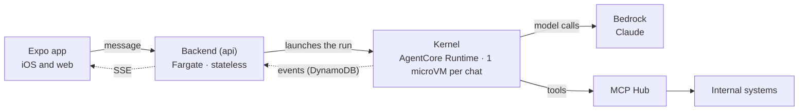

The app sends the user's message to the backend. The backend checks access and budget, creates the run and launches it in the chat's microVM. There the kernel runs the agent loop: it calls the model in Bedrock and, through the MCP Hub, the tools that reach internal systems. The kernel writes each event to DynamoDB, and the backend streams it to the app over SSE.

The glossary and the decisions behind this design come next. The detailed diagram, with accounts and VPCs, what each piece does and how they work together for one message are in [A message's journey](#journey).

<a id="glossary"></a>

## Glossary

**Platform**

| Term | What it is |
|---|---|
| **iDMZ** | The AWS account at the edge: the API Gateway the app calls and the load balancer of the panel and the web app. It reaches the platform account only over PrivateLink. |
| **`oid`** | The user's immutable identifier in Entra ID. It keys everything per user: chats, runs, spending and the S3 folders. |
| **Kernel** | Our own agent runtime (Python, Strands) that runs on AgentCore Runtime V2. A single kernel runs every agent: it builds the agent from its version and runs the loop. |

**Agents**

| Term | What it is |
|---|---|
| **Agent** | What the user chats with: a profile (name, description, icon and the Entra groups that see it) and its published version. |
| **Agent version** | Everything that changes how the agent answers: instructions, model, allowed tools, skills, subagents, Knowledge Bases, how it runs code, memory and confirmations. Each published version is immutable; a pointer says which one is in use, and each new message uses the one published at that moment. |
| **Skill** | Instructions, scripts and `tools.yaml` versioned from the panel; its scripts are exposed to the model as tools when the skill is activated. |
| **Subagent** | Another Strands agent inside the same kernel, exposed to the main agent as a tool, with its own `allow` list. |

**Running**

| Term | What it is |
|---|---|
| **Run** | One turn of the agent: from when the backend receives a message (or a task fires) until the `end` event. It has a status, lasts one hour at most and is identified by `run_id` = `{oid}.{suffix}` (the suffix is a ULID in a chat and a hash of the task and its time in a scheduled task; see "No duplicate runs"). The `run_id` is also the session name of its STS credentials, so the Bedrock invocation log says which user and which run each model call belongs to. |
| **Runtime session** | The AgentCore microVM of a chat; one per chat (`runtimeSessionId` = HMAC(secret, `oid` \| chat), 64 hexadecimal characters). It runs the chat's runs one after another; it stops after 15 minutes without use or at 8 h of lifetime, and the next invocation with the same id starts a new, empty microVM. |
| **Snapshot** | Two different things. The **Runtime V2 snapshot** is the image AgentCore takes of the kernel's container once it is healthy; each new microVM starts from it, without any chat state. The **conversation snapshot** (`snapshot_latest.json`) is the agent conversation that Strands saves in S3; the kernel loads it to rebuild a chat on a new microVM. |
| **`active_run`** | Chat attribute, holding the `run_id`, that prevents two runs at once; `api` sets it when creating the run (from a message or from a task) and `close(run_id)` removes it when it sees the `end` of that same run. A sparse index on it gives the busy chats, which is what the watchdog goes through. |
| **`previous_interrupted`** | Optional field of the payload with the reason the chat's previous run died or was cancelled, so that the kernel adds a note and the model's conversation matches the user's. |

**Identity and tools**

| Term | What it is |
|---|---|
| **Session STS credentials** | One-hour AWS credentials that `api` creates for each run when launching it and passes in the payload; not renewed. They are limited to the models of the agent version and to that user's and chat's data. |
| **Run token** | A token signed with KMS by `api` when launching the run: user, groups, agent, version, the `allow` list and the version's Knowledge Bases. The kernel checks it before accepting an invocation, and the MCP Hub and the backend use it to know which run is calling. It is not IAM and it is not the Entra token. |
| **`allow` list** | The hub tools an agent version may use, configured in the panel. `api` puts the list (of the agent and its subagents) in the run token, and the MCP Hub denies any tool that is not in it. |
| **Approval** | The user's confirmation before a sensitive tool runs (those marked `confirm: true`). The run waits up to 10 minutes; the MCP Hub only lets the call through with a granted approval of that run. |
| **OBO** | On-behalf-of: an Entra token for a specific MCP, obtained from the user's token, with which the MCP acts as the user. Only `api` stores and renews them. |
| **Run identity** | The other way, besides OBO, of identifying the user to an MCP: the MCP receives the user's data from the run token and acts with its own role. |

**Chat data**

| Term | What it is |
|---|---|
| **Chat workspace** | The S3 prefix `workspaces/{user}/{chat}/` (`input/`, `work/`, `output/`) that the kernel syncs with its local folder. In the same prefix, outside the sync, is `conversation/` (the agent conversation). |
| **Agent conversation** | What the model sees of a chat: the Strands messages, with tools and results (large results trimmed), in one JSON file (`snapshot_latest.json`) per agent in `workspaces/{user}/{chat}/conversation/`. The kernel writes and loads it with Strands' `SnapshotSessionManager`. Not to be confused with the consolidated message, which is what the user sees. |
| **Stash** | Where the kernel's context manager stores each block of the conversation as it arrives, including the original of what it trims, in the chat's `conversation/` in S3. The model gets it back with the `retrieve_context` tool. |
| **User memory** | Two text files in `workspaces/{user}/memory/` (`preferences.md` and `facts.md`), shared by all of the user's agents. The kernel puts them in the prompt; the model changes them with the `remember` tool and the user, from the app. |
| **Consolidated message** | The chat item that `close(run_id)` stores (normally from the run events Lambda) when a run finishes: text, summarised cards, files and rating; its cost is next to it, in the chat's `COST#{run_id}`, which the cost Lambda adds up. It is what the user sees; the conversation the model sees is another file, in the chat's `conversation/` in S3. |

**Shared functions**

| Term | What it is |
|---|---|
| **`close(run_id)`** | The function that turns a finished run into chat history and frees the chat for the next message. It runs once the run has its `end` event and does three things: it saves the consolidated message in the chat, removes `active_run` (only if it still holds that `run_id`, so a late close never frees the next run) and asks `api` for the push. The kernel only writes the run's events and never touches the chat; `close` is the only one that does. It lives in `packages/domain` and has three callers: the run events Lambda on seeing `end` (the normal path, about 1 s), `api` when the next message arrives before that (instead of answering 409) and the watchdog for any run left unclosed for more than 5 minutes. Each step is idempotent on its own, so two callers at once, or one that repeats after dying halfway, do no harm; only the push is not repeated. In a deleted chat it writes nothing. It does not touch the cost, which the cost Lambda adds up. See [Lifecycle](#lifecycle). |
| **`deleteChat`** | Function in `packages/domain`, the only one that starts the deletion of a chat: it marks it `deleted`, sets `cancel`, deletes its tasks and puts it in the chat deletion queue. It is called by `api` (the user) and the chat expiry Lambda (after 12 months without activity, or after 7 days for evaluation chats). The panel does not delete chats. |

<a id="decisions"></a>

## Key decisions

### Engine and models

- A single engine: our own kernel with Strands (Python) on AgentCore Runtime V2, in VPC mode, in us-east-1. No AgentCore Gateway, Identity or interceptor; no AgentCore Browser or web search (the managed Web Search is only exposed behind a Gateway, so that is out too); no LiteLLM or Dev Workbench.
- Direct inference to Bedrock with per-run STS credentials, limited to the models of the agent version. The kernel does not declare the cost: it comes from the Bedrock invocation log, which carries the calling identity (the STS session name, which is the `run_id` and starts with the user's `oid`) and the tokens; a Lambda adds it up per user, chat and run. Per-user spending is cut off with an IAM deny on `aws:SourceIdentity`.
- Every conversation goes through an agent; there is no direct chat with the model. One model per agent (and per subagent) in each version.
- Context: a single mode, the automatic one (the kernel's `ContextManager`: trimming, stash in S3 and configured summary; probe 18), with nothing to choose per version.
- No AgentCore Memory: the agent conversation is per-chat files in S3 (one Strands snapshot per agent and the stash) and the user memory is two texts in the user's folder that the model changes with the `remember` tool and the user edits in the app.
- The model's code, depending on the agent: in the microVM itself (with our own `Sandbox`: Strands' local environment isolates nothing) or in Code Interpreter in a VPC without DNS. Code Interpreter's SANDBOX mode does not isolate (the AWS guide describes it as having "limited external access": it reaches S3 and resolves DNS; Unit 42 and BeyondTrust showed it can be used to exfiltrate data), which is why it goes in a VPC.

### Backend, tools and identity

- Two stateless TypeScript services on Fargate: `api` (what the app uses: chats, SSE, files, OBO, internal routes) and `admin` (what the panel uses), in separate processes and with different permissions. In this document, "the backend" is `api`.
- One microVM per chat, not per message: `runtimeSessionId` = HMAC(secret, `oid` | chat), as in the current repo (`session_binding.py`); the session lives while the chat is in use (15 minutes of inactivity, 8 h of lifetime at most) and each message is a new invocation in the same microVM.
- A single launcher, inside `api`: the same `launch()` serves chats (on receiving the message) and scheduled tasks (Scheduler → standard SQS queue → a consumer in `api`). `api` creates the run, assumes the session role, signs the run token and calls `InvokeAgentRuntime`; the kernel accepts immediately, so the request only waits one or two seconds. No FIFO queue or launcher Lambda.
- Our own MCP Hub for all MCP tools; our own MCPs always on Fargate, in the only VPC connected to the corporate network. Skill scripts run in the kernel as typed tools.
- OBO only in the backend: it seeds once and renews on demand; the hub requests it through `/internal/obo`. Neither the kernel nor the hub sees the user's Entra token.
- Runs of one hour at most, STS credentials not renewed; a watchdog Lambda cleans up the ones that die and the run events Lambda closes them with `close(run_id)`, a shared function that the watchdog also calls as a fallback, and `api` too when a send collides with a run that has already finished.

### Clients and build

- One Expo app (iOS and web) with assistant-ui and a local chat cache on iOS only; a Next.js panel with shadcn/ui that is only an interface.
- Entry through an iDMZ account (API Gateway REST with streaming and a Lambda authorizer that only validates the Entra JWT; `api` reads `oid` and groups from the token itself); Akamai only in front of the panel and the web app.
- Everything in CDK, in a monorepo (TypeScript + Python) with a shared contract in JSON Schema.
- Test environment in a single account, with the VPCs and scheduled shutdowns; what has been checked (in the code, locally and with the probes against AWS) is in [Verified](#verified) and what remains to be tested, in [To verify](#to-verify).

<a id="journey"></a>

## A message's journey

<a id="diagram"></a>


Legend: iDMZ account · Platform account · AgentCore and kernel · Data flow · Control / authentication · Journey step

The numbers are the steps of the journey, described below. Dashed lines are control: authentication, OBO tokens and the push notification. The minimal Code Interpreter VPC is not drawn (see "The four VPCs").

### The parts

The parts are grouped by the zones of the diagram.

**Outside the platform**

- **Expo app** (iOS and web, assistant-ui): chats with agents, files, scheduled tasks and memory. It signs in with Entra and follows each run over SSE. [The app](#app).
- **Microsoft Entra ID**: sign-in, MFA and conditional access. Its groups decide which agents each user sees and the roles in the panel. It also issues the OBO tokens. [Identity and permissions](#identity).
- **Akamai**: CDN and WAF in front of the panel and the web app (the app's API does not go through it).
- **Netskope**: the only exit to the internet (Entra, APNs, Web Push).
- **APNs and Web Push**: notify the user when a run ends or is waiting for an approval.

**iDMZ account**

- **API Gateway REST**: the only public entry for the app, with response streaming for SSE and a per-IP WAF. It reaches the platform over PrivateLink.
- **Lambda authorizer**: validates the Entra JWT. `api` reads `oid` and groups from the token itself.
- **Web ALB**: serves the panel and the web app coming from Akamai, also over PrivateLink.

**Services VPC (platform account)**

- **Internal NLB**: the PrivateLink service through which the iDMZ reaches `api`.
- **Backend (`api`)**: TypeScript on Fargate, stateless. It handles chats, checks access and budget, and creates and launches each run (STS credentials, run token, `InvokeAgentRuntime`). It also serves the SSE, files, OBO and push, and consumes the scheduled tasks queue.
- **Admin panel and `admin`**: the panel (Next.js) is only the interface. The `admin` service holds the logic: agents, skills, Knowledge Bases, models, budgets, users, evaluations and audit. [The admin panel](#panel).
- **Web app**: Expo's static export served by nginx.
- **Run events Lambda**: reads the activity table's stream. On `end` it closes the run with `close(run_id)`, and it pushes notifications about pending approvals. [Lifecycle](#lifecycle).
- **Cost Lambda**: adds up the spending per user, chat and run from the Bedrock invocation log. It sends the 80 % and 100 % alerts and cuts the user off with an IAM deny.
- **Watchdog Lambda**: every minute it fails the runs that stopped sending heartbeats.
- **Chat expiry and chat deletion Lambdas**, with their SQS queue: expire inactive chats and physically delete chats (microVM, S3 and DynamoDB).
- **EventBridge Scheduler and the tasks SQS queue**: one schedule per task. When a task fires, the message lands in the queue and `api` launches the run. [Operations](#operations).

**Agents VPC**

- **AgentCore Runtime V2 with our kernel** (Python, Strands): one microVM per chat. It runs the agent loop: it calls the model, calls tools through the hub, runs skills and code, writes events to DynamoDB and syncs the chat workspace with S3. The VPC has no egress and is protected by DNS Firewall. [The agent at run time](#agent), [Network and isolation](#network).

**MCP integrations VPC**

- **MCP Hub**: the single door for MCP tools. It verifies the run token and applies the `allow` list, the approvals and OBO. It audits each call and fails closed. [MCP Hub](#hub).
- **Our own MCPs** (`mcp-documents`, `mcp-time` and others): on Fargate. This is the only VPC connected to the corporate network, which is how MCPs reach internal APIs.

**Regional services**

- **DynamoDB** (four tables: activity, configuration, OBO and audit), **S3** (chats, memory, skills and documents), **KMS**, **Secrets Manager** and **CloudWatch** with X-Ray. [Persistence](#persistence), [End-to-end tracing](#tracing).
- **Bedrock**: the Claude models, called directly by the kernel. **Knowledge Bases** handle RAG, filtered by agent and group. [Agents, skills, models and knowledge](#governance).

**AgentCore managed services**

- **Code Interpreter**: runs the model's code for the agents in that mode, in its own VPC without DNS, network or credentials.
- **AgentCore Evaluations**: scores agent quality, online over real sessions and in batch from the panel before a version is published.

### The steps

The twelve steps, as a sequence (the numbers in the list below are those of the architecture diagram; the sequence has its own per-message numbering). The sequence is the error-free case; the 402, 409 and 503 are in steps 4 and 5 and in "Lifecycle".

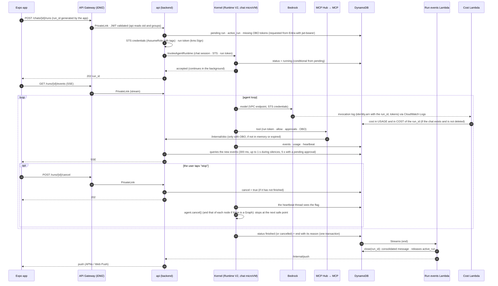

1. **Sign-in.** The Expo app signs in with Entra ID (OIDC + PKCE, MFA and conditional access) and obtains a token for the platform API. [The app](#app).
2. **Send.** `POST /chats/{id}/runs` with a `run_id` (`{oid}.{ULID}`) generated by the app, to the iDMZ API Gateway REST; the Lambda authorizer validates the JWT (signature, issuer, audience, expiry) and `api` reads `oid` and groups from the token itself.
3. **Entry to the platform.** PrivateLink to the internal NLB and any replica of the backend on Fargate.
4. **Checks and creation.** The backend checks that the user can use the agent (Entra groups) and has budget left (if not, 402); it creates the run (`pending`) and sets `active_run` on the chat (if there is already one, 409); it seeds the missing OBO tokens. [Lifecycle](#lifecycle), [Identity and permissions](#identity).
5. **Start.** `api` itself issues the STS credentials and the run token and calls `InvokeAgentRuntime` with the chat session: if the chat's microVM is still alive, the invocation lands in it (warm); if not, AgentCore starts a new one from the Runtime V2 snapshot. The kernel moves the run to `running`, accepts instantly and continues in the background (`/ping` in `HealthyBusy`); `api` responds `202 {run_id}`. If AgentCore rejects due to quota (429) or with a 409 (`RetryableConflictException`, session changing state), `api` retries with backoff for a few seconds; if it does not succeed, it closes the run and responds 503, and the app keeps the message to retry it. The payload carries the message, the agent version, the budget limit, the credentials and the run token (and, if the chat's previous run died or was cancelled, the reason); if the kernel has the chat's `Agent` in memory and it is of the same version, it uses it; if not, it builds it from S3 (the chat's `conversation/`). It always reads the user memory (with the `Agent` in memory, with a conditional `GET`).
6. **Model.** The kernel (Strands) calls Bedrock through the agents VPC's VPC endpoints with the STS credentials, limited to the models of that version; before each call it checks the month's spending. The cutoff that does not depend on it is the IAM deny on `aws:SourceIdentity`. [The agent at run time](#agent).
7. **MCP tools.** All through the MCP Hub (integrations VPC, over PrivateLink) with the run token: `allow` list, approvals, run identity or OBO (requested from the backend), audit, and it fails closed. [Network](#network), [Identity](#identity).
8. **Skills, code and files.** Skill scripts run in the kernel as typed tools; the model's code, in the microVM (local mode) or in Code Interpreter; the kernel syncs the chat workspace with S3 and emits `file` for each new file. [The agent at run time](#agent).
9. **Events and cost.** The kernel writes to DynamoDB, under its run, the text (every ~250 ms), the tools, the files, the token usage (only to show it in the app) and a heartbeat every 30 s. The cost that counts is extracted by the cost Lambda from the Bedrock invocation log, a few seconds after each call to the model.
10. **Reading in the app.** `GET /runs/{id}/events` (SSE) on any replica: the backend queries that run's new events in DynamoDB per open connection (one query by key, cheap) at two rates: 300 ms while events are arriving and 1 s during silences (5 s during a pending approval), going back to 300 ms as soon as something arrives; text streaming does not notice it and about half of the queries are saved. If there is nothing to send, `api` sends an SSE heartbeat comment every ≤60 s, because API Gateway cuts a stream after 5 minutes without data and the NLB after 350 s without traffic (fixed with a TLS listener); and since a stream lasts at most 15 minutes, the app reconnects with `Last-Event-ID` before reaching that, or as soon as it is cut; `POST /runs/{id}/cancel` to stop; files with a presigned URL.
11. **End.** The kernel writes `end` (with its reason and the usage it measured, informational only). The run events Lambda, on seeing it, calls `close(run_id)`: it stores the consolidated message in the chat, removes `active_run` (from then on the backend accepts the next message) and notifies the backend. If the app's next message arrives first (the app sees `end` over the SSE in 300 ms; the run events Lambda takes about 1 s), `api` closes the run itself instead of responding 409. [Lifecycle](#lifecycle).
12. **App in the background.** The backend sends the notification through APNs or Web Push (egress through Netskope). When coming back to the foreground, the app requests the list of chats and the new messages of the ones that changed.

<a id="accounts"></a>

## Inventory by account and network

### iDMZ account

- Regional API Gateway REST with response streaming, with its VPC Link and the NLB that points to the PrivateLink endpoint
- Lambda authorizer for Entra tokens
- PrivateLink endpoints to the platform's internal NLB (which port each one opens is to be decided: see "Entry to the internal NLB" in [To verify](#to-verify))
- Web load balancer (admin panel, `admin` and web app), behind Akamai, with PrivateLink to the platform

### Platform account

- Internet egress only through Netskope, and by two paths: the services VPC (Entra, APNs and Web Push) reaches, over Transit Gateway, only the company's egress VPC, where the tunnel to Netskope is, with no routes to the internal network; the MCP integrations VPC egresses through the corporate network (Entra, so that the MCPs validate the OBO token and obtain their own towards internal APIs, and the APIs the MCPs use). The agents VPC has no egress at all.
- Four VPCs without IGW or NAT: the services one (backend, panel, web app and Lambdas) and the agents one (only the runtimes), each with its VPC endpoints; and the MCP integrations one and the Code Interpreter one, described below. Only the integrations one reaches the internal network; services, only the company's egress
- Two services on ECS Fargate: `api` (the backend: chats, runs and SSE, files, tasks, OBO, internal routes and push) and `admin` (only for the panel: agents, skills, Knowledge Bases, models, budgets, users, evaluations and audit), each with its own IAM role; `api` starts every run (chats on receiving the message; tasks, from a standard SQS queue where Scheduler drops the trigger and which `api` itself consumes); a run events Lambda (closing and approval notifications) on the DynamoDB stream; a cost Lambda subscribed to the Bedrock invocation log (spending, 80/100 % alerts and IAM deny); a run watchdog Lambda; a chat expiry Lambda, once a day; and an SQS chat deletion queue with its Lambda, which physically deletes the chats; runs of one hour at most, without renewing STS credentials
- Web app: Expo's static export served by nginx on ECS Fargate, by the same path as the panel (Akamai → iDMZ ALB → PrivateLink). From the browser, the app calls the iDMZ API like the iOS app, with CORS for the web domain, which in API Gateway REST is set up by hand: the `OPTIONS` method without an authorizer, the CORS headers in `api`'s responses (the integration is proxy) and in API Gateway's Gateway Responses (401, 403, 429, 5XX), and `Authorization`, `Content-Type`, `Last-Event-ID`, `X-Client-Version`, `traceparent` and `tracestate` among the allowed headers. The S3 bucket for the workspaces also has CORS, for uploads with a presigned URL from the browser.
- MCP integrations VPC: the MCP Hub and our own MCP servers (ECS Fargate), and the only connection to the corporate network (Transit Gateway, Direct Connect or VPN). The kernel reaches the hub through a PrivateLink VPC endpoint, and the hub reaches the backend through another, only to request OBO tokens; there are no routes between the VPCs
- Code Interpreter VPC: minimal, only for its sessions, without endpoints, routes or NAT and with DNS disabled
- Admin panel (Next.js with shadcn/ui, on ECS Fargate). Access: administrators → Akamai → iDMZ → panel, with Entra and the administrators group. It is only the interface: the logic and the permissions live in the `admin` service, which does not exist in the API Gateway.
- DynamoDB, four tables (see [Persistence](#persistence)): activity (chats and messages, runs with their events, approvals, scheduled tasks, users and spending), configuration (agents and versions, skills, model catalog, limits and deny list), OBO (the Entra tokens, only for `api`) and audit, in which each piece writes under its own prefix (the kernel, only under `AUDIT#kernel#`); and a Lambda that reads the activity table's stream (closes runs and notifies about pending approvals)
- S3 (chat workspaces with their conversation, each user's memory, skills and documents for RAG), KMS, CloudWatch and Secrets Manager (Entra app secret and MCP credentials)
- Amazon Bedrock: the catalog models (for now, only Claude, through `bedrock-runtime`), invoked directly by the kernel with the session credentials. OpenAI models through `bedrock-mantle` are left out for now (see "Models: one per agent")
- Bedrock Knowledge Bases: index of the documents for RAG, managed from the panel (documents, metadata, synchronisation)

### AgentCore (managed, us-east-1)

- A single engine: AgentCore Runtime, platform version V2 (restores each session from a snapshot), with our own kernel (Strands), in VPC mode in the agents VPC
- AgentCore Evaluations: agent quality, online over the kernel's traces and in batch from the panel
- Code Interpreter (in its own VPC without DNS, for the free-form code of the agents that use it), called directly by the kernel. No AgentCore Memory: the conversation and the user memory are files in S3. No Browser or web search: agents do not go out to the internet. No AgentCore Gateway or AgentCore Identity: tools go through our MCP Hub, which requests the OBO tokens from the backend, the only one that stores and renews them.

### The four VPCs

| VPC | What it contains | Endpoints | Egress | DNS Firewall allows | Who reaches it |
|---|---|---|---|---|---|
| **Services** | Backend (`api`), `admin`, panel, web app, internal NLB and the Lambdas | The AWS services they use: DynamoDB and S3 (gateway), AgentCore (data plane for `InvokeAgentRuntime` and `StopRuntimeSession`, and control), Bedrock (titles), STS (`AssumeRole` from `api`), IAM (`PutRolePolicy`), KMS, Secrets Manager, SQS, Scheduler, Logs, X-Ray… | Transit Gateway only to the company's egress VPC (tunnel to Netskope): Entra, APNs, Web Push. In testing, a NAT Gateway | AWS, Entra (with Graph), APNs, Web Push | The iDMZ over PrivateLink; the integrations VPC over PrivateLink, only `/internal/obo` |
| **Agents** | Only the kernel runtimes | `bedrock-runtime`, AgentCore (Code Interpreter), the MCP Hub (PrivateLink), DynamoDB (activity and audit tables) and S3 (gateway, which also lets the ECR layers bucket through), Logs, X-Ray, ECR (`api` and `dkr`) | None | `*.us-east-1.amazonaws.com` (the wildcard is only valid at the start), the region-less names in use, the hub and the intermediate CNAMEs of all of them (the rules inspect the chain by default); everything else blocked, and if it fails, closed | Nobody over the network: `api` calls the AgentCore API |
| **MCP integrations** | MCP Hub, our own MCPs and Cloud Map | `bedrock-agent-runtime` (Knowledge Bases), DynamoDB (activity table: approvals for reading and marking; audit table under `AUDIT#hub#`), KMS (verify the run token), Secrets Manager, Logs, CloudWatch metrics and X-Ray; and those that Fargate and Service Connect need (`ecs`, `ecs-agent`, `ecs-telemetry`, ECR and S3), unless they go out through the corporate network (to verify) | Corporate network (Transit Gateway, Direct Connect or VPN) and, through it, Netskope | AWS, Entra and the internal domains | The kernel over PrivateLink; external MCPs, through the corporate network |
| **Code Interpreter** | The Code Interpreter sessions | None | None; DNS disabled | — | AgentCore through its API (data plane: files with `InvokeCodeInterpreter`) |

<a id="app"></a>

## The app (Expo + assistant-ui)

A single Expo app for iOS and web (react-native-web) with the chat interface from `@assistant-ui/react-native`. assistant-ui only renders and handles the interaction: chats, messages, cost and files live in our backend, so the same thing is seen on the iPhone and in the browser.

### Signing in and choosing an agent

- **Sign-in** with Entra (OIDC + PKCE with `expo-auth-session`), with MFA and conditional access. On iOS the token is stored in the keychain (`expo-secure-store`); on web, in memory with silent renewal.
- **New chat → agent catalog**: only those allowed by the user's Entra groups, each with name, description, icon and what it can do (search documents, run code, generate files). The chat stays bound to that agent.
- **Settings**: profile, language, light or dark theme, notifications, memory and sign out.

### Chats

- **Chat list** in a side menu: search, rename and delete (there is no archiving: a chat stays or is deleted). The backend proposes the title with a cheap model after the first message.
- **Streaming conversation**: text in Markdown, cards for what the agent is doing ("Searching documents…", "Running code…", "Generating the report…") and the reasoning collapsed if the model provides it.
- **Queueing messages**: while the agent is working, the user can keep typing. The messages stay in a queue in the app, visible in the text box, where they can be reordered or removed, and they are sent in order when the app sees `end` over the SSE; if the user stops the run, what is queued stays until their next send. Our code stores the queue on the device (on iOS, in the local cache; on web, in `localStorage`) (assistant-ui's `createMessageQueue` only keeps it in memory) and it is re-queued when the chat is opened, so it survives closing the app.
- **Cancel** with the stop button (cancellation flag in the backend); **retry** and **copy** on each response.
- **Chat context**: a small indicator next to the text box with how much of the model's window the conversation takes up ("34 %"); when tapped, the breakdown: instructions and memory, tools, conversation and tool results. It warns when it approaches the limit and the agent is about to start summarising, so that the user knows why the agent "forgets" things from long ago and can open a new chat. It comes from the SSE `context` event; when reopening a chat, from the last one stored in the consolidated message.
- **Continue later**: if the app goes to the background the run continues; on coming back, the app reconnects the SSE with `Last-Event-ID` and recovers whatever is missing. The SSE is read with the `fetch` from `expo/fetch`, which Expo installs as the global `fetch` on native and which delivers the body as a stream (React Native's does not); the app parses the events and sends `Last-Event-ID` itself when reconnecting. If a long task finishes with the app closed, a notification arrives.

### Local chat cache

- **The backend is the source of truth. On iOS, the app keeps a copy** of the chat list and of the messages of the chats opened in the last 30 days, so they open instantly, also when entering from a notification, and they can be read offline. The messages of a chat not opened in 30 days are deleted from the phone; the chat stays in the list.
- **On web, in memory only** (the TanStack Query cache while the page is open): on reload, it is requested again. Only the queue of pending messages is stored, in `localStorage`. No IndexedDB, no retention period of its own and no "don't save on this device" option: there is nothing to save.
- **Sync on startup** (and when coming back from the background): the app requests the entire list with `GET /chats` (id, title and date of last activity, without those marked `deleted`; a few tens of KB with 500 chats). A chat in the copy that is not in the list was deleted (the user deleted it on another device or it expired) and is removed from the phone at once, without leaving it read-only: keeping its content would go against the deletion; if it was open, a brief notice ("this chat has been deleted"). For the ones that changed, it requests the new messages with `GET /chats/{id}/messages?after=<seq>`. While the app is open, whatever arrives over SSE is added to the copy, and if `api` responds 404 when writing to a chat, the app removes it. There is no `updated_since` or deletion markers on the server: the full list already says what exists.
- **Where, on iOS:** SQLite (`expo-sqlite`) without SQLCipher, in `Library/Caches` (iOS does not copy it to iCloud, without marking anything), with iOS data protection (`NSFileProtectionComplete`: the file is encrypted while the phone is locked). It is not the default class (without requesting it, iOS applies `CompleteUntilFirstUserAuthentication`): the app requests it with the `com.apple.developer.default-data-protection` entitlement in `app.json`, and with it the app cannot open the database while the phone is locked, so nothing touches SQLite in the background. No extra native library or key to store in the keychain. If iOS empties `Library/Caches` for lack of space, the app requests again what it needs; only the queue of pending messages would be lost. The web does not bundle it: it has its own empty version of the cache module (checked in "iOS cache (test with Expo)" in "Verified").
- **Security:** on signing out or switching user, everything is deleted. Files are not stored: only their metadata (name, type, size), and they are downloaded when opened.

### Files

- **Attach** PDF, images, Excel/CSV or Word from the document picker or the camera. The app asks the backend for a presigned URL (valid for a few minutes, and not for a `deleted` chat), uploads the file directly to S3 (`workspaces/{user}/{chat}/input/`) and sends only the reference with the message; the kernel brings it in with its sync and, if needed, copies it to Code Interpreter. Size limit and allowed types per agent.
- **Artifacts**: the app finds out through the SSE `file` event (or, if it was closed, when reconnecting with `Last-Event-ID` or when syncing the chat). Each file appears as a card in the message (name, type, size, preview of PDFs and images) with download and share (iOS share sheet). Downloads use presigned URLs valid for a few minutes.
- **Chat files**: a panel in each chat with its artifacts. `GET /chats/{id}/files` lists S3 directly (`ListObjectsV2` on `workspaces/{oid}/{chat}/output/`): name, size and date come from the listing and the type from the extension. There is no separate index to maintain: what appears is what exists, and it lasts as long as its chat. No global view of all chats and no deletion of a single file: to remove a file, the chat is deleted. That way neither the kernel nor the chat has to know what the user deleted, and the listing does not go through `conversation/` (the stash of a 50-turn chat is 202 objects) or the other chats.

### Cost

- **What you have spent this month**: in the header and in settings, "€12.40 of €50" with a bar, the limit and where it comes from (default, your group or an exception).
- **Cost of each chat** in its header: `api` calculates it when reading the chat, adding up the `COST#{run_id}` of its messages (written by the cost Lambda from the Bedrock invocation log, a few seconds after each call to the model). There is no total stored in the chat to maintain.
- **Alerts**: at 80 % an alert in the app and a notification; at 100 % the text box is blocked with a clear message ("you have reached your monthly limit; it renews on the 1st") and how to request an increase. The backend rejects new messages; IAM cuts off what is already running.

### Memory and rating

- **"What I remember about you"**: the user memory, shared by all agents, as is: two texts (preferences and facts) that the user reads, edits and saves, or empties, from settings (`GET` and `PUT /me/memory`). It shows when it last changed and who changed it (the user or an agent, with the chat): `remember` and `api` write this as object metadata on each `PUT` (`x-amz-meta-author` and `x-amz-meta-chat`). A "use my memory" switch disables it without deleting it: the kernel neither loads it nor offers `remember`. If an agent changed it while the user was editing, on saving the app shows the new version and asks to repeat the change (see "Without overwriting each other" in "Conversation and memory (S3)").
- **Rating responses**: thumbs up or down and an optional comment. It is stored in the chat's consolidated message (it lasts as long as the chat, not the run's 90 days), is visible in the panel by agent and version, and bad responses are used to expand the evaluation test sets.

### Scheduled tasks

- **Create**: the user chooses an agent from those they can use, writes the instruction ("every Monday at 8, summarise the week's sales and send me the PDF") and the frequency (daily, weekly, monthly or once, with time and time zone).
- **Result**: each task has its own chat; each run adds a message with its files and a notification arrives. The user can keep conversing about the result.
- **Manage**: list of tasks with next run and status; pause, edit, delete and "run now". If a task pauses itself (no budget, no access to the agent, OBO tokens rejected by Entra or several consecutive failures), the app says why.

### Notifications and voice

- **Push**: long task finished, pending approval, spending alert at 80 % and at 100 %. On iOS through APNs (the backend egresses through Netskope); on web, Web Push if the browser allows it. The app registers the device on sign-in.
- **Dictation**: microphone button in the text box; on iOS with the system speech recognition and on web with the Web Speech API where available. Dictation only, not voice conversation.

### How assistant-ui is wired

| assistant-ui piece | What we connect it to |
|---|---|
| `useRemoteThreadListRuntime` + `RemoteThreadListAdapter` | The chat list: `list`, `initialize`, `rename`, `delete` and `generateTitle` (no `archive`) on the backend's `/chats`. |
| `useExternalStoreRuntime` (one per chat) | We own the messages (built from the SSE events and the backend history); `onNew` creates the run (`POST /chats/{id}/runs`) and `onCancel` cancels it. That way reconnection and history do not depend on assistant-ui. |
| Message parts and Tool UI | Each kernel event is turned into a part: text, reasoning, tool call (with its own card for `search_documents`, code and files) and generated file. |
| `attachments` adapter | Our own: it reads the file from its Expo URI, uploads it to S3 with the presigned URL and adds the reference to the message. |
| `feedback` and `dictation` adapters | `POST /chats/{id}/messages/{seq}/feedback` (the rating hangs off the consolidated message, which lasts longer than the run); on iOS, our own `DictationAdapter` over the system speech recognition (assistant-ui does not ship a native adapter; the package is yet to be chosen); on web, `WebSpeechDictationAdapter` from `@assistant-ui/core`. |
| `queue` adapter | Message queue during a run with `createMessageQueue`: it notifies the queue when the run starts (`notifyBusy`) and ends (`notifyIdle`), and the text box shows it with `ComposerPrimitive.Queue`, without `QueueItemPrimitive.Steer`. The queue driver has no `cancel`: a normal send with the run in progress goes to the runtime's `steer` lane and, with `cancel`, would interrupt the run; without it, the next one goes out when the run finishes, like a queued one. On stop, the runtime notifies the queue (`notifyCancelled`) before calling `onCancel`: what is queued stays until the next send. The backend still accepts one message at a time per chat. |
| Approvals | `approval_pending` is translated into the `approval` part of the tool call, with the `approval_id`; `onRespondToToolApproval` calls `POST /runs/{id}/approvals/{approval_id}`; on expiry, `resolution: "expired"`, so that the card stops offering the buttons. |
| Local cache | The messages we pass to `useExternalStoreRuntime` come first from the local copy (on iOS; on web, from memory) and are completed with what is new from the backend and the SSE. |
| Outside assistant-ui | Cost (`GET /me/usage`), agent catalog (`GET /agents`), memory (`/me/memory`), chat files (`/chats/{id}/files`) and devices for push (`POST /me/devices`): our own screens with TanStack Query. |

### SSE events

The kernel writes to DynamoDB everything the agent is doing, not just the text, and the app renders it as cards inside the message. Any event can carry the `subagent` attribute with the name of the subagent that emits it; the app renders it as a collapsed card inside the tool that called it. Between events, `api` interleaves SSE heartbeat comments (see step 10 of the journey), which the app ignores.

| Event | What it carries | How it looks in the app |
|---|---|---|
| `text` | Fragments of the response (grouped every ~250 ms) | The text being written |
| `reasoning` | Summary of the reasoning, if the model provides it and the agent allows it | Collapsed "Thinking…" block |
| `tool_start` | Name, readable label ("Searching documents") and summary of the arguments | Card with an "in progress" indicator |
| `tool_end` | Status (success or error), duration and short summary of the result; in searches, the citations (title and link) | The card switches to done or to error |
| `skill_activated` | Which skill was activated | Discreet line in the card |
| `approval_pending` | `approval_id`, tool, summary of the arguments and how long it waits (`expires_at`) | Approval card with approve and reject |
| `file` | Name, type, size and reference of the file | File card with preview |
| `status` | "Waiting for the model", "retrying", "waiting for approval"… | Indicator under the message |
| `context` | Before each call to the model: estimated tokens by part (instructions and memory, tool definitions, conversation, tool results), the total and the percentage of the model's window; if there was trimming or a summary, how much | Chat context indicator and its breakdown |
| `usage` | Input, output and cache tokens of each call to the model, according to the kernel (informational: the cost that counts is the cost Lambda's) | Usage of the message in progress |
| `warning` | Limit reached: the kernel ends the run with `end` (`reason = limit`); the 80 % alert arrives by push and through `GET /me/usage`, not over the SSE | Alert in the app |
| `error` | A recoverable or unrecoverable error (text for the user); if it cannot continue, `end` follows | Alert in the message |
| `end` | Always the last event of a run: `reason` (`ok`, `cancelled`, `error`, `limit`, `timeout`, `approval_expired`, `interrupted`) and the usage the kernel measured (informational: the cost that counts is the cost Lambda's). The kernel writes it; if not, the watchdog (`interrupted`), `api` (`error`, if it could not start it) or the chat deletion Lambda (`cancelled`). | End of the message; the run events Lambda calls `close(run_id)` on seeing it |

### What does not travel over the SSE

- **Tool results**: they can be large or sensitive (document fragments, API responses); only a summary and, in searches, the citations.
- **Arguments**: only a summary, without tokens or internal data.
- **Reasoning**: at most the summary, and only if the agent allows it.

### How they are generated

- Text and tool calls: Strands' streaming events; those of a subagent reach the main agent's stream as `AgentAsToolStreamEvent`, and those of a graph node, as `MultiAgentNodeStreamEvent`: that is where the `subagent` attribute comes from.
- Start and end of each tool: their hooks (`BeforeToolCallEvent` and `AfterToolCallEvent`), registered on each agent: those of a subagent do not go through those of the main agent.
- Each tool declares its label and how to summarise its result: skill tools in `tools.yaml`, MCP tools in their hub registry, defined in CDK (the panel shows them).

### History

- When each run finishes, `close(run_id)` stores the final consolidated message (text, summarised cards, files and rating; the cost, next to it, in `COST#{run_id}`) as a chat item: when reopening a chat the same cards are seen, already collapsed. The individual SSE events expire after 48 h (see [Data retention](#retention)).

<a id="panel"></a>

## The admin panel

Next.js with the interface built with shadcn/ui (components on Base UI, its default option since July 2026, and Tailwind), on ECS Fargate, reached via Akamai → iDMZ web ALB → PrivateLink, with Entra login. It is only the interface: each action calls the `admin` service (through the same web ALB, under `/admin-api`), which checks the role, applies the change and leaves it audited. `admin` is a process separate from the app backend, with its own IAM role: it is the only one that can write agents, versions, skills, prices and limits; the backend (`api`) is the only one that assumes the session role, signs run tokens, decrypts OBO and talks to Entra.

### Access and roles

- **Platform administrators** (Entra group): agents, skills, Knowledge Bases, evaluations, models and prices.
- **Budget administrators** (another Entra group): per-user limits and exceptions.
- **Content access** (a third Entra group, the most restricted): open specific conversations from the audit or from a rating. Each opening is audited with its reason.
- Entra MFA and conditional access. Every change is recorded in the audit: who, when, old and new value, and reason when one is requested.

### Agents

- **Agent profile** (unversioned, applied immediately): name, description, icon and which Entra groups see it in the app.
- **Configuration** (versioned): everything that changes how the agent responds, from the instructions to the tools; the full list is in "Agent versions".
- **Context per run**: in the detail of a run from the last 48 h (including evaluation runs), the context breakdown on each turn (the `context` events) alongside the actual token usage; after that, only the one from the last turn (stored in the consolidated message). It shows which agent carries too many tools or skills, or which tool returns huge results.
- **Versions:** a draft is edited, its tests are passed (batch evaluation; the panel has no test chat) and it is compared with the published version before publishing. Rolling back is one click.

### Skills

- **Upload a version** (instructions, scripts and `tools.yaml`) from the panel. Each version is immutable: `skills/{id}/{version}/` in S3, with its hash, author and state in DynamoDB.
- **Validation on upload:** `tools.yaml` against its JSON schema (`format: 1`, see the example in "Agents, skills, models and knowledge"), which the kernel applies again when loading it; also, that each script exists and does not leave `scripts/` (not even through a link), that its `import`s outside the standard library are in `libraries`, that `input` and `output` are valid JSON schemas, that the `summary` only uses fields from `output`, that no name is repeated or belongs to the kernel (`skills`, `remember`, `retrieve_context`) and that the `name` in `SKILL.md` is the skill's id. Checked with probe 16 (10 bad cases, all rejected).
- **Review and approval:** diff against the previous version (files, tools added or removed, parameter changes, whether it writes files, libraries it requests). Another administrator approves it; only approved versions can be assigned.
- **Dependencies:** the panel rejects a version that requests libraries the current kernel image does not include; adding them means publishing a new kernel image.
- **Usage and retirement:** which agents use each version and a warning about those on an old one; retiring a version prevents assigning it again.

### Knowledge Bases

- **Documents:** upload and delete (presigned URL to S3 `documents/`) and edit their metadata: agents and Entra groups that can see them, language.
- **Sync:** start ingestion and see its status and errors per document.
- **Test:** a test search as if it were a specific user, to check the group filters.
- The Knowledge Bases themselves are created with CDK; the panel manages their content.

### Evaluations and quality

- **Test sets** per agent: question, expected answer, assertions and tools it should use. They can be created from poorly rated answers in the app.
- **Results:** scores from the online evaluation (sampling of real sessions) and from each batch, per agent and version, with their trend and alarms.
- **User ratings:** thumbs and comments, with a link to the conversation (with content access permission, audited).

### Scheduled tasks

- All tasks from all users: agent, frequency, last and next run, failures and cost; pause or delete any of them.
- Limits: active tasks per user and minimum frequency.

### Users

- **The list of who has signed in**: the backend creates `USER#{oid}` on the first authenticated request (name, email and groups from the token, first and last sign-in) and updates the last sign-in and the groups on each request, at most once an hour. Nothing is synced with Entra or Graph: the list is that of the people who have used the platform.
- **Deactivate**, from the user's profile, with a reason and audited: `status = deactivated`. From that moment the backend rejects their requests even if the token is still valid, `api` does not start their tasks (they remain paused) and `admin` sets `cancel` on their in-progress runs. The hub does not look at the user's state: without new runs there are no calls. Reactivating means going back to `active`.
- **Almost no deletion**: their data expires as usual (see [Data retention](#retention)); the only thing deleted on deactivation is their memory (`memory/` in S3, one `DeleteObjects`), which does not expire by age.

### Budgets and usage

- **User profile:** monthly spend by model and agent, effective limit and where it comes from, create an exception, and which agents they can use and through which Entra group.
- **Global usage:** cost per agent, model and day; Runtime and Code Interpreter estimate; platform cost (Evaluations) separately; and the monthly reconciliation with the invoice.

### Security and audit

- **Denied attempts**, read from the DynamoDB audit table (instant queries): blocked commands, tools outside the `allow` list, rejected or expired approvals, OBO failures and budget cut-offs, with filters by agent, user and date.
- **Detail**: what was attempted, which rule blocked it and a link to the message's full trace, to see what the agent read beforehand (a document, an MCP response).
- **Trends and alarms**: attempts per agent and per day, and the alarms that have fired; useful for detecting a malicious document or an agent whose instructions push it to do what it should not.
- **Who sees it**: the platform administrators. Since commands may contain user data, each query is in turn recorded in the panel's audit.

### Limits and exceptions

- **What is configured:** a default monthly limit in €; limits per Entra group (if the user is in several, the highest applies); per-user exceptions (fixed amount or temporary increase, always with a reason and an expiry date).
- **Precedence:** user exception > highest group > default.
- **Screens:** "Budgets", with the rules per group (the group is looked up in Entra with Microsoft Graph, through an app registration of `admin`'s own that can only read groups; the OBO secret remains `api`'s alone) and the current exceptions; and the user profile, with the monthly spend by model and agent, their effective limit and where it comes from, and a button to create an exception.
- **Permissions and audit:** only an Entra group of budget administrators changes limits; each change stores who, old and new value, and reason.
- **Data:** rules in DynamoDB (`LIMIT#DEFAULT`, `LIMIT#GROUP#<id>` and `LIMIT#USER#<oid>`). The user's groups are taken from their Entra token when the run is created (for scheduled tasks, from those stored in `USER#{oid}` on their last request) and stored in it.
- **How it reaches the cut-off:** the kernel receives the effective limit in the invocation payload and reads the month's spend before each model call; the cost Lambda applies the IAM deny when the limit is crossed. A limit change from the panel (default, group or exception) is applied by `admin` immediately: it recalculates which users on the deny list are now below their new limit and removes them (a denied user generates no usage, so the cost Lambda would not look at them again). The counter carries the month in the key (`USAGE#{oid}#2026-11`), so nothing needs to be reset to zero.
- **Alerts:** on crossing 80 % and 100 %, the cost Lambda leaves a mark on the counter and notifies the backend through its internal route (`POST /internal/push`, in the same VPC). Only the backend sends push (it has the APNs and Web Push credentials) and the app reads the state from `GET /me/usage`. The kernel does not emit budget alerts: its `warning` event is reserved for the cut-off.

<a id="agent"></a>

## The agent at run time

Where the kernel runs and what it does during a run.

### Starting a run

What the kernel does when it receives a run:

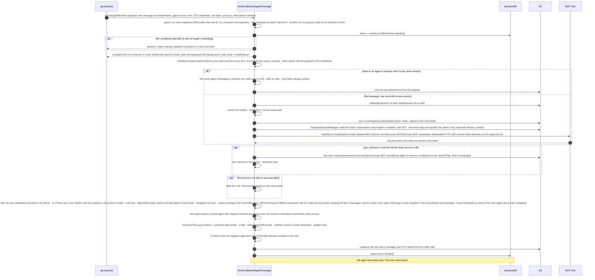

### One turn of the loop

One turn of the agent loop, with the interventions and the tools:

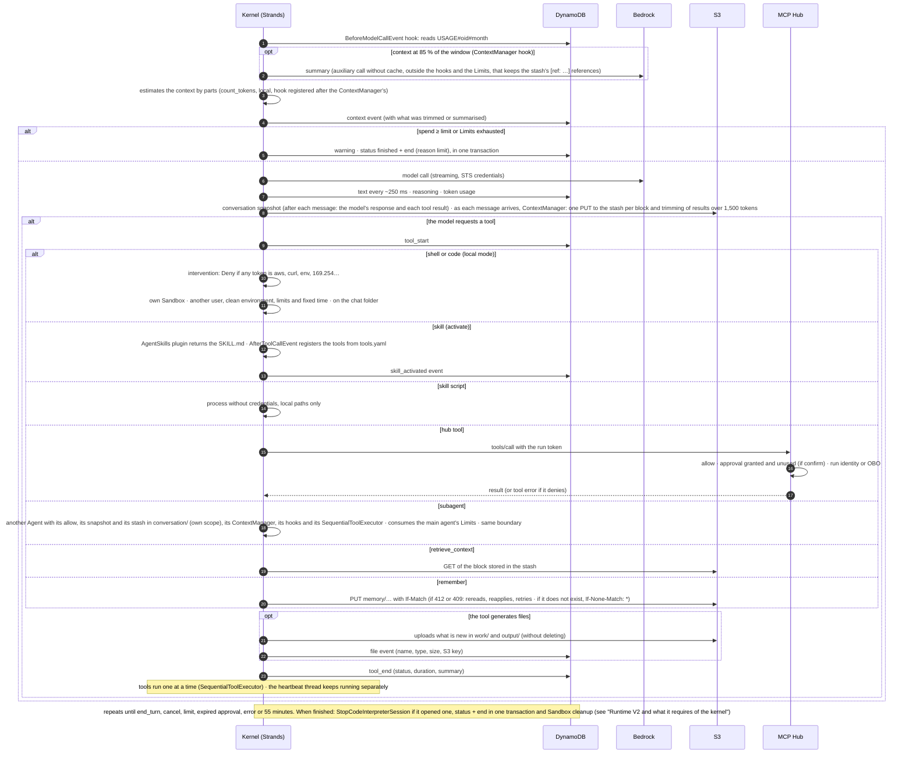

### Why our own kernel

- No AgentCore Gateway, Identity or interceptor: our own kernel calls Bedrock, Code Interpreter and S3 directly with the session STS credentials, and all MCP tools go through our MCP Hub; skill scripts run in the kernel itself.
- A single path and a single security logic, in our code: what can be limited by IAM goes direct; what depends on who the user is (data, internal APIs, OBO) goes through the hub.
- In exchange, the kernel image, the hub and the Strands updates are ours to maintain.

### Runtime V2 and what it requires of the kernel

- **What it is**: with `platformVersion` = `V2`, AgentCore starts the container once, takes a snapshot when `/ping` reports healthy and restores each new session from it. Cold start published by AWS: P75 of 1.9–2.0 s (V1: 5.4–30 s), measured in PUBLIC mode with an echo server and no model call. With our real image, in the VPC without egress: P50 1.79 s and P95 2.62 s (probe 10). A session's idle time (`idleRuntimeSessionTimeout`, 15 minutes by default) only runs when `/ping` does not say `HealthyBusy`; our runs are always busy until `end`, so none is cut off for inactivity. With one microVM per chat it is left at those 15 minutes (900 s): the chat's next message lands warm, in the same microVM, and a forgotten session frees itself; the idle session is billed, although V2 reclaims idle memory after 120 s (according to the pricing page). `maxLifetime` is left at 8 h (28,800 s, the default and, according to the AgentCore quotas, the maximum for a microVM): it counts from when the microVM is created and is not reset with each invocation, so with 1 h it would cut off midway a run that started with an already old microVM. Region: us-east-1.
- **Before the snapshot**: load everything expensive at startup (Strands and the skill libraries) and do not report healthy on `/ping` until done; it must happen in under 120 s (with the real image, 1.34 s: probe 10). Watch out for the libraries of the model's code (pandas, matplotlib, python-pptx, reportlab): they run in another Python, the `Sandbox`'s, and warming them up in a process that exits leaves nothing behind; after restoring, their first use goes over 10 s (the second, 2.4 s). That is why, before the snapshot, the kernel starts a process of the data Python with those libraries already imported, which stays waiting and does a `fork` for each model command (the child takes on the `Sandbox` user, its limits and its empty network namespace before running anything); a command's maximum time counts from the `fork`. Creating or updating the runtime takes minutes because it prepares the snapshot.
- **After restoring**: all instances start from the same memory. Random values and per-request identifiers (`os.urandom()`, `secrets`, `uuid4()`), never at startup; the trace ones too. The time is read on each request (`time.monotonic()` does not advance during the snapshot). AWS clients are created with the STS credentials of each payload, never at startup. Connections are re-established on the first call and the source port is not fixed.
- **One microVM per chat, several runs**: the microVM lives between messages of the same chat (memory and disk persist between invocations of the same session; if it stops, the same id starts a new, empty one). The kernel makes use of what it has and only goes back to S3 when it cannot trust it:
  - **The rule, just one**: if the kernel has the chat's `Agent` in memory and it is of the same agent version as the payload carries, it uses it as is; if not, it builds it from S3. Building it from S3 is the usual path and happens on the chat's first message, when the microVM is new (15 minutes unused, 8 h of life, or it crashed) and when another version has been published (the run's credentials and `allow` list already come with the new one, and an `Agent` built with the old one could request a model or a tool it is no longer allowed). Nothing else needs checking: if a run dies, the watchdog stops the microVM before writing its `end` and the memory disappears with it; if it is cancelled, the kernel itself closes it and what it has in memory is the latest. There is no case in which an `Agent` that is not the right one stays in memory.
    ```python
    # on each invocation, after the guard (the previous one has already finished and cleaned up)
    credentials.update(payload.credentials)      # the Bedrock client reads them from here
    token.update(payload.token)                  # the hub client sends it on each request
    if agent is None or agent.version != payload.version:
        agent = build_from_s3(payload)           # first message, new microVM or new version
    agent(payload.message)
    ```
  - **If it uses it as is, it does not read S3**: it uses the messages it has in memory, the skills already on disk (by `skill@version` and hash) and the chat folder already synced; it only downloads this message's new attachments, whose keys come in the payload. The user memory is checked with a conditional `GET` (`If-None-Match` with the ETag it keeps): it belongs to the user, not the chat, and another of their chats or the app may have changed it; if it did not change, S3 responds 304 with no body.
  - **If it builds it, everything from S3**: each agent's snapshot (one `GET`), the full sync of the chat workspace, the skills missing from disk and the memory. Once per microVM (or per published version), not per message.
  - **What is always renewed, without reading S3 or rebuilding the `Agent`**: the STS credentials and the run token belong to each run (they last one hour and are bound to its `run_id`, which is its key in DynamoDB). The `Agent` is not touched, nor are its subagents:
    - **Bedrock**: the `boto3.Session` of the `BedrockModel`s takes the credentials from our own provider, a subclass of `botocore.credentials.Credentials` whose `get_frozen_credentials()` returns those of the current message. botocore calls it when signing each request, so it is enough to change them (`RefreshableCredentials` does not work: it only rereads close to expiry).
    - **Hub**: each `MCPClient` (one per allowed MCP) is created with `auth_provider` = our own `httpx.Auth` that sets `Authorization: Bearer` on each request with the current message's token. The client stays open between messages as long as the `Agent` has it (`Agent(tools=[client])`) and is closed with `agent.cleanup()`; the hub works without a session (stateless Streamable HTTP, the new MCP protocol), so that no long-lived connection keeps a previous message's token.
    - **Only between messages**: the change affects every request signed afterwards, so the kernel changes both things on receiving the invocation, once past the one-run-at-a-time guard and before calling the `Agent`; a request already signed (a `ConverseStream` halfway through) finishes with the previous ones.
    - **A turn that fails**: if a call to the `Agent` fails, Strands leaves the user's message dangling at the end of `agent.messages`, and the snapshot would save it; the kernel removes it before ending the run with `end` (`error`), so that the next message does not carry two user messages in a row.
    The previous run's credentials remain valid until their hour is up, but nobody uses them any more.
  - **The snapshot is still written** after each message (`save_latest_on = "message"`, one `PUT`): it is what allows building the `Agent` from S3 when the microVM changes.
  - **Cleanup when finished**: after `end`, the kernel kills all processes of the `Sandbox` user (the model's code in local mode could leave something running that would read the next payload) and deletes temporary files outside the chat folder. `pkill -u` is not enough: a process that reproduces itself by hopping pids survives it (checked with probe 9). The kernel starts a helper process as the `Sandbox` user that does `kill(-1, SIGKILL)` (kills everything of that user at once) and repeats it until no process of that uid remains in `/proc` (`kill(-1)` does not return `ESRCH` while there are other processes in the microVM, even if it cannot kill them); in probe 10, two rounds and 0.03 s. Commands also carry `RLIMIT_CORE` = 0. Since the kernel is PID 1 of the microVM, the image starts with a minimal init (`tini`) that reaps dead processes; otherwise zombies pile up. The kernel writes its files with `umask 077`, so that the `Sandbox` user cannot read them. Whatever remains affects at most the same chat and the same user, who are the same as in the next run.
  - **One run at a time, the guard is set by the kernel**: AgentCore does not order a session's invocations: a second invocation to the same id enters the same process, in parallel, even if another is in progress (checked with probe 9). `active_run` already prevents `api` from launching two, but right after an `end` the next one may come in while the previous one finishes cleaning up, and a retry may repeat the same one. The kernel keeps in memory the `run_id`s it has accepted (a repeated invocation is ignored) and, if another arrives with a run still in progress, waits for the previous one's cleanup to finish before starting; there are never two `Agent`s working on the same chat.
  - **Only invocations from `api`**: the model's code, from the microVM itself, can call the kernel at `127.0.0.1:8080/invocations` (checked with probe 9). The kernel only accepts a payload if the run token it carries has a valid signature from our KMS key (the public key is in the image) and its `run_id` matches the payload's: the model's code cannot forge an invocation.
  - **Kernel version**: a microVM keeps the runtime version it was created with; after a deployment, an active chat can continue for up to 8 h with the previous kernel. The payload has to be backward compatible (see "Zero-downtime deployment and rollback").
- **Configuration**: almost everything goes in each invocation's payload. AWS gives 2.5 KB as the limit for environment variables in V2, but in the probe a V2 runtime with a 3,000-byte variable reached READY and the container saw it (with the platform's, about 4.3 KB); the criterion of carrying little in the environment is kept.
- **Deployment**: `PlatformVersion` is a property of `AWS::BedrockAgentCore::Runtime` in CloudFormation (`platformVersion` in the CDK `Runtime`) and is changed without replacing the resource: it is set to `V2` in the definition itself. Going back to V1 means changing that property, an in-place update, but it is not a reliable rollback: with the real image in the VPC without egress, a V1 runtime reached READY and no session started ("Runtime initialization time exceeded", probe 10). Restoring sessions in V2 does not pull from ECR again: the image is only downloaded when the runtime is created. A VPC-mode runtime created since 5 May 2026 downloads the image through our VPC (see "Separate agents VPC"), so creating or updating it needs the ECR endpoints (`api` and `dkr`) and the ECR layers bucket on the S3 gateway.

### Events written by the kernel

- **The kernel writes its events directly to DynamoDB** (`RUN#{run_id}` / `EVT#000042`), through the VPC endpoint and with the session STS credentials, which only allow writing to that run's keys (`dynamodb:LeadingKeys`).
- **Why:** if the backend restarts, the agent keeps reporting and the app loses nothing; the backend is free once the run has started; and it is cheap and fast (writes batched every ~250 ms, without leaving AWS). Which call writes each batch (`BatchWriteItem` or one write per event) is still to be decided, and the list of IAM actions of the session depends on it (see "Local code execution" in [To verify](#to-verify)).
- **Risk:** within its run it could write fake events if someone ran code in the kernel process. In agents with Code Interpreter this does not happen (the model's code goes to another microVM); in local-mode agents, the model's code runs as another user and without the session credentials (see "Running the model's code"), so it would only happen if that separation failed, and always within its own run.
- **Cost does not depend on these events:** the usage the kernel writes only serves to show it while responding; the one that counts comes from the Bedrock invocation log (see "Per-user usage control"). A compromised kernel can falsify what is shown in its own chat, not what is billed.
- **Discarded alternative:** sending the events to an internal backend endpoint and having it write them. It would centralise validation, but it requires a network path from the agents VPC to the backend, which the design deliberately avoids (see "Network and isolation"), and moreover, if the backend is unavailable, the agent cannot report its progress.

### Context: how big it is and who trims it

- **Measure**: in a `BeforeModelCallEvent` hook registered after the `ContextManager`'s (as in probe 18; the hooks of the `Agent` constructor are registered earlier, so the budget check, which goes in another hook, runs before the summary), the kernel counts the tokens of each part with `count_tokens` from the Strands model (checked in its code, 1.63.0): the system prompt (instructions, user memory and list of skills), the tool definitions, the conversation and, within it, the tool results. It is a local estimate (characters divided by 4 in text and by 2 in JSON; the docstring mentions tiktoken, but the 1.63.0 code does not use it even if installed), with no calls to AWS, and with Claude it falls short: between 15 and 63 % below the real figure, 44 % on average in probe 18's chat (figures, Spanish and tables). The same event carries `projected_input_tokens`: the actual usage of the previous response plus the estimate of the new messages, calculated before the hooks, so it does not reflect what automatic mode summarises in that same event (what was trimmed does: trimming happens when the message arrives); almost exact between turns; on the turn when summarising happens it is the pre-summary figure (up to +549 % compared with what finally reaches the model), but Strands counts again after each strategy that acts, so it does not cause extra summaries (probe 18: 7 summaries in 30 turns, one every 4, all with actual utilisation between 0.88 and 0.94). The percentage comes from the model's window, which comes from the catalogue.
- **Emit**: one `context` event per turn, in the same batch as the text. Bedrock's exact count (`use_native_token_count`, the `CountTokens` API) is not used: it would be one more call on every turn, and the actual input total already arrives for free in each response's usage; the app and the panel show both and the estimated breakdown is scaled to the real one (necessary: the estimate comes out at about half; `CountTokens` overshoots by between 0.6 and 3 %, probe 18). `close(run_id)` stores the last one in the consolidated message.
- **Trim**: a Strands context manager does it, the same one in all agents. Strands has `context_manager = "auto"` on the `Agent` (checked in its code): it trims tool results of more than 1,500 tokens to a 750-token preview and summarises the conversation on reaching 85 % of the window, with nothing to tune per agent. The summary is an auxiliary call (by default, to the agent's model) that does not go through the loop's hooks or the `Limits`, although its usage counts: it appears in the Bedrock invocation log like any other call (see "Per-user usage control"). It replaces Strands' two conversation managers, the sliding window (counts messages, not tokens) and the summary on passing a threshold (checked with Claude in probe 18, with the summary configured as explained below); with a `context_manager` set, Strands ignores them, so they are neither used nor offered per version. Automatic mode does not throw away what it trims: it stores it in a separate store (the *stash*) and gives the model the `retrieve_context` tool to retrieve it. The stash stores, as they arrive, the text blocks and each element of the tool results of each message (not the tool calls or the reasoning), with one `PUT` for each. After building the `Agent` from a snapshot, on its first model call, Strands fills the stash (*backfill*) with the restored messages, because it did not see them arrive: one `GET` per storable block still in `agent.messages` (not per message; it skips results already trimmed and what a summary removed), one after another and downloading the whole block: 178 with an unsummarised 50-turn chat, which from the microVM, through the S3 gateway, add up to 4.4 s (about 25 ms each; probe 19). There are as many as blocks fit in the window, not as many as turns the chat has. Those `GET`s only check that each block is already in the stash (`keep_existing`), and with the stash in S3 it always is: it was stored when the message arrived, and the snapshot only points to it (`"location": "external"`). Strands has no public option to skip it, so the kernel, after building the `Agent` of a chat that already had messages, sets `_backfill_done = True` on its `ContextManager` and on that of each restored subagent (each has its own), which is what Strands marks after doing it: the first call makes no `GET` and `retrieve_context` still finds what was trimmed before (`pruebas/kernel/t_backfill.py`). It is a private attribute, so that kernel line carries a comment explaining why it is there, what is lost and which test guards it; the Strands version is pinned and `t_backfill.py` fails if the attribute ceases to exist or to have an effect. What is lost: if a block's `PUT` failed on its turn (Strands logs it and carries on), it is no longer repaired on restore, and if it is later trimmed or summarised, `retrieve_context` does not find it. A new chat does not need it: it has no messages to fill in. On each turn, the ~8 `PUT`s of the stash and the snapshot add up to about 0.27 s from the microVM. By default that stash lives in memory and, when the session is saved, goes inside the snapshot, which would then grow with the chat. That is why the kernel passes the `Agent` the same `S3Storage` as the snapshot manager (`storage=`): the stash stays in the chat's `conversation/` (`context/{chat}/scopes/agent/{agent}/`), the snapshot only stores a reference, and everything is deleted with the chat's prefix. The `context` event says when it was trimmed and by how much.
- **What probe 18 showed** (Haiku 4.5, window forced to 12,000 tokens): automatic mode gets all 10 questions of the test chat right, versus 7 for the 10-message sliding window (it loses a fact from the first turn, the ranking and an old order), with half the input tokens and 56 % of the cost, summaries included. But Strands' default summary is written in English and does not keep the stash's `[ref: …]` references: what was summarised stays in the stash, but the model no longer knows how to request it and has to call the tool again (in one of two runs it did not, and got 2 questions wrong). Each summary takes between 1.7 and 4.5 s within the turn and, with automatic prompt caching, writes to cache a call that is not repeated (about $0.01 with Haiku). That is why the kernel does not use the `"auto"` string but a `ContextManager` with the same two strategies and the summary configured: `Offload.summarize("*", {"model": …, "system_prompt": …})`, with a `BedrockModel` without cache and a prompt in the chat's language that asks to keep the `[ref: …]` references as they are (it is in `gestor_kernel` in `pruebas/aws/sonda_contexto.py`). Checked with probe 18: the summary comes out in Spanish with each result's reference, the model retrieves what was summarised with `retrieve_context` without calling the tool again, gets 10 out of 10 with 2 summaries instead of 4 and each summary costs a third less (about $0.0064 with Haiku) and takes about 4 s (8.3 s for both). It is the only mode: all versions use this `ContextManager`. The sliding window and Strands' summary are not kept as options: they do worse in probe 18, have neither stash nor `retrieve_context` and would be another kernel branch to test.

### Chat files (kernel and Code Interpreter)

- **Chat workspace** in S3: `workspaces/{user}/{chat}/`, with `input/` (user attachments), `work/` (intermediate files), `output/` (what is delivered). It is kept between messages. S3 is the source of truth. Next to them, `conversation/`, which is not synced: the kernel writes and reads it directly (see [Conversation and memory (S3)](#conversation)).
- **A single sync, the kernel's**: when building the `Agent` from S3, the kernel brings the workspace to a local folder with boto3 (equivalent to `aws s3 sync`, without the AWS CLI in the image; if it already had the `Agent`, it already has the folder and only downloads the payload's new attachments: nobody else deletes or changes the chat's files while it exists); after each tool that generates files it uploads the changes, without deleting anything in S3. Only `input/`, `work/` and `output/`: the conversation and the user memory do not go through the sync (the memory belongs to the user, not the chat, and a chat and a task of theirs can run at the same time; with a sync, the last to upload would overwrite the other). The kernel itself does it with the session credentials; skill scripts receive no credentials, only local paths.
- **Only in Code Interpreter mode: kernel ↔ Code Interpreter via the API**: before each code execution, the kernel copies to the session only what has changed since the last time (`CodeInterpreter.upload_files` from the AgentCore SDK, which only does a `writeFiles` and keeps nothing: the list of what each side has, with size and hash, is kept by the kernel); then it reads the state of the folder in the session with an `executeCommand` (`stat` and `sha256sum`: `listFiles` only gives name and type, without sizes or dates, and does not go into subfolders) and brings back what is new or changed by size and hash. Upload: batches of up to about 60 MB per `writeFiles` (the service cuts off at 100,000,000 B of HTTP body, which with base64 is a file of about 71 MiB); a larger file goes in chunks and a `cat` in the session, several in parallel (100 MB in about 10 s). Download: one `readFiles` per file of up to 16 MiB (with margin: botocore cuts off events over 24 MiB, which in base64 leaves about 17 MiB of file; without that cap, the service rejected 50 MB, and between 17 and 50 MB it is not measured); a larger one is split in the session with `split -b 16M` and downloaded chunk by chunk, 4–8 in parallel, checking the hash (100 MB in about 22 s). There is no other way: Code Interpreter has no network or DNS, so it cannot go through S3. Checked with probe 11. The Code Interpreter session expires after 900 s by default even if there is activity (maximum 28,800 s): the kernel opens it with `sessionTimeoutSeconds` = 3,600, the run's hour, and closes it with `StopCodeInterpreterSession` when finished (otherwise it keeps billing until its TTL).
- **Tools one at a time**: the agent uses Strands' `SequentialToolExecutor` (by default it runs in parallel the tools the model requests in a single response). That way the local copy and the Code Interpreter copy do not overwrite each other. It costs some speed when the model requests several tools at once. Between runs of the same chat it is not needed: the backend only allows one at a time per chat.
  - **Alternative: in parallel with a lock.** Keep parallel execution and serialise with an `asyncio.Lock` only what touches the chat workspace (the sync with S3, the round trip with Code Interpreter, code execution and skill scripts); MCP calls would run concurrently. It is left for when latency calls for it: it requires marking which tools touch files, and in local mode any model command can do so, so a mistake in that list lets the copies overwrite each other again.
- **New files**: after each upload, the kernel emits a `file` event for each new or changed file in `output/` (name, type, size and S3 key); there is no separate file registry. The app receives it over the SSE and shows the card, and `close(run_id)` stores those references in the consolidated message. When the card is opened, the app asks `api` for a presigned URL (which checks that the key belongs to the chat and the user and that the chat is not `deleted`). A file lasts as long as its chat: while the card can be opened, the file exists.
- **Deletion**: the model does not delete persistent files (it can overwrite them in `work/` and `output/`; `input/` is read-only). The user does not delete individual files either: the whole chat is deleted (its entire prefix, conversation included; the chat deletion Lambda does it, see "Deleting a chat" in "Conversation and memory (S3)"). A chat can be deleted with a run in progress: `api` sets `cancel` and the chat deletion Lambda cuts off the microVM (`StopRuntimeSession`, and about 3 s of waiting) without waiting for the kernel to cancel.
- **Retention, without versioning**: the bucket has no versioning. With it, deleting a chat would only leave delete markers and its content would still be recoverable, and the snapshot, which is rewritten after each message, would leave an old version per message (about 121 KB after 50 turns, probe 18); it cannot be limited to `conversation/`, because lifecycle rules filter by a literal prefix and `conversation/` sits inside each chat. What it protected, a file deleted by mistake, no longer exists (there is no deletion of individual files); what the model overwrites in `work/` or `output/` is lost, as in any folder. `skills/` stores each version in its own path and is not overwritten. A single lifecycle rule: `AbortIncompleteMultipartUpload` after 7 days. No expiry by age: the chat workspace is deleted entirely when the chat expires or is deleted, by the same path (see "Deleting a chat" and [Data retention](#retention)), so a file lasts exactly as long as its chat.
- **Code Interpreter without network or DNS**: in its own minimal VPC (only its subnets, no endpoints, routes or NAT) with DNS disabled (`enableDnsSupport = false`), and an execution role with no permissions. It receives no credentials: files go in and out through the AgentCore API (data plane, `InvokeCodeInterpreter`). SANDBOX is not used: it can access S3 in any account and resolve DNS.

### Skills without bloating the context

- **The problem**: each tool sends its description and its schema on every model call (about 300 tokens with 4 described parameters, measured with Claude). An agent with 10 skills of 3 scripts would add up to about 8,500–9,000 tokens per call: with a system prompt of about 8,000, half of each call (probe 16). Prompt caching lowers the cost, but with many tools the model chooses worse.
- **Progressive loading** with Strands' `AgentSkills` plugin: only the name and description of each of the agent's skills go in the system prompt, and the model has a `skills` tool to activate one when it needs it; on activating it, it receives its `SKILL.md`. The kernel passes the skills to it as `Skill` instances read from the local disk, not as paths: with paths, the plugin reads the `SKILL.md` files through the agent's `Sandbox`, which in Code Interpreter mode is the other microVM, and it skips a skill it cannot read with only a warning in the log.
- **Tools on activation**: the plugin is designed to run scripts with the shell, which only local-mode agents have and which we do not want to use for our scripts. That is why, on activating a skill, the kernel registers at that moment the tools of its scripts (those in `tools.yaml`), which remain available for the rest of the run: an `AfterToolCallEvent` hook that detects the call to `skills` (checked in the plugin's code: it only marks the skill as activated and returns its `SKILL.md`; it creates no tools). It works because Strands rereads the tool list on every turn. Script tools are our own `AgentTool` class, and for those Strands does not allow registering the same name twice (`register_tool` raises an error, also if only `-` changes to `_`; functions with `@tool` are replaced without warning, checked by running it): the kernel keeps the list of what is already registered and, if the model activates a skill again, does not register its tools again. Activated skills are persisted with the session, so when building the `Agent` from S3 the kernel registers again those from `get_activated_skills`; if it reuses the one in memory, it already has them. That registration on build is needed: without it, Claude sees in the history that it used `generate_pdf` and requests it again without activating the skill; Strands responds `Unknown tool` and, depending on the model, gives up (Sonnet 4.6, no PDF) or activates the skill again (Haiku 4.5, two more calls). With it, it uses it on the first call (probe 16).
- **How a script runs**: in another process, with the data venv's Python, the chat workspace as working directory and a clean environment (no `AWS_*` variables); it receives the arguments on stdin as JSON and returns its result on stdout as JSON. Strands does not validate the input of our own `AgentTool` against its schema (only the name, `strands/tools/_validator.py`): the kernel validates the input with `input` before launching the script and the output with `output` when it finishes, and returns the error to the model so it can correct the call.
- **Result**: small fixed context (short list of skills, the `skills` tool and the hub's); a skill's schemas only come in when it is used; they are still typed and validated tools. Measured with Claude (probe 16, 10 skills): the first call goes from about 17,500 to about 9,000 tokens. Cost: the prompt cache is lost entirely on the call following the activation (it reads 0 tokens and writes everything again, about 9,700), because tools go at the start of the prompt; on the one after that it reads again. With caching, the money saved on a short task is small (2–5 %: writing a large prefix once costs the same as writing two small ones), although the tokens processed drop by 30–46 %; it grows with each call of the run and each time the cache expires between messages. The model also makes the call to activate the skill when it has all the tools, to read the `SKILL.md` (Sonnet 4.6); Haiku 4.5 skipped it in that case. The advantage that matters is the other one: the model chooses among 6 tools and not among 34.
- **Hub tools**: the same problem; it is controlled with each agent's `allow` list, which should include only those it really uses.

### Conversation and memory

The agent conversation (Strands snapshot) and the user memory are files in S3 that the kernel reads and writes with the session credentials: see [Conversation and memory (S3)](#conversation) in Persistence.

### No browsing or web search

- **Decided**: agents do not go out to the internet. Neither AgentCore Browser is used (a managed Chrome that would require a browsing VPC with egress through Netskope, recordings and domain policies) nor AgentCore's managed Web Search, which is only exposed as a target of an AgentCore Gateway (checked in the SDK, `bedrock_agentcore/tools/web_search_client.py`), and we do not want Gateway.
- **What they do have**: the Knowledge Bases (company documents) and the corporate network's MCPs. If a skill needs outside data, it is brought in as documents or through our own MCP against a specific API, which goes through the hub, the `allow` list and the audit.
- **If it is ever needed**: the least invasive option would be our own search MCP against a contracted search API, in the integrations VPC, with egress through Netskope; never a browser in the model's hands.

### Running the model's code

- **Configurable per agent**, in its version: `none`, `local` or `code_interpreter`. The kernel is the same; only the Strands `Sandbox` it configures changes: our own for the microVM's shell and Python (see below), with Strands' `shell` and `python_repl` tools, or `CodeInterpreterSandbox`, our own `Sandbox` written on top of the AgentCore SDK's `CodeInterpreter` client (it does not come with Strands). That way there can be two identical agents, one with each mode.
- **Local mode** (the simplest): the code runs in the kernel's microVM, on the chat folder, with the skills, templates, fonts and brand styles at hand and the same libraries as the image; with time, memory, CPU and number of processes limited by our `Sandbox`. It is AWS's pattern for code agents on Runtime: the boundary is the microVM, which is single-user and single-session.
- **Our own `Sandbox`**: Strands' local environment (`NotASandboxLocalEnvironment`) isolates nothing: it does not limit memory or processes, the child process inherits the kernel's whole environment, the maximum time is chosen by the model as a tool argument and the Python interpreter is looked up on the `PATH`. Ours launches each command with a clean environment (no credentials or `AWS_*` variables), with memory, CPU and process limits (`setrlimit` when launching the process), a fixed platform maximum time that ignores whatever the model requests, and the data Python by its absolute path (the interpreter name that `python_repl` passes does not accept paths, `strands/sandbox/constants.py:19`: the `Sandbox` substitutes it itself or sets the `PATH` of the clean environment, like the prototype in the tests). And it launches it as an unprivileged system user, different from the kernel's: the process limit does not apply to root (checked by running it: as root, with a cap of 20 processes, all 60 requested are created; with another user it stops at 18), whereas the memory limit does. That user, moreover, cannot read the memory or the variables of the kernel process (checked by running it: `/proc/<pid>/environ` and `/proc/<pid>/mem` give "Permission denied"). A prototype of this `Sandbox` is in `pruebas/kernel/t_contexto_sandbox.py`.
- **What that code can do**: with our own `Sandbox`, work on the chat's local folder (which the kernel uploads to S3 after each tool) with no network at all (no metadata service, no DNS, no endpoints: see below); it does not receive the session STS credentials or the run token, and cannot read them from the kernel process (checked by running it locally and, in the microVM, with probe 9). If that separation failed, it would reach the same as that user's session (their chat files, their run's events, their agent's models, the hub's allowed tools). Nothing of other users or other chats; IAM cuts off the spending and sensitive actions still ask for approval in the hub.
- **The execution role, within reach of the model's code**: checked with probe 9, the model's code, as another user and with a clean environment, obtains through the metadata service (IMDSv2, `169.254.169.254`) the runtime execution role's credentials and uses them. That is why that role only has ECR (download the kernel image), writing to the kernel's log groups with `logs:PutResourcePolicy` on its own, and sending spans to X-Ray (`xray:PutTraceSegments`): with it one can download the image and write fake logs and spans, no data. Moreover, the model's code has no network at all: each command is launched in an empty network namespace (`unshare(CLONE_NEWNET)` before switching user), where only `lo` exists. So it does not reach the metadata service, nor the kernel at `127.0.0.1:8080`, nor DNS, nor the S3 or Bedrock endpoints; the kernel keeps its network, and the cost is nil. Checked with probe 10. nftables and iptables do not work: the process has `CAP_SYS_ADMIN` but not `CAP_NET_ADMIN`. If `unshare` failed (if AWS removed that capability), local mode refuses to run code rather than run it with network.
- **What needs closing off**: exfiltration over DNS (see "Data exfiltration over DNS"); VPC endpoint policies limited to our resources (so that it cannot use the S3 endpoint with someone else's credentials towards a bucket in another account); confirmation in the hub for every tool that sends something outside; the app marks external links in messages; and the minimal execution role, because any process in the microVM can read it through the metadata service.
- **Code Interpreter mode**: for agents that work with more sensitive data or less predictable code. Code Interpreter sits in its own minimal VPC with DNS disabled, so the code has no credentials, no network and no DNS; in exchange, files are copied between the two microVMs and the Code Interpreter image is used (without our fonts or extra libraries).
- **First layer in local mode** (it stops the easy paths, it is not a boundary): a Strands intervention (`InterventionHandler`) reviews each call to the shell or to run code and returns `Deny`, with a reason for the model and a record in the audit, if any of its tokens (whole command or argument, not substring: `venv` or `awk` pass) is `aws`, `boto3` or `botocore`; the metadata and credentials service addresses (`169.254.169.254`, `169.254.170.2`); `env`, `printenv` or `/proc/*/environ` and `/proc/*/mem`; network tools (`curl`, `wget`, `nc`, `ssh`, `dig`, `nslookup`); or `pip install`, `npm install`, `sudo` and `su`. With `on_error = "deny"`: if the intervention itself fails, the call is denied instead of passing.
- **And in the image**, more effective because it does not depend on how the command is written: no AWS CLI nor `curl`, `wget`, `nc` or `dig`; and two Python environments: the kernel's (Strands, boto3) and the model's code's, with only data and document libraries (pandas, matplotlib, python-pptx…), without boto3 or HTTP clients, which is the one the `Sandbox` calls by its absolute path.

<a id="lifecycle"></a>

## Lifecycle of a run

How it is launched, which states it goes through, how it is cancelled and who closes it. First the two state machines, the run's and the chat's; the table below says who makes each transition and under what condition.

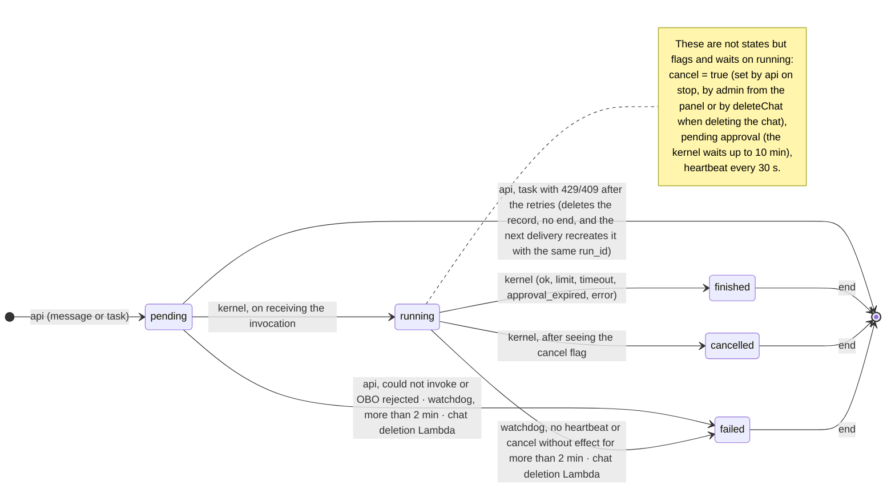

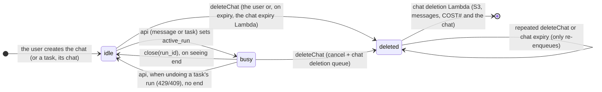

Every `end` leads to `close(run_id)`. The only exit without `end` is that of a task to which AgentCore keeps answering 429 or 409 after the retries: `api` deletes the run and `active_run` while it is still `pending` (see "Scheduled tasks" in "Operations"). In a `deleted` chat (or one that no longer exists), `close` writes nothing: every write on the chat carries the condition "exists and is not `deleted`", because an update on a deleted item would recreate it. A `failed` run is one nobody could finish properly: `api` failed to invoke it (or Entra rejected a task's OBO), the kernel died or did not start, or the microVM was cut off when the chat was deleted.

### Run states

| State | Who sets it | When | SSE event |
|---|---|---|---|
| `pending` | `api` (on receiving the message, or on reading a task's firing from its queue) | When creating the run, in the same transaction that sets `active_run = run_id` on the chat; right before invoking | — |
| `running` | Kernel | On receiving the invocation, conditional from `pending`; afterwards, heartbeat every 30 s | `status`, `text`, tools… |
| `finished` | Kernel | On finishing, with any reason other than cancellation: `ok`, `limit`, `timeout`, `approval_expired`, `error` | `end` with that reason |
| `cancelled` | Kernel | After seeing the cancellation flag (see "Cancel") | `end` (`cancelled`) |
| `failed` | `api` | Failed to invoke (quota, AgentCore error after the retries) or, in a task, Entra rejected the OBO; conditional from `pending` | `end` (`error`) |
| `failed` | Watchdog Lambda | More than 2 minutes without a heartbeat or without reacting to `cancel`; or more than 2 minutes in `pending` (`api` died between creating and invoking, or the kernel died on startup); before the `end`, `StopRuntimeSession` of the chat's session and a wait of about 3 s | `end` (`interrupted`) |
| `failed` | Chat deletion Lambda | The chat was deleted (by the user or by expiry) and the run was still `pending` or `running`: `StopRuntimeSession` of the chat's session and immediate close | `end` (`cancelled`) |

With any `end`, `close(run_id)` closes the run: it saves the consolidated message in the chat, deletes `active_run` (only if it holds that `run_id`: a late `end` does not release the next run) and notifies the backend for the push. It is a function in `packages/domain` with three callers: the run events Lambda on seeing `end` (the normal path, ~1 s), `api` when a send collides with a run that already has `end` (instead of 409), and the watchdog for those that have had `end` for more than 5 minutes without being closed (a stuck stream or a discarded batch). The kernel never touches the chat.

### Who writes what in RUN#{run_id}

| Data | Who | Condition |
|---|---|---|
| Record (`status = pending`, user, agent, version, chat, `traceparent`) | `api` (message or task) | Transaction with `active_run = run_id`, `expires` and `expires_day` on the chat (`attribute_not_exists(active_run)`, and that the chat exists and is not `deleted`) |
| `status = running` | Kernel | From `pending` |
| `last_heartbeat` (every 30 s) | Kernel | Only if `status = running`; if it fails, the kernel stops |
| Events `EVT#000001…` (also `file`), usage, pending and expired approvals | Kernel | No condition (batches of ~250 ms) |
| Decision on an approval (granted or rejected) | `api` (`POST /runs/{id}/approvals/{approval_id}`, only the chat owner) | Only if still pending: a late decision is not applied |
| Approval used | MCP Hub | Only if granted and unused (single use) |
| `cancel = true` | `api` (stop), `admin` (stop from the panel, or when offboarding a user) or `deleteChat` (from `api` or the chat expiry Lambda) | If the run has not finished |
| `status = finished \| cancelled` + `end` (`EVT#999999`) | Kernel | One transaction; `end` with `attribute_not_exists` |
| `status = failed` + `end` (`interrupted`) | Watchdog | Only if it is still in the state it saw and the heartbeat has not changed; the state before `StopRuntimeSession`, the `end` about 3 s later |
| `status = failed` + `end` (`error`) | `api` | Only from `pending`: could not invoke, or Entra rejected a task's OBO ("sign in again") |
| Deletion of the record and of `active_run` (no `end`) | `api` (task consumer) | Only after 429/409 in `launch()`: one transaction, conditional on `status = pending` and on `active_run` holding that `run_id` |
| `status = failed` + `end` (`cancelled`) | Chat deletion Lambda | If still `running` or `pending` when the chat is deleted, conditional on the state it saw; also, `StopRuntimeSession` of the chat's session |
| Consolidated message, deletion of `active_run` (on the chat, not in `RUN#`) | `close(run_id)`: run events Lambda, `api` or watchdog | Both only if the chat exists and is not `deleted`; message with `attribute_not_exists`; `active_run` only if it holds that `run_id`; each step separately, repeatable |

### Launch

- **One path for chats and tasks**: a `launch(run_id)` function in `api`. In a chat it is called by the `POST /chats/{id}/runs` request; in a task, by the task queue consumer, also in `api` (see "Scheduled tasks" in "Operations"). `launch` creates the run (`pending`) in the same transaction as `active_run`, prepares the OBO and `previous_interrupted`, assumes the session role with the run's tags and `SourceIdentity`, signs the run token with KMS and calls `InvokeAgentRuntime` with the chat's session (`runtimeSessionId` = HMAC(secret, `oid` | chat), endpoint `production`). The kernel answers "accepted" as soon as it moves the run to `running`, so the user's request waits one or two seconds (when cold, the microVM starting from the snapshot) and gets `202 {run_id}`; the app is then ready to open the SSE. No queue or Lambda in between: a single place with the permissions to assume the session role and sign, which is now `api` (see "Kernel credentials").
- **The kernel accepts and carries on**: it answers the invocation immediately ("accepted") and keeps working in a background task. The entry point is `async` (the AgentCore SDK runs it in its own worker loop, on another thread), launches the run with `asyncio.create_task`, keeps the reference and answers; `@app.async_task` only registers that task (checked in the SDK code, 1.25.2), so `/ping` answers `HealthyBusy` while the run lasts and AgentCore does not close the session for inactivity (neither during a 10-minute approval wait nor during a long tool).
- **What goes in the payload**: the message and its attachments, the agent version (with its `skill@version` and hashes), the effective budget limit, the STS credentials, the run token and `previous_interrupted` if needed. The history does not go: the agent conversation is saved and loaded by the kernel itself in S3, in the chat's `conversation/` (see [Conversation and memory (S3)](#conversation)). A `use_memory` flag does go, off if the user has disabled memory in the app (stored in `USER#{oid}`). The kernel reads nothing from the chat in DynamoDB: it only writes to its run.
- **Interrupted turn**: if the previous run died, the microVM no longer exists (the watchdog stops it) and the next one builds the `Agent` from S3; if it was cancelled, the kernel closed it itself and the in-memory `Agent` is already up to date. So that the user's message is always saved, the snapshot is written after every message (`save_latest_on = "message"`): the user's one is uploaded before the first model call (one `PUT`, tens of ms); so, from a run that died or was cancelled, only the answer is missing, or the part that did not get saved. `api` adds to the payload an optional `previous_interrupted` field with the reason the chat's last run ended with, and the kernel inserts a short note ("the previous answer was interrupted") before the new message, without comparing anything. If the kernel died before that first save, the model will not see that message; the user does see it and can retry it. If it died with a tool call without a result, Strands repairs it when the next message arrives with a filler `toolResult` in a user message and then adds, separately, the new message: there end up being two user messages in a row, as when it dies after saving the user's message and before answering. Whether Claude accepts this is yet to be tested (see "To verify"). The files that turn generated are already in `output/`, because they are uploaded after each tool.
- **One message at a time per chat**: the chat item carries the `active_run` attribute with the `run_id`, which the backend sets with a conditional write (`attribute_not_exists`, and that the chat exists and is not `deleted`: a `launch` on a deleted chat, or on the task of a deleted chat, fails instead of recreating it) and which `close(run_id)` deletes on seeing the `end` event (whether written by the kernel, the watchdog or `api`), on condition that it still holds that `run_id`; in a deleted chat `close` does not delete it: it disappears with the chat when the chat deletion Lambda deletes it. A second send while the run is still going gets 409; in practice it does not happen because the app queues messages while the agent works. What does happen is the race at the end: the app sees `end` over the SSE within 300 ms and sends the next message from its queue, and the run events Lambda takes about 1 s to close; so, if `active_run` points to a run that already has `end`, `api` calls `close(run_id)` and accepts the message instead of answering 409.
- **Retries when invoking**: if AgentCore answers 429 (quota), or 409 (`RetryableConflictException`: the chat's session is starting or stopping; the API model asks to retry with backoff), `api` retries with increasing, randomised backoff, with a total cap of about 15 s, below the maximum time for a non-streaming request in API Gateway. A 402 (`ServiceQuotaExceededException`) is not fixed in seconds: it is not retried. If it does not succeed, it moves the run to `failed` with `end` (`error`), conditional from `pending`, and answers 503; the app keeps the message in its queue to retry it. If the invocation is in doubt (it was cut off after being sent), it retries once with the same `run_id`: the kernel ignores a repeated invocation; if it is still in doubt, it answers `202` and lets the watchdog close the run if the kernel does not move it to `running`.
- **Quotas and peaks**: AgentCore's new-session quota (25 per second) only counts new microVMs; with one per chat, subsequent messages in an active chat do not use quota. The Monday 8 a.m. task peak is spread out by the task queue consumer, which limits the starts per second of each `api` replica to leave room for chats (see "Scheduled tasks" in "Operations").

### No duplicate runs

- **The `run_id`**: `{oid}.{suffix}`. The `oid` goes in hexadecimal without hyphens and in lowercase (32 characters), followed by a dot and a 26-character suffix in base32 and in uppercase. In a chat the suffix is a ULID generated by the app; in a task, the first 26 characters in RFC 4648 base32 of SHA-256(task | scheduled time), which never carry the `=` padding, so that a repeated delivery gives the same id. That is 59 characters, within the 64 of an STS session name, which is why the `run_id` can also be the session name of its credentials.
- **App → backend**: the `run_id` is generated by the app (`{oid}.{ULID}`, one per message) and is the key of `RUN#`; `api` checks that it starts with the JWT's `oid` and that the suffix is a ULID, and if not, answers 400: nobody can charge their spending to another user by choosing the `run_id`; `api` writes it with `attribute_not_exists` in the same transaction that sets `active_run`. If the app retries, the transaction fails with "already exists" and `api` answers the same `202 {run_id}`; if it fails because of `active_run` and that run still has no `end`, it answers 409 (if it already has `end`, it closes it with `close(run_id)` and continues). No separate idempotency header or key.
- **Startup**: `InvokeAgentRuntime` has no idempotency token, but none is needed: the `active_run` transaction prevents two runs in the same chat, and a repeated invocation of the same run (an `api` retry, or a repeated delivery from the task queue) is stopped by the conditional move from `pending` to `running` and by the list of already accepted `run_id`s the kernel keeps. If the repeated invocation lands on a new microVM (the previous one died), the conditional move fails and the kernel does nothing. In tasks, the `run_id` is `{oid}.` followed by the first 26 base32 characters of `hash(task, scheduled time)`, with the time Scheduler puts in the message with `<aws.scheduler.scheduled-time>`, so a repeated delivery of the same firing yields the same run and the transaction fails with "already exists". The only gap, an `api` that dies between creating the run and invoking, is closed by the watchdog after 2 minutes in `pending`.
- **Every state change is conditional**: each step (see "Run states") is a conditional write from the previous state.
- **Kernel**: on receiving the invocation it moves the run to `running` (conditional); a second identical invocation is ignored. It writes a heartbeat every ~30 s; the watchdog Lambda marks runs without a heartbeat as failed, stops the chat's session and then writes their `end`.
- **run events Lambda**: DynamoDB Streams may repeat records; for `end` it calls `close(run_id)`, which is repeatable.
- **Cost Lambda**: CloudWatch Logs may deliver a record more than once and the Lambda is retried; each record adds up in two transactions (`USAGE#` and `COST#`), each with its own marker per `requestId` (`attribute_not_exists`, with a TTL of a few days), so a repeated record is not counted twice in either.
- **`close(run_id)` is idempotent step by step**, not "all or nothing": whoever runs it (the run events Lambda, `api` or the watchdog, even at the same time) can repeat it without harm. The consolidated message is written with `attribute_not_exists`; `active_run` is deleted on condition that it holds that `run_id`; and the push is sent only by whoever won the message write; both writes on the chat also carry the condition that it exists and is not `deleted` (the chat deletion Lambda writes `end` and immediately deletes the chat, so when the run events Lambda sees that `end` there may be nothing left): if it fails because of that, `close` finishes without writing anything, because an update on a deleted item would recreate it. If whoever runs it dies halfway, the next caller completes the missing steps: none depends on having won the previous one (the exception is the push, which is not repeated: better no notification than two).

### Cancel

- **From the app**: `POST /runs/{id}/cancel` (only the chat owner). The backend writes `cancel = true` in the run's record if it has not finished (in `pending` the kernel will see it as soon as it starts), and answers `202`. The same for a scheduled task's run, from the app or the panel; pausing a task does not cut off the run in progress.
- **The kernel applies it with Strands**: the heartbeat thread reads the flag on startup and then every 30 s and calls `agent.cancel(message=…)` (checked in the Strands code: it stops at the next safe point, during model streaming, before or after a tool, MCP ones included, and ends with `stop_reason = "cancelled"`). No custom code in the hooks. Subagents stop with it (Strands passes them the main agent's `cancel_signal`); the nodes of a `Graph` do not: the kernel also calls each node's `cancel()` (see "Fixed-order flows with `Graph`"). Watch the cost: a `ConverseStream` that the client stops reading halfway is recorded in the invocation log with `outputTokenCount` = 1, even if hundreds had already been generated (checked with probe 7c), and the cost Lambda then charges the maximum output (see "The cost Lambda, in detail"). That is why, if the cancellation arrives during streaming, the kernel keeps reading that response to the end (up to the `metadata` event) without showing it: at most, one full response that is not seen is paid for.
- **What is half done**: skill scripts receive the Strands `cancel_signal` in their context and stop; if they do not within 30 s they are abandoned; Code Interpreter is stopped (`StopCodeInterpreterSession`); a pending approval is marked expired. The files generated up to then are uploaded to the chat workspace.
- **Close**: state `cancelled` and `end` with `reason = cancelled` and the text it had so far; `close(run_id)` consolidates and releases the chat as always. If the kernel does not react to the flag within 2 minutes (it is hung but sending heartbeats), the watchdog Lambda treats it as dead and calls `StopRuntimeSession`. When the chat is deleted there is no waiting for the kernel to cancel: the chat deletion Lambda cuts off the microVM at once and waits about 3 s (see "Deleting a chat" in "Conversation and memory (S3)").

How a run that dies is detected and closed:

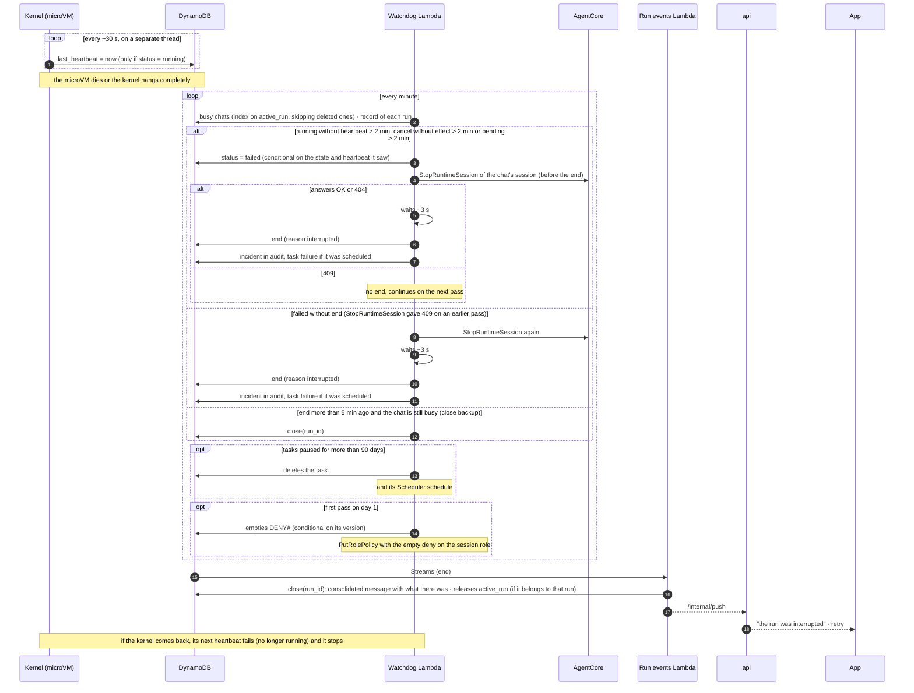

### Watchdog Lambda

- **What for**: the kernel answers the invocation instantly and carries on in the background; nobody waits for the answer. If the microVM dies (out of memory, the model's code kills the kernel, AgentCore cuts the session, the kernel hangs), nobody writes "finished": the chat stays busy (409 on every message, the app's queue never empties), the app keeps waiting and the scheduled task never ends. Nothing releases it on its own.
- **What the kernel writes**: in the run's record (`RUN#{run_id}`, which its events also hang from), `status = running`, `started_at` and `last_heartbeat`, which it updates every ~30 s from a thread separate from the agent loop: a slow tool or a model that thinks a lot does not stop the heartbeat; it only stops arriving if the process or the microVM has died or hung completely. On finishing it closes the Code Interpreter session if it opened one (`StopCodeInterpreterSession`; otherwise it is billed until its TTL of 3,600 s), sets `status = finished` (or `cancelled`) and writes the `end` event in a single transaction (if it died between the two, the run would be left finished without `end` and nobody would close it); it is `close(run_id)`, from the run events Lambda on seeing it, that releases the chat and saves the consolidated message: the kernel only writes to its run's keys.
- **What it does every minute**: it looks for busy chats (sparse index on the chat's `active_run`, which `api` sets when creating the run and `close(run_id)` removes; no other flag on the run is needed, because both are born and die in the same writes) and reads the record of each of those runs (one `GetItem` per `run_id`); that way it sees the `pending` ones, the `running` ones and those that have `end` but nobody has closed. It skips chats marked `deleted`: their run is closed by the chat deletion Lambda, which then deletes the chat, and with it its `active_run`. Of those, it considers dead: the `running` ones with more than 2 minutes without a heartbeat (about 4 missed) or with `cancel` set for more than 2 minutes without effect; the `pending` ones more than 2 minutes after their creation (`api` died between creating and invoking it, the kernel died on startup or never got to write `running`; a normal start takes a few seconds); and the `failed` ones without `end`, from an earlier pass in which `StopRuntimeSession` answered 409. It does not look at duration: the one-hour cap is already enforced by the kernel itself (it stops at 55 minutes) and, after the hour, it runs out of STS credentials. With each one:
  - it moves it to `failed` with a conditional write (only if it is still in the state it saw and its heartbeat has not changed): if the kernel finishes at exactly the same time, the kernel wins;
  - it calls `StopRuntimeSession` with the chat's session (AgentCore API) to kill the microVM if it is still alive: the hard cut, without cleanup. It goes **before** the `end`, because the session is the chat's: if it went after, `close(run_id)` might already have released the chat and the next run would be running in that same session; and that way a hung kernel that comes back cannot write its snapshot over the next turn. A 404 (the session no longer exists) is fine; a 409 is retried on the next pass without writing the `end`. Then it waits about 3 s before the `end`: `StopRuntimeSession` returns before the microVM dies, and a new invocation to the same id that arrives in the first ~100 ms still goes into the old one and is lost without an error, whereas from 500 ms on it lands on a new microVM (checked with probe 9; between 100 and 500 ms was not measured); if the chat were released in that gap, the next message would disappear. If one is lost anyway, it never reaches `running` and the watchdog closes it after 2 minutes in `pending`, like any failed start;
  - it writes the `end` event (`reason = interrupted`, "the run was interrupted"); `end` is the run's `EVT#999999` event (so it falls in the range the SSE reads) with the run's TTL, not the 48 h one, and is written with `attribute_not_exists`, so there is only one even if the kernel comes back late; the app shows it with a button to retry and the run events Lambda, on seeing it, calls `close(run_id)`, which deletes the chat's `active_run` (no more 409 and the app can send whatever it has queued) and consolidates whatever there is;
  - if it is a scheduled task, it adds a failure (several in a row pause it and notify the user);
  - it records it in the audit table under `AUDIT#platform#{agent}`.
- **Close backup**: in the same pass, it applies `close(run_id)` to every run of a busy chat that has had `end` for more than 5 minutes. Normally it finds none: the run events Lambda closes within a second. It finds them if the stream gets stuck or a batch with a poison record was discarded after exhausting its retries (see "The Lambdas"); without this backup, that `end` would never be closed except by reading the failure destination, which would be another Lambda. Since `close` is idempotent per step, arriving late or at the same time as Streams does no harm.
- **Start of the month**: on its first pass on day 1 it empties the `DENY#` deny list (conditional write on its version, like any other owner) and writes the empty policy to the session role; `DENY#` stores the month it belongs to, so a repeated pass does nothing. No separate schedule for this.
- **Each run separately**: the pass handles each run in its own `try`, and each section (dead runs, close backup, paused tasks, day 1) in its own, with its metric: an odd record does not stop the rest. Concurrency 1 and an alarm if 3 minutes go by without a complete pass.
- **If the kernel was only hung and comes back**: the heartbeat and the close are writes conditional on `status = running` (event batches are not, so as not to make them more expensive); since it is already `failed`, the next heartbeat fails and the kernel stops. Any events it wrote in the meantime are not consolidated.
- **Example**: it starts at 10:00:00; heartbeats until 10:03:00; the microVM dies at 10:03:10; at 10:05 the Lambda sees a heartbeat from 2 minutes ago and does not act yet; at 10:06 (3 minutes) it marks it as failed, stops the chat's session, waits about 3 s and writes `end`; the run events Lambda, with `close(run_id)`, releases the chat. Without it, the chat would stay blocked forever.
- **Cost**: one watchdog invocation per minute, plus the kernel's heartbeat (one DynamoDB write every 30 s per active run).

<a id="governance"></a>

## Agents, skills, models and knowledge

What each user can use and how an agent is changed without breaking it.

### Which agents each user sees

- **Only by Entra groups**: each agent's profile lists the groups that can use it; a user sees all the agents of the groups they belong to. For general agents, a broad group ("All employees"). There are no assignments to specific users: for a one-off case a group is created. That way access is managed in Entra and audited there.
- **User's groups**: they come from the token's `groups` claim. The authorizer only validates the JWT (signature against Entra's JWKS, issuer, audience, expiry) and lets it through; `api` verifies the signature again (cached JWKS) and reads `oid` and groups from the token, without depending on the authorizer context, which in a REST API only accepts simple values (string, number or boolean), not lists. In Entra, the token carries only the groups assigned to the application; if even so the user exceeds the token limit (more than 200 groups), the token does not bring `groups` but the *overage* marker (`_claim_names`), and `api` requests them from Microsoft Graph, with a cache.
- **Where it is checked**: in the catalogue (`GET /agents` returns only the allowed agents) and, above all, on every message: when creating the run the backend checks again that the user can use the chat's agent.
- **Removing access**: if the user leaves the group or the group is removed from the agent, their next message is rejected; their chats with that agent become read-only with a notice in the app.
- **In the panel**: from the agent, which groups see it; from the user's profile, which agents they can use and through which group.

### Agent versions

- **What is versioned**: whatever changes how the agent answers: instructions, model and parameters, allowed tools from the hub, `skill@version`, subagents, Knowledge Bases and filters, how it runs code (`none`, `local` or `code_interpreter`), whether it uses memory, the confirmations it adds and the attachment limits. The profile (name, description, icon, groups that see it) is not versioned: it is changed without tests and applied immediately. Of the Knowledge Bases only which ones the agent uses is versioned, not their content: uploaded documents are used as soon as synchronisation finishes.
- **How it is stored**: one editable draft per agent; each published version is immutable in DynamoDB (`AGENT#id` / `VERSION#n`) with hash, author and date; a `published` pointer indicates the one in use. Publishing and rolling back is moving that pointer, atomically.
- **From draft to published**: batch evaluation of the draft with its test set (see "Evaluations with AgentCore Evaluations"; no test chat in the panel) → comparison with the published one (scores per evaluator, cost and time per run) → validation (approved skill versions, tools registered in the hub, existing Knowledge Bases, allowed model) → publish. Optional: require a minimum score.
- **Which version a chat uses**: each new message uses the version published at that moment, so improvements and fixes arrive without opening another chat. `api` puts it in the run's payload; the run records it and the traces carry it, so that Evaluations gives scores per version.

### Skill versions

- **Immutable**: each version is uploaded from the panel to `skills/{id}/{version}/` and is never overwritten. DynamoDB stores number, content hash, author and status.
- **Lifecycle**: draft → approved → retired. The review shows the diff against the previous version and it is approved by an administrator other than the one who uploaded it. A retired version cannot be assigned and is deleted when no agent version uses it (respecting audit retention).
- **Agents pin a version**: an agent's version includes the `skill@version` of each skill, so a new version of a skill changes nothing until the agent is updated: in its draft the version is bumped, its tests are passed (batch evaluation) and it is published.
- **At run time**: the kernel receives in the payload the agent version with its `skill@version` and hashes, fetches those folders and checks the hash. A run does not change version halfway, and each run records the versions it ran with.
- **Dependencies**: the agents VPC has no internet, so there is no `pip install` at run time. The `tools.yaml` declares the libraries its scripts import (the panel checks it by reading their `import`s); they have to be in the kernel image, and the panel rejects the version if they are not.

### Example: a skill and an agent

The `tools.yaml` follows the JSON schema in `pruebas/aws/sonda_skills/esquema_tools.json` (`format: 1`), tested with Claude in probe 16 with this same skill; the agent version one is illustrative and its field names may change. What they pin down is what is configured and where each thing lives.

**A skill: `pdf-report`, version 3.** It is a folder in `skills/pdf-report/3/`, immutable, with the instructions, the scripts and the declaration of its tools:

```text
skills/pdf-report/3/
├── SKILL.md          # instructions; its header (name and description) is the only thing always in the prompt
├── tools.yaml        # which scripts are exposed as tools and how they are rendered
└── scripts/
    └── generate_pdf.py
```

```markdown
---
name: pdf-report
description: Generates a PDF report from a Markdown text and, optionally, CSV tables from the chat workspace.
---

# PDF report

1. Write the report in Markdown in `work/report.md` (headings with `#`, tables as separate CSV).
2. Call `generate_pdf` with that path. The PDF ends up in `output/` and the user sees it as a file.
3. Do not make up figures: use only those that come from the attachments or from other tools.
```

```yaml
# tools.yaml: each entry is a tool the kernel registers when activating the skill
format: 1                         # schema version
tools:
  - name: generate_pdf            # lowercase, digits and _ (Strands treats - and _ as the same name)
    script: scripts/generate_pdf.py # always under scripts/
    description: Converts a Markdown file in the chat workspace into a PDF in output/.
    input:                       # JSON schema of the arguments: the model sees it and the kernel validates it before launching the script (Strands does not validate the input of a custom AgentTool)
      type: object
      properties:
        source: { type: string, description: "Path of the Markdown file, relative to the chat workspace" }
        title: { type: string }
      required: [source]
      additionalProperties: false
    output:                        # optional: what the script returns on stdout; the kernel validates it and the summary can only use these fields
      type: object
      properties:
        file_name: { type: string }
        pages: { type: integer }
      required: [file_name, pages]
    label: "Generating the PDF" # what the app renders on the tool card
    summary: "PDF {file_name} ({pages} pages)"  # how the result is summarised in the consolidated message
    writes_files: true         # the review shows it; after the tool, the kernel uploads the changes
    confirm: false               # true: asks for the user's approval before each call
    max_time_s: 60               # the kernel kills the script after this time (default, 120)
libraries: [markdown]              # modules the scripts import outside the standard library; they have to be in the kernel image
```

The status (draft, approved or retired), the content hash, the author and who approved it go in DynamoDB, not in the folder.

**An agent: "Sales analyst", version 7.** The profile and the version go separately: the profile is changed immediately; the version is immutable and is only changed by publishing another one.

```yaml
# Profile (AGENT#sales-analyst): not versioned
name: Sales analyst
description: Answers questions about the quarter's sales and prepares reports.
icon: chart
groups: [<GUID of the Entra group "Sales">, <GUID of the group "Management">]
```

```yaml
# Version (AGENT#sales-analyst / VERSION#7): immutable; the `published` pointer says which one is used
instructions: |
  You are the company's sales analyst. Answer with figures and cite where they come from.
  If you are asked for a report, use the pdf-report skill.
model:
  id: <model id in the panel catalogue>   # price and window come from the catalogue
  temperature: 0.2
  max_tokens: 8000
  reasoning: low
hub_tools:                  # allow list: only what it really uses
  documents: [search_documents]
  crm: [search_customer, view_opportunity, log_opportunity]
skills:
  - pdf-report@3                  # pinned version; the kernel checks the hash when fetching it
knowledge_bases:
  - id: <id of the sales Knowledge Base>    # only which one it uses; its content is not versioned
code_execution: code_interpreter # none | local | code_interpreter
memory: true                      # reads the user memory and offers `remember`
require_confirmation: [crm.log_opportunity] # in addition to those marked with `confirm`; writes to the CRM as the user; can add, not remove the marked ones
attachments:
  types: [pdf, xlsx, csv]
  max_size_mb: 25
subagents:
  - name: reviewer
    description: Reviews a report and returns a list of errors in figures or wording.
    instructions: You are a demanding reviewer. Return only the list of errors, without rewriting the report.
    model: { id: <id of a cheaper model from the catalogue> }
    hub_tools: {}           # shorter than the main agent's: here, none
```

On publishing, the panel validates the same as in "Agent versions": that `pdf-report@3` is approved, that the tools exist in the hub registry, that the Knowledge Base exists and that the model is active in the catalogue. `api` copies the published version into each run's payload, and puts in the run token the union of the `allow` lists of the main agent and its subagents, and the union of their Knowledge Bases.

### Subagents

- **What it is**: an agent can delegate a bounded task to another agent ("review this document and give me a list of errors") and keep only the result, without filling its context. Strands has it built in (checked in its code, 1.63.0): the "agent as tool" pattern (`strands/agent/_agent_as_tool.py`) and, in `strands.multiagent`, `Graph` and `Swarm`.
- **How we use it**: the agent-as-tool pattern and, for fixed-order flows, `Graph` (below). In the agent version, an optional list of subagents, each with a name, description (what the main model sees to decide when to call it), instructions, model and its own `allow` list, shorter than the main agent's. The kernel creates them as tools on startup; they are defined by the administrator and versioned with the agent, never by the model at run time. `Swarm` and A2A between runtimes, ruled out: the first is hard to bound and audit (the agents hand control to each other), the second breaks "one microVM per chat".
- **Fixed-order flows with `Graph`**: when the order is decided in advance, the agent version can declare a graph instead of letting the main agent decide whom to call: nodes (subagents) and edges. The motivating case is a debate: two opposing positions ("simplifier" and "defender") that write in parallel, each replies to the other, and an arbiter reads the four pieces and concludes; it also works for a scheduled task of the research → draft → review kind. Checked in the Strands code (`strands/multiagent/graph.py`): `GraphBuilder` with `add_node`, `add_edge` and `set_entry_point`; nodes that are ready at the same time run in parallel and their events arrive interleaved in real time, each with its node's id (`MultiAgentNodeStreamEvent`), so the kernel tags them with `subagent` like the others; `set_max_node_executions` and `set_execution_timeout` bound the graph (without them it warns that the execution has no cap); the `SnapshotSessionManager` saves only the graph state (the nodes' results), because nodes cannot have their own snapshot; and cancellation has to be carried to each node: `Graph` has no `cancel()`, and the main agent's `cancel()` does not reach the nodes (the graph carries on); the kernel calls each node's `cancel()`: the one in progress stops on the current turn, the graph ends `FAILED` and the following nodes do not start. The graph's result is what the main agent returns as its answer. It is declared from the panel like subagents and versioned with the agent; the model cannot change the graph. Security and budget: the same as below, because each node is an `Agent` inside the same kernel, created like a subagent (its executor, its hooks and its interventions); the nodes share the main agent's `Limits` only if the kernel runs the graph with its `invocation_context` (`Graph` does not receive `limits`): with `turns` = 4, the nodes make 3 model calls and the main agent ends in `limit_turns`; without it, they make the 8 they wanted; each node's conversation is not saved.
- **Same security boundary**: a subagent is another `Agent` object inside the same kernel process, not another Runtime invocation. It uses the same STS credentials, the same run token and the same chat workspace; its tools go through the hub with the same approvals and the same audit. The hub cannot know which subagent is calling (the run token is the same), so it applies the union of the version's `allow` lists (main agent and subagents); each subagent's shorter list is a kernel control, like the skills' one: it improves behaviour, it is not security. Nothing changes in the network or in IAM.
- **Budget and limits**: its model calls count in the same run and the same monthly counter, and share the main agent's Strands `Limits`: Strands binds the subagent to the main agent's request, so its turns and its tokens count against the main agent's. The real cap of the run is still the monthly counter, which all of them see in `BeforeModelCallEvent`, and the 55 minutes. Each subagent makes the run more expensive: the panel shows its cost within the main agent's.
- **Each subagent with its own**: the tool executor, the hooks and the interventions belong to each `Agent`; they are not inherited from the main agent. The kernel creates each subagent with its own `SequentialToolExecutor` (by default, Strands runs tools in parallel), its budget, context and event hooks, and its interventions (`HumanInTheLoop` and the command one).
- **Its own conversation**: each subagent is another Strands agent with its own id, created with `as_tool(preserve_context=True)` (Strands requires it with snapshot, and that way it keeps its conversation between calls within the chat), and the session manager saves its snapshot separately in the same chat `conversation/` folder; its conversation does not mix with the main agent's and is deleted with the chat. It reads the same user memory as the main agent.
- **Its context, like the main agent's**: since its conversation accumulates between calls, the kernel gives it the same `ContextManager` as the main agent (with the summary on the subagent's model and its window from the catalogue) and the same `S3Storage` (`storage=`). Its stash lives in `conversation/context/{chat}/scopes/agent/{subagent}/`, separate from the main agent's, and after building the `Agent` on another microVM it recovers what was trimmed with `retrieve_context` (checked by running: `pruebas/kernel/t_subagente_stash.py`). Without `storage=`, the stash lives in memory and goes inside its snapshot (85 KB with a result of 78,779 characters, versus 4.4 KB); without a context manager, Strands gives it the sliding window and the result goes in whole into the context and the snapshot (81 KB).
- **In the app**: the subagent's events carry `subagent: <name>` and are rendered as a collapsed card inside the card of the tool that called it (its intermediate events do not go through the main agent's hooks: they reach its stream as `AgentAsToolStreamEvent`, and the kernel translates them into events with `subagent`). The consolidated message keeps only the summary. In a graph there is no tool calling them: each node is rendered as its own collapsed card, with its name and in the order it finishes (those running in parallel appear at the same time), and the final answer is the last node's text. For a debate, the user sees the two positions, the two replies and the arbiter's conclusion; none of this changes the SSE: they are the same events with the `subagent` field.

### Models: one per agent

- **Catalogue in the panel**: the Bedrock models on offer, with their price per inference profile (used by the cost Lambda: the invocation log brings the profile, not the base model), their context window (the kernel passes it to Strands as `context_window_limit`), maximum parameters and whether it is active. Retiring a model prevents using it in new versions and the panel warns which agents use it.
- **One per agent version**: the model and its parameters (temperature, maximum tokens, reasoning) are part of the versioned configuration; changing model means publishing a new version with its tests. The user does not choose a model: they choose an agent. To limit an expensive model, the agent that uses it is assigned only to the groups that should use it.
- **Claude only, for now**: the catalogue offers Claude models via `bedrock-runtime`. OpenAI ones go via `bedrock-mantle`, which is another service in IAM, another VPC endpoint and another client in the kernel (with a bearer token); they are left out until one is needed. What has already been checked for when they are added is in "Verified before building".
- **Auxiliary models** in the panel's general configuration: the one that generates chat titles, the Evaluations judge and the Knowledge Bases embeddings model. They are called by the backend (or the service) with its own role, limited to those models; it is platform cost, it does not go into the user's counter.

### RAG with Bedrock Knowledge Bases

- **Documents** in S3 (`documents/`), each with a metadata file (agents, Entra groups, language…). With S3 Vectors, the Knowledge Base accepts at most 1 KB and 35 custom metadata keys per vector: a list of Entra groups (36-character GUIDs) only fits if there are few per document (about 20, an estimate); with more, short group aliases (a GUID → code table in the panel), read groups per document or folder, or OpenSearch Serverless, which has no such limit. It is decided with the test in the RAG row of "To verify".
- **Administration from the panel**: the administrator uploads or deletes documents (presigned URL to S3), edits their metadata and triggers resynchronisation; the `admin` service writes the `.metadata.json`, calls `StartIngestionJob` and shows the status and errors (`GetIngestionJob`). Which Knowledge Base each agent uses is stored in its (versioned) configuration. The content is not versioned: what is uploaded or deleted applies to all agents that use that Knowledge Base as soon as synchronisation finishes, without prior tests; online evaluation detects whether answers get worse. The Knowledge Bases and their data sources are created with CDK; the panel manages the content, not the infrastructure.
- **Knowledge Base**: it chunks, generates the embeddings with a Bedrock model and stores the vectors (S3 Vectors, cheaper and with semantic search only, or OpenSearch Serverless, faster and with hybrid search, but billed by the hour and not fitting in the test environment's ~200 $). It is resynchronised when the documents change.
- **Agent access**: the `search_documents` tool of `mcp-documents` (Fargate), through the hub, with its `allow` list like any other. The hub passes it the run identity (user, groups, agent) and the ids of the version's Knowledge Bases, all taken from the run token that `api` signs; `mcp-documents` only calls `Retrieve` on those ids (if the model names another one, it is denied), always adds the per-agent and per-group filters and uses its own role. That way the MCP does not read the agent configuration: the token, already verified by the hub, says where it may search. Discarded alternative: `mcp-documents` reading the published version from the configuration table, which would give one more piece access to that table and one more read per search. The kernel has no permissions on the Knowledge Bases: IAM cannot force the use of a metadata filter.
- **Network**: `bedrock-agent-runtime` via VPC endpoint from the integrations VPC; everything inside AWS.

### Evaluations with AgentCore Evaluations

- **Traces**: the kernel (Strands) emits OpenTelemetry traces with ADOT to CloudWatch (AgentCore Observability), with agent and version attributes. They contain prompts and answers: log group encrypted with our CMK, limited retention and restricted access.
- **Online**: a configuration that samples a percentage of real sessions (a session is considered finished after 15 min without activity by default (`sessionTimeoutMinutes` of the online configuration, configurable from 1 to 1,440); the runtime session is the chat's, with one microVM per chat; whether Evaluations groups by chat or by run depends on the session id the traces carry, and is in "To verify") and applies built-in evaluators to them (`Builtin.Helpfulness`, `Builtin.Correctness`, tool selection…) and ours (LLM as judge with our criteria, or a Lambda), at the tool call, turn or session level. Filters per agent.
- **Batch from the panel**: each agent has a test set with expected answer, assertions and expected tools. Before publishing a new version (prompt, skills, model) the panel launches those tests as normal runs via `/internal/launch`, with a platform user (an evaluations `oid` with its own budget and no OBO), one run per test with "version = draft n", launched with the same `launch()` as a message, in a dedicated chat that `/internal/launch` creates with the `test` flag and `expires` at 7 days (the chat expiry Lambda deletes it like any other, and `GET /chats` does not return it), and then `StartBatchEvaluation` on those sessions, and compares with the previous version.
- **Results** in CloudWatch (logs and metrics): the panel shows them per agent and version, and there are alarms if the score drops.
- **Cost**: the judge model is invoked by the Evaluations service itself with the evaluator's role, outside the sessions' credentials, so it does not count in users' budgets: it is platform cost and has to be bounded with the sampling percentage. The built-in evaluators judge with a model chosen by the service, via cross-region inference within the US: they fall under the data residency decision, still pending.

<a id="network"></a>

## Network and isolation

What each piece can reach and what it cannot.

### Separate agents VPC

- **Only the kernel runtimes** (AgentCore Runtime in VPC mode: each microVM's network interfaces sit in its subnets).
- **Code Interpreter, outside**: it goes in its own VPC (see "Data exfiltration over DNS"); the kernel reaches it through the AgentCore API, not over the network.
- **No routes to other VPCs** (neither peering nor Transit Gateway): a compromised agent cannot reach the backend, the internal NLB or the iDMZ.
- **Its own VPC endpoints**, with policies limited to what an agent needs: Bedrock (`bedrock-runtime`), AgentCore (Code Interpreter), the MCP Hub's PrivateLink endpoint, the DynamoDB activity and audit tables, the S3 `skills/` and `workspaces/` prefixes (files, conversation and memory), ECR (`api` and `dkr`) and the ECR layer bucket on the S3 gateway, CloudWatch Logs and X-Ray (OTEL traces). A VPC-mode runtime created after the gradual rollout AWS began on 5 May 2026 pulls the image through our VPC, not through the AgentCore plane. Security groups that only allow egress to those endpoints, and their own flow logs.
- **Started from the services VPC** with no network connection between the two: `api` calls `InvokeAgentRuntime`, which is an AWS API.
- **One hour at most per run**: `api` assumes the session role from its task role's credentials (*role chaining*), and AWS limits those credentials to one hour. Instead of renewing them, each run lasts at most one hour: the kernel stops the agent loop at 55 minutes, saves what it has so far and ends with `end` (`reason = timeout`, "the run has exceeded the maximum time"); the user can continue in another message. No re-invoking sessions or renewing credentials, and the kernel never calls the backend.

### Data exfiltration over DNS

- **The problem**: even if a VPC has no internet egress, its DNS resolver forwards queries to the DNS server of each domain's owner. Manipulated code (through instructions hidden in a document or in an MCP response) can chop up a file, encode it and query names such as `aG9sYS4u.1.attacker.com`: the attacker's server logs the names and rebuilds the file. No connection, credentials or permissions are needed.
- **The solution**: Route 53 Resolver DNS Firewall associated with each VPC, filtering queries before they leave. In the agents VPC, a strict allow list: the domains of our VPC endpoints (`*.us-east-1.amazonaws.com`, because DNS Firewall only supports the wildcard at the start, plus whatever region-less names are used) and the internal names (the hub); everything else is blocked. By default the rules inspect the whole CNAME chain, so intermediate targets must also be allowed (or `TRUST_REDIRECTION_DOMAIN` is used on the allow rule); if the firewall fails, it fails closed (the default mode).
- **Also in the Fargate VPCs**: in the services VPC, the AWS domains, Entra (`login.microsoftonline.com`, Graph), APNs and Web Push are allowed; in the integrations VPC, those of AWS, Entra and the internal corporate domains. Whatever goes out to the internet from either of them also passes through Netskope.
- **Code Interpreter, in its own VPC**: if it shared the agents VPC, it would inherit its allow list (`*.us-east-1.amazonaws.com` and the other AWS names), which it does not need and which would still allow tricks with AWS services in another account. So it goes in a minimal VPC, with no endpoints, routes or NAT, and with DNS disabled (`enableDnsSupport = false`): it resolves no names at all. It has no hourly cost.
- **Cost**: one fee per rule and another per million queries, on the order of cents or a few dollars a month. It is defined in the CDK network stack, with blocks logged in CloudWatch.

<a id="hub"></a>

## MCP Hub

The single gateway for MCP tools: where it lives, what it checks on each call and how it asks for confirmation.

### Where it lives and how to reach it

- **Where they live**: the MCP Hub and our own MCPs, on ECS Fargate, in the MCP integrations VPC, the only one connected to the corporate network (Transit Gateway, Direct Connect or VPN). The agents VPC still has no routes: the kernel only reaches the hub, through a PrivateLink VPC endpoint (the hub publishes an endpoint service with an NLB), which it calls by a fixed name in a Route 53 private zone (see "CDK stacks"). No Lambdas for tools: MCPs are always Fargate.
- **The hub**: a single gateway for all tools, without merging anything. Each MCP has its route on the hub (`/mcp/documents`, `/mcp/time`…) and the hub forwards whatever arrives on it to that MCP; it does not combine tool lists or decide which MCP each tool goes to. This way the kernel has a single network path (one PrivateLink and one name in DNS Firewall), the rules live in one place and they also apply to external MCPs, which do not carry our code. On each request it validates the run token signed by `api`, applies the `allow` list, requires approvals, requests the OBO token from the backend and keeps it in memory until it expires (it does not have the Entra secret, does not call Entra and does not touch the store), audits and forwards the call. It shares the monorepo's `domain` package with `api` (the run token's format and verification, which `api` signs and the hub checks, and the `allow` list check), so the rules do not diverge between whoever sets them and whoever enforces them. It fails closed: if it cannot check something (the token, the `allow` list, or the OBO token because the backend does not respond), it denies the call rather than letting it through. In production at least two tasks run, in two zones, because it is the only gateway to the tools: with just one, its failure would leave every agent without them. The NLB has cross-zone load balancing enabled: without it, in probe 13 all of the microVM's connections went to a single task.
- **From hub to MCP**: within the same VPC, over ECS Service Connect on a Cloud Map namespace, with no load balancer or VPC Lattice. The hub joins the namespace as a client service (without Service Connect it cannot resolve the names), and each MCP's Service Connect proxy is configured with per-request and idle timeouts longer than the 30 s at which the hub cuts each call (by default the proxy cuts earlier), so that the one cutting is always the hub: no MCP tool can take longer than 30 s. Ours, always on Fargate; external MCPs (the company's, elsewhere on the corporate network) are registered on the hub with their internal URL; if they use the internal CA, the hub trusts it.
- **Identity, declared per MCP in its registration** (`identity: run | obo`). With `run`, the hub passes the run token's identity (user, groups, agent, and the Knowledge Bases for `mcp-documents`) to the MCP and the MCP uses its own role: that is how `mcp-documents` works, since it does not act as the user in Entra. With `obo`, the hub asks the backend for the OBO token with the MCP's audience; the MCP validates it against Entra and, if it calls an internal API as the user, does its own OBO towards it: that is how `mcp-time` works, to test the path.
- **Example MCP, `mcp-time`**, to test the full path: `current_time({ timezone? })` → time in that zone (Europe/Madrid by default); `echo({ text })` → returns the text and the time it was received; `whoami()` → name, `oid` and audience of the received token, to check that OBO arrives end to end. One task with 0.25 vCPU and 0.5 GB.
- **`mcp-documents`**: only `search_documents` over the Knowledge Bases (with mandatory filters). Generating files (PDF, PowerPoint…) is the job of skills in the kernel, which is what holds the chat workspace; an MCP cannot leave files in it.

### Allowed tools per agent

- **It is configured** on the agent (admin panel), as an `allow` list of hub tools, and stored in DynamoDB. It is the single source of truth.
- **Kernel:** opens a Strands `MCPClient` (Streamable HTTP, sessionless) for each MCP its `allow` list permits, against its hub route (`/mcp/{name}`), and loads only those tools; the run token goes on each request via `auth_provider` (see "Runtime V2 and what it requires of the kernel"). Since several MCPs end up in the same `Agent`, tool names must be unique across MCPs: the CDK registration validates this, also after replacing `-` with `_` (Strands treats `a-b` and `a_b` as the same name). It improves the model's behaviour, but it is not security.
- **MCP Hub:** on each call it checks that the tool is in the `allow` list carried inside the run token (`api`, which already reads the agent version at launch, puts in the union of the lists of the main agent and its subagents; a run does not change version midway) and, if not, denies it. This is the real control, and it does not need to read DynamoDB for it: with the token verified using the KMS public key held in memory, the hub does not read DynamoDB to decide: it only touches the activity table for approvals and writes its audit.
- **The hub does not check whether the run has finished**: it validates the signature, the `allow` list and the approvals, and forwards. A call in flight when a cancellation or an `end` arrives completes or fails on its own and its result is discarded; if it was sensitive, it already went through approval. Whoever needs to know whether a run has finished for the user is the one who checks: `api` (cancel, and `close` when a send collides with an `end`), the run events Lambda and the watchdog.
- **Fails closed:** if the hub cannot check something (DynamoDB, the OBO token, the target MCP), it denies the call and returns it as a tool error.

A hub tool that asks for confirmation:

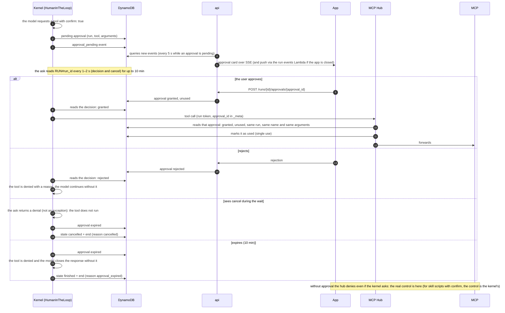

### Confirmation before sensitive actions

- **Which tools**: those marked with `confirm: true` (skill tools in `tools.yaml`; MCP tools in their hub registration, in CDK). Typically those that write or send something as the user. An agent version can add confirmations, but not remove the marked ones.
- **Flow**: Strands' `HumanInTheLoop` intervention (`strands/vended_interventions/hitl`, checked in its code) with `allowed_tools = ["*", "!flagged_tool", …]`, our own hook and our own `ask`. Strands' `ask` only receives the prompt text, so a `BeforeToolCallEvent` hook of order 0, which runs before the interventions, captures `toolUseId`, tool and arguments and, if the tool is marked, stores the pending approval in DynamoDB (run, tool and the arguments as is, as a JSON string: boto3 does not accept `float` in a DynamoDB map) and emits the `approval_pending` event; the `ask` waits for the decision by reading the run's record every 1–2 s, where the approval and the `cancel` flag are (a single read). The app shows assistant-ui's approval card with what it is going to do; the user approves or rejects (`POST /runs/{id}/approvals/{approval_id}`, only the chat's owner). If it sees `cancel` (the `agent.cancel()` does not get through while the loop is inside the callback), it returns a denial: not an exception, which would abort the run without a clean close, nor a "yes", because once approved one of our own tools runs even if the cancellation arrived during the wait. If the callback returns "yes" the tool runs; "no" or nothing (expired) denies it with a reason for the model, which continues without it; if it expired, it leaves a flag in the agent state and the kernel closes the run with `end` (`approval_expired`) instead of `ok`. No custom `cancel_tool`. Strands' real interrupt mode (ending the invocation and resuming with another one, freeing the microVM during the wait) is left for later: it changes the lifecycle of a run.
- **Wait**: the run waits up to 10 minutes, with a push notification if the app is not open (the run events Lambda, which also filters `approval_pending`, notifies `api`). After that the approval expires: the kernel cancels the tool, the model closes the response without it and the run ends with `end` (`reason = approval_expired`) and state `finished`. A late approval is not applied: the action is proposed again in the next message and asked for again. The same goes for scheduled tasks.
- **The real control is in the hub**: for a marked tool, the kernel passes the `approval_id` in the MCP call's `_meta` (Strands does not set a per-call `_meta` on the tools the model requests, but the `MCPClient` reads its `meta` on every call: the kernel gives it its own dictionary and the same hook writes the `approval_id` there before the call and removes it afterwards; this works because tools run one at a time; nodes of a `Graph` running in parallel cannot share that client or its dictionary: each carries its own) and the hub looks up that approval: granted, unused, from that run, with the same tool name and deep equality between the stored and received arguments (no hashes: canonicalising the same JSON in Python and in TypeScript is a classic source of bugs), and marks it as used (single use). Without it, it denies. That way not even a compromised kernel can bypass it. For skill scripts (our code in the kernel) the check is the kernel's.

<a id="identity"></a>

## Identity and permissions

Who each request is, what it can do and how spending is cut off.

### Kernel credentials

What an agent can do if someone runs code in its microVM. The goal: almost nothing with the execution role, and everything else with session credentials, limited to that agent, that user and that run.

| Credential | Permission | Limited to |
|---|---|---|
| **Runtime execution role** shared; visible to everything running in the microVM | ECR (pull the image) | The kernel repository |
| **Runtime execution role** | CloudWatch Logs and X-Ray | The kernel's log groups (with `logs:PutResourcePolicy` on its own) and `xray:PutTraceSegments`. Nothing else: no Bedrock, S3, DynamoDB or Secrets Manager. |
| **Session STS credentials** created by `api` per run, at launch, and delivered in each invocation's payload; not renewed: they last 1 h, the same as the longest run; STS session name = `run_id` (`{oid}.{suffix}`: that way the Bedrock invocation log says whose each call is, because it does not include `SourceIdentity` or the tags); those from a previous run of the same chat may remain in the microVM's memory until they expire, with the same scope (same user and chat; `RUN#` of that other run, already closed); revocable with a deny on the session | `bedrock:InvokeModel*` | Only the agent version's models, by inference profile ARN and `foundation-model` ARN in each destination region. Denied if the user has exceeded their limit (`aws:SourceIdentity`) |
| **Session STS credentials** | Code Interpreter: start, invoke and stop sessions | The platform's Code Interpreter, and only if the agent uses Code Interpreter mode |
| **Session STS credentials** | `s3:GetObject`, `s3:ListBucket` | `skills/{id}/{version}/*` of the skill versions in that agent version |
| **Session STS credentials** | `s3:GetObject`, `s3:ListBucket`; `s3:PutObject` only in `work/` and `output/` | `workspaces/{user}/{chat}/`: the kernel's sync with boto3 (fetching the workspace, uploading changes and detecting new files) |
| **Session STS credentials** | DynamoDB: write events, usage, pending approvals and their audit incidents; read the cancellation flag, the approval decisions and the user's monthly spend | In the activity table, that run's keys (`RUN#{run_id}`: record, events and approvals) and, in the audit table, `AUDIT#kernel#{agent}`; both with `dynamodb:LeadingKeys` (`ForAllValues:StringEquals`) on `GetItem`, `Query`, `PutItem`, `UpdateItem` and `ConditionCheckItem`, which are the actions IAM uses to authorise each element of the `status` + `end` transaction. Read-only, `USAGE#{oid}#{month}`. Nothing in the configuration or OBO tables. The effective limit arrives in the invocation payload; the agent conversation is in S3. |
| **Session STS credentials** | `s3:GetObject` and `s3:PutObject` for the conversation and memory; never delete | `workspaces/{user}/{chat}/conversation/*` of that chat and `workspaces/{user}/memory/*` of that user, plus `s3:ListBucket` with `s3:prefix` on those two prefixes (without it, a key that does not exist returns 403 instead of 404). Memory is written with `If-Match` (conditional write), or with `If-None-Match: *` if it does not exist yet. |
| **Run token** not IAM: signed by `api` with KMS per run | Call the MCP Hub and `/internal/obo` | That run: user, groups, agent, version, the `allow` list of tools and the ids of the version's Knowledge Bases. It lasts one hour, like the STS credentials; the hub and `api` only validate the signature, with the KMS public key held in memory. Nobody checks "whether the run has finished" on each call: a kernel that kept calling after its `end` is capped by that hour, and anything sensitive already went through approval. |
| **`api` role** | DynamoDB (in the activity table, chats, runs, tasks, users and what `close(run_id)` writes; the OBO table, which only `api` reaches; in the configuration table, reading agents and versions, for the catalogue, access and the `/internal/obo` audience, and limits), S3 (workspaces: presigned URLs and listing a chat's `output/`; reading and writing the user's `memory/` with `If-Match`, with `ListBucket` on that prefix so that a user with no memory gets 404), sending to the chat deletion queue (with `kms:GenerateDataKey` on its key), sending to the tasks queue ("run now") and consuming it; creating, changing and deleting the tasks' Scheduler schedules, with `iam:PassRole` only for the schedules role; to launch runs: `sts:AssumeRole` and `sts:TagSession` on the session role (with `SourceIdentity` and the run's tags), `kms:Sign` with the run token key, `bedrock-agentcore:InvokeAgentRuntime` (endpoint `production`); `kms:Decrypt`/`Encrypt` for the OBOs, the Entra secret, APNs and Web Push, Bedrock only for the titles model; egress to Entra's JWKS to verify JWTs; Microsoft Graph, only to read the groups of a user whose token carries *overage*; writing `AUDIT#platform#` (OBO rejected by Entra) | It is the only piece that assumes the session role, signs run tokens and invokes the runtime. It does not touch IAM. That is the price of launching from `api`: a compromised `api`, which has inbound access from outside, could create session credentials and tokens for any `oid` and any `allow` list. This is accepted because `api` already decrypts every user's OBOs and holds the Entra secret: the new risk is small compared with the one it already carries. |
| **Run events Lambda role** | Read the activity table's stream; read (`Query`) the `RUN#` events that `close` consolidates; what `close(run_id)` writes (chats and runs); call `/internal/push` | Only closing and approval notifications: cost and the IAM deny moved to the cost Lambda. |
| **Cost Lambda role** | Receive from the Bedrock invocation log's log group (subscription); read `RUN#` (the run's chat) and, in the configuration table, the catalogue prices, the limits and `DENY#`; write in the activity table `USAGE#`, its flags, `COST#{run_id}` (with the condition on the chat) and the per-`requestId` flags, and `DENY#` in the configuration table; `iam:PutRolePolicy` only on the session role; write `AUDIT#platform#` (budget cut-offs); call `/internal/push` | It is the only one that adds denies; `admin` only removes them when changing a limit and the watchdog empties the list on day 1. A Lambda with no external input: its only input is the log Bedrock writes. |
| **Watchdog Lambda role** | Chats (busy index, by `active_run`) and runs (`failed` + `end`), what `close(run_id)` writes, `DENY#` and `iam:PutRolePolicy` on the session role (only to empty the list on day 1), tasks and deleting their Scheduler schedules (those paused for 90 days), `bedrock-agentcore:StopRuntimeSession`, `AUDIT#platform#`, `/internal/push` | A cron with no external input. |
| **Chat expiry Lambda role** | Query the activity table's expiry index; what `deleteChat` writes (`deleted` flag on the chat, `cancel` on its run, deleting its task) and reading that run's record (its `traceparent`); deleting the task's Scheduler schedule; sending to the chat deletion queue, with `kms:GenerateDataKey` on its key | A cron with no external input; it deletes nothing in S3. |
| **Chat deletion Lambda role** | Consume the chat deletion queue and send back to it (the second pass); in DynamoDB, read the chat and its active run, `failed` + `end` on that run, `Query` of the chat's partition and batch deletion of its messages, its `COST#` and the chat; `s3:DeleteObject` and `ListBucket` on `workspaces/`; `kms:Decrypt` and `kms:GenerateDataKey` on the queue's key; `bedrock-agentcore:StopRuntimeSession`; `AUDIT#platform#` | The only piece that deletes chats in S3 (files and conversation). It does not touch `memory/`. No `DENY#`, IAM or push. |
| **`admin` role** | DynamoDB (the configuration table: agents, versions, skills, catalogue, limits and `DENY#`; in the activity table, users, every user's tasks, reading chats only for the "content access" group, audited, `cancel` on a run, reading `USAGE#{oid}#{month}` (monthly spend, for the profile page and to recalculate `DENY#`) and runs (`RUN#`: record and events, for their detail view, except those of a deleted chat: like `api`, it checks the chat first); the audit table), Scheduler schedules (pausing or deleting tasks, with `iam:PassRole` only for the schedules role, like `api`), S3 (`skills/`, `documents/`; deleting a user's `memory/` when offboarding them), `StartIngestionJob`, Evaluations, `iam:PutRolePolicy` only on the session role (the budget deny), calling `/internal/launch`, Microsoft Graph with its own app registration (group read-only) | Only what changes the configuration and what the panel shows. No OBO or session credentials; it does not write chats or events, nor delete chats. |
| **MCP Hub role** Fargate task in the integrations VPC | DynamoDB: read and mark approvals in the activity table (the catalogue is code and the `allow` list travels in the token); write the audit table under `AUDIT#hub#`; `kms:GetPublicKey` (once, with a cache for rotation: the signature is verified in the hub itself with `crypto.verify`, without KMS on each call); call `/internal/obo`; read the MCPs' secrets | No S3, Bedrock or run keys, nor the configuration and OBO tables. It does not have the Entra secret. |

- **How it fits in IAM**: the STS session policy cannot exceed 2,048 characters of plain text, and the policy in this table written with fixed paths does not fit (about 2,600 minified, even without skills). So `api` passes session tags with the run's data in `AssumeRole` (`oid`, `chat`, `run_id`, `agent`, `version`, `month`), and the session role's policy, the same for every run, uses `${aws:PrincipalTag/...}` in the resources: `workspaces/${aws:PrincipalTag/oid}/${aws:PrincipalTag/chat}/…`, `RUN#${aws:PrincipalTag/run_id}`, `USAGE#${aws:PrincipalTag/oid}#${aws:PrincipalTag/month}` and `AUDIT#kernel#${aws:PrincipalTag/agent}`. It is a managed policy, so as not to use up the role's inline policy quota, which the `DENY#` list uses. The role's trust policy allows `sts:AssumeRole` and `sts:TagSession` only to `api`'s task role, with `aws:TagKeys` limited to those keys: nobody else can choose the `oid`.
- **What goes in the session policy**: only what depends on the agent version: its models and the `skills/{id}/{version}/` paths. Since the effective permissions are the intersection of the role policy and the session policy, the session policy has to let through everything else that the role policy already narrows with the tags: a `NotAction` statement with Bedrock and S3 reads, which it does limit, and reading `workspaces/*` in general alongside the skills; otherwise the session would be left without DynamoDB, without its conversation and without its memory. If a version with many skills does not fit, reading `skills/` moves to the role policy and the kernel keeps checking each skill's hash. The tags also count towards the session's packed size: the metric to watch is `SessionTokenUtilization`, in the `AssumeRole` response.

### What the kernel does not have

- The user's Entra token or the OBO tokens (the backend does the OBO; the kernel only has a run token that the hub validates)
- The Entra app's secret
- Bedrock permissions beyond its agent's models, or on the Knowledge Bases
- Model provider keys
- Access to other users', runs' or agents' data
- Internet egress (only VPC endpoints)
- Access to Microsoft Graph or the user list
- Writing to the audit outside `AUDIT#kernel#{agent}`

### Who sees the session credentials

- The kernel process, which uses them for Bedrock, S3 (files, conversation and memory), DynamoDB and Code Interpreter.
- Not the skill scripts: they run in a process with no `AWS_*` variables.
- The model's free-form code: in Code Interpreter mode, no (it goes to another microVM); in local mode, it should not be able to reach them: it runs as another user with a clean environment, which cannot read the kernel's variables or memory (checked locally and in the microVM); even so, the design assumes it could use them, with that session's scope. In the microVM, with probe 9: the `Sandbox` user cannot read `/proc/<kernel>/environ`, `mem` or `maps` or the kernel's `0600` files, and does not see the credentials in the payload or in the next message; but it does obtain the runtime execution role's credentials through the metadata service (IMDSv2) and can use them (see "Running the model's code").
- The shell only exists in agents with local code execution, and it is used by the model's code, not the kernel.

### OBO tokens

- **Who has the user's token**: only the backend, on each message (it arrives validated by API Gateway). Neither the kernel nor the MCP Hub ever receives it: the hub only receives the run token.
- **The backend seeds once**: when creating a run, for each OBO MCP the agent is allowed that has no stored refresh token (or is flagged as rejected), it does the OBO with Entra (`jwt-bearer`, `requested_token_use = on_behalf_of`), also requesting `offline_access` so that Entra returns a refresh token, and stores the access token and the refresh token encrypted with KMS in the DynamoDB OBO table (`OBO#{oid}#{audience}`, 90-day TTL), which only `api` reaches. Normally this happens on the first message with that agent; from then on everything goes through on-demand renewal, a single path.
- **The backend renews on demand**: an internal route (`POST /internal/obo`) receives the run token and the audience; it checks the signature and that the audience is an MCP allowed for that agent version, and returns that user's token. If it has expired (or has less than 5 minutes left), it requests a new one with the refresh token (`grant_type=refresh_token`), stores the new ones (Entra issues a new refresh token on each use and does not revoke the previous one: the new one is stored and the old one discarded) and returns it. It only renews when someone uses it: tokens of inactive users expire on their own. The backend is the only one that reads and writes the store and the only one that talks to Entra.
- **The hub always asks the backend**: before calling an MCP it requests the token for that audience with the call's run token and keeps it in memory until shortly before it expires; one call to the backend the first time per user and MCP and another each time it expires (roughly one per hour). It does not touch DynamoDB or KMS for tokens, does not have the Entra secret and cannot request another user's token: the run token is signed by `api` with KMS. If the backend does not respond or there is no token, it denies and records it in the audit.
- **Network path**: a PrivateLink VPC endpoint from the MCP integrations VPC to the backend's internal NLB, on a dedicated port (an NLB is layer 4 and does not filter routes) on which `api` only mounts `/internal/obo`; the endpoint's security group only admits the hub and only that port, and nothing else can be reached from that VPC. `/internal/push` (run events, cost and watchdog Lambdas) and `/internal/launch` (`admin`) go on another port of the internal NLB, reachable only by the services VPC's security groups and not published by any PrivateLink endpoint. How callers of those two routes are authenticated, beyond the network, is still to be decided (see "`api` internal routes" in [To verify](#to-verify)).
- **No MSAL for this**: MSAL for Node (checked in its code, version 7.1.2) does not renew OBO tokens with the refresh token; its own code says the user has to send their token again when the access token expires. MSAL for .NET does have a "long-running OBO" mode. So the backend makes both requests with a standard OAuth library (for example `oauth4webapi`), which are two HTTP calls to Entra's token endpoint.
- **How long it lasts**: Entra refresh tokens expire, by default, after about 90 days unused and are renewed with each use; scheduled tasks work as long as the user has used the app within that period and nothing has revoked their sessions.

How spending is measured, warned about and cut off:

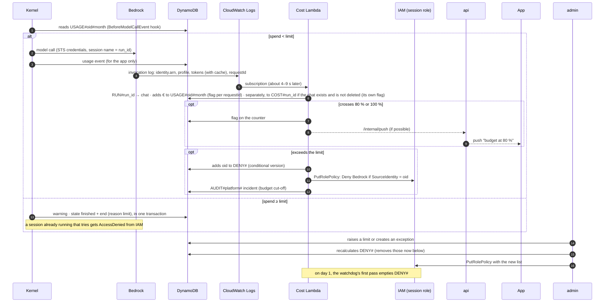

### Per-user usage control

- **Rule:** Bedrock measures, the kernel warns and IAM cuts off. The kernel calls Bedrock directly, so neither what is charged nor the cut-off depend on it: the cost comes from the Bedrock invocation log and the cut-off is an IAM deny on the user's sessions.
- **Owner of each run:** the backend reads the `oid` from the Entra JWT (already validated by the authorizer), checks that the `run_id` starts with it and stores it on the run (user and agent). The session STS credentials carry `SourceIdentity` = `oid` (it goes on every AWS call, stays in CloudTrail and is what the deny uses) and the `run_id` as the session name, which is what appears in the Bedrock invocation log.
- **Measure (Bedrock):** Bedrock model invocation logging (account and region configuration, metadata only: no text, images or embeddings) writes one record per call to a CloudWatch Logs group with `identity.arn` (the assumed session's ARN, which ends in the session name: the `run_id`), `modelId` (the inference profile), `inferenceRegion`, `requestId`, `operation` and the input, output, cache read and cache write tokens. STS signs it and Bedrock writes it: the kernel cannot forge it. It also covers auxiliary calls (the automatic mode's summaries), which go through the same credentials. Checked with probe 7: the tokens match the response's `usage` exactly, also with `ConverseStream` and with cache, and the record arrives without storing the text. The `requestMetadata` field also arrives, but it is set by the caller: the kernel fills it with the chat and the `run_id` for correlation, and it is never used for counting.
- **Add up (cost Lambda):** subscribed to that log group with a filter that only lets through the session role's calls (those of `api` for titles and those of Evaluations are platform cost). From each record it takes the `oid` and the `run_id` from the session name, reads the chat in `RUN#{run_id}` (written by `api`, not the kernel) and adds the cost in € (per-profile price table from the panel) in two transactions, each with its own per-`requestId` flag: one on `USAGE#{oid}#{month}`, always (the `oid` is inside the `run_id` itself); another on the chat's `COST#{run_id}`, the cost of that message, which lives with the chat and is deleted with it, with a `ConditionCheck` that the chat exists and is not `deleted`. Kept separate, a deleted chat does not prevent the spend from being counted, and the Lambda never writes to the chat item: it cannot recreate it after deletion. If the `COST#` condition fails because the chat is deleted, that record is considered done: no retry or failure destination. The chat's total cost is not stored: `api` adds up the `COST#` items when reading it. It arrives 4 to 9 s after the call (measured with probe 7): good for counting and warning, not for cutting off on the spot. The kernel can only read its counter (`USAGE#{oid}#{month}`), never write it.
- **Warn (kernel):** a Strands hook on `BeforeModelCallEvent` reads the user's monthly spend from their counter (with the log's seconds of delay) and compares it with the effective limit that `api` passes in the payload; if it has been exceeded, it sets `cancel = "you have reached your monthly limit"` (checked in the code: the loop does not call the model and closes with that text, with `stop_reason = "end_turn"`, not with a reason of its own); the hook leaves a flag and, on seeing it, the kernel ends the run with `end` (`limit`) instead of `ok`.
- **Cut off (IAM):** when the cost Lambda sees that a user exceeds their limit, it adds their `oid` to a deny with the `aws:SourceIdentity` condition on `bedrock:InvokeModel*` in the sessions' role (an inline policy of that role, which is the only thing the Lambda can touch: `iam:PutRolePolicy` limited to that role; about 200 `oid` fit in a role's inline policies), and the backend stops launching their runs. Their sessions can no longer call the model even if the kernel were compromised: normally within seconds, but IAM is eventually consistent and gives no deadline: in probe 3, between 7.6 and 10.4 s from the `PutRolePolicy` (see "Direct inference and Claude profiles" in "Verified").
- **The deny list has a single owner**: it lives in a `DENY#` record in the configuration table with a version number; whoever changes it (the cost Lambda on crossing a limit, `admin` on changing a limit or creating an exception, and the watchdog on its first pass on day 1 to empty it) writes the record with a condition on the version and, if it wins, writes the whole policy. That way two instances do not overwrite each other and the new month starts with no denies, without a separate schedule. About 200 `oid` fit in the 10 KB that IAM allows in total for a role's inline policies; if that is exceeded, the list moves to managed policies (up to ten per role, minus the `${aws:PrincipalTag/...}` one; 6 KB each), and going beyond that would be a sign that the limits are badly set.
- **What is accepted:** the call that crosses the limit completes; the cut-off arrives on the next one, plus the seconds the log takes and however long IAM takes to apply the deny. In probe 3, 3–4 more calls got through in the 7.6–10.4 s IAM took, and on top of that come the 4–9 s until the cost Lambda sees the record: the overrun is a few responses, more the more runs the user has at once.
- **Against abuse:** turn and token limits per run with Strands' `Limits` (`turns`, `total_tokens`, `output_tokens`, checked in its code): they are passed when invoking the agent, also apply to subagents and the loop ends with `stop_reason = "limit_…"`, which the kernel translates into the `limit` reason of `end`. They are soft limits: they are checked between turns, and do not apply to auxiliary calls (summaries), although their usage counts (it shows up in the log like any other call).
- **What is not tokens** (Runtime and Code Interpreter) is estimated from each session's duration and its rate and shown in the panel; Evaluations is platform cost.
- **Visible:** the panel shows usage per user, agent and model, with limits per Entra group and per-user exceptions; the app shows users what they have spent so far and warns them at 80 %.

<a id="persistence"></a>

## Persistence

Where each piece of data is stored, how long it lasts and how it is deleted: four DynamoDB tables and S3.

### The four tables

| Table | What it stores | Written by | Read by | Stream and PITR |
|---|---|---|---|---|
| **Activity** | What users do: chats, runs, scheduled tasks, users and spending | `api`; the kernel, only its `RUN#`; the MCP Hub, when marking approvals; `admin` (`cancel`, tasks and users); and the run events, cost, watchdog, chat expiry and chat deletion Lambdas | The same; the kernel, only its `RUN#` and its `USAGE#` | With stream (the run events Lambda); with PITR |
| **Configuration** | What the panel defines: agents, skills, models, limits and the deny list | `admin`; `DENY#`, also the cost Lambda and the watchdog | `api`, `admin` and the cost and watchdog Lambdas. Neither the kernel nor the hub | No stream; with PITR |
| **OBO** | Each user's Entra tokens, encrypted with KMS | Only `api` | Only `api` | No stream; no PITR |
| **Audit** | Agent and panel incidents | Each piece under its own prefix (see "Agent audit") | `admin` | No stream; with PITR |

- **Scope per table, not just per key**: the kernel and the hub only have permissions on the activity and audit tables, and the DynamoDB VPC endpoints in their VPCs only let those two through. So keeping the model's code in local mode away from the configuration and the OBO tokens does not depend on the `dynamodb:LeadingKeys` condition being written correctly: with a mistake in it, it would still not reach those tables. The OBO table is reachable only by `api`.
- **Restoring the configuration without touching the chats**: PITR restores a whole table into a new table. If a change from the panel breaks agents or limits, the configuration table, which is small, is restored and the affected records are copied over, without having to separate them from millions of events. The panel audit also stores the previous value of each change.
- **OBO, without PITR**: a deleted or expired refresh token must not be recoverable from a backup for 35 days. If the table were lost, `api` re-seeds the tokens on each user's next message (see "OBO tokens"); the scheduled tasks of anyone who does not sign in first fail with "sign in again", as when Entra rejects the OBO.
- **Different loads**: the activity table receives a write every ~250 ms per active run and is the only one with a stream; the configuration table is written a few times a day and read when each run is launched. Kept apart, the metrics and the throttling alarm of each one mean something, and panel changes do not go through the run events Lambda.
- **No cross-table transactions**: the one by `api` when creating a run, those of the cost Lambda (`USAGE#` and `COST#`, each with its `requestId` marker) and the kernel's (`status` + `end`) stay within the activity table. `DENY#` was already written separately, with its condition on the version.
- **Common to all four**: on-demand, encrypted with our CMK, several record types per table distinguished by the key prefix, and per-item TTL where needed (see [Data retention](#retention)).

### What each table holds

Each table holds several record types, told apart by the key prefix. A key written as `PK / SK` gives the partition and sort keys; a key with no `/` has a fixed sort key.

**Activity**

| Record | Key | What it holds | Expires |
|---|---|---|---|
| Chat | `CHAT#{chat}` | Owner (`oid`), agent, title, last activity, `active_run`, `expires` and `expires_day`, `deleted`, `test`, and `task` if it has a scheduled task | 12 months after the last activity, 7 days for test chats (chat expiry Lambda, no TTL) |
| Consolidated message | `CHAT#{chat}` / `MSG#{created}#{run_id}`, with `created` the creation time of the run record (UTC, ISO 8601) | What the user sees of each run: text, summarised cards, files, rating and the last `context` event. Written by `close(run_id)` with `attribute_not_exists`; the key is the same whoever calls it, so repeating it does nothing. The time goes first because in a task's chat the suffix of the `run_id` is a hash, not a ULID, and does not sort | With the chat |
| Run cost | `CHAT#{chat}` / `COST#{run_id}` | Cost in € of the run's model calls, added up by the cost Lambda | With the chat |
| Run | `RUN#{run_id}` | `status`, user, agent, version, chat, `traceparent`, `last_heartbeat` and `cancel` (who writes each field: "Who writes what in RUN#{run_id}") | 90 days |
| Run event | `RUN#{run_id}` / `EVT#000001…`; `end` is `EVT#999999` | One SSE event: text, tool, file, usage, `context`, approval… | 48 h; `end` lasts as long as the run |
| Approval | `RUN#{run_id}` / `APR#{approval_id}` | Tool, arguments (JSON string), state (pending, granted, rejected, expired, used). Under the run's partition, so the kernel's `dynamodb:LeadingKeys` already cover it | 30 days |
| Scheduled task | `TASK#{task_id}` (`task_id` is what the chat stores in `task` and what the Scheduler schedule points to) | Owner, its chat, agent, frequency, last and next run, failures and state (active or paused) | No TTL: the watchdog deletes those paused for 90 days |
| User | `USER#{oid}` | Name, email, groups, first and last sign-in, `status` (active or deactivated) and app settings (`use_memory`) | No TTL: a user is deactivated, not deleted, and the panel and the audit refer to them |
| Monthly spend | `USAGE#{oid}#{month}` | Total in € for the month and the 80/100 % notice markers | 13 months |
| Dedup marker | `USAGE#{oid}#{month}` / `REQ#{requestId}` and `CHAT#{chat}` / `REQ#{requestId}` | One per `requestId` and per transaction, in the same partition as the sum it guards (`attribute_not_exists`), so a repeated log record is not added twice | A few days |

Indexes: the user's chats (by `oid`, with id, title, last activity and `deleted`; it is what `GET /chats` returns), the user's tasks (by `oid`, on `TASK#`; for the app and the panel), busy chats (sparse, by `active_run`; read by the watchdog) and expiry (sparse, by `expires_day`; read by the chat expiry Lambda).

**Configuration**

| Record | Key | What it holds |
|---|---|---|
| Agent | `AGENT#{id}` | The editable draft and the `published` pointer |
| Agent version | `AGENT#{id}` / `VERSION#{n}` | The immutable published version, with hash, author and date |
| Skill version | `SKILL#{id}` / `VERSION#{n}` | Each approved `skill@version` with its hash, immutable like the agent versions |
| Model | `MODEL#{id}` | A catalogue entry: model id, price per token, context window and whether it is active |
| Limit | `LIMIT#DEFAULT`, `LIMIT#GROUP#{id}`, `LIMIT#USER#{oid}` | Monthly budget per rule |
| Deny entry | `DENY#…` | Who has hit the limit this month; emptied on day 1 |

None expires: it is configuration and is deleted by hand.

**OBO**

| Record | Key | What it holds | Expires |
|---|---|---|---|
| Token | `OBO#{oid}#{audience}` | Entra access token and refresh token, encrypted with KMS | 90 days |

**Audit**

| Record | Key | What it holds | Expires |
|---|---|---|---|
| Agent incident | `AUDIT#{source}#{agent}` / `{date}#{id}`, with source `hub`, `kernel` or `platform` | What happened, to whom and in which run (see "Agent audit") | 12 months |
| Panel incident | `AUDIT#panel` / `{date}#{id}` | Administrator, object, previous value and new value | 12 months |

Index: by user and date, for the panel.

### S3

- **By prefixes**: `workspaces/{user}/{chat}/` (chat files and agent conversation), `workspaces/{user}/memory/` (user memory), `skills/{id}/{version}/` and `documents/` (RAG). How the files are synced is in "Chat files (kernel and Code Interpreter)"; the conversation and the memory, below.

<a id="conversation"></a>

### Conversation and memory (S3)

No AgentCore Memory: everything is files in the workspaces bucket, under the user's prefix, read and written by the kernel with the session credentials. The repo's current kernel does use AgentCore Memory (`runtimes/agent-sdk-kernel/src/main.py`: on each message it reads the last turns with `ListEvents` and pastes them as text into the system prompt; at the end it saves the question and the final answer). That usage has two problems: the model forgets what the tools returned, and pasting the turns into the system prompt changes it on every message and breaks the prompt cache. They come from how that kernel uses it, not from limits of the service (short-term events accept binary data and the AgentCore SDK ships a session manager for Strands; we have not checked it). We do not use Memory because it is not needed: with one microVM per chat, the conversation is only read when the `Agent` is built, and a file in S3 is enough for that, with no other service and no per-event cost; and automatic long-term memory extraction costs on every turn and is not a text the user sees and corrects. Nor does it read less: the example queries Memory on every message, and we only read the conversation when we build the `Agent` (new microVM or new version).

- **Agent conversation (short term)**: what the model sees of a chat, stored with the Strands session manager `SnapshotSessionManager` and `S3Storage` storage (checked in the Strands code, 1.63.0, which describes it as the recommended path for new agents). It is not the consolidated message the user sees: that goes to DynamoDB and is written by `close(run_id)`.
  - **What it stores**: the whole agent: the list of messages, with the tool calls and their results as the trimming leaves them, and the system prompt. That way the model remembers on the next turn what it looked up and what the tools returned, not just the final text (what AgentCore Memory lost). Separately, in the stash, each block is kept as it arrived, among them the original of the trimmed results.
  - **Where**: a single JSON file per agent, `workspaces/{user}/{chat}/conversation/session/{chat}/scopes/agent/{agent}/snapshots/snapshot_latest.json`. The prefix up to `conversation/` is the `S3Storage` one; what comes after is set by Strands, with the chat as session id (that is why `{chat}` appears twice). The stash sits next to it, in `conversation/context/{chat}/scopes/agent/{agent}/`. `S3Storage` receives the kernel's boto3 session, so it reads and writes with the run's STS credentials, which only give access to that chat.
  - **When it is read and when it is written**: one `GET` only when the `Agent` is built (new microVM or new version); with the `Agent` already in memory it is not read. With `save_latest_on = "message"`, one `PUT` after each message that overwrites the file. Only that latest state exists: no snapshot history (we do not use `snapshot_trigger`).
  - **Subagents and `Graph`**: each subagent saves its own snapshot in the same folder, with its agent id (Strands requires creating it with `as_tool(preserve_context=True)`). A `Graph` orchestrator saves only its state, because its nodes cannot have their own snapshot.
  - **The file does not grow with the chat**: the trimming is done by automatic mode (see "Context: how big it is and who trims it"). It edits the agent's message list in place and the next snapshot already comes out trimmed. When a large result arrives, the snapshot is saved once in full, before trimming it (the snapshot manager's hook runs before the `ContextManager`'s), and is rewritten trimmed on the next message; if the microVM dies right between the two, it is restored large and trimmed on the first call. So the snapshot stays bounded by what the trimming leaves, however long the chat (with probe 18, 121 KB after 50 turns, plus a stash of 202 objects and 349 KB; in the local test `t_contexto_sandbox.py`, 4.8 KB with a trimmed result of 78,779 characters). Old content is not entirely lost: the model keeps it in the summary and the user has it in full in the consolidated messages.
  - **Retrieved content is not trimmed**: automatic mode does not trim the results of `retrieve_context` again (Strands excludes them on purpose) and each one brings up to 10,000 tokens; they stay in the conversation, and in the snapshot, until the summary removes them. After a retrieval, the test subagent's snapshot went from 4.4 to 47 KB. So the snapshot is not bounded by the 750-token preview but by the 85 % of the window at which the summary kicks in.
  - **The stash does grow**: one entry for each text block and each tool result element, as they arrive, whether trimmed or not (202 in 50 turns in probe 18), and it is only deleted with the chat's prefix, when the chat expires or is deleted.
  - **The system prompt is set again**: from the chat's second run on, Strands restores, when building the `Agent`, the system prompt saved in the snapshot, on top of the one the kernel passes it. Left alone, the agent would keep the instructions of an earlier version and a stale user memory; that is why the kernel sets `agent.system_prompt` again right after, with the instructions of the current version and the freshly read memory.
- **Two copies of the conversation, each for its reader**: the model's (the snapshot and the stash: Strands messages as the trimming leaves them, written by the kernel) and the user's (consolidated messages in DynamoDB, written by `close(run_id)` when it sees `end`). They are deleted together with the chat, whether the user deletes it or it expires 12 months after its last activity (the evaluations' test chats, after 7 days). The kernel's traces, which also carry prompts and answers (and which Evaluations reads), are not deleted with the chat: they expire with their log group, after 90 days.
- **User memory (long term)**: two text files, `workspaces/{user}/memory/preferences.md` (language, format, tone) and `facts.md` (what is worth knowing about them: their team, their projects), shared by all their agents and capped at about 10 KB each. There is no per-agent memory: what is told to one agent can be used by another of the same user; it is their own memory and they see it in full in the app.
- **Reading**: the kernel reads them when each run starts (one `GET` each, keeping its ETag; with the `Agent` already in memory, a conditional `GET` with that ETag, which returns 304 with no body if nobody changed them) and puts them in the system prompt, in a block of their own. If the agent version has "use memory" turned off, or the user has disabled it in the app (`api` carries it in the payload), it does not read them.
- **Writing: the `remember` tool**: a fixed kernel tool, in all agents with memory, with an operation (add, change or remove a line) and the file. The base prompt tells the model when to use it: when the user expresses a stable preference or asks it to remember something. There is no automatic extraction or extra call at the end of each run: it would cost tokens in all of them, including the early-morning tasks, and would fill the files with noise; if it is missed, it can be added later in the kernel. The call shows up as a tool card in the chat, so the user sees what has been saved.
- **Without overwriting each other**: a chat and a scheduled task of the same user can run at the same time. `remember` applies its change to the text it read and does a `PUT` with `If-Match` = the ETag (S3 conditional write); if another run, or the user from the app, changed it in between, S3 responds 412 (or 409, if another write coincides in time) and the kernel reads it again, applies the same change to the new content and retries; if the file does not exist yet (with `If-Match`, S3 responds 404), it creates it with `If-None-Match: *`. It is a few KB: the retry is immediate and no lock is needed. `api` saves the app's edits the same way, with the ETag it returned on read; if it does not match, it responds 412 and the app shows the new version. That is why the memory does not go through the file sync.
- **Isolation**: it is S3 with IAM, with no condition keys of its own: the session role policy, with the run's tags (`${aws:PrincipalTag/oid}` and `${aws:PrincipalTag/chat}`, see "How it fits in IAM"), allows `GetObject` and `PutObject` on `workspaces/{user}/{chat}/conversation/*` and on that user's `workspaces/{user}/memory/*`, plus `ListBucket` on those prefixes (without it, a key that does not exist yet gives 403 instead of `NoSuchKey`, and `S3Storage` fails on the chat's first message), and nothing else. In local mode the model's code does not receive those credentials: our own `Sandbox` launches it with a clean environment and as another user, who cannot read the environment or the memory of the kernel process (checked by running locally and, in the microVM, with probe 9). If that separation failed, it could read or rewrite that chat's conversation and that user's memory without going through `remember`, like the chat files, without reaching another user.
- **Deleting a chat: a single function.** `deleteChat(chat)`, from `packages/domain`, is used by the two that delete: `api` when the user deletes it and the chat expiry Lambda when it expires. The panel does not delete chats: an administrator deactivates the user and their chats expire. It marks the chat `deleted` and sets `expires` = now and `expires_day` = today, whoever deletes it: it stays in the expiry index, already expired, until the chat deletion Lambda deletes the chat, so if `deleteChat` dies before enqueuing, or the message ends up in the DLQ, the next chat expiry pass finds it again and enqueues it again. It puts `cancel` on its active run if there is one, deletes its scheduled task if it has one (the chat stores the id of its task, `task`: each task has its own chat) and its Scheduler schedule (not pausing it: reactivating the task of a chat that no longer exists would recreate it), leaves `{chat, oid}` in the chat deletion SQS queue and responds 204: it disappears from the app at once, even if it has a run in progress. If the chat was already `deleted`, it only enqueues again: that way a `deleteChat` that died before enqueuing is fixed by repeating it. From that moment `api` gives no presigned URLs and serves no runs, events or files of that chat.
- **Physical deletion, always in the chat deletion Lambda**, which consumes that queue (a single path, with no multi-second requests held open in API Gateway): first, whether or not there is a run, `StopRuntimeSession` on the chat's session (a 404 is fine: it was no longer alive), which cuts the run short and frees the idle microVM with its local copy of the files, and a wait of about 3 s, like the watchdog (`StopRuntimeSession` returns before the microVM dies, and a live kernel would keep uploading snapshot, stash and `output/`); then, if the run is still `pending` or `running`, `failed` + `end` (`cancelled`), conditional on the state it saw; the chat's prefix in S3 (`input/`, `work/`, `output/` and `conversation/`, with the snapshots and the stash of the main agent and its subagents: one `DeleteObjects` per thousand objects; no versioning, deleted means deleted); the chat's consolidated messages and `COST#` items; and, finally, the chat item (with it, the chat leaves the busy chats and expiry indexes). It does not look up the chat's runs (there is no chat-to-runs index, and none is needed): their events expire after 48 h, their approvals after 30 days and their record after 90, and in the meantime `api` does not serve them. When done, it enqueues the same message again with `DelaySeconds` = 900 and the second-pass flag, which only repeats the deletion of the S3 prefix: it picks up what arrived late, an upload with a presigned URL requested just before the deletion (they last a few minutes) or a last `PUT` from the kernel. Everything is repeatable: deleting what no longer exists does not fail, so a queue retry is harmless; after several failures, DLQ with an alarm. The queue and its DLQ are encrypted with our CMK, like the tasks queue: the senders (`api` and the chat expiry Lambda) have `kms:GenerateDataKey` on the key, and the chat deletion Lambda also has `kms:Decrypt`. It does not delete the user memory (`memory/` belongs to the user, not the chat; if the model saved something from that chat with `remember`, the user sees it and removes it in "What I remember about you"), nor the audit nor the counters.
- **No tombstone**: when the chat deletion Lambda finishes, nothing of the chat is left in DynamoDB. Any write that arrives late on it (`close` of a straggling run, a `launch`, the `COST#` of the cost Lambda) carries the condition "the chat exists and is not `deleted`", and fails the same against a marked chat as against one that no longer exists: it does not recreate it. Devices do not need a marker either: on startup they request the full list of chats and remove the ones that no longer appear (see "Local chat cache").
- **Expiring a chat**: the chat has no TTL. `api` sets `expires` (the last activity plus 12 months; 7 days for chats with the `test` flag, also on launch) and `expires_day` (that date, `YYYY-MM-DD`) when creating it and when launching each run, in the same transaction as `active_run`; a sparse index on `expires_day` groups them by day (one write per message, far below what a partition allows). Once a day, the chat expiry Lambda queries the partitions of the last 30 days up to today and calls `deleteChat` on each expired chat, with the condition `expires <= now` (if there was activity in between, it does nothing); one that is already `deleted` but still in the index is enqueued again. If something fails, the chat stays in the index and the next day's pass picks it up: there is no one-off notification that can be lost. One that stays expired for more than 7 days triggers an alarm, and beyond the 30 days each pass reads it is handled by hand. Discarded alternative: DynamoDB TTL on the chat, with DynamoDB Streams and the queue; a dropped `REMOVE` record (the stream more than 24 h behind, or a failed batch) would leave the S3 prefix forever, because the chat would no longer exist to retry. Nothing in S3 expires by age: in a chat active for more than 12 months no file or stash block disappears while it is alive.
- **Deleting or disabling the memory**: the user empties or edits it in the app; `api` writes the files. It does not expire by age (a preference from two years ago is still valid) and takes a few KB per user. When a user is deactivated from the panel, `admin` deletes their `memory/` (one `DeleteObjects`) and repeats it 5 minutes later, because a running run takes up to 30 s to see `cancel` and in that gap `remember` could recreate it; the rest of their data expires as usual (their chats, through the chat expiry Lambda).
- **Encryption and cost**: the bucket is already encrypted with our CMK. One snapshot `PUT` per Strands message (including tool results) and one per stash block (about 8 `PUT`s per turn in probe 18); two memory `GET`s per run (conditional if the `Agent` is still in memory) and, only when building the `Agent`, one `GET` per agent (the stash is only read with `retrieve_context`): cents per month. No extraction or per-event cost.

<a id="retention"></a>

### Data retention

| Data | Where | Expires | Why |
|---|---|---|---|
| SSE events (`EVT#…`) | DynamoDB, activity | 48 h (except `end`, `EVT#999999`, which lasts as long as the run) | They only serve streaming and reconnection; the history is the consolidated message |
| Approvals | DynamoDB, activity | 30 days | The audit keeps its copy |
| Runs (record, version, events) | DynamoDB, activity | 90 days, also if the chat is deleted | Ratings and the result live in the consolidated message, and their cost in the chat's `COST#{run_id}`, which lasts as long as the chat; when the chat is deleted its runs are not looked up: `api` stops serving them and they expire on their own |
| Bedrock invocation logging (metadata only) | CloudWatch Logs | 90 days | Reconciliation with the bill and support; carries no text |
| Chats and consolidated messages | DynamoDB, activity | 12 months from the last activity; 7 days for the evaluations' test chats (no TTL: the chat expiry Lambda finds them by `expires_day`) | The user can delete earlier, with `deleteChat` and the chat deletion Lambda, as on expiry |
| Spending counters | DynamoDB, activity | 13 months | Reconciliation with the bill |
| Users (`USER#{oid}`) | DynamoDB, activity | No TTL | A user is deactivated, not deleted; the panel and the audit refer to them |
| OBO tokens (encrypted) | DynamoDB, OBO | 90 days | How long an Entra refresh token lasts unused |
| Audit | DynamoDB, audit | 12 months | Encrypted with the CMK; the kernel only writes under `AUDIT#kernel#{agent}` |
| Agents, versions, skills, limits, catalogue | DynamoDB, configuration | No TTL | It is configuration: deleted by hand |
| Scheduled tasks | DynamoDB, activity | No TTL | A paused task nobody reactivates in 90 days is deleted by the watchdog; when its chat is deleted, `deleteChat` deletes it |
| Chat workspaces (files) | S3 | As long as the chat: deleted when it expires or is deleted (chat deletion Lambda) | No age-based lifecycle or versioning: deleted means deleted |
| Agent conversation (snapshot and stash) | S3, the chat's `conversation/` | As long as the chat: the chat deletion Lambda removes it when it expires or is deleted | Expires with the chat |
| User memory | S3, the user's `memory/` | No expiry; the user edits or empties it; `admin` deletes it when the user is deactivated | A few KB per user; an old preference is still valid |
| Logs and traces | CloudWatch | 90 days | They contain prompts and answers: encrypted group and restricted access |

### How retention is enforced

- **The history does not depend on the events**: when each run ends, `close(run_id)` (from the run events Lambda on seeing the `end` event) saves the final consolidated message as a chat item and removes `active_run`; the individual events only serve streaming and reconnection.
- **TTL is not exact**: DynamoDB usually deletes expired items within a few days, so reads ignore what has already expired by comparing the date.
- **Nothing depends on a TTL deletion**: TTL deletions show up in DynamoDB Streams as `REMOVE` records, but the run events Lambda does not receive them (its filter only lets inserts through) and nobody else listens to them. What has to be done when something expires, deleting a chat's workspace, does not hang off the TTL but off the chat expiry Lambda, which can be repeated.
- **A user who leaves** needs almost no deletion (only their `memory/`): Entra shuts them out immediately (no new login, one-hour token, OBO rejected) or an administrator deactivates them from the panel; their scheduled tasks are paused, their memory is deleted when they are deactivated (it does not expire by age), their chats expire after 12 months through the chat expiry Lambda and everything else expires through these TTLs. Only the audit and the counters remain, with the `oid`.
- **Backups**: with point-in-time recovery (PITR) on the activity, configuration and audit tables (not on the OBO one: see "OBO, without PITR" in [The four tables](#persistence)), deleted data remains recoverable during its window (up to 35 days). If some data must disappear sooner, this has to be taken into account.

<a id="operations"></a>

## Operations

Scheduled tasks, the Lambdas and the audit. How to follow a message end to end is in "End-to-end tracing".

A trigger from start to finish:

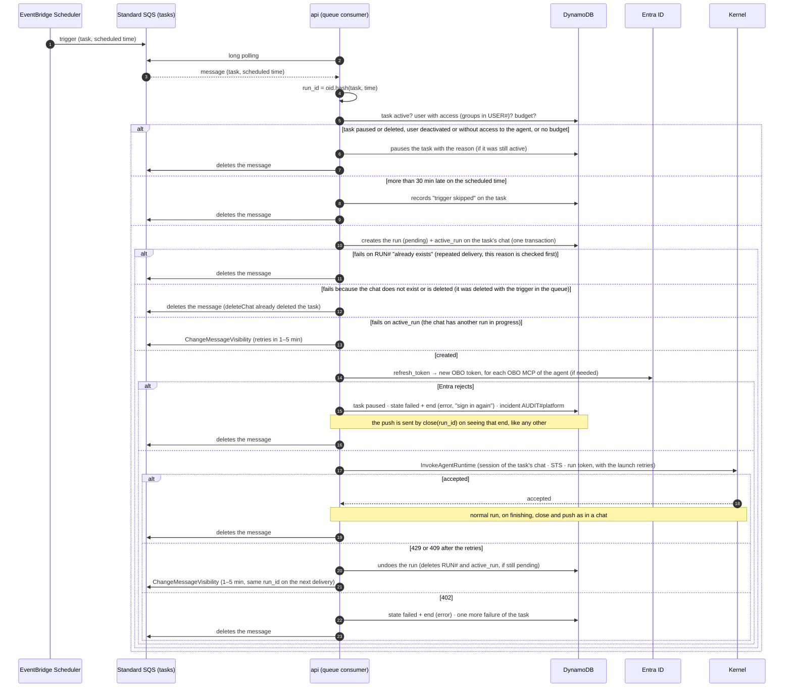

### Scheduled tasks

- **The user creates them in the app** with the agents they can use; they run as the user and count against their budget. They are stored in DynamoDB (agent, instruction, frequency, time zone, task chat, state).
- **Trigger**: the backend creates one schedule per task in EventBridge Scheduler (`cron`/`rate`/`at` expression with time zone), whose target is a **standard** SQS tasks queue, just for this (chats do not go through a queue). The body carries the task and the scheduled time, set by Scheduler itself with `<aws.scheduler.scheduled-time>`; with them and the `oid` of the task's owner, `api` computes the `run_id` = `{oid}.` + the first 26 base32 characters of `hash(task, scheduled time)`, so a repeated delivery of the same trigger (standard SQS delivers at least once) gives the same run and the transaction that creates it fails with "already exists". FIFO is not needed: per-chat ordering and deduplication come from `active_run` and that `run_id`. Scheduler delivers between 1 and 49 s after the time (50 triggers at the same time, in probe 12); a trigger that cannot be delivered (for example, without permission on the key) goes to the schedule's dead-letter queue with `ERROR_CODE` and the original body inside `MessageBody`. The schedules' execution role has `sqs:SendMessage` on the queue and `kms:GenerateDataKey` and `kms:Decrypt` on its key, and the key policy allows it. The app's "run now" is handled by `api`, which leaves an identical message in the same queue.
- **The consumer, inside `api`**: a loop in each replica with long polling (`WaitTimeSeconds` = 20, batches of up to 10) and few messages at a time (about 5 per replica), with a limiter of about 5 starts per second per replica so as not to eat up the 25 new sessions per second it shares with the chats; the Monday 8 o'clock peak is spread over a minute or two. *Visibility timeout* of 120 s; if the task's chat has a run in progress (the user is typing in it, or the task's previous run is still going), `ChangeMessageVisibility` to 1–5 minutes with random jitter, without creating anything. If AgentCore still responds 429 or 409 after the `launch()` retries (the same as in a chat), `api` undoes the run it has just created (deletes `RUN#` and `active_run` in one transaction, conditional on it still being `pending`) and applies the same `ChangeMessageVisibility`: that way the next delivery creates it again with the same `run_id`, instead of hitting "already exists" and deleting the message. A 402 (`ServiceQuotaExceededException`) is handled as in a chat: `failed` with `end` (`error`), one more failure of the task, and the message is deleted. A trigger more than 30 minutes late is skipped and recorded on the task. Each `ChangeMessageVisibility` counts as a delivery, so `maxReceiveCount` is 30 (with 8, a task waiting for a busy chat would end up in the DLQ before the 30 minutes); past those deliveries it goes to a DLQ with an alarm; what nobody consumes expires through retention (4 days). On receiving SIGTERM during a deployment it stops reading, finishes what it has in progress and returns with visibility 0 what it has not started; it takes up to about 20 s to get out of long polling, so the ECS task's `stopTimeout` is 45 s or more. A half-processed message reappears and the `run_id` makes it repeatable: the transaction fails on `RUN#` with "already exists" (checking that reason first, because if the run is still active `active_run` fails too) and the message is deleted. The hash uses the `<aws.scheduler.scheduled-time>` string as it arrives, without normalising.
- **What Scheduler does not retry**: permanent target errors (KMS denied or disabled, nonexistent queue) go to the schedule's dead-letter queue without retrying; if what fails is the schedule's own role, the trigger is lost without a trace in any queue, because that queue is written with the same role. There are alarms on the Scheduler metrics `InvocationsFailedToBeSentToDeadLetterCount` and `InvocationDroppedCount`. If the task load ever bothers the chats, the same code runs as a separate service, with the same image and another entry point.
- **Before starting**, `api` checks that the task is still active, that the user can still use the agent (with the Entra groups stored in `USER#{oid}` on their last request: those of a task are at most as old as that request, and a task whose user does not sign in for 90 days is paused, just as their refresh token expires) and that they have budget left; it creates the run in the task's chat with the published version of the agent and starts it with the same `launch()` as a message: current OBO, STS, run token, `InvokeAgentRuntime` with the session of the task's chat. It does not need the user's Entra token. The kernel does not distinguish a scheduled run from a normal one.
- **OBO without the user present**: when a tool acts as the user, the MCP Hub asks the backend for the token (see "OBO tokens"), which renews it with the refresh token if it has expired, without the user. `api` renews it the same way before starting the task. If Entra rejects the renewal (too long without activity, password change, account disabled, sessions revoked or conditional access), the record is marked as rejected and stays in the audit; `api` does not start the task, pauses it and the user is notified to open the app again.
- **Result**: a new message in the task's chat, with its files, and a push notification.
- **Automatic pause**: no budget, no access to the agent, expired OBO tokens or several failures in a row. Per-user limits (active tasks and minimum frequency) from the panel.

### Agent audit

- **What is recorded**: what the kernel and the MCP Hub decide on behalf of the platform: commands denied by the Strands interrupt, tools denied by the `allow` list, approvals granted, rejected or expired, OBO failures and budget cut-offs. Each record carries date, user, chat, run, agent and version, what was attempted, the rule applied, who recorded it (kernel or hub) and the `trace_id`.
- **Audit table in DynamoDB, with trust in the key**: each piece writes under a prefix that IAM reserves for it, and the panel shows where each record comes from. The MCP Hub writes under `AUDIT#hub#{agent}`; the kernel writes directly, with the same session STS credentials and the same `dynamodb:LeadingKeys` condition it uses for `RUN#{run_id}`, but only under `AUDIT#kernel#{agent}` (commands denied by the interrupt, few); the watchdog (interrupted runs), the cost Lambda (budget cut-offs), the chat deletion Lambda (chats deleted with the run alive) and `api` (OBO rejected by Entra) write under `AUDIT#platform#{agent}`; and `admin` writes the panel audit (configuration changes, deactivations, content access) under `AUDIT#panel`. What is under `AUDIT#kernel#` is worth what the kernel is worth: in local mode, the model's code could write fake incidents there for its own agent and user, but never under the other keys, which its credentials do not reach. No audit MCP or special route in the hub.
- **Keys for the panel**: agent audit by source, agent and date (`AUDIT#{source}#{agent}` / `date#id`, with source `hub`, `kernel` or `platform`) with an index by user and date; panel audit by date (`AUDIT#panel` / `date#id`) with the administrator, the object, the previous value and the new one; retention with a 12-month TTL; encrypted with our CMK.
- **Alarms**: the hub publishes a metric per incident; a CloudWatch alarm notifies the administrators if an agent or a user accumulates several in a short time (it usually points to a document with hidden instructions, or a misconfigured agent).
- **What it does not cover**: if the model's code killed the kernel before the event was written there would be no record, but the run without a heartbeat shows up as failed through the watchdog Lambda. The logs still exist as a technical record and for cross-checking with the trace; the panel reads the table.

### Quotas and sizing

- **AgentCore Runtime** (us-east-1, per account; the quotas can be raised through Service Quotas): 5,000 concurrent sessions, 25 new sessions per second, 1,000 requests per second shared by the whole data plane (Code Interpreter has its own: 30 `InvokeCodeInterpreter` per second and 200 sessions at a time), payloads of up to 100 MB (fixed API limit, not raisable), 8 h sessions by default (`maxLifetime`: the API accepts 60 s to 14 days, and the AgentCore quotas give 8 h as the maximum on microVM; we use 8 h, because the session is the chat's) and an idle timeout of 15 minutes by default (`idleRuntimeSessionTimeout`, with the same range in the API; we use the same 15 minutes).
- **What that gives**: with one microVM per chat, a session counts while the chat is in use and up to 15 minutes afterwards, not only while a run is going; 500 users with a chat open at the same time take 10 % of the sessions (in the eu-north-1 test account, Service Quotas gives 2,500 "Active Session Workloads": the value must be confirmed in the production account and region). A peak of 300 scheduled tasks at the same time, with two `api` replicas at about 5 starts per second each and about 2–3 s per start (`InvokeAgentRuntime` waits for the kernel to accept, and that includes the V2 cold start), is launched in a little over a minute (about 75 s), at about 4 new sessions per second: each replica has about 5 starts of 2–3 s in progress, so the limiter of 5 per second is only a ceiling.
- **Bedrock**: token and request per minute quotas per model and account, raisable (in the test account, cross-region Haiku 4.5 is at 10 calls per minute: more must be requested before the pilot); they are requested in advance and an alarm warns at 70 %. Recent Claude models are invoked through an inference profile: a `us.` profile spreads across US regions (data leaves us-east-1, but not the US) and a `global.` one, across any commercial region; which one is used depends on data residency, still to be decided. The kernel limits calls and tokens per run.
- **The rest**: per-IP WAF in front of API Gateway and a per-user limit in the backend (e.g. 60 messages per minute; API Gateway usage plans are per key, not per user); DynamoDB on-demand; watchdog 1, run events one per stream partition, cost whatever the Logs subscription asks for; backend and hub with two tasks of 1 vCPU and 2 GB each, `admin` with one, and scaling by CPU and by open connections; an MCP, one or two tasks.
- **Monitoring**: usage-versus-quota metrics on the CloudWatch dashboard and an alarm at 70 % on sessions, requests and tokens per minute; increases are requested through Service Quotas before opening the platform to a new group.

### The Lambdas

| Lambda | Triggered by | Reads | Writes | Calls |
|---|---|---|---|---|
| **Authorizer** | API Gateway, on every request | The Entra JWT (JWKS): signature, issuer, audience, expiry | — | —; passes nothing to `api`, which reads `oid` and groups from the token itself |
| **Run events** (close) | The activity table's stream, a single consumer with a filter on inserts of `end` and `approval_pending` events | The run's events | `end`: `close(run_id)` (consolidated message with `attribute_not_exists`, `active_run` if it belongs to that run; both only if the chat exists and is not `deleted`) | `api` (`/internal/push`, if possible): the end and the pending approval |
| **Cost** | CloudWatch Logs subscription to the Bedrock invocation logging group, filtered by the session role; asynchronous invocation with a failure destination (SQS) and an alarm | Invocation records; `RUN#` (the run's chat), catalogue prices, limits, `DENY#` | `USAGE#{oid}#{month}`, `COST#{run_id}` (if the chat exists and is not deleted), markers per `requestId`, 80/100 % markers, `DENY#`, cut-off incident | IAM (`PutRolePolicy` on the session role), `api` (`/internal/push`): the budget notices |
| **Watchdog** | EventBridge, every minute | Busy chats (index by `active_run`) and their run's record, `DENY#`, paused tasks | `failed`, `StopRuntimeSession` on the chat's session and, about 3 s later, `end` on the dead ones; `close(run_id)` on those with `end` unclosed for more than 5 minutes; empties `DENY#` on day 1; `AUDIT#platform#` incident; task failures; deletes tasks paused for 90 days | AgentCore (`StopRuntimeSession`), IAM (`PutRolePolicy`, only on day 1), `api` (`/internal/push`) |
| **Chat expiry** | EventBridge, once a day | The expired chats (index by `expires_day`, the last 30 days) | `deleteChat` on each, conditional on `expires <= now`: marks `deleted`, `cancel`, deletes its task and enqueues (if it was already `deleted`, by whoever, it only enqueues again) | Scheduler (deleting the tasks' schedules), chat deletion queue |
| **Chat deletion** | The chat deletion SQS queue (standard; enqueued by `deleteChat`, from `api` or the chat expiry Lambda); low concurrency, timeout of several minutes, DLQ with an alarm | The chat, its active run, its messages and `COST#` (`Query` on its partition) and the listing of its S3 prefix | `failed` + `end` (`cancelled`) if the run was still alive; deletes its S3 prefix (files and conversation of the main agent and the subagents), its messages, its `COST#` and the chat itself; re-enqueues itself after 15 minutes for a second pass over S3; `AUDIT#platform#` incident | AgentCore (`StopRuntimeSession`), S3, its own queue |
| **Emergency** (test only) | SNS, from AWS Budgets | — | — | ECS (to 0), CodeBuild (`cdk destroy` of the ephemeral network) |

None calls another Lambda; they coordinate through DynamoDB and the chat deletion queue (the tasks queue is consumed by `api`, not a Lambda). Each one has one trigger and one job: the run events one reacts to what is written, the cost one to what Bedrock logs, the watchdog to what does not happen, the chat expiry one to the passing of days and the chat deletion one to a message in its queue. Expiry is separate from the watchdog because its pace is different: one pass a day that may paginate thousands of chats, versus one per minute that has to finish in seconds; that way one does not delay the other, each has its own alarm and their permissions are narrower. What they share (closing a run, `deleteChat`, prices, limits) lives in `packages/domain`.

**The run events Lambda, in detail.** A single function (`lambdas/run-events`) that closes runs and notifies pending approvals: one role, one stream subscription and one deployment, and it leaves free the second of the two consumers DynamoDB allows per stream without losing throughput. What it requires:

- **Filter on the subscription**: only inserts (`INSERT`) of the two event types; TTL deletions (`REMOVE` records) do not even reach the function. Nothing depends on them: chat expiry is done by the chat expiry Lambda, not the TTL.
- **Bounded batches**: batch of 10 records, `BisectBatchOnFunctionError`, `MaximumRetryAttempts` = 2, `MaximumRecordAgeInSeconds` of a few minutes and an `OnFailure` destination (SQS) with an alarm. Without this, a record that makes the function fail (a malformed `end` written by a kernel in local mode) is retried for up to 24 hours and blocks its stream partition, and with it the closing of the runs sharing that partition. With bisect and two retries, the worst case is about twelve short invocations before discarding the record: seconds, not hours.
- **What is discarded is not lost**: a discarded `end` is closed by the watchdog after 5 minutes with `close(run_id)`.

**The cost Lambda, in detail.** `lambdas/cost`, subscribed to the log group of the Bedrock invocation logging. What it requires:

- **The logging, metadata only**: `textDataDeliveryEnabled`, `imageDataDeliveryEnabled`, `embeddingDataDeliveryEnabled` and `videoDataDeliveryEnabled` set to `false`; that way no prompts or answers are stored and the record still arrives with the identity and the tokens (checked with probe 7). The log group, encrypted with our CMK and with 90 days of retention, for reconciling with the bill and for support. It is an account- and region-wide setting: CDK sets it with a custom resource (`PutModelInvocationLoggingConfiguration`) and nobody else touches it.
- **Filter on the subscription**: only records whose `identity.arn` is the session role's; calls from `api` (titles) and from Evaluations are counted separately as platform cost, with their own Logs Insights query.
- **Repeatable**: in each of its two transactions (`USAGE#` and `COST#`), a marker of its own per `requestId` alongside the sum; a repeated delivery or a retry does not add twice. After two retries, the record goes to the failure destination with an alarm.
- **What is discarded is not entirely lost**: the record stays in the log group; a daily process reconciles what was summed in `USAGE#` with Logs Insights over the group and with the bill.
- **Price**: the record carries the inference profile (`eu.`, `us.` or `global.`), not the base model. AWS charges a profile by the region it is called from, not the one that runs it (`inferenceRegion` does not change the price), and `global.` comes out about 10 % cheaper than the geographic one; the panel's catalogue stores the price per profile and source region.
- **Records with errors**: those with `ValidationException` or `ThrottlingException` arrive with `errorCode` and no tokens, and add 0; those IAM denies or with a model that does not exist do not arrive, and cost nothing either.
- **Cut-off streams**: if the kernel stops reading a `ConverseStream` halfway (a cancellation, or a compromised kernel doing it on purpose), the record carries the correct input but `outputTokenCount` = 1, even if hundreds of tokens were generated; the CloudWatch metrics say the same, and what AWS bills remains to be seen. The Lambda recognises them (`ConverseStream`, no `errorCode`, with `outputTokenCount` ≤ 1) and, instead of trusting that 1, charges the maximum output tokens the agent version allows for that model: that way cutting a stream is never cheaper, and a kernel that did it on purpose penalises itself. So that a legitimate cancellation is not overcharged, the kernel, when cancelling, keeps reading the stream in progress to the end (up to the `metadata` event) without showing it; those records also count in a per-user metric with an alarm.
- **A role that combines two things**: spending and the IAM denial. This is accepted because it is a Lambda with no external input: its input is what Bedrock writes. `api`, which does have one, still has no `PutRolePolicy`. `admin` also has `PutRolePolicy` on the session role and reads the spending: it can only be reached through the panel, with the budget administrators group, and every change is audited.

### What happens when each piece fails

| Failure | Effect | What the user sees | What contains it |
|---|---|---|---|
| A backend replica (crash or deployment) | The SSE connections open on it are cut; runs continue, because the kernel does not depend on the backend | Nothing: the app reconnects with `Last-Event-ID` to another replica and recovers what is missing from DynamoDB | At least two replicas in two zones; the NLB stops sending connections to the one being drained |
| The whole backend | Messages cannot be sent nor the SSE read; runs in progress finish on their own; the hub cannot request OBO tokens and denies those tools (fails closed); no new runs start, neither from chats nor from tasks (triggers wait in their queue) | "Offline"; messages stay in the app's local queue | 5xx and health alarms; on recovery, the app resends and the consumer picks up the pending triggers (those more than 30 minutes old are skipped) |
| S3 (error or slowness) | The kernel cannot load the conversation or the memory at startup: the run ends with `end` (`error`) without calling the model; midway, a failing snapshot `PUT` is retried (SDK) and, if not, the run continues and what was not saved since the last `PUT` is lost; a failing stash `PUT` is logged by Strands, which carries on, and since the kernel skips the backfill it is no longer repaired: that block cannot be recovered with `retrieve_context` if it is later trimmed or summarised | "The chat could not be loaded, try again" or a turn the model does not remember | Multi-zone service; SDK retries; the snapshot is rewritten on every message, so at most the last one is lost |
| DynamoDB (throttling or error) | The kernel retries with increasing backoff (SDK) and batches more; heartbeats may be delayed | Text in jerks | On-demand tables; the watchdog tolerates 2 minutes without a heartbeat; throttling alarm |
| Bedrock (429, throttling, error) | Strands retries with increasing backoff up to a cap; if not, the run ends with `end` (`error`) | "The model is overloaded, try again" | Per-model quotas monitored (see "Quotas and sizing"); limit of calls per run |
| AgentCore admits no more sessions | `InvokeAgentRuntime` responds 429 | The message takes a few more seconds to start answering or, if it does not succeed, a 503 and the message goes back to the app's local queue | `api` retries with backoff for about 15 s; a task goes back to its queue with shortened visibility; alarm at 70 % of the quota |
| MCP Hub | Every MCP tool returns an error to the model (fails closed); the model answers without it or ends with `error` | Tool cards in error and an answer that says so | Two tasks in two zones, health check, alarm; the kernel retries once |
| One MCP | Only its tools fail; the hub returns a tool error and audits it | That card in error | Maximum time of 30 s per call in the hub (no MCP tool can go beyond that); alarm per MCP |
| Entra ID | No new sign-ins or OBO; tokens already issued are valid until they expire (1 h) and the hub uses the OBO tokens it has in memory | Whoever is already in carries on; login fails | The backend retries; a task whose OBO cannot be renewed is paused and notifies |
| KMS or Secrets Manager | No run tokens are signed and no OBO tokens decrypted: no new runs are launched | 503 on send | Multi-zone regional services; secrets cached in the backend's memory |
| Code Interpreter | That tool fails; the model carries on without it | Card in error | Maximum time per session; the run is not blocked |
| The kernel's microVM | It stops sending heartbeats | "The run was interrupted" and retry | Watchdog Lambda (see "Watchdog Lambda") |
| The run events Lambda (stream stuck or batch discarded) | The `end` is not closed | The chat takes a while to be released and the push does not arrive | Bisect, two retries and failure destination with an alarm; the watchdog applies `close(run_id)` after 5 minutes |
| The cost Lambda or the invocation logging | Spending is not summed in time; the kernel's budget hook and the IAM cut-off see a lagging counter | The message's cost appears late | Retries and failure destination with an alarm; alarm if the log group stops receiving records while there are runs; the daily reconciliation with the log group and the bill picks up whatever is missing |
| The tasks queue or its consumer | Scheduled tasks do not start; chats do | The task arrives late or is skipped (more than 30 minutes) | Queue retries and DLQ with an alarm; alarm on the age of the oldest message |
| The chat deletion Lambda | The chat stays marked `deleted` but physically exists | Nothing: they no longer see it | Standard queue with retries and DLQ with an alarm; deletion is repeatable |
| The chat expiry Lambda | Expired chats are not deleted that day | Nothing | They stay in the expiry index and the next pass picks them up, including those deleted by the user whose deletion did not finish (`deleteChat` sets their `expires_day` = today); alarm if a pass fails or if a chat stays expired for more than 7 days |
| An availability zone | Nothing in production: Fargate in two zones, NLB, DynamoDB and AgentCore are multi-zone | Nothing | In test, a single zone: accepted |

<a id="tracing"></a>

## End-to-end tracing

The goal: open a message a user sent from the app and see, on a single screen, everything that happened to it. From the moment they tapped "send" until the app received `end` and the push reached them, passing through API Gateway, `api`, the kernel, every model call, every tool, the hub, the MCPs and the close. With how long each step took, which one failed and why. It serves for support ("my message took a minute"), for finding bottlenecks ("where does the time go in the Sales agent?") and for debugging failures that cross pieces ("the tool returned an error: was it the hub, the OBO or the MCP?").

How: all our pieces carry OpenTelemetry, the open tracing standard, and send what they measure to AWS X-Ray, with CloudWatch Transaction Search enabled. The managed services that do not run our code (Bedrock, DynamoDB, S3, Code Interpreter) send nothing of their own, but they show up anyway: whoever calls them records the call as one of its own steps, with its duration and result.

### Concepts

- **Trace**: the complete path of a message. It has a unique identifier, the `trace_id`. Everything recorded with that id is part of the same trace, whichever piece it comes from.
- **Span**: a step within the trace ("`api` creates the run", "model call", "tool `search_documents`"). It carries the `trace_id`, its own id, the id of its **parent** (the span within which it happens), the start and end time, whether it went well or badly, and attributes (the `run_id`, the agent, the version…). Through the parents, spans form a tree: that is what is shown as a waterfall.
- **Propagation**: for the next piece to hang its spans from the same trace, the previous one passes it the `trace_id` and the parent span id. In an HTTP call it goes in a header; where there is no HTTP call (a queue, a DynamoDB item that triggers a Lambda) it has to go in the data itself. If a piece does not receive that context, it starts a new trace and the path is split in two.
- **Export**: each piece gathers its finished spans and sends them in batches to the X-Ray OTLP endpoint (`xray.{region}.amazonaws.com/v1/traces`). X-Ray joins them by `trace_id`, even if they arrive from different pieces and at different times.

### One trace per message

- **Trace = run**. A message from the app (or a scheduled task firing) creates a run, and that run is a trace. It fits how the platform works: `api` responds 202 right away and the work continues in the kernel, in the run events Lambda and in the push. If the trace were the HTTP request, it would end at the 202 and the important part would be left out. That is why everything that happens to the run, including what happens minutes later, hangs from the same trace.
- **The `trace_id` is created by whoever creates the `run_id`**: the app in a chat, the `api` task consumer in a task, `admin` in a batch evaluation. That way the trace starts at the real origin of the message (the app also measures how long the network and the entry gateway take) and not at the first server.
- **X-Ray-compatible format**: 32 hexadecimal characters; the first 8 are the time in seconds since 1970 and the remaining 24 are random. It is a valid W3C id and also fits in `X-Amzn-Trace-Id` (`Root=1-{time}-{rest}`). The X-Ray OTLP endpoint also accepts ids without the time (probe 14), but this format is the one AgentCore configures in the kernel (`OTEL_PYTHON_ID_GENERATOR=xray`) and the one needed to pass the context to AgentCore in `X-Amzn-Trace-Id` as well: that way all the platform's ids are the same and read the same. It is provided by AWS's generators for OpenTelemetry (`@opentelemetry/id-generator-aws-xray` in JavaScript, `AwsXRayIdGenerator` in Python).
- **One header: `traceparent`** (W3C standard: `00-{trace_id}-{parent span}-01`). It is the one OpenTelemetry uses and the only one the app and our services send to each other. API Gateway passes it through intact to `api` (probe 14). What is deliberately left out is `X-Amzn-Trace-Id`, AWS's own format (`Root=1-{8}-{24};Parent={parent span};Sampled=1`, the same information):
  - **API Gateway is not part of the trace**: it only continues a trace if `X-Amzn-Trace-Id` arrives; without it, it opens its own, with a different id, and adds that header to what it forwards (probe 14). Its span (the gateway and the authorizer) is left on its own. How long it takes is visible in its metrics (`Latency`, `IntegrationLatency`) and access logs, and in the trace itself as the gap between the app's client span and `api`'s server span. The authorizer does not open a span either, but writes the `trace_id` in its logs (see step 2 of "The path", below): if that gap looks odd, its logs are searched by it. In exchange, the app sends a single header, CORS lists one fewer, and there are no two different parents to reconcile in `api`.
  - **`api` reads only `traceparent`**: its propagators are `tracecontext,baggage`, without the X-Ray one. If it also read `X-Amzn-Trace-Id`, it could take the id of the trace API Gateway opened and split the message's trace.
  - **Both formats go to AgentCore**: `api` passes to `InvokeAgentRuntime` its span's context in `traceParent` and in `traceId` (`X-Amzn-Trace-Id`), as in probe 15, because AgentCore documents the latter. Inside the kernel, AgentCore sets the propagators `baggage,xray,tracecontext`, so what leaves the kernel (Code Interpreter, the MCP `_meta`) also carries `X-Amzn-Trace-Id`, always with the same parent as `traceparent`.
- **Everything is kept** (`Sampled=1` from the origin, and nobody decides again). Sampling, keeping only part of the traces, makes it cheaper, but has a problem: the decision is made at the start, when it is not yet known whether the message will fail or be slow, which are exactly the interesting ones. Always keeping the error or slow ones requires tail sampling: a central collector that receives the whole trace, waits for it to finish and then decides. We do not have one, because the kernel exports directly from AgentCore, and setting it up would be another piece to operate and another network path from the agents VPC. With Transaction Search, keeping all spans is reasonable (you pay by volume ingested, like logs), and the volume is controlled by removing noise (see "What does not produce spans").

### Context across asynchronous hops

Where there is no HTTP request to carry the header, the context travels in the data. Without this, the trace breaks exactly where the platform is asynchronous:

- **The run item stores `traceparent`** (`RUN#{run_id}`). `api` writes it when creating it, in the same transaction: the context of its server span (the `POST` one in a chat, the `/internal/launch` one in an evaluation; in a task, that of the `task` root span). It is read by the watchdog, the chat deletion Lambda and `close(run_id)`, which already read that item for other reasons: it costs no new reads.
- **`end` carries `traceparent`**. Whoever writes `end` (the kernel, the watchdog, `api` or the chat deletion Lambda) copies the one from the item. The run events Lambda reads it from the stream record itself, which brings the complete `end` item, without another read to DynamoDB.
- **Chat deletion queue**: `deleteChat` puts in the SQS message attributes the `traceparent` of the active run, if there is one, or otherwise that of its own span (the `api` request or the chat expiry Lambda pass), and the chat deletion Lambda reads it from there.
- **Tasks start their trace in the consumer**: the firing is enqueued by the Scheduler, which carries no trace context; the trace is born when the `api` consumer receives it.
- **The cost Lambda stays out of the trace**: the Bedrock invocation log brings no trace context, only the STS session name (the `run_id`). Its logs and `COST#{run_id}` carry that `run_id`, which is enough to cross-reference it with the trace if needed. Putting it in the trace would require reading the run item on every model call just for that.

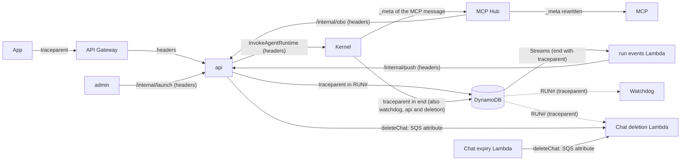

### The path

1. **App**. When "send" is tapped it generates the `run_id` and the `trace_id`, opens the `message` root span and, inside it, the client span of `POST /chats/{id}/runs`, which carries `traceparent`. The root span measures what the user experiences: it ends when the app receives `end` over the SSE, or when the user leaves the chat or the app goes to the background (then with the `abandoned` attribute, and the reply will reach them by push).
2. **API Gateway (iDMZ)**. Forwards `traceparent` to `api` untouched (checked with probe 14, with the `HTTP_PROXY` integration over VPC Link and streaming). It does not appear in the trace: how long the gateway takes is in its metrics and access logs, in the iDMZ account. The authorizer is of type `REQUEST` (with `Authorization` as the identity source, which is also its cache key), so it receives the headers: it extracts the `trace_id` from `traceparent` and writes it in its log line along with how long it took and whether it accepted or rejected the token. It does not open a span: that would leave it in the iDMZ's `aws/spans` and would force sharing it across accounts or giving it permission to write in the platform's one, and what it does (validate a JWT with the cached keys) takes milliseconds except on a cold start, which is also in the log. When the result comes from the cache, the Lambda does not run and there is no line.
3. **`api`**. Server span of the `POST`, with its children: the DynamoDB transaction that creates the run (and stores `traceparent`), STS, the KMS signing and `InvokeAgentRuntime`. The latter carries the context in both formats: the API accepts `traceparent`, `tracestate` and `baggage` (checked in botocore), and AgentCore documents `X-Amzn-Trace-Id`.
4. **AgentCore and kernel**. AgentCore inserts its own span, `AgentCore.Runtime.Invoke`, between `api` and the container, and the kernel continues the trace with ADOT (AWS's distribution of OpenTelemetry): the container's `POST /invocations` span carries `api`'s `trace_id` and hangs from AgentCore's, which in turn hangs from the `api` span that made the call. The AgentCore span is only kept with runtime tracing enabled, and goes to `aws/spans`; without it, the kernel's spans remain in the same trace, but hanging from a parent that does not appear and with a gap in the tree (probes 14 and 15). AgentCore configures ADOT on its own (propagators `baggage,xray,tracecontext`, X-Ray id generator, export to its log group): the kernel just starts with `opentelemetry-instrument`. The kernel opens the `kernel: run` span, which lasts longer than the 202 response, and inside it appear those emitted by Strands (one model call per turn, each tool, each subagent or graph node) and its own (activating a skill, the sync with S3, each round trip with Code Interpreter). Calls to Code Interpreter (`StartCodeInterpreterSession`, `InvokeCodeInterpreter`, `StopCodeInterpreterSession`) accept the same two headers; with tracing enabled on the Code Interpreter resource, the service adds its own spans inside the kernel's.
5. **MCP Hub and MCP**. In MCP the trace context travels inside the message itself, in `params._meta` (`traceparent` and `tracestate`, SEP-414 convention): the Strands MCP client injects it in every `tools/call`, and the MCP 2.x SDK then opens its own client span (`MCP send tools/call …`) and overwrites that value with its own; because of the propagators AgentCore sets, the `_meta` also carries the `X-Amzn-Trace-Id` key. The MCP 2.x server opens its span from `_meta` without any configuration. The hub takes it from there, not from the HTTP headers, continues the trace with its spans (`allow`, approval, OBO, and the latter calls `api`'s `/internal/obo`, which also continues it) and, when forwarding, **rewrites the `_meta` context with its own span**: it removes the incoming keys (`traceparent`, `tracestate`, `baggage`, `X-Amzn-Trace-Id`) and writes its own. If it forwarded the same bytes, the destination MCP would hang its spans from the kernel and the hub would end up as a sibling, outside the chain (checked with Strands 1.63 and `mcp` 2.3 in `pruebas/kernel/t_trazas_mcp.py`). The rest of the body, arguments and `approval_id` included, does not change. The kernel's `_meta` already carries the `approval_id` (see "MCP Hub"); the trace context goes alongside it. An external MCP receives the `_meta`; if it does not use it, what is seen of it is the hub's client span: how long it took and what it returned.
6. **SSE, cancel and approve**. The `GET /runs/{id}/events`, the `POST /runs/{id}/cancel` and the decision on an approval leave the app with the same trace, as children of the root span. The SSE is one span per connection, with events inside the span (first event, first text, `end` sent) and the number of events as an attribute; a reconnection is another span. This shows the time to first text, which is what the user perceives as "slow".
7. **Close and push**. The run events Lambda opens `close` with the `traceparent` from `end`, as a child of the `api` span that created the run (the one it stored in the item); from there hang `/internal/push` in `api` and the sending via APNs or Web Push. If the one closing is `api` (the next message arrived first) or the watchdog, the `close` span is theirs, in the same trace.
8. **Watchdog, expiry and deletion**. Each watchdog pass is its own trace (it does not belong to any message); for each run it touches it also opens a span in that run's trace, with the `traceparent` from the item, and links the two (OpenTelemetry *links*: a reference between spans of different traces). Each chat expiry Lambda pass is also its own trace. The chat deletion Lambda links to the context of the queue message.
9. **Tasks and evaluations**. Without an app, the root span is `task` (opened by the `api` consumer when it receives the firing) or `evaluation` (opened by `admin`, which passes the trace to `/internal/launch`); the rest of the path is the same.

### What does not produce spans

Keeping everything is only reasonable if "everything" is the steps that matter and not every turn of a loop:

- **Frequent loops, without their own span**: the kernel's event writes (every ~250 ms), the heartbeat (every 30 s) and the SSE's queries to DynamoDB (every 300 ms to 1 s). A one-minute message would generate hundreds of identical spans that say nothing. Those clients run with instrumentation disabled, and what matters about them goes as an attribute or event of the span that contains them: events written, events sent, retries, errors.
- **Health checks** (the kernel's `/ping`, the load balancers' ones): out.
- **Content**: the app's, `api`'s and the hub's spans carry no message text, only ids, sizes and results. The kernel's do carry prompts and responses: Strands follows the OpenTelemetry conventions for generative AI, and they are the ones Evaluations reads to score. That is why they go separately: AgentCore delivers each runtime's spans to its own log group (`/aws/bedrock-agentcore/runtimes/{runtime}-{endpoint}`, stream `spans`), not to the shared `aws/spans`, and that group carries our CMK and more restricted access (see "Where to see them").

### Instrumentation per piece

| Piece | How | Exports |
|---|---|---|
| Expo app (iOS and web) | OpenTelemetry trace API and SDK for JavaScript (`@opentelemetry/sdk-trace` 3.x, which replaces the deprecated `sdk-trace-base`), with hand-made spans (root, `POST`, SSE), the X-Ray id generator, the W3C propagator (`traceparent`) and a custom exporter over `fetch`. No automatic instrumentation: there is no official support for React Native, and the `fetch` one duplicates spans there. Metro (Expo SDK 53 onwards) resolves the `exports` and `imports` fields of the 3.x packages and picks their browser variant, with no configuration (`pruebas/app`) | OTLP in JSON to `api`'s `POST /telemetry`, in batches |
| API Gateway and authorizer (iDMZ) | Outside the trace: metrics (`Latency`, `IntegrationLatency`, authorizer duration) and access logs; the authorizer writes to its log the `trace_id` from `traceparent`, its duration and the result | CloudWatch in the iDMZ account |
| `api`, `admin`, MCP Hub and our own MCPs | OpenTelemetry SDK for Node with automatic instrumentation of HTTP, Fastify and the AWS SDK, plus our own spans (access check, `allow`, approval, OBO) | OTLP to an ADOT collector as a sidecar container in each Fargate task, which signs with SigV4 and sends to `xray.{region}.amazonaws.com/v1/traces` |
| Panel (Next.js) | OpenTelemetry SDK for Node on the server | Same as `admin` |
| Kernel | ADOT (`aws-opentelemetry-distro` ≥ 0.18, started with `opentelemetry-instrument`) and the Strands spans; runtime tracing enabled. The OpenTelemetry configuration is set by AgentCore in the container's environment (`OTEL_*`); among other things, it leaves the content of prompts and responses in the spans (`OTEL_INSTRUMENTATION_GENAI_CAPTURE_MESSAGE_CONTENT=true`, `AWS_GENAI_CONTENT_EXTRACTION_OPT_OUT=true`) | Directly to the X-Ray OTLP endpoint, with the runtime's execution role, to the runtime's log group: spans in the `spans` stream and logs in `otel-rt-logs` (probe 14) |
| Lambdas (Streams, cost, watchdog, chat expiry, chat deletion) | ADOT layer for Lambda | Directly to the X-Ray OTLP endpoint, with each Lambda's role |

- **Why the app goes through `api`**: the X-Ray OTLP endpoint requires SigV4 (AWS credentials) or an API key, and neither can go inside an app that anyone can decompile. `POST /telemetry` is a normal API route: it accepts only with the user's JWT, checks that each span's `run_id` starts with their `oid` (they cannot write spans into someone else's trace), limits size and frequency, sets `enduser.id` = `oid` (overwriting whatever comes in) and forwards to its own task's collector.
- **Why not CloudWatch RUM**: it is AWS's product for client telemetry, but its SDKs are for web and native iOS and Android, not for an Expo app in JavaScript.
- **Why a collector in Fargate and not in the kernel or the Lambdas**: in Fargate the sidecar collector offloads the services (spans leave in the background) and it is where signing happens; the kernel and the Lambdas already bring their exporter (AgentCore and the ADOT layer) and sign with their own role.

### Configuration (CDK)

- **Transaction Search enabled**. It is a requirement of the X-Ray OTLP endpoint and of AgentCore traces. Spans are stored as logs in the `aws/spans` group (`UpdateTraceSegmentDestination`, with its resource policy). All spans are stored and can be searched by any attribute; in addition, a percentage is indexed as an X-Ray trace summary (`UpdateIndexingRule`), which is what feeds X-Ray's own analytics. By default, 1 %, which is free; AWS considers it sufficient because search already covers all spans. Span ingestion is billed separately from logs ingestion. It is an account- and region-wide setting: CDK sets it with a custom resource, like the Bedrock invocation logging, and nobody else touches it.
- **X-Ray and Logs endpoints** in the three VPCs with our code: agents, services and integrations. Without the integrations one, the hub and the MCPs could not send their spans and the trace would break at the kernel.
- **`aws/spans`**: 90-day retention, like the logs, and encrypted with our CMK. X-Ray only applies the key (`SpansLogGroupKmsKeyId` in `UpdateTraceSegmentDestination`) if it creates the group itself; if the group already exists, the call with a key fails, and what needs to be done is to enable without a key and associate the key with the group (`AssociateKmsKey`), which encrypts whatever comes in from then on. The role that enables it needs `kms:DescribeKey`.
- **Kernel spans in their own group**: in new runtimes this is what AgentCore does by default (it is forced with `UNIFIED_TRACES_DESTINATION_ENABLED=true`). It requires Transaction Search enabled, ADOT ≥ 0.18 and the runtime's execution role to have `logs:PutResourcePolicy` on its log group, so that AgentCore lets X-Ray write to it. The group, with our CMK and 90 days.
- **Code Interpreter with tracing enabled**, so that its spans appear inside the kernel's.
- **Runtime tracing enabled**: a CloudWatch Logs delivery of type `TRACES` from the runtime to X-Ray (`PutDeliverySource` with the runtime's ARN, `PutDeliveryDestination` of type `XRAY` and `CreateDelivery`; in CDK, `CfnRuntimeTraces.toXRay()`, still in the preview mixins). It requires Transaction Search already active: otherwise, `CreateDelivery` fails. It is what stores the `AgentCore.Runtime.Invoke` span (probe 15).
- **Permission to send spans**: the X-Ray OTLP endpoint checks `xray:PutTraceSegments`. With only `xray:PutSpans`, even though it is the action documented for OTLP and comes with `xray:PutSpansForIndexing`, it responds 403 (probe 15). It is held by each Fargate task's role (for its collector), the runtimes' execution role and each Lambda's role.
- **API Gateway CORS** for the web: `Access-Control-Allow-Headers` includes `traceparent` and `tracestate` (the app only sends the first; the second is kept in case some client adds it), in addition to those of "Web app" in "Platform account" (Inventory by account and network). If one that the client sends is missing, the browser does not send the request (it fails after the preflight): it is not that the trace is lost, it is that the message does not go out (`pruebas/app`).

### Where to see them

- **Search**: CloudWatch, Transaction Search. You search by any attribute: the `run_id` (the support code the app shows in each message's menu), the chat, the agent and its version, the user, errors or duration ("runs of more than 30 s of the Sales agent v4 this week").
- **View a trace**: CloudWatch's trace detail, with the end-to-end waterfall of spans (like the example below) and that trace's service map. It joins in one trace the spans from `aws/spans` and those from the runtime's log group: the trace retrieval API the console uses (`StartTraceRetrieval`, `ListRetrievedTraces`) returned together the `api` span, the AgentCore one and the container's (probe 15). The old X-Ray API (`BatchGetTraces`) does not return these spans. From each span you jump to its logs, which carry the `trace_id` and the `run_id`, and from an error in the logs, to its trace.
- **View the agent**: the observability page of the AgentCore console, or CloudWatch's generative AI one (GenAI Observability), with the kernel's sessions, model and tool calls, tokens and latencies. It is the view for studying how an agent works; the end-to-end trace, for seeing where the time went or where a specific message failed.
- **From the panel**: a run's detail has a "View trace" link that opens that trace in CloudWatch (the panel extracts the `trace_id` from the item's `traceparent`). The panel does not draw its own traces: the console already does it well, and the kernel's spans carry prompts that must not be copied anywhere else.
- **Who**: a support role with read access to `aws/spans`, X-Ray and the services' log groups. The runtimes' groups, which hold the spans and logs with prompts, only for whoever needs them: access is granted per group, and that is why it is better for those spans not to be in `aws/spans`.
- **Evaluations** reads the same kernel spans to score the responses: it is not a separate system.

### Example

What you see when opening the trace of a message:

```
message 7f3a… (app · user X · agent Sales v4)                     total 21.0 s
├─ app: POST /chats/{id}/runs                                     2.3 s
│  └─ api: POST /chats/{id}/runs                                  2.2 s   (the 0.1 s before: network and API Gateway)
│     ├─ DynamoDB: create run · STS · KMS                           90 ms
│     ├─ InvokeAgentRuntime                                        2.1 s
│     │  └─ AgentCore (microVM cold start)                         2.1 s
│     │     └─ kernel: run                                        18.2 s
│     │        ├─ model (1st turn)                                 2.1 s
│     │        ├─ tool search_documents                            0.9 s
│     │        │  └─ MCP Hub (allow, identity) → mcp-documents       80 ms
│     │        ├─ model (2nd turn)                                 3.4 s
│     │        ├─ tool code → Code Interpreter                     9.8 s   ← this is where the time went
│     │        └─ model (final response)                           1.9 s
│     └─ run events Lambda: close                                     120 ms
│        └─ api: /internal/push → APNs                              60 ms
└─ app: SSE (first text at 4.6 s · 212 events)                    18.6 s
   └─ api: GET /runs/{id}/events                                 18.5 s
```

It reads from top to bottom: the user waited 21 s; 2.3 s were the entry and the microVM cold start; the first text reached them at 4.6 s; and half the time went into a code run in Code Interpreter. The `kernel: run` span lasts longer than its parent (`InvokeAgentRuntime`) because `api` receives the 202 and the kernel keeps working: this is normal in this trace. For the same reason, `close` hangs from `api`'s `POST` even though it happens at the end: it is the span whose context `api` stored in the item.

What remains to be checked end to end is in the "Traces, idempotency and startup latency" row of [To verify](#to-verify).

<a id="build"></a>

## Build and deployment

### Two services: api and admin

- **Why two**: the API all users use and the one administrators use are two security surfaces, with different rates of change and scaling. A bug in a chats route must not be able to reach "publish a version", and `admin` is not on the API Gateway: it can only be reached through the web ALB, with the administrators group.
- **`api`** (the backend): chats, runs (it creates them and launches them with `launch()`) and SSE, files, `/me`, the user's scheduled tasks, the OBO, the internal routes (`/internal/obo`, `/internal/push`, `/internal/launch` for `admin`'s evaluations) and push sending. It scales by open SSE connections. It is the only one that decrypts OBO and does OBO with Entra (`admin` only queries groups in Graph with a separate registration).
- **`admin`**: agents and versions, skills, Knowledge Bases, models and prices, budgets and exceptions, users, evaluations and the audit for the panel. It barely scales; it is deployed with the panel. It is the only one that writes agents, skills, prices and limits and that launches `StartIngestionJob`.
- **What is not split**: the SSE stays in `api` (separating it adds a hop and another deployment for little gain); the internal routes live in `api` because they need the Entra secret. Launching the agent does belong to `api` (chats and tasks, with the same `launch()`), not to `admin`: the panel requests its test runs through `/internal/launch`.
- **Inside `api`**, Fastify modules with clear boundaries, each with its routes, its domain and its permissions: `chats`, `runs` (with the SSE), `files`, `me`, `tasks`, `telemetry`, `internal` and `push`.

### Languages

- **TypeScript**: the app (Expo), the panel (Next.js with shadcn/ui), the `api` backend and the `admin` service (Fargate, with Fastify and AWS SDK v3), the MCP Hub and the MCPs (Fargate), and the Lambdas (authorizer, run events, cost, watchdog, chat expiry and chat deletion; and the emergency one, only in testing), in the same repository. A single language for everything that is not the agent, with types genuinely shared between app, panel and backend.
- **Python**: the kernel (Strands on AgentCore Runtime), `CodeInterpreterSandbox` and the skill scripts. Strands Python is the most mature version (1.63 versus 1.23 in TypeScript); the TypeScript one is already stable (1.x) and AgentCore Evaluations supports it since 1.5.0, but it still lacks pieces such as checkpoints and some model providers.
- **Contract between the two**: the platform and the kernel do not call each other directly; they talk through the `InvokeAgentRuntime` payload (built by `api`) and the events in DynamoDB. Both are defined once in JSON Schema and the TypeScript (app, panel, backend) and Python (kernel) types are generated, so that a change in an event does not break the other side without warning.

### Deployment: everything with CDK

- **A single infrastructure tool**: CDK in TypeScript, in the same repository as the backend, for both accounts (iDMZ and platform): networks and VPC endpoints, API Gateway and authorizer, ALB, ECS Fargate, DynamoDB, S3, KMS, SQS, EventBridge Scheduler, Lambdas, Knowledge Bases, AgentCore (Runtime, Code Interpreter, Evaluations), the MCP Hub and the MCPs, and the alarms.
- **Images**: the pipeline builds and publishes to ECR the kernel image and those of `api`, `admin`, the panel, the web app (in production), the MCP Hub and each MCP; CDK deploys the new tag.
- **Environments**: the same stacks in each environment (testing, in a single account, and production, with iDMZ and platform) with the same definition and different configuration.

### Tools and MCP with CDK

- **Each MCP is defined in CDK** (TypeScript): its Fargate service in the integrations VPC, its name in Cloud Map so the hub can find it, its identity (`run` or `obo`, with the audience in Entra) and its credentials in Secrets Manager if it needs them.
- **Registration in the hub** in the same definition: tools it exposes, readable label, how to summarise the result, `confirm` and owner. The catalogue is monorepo code (`packages/config`), imported by the hub and `admin`; no CDK custom resource or table: adding a tool is already a pull request and a deployment, and the panel offers that catalogue when composing each agent's `allow` list.
- **Adding a tool** = a code change reviewed in a pull request and deployed by the pipeline.

### One monorepo

- **Why**: there is genuinely shared code and it crosses languages. The contract (API, SSE events and `InvokeAgentRuntime` payload) generates the TypeScript and Python types; launching the agent is done only by `api`; `deleteChat` is called by `api` and the chat expiry Lambda; the limits, prices and access logic is used by the backend, the MCP Hub and the cost Lambda; `close(run_id)` is used by the run events Lambda, the watchdog and the backend; the API client, by the app and the panel. A change in an event touches both sides in the same pull request and, if it does not match, the build fails.
- **Structure**: `apps/client` (the Expo app, iOS and web), `apps/panel` (Next.js with shadcn/ui), `apps/api` (the app's backend, Fastify, with modules `chats`, `runs` with the SSE, `files`, `me`, `tasks`, `telemetry`, `internal` and `push`), `apps/admin` (the panel's API); `lambdas/` (authorizer, run-events (close and approval notices), cost, watchdog, chat expiry, chat deletion, emergency); `packages/` (`contract`, `api-client`, `domain`, `config`); `mcp/` (the hub and our own MCP servers in TypeScript: `mcp/hub`, `mcp/time`, `mcp/documents`); `kernel/` (Python); `infra/` (CDK with the stacks).
- **Tools**: pnpm workspaces and Turborepo for TypeScript (only what changes is built and tested); uv for the kernel. The Expo app lives in the monorepo with its Metro configuration for internal packages and its releases with EAS; Next.js with `transpilePackages`.
- **CDK in the same repository**: it builds the Lambdas and the container images directly, without publishing packages between repositories.
- **Outside the monorepo**: the content of the skills (instructions and scripts), which is uploaded and versioned from the panel.

### Zero-downtime deployment and rollback

- **Kernel**: a new image is a new runtime version (`UpdateAgentRuntime`, with the snapshot minutes), and the `DEFAULT` endpoint moves to it on its own: it always follows the latest version. That is why `api` does not invoke `DEFAULT`, but its own endpoint, `production`, pinned to a version (`qualifier = production` in `InvokeAgentRuntime`). First a `test` endpoint is pointed at the new version and a batch evaluation is run from the panel; then `production` is moved to it (`UpdateAgentRuntimeEndpoint`). With one microVM per chat, what stays on the old version is not only the runs in progress, but the microVMs of the active chats: up to 8 h (`maxLifetime`), or until 15 minutes pass without use. That is why a change in the `InvokeAgentRuntime` payload has to be backward compatible for at least 8 h (the old kernel receives the new payload). Rolling back is moving `production` to the previous version.
- **Backend (`api`)**: ECS rolling deployment with two replicas; when a task is retired, the NLB stops sending it connections and, after the draining time (60 s), its SSEs are cut: the app reconnects to another replica with `Last-Event-ID` without losing anything, because the events are in DynamoDB. A `launch()` halfway through (a few seconds) finishes within the draining; otherwise, the watchdog closes the run left in `pending` and the app retries. The task consumer stops reading on receiving SIGTERM and returns what it has not started (`stopTimeout` of 45 s or more). The same for the hub and the MCPs; the kernel retries once a call to the hub that fails at that moment.
- **Stack order**: data → network → services → integrations → ephemeral network (testing: it needs the VPCs of the previous two) → AgentCore (kernel: creating or updating the runtime needs the ECR endpoints of the ephemeral network; `api` takes the ARN of the `production` endpoint from configuration, not as a cross-stack reference) → iDMZ (production) → shutdowns (testing). A contract change is deployed first to whoever reads it (tolerating both formats) and then to whoever writes it; the meaning of an existing event never changes (see "API and client versioning").
- **Rollback**: each service goes back to the previous tag of its image with the same CDK deployment; DynamoDB has no schema, and a key change is done with dual writes during the transition. The Lambdas are deployed with aliases and the alias is switched.

### API and client versioning

- **Versioned path**: `/v1/…` on the API Gateway. Compatible changes (new optional fields, new SSE events, new routes) do not change the version; an incompatible change opens `/v2`, which coexists with `/v1` for at least six months.
- **SSE events**: the app ignores events and fields it does not know; the meaning or type of an existing one is never changed. The contract (JSON Schema in the monorepo) is the only definition, and the app, the panel, the backend and the kernel use the types generated from it.
- **Clients**: the app sends `X-Client-Version`; if it is older than the minimum supported, the backend responds 426 and the app shows "update the application". JavaScript changes arrive through EAS Update without going through the App Store; native changes require a store release, and the minimum supported is raised when almost nobody uses the previous one any more. The web app is deployed on its own.
- **Administration API** (`admin`): same rule, but the panel and `admin` are deployed together, so it can change without coexistence.

<a id="test-environment"></a>

## Appendix: test environment

A single account, with scheduled shutdowns and a spending cap; in production the same stacks are deployed without this.

### Test environment

- **A single account**, with the VPCs so the networking can be verified: the services one, the agents one, the MCP integrations one (hub, `mcp-time`, `mcp-documents`) and the minimal Code Interpreter one with DNS disabled (no endpoints, routes or NAT), Runtime V2 in VPC mode and Code Interpreter without network. All in one availability zone.
- **Differences from production**: no iDMZ account or cross-account PrivateLink (the API Gateway reaches the backend through a VPC Link with NLB); no Akamai (panel with public ALB, WAF and Entra login); no Netskope (egress through a NAT Gateway); a test Entra tenant; one Fargate task per service; web app on S3 + CloudFront.
- **Panel protection without Akamai** (reachable from anywhere, without IP filtering): the ALB requires the Entra login with its OIDC authentication action, so no request without a valid session reaches Next.js; in Entra, the panel's app has assignment required and only the assigned administrator groups, with MFA. In front, WAF against denial-of-service attacks and abuse: per-IP request rate rules and AWS managed rules; AWS Shield Standard already protects the ALB at no cost. The `admin` service still checks the role and audits every action.
- **Approximate cost** (us-east-1 list prices, to be confirmed with the AWS calculator): ~$200 a month if it were always on (almost everything is billed by the hour: NAT Gateway, interface VPC endpoints, load balancers and the Fargate tasks, with the integrations VPC, the MCP Hub, `mcp-time` and `mcp-documents`); with the weekend and night shutdowns (on for about 86 of the 168 weekly hours, 51 %) and the load balancers also in the ephemeral network, **~$110 a month** (~$95 with Fargate Spot): half of the hourly part plus about $15 that does not go down (WAF, KMS, Secrets Manager, DNS Firewall, CloudWatch and Route 53); plus usage, mainly Bedrock models ($20–100 a month in light testing).
- **Test data only.** What it does not validate: the cross-account iDMZ, Akamai and Netskope.
- **Region of the test accounts**: the organisation that hosts them applies a regions SCP (`AdvancedModeRegionRestrictionSecurityControlPolicy`): in us-east-1 it allows the global services (IAM, STS, Route 53, CloudFront) and some regional ones (KMS, CloudWatch Logs and, as was seen, Bedrock invocation), and denies DynamoDB and almost all of S3 (list observed by hand, with no probe that repeats it); in us-west-2, almost nothing; the only place where everything is allowed is eu-north-1. That is why the probes in `pruebas/aws/` are launched with `SONDA_REGION=eu-north-1`. Before setting up the full environment a decision is needed: either ask for the SCP to be lifted for us-east-1, or deploy the testing in eu-north-1 after confirming that AgentCore Runtime V2, Code Interpreter and the Claude inference profiles (there `eu.`, not `us.`) are available.

### CDK stacks

- **Network**: the VPCs (services, agents and the minimal Code Interpreter VPC with DNS disabled; the integrations one goes in its own stack), subnets, security groups, gateway-type endpoints (DynamoDB and S3, free) and the Route 53 Resolver DNS Firewall rules of those VPCs (the integrations one carries its own in its stack). Always deployed.
- **Ephemeral network**: everything that is billed by the hour and cannot be paused: the NAT Gateway, the interface VPC endpoints (AgentCore, CloudWatch…), the internal NLB, the panel's ALB, the WAF, the API Gateway with its VPC Link and its NLB, the MCP Hub's NLB with its VPC endpoint in the agents VPC, and the hub's VPC endpoint towards the backend. During shutdowns it is destroyed and on return it is deployed again. The URLs do not change: the API and the panel use a custom domain in Route 53 with an ACM certificate; the AWS endpoints are used by their regional name (private DNS), which does not change; and those of the MCP Hub and `/internal/obo`, which do change name when their NLB is recreated, are used through a fixed name in a Route 53 private zone of the network stack, which the ephemeral network points again at the new endpoint. A kernel deployment (creating or updating the runtime) needs the ephemeral network up, because the image is pulled through the ECR endpoints.
- **Data**: DynamoDB, S3, KMS, Secrets Manager and the SQS queues (tasks, chat deletion, their DLQs and the failure destinations of the run events and cost Lambdas), the Bedrock invocation logging log group and its configuration. Always deployed; never touched in a shutdown.
- **AgentCore and Bedrock**: Runtime V2 (`platformVersion` in the definition itself), Code Interpreter and Evaluations; and the Bedrock Knowledge Bases. Always deployed: without use it costs nothing (except whatever is confirmed about V2 pricing and OpenSearch if chosen).
- **iDMZ** (production only, in its account): the REST API Gateway with the authorizer, the VPC Link and its NLB, the web ALB and the PrivateLink endpoints towards the platform.
- **Services**: ECS with `api`, `admin`, the panel and the web app (nginx) and the Lambdas; in testing, also the authorizer. Always deployed; during shutdowns the Fargate tasks scale down to 0.
- **Web app in testing**: S3 + CloudFront instead of nginx on Fargate.
- **MCP integrations**: the integrations VPC, the MCP Hub and the MCPs' Fargate services (`mcp-time`, `mcp-documents`) with their names in Cloud Map, and the tool registry. During shutdowns, their tasks scale down to 0 and the hub's NLB goes away with the ephemeral network.
- **Shutdowns**: testing only (see "Shutdowns defined in CDK"). In production the same stacks are deployed without the shutdowns one; the ephemeral network is deployed the same way and never destroyed (everything always on), with the iDMZ in its account, several zones and more tasks.

### Shutdowns defined in CDK

- **They are declared in the environment configuration**, as a list of windows with their time zone, for example: `shutdowns: [{ from: "fri 21:00", to: "mon 07:00", timezone: "Europe/Madrid" }, { from: "00:00", to: "06:00", days: "mon-fri", timezone: "Europe/Madrid" }]`. More can be added (public holidays) without touching code, and the stack merges overlapping windows.
- **The shutdowns stack** turns each window into EventBridge Scheduler schedules: at the start, the Fargate tasks scale down to 0 (scheduled scaling), a shutdown flag is set that the `api` task consumer checks (Scheduler schedules cannot be disabled as a group; tasks that fire during the shutdown are skipped or run on return, depending on configuration) and a CodeBuild project runs `cdk destroy` of the ephemeral network; at the end, `cdk deploy` of the ephemeral network and the tasks go back to 1.
- **Starting or stopping by hand**: the same two processes can be launched whenever needed (for example, a demo on a Saturday).
- **During a shutdown** there is no API: the app reads the shutdown schedule from a static file on CloudFront (which stays on) and shows "test environment stopped until 6:00" or "until Monday at 7:00"; data is kept and the scheduled tasks that were due run on return or are skipped, depending on configuration.

### Spending cap with AWS Budgets

- **Monthly account budget** with email alerts at 50 % and 80 % of actual spend, and another on forecast spend.
- **At 100 %**: the SNS alert triggers a Lambda that launches the **emergency shutdown** (the same as a shutdown: Fargate to 0, scheduled tasks paused and `cdk destroy` of the ephemeral network with the same CodeBuild). In addition, as a native Budgets action, an IAM policy is applied that denies invoking Bedrock (`bedrock:InvokeModel*`) and AgentCore Runtime to the platform's roles: even if everything else fails, model and agent spend is cut.
- **Data is not deleted** (DynamoDB and S3): without use it costs cents. The environment stays stopped until someone restarts it by hand (raising the cap or at the start of the month); the shutdown schedule does not turn it back on. Email notice to the administrators.
- **Limitation**: billing data arrives hours late, so the cap can be exceeded somewhat before it triggers. It is complemented by AWS cost anomaly detection, which is free.
- **In CDK**, in the shutdowns stack: the budget with its alerts and its IAM action, the SNS topic and the emergency Lambda. In production there are only alerts and anomaly detection: it never stops on its own.

<a id="migration"></a>

## Appendix: migration from the current repo

### Difference from the repo's current kernel

- Today the kernel's role (`terraform/modules/runtime/iam.tf`) includes Bedrock, reading MCP secrets (`remote-mcp-key*`, `mcp-hub/*`), invoking MCP runtimes and gateways, built-in tools, Memory and writing to `feeds/*`, shared by all sessions.
- To reach the design: an "agent session" role that only `api` can assume and its issuance per run (like `workspace_credentials_service.py`); reduce the execution role to ECR, logs and X-Ray; and have the kernel always use the session credentials.

<a id="verified"></a>

## Verified before building

What has been checked without deploying the platform: on paper, against the code of Strands 1.63 and of the AgentCore SDK 1.25.2, the AWS API models (botocore 1.43.123), the CloudFormation schema and the official documentation, in November 2026. The `strands/…` paths are from the Strands 1.63.0 package and the `bedrock_agentcore/…` ones from the AgentCore SDK 1.25.2; for the API models the service and the shape are cited, because the JSON has no useful line numbers. What still depends on a test is in "To verify before building". The kernel items have also been checked by running Strands 1.63.0 locally, without AWS, with a fake model and a minimal MCP server: the 28 tests are in `pruebas/kernel/` and are rerun whenever the Strands version changes. Several rows have also been checked against AWS, in a test account, with the probes in `pruebas/aws/` (1 and 2-11-2026, in eu-north-1; see "Appendix: test environment"): session IAM, DynamoDB and S3; SSE through the iDMZ; Scheduler to the task queue (first FIFO, probe 2; then standard, probe 12); Runtime V2 with the real image and Code Interpreter with the kernel; cost from the Bedrock invocation log and the `run_id` as session name; the `Agent` reused with new credentials; one microVM per chat; the MCP Hub; end-to-end traces; the skill tools; the JWT in `api`; and context management with Claude. The app (Expo with OpenTelemetry and with assistant-ui) has been tested on web and in the iOS simulator (`pruebas/app/` and `pruebas/app-chat/`). In each row, the source says how it was checked.

| What | Result | Source |
|---|---|---|
| API Gateway REST streaming | Confirmed with private `HTTP_PROXY` integrations. Refuted the "SSE of up to one hour": the integration timeout with streaming goes up to 15 minutes and the stream is cut after 5 minutes without data (regional or private endpoints). The design now: SSE heartbeat from `api` every ≤60 s and the app reconnects before the 15 minutes. Measured against AWS: without data, cut at 311–318 s; with a heartbeat every 60 s or every 240 s, cut at exactly 900 s, also with `timeoutInMillis` = 900,000 (it is not 5 minutes in total) and with the full chain VPC Link → NLB → PrivateLink → internal NLB; events arrive as they are emitted, over HTTP/1.1 and over HTTP/2. The first requests right after the VPC Link became available returned 504 («Network error communicating with endpoint») for a few seconds. | probe `pruebas/aws/sonda_sse_idmz.py` (eu-north-1, 1-11-2026); API Gateway guide, "Stream the integration response for your proxy integrations" (official documentation, via search engine); botocore, `apigateway`, `Integration.responseTransferMode` |
| NLB idle timeout | 350 s by default (from 60 to 6,000), fixed on TLS listeners | botocore, `elbv2`, attribute `tcp.idle_timeout.seconds`; Network Load Balancer guide (official documentation, via search engine) |
| STS session policy size | Refuted that it fits with fixed paths: the limit is 2,048 plain-text characters, and the policy in "Kernel credentials" takes 2,578 minified even without skills. The design now: session tags and `${aws:PrincipalTag/...}` in the role policy; in the session policy, only the version's models and skills. | botocore, `sts`, `AssumeRoleRequest.Policy`; measurement of a draft of the policy |
| Session tags and packed size | Up to 50 tags, key of at most 128 and value of at most 256 characters; UUID, GUID and `2026-11` are valid values. The assumed role must allow `sts:TagSession`, which supports the `aws:TagKeys` condition. Tags count towards the packed size, and `PackedPolicySize` is deprecated since 17-6-2026: `SessionTokenUtilization` is monitored. In the probe, `AssumeRole` did not return it (nor `SessionTokenSize`) but did return `PackedPolicySize`: 37 % with the 6 tags and a realistic session policy of 1,252 characters (2 inference profiles, their `foundation-model` in 3 regions and 6 skills). | botocore, `sts`, `AssumeRoleRequest.Tags` and `AssumeRoleResponse`; probe `pruebas/aws/sonda_iam_datos.py`; STS Service Authorization Reference; IAM guide "Passing session tags in AWS STS" (official documentation, via search engine) |
| `bedrock-mantle`, for when it is added | Out of the design for now. What was checked applies if it is added: `CreateInference` has no model resource (only `project`) and the model is restricted with the `bedrock-mantle:Model` condition; Strands does not sign each request, but generates a bearer token from the credentials (action `CallWithBearerToken`), so it would have to be given the session's credentials; the budget denial would have to cover its actions, which are a different service in IAM; and OpenAI models go through mantle in the region, without a profile. Pending in that case: whether `CallWithBearerToken` must be allowed, the format of the model condition and whether the denial reaches calls made with a bearer token. | `bedrock-mantle` Service Authorization Reference (JSON); `strands/models/_openai_bedrock.py:22,37-44,66-68,174-198`; Bedrock guide "API keys permissions" and model card (official documentation, via search engine) |
| Claude via inference profile | Invoking via a profile requires permission on the profile ARN and on the `foundation-model` in the source region and in each destination region. A `us.` profile routes within the US; a `global.` one, to any commercial region. | Bedrock guides "Geographic cross-Region inference" and "Global cross-Region inference" (official documentation, via search engine); `bedrock` Service Authorization Reference, `InvokeModel` |
| Direct inference and Claude profiles | The design's session policy (profile ARN and `foundation-model` in each of its destination regions, plus the `NotAction`; 907 characters) lets `ConverseStream` and `Converse` with caching through (15,625 tokens written and then read), lets DynamoDB through and denies another Claude with an IAM `AccessDenied`. The profile, the source region's `foundation-model` and each destination region's are needed: without any one of them, even a remote one, it is always denied, because Bedrock authorises all candidates. A `global.` profile additionally requires `arn:aws:bedrock:::foundation-model/…`. All Claude models in the catalogue can only be invoked via a profile (`inferenceTypesSupported` = `INFERENCE_PROFILE`), in eu-north-1 and in us-east-1. An `eu.` profile processes only in its 6 EU regions and a `us.` one in the US regions; a `global.` one can take data out of the geography (blocked with an SCP on `aws:RequestedRegion = unspecified`); CloudTrail and CloudWatch log in the source region. Denial by `aws:SourceIdentity` on already issued sessions: 7.6–10.4 s (median 8.3 s, 10 measurements, with 3–4 calls getting through before); in one measurement a call got through after the first `AccessDenied`; a new session of the cut-off user is born denied, and other users are not affected. | probe `pruebas/aws/sonda_bedrock.py` (eu-north-1, 1-11-2026, Haiku 4.5 and Sonnet 4.6, two runs, 15 of 15 in the second); Bedrock guides "Geographic cross-Region inference" and "Global cross-Region inference" (official documentation) |
| Consumer of the standard task queue (`<aws.scheduler.scheduled-time>`, redeliveries, busy chat, shutdown, DLQ) | The time in the body is the nominal one: a `rate(1 minute)` gave times exactly 60 s apart, anchored to the second the schedule was created, and distinct `run_id`s. A repeated delivery (same body, or a message not deleted after creating the run) fails the transaction on `RUN#` (`ConditionalCheckFailed`, together with `active_run` if it is still active) and is deleted. Busy chat: `ChangeMessageVisibility` and back at the scheduled time, with the delivery counted. More than 30 min late: skipped. SIGTERM: finishes what it has in progress, returns what has not started and exits in 6–18 s (long polling). SIGKILL: the redelivery sees "already exists" and the run stays in `pending` (the watchdog closes it). 50 `at()` at the same time arrive at +1…+49 s and 2 replicas launch them as they arrive; 50 messages at once are drained in 8.7 s (with simulated 1 s starts). To the DLQ after `maxReceiveCount` deliveries, with the body intact. Scheduler does not retry permanent errors (KMS, non-existent queue, role): with the role broken there is not even a dead-letter queue. | probe `pruebas/aws/sonda_tareas_cola.py` (eu-north-1, 1-11-2026); `AWS/Scheduler` metrics |
| `PlatformVersion` | Refuted that CloudFormation does not set it: it is a property of `AWS::BedrockAgentCore::Runtime`, updatable without replacement, and CDK exposes it. Going back from V2 to V1 is an in-place update. The design no longer has the custom resource. | CloudFormation schema (cfn-lint 1.59.0), `resources/8044caba860ea6bb.json:3-5,1022-1024`; aws-cdk-lib 2.275.0, `aws-bedrockagentcore/lib/runtime/runtime.d.ts:62` and `aws-bedrockagentcore/README.md:917-919` |
| Runtime image in VPC mode | Refuted that the AgentCore plane brings it: a VPC-mode runtime created since the gradual rollout of 5-5-2026 sends all its traffic, including S3 and the image, through our VPC. The design keeps ECR (`api` and `dkr`) and lets the ECR layers bucket through the S3 gateway. | botocore, `bedrock-agentcore-control`, `VpcConfig.requireServiceS3Endpoint`; AgentCore guide "Runtime security best practices" (official documentation, via search engine) |
| Runtime session idle timeout | `idleRuntimeSessionTimeout` ranges from 60 s to 14 days according to the API model (the AgentCore guide gives 28,800 s, 8 h, as the maximum on microVM; the 14 days are for Instances), 900 s by default; the design leaves it at 900 s (15 minutes, one session per chat) and `maxLifetime` at 8 h, which is not reset by invocations. Memory and disk persist across invocations of the same session; if it stops, the same id starts an empty microVM. V2 reclaims idle memory after 120 s. | botocore, `bedrock-agentcore-control`, `LifecycleConfiguration`; CloudFormation schema, `8044caba860ea6bb.json:475-480`; AgentCore pricing page (official documentation, via search engine) |
| V2 cold start | AWS publishes a P75 of 1.9–2.0 s (V1: 5.4–30 s), measured in PUBLIC mode with an echo server, without a model call. | What's New "The new AgentCore Runtime is now available" (official documentation, via search engine); aws-samples, `05-measure-your-runtime/README.md:272-279` |
| `DEFAULT` endpoint | Refuted "move `DEFAULT`": it always follows the latest version. The design now invokes its own endpoint, `production`, pinned to a version. | aws-cdk-lib 2.275.0, `aws-bedrockagentcore/README.md:135-136,374-377`; AgentCore guide "Agent runtime versioning" (official documentation, via search engine); botocore, `bedrock-agentcore`, `InvokeAgentRuntimeRequest.qualifier` |
| `runtimeSessionId` | From 33 to 256 characters: the chat's HMAC, in hexadecimal (64), is valid. Refuted that the same id always lands on the same microVM: while the session is alive, yes; if it stopped, another empty one starts. That is why, if the kernel does not have the chat's `Agent` in memory, the conversation is loaded from S3, and duplicates are prevented by the conditional transition from `pending` to `running`. | botocore, `bedrock-agentcore`, `SessionType`; AgentCore guide "Runtime sessions" (official documentation, via search engine) |
| Traces in `InvokeAgentRuntime` | Accepts `traceparent`, `tracestate` and `baggage`. | botocore, `bedrock-agentcore`, `InvokeAgentRuntimeRequest` |
| Traces in AgentCore | `InvokeAgentRuntime` also accepts `X-Amzn-Trace-Id` (parameter `traceId`), and the Code Interpreter APIs accept `X-Amzn-Trace-Id` and `traceparent`. AgentCore requires Transaction Search; new runtimes leave their spans in their own log group (stream `spans`), with ADOT ≥ 0.18 and `logs:PutResourcePolicy` on the execution role. | botocore, `InvokeAgentRuntimeRequest`; AgentCore guide, "Add observability to your Amazon Bedrock AgentCore resources" |
| Transaction Search | Enabled with the Logs resource policy for `xray.amazonaws.com`, `UpdateTraceSegmentDestination` and `UpdateIndexingRule` (they exist in botocore). It ingests 100 % of spans and all of them are searchable; by default it indexes 1 % as trace summaries, for free. `aws/spans` supports a CMK only if X-Ray creates the group; if it already exists, `AssociateKmsKey`. The X-Ray OTLP endpoint requires Transaction Search, works only over HTTP (JSON or protobuf) and accepts spans from up to 14 days back. | CloudWatch guide, "Transaction Search", "Enable transaction search" and "OTLP Endpoints" |
| API Gateway and X-Ray | If the request arrives already traced, API Gateway continues the trace even if the stage does not have X-Ray enabled. REST APIs only. | API Gateway guide, "Trace user requests to REST APIs using X-Ray" |
| Trace context in MCP | It goes in `params._meta` (`traceparent`, `tracestate`), not only in headers: Strands injects it in each `tools/call` (`inject_trace_context`) and `mcp` 2.x injects and extracts it out of the box (SEP-414). | `strands/tools/mcp/mcp_instrumentation.py`, `mcp_client.py`; `mcp/shared/_otel.py`, `jsonrpc_dispatcher.py` |
| Trace id | The AWS id generators for OpenTelemetry put the time in the first 8 characters, the `X-Amzn-Trace-Id` format. The OTLP endpoint also accepts W3C ids without the time (probe 14); the X-Ray format is kept because it is the one the kernel uses and the one `api` passes to AgentCore in `X-Amzn-Trace-Id`. | `@opentelemetry/id-generator-aws-xray`; `AwsXRayIdGenerator` from `opentelemetry-sdk-extension-aws` |
| Traces in the app (Expo test) | Expo SDK 58 with `@opentelemetry/sdk-trace` 3.0, `core` and `resources` 3.0 and `id-generator-aws-xray` 3.0: Metro bundles for web and iOS without configuration and picks the browser variant; the iOS bundle compiles to Hermes bytecode. On web (Chromium, the page on a different origin from the server): id in X-Ray format, `traceparent` with the request span as parent and sampled, preflight with only `content-type,traceparent`, both spans in `/telemetry` in the same trace and the export without context headers; with a CORS policy without `traceparent`, the browser does not send the request. | `pruebas/app` (2-11-2026) |
| App with assistant-ui (Expo test) | `@assistant-ui/react-native` 0.1.51 (`core` 0.3.32) with Expo SDK 58: `useRemoteThreadListRuntime` over `/chats` and one `useExternalStoreRuntime` per chat whose messages, SSE and queue live in our own store, against a simulated backend. On web (Chrome): with the SSE cut every 1.5 s, the app reconnects with `Last-Event-ID` and receives the 37 events of a run in order, with no gaps or duplicates (6 connections); when switching chats with a run in progress, assistant-ui did not unmount the first chat's hook and the response arrived complete on returning; two messages typed during a run go out in order when it finishes, without a 409 from the backend; `approval_pending` as an `approval` part (approve, reject, and on expiry `resolution: "expired"` without buttons, set by the app with `expires_at` before `end` arrives); on stop, the runtime calls `notifyCancelled` before `onCancel` and what is queued does not go out until the next send; and the queue saved in `localStorage` is re-queued when the app reloads (on iOS, from SQLite: see "iOS cache (Expo test)") and goes out after the resumed run. A send with the run in progress goes to the `steer` lane: with `cancel` in the queue driver, it would interrupt it. On iOS (iPhone 17 simulator, iOS 27.2, `npx expo run:ios`): the `fetch` from `expo/fetch` delivers the SSE as a stream and reconnecting with `Last-Event-ID` receives all events without duplicates; with the app in the background no connection is opened, and on returning (20 s later, with the run already finished) it reconnects once and receives the 30 missing events; the approval card (approve, and expire without buttons), the queue in the text box and stop behave as on web. | `pruebas/app-chat` (2-11-2026, 16 of 16 on web; iOS in the simulator, by hand); `@assistant-ui/core`, `runtimes/external-store/external-store-thread-runtime-core.ts` (send to `queue.steer` with the run in progress; `__internal_notifyCancelled` before `onCancel`) and `runtime/queue/message-queue.ts` (`MessageQueueDriver.cancel`) |
| iOS cache (Expo test) | In the iPhone 17 simulator (iOS 27.2), Release build, `expo-sqlite` 58.0.15 in `Library/Caches` and a simulated backend with 500 chats, one of them with 500 messages: the first start requests the whole list (53 KB, 29 ms) and saves it in 4.3 ms; with the cache full, reading the list takes 4.7 ms and syncing it 3.7 ms. The 500-message chat comes out of SQLite in 1.2 ms, before requesting anything, and then `after=<seq>` brings only what is new (without cache: 99 ms of network and 4 ms to save it). With 50 chats deleted in the backend, the next start removes them along with their messages (500 → 450, 4 ms); the messages of a chat opened 31 days ago are deleted and the chat stays in the list; the saved queue is recovered when the chat is opened and goes out in order. The web still passes its 16 cases with an empty version of the module (`expo-sqlite` on web would need WebAssembly and COOP/COEP headers). | `pruebas/app-chat` (`cache.ios.ts`, `servidor.mjs` with `SEMBRAR_CHATS`), `registro-cache-ios.jsonl` and the database read with `sqlite3` from the app's container |
| Traces through the hub | Kernel (Strands 1.63, `MCPClient` over Streamable HTTP, propagators `baggage,xray,tracecontext`) → hub as an HTTP proxy → MCP with `mcp` 2.3: the `_meta` carries the SDK's `MCP send tools/call` span (child of Strands' `execute_tool`, whose value it overwrites), with `traceparent` and `X-Amzn-Trace-Id`; the MCP opens its span from `_meta` out of the box. Forwarding the same bytes, MCP and hub are siblings; removing the context keys and writing the hub's, the MCP hangs from the hub. | `pruebas/kernel/t_trazas_mcp.py` (2-11-2026): 2 of 2 |
| Runtime tracing, IAM and console view (probe 15) | With the runtime's `TRACES` delivery to X-Ray, AgentCore stores the `AgentCore.Runtime.Invoke` span in `aws/spans`: it hangs from the caller's span and the container's `POST /invocations` hangs from it, whose spans stay in the runtime's group. Without Transaction Search enabled, the delivery is rejected and the OTLP endpoint responds 400. The OTLP endpoint requires `xray:PutTraceSegments`: without permissions, with `xray:PutSpans` or with `PutSpans` + `PutSpansForIndexing`, 403; with `PutTraceSegments` alone, 200. The console's trace retrieval returns the spans of both groups in one trace; in one of the two traces the AgentCore one was missing, though it was in `aws/spans`. `BatchGetTraces` returns nothing. | `pruebas/aws/sonda_trazas2.py` (2-11-2026, eu-north-1): 15 of 16, and the IAM part in an earlier run |
| End-to-end traces (probe 14) | 16 of 16. **API Gateway** REST (`HTTP_PROXY` via VPC Link, streaming, active tracing): with `X-Amzn-Trace-Id` and `Sampled=1` it continues the trace and sets its segment as `Parent`; `traceparent` reaches the integration as is; with only `traceparent`, API Gateway opens another trace. **OTLP**: a Lambda in a VPC without egress does not reach the X-Ray endpoint without an interface endpoint, and with one (private DNS) receives 200 via private IP; it accepts a span timestamped 1 h ago and a W3C id without the time, and stores them (the first in the same trace as API Gateway). **AgentCore** (V2, ADOT ≥ 0.18): the container continues the invocation's `trace_id`, hanging from an AgentCore span; its spans go to the runtime's log group (stream `spans`) and its logs to `otel-rt-logs`; a span created 15 s after responding reaches the same trace; the environment comes with `OTEL_PROPAGATORS=baggage,xray,tracecontext`, `OTEL_PYTHON_ID_GENERATOR=xray` and GenAI content in the spans. **Transaction Search**: enabled via API in 365 s; going back to `XRay` works. | `pruebas/aws/sonda_trazas.py` (2-11-2026, eu-north-1) |
| Duration of a Code Interpreter session | It expires after 900 s by default even if there is activity, with a maximum of 28,800 s: the kernel opens it with 3,600 s. | botocore, `bedrock-agentcore`, `StartCodeInterpreterSessionRequest.sessionTimeoutSeconds` |
| AgentCore quotas | 5,000 concurrent sessions in us-east-1, 25 new sessions per second per account and 1,000 TPS shared on the data plane; the 100 MB payload is a fixed API limit. In the test account (eu-north-1): 2,500 "Active Session Workloads", 25 new sessions per second, 1,000 TPS on the Runtime data plane, and Code Interpreter separately (30 `InvokeCodeInterpreter` per second, 200 sessions); image of up to 2,048 MB; streaming of up to 60 minutes. | Service Quotas of the test account; What's New from July 2026 and AgentCore release notes (official documentation, via search engine); botocore, `bedrock-agentcore`, `InvokeAgentRuntimeRequest.payload` |
| Evaluations | Available in us-east-1 and compatible with Strands instrumented with ADOT. What it groups as a session is decided by the session id of the traces (see "To verify"), and the built-in judge uses cross-Region inference within the US. | AgentCore Evaluations What's New; AgentCore guides "Supported frameworks telemetry" and "Evaluations cross-Region inference" (official documentation, via search engine) |
| Scheduler to an encrypted FIFO queue (the design now uses a standard queue and takes the `run_id` from `<aws.scheduler.scheduled-time>`, not from `execution-id`; what applies to KMS and the dead-letter queue still holds) | It requires content-based deduplication and a `MessageGroupId`; the schedule's role needs `kms:GenerateDataKey` and `kms:Decrypt` on the queue's key, and the key policy has to allow it. Measured against AWS: `at()` with a time zone delivers to the encrypted FIFO with its `MessageGroupId`; `<aws.scheduler.execution-id>` in the body gives a different id on each firing (a `rate(1 minute)` delivered 5 of 5); with a role without KMS nothing reaches the FIFO and the firing ends up in the dead-letter queue with `KMS.AccessDeniedException`. | probe `pruebas/aws/sonda_scheduler_fifo.py` (eu-north-1, 1-11-2026); botocore, `scheduler`, `SqsParameters`; aws-cdk-lib 2.275.0, `aws-scheduler-targets/lib/sqs-send-message.js`; SQS guide "Key management" (official documentation, via search engine) |
| Runtime V2 in a VPC without egress | Confirmed: a runtime with `platformVersion` = V2 in a VPC with no NAT or gateway reaches READY, both with zip code from S3 (572 s) and with an ECR image (Python 3.12 + Strands, 83 MB compressed) that arrives through the `ecr.api`/`ecr.dkr` endpoints and the S3 gateway (535 s). Cold start of new sessions: P50 1.7 s and maximum 2.2 s with the image (the first session after creating the runtime, up to 5 s); the same session warm, 0.14 s. All sessions start from the same snapshot: a `uuid4()` made at startup comes out the same in all of them (which the design requires avoiding), and one per request, different. `StopRuntimeSession` and invoking the same session again gives a new microVM (1.7 s); with `idleRuntimeSessionTimeout` = 60, a session stopped for 90 s is released. A run that continues in the background with `/ping` in `HealthyBusy` is not cut by that idle timeout and lasts until `maxLifetime`: with 3,300 s, its last heartbeat was at 3,307 s. `requireServiceS3Endpoint` is not accepted at creation. | Probes `pruebas/aws/sonda_agentcore.py` and `sonda_runtime_imagen.py` (eu-north-1, 1-11-2026) |
| DNS Firewall in the agents VPC | Confirmed: with one rule that allows `amazonaws.com` and `*.amazonaws.com` and another that blocks `*` (NXDOMAIN), from the microVM `example.com` and `pypi.org` do not resolve and S3, STS, Bedrock, ECR and DynamoDB do (with their CNAMEs), and the image downloads all the same. Without DNS Firewall, the microVM resolves public names even though it cannot connect to them. | probe `pruebas/aws/sonda_runtime_imagen.py` (eu-north-1, 1-11-2026) |
| Code Interpreter in a VPC without DNS | Confirmed: our own Code Interpreter in VPC mode, in a VPC with DNS disabled and no endpoints, reaches READY (about 270 s) and the session starts with `sessionTimeoutSeconds` = 3,600 in 1 s; inside, it does not resolve DNS. It comes with Python 3.12.13, `/usr/bin/timeout`, reportlab, fpdf, pypdf, PyPDF2, pdfplumber, matplotlib, pandas, python-docx, openpyxl and Pillow (285 packages; no PyMuPDF), and generates a PDF. `writeFiles` accepts up to 100,000,000 bytes per request (50 MB in 5.4 s; 100 MB gives 413); `readFiles` with boto3 reaches about 17 MiB per call, because the client cuts events larger than 24 MiB. The first code execution takes about 23 s. | probe `pruebas/aws/sonda_agentcore.py` (eu-north-1, 1-11-2026) |
| OBO refresh token | Entra returns it if `offline_access` is requested; it lasts 90 days and is renewed with each use. | Microsoft Learn, "Refresh tokens" and "On-behalf-of flow" (official documentation, via search engine); MSAL Python 1.39.0, `msal/application.py:850,867,2767-2769` |
| Conditional writes in S3 | `If-Match` gives 412 if the ETag does not match, 409 on a concurrent write (retried) and 404 if the object does not exist (it is created with `If-None-Match: *`). In the probe, two simultaneous `PUT`s with the same ETag: one wins and the other gets 412, not 409; `If-None-Match: *` on an existing object, 412. The kernel treats 412 and 409 the same (re-read, re-apply, retry). | botocore, `s3`, `PutObjectRequest.IfMatch`; probe `pruebas/aws/sonda_iam_datos.py`; S3 guide "Conditional writes" (official documentation, via search engine) |
| `dynamodb:LeadingKeys` in transactions | `TransactWriteItems` is authorised item by item with `PutItem`, `UpdateItem`, `ConditionCheckItem` and `DeleteItem`, all with `LeadingKeys`. | DynamoDB Service Authorization Reference |
| Session credentials against AWS | Confirmed, 15 of 15 (the probe acts as the launcher, today `api`): it assumes the role with the tags (`oid`, `chat`, `run_id`, `agent`, `version`, `month`) and `SourceIdentity`, and a tag outside `aws:TagKeys` is rejected. With `${aws:PrincipalTag/...}` in the role policy, `dynamodb:LeadingKeys` = `RUN#{run_id}` allows writing and querying its own run and denies another's, also inside `TransactWriteItems` (if one item touches another run, the whole transaction is denied), and denies writing to `USAGE#` (reading `USAGE#{oid}#{month}`, which the design allows, was not tested); in S3 it allows its chat's `conversation/` and its user's `memory/` and denies another user's `memory/` and the `conversation/` of another chat of the same user; with `ListBucket` scoped to the prefix, a key that does not exist gives 404 (`NoSuchKey`), not 403. The session policy with `NotAction` and `workspaces/*` does not narrow what the role policy allows. | Probe `pruebas/aws/sonda_iam_datos.py` in a test account (eu-north-1, 1-11-2026) |
| Execution role credentials | Any code in the microVM can read them through the metadata service: command interventions are not a boundary. | AgentCore guide "Runtime security best practices" (official documentation, via search engine) |
| Authorizer context and Entra groups | The context of a REST authorizer only supports simple values, not lists. With more than 200 groups, the token carries an *overage* (`_claim_names`) instead of `groups`: `api` requests the groups from Graph, and its role now includes that. | API Gateway guide "Output from a Lambda authorizer"; Microsoft Learn "Configure group claims and app roles in tokens" (official documentation, via search engine) |
| Snapshot and system prompt | From the chat's second run onwards, the `SnapshotSessionManager` restores the saved prompt when building the `Agent`. The kernel sets it again right after. | `strands/session/snapshot_session_manager.py:332,432,587-596,685-692`; `strands/agent/agent.py:660,2309-2310`. Also checked by running it (`pruebas/kernel/t_basico.py`). |
| Tool without a result in an interrupted turn | Strands repairs it with a placeholder `toolResult` in a user message and adds the new message separately: two user messages end up in a row (to be tested with Claude). | `strands/agent/agent.py:2062-2078` |
| `ask` of `HumanInTheLoop` | Refuted "without our own hook": `ask` only receives the prompt text. A hook of order 0 on `BeforeToolCallEvent` runs before the interventions and captures `toolUseId`, tool and arguments. | `strands/vended_interventions/hitl/hitl.py:33-41,236-237,256`; `strands/interventions/registry.py:72-76`; `strands/hooks/registry.py:37-42`. Also checked by running it (`pruebas/kernel/t_subagentes.py`). |
| `_meta` in MCP calls | `MCPAgentTool` does not pass `meta` per call, but the `MCPClient` reads its `meta` on each call: the hook writes the `approval_id` there. | `strands/tools/mcp/mcp_agent_tool.py:127-133`; `strands/tools/mcp/mcp_client.py:944-946`. Also checked by running it (`pruebas/kernel/t_mcp_meta.py`). |
| Subagents | With snapshot they require `preserve_context=True`. Refuted "their own `Limits`": they share the main agent's and their turns count against it. Concurrent executor by default and each agent's own hooks; their events reach the main agent as `AgentAsToolStreamEvent`; the main agent's `cancel()` also stops them. | `strands/agent/_agent_as_tool.py:108-114,239-255`; `strands/agent/agent.py:610,2170-2172`; `strands/types/agent.py:150-157`; `strands/types/_events.py:248-270`. Also checked by running it (`pruebas/kernel/t_subagentes.py`). |
| `Graph` nodes | Refuted the per-node snapshot: they do not accept a session manager; only the graph state is saved. They share the main agent's `Limits` only with their `invocation_context`. `Graph` has no `cancel()` and the main agent's does not reach the nodes: the kernel cancels each node with its `Agent`'s `cancel()`, the graph ends `FAILED` and the following nodes do not start. | `strands/multiagent/graph.py:305-308,591-612,1105-1139,1354-1376`; `strands/agent/agent.py:680-748`. Also checked by running it (`pruebas/kernel/t_contexto_sandbox.py`, `t_grafo.py`). |
| Conversation managers | Refuted the "token cap": the sliding window counts messages (`window_size`, 40 by default) and summarisation goes by a fraction of `context_window_limit`. They are not used: with a `context_manager`, Strands sets `NullConversationManager`. | `strands/agent/conversation_manager/sliding_window_conversation_manager.py:38,48`; `strands/agent/conversation_manager/conversation_manager.py:18-32` |
| Automatic context mode | Trims tool results of more than 1,500 tokens to 750 and summarises at 85 %. The stash saves text blocks and each element of tool results (not `toolUse` or reasoning), with one `PUT` for each, and the `GET`s for what is restored (the backfill) arrive on the first model call; the kernel skips them with `_backfill_done` (`pruebas/kernel/t_backfill.py`). Tool results are trimmed when the message arrives (`MessageAddedEvent`), not before the call. | `strands/_context_manager/context_manager.py:33-36,85-89,209-214,259-283`; `strands/_context_manager/stash.py:97-99,110-145`; `strands/_context_manager/strategies/offload/base.py:330-352`. Also checked by running it (`pruebas/kernel/t_contexto_sandbox.py`). |
| Strands local shell | Refuted that it limits memory and processes: `NotASandboxLocalEnvironment` "provides no isolation", it inherits the kernel's environment, the model chooses the maximum time and the interpreter is looked up via the `PATH`. The design now uses its own `Sandbox`. | `strands/sandbox/not_a_sandbox_local_environment.py:65-77,126-128`; `strands/sandbox/stream_process.py:67,79-87`; `strands/vended_tools/shell/shell.py:54`; `strands/sandbox/constants.py:19`. Also checked by running it (`pruebas/kernel/t_contexto_sandbox.py`). |
| Limits of our own `Sandbox` | With `setrlimit` when launching the process, the memory limit cuts in (1 GB requested with a 256 MB cap: `MemoryError`) and the fixed time ignores the one the model asks for. The process limit does not apply to root: as root, the 60 requested processes are created with a cap of 20; with another user, 18. The design now: the model's code runs as an unprivileged user. | Local test (`pruebas/kernel/t_contexto_sandbox.py`). |
| Size of the stash and the snapshot | With automatic mode, a tool result of 78,779 characters reaches the model trimmed to 3,103 (beginning and end, with a reference); the original goes to the stash and the snapshot takes 4.8 KB. The stash stores one entry per text block, including the user's short messages. What `retrieve_context` brings back is not trimmed again: it stays in the snapshot (from 4.4 to 47 KB) until the summary. | Local test (`pruebas/kernel/t_contexto_sandbox.py`, `t_subagente_stash.py`); `strands/_context_manager/strategies/offload/base.py` (`_block_matches_target` skips the results of `retrieve_context`). |
| A subagent's stash | A subagent `as_tool(preserve_context=True)` with automatic mode and the same storage as the main agent (`storage=`) stores its stash in `context/{chat}/scopes/agent/{subagent}/`, separate from the main agent's (the 78,779-character original is only in its own), and its snapshot takes 4.4 KB; mounted again from storage, it has `retrieve_context` and recovers what was trimmed. Without `storage=`, the stash goes inside the snapshot (85 KB, with nothing in `context/`); without a context manager, there is no `retrieve_context` and the snapshot carries the whole result (81 KB). | `strands/_context_manager/stash.py` (`_resolve_stash_namespace`: `context/{session_id}/scopes/agent/{agent_id}`), `context_manager.py` (`init_agent` uses `agent.storage` if the stash does not bring its own); `pruebas/kernel/t_subagente_stash.py` (2-11-2026, 3 of 3, with `LocalFileStorage`) |
| Context management with Claude | With Haiku 4.5, the stash and the snapshot in S3 and the credentials of a session limited to `workspaces/{oid}/{chat}/conversation/` (14 of 17; the 3 that fail are the sliding window and the heuristic, which are being measured): in a 10-turn chat with results of ~3,000 tokens and the window forced to 12,000, automatic mode gets 10 of 10 right (8 of 10 in another run), with 4 summaries; the 10-message sliding window, 7 of 10. Automatic: 141,064 input tokens and $0.136; window: 302,081 and $0.245. The summary comes out in English, keeps aggregate figures and what the user said (the code from the first turn survived 4 summaries), but not the stash references: for the detail of a summarised result, the model calls the tool again and uses `retrieve_context` on the new result, or answers that it does not have it. Each summary: 1.7–4.5 s in the turn and, with `CacheConfig(strategy="auto")`, the input as a cache write ($0.038 for the 4). Token estimate versus input + cache from `usage`, per loop call: Strands heuristic −44 % on average (from −15 to −63 %), `projected_input_tokens` almost exact except in the turn where it summarises, because it is the one from before summarising (+226 % and +549 %), Bedrock `CountTokens` +0.6 to +3 %. S3: about 8 `PUT` per turn; with a 50-turn chat (25 large results), a 121 KB snapshot and a stash of 202 objects (349 KB); when mounting it in a new `Agent`, one `GET` (the snapshot, 0.46 s) and, on the first call, 180 consecutive stash `GET`s (109 ms on average from outside AWS); each stash `PUT`, about 200 ms on average, also from outside; afterwards, `retrieve_context` recovers a trimmed order from turn 7. Another chat of the same user gets `AccessDenied` when reading that stash. With the kernel's manager (the same strategies, the summary with an uncached model and its own prompt; 14 of 15): 10 of 10, 2 summaries in Spanish that keep the `[ref: …]` (12.9 thousandths of a $ and 8.3 s for both), and from turn 6 to 10 the model does not call the tool again: it recovers what was summarised with `retrieve_context`. In a 30-turn chat with the kernel's manager (3 of 3): 30 of 30, 7 summaries, one every 4 turns and never two in the same one, all with the real utilisation (`CountTokens`) between 0.88 and 0.94 and the one Strands sees between 0.86 and 0.92: none too many; $0.24 for the whole chat. | `pruebas/aws/sonda_contexto.py` (probe 18, 2-11-2026, eu-north-1, four runs; the third with `SONDA_GESTOR=kernel` and the fourth, `SONDA_PARTES=5`). |
| Skipping the stash backfill | With `_backfill_done = True` set after mounting the `Agent` of a chat that already had messages, the first call does not read the stash (with backfill, one read per restored block: 7 in a 3-turn chat), `retrieve_context` still recovers a result trimmed before restoring and new messages are still stored in the stash; with a subagent `as_tool(preserve_context=True)`, the same by setting it on both (7 reads versus 0). The test fails if the attribute stops existing (4 of 4). | `pruebas/kernel/t_backfill.py` (2-11-2026, Strands 1.63.0). |
| Context stash from the microVM | The same load, with a fake model, from outside AWS and from Runtime V2 in a VPC with no egress, with the S3 gateway and the credentials of a session limited to `conversation/` (3 of 4): `PUT` P50 34 ms (P95 42) versus 190 ms; `GET` P50 25 ms (P95 34) versus 75 ms. A turn with a large result makes 8 `PUT`s (stash and snapshot) that add up to 0.27 s (1.4 s from outside). Saving a 50-turn chat for the first time (201 `GET` and 205 `PUT`): 9 s (64 s from outside). Mounting that chat in a new `Agent`: 0.13 s (the snapshot `GET`); the first call, 178 consecutive stash `GET`s (the backfill) adding up to 4.4 s (19.8 s from outside): it misses the 3 s target. Skipping the backfill as the kernel does (`_backfill_done`; second run): the first call makes no `GET` and takes 0.21 s, versus 4.75 s with backfill in the same run (outside, 1.1 s versus 14.3 s). | `pruebas/aws/sonda_contexto_vpc.py` (probe 19, 2-11-2026, eu-north-1, two runs; the part without backfill, in the second). |
| `@app.async_task` | It only registers the task so that `/ping` says `HealthyBusy`; an `async` entry point runs in its own worker loop, in another thread, and launches the run with `asyncio.create_task`. | `bedrock_agentcore/runtime/app.py:265-293,680-700,810-829` |
| S3 Vectors in Knowledge Bases | At most 1 KB and 35 custom metadata keys per vector, and only semantic search. | S3 guide "Using S3 Vectors with Amazon Bedrock Knowledge Bases" (official documentation, via search engine) |
| assistant-ui pieces | All the ones cited exist (`@assistant-ui/react-native`, `useRemoteThreadListRuntime` with `useExternalStoreRuntime`, `createMessageQueue`, `notifyBusy`/`notifyIdle`, `ComposerPrimitive.Queue`); `createMessageQueue` keeps the queue in memory only. | assistant-ui (commit `ff654d8`), `packages/core/src/runtime/queue/message-queue.ts:31-34,123-133` and `packages/react-native/src/index.ts:141,146,161,177` |
| Streaming `fetch` in Expo | `expo/fetch` is the global `fetch` on native (Expo SDK 58) and delivers the body as a stream; React Native's does not. | `expo@58.0.22`, `src/winter/runtime.native.ts:34-46` and `src/winter/fetch/FetchResponse.ts:281-312`; `react-native@0.88.1`, `Libraries/Network/fetch.js:15` |
| CORS on API Gateway REST | It has no CORS configuration (only HTTP API): it is set up by hand. | botocore, `apigatewayv2`, `Cors` ("Supported only for HTTP APIs"); AWS Knowledge Center, CORS errors in API Gateway (official documentation, via search engine) |
| ECS Service Connect | The hub has to be in the namespace as a client service to resolve the names; the proxy cuts off after 5 minutes of inactivity by default. | botocore, `ecs`, `ServiceConnectConfiguration` and `TimeoutConfiguration`; ECS guide "Service Connect" (official documentation, via search engine) |
| PrivateLink endpoint names | AWS service endpoints are used by their regional name, which does not change; a custom endpoint service changes name when its NLB is recreated, and giving it private DNS requires verifying the domain in a public zone. The design uses a Route 53 private zone. | PrivateLink guide "Manage DNS names for endpoint services" (official documentation, via search engine) |
| `InvokeAgentRuntime` errors | Besides 429, it can return 409 `RetryableConflictException` (session changing state), which is retried with backoff. `api` treats it like 429. With one session per chat it also appears when invoking right while the chat's microVM is starting or stopping. | botocore, `bedrock-agentcore`, `InvokeAgentRuntime.errors` and `RetryableConflictException` (`httpStatusCode` 409) |
| Maximum duration of a runtime session | The 8 h are the default value of `maxLifetime`; the API allows from 60 to 1,209,600 s (14 days). The AgentCore quotas give 8 h as the maximum in a microVM, not checked against a runtime. | botocore, `bedrock-agentcore-control`, `LifecycleConfiguration` |
| Cost from Bedrock invocation logging | With metadata only (text, image, embeddings and video disabled) the logs still arrive, without bodies. Their tokens match the response `usage` exactly in `Converse` and `ConverseStream`, including cache writes and reads. `identity.arn` ends in the STS session name (the `run_id`); it does not carry the `SourceIdentity` or the session tags, which is why the `oid` goes in the `run_id`. `modelId` is the inference profile, not the base model; it carries `region` and `inferenceRegion`; `requestId` is the response's; `requestMetadata` arrives as is (set by the caller). Delay to a subscribed Lambda: 4.2–8.8 s (median 6.7 s). | probe `pruebas/aws/sonda_coste_bedrock.py` (eu-north-1, 1-11-2026, Haiku 4.5 via `eu.anthropic.claude-haiku-4-5-20251001-v1:0`), 14 of 16: the two failures are the absence of `SourceIdentity` and of tags |
| `run_id` with the `oid` as the STS session name | STS accepts `{oid}.{suffix}` (59 characters; 64 is the cap: 65 gives `ValidationError`) together with `SourceIdentity` = the `oid` with hyphens and the session tags, and does not alter it: the `identity.arn` in the invocation log ends exactly in it, with uppercase and dot. The cost Lambda's function that extracts the account, the role, the `oid` and the `run_id` from the ARN gets the real logs right and discards 11 bad cases (another role, IAM user, `oid` with hyphens or in uppercase, suffix in lowercase, short or with `=`). That is why the app and `api` always generate the `oid` in lowercase without hyphens and the suffix in uppercase. The IAM deny on `aws:SourceIdentity` over an already issued session took effect 11 s after the `PutRolePolicy` (with more measurements, in "Direct inference and Claude profiles"). | probe `pruebas/aws/sonda_runid_bedrock.py` and `pruebas/aws/runid_coste.py` (eu-north-1, 1-11-2026, Haiku 4.5), 17 of 17 |
| Invocation logging: failures, cut streams and price | `AccessDenied` and a nonexistent model leave no log; `ValidationException` and `ThrottlingException` (33 of 33) do, with `errorCode` and no tokens. A `ConverseStream` that the client cuts midway leaves a log with the correct input and `outputTokenCount` = 1 even though about 900 tokens arrived (the CloudWatch metrics say the same); cut by `maxTokens`, it matches `usage`. `inferenceRegion` was eu-north-1 in 20 of 20; according to AWS, the price goes by the source region and there is no routing cost, and the `global.` profile comes out about 10 % cheaper. The cross-region Haiku 4.5 quota in the test account is 10 calls per minute. Delay to FilterLogEvents with 60 calls: 3.0–14.8 s (median 10.4). | probe `pruebas/aws/sonda_coste_fallos.py` (eu-north-1, 1-11-2026, two runs), 15 of 15; Bedrock guide "Cross-region inference" and "Global cross-region inference" (official documentation) |
| Reusing the `Agent` across messages | The same `Agent` (and its subagent, with its own `BedrockModel` on the same `boto3.Session`) uses the new credentials and token on each message without being mounted again. Against Bedrock: with those of a role with permission, `ConverseStream`, `Converse` and the subagent answer; when switching underneath to those of a role without permission, all three give `AccessDenied`; when switching back to one with permission, they answer again, always with the same objects. Switching midway through a `ConverseStream` does not cut it (the request was already signed). The `MCPClient` with `auth_provider` sends each message's token in all its requests, from the main agent and the subagent, over the same connection. The `SnapshotSessionManager` saves after each message also on the second and third `agent(...)` of the same object. If a call fails, the user's message is left dangling in `agent.messages`. | probe `pruebas/aws/sonda_credenciales_vivas.py` (eu-north-1, 1-11-2026, Haiku 4.5), 16 of 16; `pruebas/kernel/t_reutilizar.py` with `mcp_cabeceras.py` (Strands 1.63.0, mcp 2.3.0), 3 of 3 |
| One microVM per chat | With a run in the background (`HealthyBusy`), another invocation to the same id enters the same process, in parallel (0.21 s); several in a row as well: nothing is queued or rejected. Three simultaneous invocations to a new id create a single microVM; the others get 409 `RetryableConflictException` ("Session operation in progress"). `StopRuntimeSession` returns in 0.2–0.7 s before the microVM dies: an invocation up to ~100 ms afterwards answers 200 in the old one and is lost; at 500 ms or more it lands in a new, empty microVM. The `Sandbox` user (clean environment, detached with `setsid`) cannot read the kernel's environment, memory or `0600` files, nor the workload credentials; it can read files with `umask 022`, call the kernel on `127.0.0.1:8080` and obtain the execution role's credentials via IMDSv2. `pkill -u` does not kill a process that hops pids; `kill(-1, SIGKILL)` as that user does. The kernel is PID 1. Message in the live microVM: P50 0.17 s; in a new one: P50 1.95 s. | probe `pruebas/aws/sonda_microvm_chat.py` (eu-north-1, 1-11-2026, runtime V2 in PUBLIC mode with the image from probe 6, two runs) |
| Runtime V2 with the real image | Kernel image (Strands, AgentCore SDK, data venv with pandas, matplotlib, python-pptx and reportlab, `tini`): 777 MB, about 174 MB compressed. In the VPC with no egress, READY in 513 s; load before the snapshot 1.34 s; cold start P50 1.79 s, P95 2.62 s, max 3.16 s (20 sessions, all from the same snapshot); same session warm P50 0.16 s. CloudTrail: the image is only pulled from ECR when the runtime is created, no restored session calls ECR again. Bedrock (Haiku 4.5 with `BedrockModel`) through the `bedrock-runtime` VPC endpoint with the workload credentials, in 1.58 s, with `/ping` at `HealthyBusy` in the meantime. The first use of the data libraries after restoring goes over 10 s (the second, 2.4 s). V1 with the same image: READY in 268 s, but 7 of 7 sessions fail ("Runtime initialization time exceeded"). | probe `pruebas/aws/sonda_kernel_real.py` (eu-north-1, 1-11-2026) |
| Local sandbox in the microVM | MicroVM with Linux 6.1 (AL2023), 2 vCPU and 8 GB; `tini` is PID 1 and the kernel runs as root with `umask 077`. The model's code, as uid 999 with 7 environment variables (no `AWS_*`): `RLIMIT_AS` of 1 GiB gives `MemoryError` at 2 GB; 5 s of CPU cut a loop at 6.2 s; `NPROC` 32 cuts `fork` at 30 children; the fixed 10 s time cuts a `sleep 60` even if the model asks for more; the kernel's `/proc`, its `0600` file and its Python give `Permission denied`; the data venv has no `boto3`, `urllib3` or `pip`. A detached process that renames itself and hops pids dies with `kill(-1)` in 2 rounds; 0 processes and 0 zombies. The kernel process does not have `CAP_NET_ADMIN` (nft and iptables give "Operation not permitted"), but `unshare(CLONE_NEWNET)` per command leaves the model's code with only `lo`: no IMDS, no `127.0.0.1:8080`, no DNS, no S3 or Bedrock, at zero cost; the kernel keeps its network. | probe `pruebas/aws/sonda_kernel_real.py` (eu-north-1, 1-11-2026) |
| MCP Hub locally | A test hub (Python) with one route per MCP (`/mcp/time`, `/mcp/docs`) and two toy MCPs: `tools/list` filtered to what is allowed; without a token, with a bad signature (ES256 with a KMS key), expired or with the MCP outside `allow`, the Strands `MCPClient` does not get to start (`MCPError` with the reason), and if the token changes midway, a tool error in each case; with `identity: obo`, the MCP receives the token from the simulated `/internal/obo`, one per user and requested only once; `confirm` is denied without `approval_id`, already used, from another run, with other arguments or pending, and passes with a valid one even if the arguments were stored with another serialisation (key order, `\u`, `2.50`, `1E-7`); the body arrives with the same bytes (sha256) at the hub and at the MCP, with `_meta`. With MCP protocol 2026-07-28, a tool error fabricated by the hub needs `"resultType": "complete"`, and the client sends the `Mcp-Method`, `Mcp-Name` and `Mcp-Param-*` headers, which the server compares with the body: the hub forwards them and decides by the body. | `pruebas/aws/sonda_hub/` locally (Strands 1.63.0, mcp 2.3.0) |
| MCP Hub on AWS | The same as locally, now from the kernel in Runtime V2 (VPC mode) over PrivateLink to a two-task hub on Fargate behind an NLB, with `mcp-time`, `mcp-docs` and the simulated OBO over Service Connect and without NAT (the `ecs`, `ecs-agent`, `ecs-telemetry`, ECR, Logs and KMS endpoints are enough): one `MCPClient` per MCP and per its route, `tools/list` filtered, the four token cases on connect and midway, each denial in the audit, OBO for each token's user with a cache in the task, `confirm` with DynamoDB and the identical body (sha256) from the kernel to the hub and to the MCP, with `approval_id` in `_meta`. The fixed Route 53 name resolves to the endpoint from the microVM with DNS Firewall, which blocks another name in the same zone and external ones. Latency: the hub adds 2.6 ms at P50 (4.6 versus 2.0 ms direct); from the microVM over PrivateLink, P50 5.1 ms (P90 18) with the same client and 27.6 ms opening a new client per call. Distribution: the 60 calls through one `MCPClient` and also 30 with a new client each went to the same task. The most likely cause: the NLB comes with cross-zone load balancing turned off and the microVM enters through its zone's endpoint, so it only reaches that zone's task (see "MCP Hub" in "To verify"). | `pruebas/aws/sonda_hub.py` (probe 13, 2-11-2026) |
| Code Interpreter with the kernel | End to end: a custom Strands 1.63 `Sandbox` on top of the SDK 1.25.2 `CodeInterpreter` client (primitives `execute_streaming`, `execute_code_streaming`, `read_file`, `write_file`, `remove_file` and `list_files`) uploads only what changed (its own list with size and SHA-256), runs `python_repl` and `shell` with coreutils `timeout` as the maximum time (exit code 124 becomes `SandboxTimeoutError`), brings back what is new and emits a single `file` for the PDF in `output/` (pandas, matplotlib and reportlab from the Code Interpreter image), also with Haiku 4.5. `writeFiles` and `executeCommand` share a working directory. `listFiles` does not give sizes. `writeFiles` cuts off at 100,000,000 B of HTTP body (a file of about 71 MiB; 50 MB in 7.1 s); `readFiles` accepts a file of up to 17 MiB per call; in chunks, 100 MB upload in ~10 s and download in ~22 s. `base64` via `executeCommand` is slower (≤8 MB per call). Mounting EFS requires `executionRoleArn` and a network route to the kernel. | probe `pruebas/aws/sonda_ci_kernel.py` (eu-north-1, 1-11-2026), 30 of 42: the 12 failures are the limits being probed |
| Syncing with Code Interpreter | Refuted that `upload_files` keeps track of what was uploaded: it only does a `writeFiles`. `listFiles` only gives name and type, without sizes or dates (probe 11): the kernel keeps the list and reads the session state with `stat` and `sha256sum`. | `bedrock_agentcore/tools/code_interpreter_client.py:537-575`; botocore, `bedrock-agentcore` |
| Registering skill tools | Qualified: `register_tool` raises an error if the name already exists (or only changes `-` to `_`) with a custom `AgentTool`, like the script ones; a function with `@tool` is replaced without warning. The kernel does not register twice. A tool registered in `AfterToolCallEvent` appears in the next call to the model. | `strands/tools/registry.py:236-287`, `strands/tools/decorator.py:719-725`. Also checked by running it (`pruebas/kernel/t_basico.py, t_subagentes.py`). |
| Skill tools with Claude | With Sonnet 4.6 and Haiku 4.5 (33 of 33 each): closed `tools.yaml` schema (`esquema_tools.json`) and the panel's checks on upload (10 bad cases rejected; `pdf-report@4` rejected for requesting `weasyprint`) and on publishing an agent (name repeated across skills or with the hub); the 3 → 4 revision shows the new tool, the new parameter and the new library. With 10 skills (28 tools) the first call goes from 17,456–17,950 to 8,933–8,977 tokens (about 300–320 per tool). Claude activates `pdf-report`, `generate_pdf` appears in the next call and it uses it; the script, without `AWS_*` variables, leaves a valid PDF in `output/`, and the summary comes from `tools.yaml`. The call after activation reads 0 from the cache and writes everything (9,699–9,747 tokens); the next one reads again. Full task: 39,209 versus 72,558 tokens and $0.095 versus $0.100 (Sonnet); 38,050 versus 54,845 and $0.029 versus $0.030 (Haiku, which with all the tools did not activate the skill and used one call fewer). Activating again does not register twice. When mounting from the snapshot, with the skills from `get_activated_skills` registered, it uses `generate_pdf` on the first call; without registering them, `Unknown tool`, and Sonnet gives up (Haiku activates again). Strands does not validate the input of a custom `AgentTool`: the script received `title=5` and no `source`; the kernel validates it. | `pruebas/aws/sonda_skills.py` (probe 16, eu-north-1, 2-11-2026); `strands/tools/_validator.py` |
| JWT in `api` without Entra | With our own keys and JWKS shaped like Entra's (2048-bit RSA, RS256) and PyJWT 2.15 (20 of 20): verifying with the cached JWKS costs 0.09 ms at P50 without groups and 0.58 ms (P99 0.66 ms) with 200, so the second verification in `api` carries no weight. `PyJWKClient` downloads the JWKS once per `lifespan` and, with an unknown `kid`, at most once every `cooldown_duration` (30 s by default, counted from any download): tokens with a made-up `kid` do not make it download on every request, but a rotated key can take up to 30 s to be accepted if it arrives right after a download (Entra publishes keys before using them, so with a `lifespan` of an hour or less it will already be there). It rejects a signature from another key with the same `kid`, another issuer, another audience, expired, without `oid`, `alg: none` and HS256 signed with the public key. A token with 200 groups takes about 11.8 KB: it fits in the 20,480 B of headers of a regional REST API (in a private one, 8,000 B, it would stop fitting at around 120 groups). With `_claim_names` instead of `groups`, it goes to Graph (simulated) once per `oid` and then uses the cache. The timings and the JWKS behaviour are PyJWT's; in `api` and in the authorizer, which are TypeScript, they still have to be repeated with the Node library that gets chosen (see "JWT in `api`" in "To verify"). | `pruebas/aws/sonda_jwt.py` (probe 17, locally); API Gateway REST API quotas (official documentation) |
| Budget cut-off with `cancel` | `BeforeModelCallEvent.cancel` closes with `stop_reason = "end_turn"`: the kernel leaves a marker to emit `end` (`limit`). | `strands/hooks/events.py:335-344`; `strands/event_loop/event_loop.py:642-670`. Also checked by running it (`pruebas/kernel/t_basico.py`). |
| Command intervention | `InterventionHandler` returns `Deny` with a reason; with `on_error = "deny"`, a failure of the intervention itself denies. | `strands/interventions/handler.py:43-99` |
| DNS Firewall | The wildcard is only valid at the start of the domain; rules inspect the CNAME chain by default; fails closed by default. | botocore, `route53resolver`, `UpdateFirewallDomains` and `FirewallRule` |
| AgentCore Runtime session storage | Ruled out for the chat files: it is in preview (March 2026), mounts a persistent directory per session of up to 1 GB, is kept for 14 days without use and is emptied when the runtime version is updated. Chats last 12 months, each deployment would empty it and `api` needs the files in S3 for the presigned URLs; at most it would save the sync when mounting the `Agent`. | AWS announcement ("Bedrock AgentCore Runtime session storage", March 2026) and AgentCore guide, `runtime-filesystem-configurations` (official documentation, via search engine) |

<a id="to-verify"></a>

## To verify before building

What remains to be tested, with the test that would settle it; what has already been checked is in the previous section and is not repeated here. "Blocks" marks what, if it goes wrong, forces a design change. "Status": "Partial" if part of the item has already been checked (on paper, locally or with a probe); "Test only" if nothing can be checked without deploying; "Decision only" if the technical side is already checked and a company decision is pending. What has already been decided is at the beginning, in "Key decisions".

| Item | Blocks | Status | Why it matters | How to check it |
|---|---|---|---|---|
| Cost from invocation logging | No | Partial | How much AWS bills for a `ConverseStream` cut off halfway (the log and the metrics say 1 output token; see "Invocation logging: failures, cut streams and price" in "Verified"); that the kernel can keep reading the stream after `agent.cancel()` in Strands; the delay under real load; and reconciling a month against the invoice. | A few streams cut on purpose one day, compared with Cost Explorer the next day; a cancellation with Strands that reads up to `metadata`; a week of tests comparing `USAGE#` with Cost Explorer. |
| Expo on web | No | Partial | That REST response streaming stays on HTTP/2 through Akamai if the API sits behind it (with HTTP/1.1 the browser opens only 6 connections per domain; directly against the regional endpoint, the iDMZ probe already received it over HTTP/2); that the hand-built CORS works end to end (preflight without authorizer, Gateway Responses, headers from `api` and the S3 bucket); and that `expo/fetch` streaming works on an iPhone. | `expo/fetch` streaming on a real iPhone (in the browser and in the iOS simulator it already works, see "App with assistant-ui" in "Verified"); in the browser, check in DevTools the `h2` protocol of the SSE and that a 401 from the authorizer arrives with its code; an upload with a presigned URL from the web. |
| RAG | No | Partial | Which store to use: with S3 Vectors a document's list of Entra groups only fits if there are few of them (about 20 GUIDs, an estimate), so you have to choose between short group aliases, reader groups or OpenSearch Serverless; whether `listContains` (or `equals` over a list) filters with S3 Vectors and how long an `orAll` of 200 groups takes; how to chunk (hierarchical chunking with large chunks can exceed the metadata limit); and quality, latency and cost compared with OpenSearch Serverless. | One Knowledge Base with S3 Vectors and another with OpenSearch Serverless; documents with 30 groups in the metadata to see whether ingestion fails; the same set of questions (Evaluation page) with users in 1 and in 200 groups, measuring quality, latency and cost. |
| Local code execution | No | Partial | The limits, the clean environment, the cleanup and the empty network namespace are already tested in the microVM (see "Local sandbox in the microVM" in "Verified"). Pending: the data Python process loaded before the snapshot that does a `fork` per command; that the intervention denies the commands on the list and that each denial reaches `AUDIT#kernel#{agent}` without being able to write under `AUDIT#hub#`; how much of the session `SessionTokenUtilization` reports (the IAM probe did not receive it; `PackedPolicySize` gave 37 %); that the session reads its own `USAGE#{oid}#{month}` and not another user's or another month's; and which call the kernel uses to write each batch of events (to be decided): if it is `BatchWriteItem`, that action must be added to the session's actions with the same `dynamodb:LeadingKeys` condition, and it must be checked that a batch with an item from another run is denied in full. | With the real kernel: a model command right after restoring, with and without the preloaded process; a shell call with `curl` and another with `aws`; read `SessionTokenUtilization` with the kernel's SDK; with the session credentials, read its own `USAGE#` and that of another `oid`, and write a batch to its own `RUN#` and another that mixes in another run (probe 1). |
| Conversation and memory in S3 | No | Partial | The latency of the `PUT`s and of startup from the microVM is already measured (probe 19). Pending: whether Claude accepts two consecutive user messages (a run that died before replying, repaired by Strands after a tool with no result, or a failed call that leaves the message dangling in `agent.messages` of the reused `Agent`); and that `remember` does not get overwritten with two runs at once, end to end in the kernel (the S3 responses, 412 and creation with `If-None-Match`, are already tested with the IAM probe). | A test chat with 50 turns and tools (the size was already measured by probe 18: 121 KB snapshot and 349 KB stash): check that the model remembers a tool result from an earlier turn and follows the instructions of a version published in between; kill a run before and after the first save, and halfway through a tool, and send another message with each model; a chat and a scheduled task of the same user calling `remember` at the same time. |
| Inference data residency | No | Decision only | Which profile production uses: a geographic one (`us.` in us-east-1, which processes in the US; or `eu.` if the platform moves to the EU) or `global.`, about 10 % cheaper but which may process outside the geography. The technical side is already checked (see "Direct inference and Claude profiles" in "Verified"). | Company decision on residency; if geographic, an SCP that blocks `global.`. |
| JWT in `api` | No | Partial | What requires the tenant (the rest is in "JWT in `api` without Entra" in "Verified"): the Graph permission for `api`, the *overage* with real Graph and its cache, and that Graph returns all of the user's groups, not only those assigned to the application as the token does; and, since probe 17 used PyJWT, the JWKS refresh (unknown `kid`, rotation) and the cost of verifying with the Node library used by `api` and the authorizer. | A test user with 201 groups in the claim's scope (with 200 there is no *overage*) against the test tenant. |
| Real quotas | No | Partial | The quotas of the production account and region (in the test account, AgentCore gives 2,500 "Active Session Workloads", not 5,000) and the tokens per minute of each Bedrock model (in the test account, cross-region Haiku 4.5 is at 10 calls per minute). That Code Interpreter has its own quotas has already been seen. | Service Quotas of the production account; request the increases before the pilot. |
| Subagents | No | Partial | That they work with the hub's tools and that the hub applies the union of the version's `allow` lists; that their own hooks and interventions work with the real tools (the shared `Limits` are already checked locally); how much a run with a subagent costs compared with one without; and their stash with `S3Storage` and their summary with Bedrock (locally, with `LocalFileStorage` and a fake model). | A test agent with a "reviewer" subagent with a shorter `allow` list: check that the kernel does not offer it the others, that the hub applies the union, that a tool with `confirm` from the subagent asks for approval and that the main agent's `Limits` cut it off; see the collapsed card in the app. |
| App with assistant-ui | No | Partial | The assistant-ui side against a simulated backend is checked on web and in the iOS simulator (see "App with assistant-ui (test with Expo)" in "Verified"). Pending: a real iPhone, with the app going to the background with the SSE open (in the simulator the connection was already closed) and on mobile networks; which dictation package to use on iOS (assistant-ui ships no native adapter; `expo-speech-recognition` 58.0.1 is a candidate); and the web app's domain behind Akamai, for CORS. | `pruebas/app-chat` on an iPhone with the app in the background halfway through a run; dictation with the chosen package. |
| Runtime V2 (snapshot) | No | Partial | With the real image it is already measured (see "Runtime V2 with the real image" in "Verified"). Pending: the real price of V2 on the invoice (there are only figures from secondary sources) and whether snapshots are billed separately; and why V1 does not start with the same image in the VPC without egress, if it is to be kept as a rollback. | The test invoice (`MemoryUsed-GBHours` and `CPUUsed-vCPUHours`) the next day; the logs of a V1 session. |
| One microVM per chat | No | Partial | Almost everything tested with probe 9 (see "One microVM per chat" in "Verified"). Pending: that the kernel's one-run-at-a-time guard and the token signature verification work with the real kernel (`tini` and the cleanup with `kill(-1)` are already in probe 10); and the cost of idle sessions with 15 minutes. | With the real kernel image: two invocations to the same chat at once, a fake invocation from the `Sandbox` to `127.0.0.1:8080`, a process that tries to survive the `end`; and one day's invoice with 50 chats. |
| Scheduled tasks | Yes | Partial | How long the OBO refresh token lasts in practice with the company's conditional access policies; and that `<aws.scheduler.scheduled-time>` arrives unchanged on a real Scheduler retry (these only happen with throttling or 5xx errors from the target, which probe 12 could not provoke). The standard queue consumer is already tested (see "Consumer of the standard task queue" in "Verified"). | A test scheduled task with an OBO tool, run at 24 h and at 7 days without the user opening the app. |
| Confirmations | No | Partial | Pending: that the `approval_id` arrives the same way when the tool is requested by a subagent; and how much a run waiting 10 minutes costs on Runtime V2. Already checked: over stdio with a local MCP and over Streamable HTTP through the hub (probe 13, "MCP Hub on AWS" in "Verified"), the order-0 hook before the `ask` and the assistant-ui approval card on web and in the iOS simulator (`pruebas/app-chat`). | A test tool marked with `confirm`, also called from a subagent: approve, reject, let it expire, cancel during the wait and call the hub without approval. |
| Traces, idempotency and startup latency | No | Partial | Probes 14 and 15, the hub test and the app test resolved almost all of the trace path (see "End-to-end tracing" and the following rows in Verified). Pending: the app on real iOS (in the simulator or on a device; it was only checked that it bundles and compiles for Hermes); why in one of the two traces from probe 15 the console view did not bring in the AgentCore span; that a repeated invocation or a redelivery from the task queue does not create a second run or a second charge, also after `end`; and how long the `POST` response takes (cold and warm) and the first event. | One message from the app end to end (app, API Gateway, `api`, kernel, hub, MCP, close and push) looked up by `run_id` in Transaction Search; `npx expo run:ios` of `pruebas/app` on a Mac with Xcode; invoke the same run twice and redeliver the same trigger twice, also after `end`, and check that there is only one run and one charge; measure the `POST` and the time to the first event, with the chat's microVM alive and without it. |
| MCP Hub | Yes | Partial | The distribution between the two tasks: in probe 13 all of the microVM's connections went to the task in its zone, probably because the NLB has cross-zone load balancing turned off by default. With it enabled (`load_balancing.cross_zone.enabled` on the NLB) new connections should be spread out; an `MCPClient` with keep-alive still always goes to the same task, which is fine because the hub keeps no session. The rest (path routing over PrivateLink, fixed name with DNS Firewall, token, OBO, `confirm`, identical bytes and latency) is in "MCP Hub on AWS" in "Verified". | Repeat part (5) of `pruebas/aws/sonda_hub.py` with cross-zone load balancing enabled on the NLB, and stop one of the two tasks halfway to see that the kernel retries and carries on. |
| Test environment shutdowns | No | Partial | That the runtime, Code Interpreter and the MCP Hub work again when the ephemeral network is recreated, with the fixed Route 53 name of the hub and of `/internal/obo` pointing to the new endpoints; and how long Monday's startup takes. | A manual shutdown and startup with a test run before and after, timing the `cdk deploy` of the ephemeral network. |
| MCP through the integrations VPC | No | Partial | That the hub passes the OBO token to `mcp-time` via Service Connect and that Fargate and Service Connect work without NAT with the `ecs`, `ecs-agent`, `ecs-telemetry`, ECR, Logs and KMS endpoints is already checked (probe 13). Pending: that the proxy timeouts, set above the hub's 30 s, do not cut off slow tools or Streamable HTTP SSE responses (the per-request one, about 15 s by default, is only given by a third-party source); whether in production those endpoints stay or Fargate goes out through the corporate network; how the internal names of the corporate MCPs are resolved; and that the hub trusts the internal CA. | Call `whoami` and a test tool that takes 25 s (more than the proxy's ~15 s per request given by a third-party source, less than the hub's 30 s) from a test agent: it must return the user's `oid` and the MCP's audience, and the slow one must not be cut off. |
| Entry to the internal NLB | No | Test only | The iDMZ PrivateLink endpoints reach the internal NLB, but it remains to decide which port (or target group) serves each destination: `api` for the API Gateway endpoint; panel, `admin` and web app for the web ALB one; `/internal/obo` for the hub; and the rest of `/internal/*`, only from the services VPC. On this depends that no `/internal/*` can be reached from the iDMZ, nor `admin` from the API Gateway endpoint. | Set the listeners and the security group of each iDMZ endpoint (each one opens only its own port); from each endpoint, try the ports of the other destinations and the `/internal/*` paths: everything must fail except its own. |
| Internal routes of `api` | No | Test only | `/internal/push` (run events, cost and watchdog Lambdas) and `/internal/launch` (`admin`) are on a port of the internal NLB that only the services VPC reaches (see "OBO tokens"); it remains to decide how `api` authenticates whoever calls them, besides the network: today only the security group isolates them, and `/internal/launch` launches runs with an `oid` and a version. | Choose the mechanism and test that a call without it, from the services VPC, is rejected. |
| Deleting a chat with the microVM alive | No | Test only | That after `StopRuntimeSession` and the ~3 s wait the kernel no longer uploads anything to the chat's prefix, and that the second pass, at 15 minutes, leaves it empty even with an upload via presigned URL in progress; and how long the daily pass of the chat expiry Lambda takes with many chats expiring on the same day. | A test chat with a tool that writes to `output/` in a loop: delete it halfway and upload an attachment with a URL requested just before; list the prefix at 0, 5 and 16 minutes. Seed 10,000 chats with `expires_day` set to yesterday and measure the pass. |
| Evaluations | No | Partial | How much it costs per evaluated session (there are only third-party rates); whether it is acceptable for the built-in judge to use cross-region inference within the US or custom evaluators are used; and whether the sessions Evaluations sees are grouped by chat (the runtime session) or by run, and which is preferable. | A test runtime with observability enabled, 20 sessions, an online configuration at 100 % and a batch with expected answers; review scores, explanations and cost. |

---

*Based on the sample-agent-platform-with-agentcore repository. Verified on paper in November 2026 against the code of Strands 1.63 and the AgentCore SDK 1.25.2, the AWS API models (botocore 1.43.123), the CloudFormation schema and the official documentation (see "Verified before building"). The kernel parts have also been checked by running Strands 1.63.0 locally, without AWS (`pruebas/kernel/`), several rows against AWS with the probes in `pruebas/aws/` (1 and 2-11-2026, eu-north-1) and the app on web and in the iOS simulator (`pruebas/app/`, `pruebas/app-chat/`). What is pending is in "To verify before building".*
