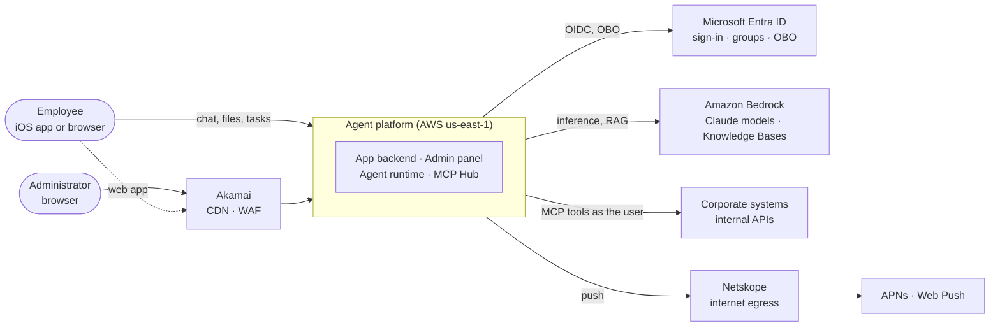
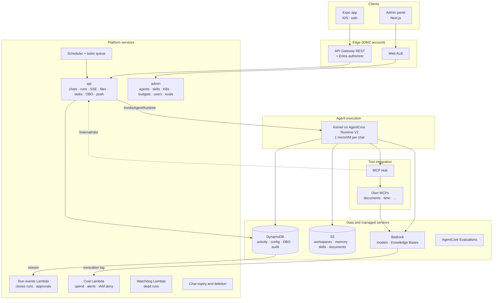
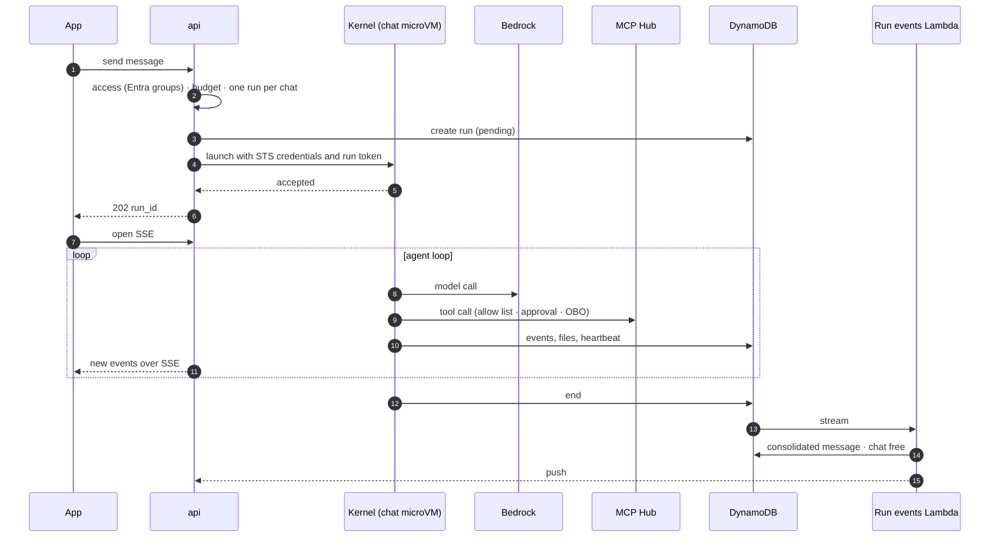
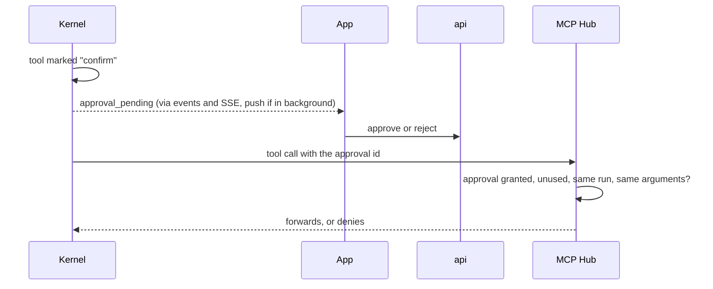
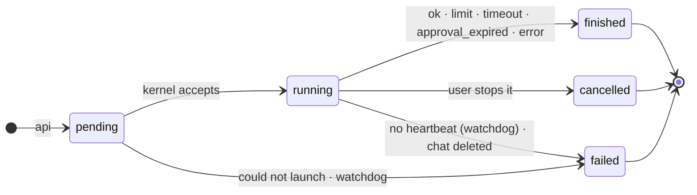
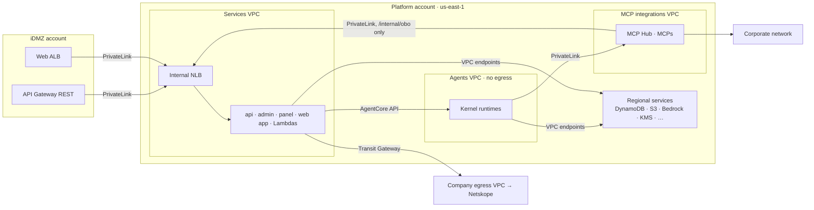
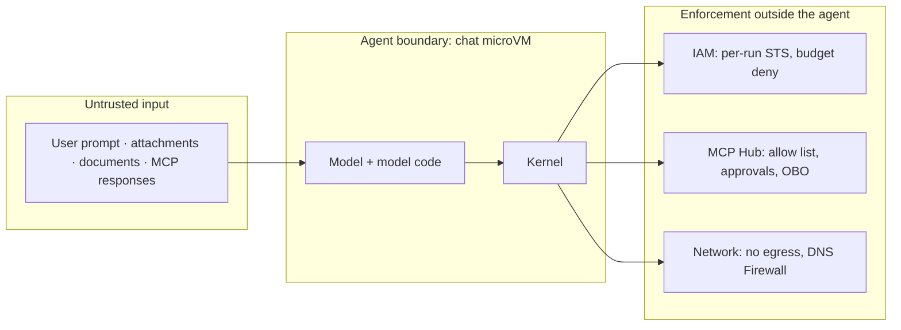
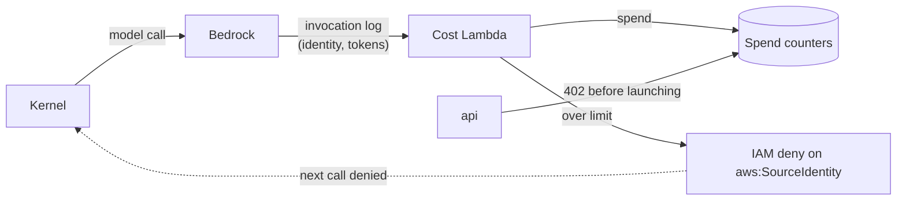

# Agent platform: high-level design

*HLD · Expo (iOS and web) + REST · AWS us-east-1*

This document describes the architecture of the agent platform: its context, the components and their responsibilities, the main flows, the data, the network and security model, and the decisions and risks behind them. How each piece is built (keys, IAM statements, Strands hooks, API routes, probes) is in the detailed design, [arquitectura-agentes.md](arquitectura-agentes.md), which this document summarises and does not replace.

## Contents

1. [Purpose and scope](#1-purpose-and-scope)
2. [Context](#2-context)
3. [Requirements](#3-requirements)
4. [Architecture principles](#4-architecture-principles)
5. [Architecture decisions](#5-architecture-decisions)
6. [Logical view: components](#6-logical-view-components)
7. [Main flows](#7-main-flows)
8. [Data view](#8-data-view)
9. [Deployment and network view](#9-deployment-and-network-view)
10. [Security view](#10-security-view)
11. [Quality attributes](#11-quality-attributes)
12. [Risks, assumptions and open decisions](#12-risks-assumptions-and-open-decisions)
13. [Glossary](#13-glossary)

---

## 1. Purpose and scope

The platform gives the company's employees AI agents they use from one app, on iOS and on the web. Administrators define and govern the agents from a panel. Each agent is configuration: a Bedrock model, instructions, skills, allowed MCP tools and knowledge bases. A single runtime (the kernel) runs all of them.

**In scope**

- The user app (chat, files, scheduled tasks, memory, cost) and the admin panel.
- The backend services, the agent runtime, the MCP Hub and the platform's own MCPs.
- Identity, authorisation, per-user cost control, audit, observability and data retention.
- The AWS accounts, VPCs and connectivity to Entra ID, the corporate network and the internet egress.
- Build, deployment and the test environment.

**Out of scope**

- The internal systems the MCPs call (they are reached as they are, through the corporate network).
- The content of agents and skills (it is managed from the panel, not designed here).
- Implementation detail: see the [detailed design](arquitectura-agentes.md).

## 2. Context

| Actor or system | Role |
|---|---|
| Employee | Chats with the agents their Entra groups allow, attaches files, schedules tasks, rates answers. |
| Administrator | Publishes agents and skills, manages knowledge bases, models, budgets, users and evaluations. Three Entra roles: platform, budgets, content access. |
| Microsoft Entra ID | Identity provider: sign-in, MFA, conditional access, groups, and OBO tokens for MCPs that act as the user. |
| Amazon Bedrock | Models (Claude, through inference profiles) and Knowledge Bases for RAG. |
| Corporate systems | Internal APIs that MCPs call, reached only from the MCP integrations VPC. |
| Akamai | CDN and WAF in front of the panel and the web app. The app's API does not go through it. |
| Netskope | The only internet egress (Entra, APNs, Web Push). |
| APNs, Web Push | Notifications when a run ends or waits for an approval. |

## 3. Requirements

### Functional

- A user chats with an agent and sees its progress live: text, tool cards, files and approvals.
- A user can leave and come back: the run continues and the app catches up on reconnecting.
- Files in (attachments) and out (generated documents), per chat.
- Scheduled tasks run an agent as the user, without the user present.
- Sensitive tools require the user's explicit confirmation.
- A long-term memory per user that the user can see, edit and turn off.
- Administrators version agents and skills, test and evaluate a version before publishing it, and roll back in one step.
- Per-user monthly budgets with group defaults and exceptions, warnings at 80 % and a cut-off at 100 %.

### Non-functional

| Attribute | Target |
|---|---|
| Isolation | One user's agent cannot reach another user's data, the backend, the internet or the corporate network. |
| Least privilege | The agent never holds the user's Entra token. Its credentials are per run and limited to that user, chat and agent version. |
| Cost control | The cut-off does not depend on the agent's code. A user overspends by at most a few responses. |
| Availability | No single-zone failure affects production. A backend restart loses no progress. |
| Scale | 500 concurrent users and peaks of 300 scheduled tasks at once within default quotas. |
| Latency | Sending a message returns in 1–2 s (the kernel accepts and continues in the background). A new microVM starts in about 2 s (Runtime V2). |
| Auditability | Every denied action, approval, OBO failure and budget cut-off is recorded, with who, what and the trace. |
| Traceability | One trace per message across app, backend, agent, hub and MCPs. |
| Retention | Chats live 12 months from the last activity. Deleting a chat deletes its files and conversation. |
| Operability | Everything in code (CDK), one monorepo, zero-downtime deployments and rollback. |

## 4. Architecture principles

1. **Agents are configuration, not code.** One kernel runs every agent from its published, immutable version.
2. **The agent never holds the user's token.** Each run gets its own short-lived STS credentials and a signed run token. Anything that acts as the user goes through the MCP Hub, which applies OBO.
3. **The agents are closed in.** The agents VPC has no egress and no routes. Only the MCP Hub reaches the corporate network.
4. **Controls that matter live outside the agent.** The tool allow list, approvals and the budget cut-off are enforced by the hub and IAM, not by the kernel. What the kernel enforces improves behaviour; it is not security.
5. **Stateless services, state in managed stores.** The backend can restart at any time; the kernel writes its progress straight to DynamoDB.
6. **One path for each thing.** One launcher for chats and tasks, one door for tools, one function that closes a run, one function that deletes a chat.
7. **Idempotent, conditional writes.** Every state change is conditional on the previous state, so retries and races do no harm.
8. **Fail closed.** When the hub, OBO or a check cannot decide, the action is denied and audited.

## 5. Architecture decisions

| # | Decision | Alternatives discarded | Why |
|---|---|---|---|
| D1 | Own kernel (Python, Strands) on **AgentCore Runtime V2**, VPC mode | AgentCore Gateway, Identity and interceptor; LiteLLM | One path and one security logic in our code; V2 starts a microVM in about 2 s from a snapshot. |
| D2 | **One microVM per chat**, one run at a time | One microVM per message | Warm chats reuse the agent in memory; a chat's data never shares a microVM with another chat. |
| D3 | **Direct inference** to Bedrock with per-run STS credentials | A model proxy | No extra hop; IAM limits each run to its version's models. |
| D4 | **Cost from the Bedrock invocation log**, cut-off by an **IAM deny** on the user | The kernel reporting and enforcing its own spend | Bedrock writes the log and STS signs the identity: the kernel cannot forge it or skip the cut-off. |
| D5 | **Own MCP Hub** as the single door for MCP tools | AgentCore Gateway; MCPs called directly | One network path from the agents VPC; allow list, approvals, OBO and audit in one place, also for external MCPs. |
| D6 | **OBO only in the backend**; the hub requests tokens per call | The hub or the kernel holding user tokens | Only one service has the Entra secret and the token store. |
| D7 | **Launch inside `api`** for chats and tasks (tasks via Scheduler and a standard SQS queue) | A FIFO queue plus a launcher Lambda | Fewer moving parts; the kernel accepts immediately, so the request waits 1–2 s. |
| D8 | **Kernel writes events to DynamoDB**; `api` streams them over SSE | Events sent through a backend endpoint | No network path from agents to backend; progress survives backend restarts. |
| D9 | **Conversation and memory as files in S3** | AgentCore Memory | Full tool results kept for the model, simple deletion with the chat, memory the user controls. |
| D10 | **Model code runs in the chat's microVM** with a sandbox | AgentCore Code Interpreter | The microVM is already the boundary (one user, one chat, no egress); no file copying between microVMs. |
| D11 | **Subagents only as tools**, from a predefined catalogue plus the agent's own | A `Graph` flow declared per version; subagents that keep their context | The main model orchestrates; empty context per call keeps them predictable and cheap. |
| D12 | **No web browsing or web search** | AgentCore Browser, managed Web Search | Agents do not reach the internet; outside data comes as documents or through a specific MCP. |
| D13 | **Two backend services**: `api` (app) and `admin` (panel) | One service | Two security surfaces; `admin` is not on the public API. |
| D14 | **Four DynamoDB tables** (activity, configuration, OBO, audit) | One table | Permissions per table, different loads, configuration restorable on its own, OBO without backups. |
| D15 | **TypeScript** for everything but the agent, **Python** for the kernel; a JSON Schema contract; **CDK**; one monorepo | Several repos and IaC tools | Shared types end to end; a contract change breaks the build, not production. |

## 6. Logical view: components

The detailed diagram, with accounts, VPCs and numbered steps, is [arquitectura-agentes.svg](arquitectura-agentes.svg). The view below groups the components by responsibility.

| Component | Responsibility | Technology |
|---|---|---|
| **Expo app** | Chat UI with live streaming, files, tasks, memory, cost and push. A local cache on iOS. | Expo (iOS and web), assistant-ui |
| **Admin panel** | Interface only; every action goes to `admin`. | Next.js, shadcn/ui |
| **API Gateway + authorizer** | Single public entry for the app: JWT validation, WAF, response streaming for SSE. | API Gateway REST, Lambda |
| **`api`** | Checks access and budget, creates and launches runs, streams events over SSE, serves files, schedules tasks, stores and renews OBO tokens, sends push. | TypeScript, Fastify, Fargate |
| **`admin`** | Writes agent versions, skills, models and prices, limits, users; launches ingestion and evaluations; reads audit. | TypeScript, Fastify, Fargate |
| **Kernel** | Builds the agent from its version and runs the loop: model calls, tools through the hub, skills, sandboxed code, context management, events and files. | Python, Strands, AgentCore Runtime V2 |
| **MCP Hub** | Single door for MCP tools: verifies the run token, applies the allow list and approvals, obtains OBO, audits, fails closed. | TypeScript, Fargate |
| **Own MCPs** | `mcp-documents` (RAG with mandatory filters), `mcp-time` (end-to-end test of OBO) and future ones. | TypeScript, Fargate |
| **Run events Lambda** | On the `end` event, closes the run (consolidated message, frees the chat, push). Copies approvals and memory proposals for the user. | Lambda on DynamoDB Streams |
| **Cost Lambda** | Adds up spend per user, chat and run from the Bedrock invocation log; 80/100 % alerts; adds the IAM deny. | Lambda on CloudWatch Logs |
| **Watchdog Lambda** | Every minute fails runs without heartbeat and closes runs left unclosed. | Lambda on EventBridge |
| **Chat expiry and deletion** | Expires chats after 12 months idle; physically deletes a chat (microVM, S3, DynamoDB). | Lambdas, SQS |
| **Scheduler + tasks queue** | One schedule per task; the trigger lands in a queue that `api` consumes. | EventBridge Scheduler, SQS |
| **DynamoDB** | Activity, configuration, OBO tokens and audit, in four tables. | DynamoDB on-demand |
| **S3** | Chat workspaces (files and agent conversation), user memory, skill versions, RAG documents. | S3 |
| **Bedrock** | Claude models through inference profiles; Knowledge Bases for RAG. | Bedrock |
| **AgentCore Evaluations** | Online scoring of real sessions and batch scoring before publishing a version. | AgentCore |

## 7. Main flows

### 7.1 A chat message

1. The app signs in with Entra and sends the message to the API Gateway, which validates the token.
2. `api` checks that the user may use the agent and has budget, and that the chat has no run in progress.
3. `api` creates the run, issues per-run STS credentials and a signed run token, and invokes the chat's microVM. A warm chat reuses its agent; a cold one starts from the Runtime V2 snapshot and rebuilds the conversation from S3.
4. The kernel runs the agent loop: models in Bedrock, tools through the hub, skills and code in the microVM.
5. The kernel writes every event to DynamoDB; `api` streams them to the app. The app can drop and reconnect without losing anything.
6. On `end`, the run events Lambda turns the run into chat history, frees the chat and asks `api` for a push if the app is in the background.

### 7.2 A scheduled task

EventBridge Scheduler drops the trigger into a queue that `api` consumes. `api` checks the task is active, the user still has access and budget, and launches the run exactly like a chat message, in the task's own chat. Tools that act as the user get OBO tokens renewed from the stored refresh token, so the user does not need to be present. If Entra rejects the renewal, or the task keeps failing, the task pauses and the user is notified.

### 7.3 A sensitive action

The run waits up to 10 minutes. The real control is in the hub: without a matching, unused approval it denies the call, so even a compromised kernel cannot skip it. An expired approval ends the run with `approval_expired`.

### 7.4 Run lifecycle

Every terminal state writes one `end` event, and every `end` is closed by one shared function. The watchdog is the safety net: a microVM that dies stops sending heartbeats, and within about 3 minutes the run is failed, the microVM stopped and the chat freed. A run lasts at most one hour, the life of its credentials; the kernel stops at 55 minutes.

## 8. Data view

| Store | Holds | Written by | Retention |
|---|---|---|---|
| DynamoDB · **activity** | Chats and consolidated messages, runs and their events, run controls (cancel, approvals, memory proposals), tasks, users, spend | `api`, kernel (only its own run), hub (approvals), Lambdas | Events 48 h; runs 90 days; chats 12 months from last activity; spend 13 months |
| DynamoDB · **configuration** | Agents and versions, skills, model catalogue and prices, limits, deny list | `admin`; deny list also cost Lambda and watchdog | No expiry; restorable on its own with PITR |
| DynamoDB · **OBO** | Users' Entra tokens, encrypted | Only `api` | 90 days; no backups by design |
| DynamoDB · **audit** | Agent and panel incidents | Each piece under its own prefix; never the kernel | 12 months |
| S3 · **workspaces** | Per chat: input, work and output files, and the agent conversation | Kernel (its chat), app (uploads via presigned URL) | As long as the chat |
| S3 · **memory** | One text file per user, shared by all their agents | Only `api`, on user confirmation | No expiry; deleted when the user is deactivated |
| S3 · **skills, documents** | Immutable skill versions; RAG documents and their metadata | `admin` | Configuration |
| CloudWatch | Logs, traces, Bedrock invocation log (metadata only) | All | 90 days |

Two copies of each conversation exist, each for its reader: the **model's** (Strands snapshot in S3, trimmed by the context manager) and the **user's** (consolidated messages in DynamoDB). Both are deleted with the chat. All stores are encrypted with the platform's own KMS keys.

## 9. Deployment and network view

| VPC | Contains | Egress | Reached by |
|---|---|---|---|
| **Services** | `api`, `admin`, panel, web app, internal NLB, Lambdas | Only the company egress VPC (Netskope): Entra, APNs, Web Push | iDMZ over PrivateLink; the hub, only for `/internal/obo` |
| **Agents** | Kernel runtimes only | None | Nobody over the network; `api` uses the AgentCore API |
| **MCP integrations** | MCP Hub, own MCPs | Corporate network (Transit Gateway, Direct Connect or VPN) | The kernel over PrivateLink |

- No IGW or NAT in any VPC, and no routes between them; every AWS service through VPC endpoints with restrictive policies.
- **Route 53 DNS Firewall** on every VPC, with a strict allow list in the agents VPC, to close data exfiltration over DNS.
- Production: two accounts (iDMZ and platform), Fargate in two zones, two tasks of `api` and of the hub.
- Test: a single account and zone, NAT instead of Netskope, no Akamai, scheduled shutdowns and a spending cap (see the detailed design).

## 10. Security view

### Identities and credentials

| Credential | Held by | Scope | Lifetime |
|---|---|---|---|
| User's Entra token | App, `api` | The platform API | 1 h, renewed by the app |
| Session STS credentials | Kernel (per run) | The version's models; that chat's files and conversation; that user's memory (read); that run's records | 1 h, not renewed |
| Run token (KMS-signed) | Kernel → hub, `api` | User, groups, agent, version, allow list, knowledge bases | 1 h |
| OBO token | `api` stores; hub caches per call | One MCP's audience, as the user | Access 1 h; refresh up to 90 days idle |
| Runtime execution role | Kernel microVM | Pull the image, write logs and traces. Nothing else | Managed by AgentCore |
| Service roles | `api`, `admin`, hub, each Lambda | Only what each one writes (see the detailed design) | Task or function |

### Trust boundaries and defences

- **Prompt injection is assumed.** The model and its code are treated as untrusted inside the microVM; what they can reach is bounded by IAM, the hub and the network, not by the prompt.
- **Per-run, per-chat credentials.** Session tags put the user, chat and run into the IAM policy, so a run can touch only its own chat.
- **The kernel cannot write audit, approvals or its own controls**, and has no Entra secret, no OBO tokens, no Graph and no internet.
- **Sensitive tools need a human.** The hub checks a one-time approval bound to the run and the exact arguments.
- **Knowledge Bases are filtered by agent and group** inside `mcp-documents`, because IAM cannot enforce metadata filters.
- **Access to the agents is by Entra group only**, checked on every message, not only in the catalogue.
- **Panel actions are role-based and audited**, including every opening of a user's conversation.

### Cost control

Bedrock measures, `api` refuses new runs over the limit, and IAM cuts off runs in progress. The kernel only turns the deny into a clean `limit` ending. The accepted overrun is a few responses (about 10–20 s from crossing the limit to the deny taking effect).

## 11. Quality attributes

| Attribute | How the architecture achieves it |
|---|---|
| **Availability** | Stateless services in two zones; the kernel does not depend on the backend; SSE reconnects to any replica from DynamoDB; the watchdog frees chats whose microVM died. |
| **Resilience** | Every component fails in a contained way: the hub fails closed, an MCP only fails its tools, quota errors retry with backoff and return 503 for the app to resend. See "What happens when each piece fails" in the detailed design. |
| **Scalability** | One microVM per chat within AgentCore quotas (5,000 sessions, 25 new per second); DynamoDB on-demand; services scale by CPU and open connections; alarms at 70 % of every quota. |
| **Performance** | Warm chats reuse the agent in memory; cold start about 2 s on V2; SSE polls DynamoDB every 300 ms while events flow. |
| **Cost** | Per-user budgets enforced by IAM; tokens costed from the invocation log; runtime and evaluations shown as platform cost; the test environment shuts down nights and weekends. |
| **Observability** | W3C trace context from the app through `api`, the kernel, the hub and the MCPs; business ids (run, chat, agent, version) on every span; JSON logs linked to traces; a support code per message. |
| **Quality of answers** | AgentCore Evaluations online on a sample of real sessions and in batch before each publication; user ratings feed the test sets. |
| **Maintainability** | One monorepo, a JSON Schema contract that generates TypeScript and Python types, CDK for every resource, versioned agents and skills with one-step rollback. |
| **Deployability** | New kernel images go to a test endpoint first; services roll out progressively; the API is versioned and old clients get a 426 to update. |

## 12. Risks, assumptions and open decisions

Most of the design has been checked on paper, locally or with probes against AWS (see "Verified before building" in the detailed design). These items remain open.

| Item | Type | Impact if it goes wrong | How it is settled |
|---|---|---|---|
| OBO refresh token lifetime under the company's conditional access | Risk (blocks scheduled tasks) | Tasks that act as the user pause more often than expected | A test task with OBO run at 24 h and 7 days without the user |
| MCP Hub load distribution across zones | Risk (blocks) | One hub task takes all the traffic | Enable cross-zone on the NLB and measure |
| Inference data residency (`us.` vs `global.` profiles) | Decision | `global.` is about 10 % cheaper but may process outside the US | Company decision; enforced with an SCP if geographic |
| RAG store and group filtering (S3 Vectors vs OpenSearch) | Decision | Group lists may not fit the metadata filters | Same question set on both stores |
| Real quotas in the production account | Assumption | Fewer sessions or tokens per minute than planned | Service Quotas; request increases before the pilot |
| Runtime V2 price and snapshot billing | Assumption | Higher run cost | The test invoice |
| How `api` authenticates internal routes beyond the network | Open | A misconfigured security group would expose `/internal/*` | Decide ports and authentication on the internal NLB |
| Cost of a stream cut off halfway | Risk | Spend under-reported for cancelled responses | Compare the invocation log with the invoice |

## 13. Glossary

| Term | Meaning |
|---|---|
| **Run** | One turn of the agent, from the message (or task trigger) to the `end` event. One hour at most. |
| **Kernel** | The platform's own agent runtime (Python, Strands) on AgentCore Runtime V2; one kernel runs every agent. |
| **Agent version** | Model, instructions, tools, skills, subagents, knowledge bases, code mode, memory and confirmations. Immutable once published. |
| **Skill** | Versioned instructions and scripts; its scripts become typed tools when the agent activates it. |
| **Subagent** | Another agent inside the same kernel, exposed to the main agent as a tool, starting with an empty context on each call. |
| **Run token** | A KMS-signed token that tells the hub and `api` which run is calling and what it may use. |
| **OBO** | On-behalf-of: an Entra token with which an MCP acts as the user. |
| **Allow list** | The hub tools an agent version may use, enforced by the hub. |
| **Consolidated message** | What the user sees of a finished run in the chat history. |
| **iDMZ** | The edge AWS account, the only one reachable from outside. |

---

*Summary of [arquitectura-agentes.md](arquitectura-agentes.md). When the two disagree, the detailed design wins and this document must be updated.*
